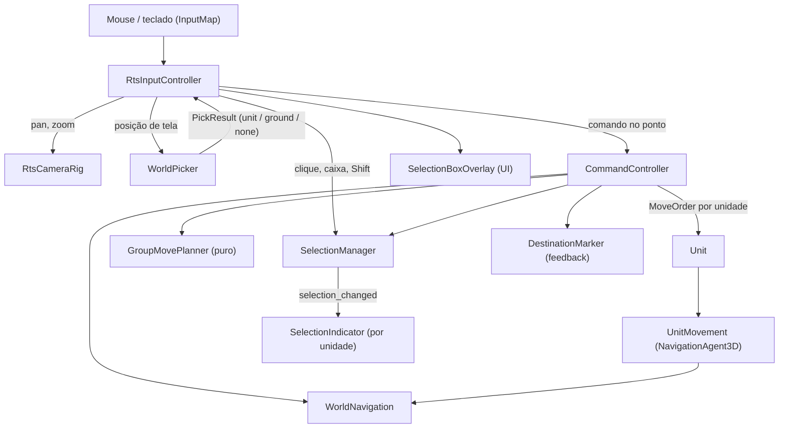
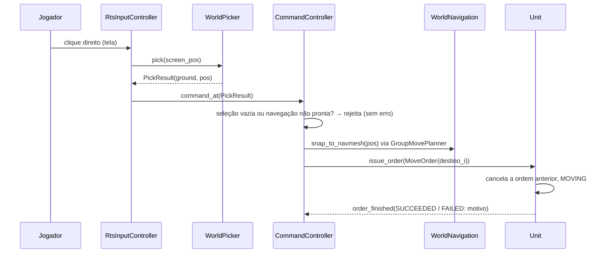

# Dawn of Kin — Implementation Plan da T1 (Fundação RTS)

> [!IMPORTANT]
> **Status: Aprovado e consolidado para a T1.0 (Aguardando autorização explícita para início da execução).**  
> Todas as decisões **D1–D8** foram definidas e aprovadas pelo usuário. Todos os resultados de inspeção técnica, testes de ambiente e medições de desempenho realizados foram preservados integralmente. Nenhum código de jogo foi criado prematuramente.

---

## 1. Resultados da inspeção (verificados, com evidência)

| Item | Resultado | Como verifiquei |
|---|---|---|
| Workspace atual | `c:\Users\alexa\OneDrive\Área de Trabalho\Dawn of Kin` — **Vazio** (nenhum arquivo, nenhum projeto Godot, nenhum repositório Git) | `Get-ChildItem -Force -Recurse` |
| Godot | **4.7.2.stable.official (ed1daf0bf)** em `Downloads\Godot_v4.7.2-stable_win64.exe\Godot_v4.7.2-stable_win64.exe`. **Não está no PATH.** Sem o `_console.exe`. Export templates 4.7.2 instalados | `--version`, busca no disco |
| Git | 2.55.0 + Git LFS 3.7.1. **`user.name`/`user.email` globais não configurados** | `git --version`, `git config --global` |
| Python | 3.13.15 (disponível no sistema, não necessário para o runtime) | `python --version` |
| SO / CPU / RAM | Windows 11 Pro 10.0.26300 · i7-8650U (4C/8T) · 15,9 GB | CIM / Win32 API |
| GPU usada pela Godot | **Intel UHD Graphics 620** (= hardware de referência do GDD) | Log oficial da Godot |
| GPU discreta | GTX 1060 com **status `Error`** no Gerenciador de Dispositivos; o Vulkan só enxerga 1 dispositivo (`--gpu-index 1` → "out of range (0-0)") | `Get-PnpDevice`, log da Godot |
| Tela | Física 3240×2160, escala 200 %. **A Godot reporta `screen_scale=1.0` e `dpi=192`** no Windows | Sonda em execução |
| Pasta original | Dentro do OneDrive (Área de Trabalho redirecionada por KFM, *reparse point*). Processo OneDrive **não estava rodando** na inspeção | Atributos + registro do Windows |
| Caminho com acentos | Importação e execução funcionam num caminho com "Á", "ç" e "ã" (o texto embaralhado no log é só a codificação do console) | Sonda em `scratch\Área de Teste ção\` |

### 1.1 Capacidades de validação comprovadas

| Capacidade | Resultado |
|---|---|
| Importação headless (`--headless --import`) | ✅ exit 0, ~14 s na primeira importação |
| Verificação de script (`--check-only --script`) | ✅ exit 0 com script válido; **exit 1** com erros de tipo e de chamada inexistente (teste negativo comprovado) |
| Execução em janela + captura de tela pelo próprio jogo | ✅ PNG salvo e **inspecionado visualmente pelo agente** |
| Evento de mouse sintético (`Input.parse_input_event`) chegando em `_unhandled_input` | ✅ Confirmado por sonda de input |
| Bake de navmesh em runtime e consulta de caminho **em headless** | ✅ Caminho contorna a parede (17,3 m contra 10 m em linha reta); ponto-alvo fora do mapa é aproximado à borda |
| Flags úteis da CLI 4.7.2 | `--fixed-fps`, `--quit-after`, `--disable-vsync`, `--time-scale`, `--debug-navigation`, `--write-movie`, `--log-file` |

### 1.2 Achados técnicos relevantes para o design

1. **A sincronização do mapa de navegação é assíncrona no 4.7** (`navigation/world/region_use_async_iterations=true` e `map_use_async_iterations=true`). Após atribuir a navmesh, o mapa levou **6 frames de física** para conter a região. Antes disso, `map_get_path` devolve caminho vazio. A causa raiz foi investigada e isolada: ordens emitidas cedo demais falhariam em silêncio. → Implementado **portão de "navegação pronta"** (`WorldNavigation.navigation_ready`).
2. A navmesh assada fica **~0,3 m acima** do chão (arredondamento de `cell_height=0,25`). → O movimento de navegação atua estritamente no plano XZ; a coordenada vertical é mantida pela gravidade e colisão física com o terreno.
3. `agent_radius` que não é múltiplo de `cell_size` gera o aviso "ceiled to cell_size" (reproduzido com 0,4/0,25). → Adotados raios múltiplos de `cell_size`, eliminando avisos e discrepâncias entre o corpo físico e a malha de navegação.
4. Num projeto criado à mão, `physics/3d/physics_engine` fica `DEFAULT`. → O motor é fixado explicitamente em `project.godot` como `Jolt Physics` (padrão de novos projetos desde a 4.6).
5. Com `screen_scale=1.0` e DPI 192, limiares em pixels (arraste, margem de tela) devem ser escalados por **DPI/96**, e não por `screen_get_scale()`.

### 1.3 Desempenho medido (Intel UHD 620, VSync desligado, cena: plano + 2 cápsulas + 1 luz com sombra)

| Renderizador / driver | 1280×720 | 1920×1080 |
|---|---|---|
| Forward+ / Vulkan | 80–91 fps | **52,6 fps** |
| Forward+ / D3D12 | 114 fps | não medido |
| Mobile / Vulkan | 103–112 fps | 88,5 fps |
| Mobile / D3D12 | 217 fps | não medido |
| Compatibility / OpenGL 3.3 | **282 fps** | **151,5 fps** |

> [!WARNING]
> Cada configuração rodou uma vez, numa cena de referência leve, sem controle de throttling térmico ou perfil de energia do notebook. Os números indicam a **sobrecarga de base (overhead)** de cada renderizador no hardware de referência, não a taxa final do jogo completo. O driver Intel antigo (30.0.101.1339, Vulkan 1.2.203) explica a grande vantagem do D3D12 e do OpenGL 3.3 sobre o Vulkan.

---

## 2. Decisões Consolidadas do Projeto (Aprovadas)

| # | Decisão | Opção Escolhida | Justificativa e Regras de Engenharia |
|---|---|---|---|
| **D1** | Renderizador da T1 | **Compatibility** (OpenGL 3.3) | Maior folga de desempenho medida no hardware de referência (151,5 fps a 1080p). Reduz variáveis de driver e tempo de carregamento de shaders no início. O código permanecerá desacoplado e agnóstico de renderizador. **Reavaliação formal:** Um teste comparativo com uma cena ambiental representativa (vegetação, água, vento) será executado antes da etapa T7. |
| **D2** | Projeção da Câmera | **Perspectiva com FOV estreito (~35°)** | Pitch ~55°, Yaw 45°. Equilibra a sensação de profundidade do ambiente naturalista com a precisão geométrica e leitura desimpedida do RTS isométrico. Centralizado no `RtsCameraRig`. |
| **D3** | Seleção Múltipla | **Caixa de seleção (arraste) + Shift+clique** | Padrão clássico e ergonômico de RTS, permitindo selecionar o casal simultaneamente ou alternar indivíduos. Limiar de arraste escalado por DPI (6 px × DPI/96). Enfileiramento de comandos permanece fora da T1. |
| **D4** | Framework de Testes | **Executor mínimo próprio em GDScript** | Runner leve (~150 linhas) sem dependências externas ou riscos de quebra na Godot 4.7.2. Suporta `test_*`, asserções tipadas e `await`. Inclui teste negativo comprovando detecção de falhas. |
| **D5** | Local do Projeto | **Pasta local fora do OneDrive** (`C:\Projetos\Dawn of Kin`) | Elimina travamentos de arquivos, latência de disco e conflitos de sincronização automática sobre as pastas de trabalho `.git/` e `.godot/`. |
| **D6** | Identidade Git dos Commits | **Configuração estritamente local** | O repositório Git será configurado exclusivamente via `git config --local`. Nenhuma identidade fictícia será inventada e a configuração global do usuário não será alterada. |
| **D7** | Rotação de Câmera | **Fora da T1** | Mantém foco no núcleo funcional RTS. O rig de câmera 3D utiliza pivô desacoplado, permitindo acoplar controles de rotação futuros sem refatoração. |
| **D8** | Separação entre Unidades (RVO) | **Pausada para T1.9 (condicional)** | A dispersão de destinos em anel (`GroupMovePlanner` em T1.8) já impede sobreposição final. A necessidade de evasão dinâmica (RVO de `NavigationAgent3D`) será julgada após inspecionar o movimento do casal em grupo. |

**Regras Permanentes de Trabalho Aprovadas:**
- **Padrão de Idioma:** Código-fonte, identificadores, nomes de arquivos, nós e comentários técnicos em **inglês** (convenção padrão Godot/GDScript); documentação de arquitetura, manuais de teste e relatórios de progresso em **português**.
- **Ritmo Incremental:** Pausa obrigatória para revisão e aprovação do usuário **ao final de cada uma das 11 subetapas** (T1.0 a T1.10).
- **Controle de Qualidade:** Código não é considerado concluído sem validação técnica real (script-check, headless test runner, verificação visual via screenshot e protocolo manual do usuário).

---

## 3. Arquitetura proposta

### 3.1 Princípios
- **Cena de composição explícita**: `main.tscn` liga os componentes por referências exportadas. **Nenhum autoload/singleton na T1** e nenhum "event bus" global. As dependências ficam visíveis e os componentes são instanciáveis isoladamente em testes.
- **Entrada separada de intenção**: o controlador de entrada só traduz o mouse em intenções (selecionar, comandar). Seleção, ordens e navegação não conhecem o mouse. O futuro `JobSystem` (IA) emitirá **as mesmas ordens** que o jogador.
- **Ordens como objetos** com ciclo de vida (`start → physics_update → finish/cancel`). A T1 só tem `MoveOrder`, mas a T2 (coletar = mover → trabalhar → transportar) e a fila com Shift encaixam sem refazer o pipeline.
- **Lógica pura onde possível** (seleção, planejamento de destinos, limites da câmera, inclusão em retângulo), testável sem renderização.
- Entrada via `_unhandled_input`, para que a futura HUD consuma cliques antes do mundo.

### 3.2 Componentes e responsabilidades



| Componente | Tipo | Responsabilidade | Não faz |
|---|---|---|---|
| `RtsCameraRig` | `Node3D` + `Camera3D` | Pan (WASD/setas, borda de tela, botão do meio), zoom suavizado, limites do mapa, **delta em tempo real** (imune a `Engine.time_scale`, que no futuro controlará 1×/2×/4×) | Selecionar ou comandar |
| `WorldPicker` | `RefCounted` (utilitário) | Posição de tela → raycast → `PickResult` tipado (`kind`, `unit`, `position`, `normal`) | Decidir o que fazer com o resultado |
| `RtsInputController` | `Node` | Distingue clique de arraste (limiar escalado por DPI), lê Shift/Esc, chama seleção e comando, alimenta o overlay da caixa | Conter regras de seleção ou de movimento |
| `SelectionManager` | `Node` | Conjunto selecionado (substituir, adicionar, alternar, limpar, selecionar na caixa); remove unidades que saem da árvore; emite `selection_changed` | Raycast e entrada |
| `CommandController` | `Node` | Resolve o alvo contextual (T1: chão → mover), valida o comando, distribui destinos, emite ordens, mostra o marcador de destino | Mover unidades diretamente |
| `GroupMovePlanner` | funções estáticas | N unidades + ponto → N destinos espaçados, ajustados à navmesh (a função de ajuste é injetada como `Callable`, o que permite testes sem navegação) | Acessar a árvore de cenas |
| `WorldNavigation` | `Node` na região | Bake em runtime, sinal `navigation_ready`, `snap_to_navmesh()`, ponto de entrada futuro para rebakes (T3) | Mover unidades |
| `Unit` | `CharacterBody3D` (cena) | Identidade (`CharacterDefinition`), estado (`IDLE`/`MOVING`), ordem atual, sinais `state_changed` e `order_finished` | Ler entrada |
| `UnitMovement` | `Node` (componente) | `NavigationAgent3D`, direção no plano XZ, gravidade e chão, rotação suave, detecção de travamento | Decidir para onde ir |
| `UnitOrder` / `MoveOrder` | `RefCounted` | Ciclo de vida da ordem e status `RUNNING`/`SUCCEEDED`/`FAILED` (com motivo) | Guardar nós além da unidade executora |
| `CharacterDefinition` | `Resource` (`.tres`) | ID estável, nome provisório, velocidade, cor ou forma provisória | Lógica |
| `SelectionIndicator` | `Node3D` (por unidade) | Anel de seleção e realce de hover (provisórios) | — |
| `SelectionBoxOverlay` | `Control` (`mouse_filter = IGNORE`) | Desenha o retângulo de seleção | Consumir entrada |
| `DebugOverlay` | `Control` | FPS, tempos de frame, contagem de seleção, estados das unidades, alternância da visualização da navmesh (F3/F4) | — |

### 3.3 Fluxo principal: ordem de movimento



---

## 4. Organização de pastas (por domínio, convenção da Godot)

Local do projeto: `C:\Projetos\Dawn of Kin` (fora do OneDrive, decisão D5).

```
C:\Projetos\Dawn of Kin/
├─ project.godot              # renderer (Compatibility), Jolt explícito, camadas nomeadas, InputMap, janela/DPI, avisos GDScript
├─ AGENTS.md  README.md  .gitignore  .gitattributes
├─ docs/
│  ├─ Dawn_of_Kin_GDD_v1.0.md
│  ├─ architecture/T1_architecture.md      # decisões e justificativas (ADR curto)
│  ├─ testing/T1_manual_test_protocol.md   # roteiro de teste manual do usuário
│  ├─ T1_Implementation_Plan.md           # cópia deste plano consolidado
│  └─ KNOWN_ISSUES.md
├─ src/
│  ├─ core/            collision_layers.gd, input_actions.gd   # constantes nomeadas
│  ├─ camera/          rts_camera_rig.gd/.tscn, camera_math.gd
│  ├─ navigation/      world_navigation.gd
│  ├─ units/           unit.gd/.tscn, unit_movement.gd, character_definition.gd, selection_indicator.gd
│  │  └─ orders/       unit_order.gd, move_order.gd
│  ├─ rts/             rts_input_controller.gd, selection_manager.gd, command_controller.gd,
│  │                   world_picker.gd, pick_result.gd, group_move_planner.gd, destination_marker.gd/.tscn
│  ├─ ui/              selection_box_overlay.gd, debug_overlay.gd/.tscn
│  └─ main/            main.tscn, main.gd (só composição)
├─ levels/test_map/    test_map.tscn            # greybox de testes
├─ data/characters/    leader_a.tres, leader_b.tres
├─ assets/placeholder/ materiais provisórios (nome e pasta deixam claro que são temporários)
├─ tests/
│  ├─ framework/       test_runner.gd, test_case.gd
│  ├─ unit/            test_selection_manager.gd, test_group_move_planner.gd, test_camera_math.gd, ...
│  ├─ integration/     test_navigation.gd, test_unit_movement.gd, test_picking.gd, test_commands.gd
│  ├─ visual/          scenario_*.gd       # roteiros em janela com input sintético + screenshots
│  └─ perf/            perf_capture.tscn/.gd
└─ tools/              godot.ps1 (resolve GODOT_BIN), validate.ps1, run_tests.ps1, run_game.ps1, perf.ps1
```

`.gitignore`: `.godot/`, `test_output/`, `*.tmp`. Os arquivos `*.import` **são versionados** (prática da Godot 4). `.gitattributes`: texto com `eol=lf`, binários marcados.

---

## 5. Estratégias técnicas

### 5.1 Entrada e mouse
- **InputMap** em `project.godot`: `select` (botão esquerdo), `command` (botão direito), `selection_modifier` (Shift), `clear_selection` (Esc), `camera_pan_*` (WASD/setas), `camera_drag` (botão do meio), `camera_zoom_in/out` (roda), `debug_overlay` (F3), `debug_navigation` (F4). Os nomes ficam centralizados em `input_actions.gd`.
- **Clique × arraste**: pressionar inicia um gesto pendente. Se o mouse se mover além do limiar (6 px × DPI/96), vira caixa; senão, ao soltar, é clique.
- **Coordenadas**: tudo em coordenadas de *viewport* (`event.position`), coerente com `camera.project_ray_*` mesmo com stretch. Será testado com escala de 200 %.
- **Janela**: base 1920×1080, `stretch_mode=canvas_items`, `aspect=expand`, `allow_hidpi=true`. A legibilidade em 200 % entra na verificação visual.

### 5.2 Câmera
- Rig = pivô no plano do chão (yaw 45°) → pitch (~55°) → `Camera3D` em perspectiva (FOV ~35°, decisão D2) a uma distância `d`. Zoom altera `d` entre `min/max`, com interpolação suave.
- A velocidade de pan é proporcional ao zoom. O foco é limitado a um `Rect2` do mapa, fornecido pelo nível.
- **Delta real**: medido com `Time.get_ticks_usec()` e limitado a 0,1 s. A câmera continua responsiva em pausa e a 4×.
- Borda de tela só com a janela em foco e o mouse dentro dela, desativável por `@export`.
- Matemática em `camera_math.gd` (funções puras e testáveis).

### 5.3 Seleção e picking
- **Clique: raycast físico** contra a camada `selection` (`Area3D` de picking um pouco maior que o corpo, `collide_with_areas=true`) e, sem acerto, contra `terrain|obstacles`.
  - *Por quê*: generaliza para árvores, construções e recursos da T2/T3, que terão formas variadas. O mesmo `PickResult` alimenta o clique direito contextual.
  - *Alternativa*: picking em espaço de tela (projetar posições). É mais tolerante com unidades pequenas, mas não serve para objetos grandes e irregulares. Fica reservado à caixa.
- **Caixa: espaço de tela.** Uma unidade entra na seleção se `camera.unproject_position(âncora)` cair no retângulo e `!camera.is_position_behind(âncora)`. A lista vem do grupo `selectable_units`.
- **Regras**:
  - clique em unidade → seleção exclusiva
  - Shift+clique → alterna
  - clique no chão → limpa
  - Shift+clique no chão → mantém
  - caixa → substitui; Shift+caixa → adiciona
  - Esc → limpa
- Unidades removidas da árvore saem da seleção automaticamente (robustez para mortes na T6).

### 5.4 Comandos e ordens
- `CommandController.command_at(pick)`:
  - seleção vazia → nenhuma ação
  - `PickResult.NONE` (céu ou fora do mapa) → nenhuma ação
  - navegação não pronta → rejeita e registra no overlay de debug
  - chão ou obstáculo → mover
  - unidade (sem ordem contextual na T1) → mover para o chão sob o cursor (comportamento provisório e documentado)
- `GroupMovePlanner`: posições em anéis concêntricos com espaçamento ≥ 2×raio + folga, cada uma ajustada à navmesh. Descarta candidatos que colapsem sobre outros. Atribui unidades a posições pela menor distância (evita cruzamentos).
- `Unit.issue_order()` sempre **substitui** a ordem atual (a fila é futura). Clicar repetidamente apenas reemite o destino, sem acumular estado.

### 5.5 Navegação e movimento
- **Navmesh: bake em runtime ao carregar o nível**, contra bake no editor salvo como recurso.
  - Runtime nunca fica dessincronizado da geometria quando o mapa de teste muda, e já prepara o caminho que a T3 precisará (rebake ao posicionar construções). O custo no mapa de teste é pequeno e será medido.
- **Portão de prontidão**: `WorldNavigation` emite `navigation_ready` só quando o mapa confirma a região (iteração do mapa avançada e consulta válida), como comprovado na sondagem técnica.
- **Movimento**: a cada frame de física, `agent.get_next_path_position()` → direção XZ × velocidade; gravidade e `move_and_slide()` dão a altura sobre o terreno.
  - Chegada: `is_navigation_finished()` com `target_desired_distance` calibrado.
  - Corpos de unidades **não colidem entre si** (máscara sem a camada `units`); colidem com terreno e obstáculos.
- **Alvo inalcançável** (ex.: interior de um cercado fechado): o agente vai ao ponto alcançável mais próximo e a ordem termina com `FAILED: unreachable` (ou `SUCCEEDED_PARTIAL`, a definir no código), voltando a `IDLE`. Sem oscilação.
- **Detecção de travamento**: se o progresso ficar abaixo de ε por 1,5 s → recalcula o caminho uma vez → se persistir, `FAILED: stuck` e `IDLE`.

---

## 6. Modularidade e testabilidade
- Lógica pura (`SelectionManager`, `GroupMovePlanner`, `camera_math`, inclusão na caixa) testada sem cena.
- Integração headless com física e navegação reais (comprovado viável): instancia o mapa de teste, espera `navigation_ready`, emite ordens, avança frames com `--fixed-fps 60` e verifica chegada, desvio e falhas.
- Picking testado em headless projetando a posição da unidade para a tela e consultando o `WorldPicker`.
- O runner falha o processo (exit ≠ 0) em qualquer falha. Os scripts `tools/*.ps1` também **falham se o log contiver `ERROR`, `SCRIPT ERROR` ou `WARNING`** (nenhum aviso é silenciado).
- GDScript tipado. Avisos `untyped_declaration` e `unsafe_*` ficam em *warn*, e a regra de log zero-WARNING os torna bloqueantes.

---

## 7. Impacto nas etapas futuras

| Etapa futura | Como a T1 prepara (sem implementar) |
|---|---|
| **T2 Trabalhadores e recursos** | `PickResult` ganha o tipo "recurso"; `CommandController` mapeia alvo → ordem (`GatherOrder`, com fases); o `JobSystem` emite as mesmas `UnitOrder`; estados novos se somam ao enum. |
| **T3 Construção** | `WorldNavigation` já faz bake em runtime, e o rebake após posicionar uma obra entra ali. Camadas de colisão reservadas para construções (só documentadas). |
| **T4 Tempo e save** | A câmera usa tempo real e as unidades usam o delta de física escalável. `MoveOrder` é só dados (destino) e serializável. `CharacterDefinition` tem ID estável. |
| **T5+ População grande** | Custo por unidade (agente de navegação, corpo físico, RVO) será **medido** na T1.10 com um teste de estresse informativo. O GDD prevê simulação simplificada para moradores distantes, e manter a identidade e o estado separados do nó facilita isso. Seleção e caixa são O(N) por gesto, aceitável. |
| **T6 Mortes** | `SelectionManager` já trata unidades removidas; ordens falham com segurança se a unidade sair. |

---

## 8. Riscos técnicos e mitigação

| Risco | Prob. | Mitigação / alternativa |
|---|---|---|
| Ordens antes da sincronização da navmesh (comprovado) | Alta | Portão `navigation_ready` + teste dedicado |
| Unidades presas em quinas (raio do corpo ≠ raio da navmesh) | Média | Raio da navmesh ≥ raio do corpo, múltiplo de `cell_size`; detecção de travamento; testes em quinas e vãos |
| Desempenho no UHD 620 e escolha de renderizador | Média | D1 (Compatibility) + medições repetidas por incremento; comparação de renderizadores antes da T7 |
| GPU discreta indisponível (`Error`) | Certa | Desempenho em dGPU **não verificável** aqui; declarado como lacuna |
| Escala 200 % (limiares, legibilidade da UI, coordenadas) | Média | Escala por DPI; verificação visual em tela cheia nativa |
| Conflitos de sincronização do OneDrive | Mitigado | D5: Projeto isolado em `C:\Projetos\Dawn of Kin` |
| Godot fora do PATH, em Downloads | Baixa | `tools/godot.ps1` usa a variável `GODOT_BIN` com fallback para o caminho atual e falha com mensagem clara |
| Engasgos na primeira compilação de shaders | Média | Aquecimento antes de medir; registrar engasgos separadamente |
| Meu conhecimento de APIs da 4.7 desatualizado | Média | Toda API incerta é validada por sonda ou documentação antes de entrar no código (feito para navegação) |
| Input sintético ≠ mouse real | Certa | Roteiros automatizados **mais** protocolo manual executado pelo usuário |

---

## 9. Subetapas incrementais (com checkpoints obrigatórios de aprovação)

> **Regra estrita:** Cada subetapa termina com: validação completa (`tools/validate.ps1`), regressão de toda a suíte, relatório no formato da seção 12, **parada obrigatória para revisão e aprovação do usuário**, e só então o commit local.

### T1.0 — Repositório e esqueleto do projeto
- **Objetivo**: Inicializar o repositório local em `C:\Projetos\Dawn of Kin` (D5), configurado para a engine Godot 4.7.2 com renderizador Compatibility (D1) e Git local (D6).
- **Arquivos**: `project.godot`, `.gitignore`, `.gitattributes`, `AGENTS.md`, `README.md`, `docs/` (GDD copiado + plano consolidado), `src/core/collision_layers.gd`, `src/core/input_actions.gd`, `src/main/main.tscn` (ambiente básico e luz), `tools/godot.ps1`, `tools/validate.ps1`, `tools/run_game.ps1`.
- **Dependências**: D1, D5, D6 aprovadas.
- **Comportamento esperado**: Abre e roda uma cena vazia iluminada em janela.
- **Testes**: Importação headless; validação estática de scripts (`--check-only`); execução em janela por 5 s com captura de tela; `git status` limpo após commit local.
- **Condição de aprovação**: Exit 0 em todas as etapas, zero ERROR/WARNING nos logs, screenshot visualmente coerente, configurações conferidas em `project.godot`.

### T1.1 — Infraestrutura de testes
- **Objetivo**: Executor mínimo de testes em GDScript (D4), sem plugins externos.
- **Arquivos**: `tests/framework/test_runner.gd`, `test_case.gd`, `tests/unit/test_framework_selftest.gd`, `tools/run_tests.ps1`.
- **Dependências**: T1.0 concluída e aprovada.
- **Comportamento esperado**: Descobre e executa suítes de teste `test_*.gd`, suporta asserções e `await`, resume falhas e reporta código de saída adequado para CI/CLI.
- **Testes**: Suíte de auto-teste interno. Injeção de teste que falha propositalmente para comprovar saída com exit ≠ 0.
- **Condição de aprovação**: Exit 0 com testes válidos; falha reproduzida com teste inválido; zero avisos.

### T1.2 — Mapa de testes (greybox) e overlay de debug
- **Objetivo**: Ambiente 3D que exercite geometrias reais de navegação.
- **Conteúdo**: Chão 64×64 m; obstáculos ("rochas" e "árvores" provisórias); parede com vão; cercado fechado (destino inalcançável); rampa e platô elevado; limites do mapa (`Rect2`); iluminação direcional; `DebugOverlay` (exibição de FPS, tempos de frame e nós).
- **Arquivos**: `levels/test_map/test_map.tscn`, `assets/placeholder/*`, `src/ui/debug_overlay.*`, testes de integração do nível.
- **Testes**: Nível carrega sem erros; colisores alocados nas camadas de física corretas (teste automatizado); screenshot.
- **Condição de aprovação**: Elementos visíveis e legíveis na captura; testes de carregamento verdes.

### T1.3 — Câmera RTS
- **Objetivo**: Câmera isométrica em perspectiva com FOV estreito (D2), movimentação fluida e limites rígidos.
- **Arquivos**: `src/camera/*`, `main.tscn`, `tests/unit/test_camera_math.gd`, `tests/integration/test_camera_rig.gd`, `tests/visual/scenario_camera.gd`.
- **Dependências**: T1.2, D2, D7.
- **Testes**:
  - Unitários: cálculo do foco, limites de zoom, velocidade proporcional.
  - Integração: comandos simulados movem o foco sem ultrapassar limites do mapa.
  - Independência de `time_scale` (testado a 0,5× e 4×).
  - Capturas de tela nos níveis de zoom mínimo e máximo.
- **Condição de aprovação**: Testes verdes + screenshots verificados + protocolo manual de conforto validado pelo usuário.

### T1.4 — Navegação do mundo
- **Objetivo**: Geração de navmesh em runtime e portão de prontidão assíncrona.
- **Arquivos**: `src/navigation/world_navigation.gd`, `test_map.tscn`, `tests/integration/test_navigation.gd`.
- **Testes (headless)**:
  - Trajeto contorna a parede passando exclusivamente pelo vão aberto.
  - Ponto no interior do cercado fechado é projetado para a borda navegável externa mais próxima.
  - Platô elevado é acessado via rampa.
  - Consulta antes da prontidão da navmesh é tratada com segurança.
  - Tempo de bake medido e registrado.
- **Condição de aprovação**: Testes verdes; captura com `--debug-navigation` exibindo a malha de navegação íntegra.

### T1.5 — Unidade e movimento (sem entrada do jogador)
- **Objetivo**: Entidade `Unit` executando `MoveOrder` sobre a navmesh.
- **Arquivos**: `src/units/*` (`unit`, `unit_movement`, `character_definition`, `orders/`), `data/characters/leader_a.tres` e `leader_b.tres`, `main.tscn`, testes.
- **Comportamento esperado**: Dois protagonistas com aparências provisórias distintas (cor e forma); estados `IDLE` e `MOVING`; rotação suave na direção do vetor de deslocamento; altura aderente ao terreno.
- **Testes (headless)**:
  - Deslocamento até ≤ 0,5 m do destino dentro do tempo estimado.
  - Desvio de colisor e retorno a `IDLE`.
  - Destino inalcançável resulta em `FAILED` e `IDLE` sem loops.
  - Nova ordem no meio do caminho substitui a anterior sem travar o ator.
- **Condição de aprovação**: Testes automatizados verdes; roteiro visual em janela com trajeto comprovado.

### T1.6 — Picking e seleção por clique
- **Objetivo**: Seleção individual pelo mouse com clique esquerdo.
- **Arquivos**: `src/rts/world_picker.gd`, `pick_result.gd`, `selection_manager.gd`, `rts_input_controller.gd` (clique), `src/units/selection_indicator.gd`, testes.
- **Testes**:
  - Unitários: regras de seleção exclusiva, alternância com Shift, desseleção por clique no chão e tratamento de remoção da árvore.
  - Integração: projeção de coordenada de tela → raycast físico → unidade selecionada.
  - Capturas visuais exibindo anel de seleção e hover.
- **Condição de aprovação**: Testes verdes + verificação visual + itens de clique do protocolo manual validados.

### T1.7 — Seleção por caixa
- **Objetivo**: Seleção múltipla por caixa de arraste e Shift+clique (D3).
- **Arquivos**: `rts_input_controller.gd`, `src/ui/selection_box_overlay.gd`, testes.
- **Testes**:
  - Unitários: algoritmo de intersecção em espaço de tela (inclusive retângulos invertidos).
  - Limiar de transição entre clique e arraste calibrado por DPI.
  - Arraste sintético seleciona os dois personagens simultaneamente; Shift adiciona à seleção.
  - Captura de tela com a caixa desenhada sobre o viewport.
- **Condição de aprovação**: Testes verdes + validação interativa manual.

### T1.8 — Comando de movimento por clique direito
- **Objetivo**: Emissão de ordens de movimento para unidades selecionadas via clique direito contextual.
- **Arquivos**: `src/rts/command_controller.gd`, `group_move_planner.gd`, `destination_marker.*`, `rts_input_controller.gd`, testes.
- **Testes**:
  - Unitários do planejador de grupo: geração de N posições adjacentes sem sobreposição final.
  - Teste sintético ponta a ponta: casal selecionado → clique direito → ambos se deslocam e concluem a ordem em destinos próprios.
  - Robustez diante de comandos inválidos: clique no céu, fora dos limites, no interior de obstáculo estático, 20 cliques sucessivos por segundo.
- **Condição de aprovação**: Testes verdes; ausência total de travamentos ou erros em cliques espúrios; protocolo manual de ordens aprovado.

### T1.9 — (Condicional, D8) Separação entre unidades
- **Objetivo**: Avaliar e, se necessário, implementar desvio dinâmico (RVO) entre personagens durante o deslocamento.
- **Critério de acionamento**: Se a inspeção da subetapa T1.8 apontar colisões ou cruzamentos visualmente degradados entre os dois protagonistas.

### T1.10 — Desempenho, documentação e encerramento da T1
- **Objetivo**: Validação final de desempenho no hardware de referência, consolidação da documentação técnica e fechamento formal da T1.
- **Arquivos**: `tests/perf/*`, `tools/perf.ps1`, `docs/architecture/T1_architecture.md`, `docs/testing/T1_manual_test_protocol.md`, `docs/KNOWN_ISSUES.md`, `README.md`.
- **Testes**:
  - Protocolo de desempenho: 5 s de aquecimento + 30 s de gravação contínua com ordens ativas.
  - Medição de FPS médio e percentis de tempo de quadro (p50, p95, p99, máx) a 1280×720, 1920×1080 e nativo.
  - Teste de estresse informativo com população elevada em cena isolada.
  - Execução integral do protocolo de teste manual pelo usuário.
- **Condição de aprovação**: Todos os critérios de aceitação AC-01 a AC-16 plenamente satisfeitos → criação da tag Git `t1-complete`.

---

## 10. Plano de testes

1. **Importação e execução**: `--headless --import` (exit 0, log sem ERROR/WARNING); execução em janela por 60 s sem erros no `--log-file`.
2. **Erros de scripts e recursos**: carregamento de todos os `.gd`/`.tscn`/`.tres` por script de validação; `--check-only` como verificação complementar.
3. **Funcionais RTS (automatizados)**: testes unitários de lógica pura + integração headless com física e navegação reais.
4. **Comandos inválidos**: disparos fora da malha navegável, seleções vazias, cliques rápidos repetidos, alvos obstruídos.
5. **Regressão contínua**: execução da suíte completa de testes ao final de cada subetapa; nenhum teste é atenuado ou removido.
6. **Desempenho**:
   - 5 s de aquecimento + 30 s de cena com câmera percorrendo o mapa e ordens repetidas.
   - Métricas: FPS médio, frame time p50/p95/p99/máx, draw calls, objetos, memória.
   - Resoluções 1280×720, 1920×1080 e tela cheia nativa 3240×2160.
   - 3 execuções consecutivas (mediana); registro do perfil de energia.
   - **Orçamento de desempenho da T1**: p95 ≤ 16,7 ms em 1920×1080 no hardware Intel UHD 620 e nenhum frame > 100 ms pós-aquecimento.
7. **Verificação visual**: roteiros em janela com input sintético que salvam capturas em `test_output/` (ignorado pelo Git), inspecionadas diretamente antes de cada entrega.
8. **Verificação interativa (protocolo manual)**: roteiro com passos precisos a ser executado pelo usuário no ambiente real para validar a sensação de controle, ergonomia do mouse e legibilidade.

> [!CAUTION]
> Testes automatizados ou headless não substituem a validação de manuseio e visualização no hardware real. **Nenhum incremento será considerado aprovado sem a validação do protocolo manual pelo usuário.**

---

## 11. Critérios de aceitação da T1

| ID | Critério | Verificação |
|---|---|---|
| AC-01 | Importação headless com exit 0 e zero ERROR/WARNING | Automática |
| AC-02 | Toda a suíte passa; runner comprovadamente falha com teste que falha | Automática |
| AC-03 | Cena principal roda 60 s em janela sem erros no log | Automática + visual |
| AC-04 | Câmera: pan (teclas, botão do meio, borda), zoom entre limites, nunca sai do mapa, velocidade independente de FPS e de `time_scale` | Auto + visual + manual |
| AC-05 | Dois personagens distinguíveis por cor **e** forma em todos os níveis de zoom | Visual + manual |
| AC-06 | Clique seleciona um; clique no outro troca; Shift alterna; caixa seleciona ambos; clique no chão ou Esc limpa | Auto + manual |
| AC-07 | Feedback: anel de seleção, realce de hover, retângulo da caixa, marcador de destino | Visual + manual |
| AC-08 | Clique direito move todos os selecionados; cada um chega a ≤ 0,5 m do seu destino; distância final entre unidades ≥ 2×raio | Auto + visual |
| AC-09 | Caminhos contornam obstáculos (passam pelo vão; nunca atravessam colisores) | Auto + visual |
| AC-10 | Alvo inalcançável → ponto alcançável mais próximo, `IDLE` em ≤ 10 s, sem oscilação | Auto |
| AC-11 | Comandos inválidos e spam de cliques não geram erros, travamentos nem estado inconsistente | Auto + manual |
| AC-12 | Platô alcançável pela rampa; unidade acompanha o terreno (desvio vertical ≤ 0,1 m) | Auto + visual |
| AC-13 | Orçamento de desempenho da seção 10.6 atingido e medido em 3 resoluções | Medição |
| AC-14 | Arquitetura conforme a seção 3: sem "god script", GDScript tipado, sem autoloads ou plugins não aprovados | Revisão de código |
| AC-15 | README (executar e testar), documento de arquitetura e KNOWN_ISSUES atualizados; tag `t1-complete` | Revisão |
| AC-16 | Protocolo manual executado e aprovado pelo usuário | Manual |

---

## 12. Formato do relatório por subetapa
Ao final de cada subetapa, o relatório apresentará estritamente:
1. O que foi implementado.
2. Arquivos criados ou alterados (com `git diff --stat`).
3. Testes executados (comandos exatos) e resultados obtidos.
4. Comportamentos efetivamente verificados (declarando status: *implementado*, *testado automaticamente*, *testado visualmente*, *testado manualmente*, *não verificado* ou *bloqueado*).
5. Problemas, limitações e lacunas de verificação.
6. Próxima subetapa recomendada.

## 13. Fora de escopo da T1
Coleta de recursos, estoque compartilhado, construção, inventário, fila de ordens com Shift, IA e tarefas automáticas, ciclo familiar/reprodução, calendário e envelhecimento, ciclo dia/noite, clima dinâmico, combate e arsenal, salvamento/carregamento (save/load), transição de regiões, HUD de jogo completa, arte final, áudio e rotação de câmera.
