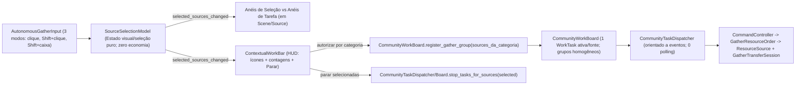

# Dawn of Kin — R-03A D0: Reconciliação Documental e Plano Técnico da Nova Experiência de Trabalho Comunitário

**Status na Taxonomia Obrigatória (em 24/11/2026):**
- **`R-03A D0`:** `RECONCILIAÇÃO DOCUMENTAL CONCLUÍDA` (somente documentação/planejamento; zero alterações executáveis)
- **`R-03A D1`–`D4`:** `PLANEJADO` (`D1 NÃO AUTORIZADA`)
- **`R-03A` (geral):** `NÃO HOMOLOGADO` / `NÃO INTEGRADO À DEVELOP`
- **`R-03B`–`T3.9` e `T4`–`T8`:** `BLOQUEADO`

**Candidata ancestral de referência (preservada intacta):** `f77e99e7ea2404120baafe7a16ca47e94236d922` (`origin/feat/r-03a-community-work-main-scene`)  
**Base homologada (`develop`, intacta):** `21c34ee645725a74f1fefac9db0309ec711ab5f2`  
**Linha estável (`main`, intacta):** `25e0a20f1d6a2f10a9e059afe69759fbe263db4a`  
**Worktree candidato:** `C:\Projetos\Dawn_of_Kin_wt_r_03a`  
**Engine / Stack:** Godot `4.7.2.stable.official.ed1daf0bf`, GDScript tipado estrito, `gl_compatibility`, `Jolt Physics`, Intel UHD Graphics 620 (`1280×720` e `1920×1080`)

---

## 1. Contexto da Reprovação Humana e Escopo da D0

### 1.1 Resultado real da `R-03A R1.1` (`f77e99e`) vs Testes Humanos (`M1`–`M8`)
A candidata `R-03A R1.1` obteve aceite técnico independente do ChatGPT sobre os resultados automatizados anteriores (`86/86` suítes, `620/620` testes, `29.756` asserções, `209` scripts validados sem erros/avisos e `28/28` testes / `772` asserções em `test_r_03a_community_work_main_scene.gd`). Contudo, esses resultados testavam o contrato anterior e **não validam a nova experiência aprovada**.

Nos testes humanos na `MainScene`, o proprietário registrou:
- **`M3` (Reprovado por inadequação da experiência de seleção):** clicar em uma árvore/pedra/arbusto disparava trabalho imediato em vez de apenas selecionar, e a caixa de seleção de fontes exigia começar sobre uma fonte.
- **`M4` (Reprovado por inadequação da experiência de seleção):** a caixa por origem de fonte conflitava com a expectativa de `Shift + arraste` a partir de qualquer ponto válido para somar fontes heterogêneas e arraste livre sem `Shift` para seleção RTS de habitantes.
- **`M5` (Pendente com revisão de design solicitada):** necessidade de cancelamento direto (individual e coletivo) nas fontes selecionadas pela HUD e separação entre corte progressivo e extração de madeira somente após a derrubada da árvore.
- **`M1`, `M2`, `M6`, `M7`, `M8`:** Pendentes (aguardam a nova experiência completa em `D4`).

**Classificação obrigatória:** `M3` e `M4` **não** são defeitos técnicos de programação da R1.1; são reprovações legítimas de experiência que motivaram a revisão de contrato aprovada pelo proprietário no plano incremental **`D0`–`D4`**.

---

## 2. Reconciliação de Contratos (`Substituídos` × `Aprovados` × `Preservados`)

### 2.1 Contratos Substituídos (da R-03A R1.1 / RUX-2B original)
1. **Clique simples em fonte cria tarefa e despacha trabalhador imediatamente** → Substituído por **seleção sem mutação de trabalho/economia**.
2. **Arraste sem `Shift` iniciado sobre fonte cria seleção de fontes por origem (`_drag_started_on_source`)** → Substituído por **arraste sem `Shift` = sempre seleção RTS tradicional de habitantes**, e **`Shift + arraste` = adição de fontes elegíveis a partir de qualquer ponto válido da área jogável**.
3. **Seleção restrita a um único tipo de recurso por vez (rejeição mista no `Shift+Clique`)** → Substituído por **seleção visual mista/heterogênea simultânea** de árvores, pedras e arbustos, mantendo grupos internos homogêneos por categoria apenas no momento da autorização pela HUD.
4. **Cancelamento comunitário ausente na HUD contextual (dependência exclusiva futura da lista `D-11` em `R-03D`)** → Antecipada ação contextual mínima **`Parar`** na barra contextual das fontes selecionadas (preservando `D-11` flutuante completa em `R-03D`).
5. **Primeira extração de madeira em árvore em pé dispara corte/extração e só então inicia tween de queda (`ResourceSource.extract` / `transfer_to_carry_load*`)** → Substituído por **corte progressivo sem madeira antes da queda**, confirmação irreversível de **derrubada**, e recolhimento físico apenas a partir da árvore **derrubada**.

### 2.2 Novos Contratos Aprovados (para `D1`–`D4`)
- **Fluxo em 3 momentos independentes:** `(1) Seleção de fontes` → `(2) Autorização explícita pela HUD` → `(3) Distribuição/execução automática`.
- **Invariante de seleção:** selecionar/desmarcar fontes jamais cria/cancela tarefas no `CommunityWorkBoard`, jamais movimenta unidades, jamais altera estoques, mochilas, reservas, progresso de corte ou quantidades da fonte.
- **Independência seleção × autorização:** desmarcar fonte não cancela tarefa ativa; selecionar fonte já autorizada não duplica tarefa; autorizar trabalho não limpa a seleção atual.
- **Cancelamento individual e coletivo:** parar trabalho via HUD encerra definitivamente somente as tarefas ativas das fontes atualmente selecionadas, bloqueia novas extrações naquela autorização, libera slots, preserva materiais já extraídos (`FREE_GATHERED`), preserva ordens pessoais e nunca reativa tarefas canceladas por callback tardio.
- **Corte progressivo de árvores (`WOOD`):** zero madeira extraída e zero lote `FREE_GATHERED` criado antes da derrubada; cancelamento antes da derrubada recupera 100% da árvore em pé e do progresso de corte; após confirmação da derrubada, a árvore permanece derrubada com saldo finito conservado no local para recolhimento e transporte físico respeitando a capacidade da mochila.

### 2.3 Contratos Históricos Integralmente Preservados (`§9`)
- **`P-REC-1` a `P-REC-4`:** fluxo antigo de construção (`D2`/`D3`/`DEC-11B`) mantido em transição segura até `R-04C`; nova construção `D-01`/`D-02` segue em `R-04A`–`R-04C`; cadeia linear na `develop` preservada.
- **Decisões de Produto e Economia:** `D-01`, `D-02`, `D-04`, `D-05`, `D-06`, `D-10`, `D-13`; autoridade econômica regional única (`ReservedWithdrawalCoordinator.RegionalAuthority`), capacidade e proveniência (`UnitCarryLoad` + `CarryProvenanceLedger`), entrega física seletiva no acampamento (`DeliverToCampOrder` + `SelectiveCampDeliveryCoordinator`), conservação de reservas, prioridade soberana de ordens pessoais, regras etárias/população (`DEC-01`–`DEC-04`), identidade visual **D2.2** (Cláusula Pétrea), `D-ERR-1 B` (`use_d2_2_hud = false` mantido na `MainScene` até `R-05B`), `D-ERR-2 C`, `AGENTS.md` e `R-02B` encerrada.
- **`D-03` e `D-11`:** `D-03` preserva a distribuição automática comunitária + futura atribuição manual opcional (`R-03C`) sobre o novo contrato de autorização explícita pela HUD; `D-11` preserva a futura lista flutuante de tarefas em `R-03D` distinta do comando contextual mínimo `[Parar]` desta `R-03A`.
- **Garantias técnicas `F01`, `F02`, `T01`–`T04` e `R01`:** `TestMap.get_all_region_resource_sources()` (`14` fontes no `PlacementValidator` e `DiscoverabilityBadge`), `TestMap.get_resource_sources()` (`6` fontes históricas preservadas), captura limpa de gesto sem fallback silencioso para seleção de unidades, lifecycle/teardown `_torn_down`, bloqueio atômico em falha de admissão econômica, e limitação `R01` (fontes externas sem `meta("region_id")` no mesmo `World3D`) documentada para arquitetura multi-região na **T4** (sem resolver T4 aqui).

---

## 3. Especificação de Controles e Captura Determinística de Gestos (`D1`)

| Entrada | Comportamento Especificado | Condições / Isolamento |
|---|---|---|
| **Clique esquerdo em fonte disponível** | Alterna seleção individual: se não selecionada → **seleciona apenas esta fonte** (limpa outras fontes selecionadas); se já selecionada (única ou parte de seleção) → **desmarca** (ou ver nota abaixo sobre clique único vs grupo) | Requer `!_is_placement_active()`, pick em `ResourceSource` suportada (`wood`/`stone`/`food`) dentro de `board.is_source_in_region_domain(src)`. Emite `construction_site_picked.emit(null)`. Nunca mexe em `SelectionManager` (habitantes) nem cria `WorkTask`. |
| **Clique esquerdo novamente na fonte selecionada** | Desmarca a fonte da seleção (sem cancelar eventual tarefa já autorizada) | Quando era a única selecionada, a seleção fica vazia e a barra contextual da HUD oculta-se. Quando havia múltiplas selecionadas, clique sem `Shift` em fonte *não* selecionada substitui pela clicada; clique sem `Shift` em fonte *já* selecionada desmarca-a (ver §12.1 — detalhe de ergonomia para clique único sem Shift em seleção múltipla). |
| **`Shift + clique esquerdo` em fonte** | **Toggle aditivo:** se fonte já está selecionada → remove somente ela; se não está selecionada → adiciona à seleção preservando fontes de qualquer categoria (`wood`/`stone`/`food`) já selecionadas | Preserva seleção RTS atual ou mantém fronteira sem misturar habitantes dentro de `SourceSelectionModel`. |
| **`Shift + arraste` (caixa)** | **Adiciona** todas as fontes elegíveis do domínio regional (`wood`/`stone`/`food`) abrangidas pelo retângulo projetado (`SelectionBoxMath`), iniciando em **qualquer ponto válido** da área jogável (chão livre, fonte, entorno de unidade) | Nunca exige clique prévio em fonte; **preserva** fontes já selecionadas anteriormente; **não** alterna/desmarca fontes já selecionadas dentro do retângulo; **não** altera fontes fora da caixa; **não** seleciona nem mistura habitantes (`SelectionManager` intocado). |
| **Arraste sem `Shift` (caixa)** | Seleção RTS tradicional de habitantes (`SelectionManager`) em `super._handle_box_selection()` | Sempre seleciona habitantes (mesmo que o cursor comece visualmente sobre uma árvore/pedra/arbusto), sem alterar `SourceSelectionModel`. |
| **Botão contextual da HUD (`[Machado N]`, `[Picareta N]`, `[Colheita N]`)** | Autoriza trabalho comunitário **somente** para as fontes selecionadas da respectiva categoria (`wood` / `stone` / `food`) | Consome input via `MOUSE_FILTER_STOP`; mantém `SourceSelectionModel` intacto após autorização; idempotente sobre fontes já autorizadas. |
| **Botão contextual `[Parar]` da HUD** | Cancela definitivamente tarefas comunitárias ativas em **todas** as fontes selecionadas (de todas as categorias) | Visível/habilitado apenas quando `selected_with_active_task_count > 0`; não afeta fontes fora da seleção nem cancela a seleção visual se não solicitado (ver §6). |
| **`Esc`** | Prioridade determinística: (1) se `PlacementController.is_placement_active()` → cancela colocação; (2) se gesto de arraste ativo (`_left_pressed` ou `_is_drag_gesture`) → cancela gesto em curso sem alterar seleções; (3) se `SourceSelectionModel` não vazio e/ou `SelectionManager` não vazio → limpa seleção sem cancelar tarefas ativas | Nunca fecha `WorkTask` ativa no `CommunityWorkBoard`. |
| **Clique direito / ordens pessoais / bloqueio de UI** | Totalmente preservados (`CommandController`, prioridade de construção, `AutonomousGatherInput` bloqueado sobre `Control` com `MOUSE_FILTER_STOP`) | Sem alterações ao clique direito RTS em chão ou unidade. |

### 3.1 Captura da Intenção do Gesto e Blindagem contra Regressão F02
1. **Registo no `mouse_down` (`_on_left_press_started`):**
   - Registrar `_press_shift_held: bool = _is_shift_held(event)` e zerar flags transitórias de arraste.
   - Armazenar `_drag_mode`: `NONE` → definido ao cruzar `get_drag_threshold_px()` ou já no `mouse_down`:
     - Se `Shift` ativo → `_drag_mode = SOURCE_BOX_ADD` (retângulo visual com cor/borda sutil distinta, ex. tom dourado/verde mineral, indicando seleção de fontes).
     - Se `Shift` inativo → `_drag_mode = UNIT_BOX_RTS` (retângulo RTS padrão de habitantes).
2. **Mudança de `Shift` durante o arraste:**
   - Uma vez ultrapassado `get_drag_threshold_px()`, o gesto mantém o modo travado em `_drag_mode` durante aquele arraste (sem alternar abruptamente de caixa de fontes para caixa de habitantes a meio caminho se o jogador soltar `Shift` 1 frame antes do botão do mouse!).
   - Se `Shift` for pressionado ou solto **antes** de ultrapassar `get_drag_threshold_px()`, o modo segue o estado de `Shift` ao cruzar o limiar (ou no release de clique simples, o `shift_held` do `InputEventMouseButton` de soltura).
   - **Garantia anti-F02:** Um arraste em modo `SOURCE_BOX_ADD` **jamais** chama `super._handle_box_selection()` nem altera `SelectionManager`, mesmo que todas as fontes sob o retângulo tenham sido esgotadas, removidas (`tree_exited`), ou estejam sob economia bloqueada (`_is_community_economy_blocked()`).
3. **Cancelamento / perda de foco / fontes removidas durante o gesto:**
   - `Esc`, `NOTIFICATION_WM_WINDOW_FOCUS_OUT` ou `NOTIFICATION_WM_MOUSE_EXIT` chamam `_cancel_active_drag()`, limpando `_drag_mode` e o `SelectionBoxOverlay` sem executar seleção.
   - Fontes que saem da árvore ou esgotam durante o arraste são filtradas no momento de coleta (`is_instance_valid`, `is_inside_tree`, `not is_queued_for_deletion`, `not is_depleted`, `is_available`, `_board.is_source_in_region_domain`).

---

## 4. Arquitetura da Seleção, Autorização e Estados (`D1`)



### 4.1 Os Quatro Estados Formais da Fonte
Cada `ResourceSource` jogável pode estar em exatamente um dos 4 quadrantes:

| Estado | Em `SourceSelectionModel`? | `WorkTask` ativa no `CommunityWorkBoard`? | Destaque Visual no Mapa | Efeito de Ações |
|---|---|---|---|---|
| **1. Fonte disponível** | Não | Não | Apenas `DiscoverabilityBadge` padrão (se ativo) | Clique → seleciona; `Shift+arraste` → adiciona à seleção. |
| **2. Fonte selecionada** | Sim | Não | Anel de **seleção** discreto (dourado/marfim claro) | Contabilizada no botão da categoria na HUD; `Autorizar` cria `WorkTask`; `Parar` ignora. |
| **3. Trabalho autorizado** | Não | Sim (`PENDING`/`IN_PROGRESS`) | Anel de **trabalho ativo** (`AutoGatherTaskRing_*` verde/azul/âmbar por recurso) | `CommunityTaskDispatcher` aloca trabalhadores; não aparece na contagem selecionada; `Parar` fora da seleção não a afeta. |
| **4. Selecionada e autorizada** | Sim | Sim (`PENDING`/`IN_PROGRESS`) | Ambos os indicadores visíveis e distinguíveis (ex.: anel interno de trabalho + aro externo fino de seleção, sem poluição) | Contabilizada na HUD (com indicação de já autorizada se todas da categoria estiverem ativas); `Autorizar` é idempotente; `Parar` cancela sua `WorkTask`. |

### 4.2 Separação Estrutural (`SourceSelectionModel`)
- **`SourceSelectionModel` (novo script leve `RefCounted` em `src/rts/source_selection_model.gd`, ou gerido por `AutonomousGatherInput`):**
  - Mantém `_selected_by_id: Dictionary` (`source_instance_id -> weakref(ResourceSource)`) + ordem determinística de inserção.
  - Conecta apenas `tree_exited` e `depleted` da fonte selecionada para auto-remoção limpa (sem polling `_process` nem `_physics_process`).
  - Expõe consultas puras: `get_selected_sources()`, `get_selected_by_resource(resource_id)`, `get_counts_by_resource()`, `is_selected(source)`, e métodos de mutação pura: `select_single(src)`, `toggle_source(src)`, `add_sources(arr)`, `clear()`.
  - Emite `selection_changed()`.
  - **Zero dependência econômica** e zero referência a `Unit`, `UnitCarryLoad`, `SettlementInventory`, `GroundPileManager` ou `WorkTask`.
- **Autorização pela HUD (sem alterar autoridade do `CommunityWorkBoard`):**
  - Ao clicar no botão da categoria `res_id` (`&"wood"`, `&"stone"`, `&"food"`):
    1. Checa `_is_community_economy_blocked()` (se bloqueada, exibe `"Economia regional bloqueada: trabalho comunitário indisponível."`).
    2. Coleta `var candidates: Array[ResourceSource] = selection_model.get_selected_by_resource(res_id)`.
    3. Filtra apenas `source` sem `WorkTask` ativa (`board.get_active_task_for_source(src) == null`) — **ou** delega a `board.register_gather_group(candidates)` que já é idempotente e separa `created_tasks` de `existing_tasks`!
    4. Registra **somente** essa categoria em `CommunityWorkBoard`, **preservando integralmente** a seleção atual (`wood` + `stone` + `food`) e preservando tarefas já existentes das outras categorias!
    5. Se todas as fontes daquela categoria já possuírem `WorkTask` ativa (`created_tasks.is_empty()` e `not existing_tasks.is_empty()`): operação 100% idempotente (`0` duplicações, `0` ordens duplicadas).
    6. Se alguma tarefa estiver em `BLOCKED_REAUTHORIZATION` (caso `A17` de todos os trabalhadores excluídos manualmente): a decisão de reautorização explícita pela HUD pode reabrir ou seguir feedback honesto conforme critério §12.1.

---

## 5. HUD Contextual Mínima e Consistência Visual (`D1`)

### 5.1 Referências Visuais Reais Inspecionadas
1. **HUD legada (`use_d2_2_hud = false`, ativa na `MainScene` até `R-05B`):**
   - [`src/ui/hud_style.gd`](../../src/ui/hud_style.gd): `PANEL_BG_COLOR = Color(0.11, 0.12, 0.10, 0.85)`, `PANEL_BORDER_COLOR = Color(0.40, 0.36, 0.28, 0.90)`, `TEXT_PRIMARY_COLOR = Color(0.94, 0.91, 0.83, 1.0)`, cores semânticas `WOOD_COLOR`, `STONE_COLOR`, `FOOD_COLOR`, `StyleBoxFlat` chanfrado leve (`corner_radius = 5`, borda `1 px`), zero glow/neon.
   - [`src/ui/resource_hud.tscn`](../../src/ui/resource_hud.tscn): `SettlementStockpilePanel` no canto superior direito (`x: [w-332 .. w-16]`, `y: 16..~88`), `SelectedUnitPanel` no canto inferior esquerdo (`x: [16 .. 332]`, `y: [h-135 .. h-16]`).
   - [`src/buildings/placement_test_overlay.gd`](../../src/buildings/placement_test_overlay.gd): `TemporaryPlacementBar` no canto inferior direito (`x: [w-476 .. w-16]`, `y: [h-152 .. h-16]`, `460×136 px`), banner de colocação no topo central (`y: 16..72`, oculto em ocioso).
   - [`src/ui/building_inspector_panel.gd`](../../src/ui/building_inspector_panel.gd): painel de obra/recuperações no canto superior esquerdo (`x: 16`, `w: 350`, oculto em ocioso).
   - [`src/ui/autonomous_gather_feedback.gd`](../../src/ui/autonomous_gather_feedback.gd): banner transitório topo central (`y: 14`, auto-hide `3.0 s`, `MOUSE_FILTER_IGNORE`).
2. **Design System Mestre D2.2 (`Marcos de Pedra e Eclipse`):**
   - [`DAWN_OF_KIN_VISUAL_DESIGN_SYSTEM.md`](../design/DAWN_OF_KIN_VISUAL_DESIGN_SYSTEM.md) §§2, 3, 6, 8, 10 (Cláusula Pétrea) + [`src/ui/d2/d2_tokens.gd`](../../src/ui/d2/d2_tokens.gd) + [`assets/ui/d2/atlas_manifest.json`](../../assets/ui/d2/atlas_manifest.json) + inspeção direta de [`assets/ui/d2/d2_2_faithful_atlas.png`](../../assets/ui/d2/d2_2_faithful_atlas.png):
     - Basalto `#141618`, ouro kintsugi `#DFBC72` / `#F5D996`, marfim `#F4EFE4`, alerta terracota `#C66A58` / `#F2B8AC`.
     - Ícones existentes no atlas (`48×48` em traço dourado/mineral limpo): `ico_wood` (troncos estilizados), `ico_stone` (pedra), `ico_food` (fruto), `ico_tasks` (seta), `ico_lineage` (elo). **Nota objetiva:** ícones específicos de **Machado**, **Picareta**, **Colheita** e **Parar** **ainda não existem** no atlas `d2_2_faithful_atlas.png` e precisarão de decisão simples de criação em estilo 100% compatível com o traço D2.2 (ou reutilização/complemento aprovado antes de D1 — ver §11).

### 5.2 Especificação Visual, Conteúdo e Posicionamento Livre (`1280×720` e `1920×1080`)
- **Componente:** `CommunitySelectionActionsHud` (nó `Control` de pass-through sob `UiLayer`, `set_process(false)`, `set_physics_process(false)`), atualizado **exclusivamente por sinais** (`SourceSelectionModel.selection_changed`, `CommunityWorkBoard.task_registered` / `task_updated` / `task_closed`).
- **Aparência mínima aprovada (zero cartões grandes, zero textos longos, zero brilho/glow):**
  - Contêiner horizontal compacto centralizado no **centro inferior** (`anchor_left=0.5, anchor_right=0.5, anchor_top=1.0, anchor_bottom=1.0`, `offset_bottom = -16`), altura `~44–48 px`, largura dinâmica compacta (`~88–320 px` conforme categorias presentes).
  - **Análise geométrica anti-sobreposição:**
    - Em **`1280×720` (`use_d2_2_hud = false`):** canto inferior esquerdo ocupa `x ∈ [16..332]`; canto inferior direito (`TemporaryPlacementBar`) ocupa `x ∈ [804..1264]`. Sobra o vão livre central **`x ∈ [332..804]` (`472 px`)**. Uma barra de até `~320 px` centralizada em `640 px` ocupa `[480..800]`, mantendo **folga mínima ≥ 148 px à esquerda** (exceto ao centro de `1280×720`: `[480..800]` é apenas `4 px` antes de `804`; portanto, deslocar o centro ou limitar largura máxima compacta ≤ `280 px`, `[500..780]`, garante **≥ 24 px de margem até `TemporaryPlacementBar` em `720p`**!).
    - Em **`1920×1080` (`use_d2_2_hud = false`):** vão livre é **`[332..1444]` (`1.112 px`)**, com folga lateral de centenas de pixels.
    - **Compatibilidade futura D2.2 (`R-05B`, `use_d2_2_hud = true`):** em `1080p`, as estelas ficam em `x ∈ [20..264]` (`lineage_blade` até `488` quando aberta) e as lajes à direita iniciam em `x = 1572` (`D2ConstructionDockView` aberta ocupa até `1338`), deixando o centro inferior `[510..1310]` livre também em `1080p` (com encapsulamento visual atrás de view dedicada para adoção da materialidade basalto/ouro na transição `R-05B`).
- **Botões exibidos (apenas categorias com `count > 0` na seleção):**
  - Árvores (`wood > 0`): `[Ícone Machado] N`
  - Pedras (`stone > 0`): `[Ícone Picareta] N`
  - Arbustos (`food > 0`): `[Ícone Colheita] N`
  - Parada (`active_tasks_in_selection > 0`): `[Ícone Parar]` (ou `[Ícone Parar M]`) discreto separado por divisor fino vertical `1 px`, acento terracota suave (`#C66A58` / `#F2B8AC`), exibido somente quando houver trabalho ativo em ao menos 1 fonte selecionada.
- **Indicação visual de estados sem poluir:**
  - *Pendente (0 ou parte autorizadas):* borda sutil padrão, clicável para autorizar apenas as pendentes (`N` = total de fontes selecionadas na categoria).
  - *Parcialmente autorizada (`0 < ativas < N`):* ícone/borda com filete dourado discreto + clicável (autoriza as faltantes sem duplicar as ativas).
  - *Totalmente autorizada (`ativas == N`):* fundo suavemente elevado/marcado em ouro suave `#DFBC72` com opacidade baixa (clicar novamente continua idempotente, sem erro nem nova tarefa).
  - *Bloqueada por economia:* estado desabilitado honesto (`disabled = true` / opacidade reduzida `#B8B2A5`).
- **Anti-click-through:** áreas vazias do `Control` raiz usam `MOUSE_FILTER_IGNORE`; apenas o fundo compacto do painel/botões visíveis usa `MOUSE_FILTER_STOP` + `focus_mode = Control.FOCUS_NONE`.

---

## 6. Cancelamento Individual e Coletivo (`D2`)

### 6.1 Distinção dos 6 Fluxos de Encerramento
1. **Desmarcação de fonte (Seleção):** altera apenas `SourceSelectionModel`. Zero chamada em `CommunityWorkBoard`, `CommunityTaskDispatcher` ou `Unit`.
2. **Cancelamento definitivo comunitário (`Parar` pela HUD):** cancela apenas as `WorkTask` ativas correspondentes às fontes presentes em `SourceSelectionModel` (individual = 1 selecionada; coletivo = N selecionadas). Fontes não selecionadas permanecem intactas.
3. **Interrupção de ordem individual do trabalhador:** um `unit.cancel_current_order()` interno fora do botão `Parar` mantém o fluxo existente em `CommunityTaskDispatcher._handle_assigned_order_finished()` (retorna tarefa com fonte utilizável para `PENDING_WORKERS` e inclui `uid` em `excluded_unit_ids`).
4. **Substituição por ordem pessoal (`MoveOrder`, etc.):** soberania da Casa Fundadora incrementa `_order_revision`, cancela somente a participação daquele trabalhador, libera seu slot na fonte, devolve tarefa pendente para outro trabalhador livre, e preserva integralmente carga física já na mochila.
5. **Conclusão normal:** `WorkTask.State.COMPLETED` somente quando fonte não é mais utilizável (`remaining == 0`) após entrega física completa (`GatherResourceOrder.is_succeeded()`).
6. **Fonte removida ou inacessível:** `WorkTask.State.FAILED` (`invalid_source`, `source_depleted` ou `source_unreachable`).

### 6.2 Sequência Segura de Encerramento em `Parar` (Anti-Reativação e Preservação Econômica)
Problema identificado no código atual (`community_task_dispatcher.gd` linhas 256–265): se uma ordem for cancelada **antes** de fechar a `WorkTask` no `CommunityWorkBoard`, o sinal `unit.order_finished` dispara sincronamente `_handle_assigned_order_finished()`, que vê a `WorkTask` ainda ativa com fonte usável e a recoloca em `PENDING_WORKERS`!

**Sequência obrigatória em `stop_tasks_for_sources(sources)`:**
1. Coletar snapshot dos pares `(task, assigned_unit, assigned_order)` para cada `source` selecionada que possua `task` ativa no `CommunityWorkBoard`. (Se `task` já estiver fechada ou `source` sem tarefa → no-op).
2. **Passo 1 — Fechamento definitivo no Board primeiro:**
   Para cada `task` coletada, chamar `_board.close_task(task, WorkTask.State.CANCELLED, "player_cancelled_community_work")` (remove de `_active_by_source_id`, desconecta sinais de fonte, limpa `task.clear_assignment()`, emite `task_closed`).
   *Invariante:* Qualquer sinal `order_finished` subsequente ou callback tardio não encontra mais `task` em `_board.get_active_tasks()`, **impedindo qualquer retorno a `PENDING_WORKERS` ou reatribuição**.
3. **Passo 2 — Tratamento seguro dos trabalhadores vinculados (`assigned_unit` / `assigned_order`):**
   Verificar se `is_instance_valid(unit)` e `unit.get_current_order() == assigned_order` e `assigned_order.is_active()`:
   - **Caso A — Ordem em `DELIVERING_TO_CAMP` (transporte físico já iniciado):** **não abortar nem perder entrega**; desvincular apenas da tarefa fechada (ou deixar a subordem `DeliverToCampOrder` concluir naturalmente até o acampamento, pois `GatherResourceOrder` após entrega verificará que não há nova tarefa/ou ao cancelar a ordem após fechamento do board o trabalhador que já tem carga física pode ser redirecionado via `DeliverToCampOrder` seletivo ou finalizar sua viagem atual sem nunca reextrair da fonte!). *Detalhe explícito para D2:* se `order._phase == Phase.DELIVERING_TO_CAMP`, permitir que termine apenas a entrega atual sem retornar à fonte (ex.: flag `stop_after_delivery = true` em `GatherResourceOrder`), ou se estava em `APPROACHING_SOURCE`/`GATHERING`:
   - **Caso B — Ordem em `APPROACHING_SOURCE` ou `GATHERING`:**
     - Se **transação econômica está executando no instante** (`assigned_order.is_provenance_transfer_executing()`): marcar flag de encerramento pós-commit (`cancel_requested_after_tx` / retry em próximo frame sem interromper atomicidade) para nunca violar guardas de `GatherTransferSession`.
     - Se `carry_load` do trabalhador possui carga `FREE_GATHERED` útil acumulada de ciclos anteriores (quando aplicável): preservar carga na mochila intacta e encaminhar entrega física seletiva ou encerrar viagem sem tocar na fonte (nunca descartar carga).
     - Caso contrário (mochila vazia de coleta ou antes da derrubada): chamar `unit.cancel_current_order()`, liberando slot na `ResourceSource` e progresso de corte (em `D3`).
4. **Passo 3 — Se árvore em corte anterior à derrubada (`D3`):** quando `D3` estiver implementada, se nenhum trabalhador restante continuar cortando aquela árvore ainda `CHOPPING`, `ResourceSource` reverte progresso de corte para `STANDING` (`0.0`). Enquanto `D2` precede `D3`, o plano registra explicitamente que a recuperação total de árvores pré-derrubada se completa apenas em `D3`.

---

## 7. Novo Ciclo Progressivo de Corte e Derrubada de Árvores (`D3`)

### 7.1 Diagnóstico do Código Atual (`294b0fe`) e Mapa de Impacto
Atualmente em `src/economy/resource_source.gd`:
- `extract()` (l. 203), `transfer_to_carry_load()` (l. 247) e `transfer_to_carry_load_with_provenance()` (l. 694) **decrementam `_remaining_amount` e adicionam madeira primeiro**, chamando `_trigger_tree_felling_if_needed()` somente **depois** da extração.
- `TreeVisualState` possui apenas `STANDING`, `FELLING`, `FALLEN`, e `is_felling()` retorna `true` apenas enquanto `_remaining_amount > 0` e `_felling_tween` não terminou (`_on_felling_tween_finished`).
- Em `GatherResourceOrder` (`l. 504–660`), `_update_gathering` executa `gather_prepare_duration_sec` (`0.35 s`) + `gather_operation_duration_sec` (`2.5 s`), executa `GatherTransferSession` (`transfer_to_carry_load_with_provenance`) imediatamente, e só então entra em `_awaiting_felling_before_delivery` esperando o tween visual `0.50 s`.

**Caminhos que DEVEM respeitar a pré-condição de derrubada (sem nenhum atalho):**
1. `ResourceSource.can_extract()`
2. `ResourceSource.extract()`
3. `ResourceSource.transfer_to_carry_load()`
4. `ResourceSource.transfer_to_carry_load_with_provenance()`
5. `GatherResourceOrder._update_gathering()` / `GatherTransferSession`
6. Futuras ordens diretas ou manuais que consultem `ResourceSource`

*(Fontes `STONE` e `FOOD` **não** possuem estado de corte/derrubada e mantêm integralmente seu comportamento atual.)*

### 7.2 Máquina de Estados Explícita para Árvores (`Category.WOOD`)

```mermaid
stateDiagram-v2
    [*] --> STANDING: configure() / árvore intacta (remaining == initial_amount)
    STANDING --> CHOPPING: 1º progresso de corte > 0 (0 extração econômica)
    CHOPPING --> STANDING: cancelamento antes da derrubada (0 trabalhadores ativos -> progresso = 0)
    CHOPPING --> FELLING_IN_PROGRESS: chop_progress >= chop_required (COMMIT IRREVERSÍVEL da derrubada)
    FELLING_IN_PROGRESS --> FALLEN: fim determinístico do tempo de queda (nunca volta a STANDING)
    FALLEN --> FALLEN: coleta de toras em ciclos/viagens (provenance FREE_GATHERED, remaining > 0)
    FALLEN --> DEPLETED: remaining atingiu 0 (Stump/DepletedVisual; sem remoção DEC-09 até T4)
```

### 7.3 Regras Invioláveis da Máquina de Estados
1. **Estado econômico vs visual:**
   - Adicionar estado econômico explícito (ex.: `enum TreeHarvestStage { STANDING, CHOPPING, FELLING, FALLEN, DEPLETED }` ou estender contrato em `ResourceSource` sem acoplar estado econômico ao ciclo de vida visual do `Tween`).
   - Enquanto `Category.WOOD` estiver em `STANDING`, `CHOPPING` ou `FELLING`:
     - `is_extractable_wood()` / `can_extract()` retorna **`false`**.
     - `extract()` retorna `0`; `transfer_to_carry_load()` retorna `0`; `transfer_to_carry_load_with_provenance()` falha limpo com `{"ok": false, "reason": "tree_not_felled", "extracted": 0}` **sem consumir `_provenance_receipts` nem alterar `UnitCarryLoad`**.
2. **Ponto exato e irreversível da derrubada:**
   - O corte progride somente enquanto há trabalhador em `GatherResourceOrder` fase `CHOPPING_TREE` (ou `GATHERING` em modo corte) dentro do alcance de trabalho da árvore.
   - No instante em que `_chop_progress_sec >= chop_duration_required_sec`: ocorre o **commit síncrono e irreversível** para `FELLING` (registrando `_felling_committed = true` e `_felling_elapsed_sec = 0.0`), mantendo `_remaining_amount == initial_amount`!
   - A transição `FELLING → FALLEN` é conduzida deterministicamente por avanço de simulação (ou timer/tick vinculado ao pedido/clock da árvore com limite `felling_duration_sec`), **e o `Tween` de `FellingPivot` atua apenas como representação visual**, sincronizada ao mesmo `felling_duration_sec` — **se o `Tween` for interrompido/headless sem renderização, o estado econômico nunca fica preso em `FELLING`**.
   - Caso a árvore seja uma `ResourceSource` "nua" em testes unitários sem nó visual `AvailableVisual/FellingPivot`, a conclusão determinística do tempo de queda (ou `felling_duration_sec` decorrido, ou transição síncrona quando configurado `felling_duration_sec <= 0`/sem nó visual apenas se documentado) garante ausência de travamento sem furar o requisito de derrubada antes da extração!
3. **Cancelamento na fronteira:**
   - **Antes** do commit da derrubada (`STANDING`/`CHOPPING`): ao liberar o último trabalhador ativo sem outro trabalhador cortando a árvore, `_chop_progress_sec = 0.0`, estado volta a `STANDING`, visuals voltam à pose ereta (`_reset_felling_visuals()` sem chamar `configure()`!), `_transaction_revision` e `_provenance_receipts` preservados, `0` madeira criada.
   - **Durante `FELLING` ou após `FALLEN` (`_felling_committed == true`):** o cancelamento **nunca** reverte para `STANDING`; a árvore conclui a queda para `FALLEN` com `_remaining_amount` integralmente preservado no local (`_reset_felling_visuals()` só ocorre em `_exit_tree()` / teardown da cena, nunca em cancelamento de tarefa!).
4. **Concorrência de 2 trabalhadores na mesma árvore:**
   - `max_simultaneous_workers = 2`: ambos podem ocupar slots durante `CHOPPING` (contribuindo conforme regra de balanceamento escolhida), ambos param/esperam sem extrair durante `FELLING`, e assim que `FALLEN` confirma, ambos podem recolher madeira disponível em `FALLEN` respeitando capacidade individual da mochila e `_remaining_amount` via `GatherTransferSession` atômico (zero corrida, zero extração acima de `_remaining_amount`).
5. **Pausa, `teardown`, remoção e ordens pessoais:**
   - `SceneTree.paused` pausa `physics_update` e `Tween` normalmente sem avançar corte; `teardown` / `_exit_tree()` cancela tweens sem vazamento de erros; ordem pessoal interrompe o trabalhador durante `CHOPPING` liberando seu slot (se restar outro trabalhador na árvore, continua o corte; se for o último e ainda em `CHOPPING` com tarefa cancelada definitivamente → restaura `STANDING`; se apenas ordem pessoal trocou e tarefa segue ativa/pendente → decisão documentada na §11: se 0 trabalhadores por interrupção pessoal sem cancelamento definitivo, progresso reseta ao perder último cortador ativo ou congela até retorno, evitando explorar progresso parcial inconsistente — **recomendado:** resetar progresso visual/de corte quando `active_chopper_count == 0` enquanto `CHOPPING`, mantendo simples e consistente entre visualização ereta e estado econômico!).

### 7.4 Invariante Formal de Conservação Econômica
Para toda árvore $t$ de categoria `WOOD` na região ativa durante `D3`:

$$M_{\text{inicial}}(t) = M_{\text{pé}}(t) + M_{\text{derrubada}}(t) + M_{\text{mochilas}}(t) + M_{\text{estoque}}(t) + M_{\text{consumo\_e\_perdas\_legítimas}}(t)$$

Onde:
- $M_{\text{pé}}(t) = \text{initial\_amount}(t)$ enquanto em `STANDING` / `CHOPPING` / `FELLING` (nunca parcialmente extraída).
- $M_{\text{derrubada}}(t) = \text{remaining\_amount}(t)$ quando em `FALLEN` (e $0$ em `DEPLETED`).
- $M_{\text{estoque}}(t)$ = físico de `SettlementInventory` (que **já** contabiliza as pilhas físicas via `GroundPileManager`, evitando dupla contagem!).
- Antes da derrubada: $M_{\text{derrubada}} = M_{\text{mochilas\_dessa\_árvore}} = 0$, logo restaurar corte tem delta econômico zero ($0 = 0$).
- Depois da derrubada: $\Delta M_{\text{derrubada}}(t) = -\Delta M_{\text{mochilas}}(t)$, sem regeneração `T4` nem geração fictícia.

---

## 8. Matriz de Testes Existentes e Novas Coberturas (`D1`–`D4`)

### 8.1 Classificação dos Testes Existentes Pertinentes
1. **Preservar integralmente (contratos históricos não afetados):**
   - Toda a suíte `tests/unit/` de matemática, câmera, seleção, inventário, pilhas, proveniência ledger, reservas, D2.2 (`test_ui_1_*`) e `test_t3_6_1_refund_math.gd`.
   - `test_t3_3_construction_logistics.gd`, `test_t3_6_2_c4_9*`, `test_t3_6_2_c4_10*`, `test_t3_6_2_c4_12*`, `test_t3_6_3_*`, `test_t3_6_4_cancellation_ui.gd`, `test_t3_2_*`, `test_t3_4_*`, `test_t3_5_*`.
   - Em `test_r_03a_community_work_main_scene.gd`: `test_a01` (flags e composição), `test_a05`/`test_a06` (após adaptar entrada para seleção + autorização HUD), `test_a07` (drag no chão sem Shift = RTS), `test_a08`–`test_a16` (após adaptar abertura via seleção + HUD), `test_a18`, `test_a19`, `test_a20`, `test_r1_f01`, `test_r1_t02`, `test_r1_1_t02`, `test_r1_t03`, `test_r1_t04`, `test_r1_1_t04`, `test_r1_r01` e `test_r1_1_r01`.
2. **Adaptar justificadamente ao novo contrato (`D1`/`D2`/`D3`):**
   - `test_r_03a_community_work_main_scene.gd`:
     - `test_a02` (`clique esquerdo` agora seleciona sem criar tarefa; autorização ocorre pela HUD mantendo idempotência ao repetir clique na HUD).
     - `test_a03` (`Shift+clique` agora alterna seleção inclusive com tipos mistos `wood`+`stone`+`food`; rejeição mista na seleção foi substituída).
     - `test_a04`, `test_a12`, `test_a15`, `test_a17`, `test_r1_f02` (arraste em fontes agora exige **`Shift + arraste`** de qualquer ponto válido; arraste sem Shift sempre seleciona habitantes RTS; bloqueio F02 verificado em `Shift + arraste`).
   - `test_t2_playable_economy.gd` (`test_02`, `test_03`, `test_04`, `test_06`, `test_07`, `test_08`) e `test_t2_worker_cycle.gd` (`test_01`, `test_03`, `test_04`, `test_05`, `test_08`): fluxos que acionam `GatherResourceOrder` sobre árvores (`WOOD`) passarão pelo estágio de derrubada antes da 1ª extração (ajustar tempos/observações de madeira somente após derrubada, preservando todas as asserções de clique direito RTS, peso, estoque físico e conservação!).
   - `test_t3_6_2_c3_5_gather_order_integration.gd` (`test_group_b_real_cycle_slots_weights_felling_and_depletion` e cenário `40a` de `test_group_e_...`): **Contrato anterior:** primeira extração causava queda simultânea à entrega do primeiro lote e cancelar durante queda mantinha 10 madeiras já extraídas; **Novo contrato (`D3`):** corte progressivo → queda → só então extração de `10` madeiras (`tree` já está `FALLEN` ao extrair, e cancelamento pré-queda retorna `0` madeira e árvore volta a `STANDING`; cancelamento durante `FELLING` conclui queda sem extração prévia). **Garantias mantidas:** slots, peso, seletividade `FREE_GATHERED`, conservação exata, idempotência e cleanup de guardas.
   - `test_t2_natural_source_states.gd` (`test_01`, `test_04`), `test_t2_resource_sources.gd` (`test_01`–`test_05`), `test_t3_6_2_b3_2_source_transfer.gd`: onde chamam `extract()` / `transfer_to_carry_load*()` direto em `WOOD` recém-instanciado em pé, adaptar para iniciar/concluir derrubada antes da extração OU testar explicitamente a recusa pré-derrubada (`0` / `tree_not_felled`) e extração pós-derrubada!
3. **Preservar como evidência histórica:**
   - `tests/integration/test_ux_1_contextual_tree.gd`, `tests/integration/test_rux_1_autonomous_gather.gd`, `tests/integration/test_rux_2a_auto_resources.gd`, `tests/integration/test_rux_2b_multi_source_selection.gd` (protótipos isolados históricos em `tests/visual/rux_*` e `ux_1_*`, com nota clara se `ResourceSource` `D3` exigir helper de derrubada nos sandboxes legados ou adaptação isolada de fixture para não quebrar a regressão verde). *(Nota crítica: em `D3`, como `ResourceSource` é compartilhada entre `MainScene` e os sandboxes `rux_*`/`ux_1_*`, os sandboxes seguirão automaticamente o novo ciclo de corte → derrubada; verificar explicitamente em `D3` se os timeouts dos testes `rux_*`/`ux_1_*` comportam o tempo de corte ou precisam ajuste de timing em fixture!)*
4. **Acrescentar em `D1`–`D3` (novos cenários adversariais obrigatórios §11):**
   - **Em `D1`:** seleção individual/desmarcação sem mutação econômica; `Shift+clique` misto; `Shift+arraste` a partir de chão vazio, sobre fonte e sobre unidade preservando seleção prévia e sem misturar habitantes; união idempotente por `Shift+arraste`; arraste sem `Shift` iniciado sobre árvore selecionando habitantes; remoção/esgotamento de fonte durante arraste; clique sobre botões da HUD sem click-through no mapa; autorização parcial apenas de 1 categoria mantendo seleção completa e outras categorias pendentes; idempotência de repetição na HUD; bloqueio sob economia não admitida; `Esc` limpando seleção sem cancelar tarefas ativas.
   - **Em `D2`:** cancelamento individual (1 árvore) e coletivo (subconjunto de N selecionadas, misto `wood`+`stone`); preservação de tarefas em fontes não selecionadas; cancelamento repetido / em fonte sem tarefa; cancelamento durante transporte (`DELIVERING_TO_CAMP`) preservando carga e proveniência; cancelamento em borda de transação econômica ativa; reautorização posterior da mesma fonte; ausência de callbacks tardios reativando tarefa fechada.
   - **Em `D3`:** zero madeira e zero `FREE_GATHERED` antes da derrubada em `extract()`, `transfer_to_carry_load()`, `transfer_to_carry_load_with_provenance()` e `GatherResourceOrder`; cancelamento antes da derrubada restaurando árvore `STANDING` e progresso `0`; cancelamento na fronteira da derrubada (`FELLING`) mantendo queda irreversível; cancelamento após a queda conservando saldo finito sem regeneração nem duplicação; recolhimento limitado por mochila com múltiplas viagens; 2 trabalhadores simultâneos na mesma árvore durante corte e recolhimento; pausa, `teardown` e ordem pessoal.

---

## 9. Plano Incremental Detalhado (`D1`–`D4`)

*(Cada etapa possui parada obrigatória após conclusão para auditoria independente e autorização expressa do proprietário.)*

### 9.1 `R-03A D1` — Seleção Independente, Controles Revistos e Autorização pela HUD
- **Objetivo:** Implementar a separação completa entre seleção de fontes e autorização explícita de trabalho pela HUD contextual mínima na `MainScene`.
- **Escopo:**
  - Criar `SourceSelectionModel`, anéis visuais distintos de seleção vs trabalho ativo, novos controles (`clique`, `clique novamente`, `Shift+clique`, `Shift+arraste` em qualquer ponto, `arraste sem Shift` sempre RTS, `Esc`).
  - Criar barra contextual mínima da HUD (`[Machado N]`, `[Picareta N]`, `[Colheita N]`, `[Parar]` preparado visualmente ou em `D2` — ver nota: botão `[Parar]` funcional entra em `D2`, podendo ficar ausente/desacoplado em `D1` até `D2`), mantendo `use_d2_2_hud = false`.
  - Adaptar/adicionar testes focais de seleção + autorização + regressão completa.
- **Arquivos provavelmente afetados:** `src/rts/source_selection_model.gd` (novo), `src/rts/autonomous_gather_input.gd`, `src/rts/selection_box_math.gd`, `src/ui/community_selection_actions_hud.gd` (novo), `src/main/main.gd`, `src/main/main.tscn`, `assets/ui/d2/` (se ícones dedicados aprovados), `tests/integration/test_r_03a_community_work_main_scene.gd`.
- **Dependências:** `R-03A D0` auditada e `D1` expressamente autorizada.
- **Riscos:** Regressão no bloqueio de input sobre UI (`anti-click-through`), fallback indevido em `Shift+arraste` vazio (tipo F02), sobreposição em `1280×720` com `TemporaryPlacementBar`.
- **Critérios de aceite:** Zero tarefas ou mutações econômicas ao selecionar; seleção heterogênea + autorização isolada por categoria mantendo seleção; idempotência; `validate.ps1` `0/0`; suítes focais e regressão aprovadas; inspeção visual em `720p`/`1080p`.
- **Parada obrigatória:** Ao concluir e publicar `D1` na branch candidata para auditoria independente antes de iniciar `D2`.

### 9.2 `R-03A D2` — Cancelamento Comunitário Individual e Coletivo
- **Objetivo:** Habilitar cancelamento definitivo individual e coletivo via ação discreta `[Parar]` nas fontes selecionadas pela HUD, sem afetar fontes fora da seleção nem reativar tarefas fechadas.
- **Escopo:**
  - Implementar ação `[Parar]` na HUD contextual (visível apenas quando houver `>= 1` tarefa ativa entre fontes selecionadas).
  - Implementar encerramento definitivo board-first + liberação segura de slots/trabalhadores + preservação de mochilas em transporte e guarda transacional.
  - Testes unitários/integração focais de cancelamento individual, coletivo, repetido, pós-transporte e transação concorrente.
- **Arquivos provavelmente afetados:** `src/rts/community_work_board.gd`, `src/rts/community_task_dispatcher.gd`, `src/units/orders/gather_resource_order.gd`, `src/rts/autonomous_gather_input.gd`, `src/ui/community_selection_actions_hud.gd`, `tests/integration/test_r_03a_community_work_main_scene.gd`.
- **Dependências:** `D1` concluída/auditada e `D2` autorizada.
- **Riscos:** Condição de corrida `order_finished` reativando tarefa em `PENDING_WORKERS`; descarte de carga `FREE_GATHERED` já extraída; interrupção durante `is_provenance_transfer_executing()`. *(Nota obrigatória: recuperação integral de árvore pré-queda completa apenas em `D3`.)*
- **Critérios de aceite:** Cancelamento afeta estritamente seleção atual; reautorização funciona; zero perda/duplicação de carga; `validate.ps1` `0/0` + regressão 100% verde.
- **Parada obrigatória:** Auditoria independente de `D2` antes de autorizar `D3`.

### 9.3 `R-03A D3` — Corte Progressivo e Derrubada de Árvores
- **Objetivo:** Implementar a máquina explícita de corte progressivo e derrubada em árvores (`WOOD`), bloqueando qualquer extração econômica antes da derrubada confirmada e garantindo recuperação integral pré-queda e conservação estrita pós-queda.
- **Escopo:**
  - Evoluir `ResourceSource` para `STANDING → CHOPPING → FELLING → FALLEN → DEPLETED`, fechando todos os caminhos públicos de extração (`extract`, `transfer_to_carry_load`, `transfer_to_carry_load_with_provenance`) antes de `FALLEN`.
  - Atualizar `GatherResourceOrder` para fase explícita de corte antes da coleta com `GatherTransferSession`.
  - Conectar cancelamento pré-queda para restauração segura sem `configure()`; adaptar testes históricos que acoplavam 1ª extração ao tween de queda e adicionar testes adversariais de corte/queda/concorrência.
- **Arquivos provavelmente afetados:** `src/economy/resource_source.gd`, `src/units/orders/gather_resource_order.gd`, `src/economy/sources/tree_source.tscn`, `tests/unit/test_t2_natural_source_states.gd`, `tests/unit/test_t2_resource_sources.gd`, `tests/integration/test_t3_6_2_b3_2_source_transfer.gd`, `tests/integration/test_t3_6_2_c3_5_gather_order_integration.gd`, `tests/integration/test_t2_playable_economy.gd`, `tests/integration/test_t2_worker_cycle.gd`, `tests/integration/test_rux_*.gd`, `tests/integration/test_r_03a_community_work_main_scene.gd`.
- **Dependências:** `D2` concluída/auditada, **decisões de balanceamento/timing** da árvore respondidas (§11) e `D3` autorizada.
- **Riscos:** Dessincronia entre tween visual e confirmação econômica em headless/baixa taxa de quadros; timeout em testes legados `T2`/`RUX` por aumento no tempo até a 1ª madeira entregue; corrida com 2 trabalhadores na transição `CHOPPING → FELLING → FALLEN`.
- **Critérios de aceite:** `0` madeira extraída pré-queda; recuperação integral pré-queda; conservação exata pós-queda; concorrência de 2 trabalhadores limpa; `validate.ps1` `0/0` + regressão integral verde.
- **Parada obrigatória:** Auditoria independente de `D3` antes de autorizar `D4`.

### 9.4 `R-03A D4` — Auditoria Final, Smokes, Benchmark e Aceite Humano
- **Objetivo:** Consolidar a nova experiência `R-03A` completa (`D1`–`D3`) com regressão integral segmentada, validação estática, smokes visuais `720p`/`1080p`, medição proporcional na Intel UHD Graphics 620, atualização do roteiro manual `M1`–`M8` e preparação da submissão final para homologação e eventual integração à `develop`.
- **Escopo:** Zero novas features; testes automatizados completos, inspeção visual em `1280×720` e `1920×1080`, benchmark CA em UHD 620, revisão documental e novo roteiro manual cobrindo os 3 momentos + cancelamento + derrubada.
- **Dependências:** `D3` concluída/auditada e `D4` autorizada.
- **Critérios de aceite:** `validate.ps1` `0/0`, `100%` suítes verdes, `p95 <= 16,7 ms` em CA, zero sobreposição visual, auditoria independente e aprovação expressa dos testes humanos `M1`–`M8` pelo proprietário.
- **Parada obrigatória:** Aguardar homologação expressa do proprietário antes de integrar à `develop`, encerrar o worktree `C:\Projetos\Dawn_of_Kin_wt_r_03a` ou iniciar `R-03B`.

---

## 10. Matriz de Riscos Técnicos

| Risco | Probabilidade | Impacto | Mitigação Planejada |
|---|---|---|---|
| **Callback tardio `order_finished` reativando tarefa cancelada em `D2`** | Média | Alto | Fechar `WorkTask` (`CANCELLED`) no `CommunityWorkBoard` **antes** de cancelar ordens de trabalhadores (`D2`). |
| **Extração parcial antes da queda via método legado (`extract` / `transfer_to_carry_load`) em `D3`** | Média | Alto | Trava centralizada na própria `ResourceSource` em todos os métodos públicos de extração (`D3`). |
| **Queda presa em `FELLING` se `Tween` visual falhar/headless em `D3`** | Média | Alto | Estado econômico avançado deterministicamente por delta de simulação (`GatherResourceOrder` / tick ou timer), desacoplado do `Tween` visual. |
| **Fuga de seleção RTS ou fallback de `Shift+arraste` vazio** | Média | Médio | Travar `_drag_mode` no limiar (`SOURCE_BOX_ADD` vs `UNIT_BOX_RTS`), nunca invocar `SelectionManager` em `SOURCE_BOX_ADD` (`D1`). |
| **Sobreposição da barra contextual em `1280×720` com `TemporaryPlacementBar`** | Baixa | Médio | Largura compacta (`<= 280 px`) ancorada no centro inferior deixando `>= 24 px` de folga até `x = 804`, verificada por testes geométricos `720p`/`1080p` (`D1`). |
| **Quebra de timeouts em suítes históricas (`T2`/`RUX`) após atraso inicial do corte (`D3`)** | Alta | Médio | Ajustar em `D3` exclusivamente os tempos de fixture (`felling_duration_sec`/ciclo) ou validar fluxo completo preservando asserções econômicas. |

---

## 11. Questões Pendentes para Decisão Antes de `D1` / `D3`

1. **Ícones da HUD contextual (`D1` — Arte / Implementação):**
   `assets/ui/d2/d2_2_faithful_atlas.png` possui hoje apenas `ico_wood` (pilha de toras), `ico_stone`, `ico_food`, `ico_tasks` e `ico_lineage`. Como o proprietário especificou **Machado**, **Picareta**, **Colheita** e ação discreta **Parar**:
   - *Opção A (Recomendada):* produzir em `D1` ícones 48×48 no mesmo estilo minimalista de traço dourado D2.2 (machado, picareta, colheita, parar) em `assets/ui/d2/` alinhados a `ico_wood`/`ico_stone`.
   - *Opção B:* reutilizar provisoriamente `ico_wood`/`ico_stone`/`ico_food` + símbolo vetorial/Unicode discreto até revisão artística D2.2.
2. **Clique esquerdo sem `Shift` quando já há múltiplas fontes selecionadas (`D1` — Ergonomia de Controle):**
   Se `{Árvore 1, Árvore 2, Pedra 1}` estão selecionadas e o jogador clica **sem `Shift`** em `Árvore 3` (não selecionada) → seleciona somente `Árvore 3`. E se clicar **sem `Shift`** em `Árvore 1` (que faz parte da seleção múltipla):
   - *Opção A (Recomendada, consistente com RTS padrão + regra da tabela):* se `selection.size() == 1` e clicar nela → desmarca; se `selection.size() > 1` e clicar em uma já selecionada sem `Shift` → reduz para selecionar somente ela (ou desmarca somente ela / limpa seleção). Confirmar preferência simples.
3. **Parâmetros de balanceamento do corte de árvores (`D3` — Balanceamento `ABERTO`):**
   - Qual a **duração alvo do corte** até a derrubada de uma árvore padrão (ex.: igual a `1` ciclo atual `2,5 s`, `5,0 s`, ou `7,5 s`)?
   - Quando **2 trabalhadores** cortam a mesma árvore ao mesmo tempo, ambos somam progresso `100% + 100%` (`2×` mais rápido), somam com rendimento reduzido, ou apenas 1 corta enquanto o outro espera/auxilia?

---

## 12. Adendo Proposto para Futura Reconciliação do GDD (`NÃO HOMOLOGADO` nesta `D0`)

> **Aviso normativo:** O documento [docs/Dawn_of_Kin_GDD.md](../Dawn_of_Kin_GDD.md) **`v1.3` permanece preservado e intacto**. O texto abaixo constitui **proposta rastreável da `R-03A D0`** para eventual incorporação à `GDD v1.4` somente após auditoria e aprovação expressa do proprietário em `D4`.

### Trecho proposto para `GDD §9.1` (*Controles de Trabalho e Coleta Canônicos*):
> - **Ciclo em Três Momentos (Seleção → Autorização → Execução):** O jogador seleciona fontes naturais no mundo (`clique esquerdo` para seleção/desmarcação individual, `Shift + clique` para alternar fonte e `Shift + arraste` a partir de qualquer ponto válido da área jogável para somar múltiplas fontes heterogêneas — árvores, pedras e arbustos — preservando o conjunto já selecionado). O arraste sem `Shift` permanece exclusivo para a seleção RTS tradicional de habitantes.
> - **Autorização e Cancelamento pela HUD Contextual:** Selecionar fontes apenas exibe uma barra contextual mínima com os ícones e contagens de fontes selecionadas por categoria (`[Machado N]`, `[Picareta N]`, `[Colheita N]`) e uma ação discreta de parada (`[Parar]`) quando houver tarefas ativas na seleção. Autorizar uma categoria registra apenas aquelas fontes no `CommunityWorkBoard` sem limpar a seleção nem duplicar tarefas existentes. Acionar a parada encerra definitivamente apenas as tarefas ativas das fontes selecionadas, liberando trabalhadores e preservando qualquer carga física já recolhida nas mochilas. `Esc` cancela o gesto ou limpa a seleção sem interromper trabalhos ativos.

### Trecho proposto para `GDD §7.2` (*Aparência Coerente Durante a Extração*):
> - **Corte Progressivo e Derrubada Irreversível de Árvores:** Árvores exigem primeiro um ciclo progressivo de corte até a derrubada antes de disponibilizarem madeira para recolhimento físico. Antes da confirmação da derrubada, nenhuma unidade de madeira sai da árvore nem ingressa em mochilas ou estoque; cancelar o corte antes da queda restaura integralmente a árvore em pé. Após a confirmação da derrubada, a árvore permanece caída no solo e seu saldo finito de madeira é recolhido em lotes físicos conforme a capacidade das mochilas até o esgotamento.
