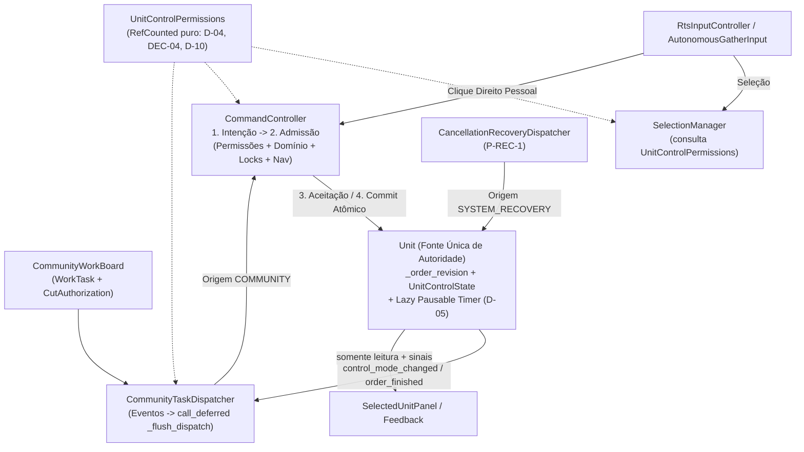
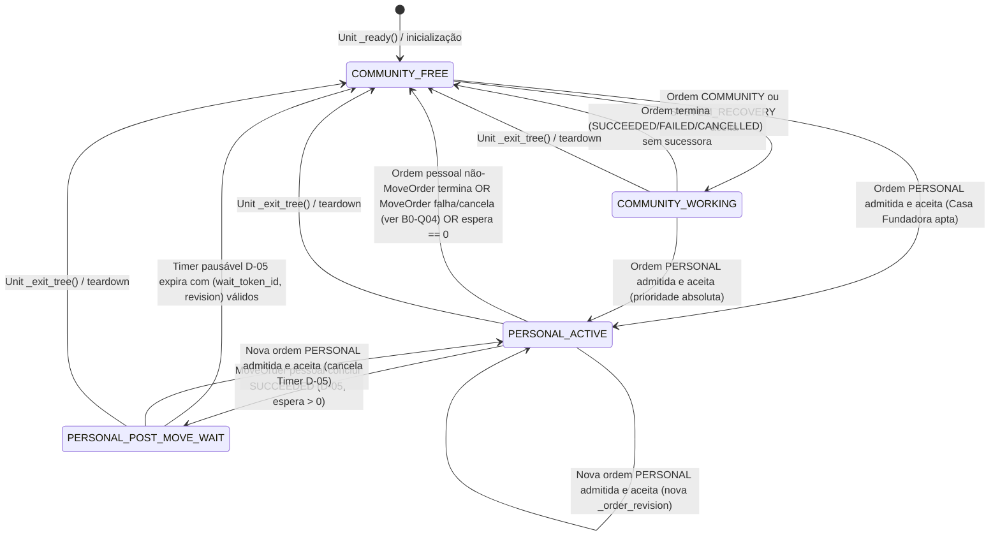

# Dawn of Kin — `R-03B B0`: Planejamento Arquitetural da Casa Fundadora e `ControlMode`

> **Status Obrigatório:** **`PROPOSTA ARQUITETURAL — CANDIDATA À HOMOLOGAÇÃO DOCUMENTAL — IMPLEMENTAÇÃO NÃO AUTORIZADA`**
>
> **Etapa:** `R-03B B0` — Planejamento Arquitetural (Casa Fundadora, Permissões, `ControlMode` e Retorno Automático Configurável `D-05`)
>
> **Data:** `26/11/2026`
>
> **Engine / Stack:** Godot `4.7.2.stable.official.ed1daf0bf` · GDScript tipado estrito · `gl_compatibility` · `Jolt Physics` · Intel UHD Graphics 620 (`1920×1080`, orçamento nominal `p95 <= 16,7 ms` em tomada CA)

---

## 1. Identificação e Status

- **Projeto:** *Dawn of Kin*
- **Incremento atual:** `R-03B B0` — Planejamento Arquitetural da Casa Fundadora e `ControlMode` na `MainScene`
- **Natureza da entrega:** exclusivamente documental e arquitetural. **Zero alterações em código executável, cenas, testes executáveis, recursos `.tres`, configurações ou documentos normativos vigentes.**
- **Estado na taxonomia obrigatória (`AGENTS.md` §2):**
  - `R-03A`: `HOMOLOGADO DEFINITIVAMENTE` · `INTEGRADO À DEVELOP` · `VALIDADO PÓS-INTEGRAÇÃO` · `PUBLICADO` · `ENCERRADO`
  - `R-03B B0`: **`CANDIDATA DOCUMENTAL AGUARDANDO AUDITORIA INDEPENDENTE`** (`NÃO HOMOLOGADA`)
  - `R-03B B1` e incrementos posteriores (`R-03C`–`T3.9`, `T4`–`T8`): **`PLANEJADO — NÃO AUTORIZADO / BLOQUEADO`**

---

## 2. Base Git

- **Repositório:** `https://github.com/Julian0s/Dawn-of-Kin`
- **Checkout principal permanente:** `C:\Projetos\Dawn of Kin` (`develop`, preservado intacto)
- **Branch canônica (`develop` e `origin/develop`):** `94c718024359dc7ff8360949313969b3ceaf9776` *(preservada intacta)*
- **SHA técnico homologado da `R-03A` (`D4-R2`):** `7c77e49d491f70c1867254f1a76a023050815431`
- **SHA de integração fast-forward da `R-03A`:** `46ed25a8faac84c316ff3f08e17de0fe8b8f04ae`
- **Linha estável protegida (`main` e `origin/main`):** `25e0a20f1d6a2f10a9e059afe69759fbe263db4a` *(preservada intacta)*
- **Tags protegidas preservadas:**
  - `t1-complete`: `3dcbba9386cbbee70025b47f4254ef097688a6e1`
  - `t2-complete`: `049ba9c7714c9b90b5515ae6ac30a28830454773`
  - `t3-3-complete`: `c7947c9630c102a9d77603cac0bae68678247c95`
- **Arquivo local protegido no checkout principal (`C:\Projetos\Dawn of Kin\project.godot`):** `SHA-256 = AEEFDA2810DA5C4EDFA9BF5F2A47A5841F8597238C8DAB4C2E202FAF70307613` *(preservado byte a byte)*
- **Isolamento documental da `R-03B B0`:**
  - Branch: `feat/r-03b-founding-house-control-mode` (derivada estritamente de `develop @ 94c718024359dc7ff8360949313969b3ceaf9776`)
  - Worktree único temporário: `C:\Projetos\Dawn_of_Kin_wt_r_03b`
  - Evidências: `C:\Projetos\Backups\Dawn_of_Kin_Archive_Local\evidencias\R-03B\B0\`

---

## 3. Autorização e Limites

O proprietário autorizou **exclusivamente** a etapa `R-03B B0` para auditar documentação, código real e testes existentes e elaborar a arquitetura detalhada da `R-03B`.

### Estritamente fora de escopo em `B0` e na própria `R-03B`
- **Proibido em `B0`:** criar ou editar qualquer arquivo `.gd`, `.tscn`, `.tres`, `project.godot`, testes executáveis ou documentos normativos (`AGENTS.md`, `Dawn_of_Kin_GDD.md`, `ROADMAP_MESTRE.md`, `README.md`, `KNOWN_ISSUES.md` ou relatórios históricos).
- **Proibido na futura implementação da `R-03B`:**
  - Nascimentos, casamentos, genealogia completa, parentesco, residências familiares, envelhecimento, calendário, morte, profissões, `JobSystem`, comunidades externas (`T5`/`T8`).
  - Atribuição manual opcional de equipe (`R-03C`), lista flutuante de tarefas (`R-03D`), nova construção com débito imediato (`R-04A`–`R-04C`), ativação global da HUD D2.2 (`R-05B`), depósito protegido (`T3.7`), persistência em disco (`T3.8`), velocidades `2×`/`4×` (`T4`), combate/Alento (`T6`).
  - Introdução de moradores narrativos permanentes, crianças/bebês jogáveis na cena principal ou novo botão de suspensão permanente do trabalho comunitário.
  - Remoção da construção legada (`P-REC-1`) ou alteração das flags vigentes na `MainScene`: `use_provenance_economy = true`, `automatic_cancellation_recovery = true`, `use_d2_2_hud = false`.

---

## 4. Referências Normativas e Hierarquia Documental

A elaboração deste plano respeita rigorosamente a hierarquia normativa do projeto:

1. **Decisões expressamente homologadas pelo proprietário** (`D-01`–`D-13`, `P-REC-1`–`P-REC-4`, `D-ERR-1 B`, `D-ERR-2 C`, `DEC-01`–`DEC-19`, homologação `R-03A` em `26/11/2026`).
2. **[docs/Dawn_of_Kin_GDD.md](../Dawn_of_Kin_GDD.md)** (`v1.3`, homologado em `R-02A R1`): §§1.2, 3.2, 3.3, 3.4, 4.1–4.3, 5.1, 5.3, 8, 9.1, 11 e 12.
3. **[AGENTS.md](../../AGENTS.md)**: governança permanente, taxonomia de status, regra de acessibilidade pela `MainScene` e ciclo de 20 etapas.
4. **[docs/ROADMAP_MESTRE.md](../ROADMAP_MESTRE.md)**: §§1, 3, 4 (linha 5 `R-03B`), 5 (`D-03`, `D-04`, `D-05`, `D-06`, `D-10`, `P-REC-1..4`) e 6.
5. **[docs/design/DAWN_OF_KIN_VISUAL_DESIGN_SYSTEM.md](../design/DAWN_OF_KIN_VISUAL_DESIGN_SYSTEM.md)** (`D2.2`, Cláusula Pétrea) e **[docs/KNOWN_ISSUES.md](../KNOWN_ISSUES.md)** (§§1–6).
6. **Código efetivamente homologado na base `94c7180` / `7c77e49`** e relatórios da série `R-03A` (`D0`, `D1-R3`, `D2-R1`, `D3.1-R1`, `D3.2`, `D3.3-R1`, `D3.4`, `D4-R1`, `D4-R2`, `CLOSEOUT`).
7. **Documentação histórica de contexto:** [RUX_0_autonomous_work_family_PROPOSAL.md](RUX_0_autonomous_work_family_PROPOSAL.md), [DAWN_OF_KIN_GLOBAL_VISION_AUDIT_PROPOSAL.md](../audits/DAWN_OF_KIN_GLOBAL_VISION_AUDIT_PROPOSAL.md) e [T3_architecture_PROPOSAL.md](T3_architecture_PROPOSAL.md).

### Reconciliação explícita frente à proposta histórica `RUX-0`
A `RUX-0` foi parcialmente substituída pelas decisões `D-01`–`D-13` e pela revisão `R-03A D0`–`D4`. **Não restaurar** na `R-03B`:
- Trabalho automático disparado por simples seleção de fonte (`R-03A D1` homologou `SELEÇÃO → AUTORIZAÇÃO PELA HUD → EXECUÇÃO`).
- Seleção heterogênea incompatível ou arraste iniciado sobre fonte sem `Shift` (`R-03A D1` / `D1-R3`).
- Agrupamentos/botões/cartões de cancelamento antigos na fonte (`R-03A D2` homologou o selo mineral `×`/`×N` por categoria).
- Estado `PERSONAL_HOLD` permanente com botão `"Liberar para comunidade"` (`RUX-0` §5.2 Opção A foi **substituída por `D-05`**, que determina retorno automático após intervalo configurável pós-`MoveOrder`).
- Obrigatoriedade da atribuição manual (`D-03`/`D-10` reservam a atribuição manual **opcional** à `R-03C`).
- Residência obrigatória na Casa Principal sem escolha (`D-06` concede ao jogador a escolha em `T5`).

---

## 5. Requisitos Decididos (`DECIDIDO`)

Estes contratos estão formalmente homologados e **não são reabertos** neste plano:

| ID | Contrato Decidido | Efeito Direto na `R-03B` |
|---|---|---|
| **`D-04`** | Pertencem à **Casa Fundadora**: os **2 protagonistas originais**, **todos os seus descendentes diretos** e **cônjuges externos** que ingressarem por casamento. Todos os membros selecionáveis e aptos possuem controle pessoal direto prioritário. Demais moradores atuam pelo sistema comunitário automático. | Metadados mínimos de afiliação (`FOUNDING_HOUSE` vs `COMMUNITY`) + papel/origem (`ORIGINAL_FOUNDER`, `DIRECT_DESCENDANT`, `EXTERNAL_SPOUSE`, `NONE`) desacoplados de `display_name` e de residência física. |
| **`DEC-07`** | Proteção contra morte definitiva é **exclusiva dos 2 protagonistas originais** (`is_original_founder == true`). Descendentes e cônjuges externos são mortais. | Flag/papel explícito distinguindo os 2 protagonistas originais dos demais integrantes da Casa Fundadora. |
| **`DEC-04`** | 4 faixas etárias: **Bebê (`0–2`)** não selecionável nem comandável; **Criança (`3–11`)** apenas tarefas leves/seguras (sem corte de árvores, mineração, construção pesada ou combate); **Jovem (`12–17`)** atividades apropriadas à idade; **Adulto (`18+`)** aptidão plena. | Enum `AgeStage` + matriz de permissões por faixa etária e categoria de tarefa/comando, validada em fixtures automatizadas sem introduzir crianças/bebês na `MainScene` jogável. |
| **`D-05`** | Prioridade absoluta de ordens pessoais da Casa Fundadora sobre o trabalho comunitário; após concluir um **`MoveOrder` pessoal**, aguardar **intervalo configurável** (não fixado em `5 s`) e retornar automaticamente ao trabalho comunitário. | Estado `PERSONAL_POST_MOVE_WAIT` com duração configurável em tempo de simulação pausável e retorno orientado a eventos (sem polling por frame e sem `PERSONAL_HOLD` indefinido). |
| **`D-10`** | Equipe manual opcional (`R-03C`) restrita a integrantes aptos da Casa Fundadora. | Serviço centralizado `UnitControlPermissions` expõe predicado de prontidão para `R-03C`, sem implementar gestos ou UI de `R-03C`. |
| **`HD3-06`** | Observação legítima da `R-03A`: com exclusão apenas por tarefa, o trabalhador assumia outra tarefa autorizada imediatamente ao concluir `MoveOrder`. | Tratada naturalmente por `PERSONAL_POST_MOVE_WAIT` (`D-05`), preservando `R-03A` sem reclassificar `HD3-06` como bug retroativo. |
| **`D0-A03` / `D0-A04`** | Derrubada irreversível de árvores (`STANDING → CHOPPING → FELLING → FALLEN → DEPLETED`) e conservação econômica regional sobre 8 compartimentos físicos e fronteiras transacionais estáveis. | Mudança de `ControlMode` tem delta econômico zero; nunca aborta transação ativa, nunca reinicia `FELLING` e nunca perde ou duplica carga. |
| **`P-REC-1` / `D-ERR-1 B`** | Fluxo antigo de construção (`D2`/`D3`/`DEC-11B`) preservado até `R-04C`; `use_d2_2_hud = false` preservado na `MainScene` até `R-05B`. | `ConstructOrder`, `CancellationRecoveryDispatcher` e `RecoveryOrder` mantidos 100% funcionais; HUD D2.2 não ativada. |

---

## 6. Questões em Aberto (Resumo)

Foram identificadas **7 questões genuinamente abertas** que exigem deliberação do proprietário antes da implementação de `B1`–`B4` (detalhadas com os 10 campos obrigatórios na **Seção 30**):

1. **`B0-Q01`:** Seleção visual e inspeção de moradores comuns (`COMMUNITY`) na `MainScene`.
2. **`B0-Q02`:** Comportamento do `CommandController` em seleção mista (Fundador + Morador comum).
3. **`B0-Q03`:** Classificação de `Worker3`/`Worker4` (`TemporaryTestWorkersController`) na `MainScene` durante a transição `P-REC-1`.
4. **`B0-Q04`:** Semântica de `D-05` quando um `MoveOrder` pessoal termina por **falha de navegação** ou **cancelamento** (vs chegada bem-sucedida `SUCCEEDED`).
5. **`B0-Q05`:** Elegibilidade da **mesma tarefa comunitária interrompida** (`WorkTask.excluded_unit_ids`) após expiração do intervalo `D-05`.
6. **`B0-Q06`:** Faixa de valores experimentais para calibração de `D-05` (mantendo política de pausa congelada recomendada).
7. **`B0-Q07`:** Grau de indicação visual transitória de `ControlMode` na HUD legada (`use_d2_2_hud = false`).

---

## 7. Inventário da Arquitetura Atual

Todos os componentes abaixo foram auditados diretamente no código-fonte real na base `94c718024359dc7ff8360949313969b3ceaf9776`.

| Componente / Arquivo | Responsabilidade Atual e Autoridade | Dependências / Sinais / Estado Principal | Pontos de Extensão e Riscos para `R-03B` | Modificação Futura? |
|---|---|---|---|---|
| `src/units/character_definition.gd` (`CharacterDefinition`, `L1–36`) | Recurso imutável/configurável de identidade e perfil motor (`character_id`, `display_name`, velocidades, `base_carry_capacity`). Autoridade de dados estáticos do personagem. | Sem dependências de cena. Valida invariantes em `is_valid()` (`L23–36`). | **Ponto de extensão primário** para metadados da Casa Fundadora e faixa etária. **Risco:** `CharacterDefinition.new()` é usado em 5 suítes de teste sem `.tres` — defaults devem ser seguros e retrocompatíveis. | **Sim (`B1`)** |
| `data/characters/leader_a.tres`, `leader_b.tres` (`L1–14`) | Definições dos 2 protagonistas originais (`&"leader_a"` / `"Leader A"`, `&"leader_b"` / `"Leader B"`). | Referenciados por `src/main/main.tscn:8-9,52,56`. | Recebem explicitamente `house_affiliation = FOUNDING_HOUSE`, `founding_house_role = ORIGINAL_FOUNDER`, `age_stage = ADULT`. | **Sim (`B1`)** |
| `src/units/unit.gd` (`Unit`, `L1–427`) | Entidade RTS (`CharacterBody3D`): ciclo de `_current_order`, `_order_revision`, `_state` (`IDLE`, `MOVING`, `WORKING`, `TRANSPORTING`), `_carry_load`, `_is_reserved_withdrawal_locked()` (`L239–244`), `issue_order()` (`L247–288`), `cancel_current_order()` (`L290–315`), `_exit_tree()` (`L102–110`). | Sinais: `state_changed(new, prev)` (`L16`), `order_finished(order)` (`L17`). Grupo `selectable_units` (`L58`). | **Autoridade natural do `ControlMode` (via objeto composto `UnitControlState`)**. **Risco crítico:** janela síncrona entre `previous_order.cancel()`/`order_finished.emit()` (`L255–256`) e `order.start()` (`L275`), além de 43 suítes chamando `issue_order()` diretamente. | **Sim (`B1`/`B2`/`B3`)** |
| `src/units/unit_movement.gd` (`UnitMovement`, `L1–807`) | Navegação XZ, `NavigationAgent3D`, gravidade, RVO, `MoveState` (`IDLE`, `MOVING`, `ARRIVED`, `FAILED_STUCK`, `FAILED_INVALID`). | Desconecta sinais em `_exit_tree()` (`L87–90`). | Nenhuma autoridade de `ControlMode`. Não deve acoplar-se a permissões nem temporizadores. | **Não** |
| `src/units/orders/unit_order.gd` (`UnitOrder`, `L1–99`) | Classe base `RefCounted` de ordens (`Status`: `PENDING`, `RUNNING`, `SUCCEEDED`, `FAILED`, `CANCELLED`; `failure_reason`). | Sem campo de origem (`PERSONAL` / `COMMUNITY` / `SYSTEM_RECOVERY`). | Pode carregar metadado leve `order_origin` (definido no despacho/emissão, somente leitura) para rastreabilidade sem criar segundo sistema de ordens. | **Sim — mínimo (`B2`)** |
| `src/units/orders/move_order.gd` (`MoveOrder`, `L1–119`) | Movimento RTS via `WorldNavigation.find_path()` (`L52`), distinguindo `SUCCEEDED` (`L67,111`), `PARTIAL_UNREACHABLE`/`FAILED` (`L75,79,109,114,117`), `CANCELLED` (`L66` base). | Sinais: nenhum (observado via `Unit.order_finished`). | **Gatilho específico de `D-05`** ao finalizar em `Unit`. **Risco:** `start()` pode concluir sincronamente com `mark_succeeded()` quando já está no alvo (`L65–68`) ou falhar sincronamente (`L34–87`). | **Não** *(ou leitura de status existente)* |
| `src/units/orders/gather_resource_order.gd` (`GatherResourceOrder`, `L1–1217`) | Ciclo físico de coleta + corte progressivo (`D3`) + entrega (`DeliverToCampOrder`) + cancelamento cooperativo (`D2-B`: `request_community_cancel()` `L452–494`) + `CutAuthorization` (`L13–32`) + guardas por revisão (`_still_owns_unit_execution` `L1066–1071`, `_still_owns_movement_cleanup` `L1074–1080`). | Bloqueia cancelamento durante `is_provenance_transfer_executing()` (`L199–210, 428–429`). | Preservar 100% intacto o contrato `D2-A01`/`D3.2`. `CutAuthorization` já distingue token emprestado (comunitário) vs próprio (`_owns_tree_cut_authorization` `L82,262`). | **Não** *(preservar intacto)* |
| `src/units/orders/deliver_to_camp_order.gd` (`DeliverToCampOrder`, `L1–540`) | Entrega física no acampamento (legado ou seletivo com proveniência `CampDeliveryTransferSession`). | `is_selective_transfer_executing()` (`L79–88`). | Preservar 100% intacto. | **Não** |
| `src/units/orders/construct_order.gd` (`ConstructOrder`, `L1–1479`) | Ordem legada `P-REC-1` de suprimento/montagem de `ConstructionSite` (`D2`/`D9`). | `_defer_transfer_replan()` (`L258–265`), `cancel()` (`L230–245`). | Preservar 100% intacto; `CommandController.command_units_to_site` respeitará permissão centralizada. | **Não** |
| `src/units/cancellation_recovery_dispatcher.gd` (`L1–183`) & `src/units/orders/recovery_order.gd` (`L1–226`) | Despacho orientado a eventos e execução de recuperação física de sobras (`T3.6.3`, `P-REC-1`). | Guarda `entry.manual` (`L90,116,130`), checa `unit.get_order_revision()` (`L86,133`), `RecoveryOrder.manual_interruption` (`L12`). | Deve despachar com `OrderOrigin.SYSTEM_RECOVERY` para não violar regras de controle pessoal em moradores comuns nem ser bloqueado por `PERSONAL_POST_MOVE_WAIT` quando elegível, respeitando sempre interrupção pessoal soberana (`entry.manual = true`). | **Sim — mínimo (`B2`, origem explícita)** |
| `src/rts/selection_manager.gd` (`SelectionManager`, `L1–199`) | Conjunto tipado `_selected_units: Array[Unit]`; deduplicação e limpeza em `tree_exited` (`L148–155`). | Sinal `selection_changed(selected_units)` (`L6`). Predicado `_is_selectable_unit()` (`L189–190`). | Ponto único para aplicar regra de selecionabilidade (`DEC-04`: `BABY` nunca entra em `_selected_units`; moradores comuns conforme `B0-Q01`). | **Sim (`B1`)** |
| `src/rts/command_controller.gd` (`CommandController`, `L1–483`) | Traduz `PickResult` em `MoveOrder`, `GatherResourceOrder`, `ConstructOrder`. Valida domínio regional/proveniência (`_admit_economic_command` `L378–414`). | Sinais: `command_issued` (`L8`), `command_rejected` (`L9`). `_collect_commandable_units()` (`L465–472`), `command_at()` (`L78–192`), `command_units_to_gather()` (`L195–222`), `command_units_to_site()` (`L312–335`). | **Ponto crítico de segurança:** hoje `_collect_commandable_units()` aceita qualquer unidade selecionada e `command_units_to_gather()`/`command_units_to_site()` aceitam qualquer `Array[Unit]` sem validar Casa Fundadora nem distinguir origem `PERSONAL` vs `COMMUNITY`! | **Sim (`B1`/`B2`)** |
| `src/rts/community_task_dispatcher.gd` (`CommunityTaskDispatcher`, `L1–940`) | Distribuidor orientado a eventos (`set_process(false)`, `set_physics_process(false)`), fila coalescida `call_deferred("_flush_dispatch")` (`L94–100`), batch `D4-R1`/`D4-R2`, cancelamento cooperativo `D2-B`. | Sinais: `task_assigned`, `task_waiting`, `task_blocked`, `task_feedback`, `dispatch_batch_started/finished`. Conecta `unit.order_finished`, `state_changed`, `tree_exited` (`L274–285`). Checagens em `_check_unit_base_eligibility()` (`L646–674`) e `_check_task_specific_eligibility()` (`L854–865`). | Conectar sinal de mudança de elegibilidade/controle da unidade (`control_mode_changed`) sem polling; validar `ControlMode == COMMUNITY_FREE` + `UnitControlPermissions.can_participate_in_community_work(unit, task.kind)` + despachar via origem `COMMUNITY` explícita. | **Sim (`B1`/`B2`/`B3`)** |
| `src/rts/community_work_board.gd` (`CommunityWorkBoard`, `L1–459`) & `src/rts/work_task.gd` (`WorkTask`, `L1–100`) | Registro regional idempotente de `WorkTask` (`PENDING_WORKERS`, `IN_PROGRESS`, `BLOCKED_REAUTHORIZATION`, `COMPLETED`, `FAILED`, `CANCELLED`), `excluded_unit_ids` (`WorkTask:38`), `tree_cut_authorization` (`WorkTask:36,91–100`). | Sinais: `task_registered`, `task_updated`, `task_closed`. | Preservar estrutura e idempotência. Ajustar apenas política de `excluded_unit_ids` se `B0-Q05` deliberar reconciliação pós-`D-05`. | **Mínimo ou Não (`B3`, conforme `B0-Q05`)** |
| `src/rts/rts_input_controller.gd` (`L1–351`) & `src/rts/autonomous_gather_input.gd` (`L1–875`) | Picking, hover, arraste RTS vs `Shift+arraste` de fontes, autorização/cancelamento na HUD contextual, `Esc`. | Delega seleção a `SelectionManager` e clique direito a `CommandController.command_at()`. | Preservar integralmente contratos `D1`/`D1-R3`/`D2`/`D4-R2`. Hover/box selection respeitam `UnitControlPermissions.can_be_selected_visually()` (via `SelectionManager` / filtro). | **Mínimo (`B1` hover/feedback se aplicável)** |
| `src/economy/unit_carry_load.gd` (`L1–398`) & `src/economy/reserved_withdrawal_coordinator.gd` (`L1–3102`) | Mochila física com proveniência (`CarryProvenanceLedger`) e autoridade transacional regional única (`RegionalAuthority`, `validate_unit_identity_in_domain_readonly`, `admit_empty_provenance_units`). | Locks `_coordinator_transaction_locked`, `_provenance_busy`, `_provenance_applying`. | **Intocáveis.** `ControlMode` consulta os locks existentes sem jamais contorná-los ou alterar proveniência/saldos. | **Não** |
| `src/economy/resource_source.gd` (`L1–1033`) | Estoque finito, vagas (`max_simultaneous_workers`), estágios `TreeHarvestStage`, `TreeCutter`, `begin_tree_cut`/`end_tree_cut`/`cancel_tree_cut_authorization`. | Sinais: `tree_harvest_stage_changed`, `amount_changed`, `depleted`, `worker_slot_released`. | **Intocável.** Preservar integralmente `D3.1-R1`/`D3.2`. | **Não** |
| `src/economy/economy_clock_controller.gd` (`L1–115`) & `src/ui/d2/d2_simulation_pause_controller.gd` (`L1–459`) | Relógio econômico pausável (`PROCESS_MODE_PAUSABLE`, `Timer.ignore_time_scale = false`) e autoridade cooperativa de pausa em `SceneTree.paused` (`dok_pause_authorities`). | Sem polling; respeita pausas externas e de HUD. | Referência canônica de temporização pausável: o temporizador de `D-05` deve seguir exatamente o mesmo padrão (`PROCESS_MODE_PAUSABLE`, `ignore_time_scale = false`). | **Não** |
| `src/units/temporary_test_workers_controller.gd` (`L1–687`) | Spawner/removedor seguro de `Worker3` (`&"test_worker_3"`) e `Worker4` (`&"test_worker_4"`) para testes C4/UX (`_create_worker_definition` `L591–609`). | Usado por `PlacementTestOverlay` e 7 suítes de teste (5 delas enviam comandos diretos a `Worker3`/`Worker4`). | **Ponto sensível (`B0-Q03`):** exige decisão explícita sobre a afiliação de `Worker3`/`Worker4` durante a transição `P-REC-1`. | **Conforme `B0-Q03` (`B1`)** |
| `src/main/main.gd` (`L1–612`) & `src/main/main.tscn` (`L1–122`) | Composição raiz da `MainScene`, admissão regional (`L67–73`), instanciação de `LeaderA`/`LeaderB`, flags (`use_provenance_economy=true`, `automatic_cancellation_recovery=true`, `use_d2_2_hud=false`), `request_controlled_teardown()` (`L248–302`). | `LeaderA` (`main.tscn:50–52`), `LeaderB` (`main.tscn:54–56`). | Expõe parâmetro configurável de duração `D-05` (ou propaga para `Units` / `CommunityTaskDispatcher`) e conecta feedback/teardown limpo. | **Sim — mínimo (`B3`/`B4`)** |
| `src/ui/selected_unit_panel.gd` (`L1–420`), `src/ui/hud_formatter.gd` (`L1–143`), `src/ui/autonomous_gather_feedback.gd`, `src/ui/d2/components/d2_founder_steles_view.gd` (`L1–690`), `d2_lineage_blade_view.gd` (`L1–869`) | HUD legada de unidade selecionada (sinais de `Unit` e `UnitCarryLoad`, zero polling), banner transitório superior (`D4-A01`), e vistas D2.2 (inativas na `MainScene` até `R-05B`). | `D2FounderStelesView._order_founder_units()` (`L650–674`) ainda busca `cid == &"leader_a"` / `&"leader_b"`. | Intervenção mínima conforme `B0-Q07` (ex.: exibir estado pessoal/espera discreto via `HudFormatter` sem redesenhar HUD nem ativar `use_d2_2_hud`). Em `D2FounderStelesView`, preparar compatibilidade futura com `is_original_founder` apenas se autorizado sem quebrar `UI-1.2`. | **Mínimo conforme `B0-Q07`** |

---

## 8. Fluxos de Ordens Existentes (Rastreamento do Código Real)

Reconstrução dos 14 fluxos exigidos a partir do código verificado:

1. **Seleção de protagonista:** `RtsInputController._handle_left_click` (`rts_input_controller.gd:214–232`) ou `_handle_box_selection` (`L243–260`, após `AutonomousGatherInput` delegar `UNIT_BOX_RTS` em `autonomous_gather_input.gd:428–430`) chama `SelectionManager.select_single/toggle_unit/set_selection` (`selection_manager.gd:38–130`), que valida apenas `_is_selectable_unit()` (`L189–190`: válido e na árvore), marca `unit.set_selected(true)` e emite `selection_changed`.
2. **Emissão de `MoveOrder` pessoal:** `RtsInputController._handle_right_click` (`L235–240`) → `CommandController.command_at(pick)` (`command_controller.gd:78–192`) → `_collect_commandable_units()` (`L465–472`) → checagem de bloqueador pendente (`L131–135,159–166`) → `GroupMovePlanner.plan_targets()` (`L144–153`) → `MoveOrder.new(...)` → `unit.issue_order(order)` (`L174`) → valida `_is_order_accepted()` (`L175`) → atualiza `DestinationMarker` (`L189`) e emite `command_issued` (`L191`).
3. **Emissão de ordem RTS direta de coleta:** `CommandController.command_at(PickResult.RESOURCE_SOURCE)` (`L121–122`) → `_command_gather_resource` (`L225–227`) → `_execute_gather_resource` (`L230–293`) → `_admit_economic_command` (`L241`) → `source.has_worker_slot(unit)` (`L263`) → `GatherResourceOrder.new(..., cut_authorization = null)` (`L269–272`, ordem cria token próprio em `gather_resource_order.gd:260–262`) → `unit.issue_order(order)` (`L273`).
4. **Emissão de ordem direta de construção:** `CommandController.command_at(PickResult.CONSTRUCTION_SITE)` (`L123–124`) ou `command_units_to_site()` (`L312–335`) → `_command_supply_construction_site` (`L338–375`) → `_admit_economic_command` (`L348`) → `ConstructOrder.new(...)` (`L358`) → `unit.issue_order(order)` (`L359`).
5. **Atribuição pelo `CommunityTaskDispatcher`:** sinal de entrada → `request_dispatch()` (`community_task_dispatcher.gd:94–100`) → `call_deferred("_flush_dispatch")` (`L428–490`) → `_dispatch_group_tasks()` (`L509–632`, ordem estrita `dist_sq`, `task_idx`, `unit_name`, `unit_id`) → `_try_dispatch_unit_to_task()` (`L677–748`) → chama `_command_controller.command_units_to_gather(task.source, [chosen_unit], false, task.tree_cut_authorization)` (`L687`) → grava `task.assigned_unit/order/order_revision` (`L731–733`) e emite `task_assigned` (`L744`).
6. **Substituição de ordem comunitária por ordem pessoal:** `CommandController` chama `unit.issue_order(personal_order)` (`unit.gd:247`). Se não houver `_is_reserved_withdrawal_locked()` (`L248`), incrementa `_order_revision` (`L250`), zera `_current_order` (`L254`), chama `previous_order.cancel(_movement, REASON_REPLACED)` (`L255`) — que libera vaga e encerra participação no corte preservando token emprestado da tarefa — e emite `order_finished.emit(previous_order)` (`L256`). `CommunityTaskDispatcher._on_unit_order_finished()` (`community_task_dispatcher.gd:373–380`) limpa `task.assigned_*`, marca `task.excluded_unit_ids[uid] = true` (`L398`), devolve tarefa para `PENDING_WORKERS` (`L400`) e agenda `call_deferred("_flush_dispatch")` (`L380`). Em seguida, `Unit.issue_order()` instala `personal_order` e chama `personal_order.start()` (`unit.gd:273–275`).
7. **Cancelamento de ordem:**
   - *Via `Unit.cancel_current_order(reason)` (`unit.gd:290–315`):* respeita `_is_reserved_withdrawal_locked()`, incrementa `_order_revision`, chama `cancelled_order.cancel(_movement, reason)`. Se a ordem recusar cancelamento por transferência ativa (`not cancelled_order.is_finished()`), restaura `_current_order = cancelled_order` (`L308–311`); caso contrário transita para `State.IDLE` e emite `order_finished`.
   - *Via cancelamento seletivo comunitário (`D2-B`, `community_task_dispatcher.gd:103–224`):* fase 1 fecha `WorkTask` no Board (`CANCELLED`, revogando `CutAuthorization`); fase 2 reconcilia cooperativamente somente ordens que ainda batem `(snap_order, snap_rev)` via `GatherResourceOrder.request_community_cancel()` (mantendo entrega final se houver carga `FREE_GATHERED`, diferindo se houver transferência ativa ou cancelando imediatamente se vazio).
8. **Término bem-sucedido:** `Unit._physics_process` (`unit.gd:91–97`) ou `Unit.issue_order` (`L279–284`) detecta `is_finished()`, zera `_current_order`, transita para `State.IDLE` e emite `order_finished`. `CommunityTaskDispatcher` fecha a tarefa como `COMPLETED` se a fonte esgotou ou retorna a `PENDING_WORKERS` (`L386–394`) e agenda despacho.
9. **Término por falha ou inacessibilidade:** `MoveOrder`/`GatherResourceOrder`/`ConstructOrder` chamam `mark_failed(reason)` (`REASON_UNREACHABLE`, `REASON_STUCK`, `REASON_SOURCE_UNREACHABLE`, `REASON_NO_WORKER_SLOT`, etc.). `Unit` volta a `State.IDLE` e emite `order_finished`. Em tarefa comunitária, falhas terminais de fonte fecham a tarefa como `FAILED` (`community_task_dispatcher.gd:407–417`).
10. **Liberação de vaga na fonte:** `GatherResourceOrder._release_source_reservation()` (`gather_resource_order.gd:1083–1089`) encerra corte (`_leave_tree_cut()`), zera `_has_reservation = false` **antes** do sinal e chama `source.release_worker(_unit)`, emitindo `worker_slot_released` de forma idempotente (`D2-A01`).
11. **Preservação da mochila:** `UnitCarryLoad` (`unit_carry_load.gd`) é independente do ciclo de vida de `UnitOrder`. Cancelar `GatherResourceOrder` ou emitir `MoveOrder` **nunca** chama `remove_units`/`take_all` nem toca no `CarryProvenanceLedger`; os lotes (`FREE_GATHERED`, `SITE_RESERVED`, `CANCEL_BUFFER`, `CANCEL_TRANSIT`) permanecem íntegros e auditáveis.
12. **Retorno atual à elegibilidade comunitária (origem de `HD3-06`):** assim que um `MoveOrder` pessoal termina com `SUCCEEDED`, `Unit` zera `_current_order`, muda para `State.IDLE` (`unit.gd:95–96`) e emite `state_changed(IDLE)` + `order_finished`. `CommunityTaskDispatcher._on_unit_state_changed` (`L368–370`) e `_on_unit_order_finished` (`L373–380`) agendam `_flush_dispatch()`. Na rodada seguinte, `_check_unit_base_eligibility()` (`L646–674`) vê `IDLE` + `_current_order == null` e atribui imediatamente qualquer outra tarefa cujo `excluded_unit_ids` não contenha `uid`.
13. **Reconfiguração ou remoção da unidade:** `Unit._exit_tree()` (`unit.gd:102–110`) cancela ordem ativa com `REASON_UNIT_EXITED` e emite `order_finished`; `SelectionManager._on_unit_tree_exited()` (`L148–155`) deseleciona; `CommunityTaskDispatcher._on_units_child_exiting()` / `_on_unit_tree_exited()` (`L320–330`) libera a tarefa e desconecta callbacks; `TemporaryTestWorkersController.remove_temporary_workers_safely()` (`L161–241`) revalida locks, custódia e mochilas em 4 fases antes de `remove_child`/`queue_free`.
14. **Encerramento de cena:** `MainScene.request_controlled_teardown()` (`main.gd:248–302`) e `_exit_tree()` (`L314–383`) desmontam `CommunitySelectionActionsHud`, `AutonomousGatherInput`, `CommunityTaskDispatcher`, `CommunityWorkBoard`, desconectam `D2HudRoot`/`ResourceHud`, cancelam ordens pendentes pós-remoção e liberam o domínio regional via `ReservedWithdrawalCoordinator.release_regional_domain()`.

### Diagnóstico de Origem e Propriedade por Revisão
- **Onde a origem é registrada hoje:** em lugar nenhum dentro de `Unit` ou `UnitOrder`.
- **Onde é inferida hoje:** apenas externamente em `WorkTask.assigned_order`/`assigned_order_revision` (`community_task_dispatcher.gd:731–733`), `CancellationRecoveryDispatcher._entries[uid]` (`cancellation_recovery_dispatcher.gd:107`) e `GatherResourceOrder._owns_tree_cut_authorization` (`gather_resource_order.gd:82`).
- **Contratos de revisão existentes que o `ControlMode` aproveitará diretamente:**
  - `Unit._order_revision` (`unit.gd:44, 199–200, 250, 293`) — contador monotônico por unidade.
  - `UnitOrder` (identidade por referência `==`), `WorkTask.task_id` / `assigned_order_revision`, `GatherResourceOrder.CutAuthorization` (token de corte), `Unit.get_character_id()` + `unit.get_meta(&"region_id")` + `World3D` (domínio regional validado por `ReservedWithdrawalCoordinator`).

---

## 9. Modelo de Metadados Mínimos da Casa Fundadora (`D-04`, `D-10`, `DEC-04`, `DEC-07`)

### 9.1 Princípios de Design
- **Nenhuma autoridade em texto visual:** nunca inferir pertencimento por `display_name`, `node.name` (`"LeaderA"`, `"LeaderB"`) ou `instance_id`.
- **Separação ortogonal dos 3 eixos:** (1) **Afiliação de Casa** (`D-04`), (2) **Status de Protagonista Original** (`DEC-07` — mortalidade vs proteção), e (3) **Faixa Etária** (`DEC-04`).
- **Zero antecipação de `T5`:** não criar grafos de parentesco, listas de filhos/cônjuges, datas de nascimento, residências ou profissões nesta etapa.

### 9.2 Proposta de Extensão em `CharacterDefinition` (`src/units/character_definition.gd`)

```gdscript
# PROPOSTA CONCEITUAL (NÃO IMPLEMENTADA EM B0)
enum HouseAffiliation {
	COMMUNITY = 0,       # Default seguro para novos personagens/moradores comuns
	FOUNDING_HOUSE = 1,  # Protagonistas originais, descendentes diretos e cônjuges externos (D-04)
}

enum FoundingHouseOrigin {
	NONE = 0,
	ORIGINAL_FOUNDER = 1,  # Estritamente LeaderA e LeaderB — únicos com proteção DEC-07
	DIRECT_DESCENDANT = 2, # Descendentes diretos da linhagem (mortal, controle pessoal)
	EXTERNAL_SPOUSE = 3,   # Cônjuge externo que ingressou por casamento (mortal, controle pessoal D-04)
}

enum AgeStage {
	BABY = 0,   # 0-2 anos: dependente, não selecionável nem comandável
	CHILD = 1,  # 3-11 anos: apenas atividades leves/seguras (ex.: colher frutos)
	YOUTH = 2,  # 12-17 anos: coleta, construção e atividades apropriadas (sem casamento / combate pleno)
	ADULT = 3,  # 18+ anos: aptidão plena (default seguro para T3)
}

@export var house_affiliation: HouseAffiliation = HouseAffiliation.COMMUNITY
@export var founding_house_origin: FoundingHouseOrigin = FoundingHouseOrigin.NONE
@export var age_stage: AgeStage = AgeStage.ADULT
```

### 9.3 Invariantes Obrigatórios de Consistência (`CharacterDefinition.is_valid()`)
1. `character_id` não vazio (`StringName` estável e imutável).
2. Se `house_affiliation == COMMUNITY`, então `founding_house_origin` **deve** ser `NONE` (rejeita combinação contraditória como morador comum marcado como `ORIGINAL_FOUNDER`).
3. Se `house_affiliation == FOUNDING_HOUSE`, então `founding_house_origin` **deve** ser um de `{ORIGINAL_FOUNDER, DIRECT_DESCENDANT, EXTERNAL_SPOUSE}` (nunca `NONE`).
4. Se `founding_house_origin == ORIGINAL_FOUNDER` ou `EXTERNAL_SPOUSE`, `age_stage` **deve** ser `ADULT` (protagonistas originais e cônjuges `18+` são adultos pelo GDD `v1.3` §3.3–§3.4).
5. **Helper explícito de proteção contra morte (gancho futuro `DEC-07`):**
   - `is_original_founder() -> bool`: `house_affiliation == FOUNDING_HOUSE and founding_house_origin == ORIGINAL_FOUNDER`.
   - `is_founding_house_member() -> bool`: `house_affiliation == FOUNDING_HOUSE and founding_house_origin != NONE`.
   - Assim, `DIRECT_DESCENDANT` e `EXTERNAL_SPOUSE` retornam `is_founding_house_member() == true` e `is_original_founder() == false` (nunca confundindo controle pessoal com imortalidade).

### 9.4 Configuração dos Recursos Reais (`data/characters/`)
- `data/characters/leader_a.tres`: `character_id = &"leader_a"`, `house_affiliation = FOUNDING_HOUSE`, `founding_house_origin = ORIGINAL_FOUNDER`, `age_stage = ADULT`.
- `data/characters/leader_b.tres`: `character_id = &"leader_b"`, `house_affiliation = FOUNDING_HOUSE`, `founding_house_origin = ORIGINAL_FOUNDER`, `age_stage = ADULT`.
- **Requisitos registrados para persistência futura (`T3.8` — `SaveManager` `schema_version = 1`):**
  - Toda entidade `Unit` persistida deverá ser endereçada por `character_id` imutável (nunca por `instance_id` ou nome de nó), serializando `(character_id, house_affiliation, founding_house_origin, age_stage, control_mode, personal_wait_remaining_sec)` e validando invariantes na desserialização antes de admitir a unidade na região.

---

## 10. Modelo de Permissões (`UnitControlPermissions`)

Para impedir contorno por chamadas diretas ao `CommandController` ou inconsistências entre `SelectionManager`, `CommunityTaskDispatcher` e HUD, propõe-se um serviço puro `RefCounted` (`src/units/unit_control_permissions.gd` — **proposta**) como **única autoridade de permissão**.

### 10.1 Separação das Cinco Capacidades

```gdscript
# PROPOSTA CONCEITUAL (NÃO IMPLEMENTADA EM B0)
enum PersonalCommandKind {
	MOVE,
	GATHER_WOOD,
	GATHER_STONE,
	GATHER_FOOD,
	CONSTRUCT_SITE,
}
```

| Capacidade | Regra Canônica (`D-04`, `D-10`, `DEC-04`) | Observações / Dependência |
|---|---|---|
| 1. `can_be_selected_visually(unit)` | `false` se `unit` inválida, fora da árvore, `definition == null`, `not definition.is_valid()` ou `age_stage == BABY`. Para `FOUNDING_HOUSE` (`CHILD`/`YOUTH`/`ADULT`): `true`. Para `COMMUNITY` (`CHILD`/`YOUTH`/`ADULT`): **sujeito a `B0-Q01`** *(recomendado: `true` somente leitura para inspeção)*. | Aplicada em `SelectionManager._is_selectable_unit()` e hover/box selection. |
| 2. `can_be_inspected(unit)` | Mesmo critério de visibilidade no mapa (`age_stage != BABY`); no futuro `T5`, `BABY` é inspecionado apenas pelo painel da residência. | Permite ver nome, estado e mochila sem conceder comando pessoal. |
| 3. `can_receive_personal_order(unit, kind)` | Exige **todas** as condições: (a) unidade válida na árvore; (b) `definition.is_valid()`; (c) `definition.is_founding_house_member() == true`; (d) `age_stage != BABY`; (e) compatibilidade etária de `kind` (`CHILD`: apenas `MOVE` e `GATHER_FOOD`; `YOUTH` e `ADULT`: `MOVE`, `GATHER_WOOD`, `GATHER_STONE`, `GATHER_FOOD`, `CONSTRUCT_SITE`). | Aplicada incondicionalmente dentro de `CommandController` em **todos** os caminhos pessoais (`command_at`, `command_units_to_gather` pessoal, `command_units_to_site` pessoal). Não pode ser contornada por chamadas diretas. |
| 4. `can_participate_in_community_work(unit, task_kind)` | Exige unidade válida, `definition.is_valid()`, `age_stage != BABY`, e compatibilidade etária com `WorkTask.Kind` (`CHILD`: apenas `GATHER_FOOD`; `YOUTH`/`ADULT`: `GATHER_WOOD`, `GATHER_STONE`, `GATHER_FOOD`). **Válido para `FOUNDING_HOUSE` e `COMMUNITY`.** | Aplicada em `CommunityTaskDispatcher._check_unit_base_eligibility()` / `_check_task_specific_eligibility()`. |
| 5. `can_join_manual_team_future(unit, task_kind)` *(gancho `R-03C` / `D-10`)* | Equivalente a `is_founding_house_member() and can_participate_in_community_work(unit, task_kind)`. | Apenas consulta pura; nenhuma UI/gesto da `R-03C` implementada na `R-03B`. |

### 10.2 Matriz Etária `DEC-04` × Atividades (`R-03B` vs `T5`/`T6`)

| `AgeStage` | Seleção no Mapa | `MoveOrder` Pessoal (Casa Fundadora) | `GATHER_FOOD` (Leve) | `GATHER_WOOD` / `GATHER_STONE` / `CONSTRUCT_SITE` (Pesado) | Casamento / Combate Pleno *(gancho `T5`/`T6`)* |
|---|---|---|---|---|---|
| **`BABY` (`0–2`)** | **Não** | **Não** | **Não** | **Não** | **Não** *(fora de escopo `R-03B`)* |
| **`CHILD` (`3–11`)** | Sim *(se `B0-Q01`)* | **Sim** *(só Casa Fundadora)* | **Sim** *(leve/seguro)* | **Não** *(proibido por `DEC-04`)* | **Não** *(fora de escopo `R-03B`)* |
| **`YOUTH` (`12–17`)** | Sim | **Sim** *(só Casa Fundadora)* | **Sim** | **Sim** *(coleta/construção apropriadas)* | **Não** *(casamento `18+`, combate pleno `ADULT` — `T5`/`T6`)* |
| **`ADULT` (`18+`)** | Sim | **Sim** *(só Casa Fundadora)* | **Sim** | **Sim** | **Sim** *(`T5`/`T6`)* |

### 10.3 Cenários de Seleção Mista e Domínio Inválido
- **Dois membros da Casa Fundadora aptos:** ambos aceitos normalmente.
- **Um fundador apto + um morador comum (`B0-Q02`):** recomendado filtrar e comandar apenas o fundador apto, emitindo feedback discreto se houver moradores ignorados; se o grupo selecionado contiver **apenas** moradores comuns, `CommandController` rejeita com razão explícita `"personal_control_denied"` (`command_rejected.emit(pick, "personal_control_denied")`) sem alterar qualquer ordem comunitária ativa.
- **Unidade inelegível por faixa etária (ex.: `CHILD` da Casa Fundadora clicando com botão direito em árvore/pedra/obra):** `CommandController` rejeita com razão explícita `"age_restricted_task"` sem cancelar tarefa comunitária leve ativa.
- **Unidade inválida, removida ou fora do domínio regional:** rejeitada por `_inspect_economic_command` (`"unit_not_admitted"`, `"invalid_domain"`, `"ambiguous_unit_identity"`) ou `is_instance_valid`/`is_inside_tree` **antes** de qualquer mutação de estado.

---

## 11. Máquina de Estados Proposta (`ControlMode`)

### 11.1 Análise frente à `RUX-0`
A `RUX-0` §5.1 sugeria `COMMUNITY_FREE`, `COMMUNITY_WORKING`, `PERSONAL_ACTIVE` e `PERSONAL_HOLD` (permanente com botão manual). Com a homologação de **`D-05`**, `PERSONAL_HOLD` permanente foi **substituído** por um estado explícito de espera temporária pós-movimento pessoal com retorno automático.

Adicionalmente, enquanto `P-REC-1` mantiver `CancellationRecoveryDispatcher` (`RecoveryOrder`), uma unidade sob recuperação física de cancelamento não pode ser sequestrada pelo `CommunityTaskDispatcher` nem confundida com ordem pessoal. Como `CommunityTaskDispatcher` já rejeita trabalhadores com `unit.get_current_order().is_active()` e `_has_non_free_provenance_lots(carry_load)`, manter `SYSTEM_RECOVERY` como **origem de ordem** (sem criar um quinto estado de controle paralelo, mantendo o trabalhador em `COMMUNITY_WORKING` durante `RecoveryOrder` ou deixando `COMMUNITY_FREE` quando ocioso) simplifica a máquina sem perder qualquer guarda! Contudo, para rastreabilidade exata entre `GatherResourceOrder` comunitária e `RecoveryOrder`, `OrderOrigin` distingue explicitamente:
- `OrderOrigin.COMMUNITY` (despachado por `CommunityTaskDispatcher`)
- `OrderOrigin.PERSONAL` (emitido pelo jogador via `CommandController` para Casa Fundadora apta)
- `OrderOrigin.SYSTEM_RECOVERY` (despachado por `CancellationRecoveryDispatcher`)

### 11.2 Os Quatro Estados Canônicos de `ControlMode`

| Estado (`ControlMode`) | Significado | Elegível para `CommunityTaskDispatcher`? | Ordem Ativa Esperada |
|---|---|---|---|
| **`COMMUNITY_FREE`** | Estado padrão inicial. Unidade livre para receber trabalho comunitário automático (ou ordem pessoal, se apta na Casa Fundadora). | **Sim** *(sujeito a `Unit.State.IDLE`, sem ordem ativa, sem lock, idade e domínio)* | `null` |
| **`COMMUNITY_WORKING`** | Executando uma ordem originada pelo sistema comunitário (`OrderOrigin.COMMUNITY` ou `OrderOrigin.SYSTEM_RECOVERY`). | **Não** *(já alocada; nunca arrancada para outra tarefa comunitária)* | `GatherResourceOrder` comunitária (ou `RecoveryOrder`) |
| **`PERSONAL_ACTIVE`** | Executando uma ordem pessoal explícita da Casa Fundadora (`OrderOrigin.PERSONAL`: `MoveOrder`, `GatherResourceOrder` RTS direta ou `ConstructOrder` direta). Soberana sobre o distribuidor. | **Não** *(bloqueio global de controle pessoal)* | `MoveOrder`, `GatherResourceOrder` pessoal ou `ConstructOrder` pessoal |
| **`PERSONAL_POST_MOVE_WAIT`** | Espera temporária pós-chegada bem-sucedida de um `MoveOrder` pessoal (`D-05`), com duração configurável `personal_post_move_wait_sec`. **Não é suspensão permanente:** ao expirar o temporizador (em tempo de simulação pausável), retorna automaticamente para `COMMUNITY_FREE`. | **Não** *(bloqueio global temporário durante o intervalo `D-05`)* | `null` *(unidade parada em `Unit.State.IDLE` na posição escolhida pelo jogador)* |

---

## 12. Diagrama de Autoridade e Comparação de Alternativas

### 12.1 Escolha da Fonte Única de Autoridade (Comparação §14)

| Critério | Alt. 1: Campos soltos direto em `Unit.gd` | **Alt. 2 (RECOMENDADA): `Unit` possui um `UnitControlState` (`RefCounted`) dedicado** | Alt. 3: `Node` filho separado em `unit.tscn` | Alt. 4: Dicionário central no `CommunityTaskDispatcher` |
|---|---|---|---|---|
| **Acoplamento** | Engorda `Unit.gd` (`427` linhas) rumo a *god script* | **Baixo:** `Unit` delega máquina de estados a `UnitControlState`, espelhando `UnitCarryLoad` (`unit.gd:48`) | Médio: altera cena `unit.tscn` e ordem de `_ready()` | Alto: viola encapsulamento; `Unit` sem dispatcher fica sem autoridade |
| **Estado duplicado** | Baixo, mas misturado com visuais | **Zero:** `Unit` + `UnitControlState` formam fonte única acoplada a `_order_revision` | Risco de dessincronia se nó filho sair da árvore | **Alto risco** de divergência entre `Unit`, `CommandController` e `Dispatcher` |
| **Testabilidade unitária** | Exige instanciar `Unit` completo | **Excelente:** `UnitControlState` testável em testes unitários puros sem cena + integração real em `Unit` | Exige cena | Exige montar dispatcher inteiro |
| **Teardown / Escalabilidade** | 0 nós extras | **0 nós extras em repouso** (`RefCounted` puro + `Timer` lazy criado só em `PERSONAL_POST_MOVE_WAIT`) | +1 `Node` por habitante mesmo em moradores comuns | Requer limpeza manual por `uid` |
| **Persistência futura `T3.8`** | Espalhado | **Limpo:** `snapshot()` / `restore()` diretamente em `UnitControlState` | Extra serialização de nó | Acopla save de unidade ao dispatcher |

**Decisão técnica recomendada:** **Alternativa 2** — `UnitControlState` (`src/units/unit_control_state.gd`, `RefCounted` composto em `Unit`, análogo a `UnitCarryLoad`).
- `Unit` é o **único ponto de mutação** de `UnitControlState` (via `issue_order` com `OrderOrigin`, término de ordem em `_physics_process`, `cancel_current_order`, expiração validada do temporizador `D-05` e `_exit_tree`).
- Consumidores (`CommandController`, `CommunityTaskDispatcher`, `SelectedUnitPanel`, `D2LineageBladeView`) realizam **somente leitura** (`unit.get_control_mode()`, `unit.is_community_dispatch_eligible()`, `unit.get_personal_wait_remaining_sec()`) e observam o sinal `unit.control_mode_changed(new_mode, previous_mode)`.

### 12.2 Diagrama de Autoridade e Fronteira de Admissão



### 12.3 Diagrama da Máquina de Estados `ControlMode`



---

## 13. Tabela Completa de Transições

| # | Origem | Evento | Guardas Obrigatórias | Responsável Único | Destino | Efeitos Permitidos | Efeitos Proibidos | Relação Ordem / Revisão / Elegibilidade |
|---|---|---|---|---|---|---|---|---|
| **T1** | `COMMUNITY_FREE` | Despacho comunitário ou recuperação | `control_mode == COMMUNITY_FREE`, `State.IDLE`, sem ordem ativa, sem lock, `can_participate_in_community_work` (`COMMUNITY`) ou custódia válida (`SYSTEM_RECOVERY`) | `Unit.issue_order(order, COMMUNITY/SYSTEM_RECOVERY)` | `COMMUNITY_WORKING` | Incrementa `_order_revision`, grava `active_origin`, vincula `order`, inicia `order.start()` | Alterar `SelectionManager`, mutar saldo econômico | Se `order.start()` falhar/concluir sincronamente, retorna a `COMMUNITY_FREE` sem ficar preso em `COMMUNITY_WORKING`. |
| **T2** | `COMMUNITY_FREE` | Comando pessoal admitido | `can_receive_personal_order(unit, kind)`, não `_is_reserved_withdrawal_locked()`, pré-condições válidas | `Unit.issue_order(order, PERSONAL)` | `PERSONAL_ACTIVE` | Incrementa `_order_revision`, marca `PERSONAL_ACTIVE` **antes** de `order.start()`, emite `control_mode_changed` | Iniciar ordem se admissão falhou | Elegibilidade comunitária = `false`. |
| **T3** | `COMMUNITY_WORKING` | Ordem comunitária termina (`SUCCEEDED`/`FAILED`/`CANCELLED`) | `finished_order == _current_order` e `_order_revision` inalterada | `Unit._physics_process` ou `cancel_current_order` | `COMMUNITY_FREE` | Zera `_current_order`, `State.IDLE`, emite `control_mode_changed` e `order_finished` | Iniciar `PERSONAL_POST_MOVE_WAIT` | `Dispatcher` agenda flush e reavalia tarefas pendentes. |
| **T4** | `COMMUNITY_WORKING` | **Ordem pessoal admitida (interrupção soberana)** | `can_receive_personal_order(unit, kind)`, não `_is_reserved_withdrawal_locked()`, admissão econômica/nav pré-validada | `Unit.issue_order(order, PERSONAL)` | `PERSONAL_ACTIVE` | (1) Incrementa `_order_revision = R`; (2) **compromete** `ControlMode = PERSONAL_ACTIVE` para revisão `R` antes de cancelar a anterior; (3) cancela ordem comunitária (`REASON_REPLACED`), liberando vaga e preservando mochila; (4) inicia `order.start()`. Se `start()` falhar sincronamente sem sucessora mais nova, executa rollback para `COMMUNITY_FREE` (`T6b`). | Janela intermediária em `COMMUNITY_FREE` onde `Dispatcher` sequestre a unidade; perder mochila; cancelar ordem comunitária se a ordem pessoal foi rejeitada na admissão | `WorkTask` limpa atribuição e registra exclusão conforme `B0-Q05`; vaga liberada idempotentemente (`D2-A01`). |
| **T5** | `PERSONAL_ACTIVE` | Nova ordem pessoal admitida | `can_receive_personal_order(unit, kind)`, não `_is_reserved_withdrawal_locked()` | `Unit.issue_order(order, PERSONAL)` | `PERSONAL_ACTIVE` | Incrementa `_order_revision`, substitui ordem pessoal anterior (`REASON_REPLACED`), inicia nova ordem | Disparar temporizador `D-05` pela ordem pessoal substituída | `owner_order_revision` avança para nova revisão. |
| **T6a** | `PERSONAL_ACTIVE` | `MoveOrder` pessoal conclui **`SUCCEEDED`** | `finished_order is MoveOrder`, `finished_order.is_succeeded()`, `active_origin == PERSONAL`, `wait_duration_sec > 0`, `is_inside_tree()`, não `_is_tearing_down` | `Unit._on_order_completed_naturally()` | `PERSONAL_POST_MOVE_WAIT` | Zera `_current_order`, `State.IDLE`, incrementa `wait_token_id`, arma `Timer` pausável (`wait_duration_sec`), emite `control_mode_changed` | Aceitar despacho comunitário; alterar mochila | Unidade permanece parada sob proteção `D-05` até expiração ou nova ordem pessoal. |
| **T6b** | `PERSONAL_ACTIVE` | Ordem pessoal **não-`MoveOrder`** termina (`GatherResourceOrder`/`ConstructOrder`), OU `MoveOrder` termina `FAILED`/`CANCELLED` *(sujeito a `B0-Q04`)*, OU `wait_duration_sec <= 0` | `finished_order` pertence à revisão atual (`_order_revision == owner_revision`) | `Unit._on_order_completed_naturally()` / `cancel_current_order` | `COMMUNITY_FREE` | Zera `_current_order`, `State.IDLE`, emite `control_mode_changed` e `order_finished` | Deixar unidade presa em `PERSONAL_ACTIVE` sem ordem | Unidade volta imediatamente elegível para `CommunityTaskDispatcher`. |
| **T7** | `PERSONAL_POST_MOVE_WAIT` | Expiração do `Timer` pausável `D-05` | `control_mode == PERSONAL_POST_MOVE_WAIT`, `callback_token == wait_token_id`, `callback_revision == _order_revision`, `is_inside_tree()`, não `tree.paused` | `Unit._on_personal_wait_timeout(token, rev)` | `COMMUNITY_FREE` | Para/limpa timer, invalida `wait_token_id`, muda para `COMMUNITY_FREE`, emite `control_mode_changed` | Alterar estado se `token` ou `revision` estiverem obsoletos; autorizar tarefa cancelada | `CommunityTaskDispatcher` recebe `control_mode_changed(COMMUNITY_FREE)` e chama `request_dispatch()` (coalescido). |
| **T8** | `PERSONAL_POST_MOVE_WAIT` | Nova ordem pessoal admitida | `can_receive_personal_order(unit, kind)`, não `_is_reserved_withdrawal_locked()` | `Unit.issue_order(order, PERSONAL)` | `PERSONAL_ACTIVE` | Para timer `D-05`, invalida `wait_token_id`, incrementa `_order_revision`, entra em `PERSONAL_ACTIVE` e inicia ordem | Permitir que timeout antigo interfira na nova ordem | Espera cancelada deterministicamente. |
| **T9** | Qualquer estado | `Unit._exit_tree()` / teardown | Unidade saindo da árvore | `Unit._exit_tree()` | `COMMUNITY_FREE` *(inativo)* | Para timer `D-05`, incrementa `wait_token_id`, cancela ordem ativa (`REASON_UNIT_EXITED`), zera estado sem agendar novos callbacks | Deixar timer órfão ou emitir despacho após teardown | Sem vazamento de sinais ou referências. |

### Fronteira Estrita de Quatro Estágios (`§15`)
1. **Intenção:** entrada do jogador (`PickResult` em `RtsInputController`) ou evento do `CommunityTaskDispatcher`. Nenhuma mutação ocorre.
2. **Admissão (`CommandController`):** valida `UnitControlPermissions`, navegação pronta, bloqueadores pendentes (`_pending_building_blockers`), `_admit_economic_command` (domínio regional + identidade + proveniência), `_is_reserved_withdrawal_locked()`, e pré-condições de alvo (fonte disponível/vaga, canteiro válido). **Se falhar aqui, retorna `false` sem tocar em `Unit`, `ControlMode` ou na tarefa comunitária em andamento.**
3. **Aceitação Efetiva (`Unit.issue_order`):** trava a transição em `issued_revision`, aplica o novo `ControlMode` provisoriamente (impedindo janela comunitária durante `previous_order.cancel()`), cancela a anterior e executa `order.start()`.
4. **Commit / Rollback:** se `order.is_active()` ou `order.is_succeeded()`, o estado permanece consolidado (disparando `T6a` se um `MoveOrder` pessoal já estava no destino e concluiu `SUCCEEDED` sincronamente — ou ver caso de borda: clique no próprio pé!). Se `order.start()` falhou (`FAILED`/`CANCELLED`) e nenhuma ordem mais nova substituiu `issued_revision`, faz fallback limpo para `COMMUNITY_FREE` (nunca deixando `PERSONAL_ACTIVE` órfão).

---

## 14. Propriedade por Revisão e Proteção contra Callbacks Obsoletos (`§16`)

A arquitetura reutiliza e estende o mecanismo provado em `D2-A01`, `D3.1-R1`, `D3.2` e `D4-R2` com dois contadores monotônicos por unidade: `_order_revision: int` (já existente em `unit.gd:44`) e `_wait_token_id: int` (novo em `UnitControlState`).

| Cenário Adversarial (`§16`) | Mecanismo Determinístico de Proteção |
|---|---|
| 1. Callback de ordem antiga alterando `ControlMode` atual | Toda transição por término/cancelamento verifica `expected_revision == _order_revision` e `order == _current_order` antes de mutar `UnitControlState`. |
| 2. Ordem antiga liberando vaga de ordem nova | Preservado intacto de `D2-A01`: `GatherResourceOrder._release_source_reservation()` zera `_has_reservation = false` antes do sinal e `_still_owns_movement_cleanup(entry_rev)` checa `_order_revision`. |
| 3. Término de ordem substituída iniciando temporizador `D-05` indevido | Em `T5`, `previous_order.cancel(..., REASON_REPLACED)` produz `status == CANCELLED` (nunca `SUCCEEDED`) e ocorre sob `issued_revision != previous_revision`; `T6a` exige `is_succeeded() and rev == owner_revision`. |
| 4. Temporizador antigo liberando unidade atualmente sob ordem pessoal | Toda saída de `PERSONAL_POST_MOVE_WAIT` (`T8`/`T9`) para o `Timer` **e** incrementa `_wait_token_id`. O callback `_on_personal_wait_timeout(token, rev)` é vinculado com `(token, rev)` da emissão e descarta imediatamente se `token != _wait_token_id or rev != _order_revision or control_mode != PERSONAL_POST_MOVE_WAIT`. |
| 5. Reentrada comunitária durante transação econômica | `_is_reserved_withdrawal_locked()` (`unit.gd:239–244`) + `carry_load.is_transaction_busy()` + `ReservedWithdrawalCoordinator.is_region_transaction_active_readonly()` permanecem intocados em `Unit`, `CommandController` e `CommunityTaskDispatcher`. |
| 6. Duplo registro de disponibilidade | `CommunityTaskDispatcher.request_dispatch()` (`L94–100`) mantém coalescência via `_flush_queued = true; call_deferred("_flush_dispatch")`; múltiplos sinais no mesmo frame resultam em 1 única passada. |
| 7. Duplicação de tarefas | `CommunityWorkBoard._active_by_source_id` (`L174–179`) mantém idempotência estrita por fonte; `ControlMode` nunca registra tarefas no Board. |
| 8. Revogação de `CutAuthorization` pertencente a outra ordem | Preservado intacto de `D3.1-R1`/`D3.2`: `WorkTask` detém seu token comunitário e ordens pessoais detêm tokens próprios (`_owns_tree_cut_authorization`); interrupção pessoal apenas retira a participação da ordem antiga sem revogar o token comunitário da tarefa nem o token de outro cortador independente. |

---

## 15. Integração com o Distribuidor Comunitário (`CommunityTaskDispatcher` e `§24`)

### 15.1 Alterações Mínimas no `CommunityTaskDispatcher`
1. **Conexão orientada a eventos em `_bind_unit()` (`L268–285`):** conectar `unit.control_mode_changed` (e desconectar em `_disconnect_unit_entry()` `L300–311`). Quando `new_mode == COMMUNITY_FREE`, chamar `request_dispatch()` — **zero polling por frame (`set_process(false)`, `set_physics_process(false)` preservados)**.
2. **Elegibilidade base em `_check_unit_base_eligibility()` (`L646–674`):**
   - Adicionar verificação: `if not unit.is_community_dispatch_eligible(): return "personal_control_active"` (cobre `PERSONAL_ACTIVE` e `PERSONAL_POST_MOVE_WAIT`).
   - Adicionar verificação etária geral: `if not UnitControlPermissions.can_be_community_worker_base(unit): return "age_ineligible"` (`BABY`).
3. **Elegibilidade específica da tarefa em `_check_task_specific_eligibility()` (`L854–865`):**
   - Adicionar verificação etária por tarefa (`DEC-04`): `if not UnitControlPermissions.can_participate_in_community_work(unit, task.kind): return "age_restricted_task"` (ex.: `CHILD` aceito em `GATHER_FOOD` e recusado em `GATHER_WOOD`/`GATHER_STONE`).
   - **Preservar estritamente a precedência `D4-R2`:** `manually_overridden` (`excluded_unit_ids`) continua sendo avaliado antes de `busy`/`not_idle`/`personal_control_active` em `_check_pre_nav_eligibility()` (`L868–877`), enquanto `personal_control_active` entra em `has_temporary_wait` em `_evaluate_unassigned_task()` (`L783`) para que uma tarefa aguardando o fim do intervalo `D-05` de um líder fique em **`PENDING_WORKERS` (`"personal_control_active"` — espera temporária)** e **não** feche nem bloqueie indevidamente se houver trabalhadores temporariamente sob espera pessoal!
4. **Despacho com origem explícita (`L687`):** `CommunityTaskDispatcher._try_dispatch_unit_to_task()` chama método explícito de despacho comunitário no `CommandController` (ex.: `dispatch_community_gather(task.source, chosen_unit, authorization)`), que valida elegibilidade comunitária e passa `OrderOrigin.COMMUNITY` a `Unit.issue_order()`, sem passar pelo filtro de permissão pessoal da Casa Fundadora (permitindo que moradores comuns executem tarefas comunitárias normalmente).

### 15.2 Distinção dos 6 Estados de Elegibilidade e Exclusão (`§24`)

| Conceito | Escopo | Duração | Quem Altera |
|---|---|---|---|
| 1. **Bloqueio global por controle pessoal** (`PERSONAL_ACTIVE` / `PERSONAL_POST_MOVE_WAIT`) | Toda tarefa comunitária da unidade | Enquanto ordem pessoal ativa ou intervalo `D-05` em curso | `Unit` / `UnitControlState` |
| 2. **Exclusão específica de tarefa** (`WorkTask.excluded_unit_ids[uid]`) | Somente a `WorkTask` interrompida | Ver `B0-Q05` (até reautorização explícita vs reconciliação controlada) | `CommunityTaskDispatcher` / `CommunityWorkBoard.reauthorize_gather_task` |
| 3. **Revogação de autorização de corte** (`CutAuthorization.revoke()`) | Token `WOOD` da tarefa | Definitivo para aquele token | `CommunityWorkBoard` (`close_task`, `block_for_reauthorization`, `teardown`) |
| 4. **Tarefa cancelada** (`WorkTask.State.CANCELLED`) | Fechada no Board | Definitivo — **nunca** reativada por expiração de `D-05` | `CommunityWorkBoard.close_task` |
| 5. **Tarefa elegível ainda autorizada** (`PENDING_WORKERS`) | Ativa no Board | Até conclusão/cancelamento | `CommunityTaskDispatcher` |
| 6. **Reautorização explícita** (`D1-C`) | Tarefa em `BLOCKED_REAUTHORIZATION` | Somente por clique explícito do jogador na HUD | `AutonomousGatherInput.authorize_selected_category` → `Board.reauthorize_gather_task` |

**Invariantes invioláveis (`§24`):**
- Expiração do intervalo `D-05` **jamais** limpa cegamente `excluded_unit_ids` de tarefas em `BLOCKED_REAUTHORIZATION` e **jamais** reativa tarefa `CANCELLED`.
- Retorno prematuro durante `PERSONAL_POST_MOVE_WAIT` é impossível porque `is_community_dispatch_eligible()` retorna `false` até `T7`.

---

## 16. Retorno Automático Configurável (`D-05` e `HD3-06`)

### 16.1 Escopo Exato de `D-05`
A decisão `D-05` vincula o intervalo configurável especificamente ao término de um **`MoveOrder` pessoal** de membro apto da Casa Fundadora:

| Cenário da Ordem Pessoal | Comportamento Proposto | Status |
|---|---|---|
| Início de `MoveOrder` pessoal | Entra em `PERSONAL_ACTIVE` (sem iniciar contagem `D-05` ainda). | `DECIDIDO` (`D-05`) |
| Chegada bem-sucedida (`MoveOrder.is_succeeded()`) | Entra em `PERSONAL_POST_MOVE_WAIT` pelo intervalo configurável `personal_post_move_wait_sec`; ao expirar, retorna a `COMMUNITY_FREE`. | `DECIDIDO` (`D-05`) |
| Substituição por nova ordem pessoal durante movimento ou durante espera | Cancela espera anterior (se houver), invalida token e permanece/entra em `PERSONAL_ACTIVE` na nova revisão. | `DECIDIDO` (`D-05`) |
| Cancelamento ou falha de navegação do `MoveOrder` (`FAILED_STUCK`, `PARTIAL_UNREACHABLE`, `CANCELLED`) | **Em aberto (`B0-Q04`)** — recomendado retornar imediatamente a `COMMUNITY_FREE` quando `FAILED`/`CANCELLED` sem chegada ao destino (ou aplicar espera apenas quando chegou parcialmente perto? Discutido em `B0-Q04`). | `ABERTO` (`B0-Q04`) |
| Remoção da unidade (`_exit_tree`) | Cancela temporizador e encerra limpo sem vazamento. | Técnica obrigatória |
| Pausa da simulação (`SceneTree.paused`) | Congela exatamente o tempo restante do temporizador `D-05`; retoma ao despausar (ver §17 e `B0-Q06`). | Recomendação técnica |
| Término de `GatherResourceOrder` pessoal ou `ConstructOrder` pessoal | **Não** extrapola `D-05` automaticamente: retorna a `COMMUNITY_FREE` ao concluir (a unidade concluiu trabalho, não posicionamento espacial). | Coerente com `D-05` (`RUX-0` §5.2 diferenciada) |

### 16.2 Parâmetro Configurável e Método de Calibração (`§20`)
- **Nenhum valor fixo homologado:** o intervalo será exposto como parâmetro de configuração único e explícito (ex.: `@export var personal_post_move_wait_sec: float` no perfil/configuração de controle da `MainScene` propagado às unidades, sem menu de configurações antecipado e sem fixar `5 s` como norma).
- **Método proposto para calibração empírica pelo proprietário (em `B3`/`B4`):**
  Testar comparativamente 3 faixas **estritamente como hipóteses experimentais** em partidas reais na `MainScene` com tarefas autorizadas simultâneas:
  - *Hipótese curta* (ex.: `3,0 s`): máxima produtividade comunitária, risco de parecer retomada apressada ao reposicionar um líder.
  - *Hipótese intermediária* (ex.: `6,0 s`–`8,0 s`): tempo confortável para reposicionar e decidir uma segunda ação antes do retorno automático.
  - *Hipótese longa* (ex.: `12,0 s`–`15,0 s`): sensação mais forte de "aguardar ordem", com maior ociosidade temporária.
  - **Critérios de avaliação presencial:** clareza da resposta ao jogador, capacidade de reposicionar os dois protagonistas sem corrida, ausência de retomada inesperada, fluidez ao emitir nova ordem durante a espera e impacto percebido na produtividade comunitária.

---

## 17. Temporização e Pausa (`§19`)

### 17.1 Comparação das Alternativas de Temporização

| Critério | **Alt. A (RECOMENDADA): `Timer` one-shot lazy na `Unit` (`PROCESS_MODE_PAUSABLE`, `ignore_time_scale = false`) + gancho determinístico de teste** | Alt. B: Escalonador centralizado com 1 `Timer` de min-deadline | Alt. C: Polling em `_physics_process` da `Unit` ou `Dispatcher` |
|---|---|---|---|
| **Polling por frame** | **Zero** (`Timer` nativo da engine, 0 código GDScript por frame) | Zero | **Proibido** (`§19`) |
| **Pausa (`SceneTree.paused`)** | **Nativo e exato:** `PROCESS_MODE_PAUSABLE` congela `time_left` automaticamente, compatível com `D2SimulationPauseController` | Requer manter relógio acumulado pausável manual | Pausável, mas usa polling |
| **Futuro `2×`/`4×` e testes `time_scale = 3.0`** | **Automático** (`ignore_time_scale = false`), igual a `EconomyClockController` (`L101–102`) | Requer sincronizar `Engine.time_scale` no cálculo de deadlines | Automático |
| **Escalabilidade (centenas de moradores)** | **Ótima:** moradores `COMMUNITY` **nunca** criam o `Timer` (criação lazy somente na 1ª entrada de um membro da Casa Fundadora em `PERSONAL_POST_MOVE_WAIT`) | Ótima (1 `Timer` global por região) | Ruim ($O(N)$ por frame) |
| **Isolamento / Testes unitários** | **Excelente:** funciona em testes isolados de `Unit` sem precisar instanciar nó escalonador extra; método de teste `advance_personal_wait(delta)` ou `wait_time` curto permite determinismo total | Exige acoplar `Unit` a um nó externo na cena | Simples, mas proibido |
| **Teardown e segurança de revisão** | `Unit._exit_tree()` chama `timer.stop()` e invalida `wait_token_id`; `Timer` é filho da própria `Unit` e morre junto com ela | Risco de referências órfãs se `Unit` sair sem notificar | N/A |
| **Tempestade de sinais em retorno simultâneo** | Cada `timeout` chama `CommunityTaskDispatcher.request_dispatch()`, que já coalesce via `_flush_queued = true; call_deferred("_flush_dispatch")` em **1 único flush** por frame | 1 timeout único | N/A |

**Recomendação fundamentada:** **Alternativa A** — espelha exatamente o padrão já homologado em `EconomyClockController` (`src/economy/economy_clock_controller.gd:101–104`), não introduz autoload global, mantém custo zero para moradores comuns e garante comportamento idêntico sob `D2SimulationPauseController` (`SceneTree.paused`) e futuras escalas de velocidade (`2×`/`4×`), sem implementá-las na `R-03B`.

---

## 18. Conservação Econômica (`§21`–`§22`)

**Invariante fundamental:** nenhuma transição de `ControlMode` cria, destrói, credita, debita, altera proveniência ou rejuvenesce recursos. O delta econômico de qualquer mudança de `ControlMode` é rigorosamente **zero**.

### Análise dos 8 Cenários de Carga Física (`§21`)
1. **Mochila vazia:** transição livre em `T1`–`T9`, sem qualquer efeito sobre `UnitCarryLoad` ou `SettlementInventory`.
2. **Carga `FREE_GATHERED`:** ao interromper coleta comunitária com `MoveOrder` pessoal (`T4`), a ordem comunitária é cancelada com `REASON_REPLACED` preservando **100%** dos lotes `FREE_GATHERED` (mesmos `lot_id`, `quantity`, `origin`, `unit_id`) e desaceleração de peso na mochila. Ao retornar posteriormente a `COMMUNITY_FREE`, se for atribuída nova coleta e a mochila estiver cheia/não couber `+1`, `GatherResourceOrder.start()` (`L321–330`) já entrega primeiro os lotes `FREE_GATHERED` no acampamento antes de extrair.
3. **Carga reservada (`SITE_RESERVED`):** `CommunityTaskDispatcher._check_unit_base_eligibility()` (`L663–664`) bloqueia despacho comunitário enquanto `_has_non_free_provenance_lots(carry_load)` for verdadeiro. Interrupção pessoal preserva os lotes `SITE_RESERVED` intactos (sem liberá-los nem misturá-los).
4. **Materiais de construção (`ConstructOrder`):** cancelamento por ordem pessoal executa `ConstructOrder.cancel()` (`construct_order.gd:230–245`), que libera `pickup_claim` e desregistra papel no canteiro sem tocar nos lotes já carregados (que permanecem auditados pelo `CarryProvenanceLedger`).
5. **Recuperação de cancelamento (`CANCEL_BUFFER` / `CANCEL_TRANSIT`):** `CancellationRecoveryDispatcher` marca `entry.manual = true` (`L130`) quando `RecoveryOrder` sofre interrupção pessoal; os lotes de custódia permanecem íntegros em `UnitCarryLoad` e `CancellationCustodyRecord` e `CommunityTaskDispatcher` continua recusando a unidade (`reserved_or_recovery_cargo`).
6. **Transação em execução (`_coordinator_transaction_locked` / `_provenance_busy` / `site._is_preparing_or_transacting`):** `Unit._is_reserved_withdrawal_locked()` (`unit.gd:239–244`) **bloqueia** `issue_order()` e `cancel_current_order()`, e `CommandController` deve checar o mesmo lock na fase de admissão — devolvendo `"unit_transaction_locked"` sem alterar `ControlMode`, sem cancelar a ordem ativa e sem iniciar espera `D-05`.
7. **Entrega residual ativa (`GatherResourceOrder` em `DELIVERING_TO_CAMP` pós-cancelamento `D2-B`):** ordem pessoal fora da janela de lock interrompe a entrega residual preservando a carga na mochila (`D2-A01 A01-R4`); dentro da janela de lock pós-commit (`A01-R5B`), é legitimamente recusada com `unit_transaction_locked`.
8. **Autoridade regional (`D0-A04`):** `RegionalConservationAudit` (`tests/framework/regional_conservation_audit.gd`) deve confirmar conservação exata nos 8 compartimentos físicos e fronteiras `stable_boundary == true` com mesmo `storage_instance_id` antes e depois de todos os cenários de interrupção, espera, retorno, reatribuição, cancelamento durante espera, remoção de unidade e teardown.

---

## 19. Corte Progressivo e Autorizações de Árvores (`§23`)

O `ControlMode` respeita integralmente a máquina de estados `TreeHarvestStage` (`src/economy/resource_source.gd:15–21`) e o ciclo de `CutAuthorization` (`gather_resource_order.gd:13–32`):

- **`STANDING` / `CHOPPING`:** ordem pessoal de um trabalhador comunitário (`T4`) cancela sua `GatherResourceOrder` (`REASON_REPLACED`), removendo sua participação via `_leave_tree_cut()` sem revogar o token `WorkTask.tree_cut_authorization`. Se outro trabalhador assumir a tarefa comunitária ainda ativa, retoma legitimamente o corte (conforme `test_i05_i07_community_assignment_can_change_without_losing_the_cut` em `test_r_03a_d3_2_tree_gather_orders.gd:411–443`). Se todos os trabalhadores forem excluídos e a tarefa entrar em `BLOCKED_REAUTHORIZATION`, o Board revoga o token e a árvore volta a `STANDING` (`0,0 s`).
- **`FELLING` (`0,50 s` irreversível):** interrupção pessoal ou entrada em `PERSONAL_POST_MOVE_WAIT` **nunca** reverte `FELLING` para `STANDING`, **nunca** interrompe o relógio de queda da árvore e **nunca** permite extração antes de `FALLEN`.
- **`FALLEN`:** se a árvore caiu e a tarefa comunitária foi cancelada durante `PERSONAL_POST_MOVE_WAIT`, a expiração do temporizador `D-05` **não** reautoriza a árvore automaticamente (exige reautorização explícita pela HUD `D1-C`). Se a tarefa continua autorizada e há outro trabalhador elegível, esse outro trabalhador recolhe normalmente.
- **`DEPLETED`:** fonte esgotada nunca gera despacho ao término de `D-05`.
- **Corte solo (`2,5 s`) e combinado RTS (`1,5×`):** se dois protagonistas cortam uma árvore em ordem pessoal RTS e um recebe `MoveOrder`, o outro continua a `1×` sem perder o corte (`test_i02_i03` preservado), e quem recebeu `MoveOrder` entra em `PERSONAL_POST_MOVE_WAIT` ao chegar.

---

## 20. Construção Legada (`P-REC-1`)

Durante toda a `R-03B`, o fluxo antigo de construção (`D2`, `D3`, `D9`/`DEC-18`, `DEC-11B`, `CancellationRecoveryDispatcher`) permanece ativo e intacto:
- `CommandController.command_units_to_site()` / `command_at(CONSTRUCTION_SITE)` passa a validar `UnitControlPermissions.can_receive_personal_order(unit, CONSTRUCT_SITE)`, impedindo comando pessoal de moradores comuns ou `CHILD`/`BABY`, enquanto preserva o fluxo completo para `LeaderA` e `LeaderB`.
- Interromper um construtor/transportador da Casa Fundadora com `MoveOrder` dispara `ConstructOrder.cancel()`, mantém promoção de papéis `D9` no `ConstructionSite` e coloca o protagonista interrompido em `PERSONAL_ACTIVE` → `PERSONAL_POST_MOVE_WAIT` ao chegar.
- `CancellationRecoveryDispatcher` continua operando via `OrderOrigin.SYSTEM_RECOVERY`, sem exigir que moradores comuns tenham permissão pessoal para devolver custódia de cancelamento e respeitando `entry.manual = true` quando um fundador for interrompido por ordem pessoal.
- **Ponto de atenção explícito (`B0-Q03`):** 5 suítes legadas (`test_t3_3_construction_logistics.gd`, `test_t3_3_ux_flow.gd`, `test_t3_6_2_c3_5_gather_order_integration.gd`, `test_t3_6_2_c4_12_rts_provenance.gd` e `tests/visual/t3_3_ux_repro.gd`) usam `TemporaryTestWorkersController` (`Worker3`/`Worker4`) com comandos diretos do `CommandController`. A deliberação `B0-Q03` define se `Worker3`/`Worker4` recebem flag transitória de harness C4 ou se passam a atuar como moradores comuns `COMMUNITY` com reconciliação explícita dessas 5 suítes.

---

## 21. Integração com a `MainScene` (`§25`)

A funcionalidade homologada da `R-03B` será diretamente acessível e verificável na `MainScene` real (`res://src/main/main.tscn`, executável por `F5` / `.\tools\run_game.ps1`):
1. **Os 2 protagonistas (`LeaderA`, `LeaderB`):** carregam `leader_a.tres` e `leader_b.tres` já com `FOUNDING_HOUSE` + `ORIGINAL_FOUNDER` + `ADULT`, mantendo a composição narrativa canônica do Capítulo 1 (somente o casal inicial, sem inventar moradores permanentes, descendentes ou casamentos).
2. **Verificação jogável de prioridade pessoal e retorno automático `D-05`:** o jogador autoriza fontes pela HUD contextual (`R-03A`), interrompe `LeaderA` ou `LeaderB` com botão direito no chão (`MoveOrder`), confirma obediência imediata, permanência no destino durante o intervalo configurável (`HD3-06` resolvido por `D-05`) e retorno automático ao trabalho comunitário ao expirar o temporizador.
3. **Verificação da diferença Casa Fundadora × Morador comum sem inventar lore:**
   - Em testes automatizados (`B1`–`B4`): fixtures isoladas que instanciam `Unit` com `CharacterDefinition` configuradas para `DIRECT_DESCENDANT`, `EXTERNAL_SPOUSE`, `COMMUNITY` e faixas `BABY`/`CHILD`/`YOUTH`/`ADULT`.
   - Em verificação presencial na `MainScene`: depende diretamente da decisão **`B0-Q03`** (se `Worker3`/`Worker4` existentes no `PlacementTestOverlay` forem classificados como moradores comuns temporários de teste `COMMUNITY`, o proprietário poderá testá-los presencialmente clicando em `[+ Workers C4]` sem criar nenhum personagem narrativo nem novo botão; caso contrário, `Worker3`/`Worker4` preservam integralmente os testes C4 e a validação de morador comum/etária permanece em fixtures + cena de diagnóstico isolada se desejada).

---

## 22. Interface Transitória e Design System D2.2 (`§26`)

- **Cláusula Pétrea e flags preservadas:** `use_d2_2_hud = false` permanece inalterado na `MainScene` até `R-05B`. Nenhum redesenho de HUD, nenhuma lista flutuante (`R-03D`), nenhum painel familiar (`T5`), nenhum botão de suspensão permanente.
- **Menor intervenção transitória proposta (sujeita a `B0-Q07`):**
  - Em `SelectedUnitPanel` (`src/ui/selected_unit_panel.gd`, já dirigido 100% por sinais com `set_process(false)`): ao selecionar uma unidade única, refletir discretamente no rótulo de estado existente (`_unit_state_label` via `HudFormatter`) o estado de espera pessoal quando em `PERSONAL_POST_MOVE_WAIT` (ex.: `"Aguardando (Pessoal)"`) e indicar `"Comunitário (Somente leitura)"` se um morador comum estiver selecionado (caso `B0-Q01` permita seleção de inspeção).
  - Em `AutonomousGatherFeedback` (`D4-A01`, já compatível com `PlacementStatusBanner`): exibir mensagem transitória breve apenas quando o jogador tentar comandar diretamente uma unidade sem permissão pessoal (ex.: `"Somente a Casa Fundadora recebe ordens pessoais."` ou restrição etária).
  - Em `D2FounderStelesView._order_founder_units()` (`src/ui/d2/components/d2_founder_steles_view.gd:650–674`): manter compatibilidade intacta com `UI-1.2`, registrando como melhoria opcional (ou apenas em `B1` se autorizada) priorizar `def.is_original_founder()` antes do fallback `&"leader_a"`/`&"leader_b"`.

---

## 23. Teardown e Reentrância (`§29`)

| # | Cenário de Teardown / Reentrância | Mitigação Arquitetural Obrigatória |
|---|---|---|
| 1 | Ordem substituída durante callback (`order_finished`, `state_changed`, `worker_slot_released`) | `_order_revision` incrementado antes da substituição; verificações `issued_revision == _order_revision` em `Unit.issue_order` (`L257,276`) e em `UnitControlState`. |
| 2 | Unidade removida (`queue_free`/`remove_child`) durante `PERSONAL_POST_MOVE_WAIT` | `Unit._exit_tree()` para o `Timer` lazy, incrementa `wait_token_id` e zera `ControlMode` sem emitir novo despacho. |
| 3 | `CommunityTaskDispatcher` desconectado (`teardown()`) durante transição | `_unbind_all()` desconecta `control_mode_changed` de todas as unidades; `_is_tearing_down = true` bloqueia `_flush_dispatch()`. |
| 4 | `CommunityWorkBoard` substituído/reconfigurado | `Dispatcher.configure()` chama `_unbind_all()` primeiro e re-vincula sinais limpos. |
| 5 | Cena encerrada (`MainScene.request_controlled_teardown()` / `_exit_tree()`) | `MainScene._teardown_community_work()` roda antes de `remove_child(self)`; cada `Unit._exit_tree()` encerra seus temporizadores `D-05`. |
| 6 | Unidade reconfigurada (`unit.definition = new_def`) | `Unit._is_definition_mutation_locked()` (`L116–123`) continua bloqueando mutação em transação; se a nova definição reduzir permissões (ex.: `FOUNDING_HOUSE → COMMUNITY` ou `ADULT → BABY`), reconciliar `SelectionManager` (deselecionar se `BABY`) e cancelar `PERSONAL_POST_MOVE_WAIT` sem corromper ordem ativa se válida ou cancelando ordem pessoal incompatível com segurança. |
| 7 | Sinal emitido durante teardown | Todos os listeners checam `_is_tearing_down`, `is_inside_tree()` e `is_instance_valid()`. |
| 8 | Expiração `D-05` coincidente no mesmo frame com nova ordem pessoal | Em `T8`, `Unit.issue_order(..., PERSONAL)` para o `Timer` e incrementa `wait_token_id` sincronamente; mesmo se um sinal enfileirado chegasse depois, `(token, rev)` diverge e é descartado. Se a expiração ocorrer 1º, `Unit` entra em `COMMUNITY_FREE` e o comando pessoal subsequente vence imediatamente via `T2`/`T4` (prioridade absoluta). |
| 9 | Pausa e retomada (`SceneTree.paused`) | `Timer` com `PROCESS_MODE_PAUSABLE` congela exatamente o restante durante pausa e retoma após `paused = false`, preservando `D2SimulationPauseController`. |
| 10 | Tarefa comunitária cancelada durante `PERSONAL_POST_MOVE_WAIT` | Board fecha tarefa como `CANCELLED`; ao expirar `D-05`, `Dispatcher` consulta apenas `_board.get_active_tasks()`, nunca reativando tarefas fechadas. |

---

## 24. Desempenho e Escalabilidade (`§27`–`§28`)

- **Orçamento nominal preservado:** **`p95 <= 16,7 ms` em `1920×1080` tomada CA na Intel UHD Graphics 620**, com `0` quadros `> 100 ms`. A exceção `D2-P01` (`19,879 ms` em `1080p`) foi aceita **exclusivamente** para o encerramento da `R-03A` e **não** autoriza regressões na `R-03B`.
- **Preservação das otimizações `D4-R1`/`D4-R2`:**
  - `GatherSlotPlanner` com early-exit protegido (`snap_shift_sq <= 0.25`).
  - `CommunityTaskDispatcher` com pré-validação única por unidade (`_check_unit_base_eligibility` chamada `1×` por unidade por rodada de despacho, onde `is_community_dispatch_eligible()` é $O(1)$ sem alocação), comparador estrito e sinais de lote `dispatch_batch_started/finished`.
  - Zero polling em `UnitControlState`, `CommunityTaskDispatcher`, `CommunityWorkBoard`, `SelectedUnitPanel` e `CommunitySelectionActionsHud`.
- **Escalabilidade ($O(1)$ por evento):**
  - Moradores comuns (`COMMUNITY`) alocam apenas 1 `UnitControlState` (`RefCounted` mínimo) e **zero** nós `Timer` (criação lazy somente em `PERSONAL_POST_MOVE_WAIT`).
  - Retorno simultâneo de $K$ unidades da Casa Fundadora coalesce todos os `request_dispatch()` via `_flush_queued = true` em **1 único `_flush_dispatch()`** por frame.
  - Nenhuma abstração especulativa (sem simulação distante, sem LOD de personagens, sem multi-região `T4`).
- **Benchmarks futuros obrigatórios em `B4` (CA, UHD 620, `720p` e `1080p`):**
  1. Emissão de ordem pessoal (`MoveOrder` solo e em grupo).
  2. Interrupção de trabalho comunitário ativo (`CHOPPING` / `GATHERING` / `DELIVERING`).
  3. Conclusão de `MoveOrder` → entrada em `PERSONAL_POST_MOVE_WAIT`.
  4. Expiração do intervalo `D-05` → retorno e redespaço comunitário.
  5. Retorno simultâneo de múltiplas unidades (ex.: 4–8 unidades em fixture de estresse) comprovando coalescência em 1 flush.
  6. Cancelamento de tarefa durante `PERSONAL_POST_MOVE_WAIT`.
  7. Reconfiguração/remoção de unidade em espera.
  8. Seleção mista (Fundadores + Moradores comuns).

---

## 25. Matriz de Riscos

| ID | Risco | Prob. | Impacto | Mitigação Técnica |
|---|---|---|---|---|
| **R-B0-01** | Janela de reentrância em `Unit.issue_order()` permitir despacho comunitário antes de `personal_order.start()` | Média | **Crítico** | Comprometer `ControlMode = PERSONAL_ACTIVE` para `issued_revision` **antes** de `previous_order.cancel()`/`order_finished.emit()`, com rollback para `COMMUNITY_FREE` apenas se `start()` falhar sem sucessora. |
| **R-B0-02** | Quebra dos 5 testes existentes com `Worker3`/`Worker4` ao restringir `CommandController` | Alta | Alto | Explicitar decisão **`B0-Q03`** antes de `B1`; se `Worker3`/`Worker4` virarem `COMMUNITY`, reconciliar transparentemente as 5 suítes com autorização; se forem harness C4, isolar morador comum em fixtures. |
| **R-B0-03** | Quebra de parte das 43 suítes que chamam `unit.issue_order()` diretamente | Média | Alto | Assinatura retrocompatível `issue_order(order, origin = PERSONAL)` em `Unit`, centralizando a barreira de permissão em `CommandController` (e não bloqueando chamadas internas de fixture de baixo nível em `Unit` salvo quando explícito). |
| **R-B0-04** | Callback tardio de `Timer` `D-05` liberar unidade que recebeu nova ordem pessoal ou saiu da árvore | Baixa | **Crítico** | Guardas duplas `(wait_token_id, _order_revision)` + `timer.stop()` em `T8` e `Unit._exit_tree()`. |
| **R-B0-05** | Tarefa comunitária entrar indevidamente em `BLOCKED_REAUTHORIZATION` enquanto único fundador aguarda `D-05` | Média | Alto | Tratar `"personal_control_active"` em `has_temporary_wait` no `CommunityTaskDispatcher._evaluate_unassigned_task()` (espera temporária `PENDING_WORKERS`, nunca bloqueio falso), respeitando `B0-Q05`. |
| **R-B0-06** | Interrupção pessoal durante lock econômico (`_is_reserved_withdrawal_locked`) corromper `ControlMode` ou transação | Baixa | **Crítico** | Verificar lock na fase de admissão do `CommandController` **antes** de qualquer mutação; preservar intocável a guarda de `Unit.issue_order()`. |
| **R-B0-07** | Regressão de desempenho CA (`> 16,7 ms`) por sinais excessivos ou checagens repetidas | Baixa | Alto | `Timer` lazy, zero polling, coalescência `_flush_queued`, validação $O(1)$ de `ControlMode` em `_check_unit_base_eligibility()`, benchmarks dedicados em `B4`. |

---

## 26. Matriz de Testes Futuros (`RED → GREEN`) e Classificação de Cobertura Existente

### 26.1 Classificação da Cobertura Existente (`95` suítes / `724` testes)

| Classificação | Suítes Existentes Pertinentes | Observação Técnica |
|---|---|---|
| **Já protegida** | `test_r_03a_d1_selection_and_authorization.gd`, `test_r_03a_d2_selective_work_cancellation.gd`, `test_r_03a_d2_r1_adversarial_cancellation.gd`, `test_r_03a_d3_1_tree_harvest.gd`, `test_r_03a_d3_3_regional_conservation.gd`, `test_r_03a_d4_r1_visual_top_banners.gd`, `test_r_03a_d4_r2_algorithmic_equivalence.gd`, `test_ui_1_1b_hitboxes_and_pause.gd`, `test_t3_6_2_c4_10_work_regional_authority.gd`, `test_t3_6_3_b1_4_recovery_dispatch.gd`, `test_t3_6_4_cancellation_ui.gd` | Contratos `R-03A`, `D2-A01`, `D3`, `D0-A04`, `D4-R2`, pausa cooperativa e recuperação física permanecem válidas; `LeaderA`/`LeaderB` são `FOUNDING_HOUSE` + `ADULT`. |
| **Parcialmente protegida** | `test_selection_manager.gd`, `test_commands.gd`, `test_r_03a_community_work_main_scene.gd`, `test_r_03a_d3_2_tree_gather_orders.gd`, `test_ui_1_2_selection_and_lineage.gd` | Validam seleção básica, comandos para `LeaderA`/`LeaderB` e precedência de `MoveOrder` por tarefa, mas **não** cobrem `COMMUNITY`, `DIRECT_DESCENDANT`, `EXTERNAL_SPOUSE`, `AgeStage` (`BABY`/`CHILD`/`YOUTH`), `ControlMode` nem espera configurável `D-05`. |
| **Potencialmente afetada pela `R-03B`** | `test_t3_3_ux_flow.gd`, `test_t3_3_construction_logistics.gd`, `test_t3_6_2_c3_5_gather_order_integration.gd`, `test_t3_6_2_c4_12_rts_provenance.gd`, `tests/visual/t3_3_ux_repro.gd` (uso de `Worker3`/`Worker4` via `CommandController`); `test_r_03a_community_work_main_scene.gd` e `test_rux_*` (se algum cenário esperar retorno comunitário imediato pós-`MoveOrder` sem aguardar `D-05`) | Exigem inspeção cirúrgica e preservação/reconciliação transparente conforme `B0-Q03` e `B0-Q05`. |
| **Ausente (nova cobertura obrigatória na `R-03B`)** | Metadados Casa Fundadora, `UnitControlPermissions`, `DEC-04` etário, `ControlMode` (`UnitControlState`), `PERSONAL_POST_MOVE_WAIT` (`D-05`), proteção contra timer obsoleto, seleção mista e benchmarks `R-03B` | Coberta pela matriz `A`–`G` abaixo em `B1`–`B4`. |

### 26.2 Matriz de Verificações Futuras (`RED → GREEN`, Grupos A–G)

| ID | Contrato | Pré-condições | Sequência de Eventos | Resultado Esperado | Criticidade | Camada | Arquivos Prováveis | Evidência | Incr. |
|---|---|---|---|---|---|---|---|---|---|
| **A01** | `D-04`/`DEC-07` Protagonista original | `leader_a.tres` e `leader_b.tres` carregados | Consultar `is_valid()`, `is_founding_house_member()`, `is_original_founder()`, `can_receive_personal_order()` | Todas retornam `true` para `MOVE`/coleta/obra; independe de `display_name` | Crítico | Unit | `character_definition.gd`, `unit_control_permissions.gd`, `leader_*.tres` | Log unit `exit=0` | `B1` |
| **A02** | `D-04`/`DEC-07` Descendente direto | Fixture `FOUNDING_HOUSE` + `DIRECT_DESCENDANT` + `ADULT` | Consultar permissões pessoais e `is_original_founder()` | Controle pessoal `true`; `is_original_founder()` **`false`** | Crítico | Unit | `character_definition.gd`, `unit_control_permissions.gd` | Log unit `exit=0` | `B1` |
| **A03** | `D-04`/`DEC-07` Cônjuge externo | Fixture `FOUNDING_HOUSE` + `EXTERNAL_SPOUSE` + `ADULT` | Consultar permissões pessoais, comunitárias e `is_original_founder()` | Controle pessoal `true`, comunitário `true`, `is_original_founder()` **`false`** | Crítico | Unit | `character_definition.gd`, `unit_control_permissions.gd` | Log unit `exit=0` | `B1` |
| **A04** | `D-04` Morador comum sem autoridade pessoal | Fixture `COMMUNITY` + `ADULT` na cena | Tentar `command_at`, `command_units_to_gather` (pessoal) e `command_units_to_site` | Rejeitado (`personal_control_denied`); ordem comunitária não interrompida; apto a trabalho comunitário via `Dispatcher` | **Crítico** | Unit + Integração | `command_controller.gd`, `community_task_dispatcher.gd`, `unit_control_permissions.gd` | RED→GREEN log | `B1` |
| **A05** | Seleção mista (`B0-Q02`) | `LeaderA` + fixture `COMMUNITY` selecionados | Emitir `MoveOrder` / coleta / obra via `CommandController` | Segue regra deliberada em `B0-Q02`; morador comum **jamais** recebe ordem pessoal | Crítico | Integração | `command_controller.gd`, `selection_manager.gd` | RED→GREEN log | `B1` |
| **A06** | Unidade inválida / fora de domínio / metadados inválidos | Unidade `queue_free`, `region_id` divergente, `definition == null` ou `COMMUNITY + ORIGINAL_FOUNDER` | Consultar `is_valid()` e tentar selecionar/comandar | Rejeição limpa antes de qualquer mutação | Crítico | Unit + Integração | `character_definition.gd`, `unit_control_permissions.gd`, `command_controller.gd` | RED→GREEN log | `B1` |
| **B01** | `DEC-04` Bebê (`BABY`) | Fixture `FOUNDING_HOUSE + DIRECT_DESCENDANT + BABY` | Tentar selecionar em `SelectionManager`, comandar em `CommandController` e despachar no `Dispatcher` | Recusado em todas as 3 camadas (`false`, sem seleção, sem ordem) | **Crítico** | Unit + Integração | `selection_manager.gd`, `command_controller.gd`, `community_task_dispatcher.gd` | RED→GREEN log | `B1` |
| **B02** | `DEC-04` Criança (`CHILD`) atividade leve | Fixture `CHILD` (Fundadora e Comum) + `FoodBush` | Comandar `GATHER_FOOD`/`MoveOrder` (Fundadora) e despachar `GATHER_FOOD` comunitária | `GATHER_FOOD` aceito para ambas; `MoveOrder` aceito só para Fundadora | Crítico | Unit + Integração | `unit_control_permissions.gd`, `command_controller.gd`, `community_task_dispatcher.gd` | RED→GREEN log | `B1` |
| **B03** | `DEC-04` Criança (`CHILD`) atividade pesada | Fixture `CHILD` (Fundadora e Comum) + `WoodTree`, `StoneRock`, `ConstructionSite` | Tentar comando pessoal e despacho comunitário em madeira, pedra e obra | Recusado (`age_restricted_task`) em todas as entradas | **Crítico** | Unit + Integração | `unit_control_permissions.gd`, `command_controller.gd`, `community_task_dispatcher.gd` | RED→GREEN log | `B1` |
| **B04** | `DEC-04` Jovem (`YOUTH`) e Adulto (`ADULT`) | Fixtures `YOUTH` e `ADULT` | Testar coleta (madeira/pedra/frutos), obra e `MoveOrder` | Aptos para trabalho/coleta/construção e controle pessoal (se Fundadora); `EXTERNAL_SPOUSE` exige `ADULT` em `is_valid()` | Alto | Unit + Integração | `character_definition.gd`, `unit_control_permissions.gd` | Log unit/int `exit=0` | `B1` |
| **C01** | Prioridade pessoal durante aproximação/corte/coleta/transporte/entrega | `LeaderA` em `COMMUNITY_WORKING` em cada fase da `GatherResourceOrder` | Emitir `MoveOrder` pessoal via `CommandController` | Transita atomicamente para `PERSONAL_ACTIVE`; libera slot; preserva mochila; zero sequestro pelo `Dispatcher` | **Crítico** | Integração | `unit.gd`, `unit_control_state.gd`, `command_controller.gd`, `community_task_dispatcher.gd` | RED→GREEN log | `B2` |
| **C02** | Ordem pessoal durante lock econômico | `_coordinator_transaction_locked = true` ou `_provenance_busy = true` | Tentar `command_at` pessoal | Rejeitada (`unit_transaction_locked`); `ControlMode` e transação intactos | **Crítico** | Integração | `command_controller.gd`, `unit.gd`, `unit_control_state.gd` | RED→GREEN log | `B2` |
| **C03** | Ordem pessoal recusada na admissão | `LeaderA` em `COMMUNITY_WORKING`; clicar em alvo bloqueado/inválido/sem nav | Chamar `command_at` inválido | Retorna `false`; **não** cancela `GatherResourceOrder` ativa; mantém `COMMUNITY_WORKING` | **Crítico** | Integração | `command_controller.gd`, `unit.gd` | RED→GREEN log | `B2` |
| **C04** | Substituição consecutiva e callback reentrante | `LeaderA` em `COMMUNITY_WORKING`; listener em `worker_slot_released`/`order_finished` dispara despacho ou nova ordem | Emitir `MoveOrder` #1 e `MoveOrder` #2 em sequência | Nenhum sequestro intermediário; ordem mais recente vence por `_order_revision` | **Crítico** | Integração | `unit.gd`, `unit_control_state.gd`, `community_task_dispatcher.gd` | RED→GREEN log | `B2` |
| **D01** | `D-05` Chegada ao destino e permanência durante intervalo | Tarefas comunitárias pendentes na `MainScene`; `LeaderA` recebe `MoveOrder` pessoal | Aguardar chegada (`SUCCEEDED`), avançar `< wait_sec` | Entra em `PERSONAL_POST_MOVE_WAIT`; permanece parado no destino mesmo com tarefas pendentes | **Crítico** | Integração | `unit.gd`, `unit_control_state.gd`, `community_task_dispatcher.gd` | RED→GREEN log | `B3` |
| **D02** | `D-05` Retorno automático após expiração | `LeaderA` em `PERSONAL_POST_MOVE_WAIT` com tarefa elegível pendente | Expirar intervalo configurável | Transita para `COMMUNITY_FREE`, emite `control_mode_changed` e `Dispatcher` atribui tarefa elegível | **Crítico** | Integração | `unit.gd`, `unit_control_state.gd`, `community_task_dispatcher.gd` | RED→GREEN log | `B3` |
| **D03** | Nova ordem pessoal durante espera + temporizador obsoleto | `LeaderA` em `PERSONAL_POST_MOVE_WAIT` (`token=1`) | Emitir novo `MoveOrder` (`token=2`); injetar timeout antigo `(token=1)` | Timeout antigo ignorado; nova ordem permanece em `PERSONAL_ACTIVE` | **Crítico** | Unit + Integração | `unit.gd`, `unit_control_state.gd` | RED→GREEN log | `B3` |
| **D04** | Callback de ordem antiga durante espera/nova ordem | Ordem anterior finalizada fora de sequência | Invocar callback com `rev` antiga | Zero alteração em `ControlMode` ou `wait_token_id` | **Crítico** | Unit | `unit_control_state.gd`, `unit.gd` | RED→GREEN log | `B2`/`B3` |
| **D05** | Cancelamento de tarefa durante espera / ausência de tarefas | `LeaderA` em `PERSONAL_POST_MOVE_WAIT`; cancelar tarefa via HUD `×` | Expirar intervalo `D-05` | Retorna a `COMMUNITY_FREE`, permanece `IDLE`, **não** reativa tarefa cancelada | **Crítico** | Integração | `community_work_board.gd`, `community_task_dispatcher.gd`, `unit.gd` | RED→GREEN log | `B3` |
| **D06** | Pausa e retomada durante espera `D-05` | `LeaderA` em `PERSONAL_POST_MOVE_WAIT` | Ativar `SceneTree.paused = true` (e via `D2SimulationPauseController`) por `> wait_sec`, depois despausar | Durante pausa, permanece em `PERSONAL_POST_MOVE_WAIT` sem expirar; após despausar, completa apenas o tempo restante | **Crítico** | Integração | `unit.gd`, `d2_simulation_pause_controller.gd` | RED→GREEN log | `B3` |
| **D07** | Falha/cancelamento de `MoveOrder` e tarefa anterior (`B0-Q04`, `B0-Q05`) | `MoveOrder` para destino inacessível ou cancelado; tarefa anterior ainda autorizada | Executar `MoveOrder` falho/cancelado e verificar `ControlMode` + elegibilidade | Cumpre exatamente a deliberação `B0-Q04` e `B0-Q05` | Alto | Integração | `unit.gd`, `community_task_dispatcher.gd` | RED→GREEN log | `B3` |
| **E01** | Conservação econômica `D0-A04` sob `ControlMode` | `MainScene` com `use_provenance_economy = true` e `RegionalConservationAudit` | Interromper coleta, interromper transporte, esperar `D-05`, reatribuir, cancelar tarefa em espera, entregar residual | `verify_conservation().ok == true`, `stable_boundary == true`, `lot_id`/`origin` preservados, zero crédito mágico ou perda | **Crítico** | Integração | `regional_conservation_audit.gd`, `unit_carry_load.gd`, `unit.gd` | Log conservação `exit=0` | `B2`/`B3` |
| **E02** | Carga de custódia/construção protegida | Unidade portando `SITE_RESERVED` ou `CANCEL_BUFFER` real | Interromper com ordem pessoal e aguardar retorno `D-05` | Custódia 100% íntegra; `Dispatcher` não captura unidade enquanto houver lotes não-`FREE_GATHERED` | **Crítico** | Integração | `community_task_dispatcher.gd`, `cancellation_recovery_dispatcher.gd` | RED→GREEN log | `B2`/`B3` |
| **F01** | Teardown, remoção e reconfiguração em todos os estados | Unidade em `PERSONAL_ACTIVE` e `PERSONAL_POST_MOVE_WAIT` | `remove_child` + `queue_free`, `dispatcher.teardown()`, `main.request_controlled_teardown()`, troca de `definition` | Zero erros, zero timers órfãos, zero sinais desconectados pendentes, `release_regional_domain().ok == true` | **Crítico** | Integração | `unit.gd`, `community_task_dispatcher.gd`, `main.gd` | RED→GREEN log | `B2`/`B3` |
| **G01** | Regressão integral de compatibilidade | Todas as suítes `R-03A`, `D2-R1`, `D3.1-R1`, `D3.2`, `D3.3-R1`, `D4-R2`, construção legada, RTS, pausa, UI | Executar `validate.ps1` + `run_tests.ps1 -Segmented` + benchmarks CA `B4` | `exit=0`, `Discovered == ExecutedUnique`, `Failed=0`, `SuiteErrors=0`, `p95 <= 16,7 ms` CA nos cenários `R-03B` | **Crítico** | Regressão + Perf | Todo o projeto | Logs + JSON CA | `B4` |

---

## 27. Critérios de Aceite por Criticidade (`§31`)

Preserva-se integralmente o protocolo de criticidade e `exit code 0` vigente em `AGENTS.md`:

- **Crítico (tolerância zero — bloqueia homologação):** perda/duplicação de recursos ou falha em `D0-A04`; violação da autoridade regional; ordem pessoal sequestrada por despacho comunitário; morador comum recebendo ordem pessoal; violação de restrição etária `DEC-04` (ex.: `BABY` selecionado ou `CHILD` cortando árvore); callback/temporizador obsoleto corrompendo `ControlMode` ou ordem atual; retorno prematuro antes do intervalo `D-05`; travamento de unidade em `PERSONAL_ACTIVE`/`PERSONAL_POST_MOVE_WAIT`; falha transacional/lock; erro ou aviso em `validate.ps1`; falha em suíte automatizada (`exit != 0` ou `Missing > 0`).
- **Alto (bloqueia homologação salvo exceção expressa do proprietário):** falha em seleção mista ou feedback de recusa; divergência de comportamento sob pausa/retomada; regressão de desempenho em cenários `R-03B` acima de `16,7 ms` CA na UHD 620; sobreposição de UI em `720p`/`1080p`.
- **Médio:** refinamentos de mensagem transitória ou calibração fina do intervalo `D-05` (sujeitos a aceite do proprietário).
- **Baixo:** ajustes cosméticos menores fora da Cláusula Pétrea.

---

## 28. Roteiro de Aceite Humano Futuro na `MainScene` (`§32`)

> **Status:** `PLANEJADO — NÃO EXECUTADO — NENHUM CENÁRIO APROVADO`

### A. Cenários Jogáveis Presenciais na `MainScene` (`1280×720` e `1920×1080`, CA)
- **`HB-01` — Controle dos protagonistas originais:** selecionar `LeaderA` e `LeaderB` individualmente e em dupla, confirmar `MoveOrder`, coleta direta e construção legada funcionando sem regressão.
- **`HB-02` — Interrupção pessoal durante coleta comunitária (`CHOPPING` / `GATHERING` / `DELIVERING`):** autorizar múltiplas árvores/pedras via HUD (`R-03A`), interromper `LeaderA` com botão direito no chão; verificar resposta imediata, preservação da carga física na mochila (`SelectedUnitPanel`) e liberação da vaga para `LeaderB`.
- **`HB-03` — Intervalo pós-movimento (`D-05`) e resolução perceptível de `HD3-06`:** com múltiplas fontes autorizadas pendentes, enviar `LeaderA` para ponto distante; confirmar que ao chegar permanece parado durante todo o intervalo configurável (sem sair correndo imediatamente para outra árvore) e retorna automaticamente ao trabalho comunitário ao final do intervalo.
- **`HB-04` — Nova ordem durante a espera `D-05`:** enquanto `LeaderA` está aguardando no destino, emitir novo `MoveOrder` ou ordem direta; confirmar cancelamento da espera anterior e obediência imediata sem interferência.
- **`HB-05` — Pausa durante a espera `D-05`:** pausar a simulação durante a espera (quando testado no sandbox D2.2 ou via pausa controlada), aguardar mais do que a duração do intervalo, despausar e confirmar que a espera só termina após decorrer o tempo restante em simulação ativa.
- **`HB-06` — Coexistência com construção legada (`P-REC-1`):** criar canteiro de `Abrigo Básico`, interromper trabalhador, confirmar promoção/construção e ausência de travamento ou perda de recursos.
- **`HB-07` — Diferença Casa Fundadora × Morador comum na `MainScene`:** *(aplicável presencialmente se `B0-Q03` definir `Worker3`/`Worker4` como moradores comuns temporários de teste; caso contrário, validado na categoria B abaixo)*.
- **`HB-08` — Integridade visual (`720p`/`1080p`) e encerramento limpo:** confirmar ausência de sobreposição de painéis/avisos (`D4-A01`), legibilidade de eventual estado transitório (`B0-Q07`) e encerramento limpo do console sem erros/avisos.

### B. Verificações Exclusivamente Automatizadas via Fixtures (sem criar população artificial na `MainScene`)
- Descendente direto (`DIRECT_DESCENDANT`) e cônjuge externo (`EXTERNAL_SPOUSE`) com controle pessoal e `is_original_founder == false`.
- Restrições etárias `BABY` (não selecionável), `CHILD` (somente `GATHER_FOOD`/`MoveOrder` fundador, bloqueado em madeira/pedra/obra) e `YOUTH`.
- Stress de retorno simultâneo, callbacks obsoletos, locks econômicos e `RegionalConservationAudit` (`D0-A04`).

---

## 29. Subdivisão Proposta de Implementação (`§33`)

### Avaliação Crítica da Divisão Preliminar (`B0`–`B4`)
A divisão sugerida pelo supervisor (`B0`, `B1`, `B2`, `B3`, `B4`) foi confrontada contra a alternativa de consolidar `B2+B3`:
- **Por que NÃO consolidar `B2+B3`:** `B2` altera o núcleo crítico de autoridade de ordens (`Unit`, `UnitControlState`, `CommandController`, `CommunityTaskDispatcher`, `CancellationRecoveryDispatcher`) sob risco de reentrância e regressão em 95 suítes; isolar `B2` prova primeiro a soberania absoluta e a preservação econômica/transacional antes de introduzir temporização assíncrona, pausa e expiração `D-05` em `B3`.
- **Recomendação:** **manter a estrutura em 5 incrementos (`B0` → `B1` → `B2` → `B3` → `B4`)**, com escopo cirúrgico e parada obrigatória para auditoria independente em cada etapa.

| Incr. | Escopo e Contratos | Dependências | Arquivos Prováveis | Testes Focais / Validação | Critérios de Aceite, Riscos e Parada |
|---|---|---|---|---|---|
| **`B0`** *(atual)* | Planejamento arquitetural e deliberações em aberto (`B0-Q01`–`B0-Q07`). | `R-03A` encerrada (`94c7180`). | Somente 2 docs (`PLAN` + `report`). | Consistência documental + `git diff --check`. | Zero código alterado. **Parada:** auditoria ChatGPT + deliberação `B0-Q01`–`B0-Q07` + autorização de `B1`. |
| **`B1`** | Metadados mínimos da Casa Fundadora (`D-04`, `DEC-07`), `AgeStage` (`DEC-04`), `UnitControlPermissions`, proteção em `SelectionManager`, `CommandController` e `CommunityTaskDispatcher`. | `B0` homologada + `B0-Q01`–`B0-Q03` decididas + autorização `B1`. | `character_definition.gd`, `leader_a.tres`, `leader_b.tres`, `unit_control_permissions.gd` (novo), `selection_manager.gd`, `command_controller.gd`, `community_task_dispatcher.gd`, `temporary_test_workers_controller.gd` (se `B0-Q03`), novos testes `B1`. | RED→GREEN Grupos **A** e **B** + `validate.ps1` + suítes focais RTS/seleção/C4. | 100% permissões respeitadas; `BABY`/`CHILD`/morador comum bloqueados corretamente; zero regressão em `LeaderA`/`LeaderB`. **Teste humano:** opcional/não obrigatório (salvo se `B0-Q03` alterar `Worker3`/`Worker4`). **Parada:** auditoria + homologação `B1`. |
| **`B2`** | `UnitControlState` (`ControlMode`: `COMMUNITY_FREE`, `COMMUNITY_WORKING`, `PERSONAL_ACTIVE`), `OrderOrigin` explícito, commit atômico em `Unit.issue_order`, proteção contra reentrância/locks/callbacks obsoletos e preservação `D2`/`D3`/`D0-A04`/`P-REC-1`. | `B1` homologada + autorização `B2`. | `unit_control_state.gd` (novo), `unit.gd`, `unit_order.gd`, `command_controller.gd`, `community_task_dispatcher.gd`, `cancellation_recovery_dispatcher.gd`, novos testes `B2`. | RED→GREEN Grupos **C**, **E**, **F** (sem timer) + `validate.ps1` + regressão focada `R-03A`/`T3.6`/`D0-A04`. | Zero sequestro comunitário; ordem recusada não destrói tarefa ativa; conservação `D0-A04` 100% verde. **Teste humano:** não obrigatório ainda (aguarda `B3` para comportamento completo `D-05`). **Parada:** auditoria + homologação `B2`. |
| **`B3`** | Estado `PERSONAL_POST_MOVE_WAIT`, temporizador lazy pausável `D-05`, parâmetro configurável, reconciliação `HD3-06` / `excluded_unit_ids` (`B0-Q04`, `B0-Q05`, `B0-Q06`) e indicação transitória mínima (`B0-Q07`). | `B2` homologada + `B0-Q04`–`B0-Q07` decididas + autorização `B3`. | `unit_control_state.gd`, `unit.gd`, `community_task_dispatcher.gd`, `community_work_board.gd` (se `B0-Q05`), `main.gd`, `hud_formatter.gd`/`selected_unit_panel.gd` (se `B0-Q07`), novos testes `B3`. | RED→GREEN Grupos **D**, **E**, **F** (timer/pausa/teardown) + `validate.ps1` + suítes focais `R-03A`/pausa. | Espera `D-05` exata, pausável, cancelável por nova ordem, imune a timers obsoletos, sem reativar tarefas canceladas. **Teste humano:** calibração preliminar opcional ou unificada em `B4`. **Parada:** auditoria + homologação `B3`. |
| **`B4`** | Integração final na `MainScene`, campanha segmentada integral (`95+` suítes), benchmarks CA UHD 620 (`720p`/`1080p`), validação visual e protocolo humano `HB-01`–`HB-08`. | `B3` homologada + autorização `B4`. | Apenas correções focais comprovadas + docs/protocolo humano `B4`. | `validate.ps1` `0/0`, `run_tests.ps1 -Segmented` `100%` (`exit=0`, `Discovered == ExecutedUnique`), benchmarks CA `p95 <= 16,7 ms`, aceite humano `HB-01`–`HB-08`. | Homologação definitiva da `R-03B` pelo proprietário (seguida depois de closeout/integração controlada à `develop`). |

---

## 30. Decisões Requeridas do Proprietário (`§34`)

### Decisões Técnicas Ordinárias (NÃO exigem deliberação de produto — recomendadas neste plano)
- Usar `UnitControlState` (`RefCounted` composto em `Unit`) como fonte única de autoridade do `ControlMode`.
- Usar `Timer` one-shot lazy com `PROCESS_MODE_PAUSABLE` e `ignore_time_scale = false`, protegido por `(wait_token_id, _order_revision)`.
- Manter `CharacterDefinition` com defaults seguros (`COMMUNITY`, `NONE`, `ADULT`) e preencher explicitamente `leader_a.tres`/`leader_b.tres` como `FOUNDING_HOUSE` + `ORIGINAL_FOUNDER` + `ADULT`.
- Centralizar validações em `UnitControlPermissions` (`RefCounted` puro) e distinguir `OrderOrigin` (`COMMUNITY`, `PERSONAL`, `SYSTEM_RECOVERY`).

### Decisões de Produto Abertas que Exigem Deliberação do Proprietário

#### `B0-Q01` — Seleção Visual e Inspeção de Moradores Comuns (`COMMUNITY`)
1. **Identificador:** `B0-Q01`
2. **Contexto:** Na `R-03B`, moradores comuns (`COMMUNITY`) não podem receber ordens pessoais, mas estarão presentes no mapa a partir do Cap. 2 (e em fixtures/eventuais trabalhadores de teste).
3. **Requisito já homologado:** `D-04` (moradores comuns atuam pelo sistema comunitário, sem controle pessoal) e `DEC-04` (`BABY` não é selecionável).
4. **Questão não resolvida:** Moradores comuns (`CHILD`/`YOUTH`/`ADULT`) podem ser clicados/selecionados visualmente para **inspeção somente leitura** (nome, estado, mochila), ou devem ser **totalmente não selecionáveis** no `SelectionManager`?
5. **Alternativas viáveis:**
   - **Alt. A:** Selecionáveis para inspeção somente leitura (HUD mostra nome/estado/mochila; clique direito não emite ordem pessoal).
   - **Alt. B:** Não selecionáveis no mapa (clique/caixa ignora moradores comuns; seleção RTS captura apenas Casa Fundadora).
6. **Vantagens e desvantagens:** Alt. A permite acompanhar nome, carga física e estado de qualquer morador (alinhado ao Pilar 1: *"Nenhum habitante é genérico"*) e preserva `test_selection_manager.gd`, exigindo apenas sinalizar que não aceitam comando pessoal. Alt. B elimina seleção mista acidental, mas impede inspecionar moradores comuns clicando neles no mapa.
7. **Impacto arquitetural:** Alt. A aplica filtro de comando em `CommandController` mantendo `SelectionManager` bloqueando apenas `BABY`; Alt. B bloqueia `COMMUNITY` também em `SelectionManager._is_selectable_unit()`.
8. **Impacto na experiência:** Alt. A oferece transparência da comunidade viva; Alt. B oferece seleção por caixa mais "limpa" para comandar fundadores.
9. **Alternativa recomendada:** **Alt. A (selecionável para inspeção somente leitura)** — opcionalmente combinável futuramente com filtro de caixa caso vilas grandes peçam.
10. **Consequências se adotada:** `SelectionManager` bloqueia `BABY` e aceita `CHILD`/`YOUTH`/`ADULT`; `CommandController` recusa ordens pessoais a `COMMUNITY` com feedback honesto.

#### `B0-Q02` — Comportamento em Seleção Mista (Casa Fundadora + Morador Comum)
1. **Identificador:** `B0-Q02` *(relevante especialmente se `B0-Q01 = Alt. A`)*
2. **Contexto:** Ao arrastar uma caixa RTS sobre um grupo contendo `LeaderA` e um morador comum e clicar com botão direito no chão/fonte/obra.
3. **Requisito já homologado:** `D-04` (Casa Fundadora tem controle pessoal; morador comum não).
4. **Questão não resolvida:** O comando direito sobre seleção mista deve executar **apenas nos membros aptos da Casa Fundadora** ou **rejeitar o comando inteiro**?
5. **Alternativas viáveis:**
   - **Alt. A:** Filtrar e comandar somente os integrantes aptos da Casa Fundadora presentes na seleção, ignorando moradores comuns sem interromper seu trabalho comunitário (com feedback discreto opcional).
   - **Alt. B:** Rejeitar integralmente o comando sempre que houver qualquer unidade não comandável na seleção.
6. **Vantagens e desvantagens:** Alt. A é fluida em RTS (nunca trava o comando de `LeaderA` porque um aldeão passou dentro da caixa); Alt. B é rígida e frustrante em situações de urgência.
7. **Impacto arquitetural:** Em `CommandController._collect_commandable_units()`, Alt. A filtra por `can_receive_personal_order()` e só falha se o conjunto filtrado ficar vazio.
8. **Impacto na experiência:** Alt. A evita fricção de controle; Alt. B penaliza arrastes imprecisos.
9. **Alternativa recomendada:** **Alt. A (comandar os aptos da Casa Fundadora e ignorar moradores comuns).**
10. **Consequências se adotada:** Seleção contendo apenas moradores comuns rejeita com `"personal_control_denied"`; seleção mista comanda normalmente os fundadores aptos sem afetar moradores comuns.

#### `B0-Q03` — Classificação de `Worker3` e `Worker4` (`TemporaryTestWorkersController`) na `MainScene`
1. **Identificador:** `B0-Q03`
2. **Contexto:** `MainScene` possui exclusivamente `LeaderA` e `LeaderB` por padrão, mais o mecanismo temporário de desenvolvimento `TemporaryTestWorkersController` (`[+ Workers C4]`), usado por 5 suítes legadas que emitem comandos diretos do `CommandController` para `Worker3`/`Worker4`.
3. **Requisito já homologado:** `GDD v1.3` nota `R2-F` (`Worker3`/`Worker4` não são população canônica do Cap. 1 e saem em `R-07`); `P-REC-1` preserva testes de construção legada até `R-04C`.
4. **Questão não resolvida:** Como classificar `Worker3` e `Worker4` durante `R-03B`?
5. **Alternativas viáveis:**
   - **Alt. A:** Manter `Worker3`/`Worker4` com afiliação transitória compatível com o harness C4 (ex.: `FOUNDING_HOUSE` temporário de teste, ou preservação do harness C4 intacto) e testar morador comum exclusivamente em fixtures automatizadas (e/ou cena de verificação isolada se autorizada).
   - **Alt. B:** Classificar `Worker3`/`Worker4` como moradores comuns (`COMMUNITY`) na `MainScene`, permitindo testar presencialmente Fundador × Morador comum no botão `[+ Workers C4]` existente, e reconciliar explicitamente as 5 suítes legadas que comandam `Worker3`/`Worker4` diretamente.
6. **Vantagens e desvantagens:** Alt. A preserva **100% intactas** as 5 suítes legadas T3.3/T3.6 sem tocar em testes homologados, porém sem morador comum clicável diretamente na `MainScene` durante o teste humano. Alt. B oferece teste humano imediato da diferença Fundador × Morador comum na `MainScene`, mas exige alterar 5 testes históricos da série `T3.3`/`T3.6` (que foram escritos para testar a regra `D9` de 3–4 trabalhadores em obra antes da `R-03B` existir).
7. **Impacto arquitetural:** Alt. A exige zero alteração em `test_t3_3_*` e `test_t3_6_*`; Alt. B exige atualizar 5 suítes históricas (ou dar permissão apenas a `LeaderA`/`LeaderB` + fixture de 3º fundador nas suítes `D9`).
8. **Impacto na experiência:** Alt. A protege o comportamento de desenvolvimento C4 já conhecido; Alt. B transforma `[+ Workers C4]` em simulador presencial de moradores comuns na `MainScene`.
9. **Alternativa recomendada:** **Alt. A** *(preservar `P-REC-1` e as 5 suítes homologadas T3.3/T3.6 intactas até `R-04C`, usando fixtures dedicadas para `COMMUNITY`, `DIRECT_DESCENDANT`, `EXTERNAL_SPOUSE` e `AgeStage`)* — ou **Alt. B** apenas se o proprietário preferir explicitamente testar morador comum presencialmente na `MainScene` via `[+ Workers C4]` autorizando o ajuste das 5 suítes C4.
10. **Consequências se adotada:** Define exatamente o escopo de alterações de `temporary_test_workers_controller.gd` e das 5 suítes C4 em `B1`.

#### `B0-Q04` — Tratamento de `MoveOrder` Pessoal que Termina por Falha ou Cancelamento
1. **Identificador:** `B0-Q04`
2. **Contexto:** `D-05` especifica espera configurável após concluir um `MoveOrder` pessoal. Porém um `MoveOrder` pode terminar com `SUCCEEDED` (chegou), `FAILED` (`REASON_UNREACHABLE`, `REASON_STUCK`, `PARTIAL_UNREACHABLE`) ou `CANCELLED` (cancelamento externo).
3. **Requisito já homologado:** `D-05` (retorno automático pós-`MoveOrder` pessoal após intervalo configurável).
4. **Questão não resolvida:** Em caso de **falha de navegação** (ex.: clicou atrás de obstáculo fechado e a unidade parou no ponto mais próximo `PARTIAL_UNREACHABLE` ou travou `REASON_STUCK`) ou **cancelamento**, a unidade entra em `PERSONAL_POST_MOVE_WAIT` ou volta imediatamente para `COMMUNITY_FREE`?
5. **Alternativas viáveis:**
   - **Alt. A:** Entrar em `PERSONAL_POST_MOVE_WAIT` **somente** quando `MoveOrder.is_succeeded() == true` (chegada válida); em `FAILED` ou `CANCELLED`, retornar imediatamente a `COMMUNITY_FREE`.
   - **Alt. B:** Entrar em `PERSONAL_POST_MOVE_WAIT` tanto em `SUCCEEDED` quanto em `PARTIAL_UNREACHABLE` (onde a unidade efetivamente se deslocou até a borda mais próxima), retornando a `COMMUNITY_FREE` apenas em falha imediata no `start()` ou cancelamento.
6. **Vantagens e desvantagens:** Alt. A é mais simples, previsível e nunca retém uma unidade cuja ordem falhou; Alt. B evita que uma unidade que caminhou até a beira de um obstáculo volte imediatamente ao trabalho antes de o jogador corrigir o clique.
7. **Impacto arquitetural:** Mínimo — apenas uma condição booleana na guarda de `T6a` em `UnitControlState`.
8. **Impacto na experiência:** Alt. A minimiza surpresas quando uma ordem falha; Alt. B amortece cliques perto de bordas de obstáculos.
9. **Alternativa recomendada:** **Alt. A (`PERSONAL_POST_MOVE_WAIT` somente em `MoveOrder.is_succeeded()`, retorno imediato a `COMMUNITY_FREE` em falha/cancelamento).**
10. **Consequências se adotada:** Contrato unívoco e determinístico para testes `D07`.

#### `B0-Q05` — Elegibilidade da Mesma Tarefa Comunitária Interrompida após Expiração de `D-05`
1. **Identificador:** `B0-Q05`
2. **Contexto:** Na `R-03A`, interromper uma tarefa comunitária com `MoveOrder` coloca `uid` em `WorkTask.excluded_unit_ids` (`community_task_dispatcher.gd:398`). Se havia apenas 1 árvore autorizada e ambos os líderes foram movidos, ela vai para `BLOCKED_REAUTHORIZATION`. Com `D-05`, o líder agora aguarda o intervalo configurável antes de voltar a `COMMUNITY_FREE`.
3. **Requisito já homologado:** `D-05` (retorno automático ao trabalho comunitário após intervalo configurável pós-`MoveOrder`) e `R-03A D1-C` (`BLOCKED_REAUTHORIZATION` não pode ser desbloqueada silenciosamente sem reautorização explícita).
4. **Questão não resolvida:** Quando o intervalo `D-05` expira e o líder retorna a `COMMUNITY_FREE`:
   - Ele permanece excluído da **tarefa específica** que interrompeu (assumindo apenas *outras* tarefas autorizadas pendentes, ou exigindo reautorização se era a única), **OU**
   - Ele volta a ser elegível inclusive para a **mesma tarefa** se ela ainda estiver ativa em `PENDING_WORKERS` (não `CANCELLED` nem `BLOCKED_REAUTHORIZATION`)?
5. **Alternativas viáveis:**
   - **Alt. A (Preserva exclusão por tarefa da `R-03A`):** `excluded_unit_ids` continua impedindo retorno àquela mesma tarefa sem reautorização explícita; após `D-05`, o líder assume **outras** tarefas autorizadas pendentes.
   - **Alt. B (Espera `D-05` substitui exclusão permanente em `MoveOrder` quando tarefa segue ativa):** Ao interromper via `MoveOrder` pessoal, o bloqueio do trabalhador passa a ser o intervalo `D-05` (`PERSONAL_ACTIVE` → `PERSONAL_POST_MOVE_WAIT`) em vez de excluí-lo permanentemente da tarefa; se a tarefa continuar ativa em `PENDING_WORKERS` quando `D-05` expirar, ele pode retomá-la automaticamente (enquanto `cancel_current_order()` administrativo ou cancelamento seletivo `×` continuam definitivos).
6. **Vantagens e desvantagens:** Alt. A preserva 100% intactos todos os testes `R-03A` de `BLOCKED_REAUTHORIZATION` (`test_r2_hv03`, `test_r3_r2t01`, `test_i07`) sem alterar contratos `D1-C`, mas se houver apenas 1 tarefa autorizada o líder não volta a ela após `D-05` (exigindo clicar novamente na HUD). Alt. B atende literalmente à sensação de *"dei um passo para o lado, esperei X segundos, voltei ao trabalho comunitário"* mesmo com apenas 1 fonte autorizada, porém altera o gatilho de `BLOCKED_REAUTHORIZATION` em `R-03A` (exigindo revisão explícita dos testes que atingem `BLOCKED_REAUTHORIZATION` via `MoveOrder`).
7. **Impacto arquitetural:** Alt. A zero mudança em `CommunityWorkBoard` e nos testes `BLOCKED_REAUTHORIZATION`; Alt. B exige diferenciar `MoveOrder` de cancelamento manual na inclusão em `excluded_unit_ids` e revisar os testes `R-03A` afetados.
8. **Impacto na experiência:** Alt. A privilegia respeito estrito à interrupção de uma fonte específica; Alt. B privilegia retorno comunitário completo mesmo com 1 única tarefa ativa.
9. **Alternativa recomendada:** **Alt. A** *(preservar `excluded_unit_ids` e `BLOCKED_REAUTHORIZATION` homologados na `R-03A` sem quebrar `D1-C`, resolvendo `HD3-06` nas tarefas comunitárias ativas com `PERSONAL_POST_MOVE_WAIT`)* — com abertura transparente para **Alt. B** se o proprietário desejar retorno à própria tarefa interrompida após `D-05`.
10. **Consequências se adotada:** Define se `WorkTask.excluded_unit_ids` permanece intacto ou passa a ser condicionado à modalidade de interrupção em `B3`.

#### `B0-Q06` — Faixa Experimental de Calibração de `D-05` e Confirmação da Semântica de Pausa
1. **Identificador:** `B0-Q06`
2. **Contexto:** `D-05` deixou a duração do intervalo pós-`MoveOrder` explicitamente **`ABERTO`** para calibração empírica (não fixar `5 s`).
3. **Requisito já homologado:** `D-05` (intervalo configurável, sem valor definitivo homologado).
4. **Questão não resolvida:** (1) Confirmar se o intervalo congela durante pausa da simulação (`SceneTree.paused`, **recomendado**); (2) Aprovar o valor inicial provisório de desenvolvimento e as 3 hipóteses experimentais para o teste presencial em `B4` (ex.: `3,0 s` / `8,0 s` / `15,0 s`).
5. **Alternativas viáveis:**
   - **Alt. A:** Tempo de simulação pausável (`PROCESS_MODE_PAUSABLE`), valor provisório de desenvolvimento configurável em `MainScene` (ex.: `6,0 s` provisório, claramente rotulado como provisório não homologado) + protocolo comparativo `3 s / 8 s / 15 s` em `B4`.
   - **Alt. B:** Outra faixa de valores experimentais definida diretamente pelo proprietário.
6. **Vantagens e desvantagens:** Alt. A garante que pausar o jogo nunca "estoure" a espera pessoal invisivelmente e fornece base objetiva para calibração humana.
7. **Impacto arquitetural:** Nenhum impacto estrutural — parâmetro `@export var personal_post_move_wait_sec: float`.
8. **Impacto na experiência:** Define o ritmo sentido ao reposicionar protagonistas.
9. **Alternativa recomendada:** **Alt. A (tempo pausável + calibração comparativa em `B4`).**
10. **Consequências se adotada:** Permite testar e calibrar em `B4` sem homologar número fixo prematuramente.

#### `B0-Q07` — Indicação Visual Mínima do `ControlMode` na HUD Transitória (`use_d2_2_hud = false`)
1. **Identificador:** `B0-Q07`
2. **Contexto:** Durante `R-03B`, `use_d2_2_hud = false` permanece ativo na `MainScene` (`SelectedUnitPanel` + `AutonomousGatherFeedback`).
3. **Requisito já homologado:** `D-ERR-1 B` (`use_d2_2_hud = false` até `R-05B`) e Cláusula Pétrea D2.2.
4. **Questão não resolvida:** Deseja-se indicação textual discreta do estado `PERSONAL_POST_MOVE_WAIT` e de recusa de comando pessoal na HUD legada durante `R-03B`?
5. **Alternativas viáveis:**
   - **Alt. A:** Apenas texto discreto no rótulo já existente de `SelectedUnitPanel` (ex.: `"Aguardando (Pessoal)"` durante `PERSONAL_POST_MOVE_WAIT`) + mensagem breve em `AutonomousGatherFeedback` ao recusar ordem pessoal (morador comum/idade). Zero novos botões, zero mudança de layout.
   - **Alt. B:** Nenhuma alteração visual na HUD em `R-03B` (verificação visual apenas pelo comportamento da unidade no mapa).
6. **Vantagens e desvantagens:** Alt. A torna o intervalo `D-05` imediatamente legível no teste humano `HB-03` sem violar o orçamento visual nem redesenhar a HUD; Alt. B reduz diff em `src/ui/` mas dificulta distinguir "ocioso sem tarefas" de "em espera `D-05`".
7. **Impacto arquitetural:** Alt. A altera apenas `HudFormatter` / `SelectedUnitPanel` (conectando `control_mode_changed` sem polling) e 1 chamada de feedback em `AutonomousGatherInput`/`MainScene`.
8. **Impacto na experiência:** Alt. A melhora clareza imediata sem poluição visual.
9. **Alternativa recomendada:** **Alt. A (indicação textual mínima no rótulo já existente + feedback de recusa).**
10. **Consequências se adotada:** Nenhuma mudança de geometria/layout em `720p`/`1080p`; preservada `D4-A01`.

---

## 31. Ressalvas Documentais do Encerramento `R-03A` (`§35`)

Sem modificar relatórios históricos nesta missão `B0`, registram-se formalmente as 3 erratas não bloqueantes identificadas pela auditoria independente do `CLOSEOUT` da `R-03A` para não propagação na `R-03B` e eventual consolidação documental futura autorizada:

1. **`CLOSEOUT-DOC-01` (contagem de descoberta em `R_03A_COMMUNITY_WORK_CLOSEOUT_REPORT.md` §6.1):**
   - O registro citou `Discovered=724 == ExecutedUnique=724` na seção 6.1 (enquanto a seção 6.2 e o relatório original `R_03A_D4_R2_algorithmic_equivalence_candidate_report.md:93` registraram corretamente `Discovered=95, ExecutedUnique=95`).
   - **Fato correto:** **`95` suítes descobertas e executadas de forma única (`Discovered=95 == ExecutedUnique=95`)**, abrangendo **`724` testes** aprovados.
2. **`CLOSEOUT-DOC-02` (diferença de `+3` asserções entre `D4-R2` `34.026` e pós-integração `34.029` — EXPLICADA COM EVIDÊNCIA FORENSE):**
   - A comparação direta teste a teste entre `evidencias/R-03A/D4/D4-R2/07_full_validation/full_regression.log` e `evidencias/R-03A/CLOSEOUT/05_post_integration_validation/segmented_post_integration.log` comprovou que **722 dos 724 testes executaram exatamente a mesma quantidade de asserções**, e toda a diferença de `+3` ocorreu exclusivamente em `tests/integration/test_t2_worker_cycle.gd`:
     - `test_01_full_wood_cycle_right_click_states_and_exact_conservation`: `346 → 347` (**`+1`**) — laço `while` (`L208–225`) executa `assert_eq(total_conserved, manager_source_total)` a cada quadro de física (+1 quadro natural de navegação/RVO).
     - `test_08_slot_concurrency_preexisting_load_mid_transport_depletion_and_lifecycle_edges`: `2003 → 2005` (**`+2`**) — laço `while` (`L749–761`) executa 2 asserções por quadro de física (`assert_true(tree.get_active_worker_count() <= 1)` e `assert_eq(wood_sum, 20)`), de modo que +1 único quadro natural de física/RVO gera exatamente `+2` asserções.
   - **Conclusão comprovada:** variação puramente esperada de ±1 quadro de simulação física/RVO em asserções dentro de laços `while`, com árvore executável idêntica (`NON_DOC_DIFF_7C77_TO_HEAD=0`).
3. **`CLOSEOUT-DOC-03` (descrição precisa do cenário `D2-P01`):**
   - Em trechos de `KNOWN_ISSUES.md` §6 e do relatório de closeout, `D2-P01: 6_TREES_KEEPING_STONE_FOOD_ACTIVE` foi resumido imprecisamente como "lote máximo de autorização simultânea".
   - **Fato correto (conforme `R_03A_D2_R1_adversarial_cancellation_candidate_report.md:70`, `R_03A_D4_R1_visual_and_performance_candidate_report.md:85,91` e `R_03A_D4_R2_algorithmic_equivalence_candidate_report.md:107,113`):** o cenário `D2-P01: 6_TREES_KEEPING_STONE_FOOD_ACTIVE` mede o **cancelamento em lote de `6` árvores mantendo tarefas de pedra e alimento ativas**, com redistribuição simultânea no mesmo quadro (`p95 = 19,879 ms` em `1080p` CA; `16,445 ms` em `720p` CA). O cenário de autorização em lote `P04_Community_Authorization` atingiu `12,516 ms` (`720p`) e `14,122 ms` (`1080p`), ambos abaixo de `16,7 ms`.

---

## 32. Restrições de Etapas Futuras

- **`R-03C` (Atribuição manual opcional da Casa Fundadora):** reutilizará `UnitControlPermissions.can_join_manual_team_future()`, sem ser iniciada nem especificada em detalhes na `R-03B`.
- **`R-03D` (Lista flutuante de tarefas `D-11`):** consumirá `CommunityWorkBoard` e poderá exibir estado/trabalhador sem duplicar `ControlMode`.
- **`R-04A`–`R-04C` (Nova construção `D-01`/`D-02` e aposentadoria de `P-REC-1`):** preservará `ControlMode` e `UnitControlPermissions` ao migrar `BUILD_SITE` para o `CommunityWorkBoard`.
- **`R-05B` (`use_d2_2_hud = true`):** `D2FounderStelesView` e `D2LineageBladeView` poderão consumir `is_original_founder()` e `get_control_mode()` após cutover autorizado.
- **`T3.8` (Persistência):** serializará `character_id`, `house_affiliation`, `founding_house_origin`, `age_stage`, `control_mode` e tempo restante de espera `D-05`.
- **`T4`–`T8`:** permanecem bloqueadas até conclusão formal da `T3`.

---

## 33. Critério de Parada Obrigatório

Esta entrega **`R-03B B0`** encerra-se imediatamente após a criação, verificação documental, publicação na branch isolada `feat/r-03b-founding-house-control-mode` e selagem do manifesto SHA-256 em `evidencias\R-03B\B0`.

- **Nenhuma implementação (`B1`–`B4`) está autorizada pela criação deste documento.**
- Próximo passo exclusivo de governança: auditoria independente do ChatGPT sobre esta candidata documental → apresentação ao proprietário → deliberação sobre `B0-Q01`–`B0-Q07` → eventual homologação documental de `B0` e autorização expressa de `B1` em turno posterior.
