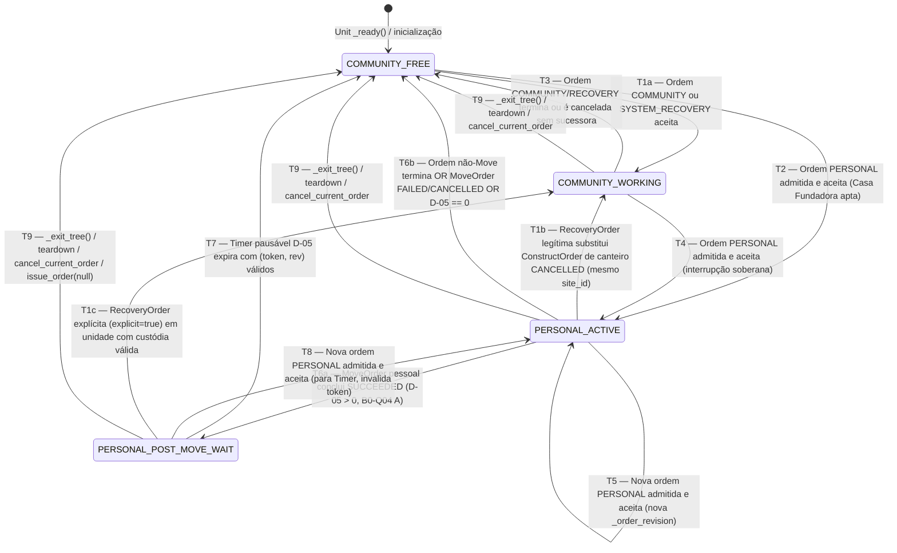

# Dawn of Kin — `R-03B B0-R2`: Planejamento Arquitetural da Casa Fundadora e `ControlMode` (Fechamento Focal)

> **Status Obrigatório:** **`PROPOSTA ARQUITETURAL — CANDIDATA DOCUMENTAL B0-R2 AGUARDANDO AUDITORIA INDEPENDENTE — IMPLEMENTAÇÃO NÃO AUTORIZADA`**
>
> **Etapa:** `R-03B B0-R2` — Fechamento Focal dos Contratos Arquiteturais (`F01`–`F04`), preservando integralmente `B0-Q01`–`B0-Q07` e `B0-A01`–`B0-A05`
>
> **Data:** `27/11/2026`
>
> **Revisão:** Fechamento cirúrgico sobre a candidata `B0-R1` (`2cc8fbcddb149cfe545b3b7c1e49038d322a2e5a`) derivada de `B0` (`e5024909fbb17cd5266d30e0452e92cc095d5923`)
>
> **Engine / Stack:** Godot `4.7.2.stable.official.ed1daf0bf` · GDScript tipado estrito · `gl_compatibility` · `Jolt Physics` · Intel UHD Graphics 620 (`1920×1080`, orçamento nominal `p95 <= 16,7 ms` em tomada CA)

---

## 1. Identificação e Status

- **Projeto:** *Dawn of Kin*
- **Incremento atual:** `R-03B B0-R2` — Fechamento Focal dos Contratos de Autoridade, Revisão e Fronteira `B1`/`B2` (`F01`–`F04`)
- **Natureza da entrega:** exclusivamente documental e cirúrgica. **Zero alterações em código executável, cenas, testes executáveis, recursos `.tres`, configurações ou documentos normativos vigentes.**
- **Estado na taxonomia obrigatória (`AGENTS.md` §2):**
  - `R-03A`: `HOMOLOGADO DEFINITIVAMENTE` · `INTEGRADO À DEVELOP` · `VALIDADO PÓS-INTEGRAÇÃO` · `PUBLICADO` · `ENCERRADO`
  - Decisões de produto `B0-Q01`–`B0-Q07`: **`DECIDIDO`** (expressamente aprovadas pelo proprietário em `26/11/2026`, preservadas integralmente)
  - `R-03B B0-R2`: **`CANDIDATA DOCUMENTAL AGUARDANDO AUDITORIA INDEPENDENTE`** (`NÃO HOMOLOGADA`)
  - `R-03B B1`, `B2`, `B3`, `B4` e etapas posteriores (`R-03C`–`T3.9`, `T4`–`T8`): **`PLANEJADO — NÃO AUTORIZADO / BLOQUEADO`**

---

## 2. Base Git

- **Repositório:** `https://github.com/Julian0s/Dawn-of-Kin`
- **Checkout principal permanente:** `C:\Projetos\Dawn of Kin` (`develop`, preservado intacto)
- **Branch canônica (`develop` e `origin/develop`):** `94c718024359dc7ff8360949313969b3ceaf9776` *(preservada intacta)*
- **SHA técnico homologado da `R-03A` (`D4-R2`):** `7c77e49d491f70c1867254f1a76a023050815431`
- **SHA de integração fast-forward da `R-03A`:** `46ed25a8faac84c316ff3f08e17de0fe8b8f04ae`
- **SHA documental `B0`:** `e5024909fbb17cd5266d30e0452e92cc095d5923`
- **SHA documental `B0-R1` auditado:** `2cc8fbcddb149cfe545b3b7c1e49038d322a2e5a` *(base direta do fechamento focal `B0-R2`)*
- **Linha estável protegida (`main` e `origin/main`):** `25e0a20f1d6a2f10a9e059afe69759fbe263db4a` *(preservada intacta)*
- **Tags protegidas preservadas:**
  - `t1-complete`: `3dcbba9386cbbee70025b47f4254ef097688a6e1`
  - `t2-complete`: `049ba9c7714c9b90b5515ae6ac30a28830454773`
  - `t3-3-complete`: `c7947c9630c102a9d77603cac0bae68678247c95`
- **Arquivo local protegido no checkout principal (`C:\Projetos\Dawn of Kin\project.godot`):** `SHA-256 = AEEFDA2810DA5C4EDFA9BF5F2A47A5841F8597238C8DAB4C2E202FAF70307613` *(preservado byte a byte)*
- **Isolamento documental da `R-03B B0` / `B0-R1` / `B0-R2`:**
  - Branch candidata existente: `feat/r-03b-founding-house-control-mode` (derivada estritamente de `develop @ 94c718024359dc7ff8360949313969b3ceaf9776`)
  - Worktree candidato único: `C:\Projetos\Dawn_of_Kin_wt_r_03b`
  - Evidências preservadas: `evidencias\R-03B\B0\` e `evidencias\R-03B\B0-R1\` (manifestos intocados)
  - Evidências `B0-R2` (manifesto próprio): `C:\Projetos\Backups\Dawn_of_Kin_Archive_Local\evidencias\R-03B\B0-R2\`

---

## 3. Autorização e Limites

O proprietário autorizou **exclusivamente** o fechamento focal **`R-03B B0-R2`**, restrito aos quatro achados da auditoria independente da `B0-R1`: **`F01`** (autoridade de trabalho comunitário), **`F02`** (autoridade de recuperação econômica), **`F03`** (revisões e notificações durante cancelamento/reentrância) e **`F04`** (fronteira técnica executável entre `B1` e `B2`). As sete decisões `B0-Q01`–`B0-Q07` e as correções `B0-A01`/`B0-A05` permanecem preservadas sem rediscussão.

### Estritamente fora de escopo em `B0-R2` e na própria `R-03B`
- **Proibido em `B0-R2`:** reescrever integralmente o plano ou os relatórios históricos `B0`/`B0-R1`; criar ou editar qualquer arquivo `.gd`, `.tscn`, `.tres`, `project.godot`, testes executáveis ou documentos normativos vigentes (`AGENTS.md`, `docs/Dawn_of_Kin_GDD.md`, `docs/ROADMAP_MESTRE.md`, `README.md`, `docs/KNOWN_ISSUES.md` ou relatórios históricos da `R-03A`).
- **Escopo documental exclusivo de `B0-R2`:** apenas alterações cirúrgicas neste plano e o novo relatório focal `docs/testing/R_03B_B0_R2_focal_contract_closure_candidate_report.md`. *(Supersessão explícita: as cláusulas específicas de `B0-R1` sobre assinatura de `issue_community_order`, parâmetros de `issue_recovery_order`, momento do incremento de `_order_revision`, leitura de `_current_order` na classificação de interrupção, callback sem argumentos do `Timer` e dependências `B1`/`B2` ficam formalmente superadas pelas especificações `F01`–`F04` deste documento.)*
- **Proibido na futura implementação da `R-03B`:**
  - Nascimentos, casamentos, genealogia completa, parentesco, residências familiares, envelhecimento dinâmico, calendário, morte, profissões, `JobSystem`, comunidades externas (`T5`/`T8`).
  - Atribuição manual opcional de equipe (`R-03C`), lista flutuante de tarefas (`R-03D`), nova construção com débito imediato (`R-04A`–`R-04C`), ativação global da HUD D2.2 (`R-05B`), depósito protegido (`T3.7`), persistência em disco (`T3.8`), velocidades `2×`/`4×` (`T4`), combate/Alento (`T6`).
  - Menu de configuração de `D-05`, cronômetro regressivo ou atualização contínua na HUD, botão de suspensão permanente do trabalho comunitário ou população narrativa permanente adicional no Capítulo 1.
  - Remoção da construção legada (`P-REC-1`) ou alteração das flags vigentes na `MainScene`: `use_provenance_economy = true`, `automatic_cancellation_recovery = true`, `use_d2_2_hud = false`.

---

## 4. Referências Normativas e Hierarquia Documental

A reconciliação deste plano respeita rigorosamente a hierarquia normativa do projeto:

1. **Decisões expressamente homologadas pelo proprietário** (`D-01`–`D-13`, `P-REC-1`–`P-REC-4`, `D-ERR-1 B`, `D-ERR-2 C`, `DEC-01`–`DEC-19`, homologação `R-03A` e deliberações **`B0-Q01`–`B0-Q07`** em `26/11/2026`).
2. **[docs/Dawn_of_Kin_GDD.md](../Dawn_of_Kin_GDD.md)** (`v1.3`, homologado em `R-02A R1`): §§1.2, 3.2, 3.3, 3.4, 4.1–4.3, 5.1, 5.3, 8, 9.1, 11 e 12.
3. **[AGENTS.md](../../AGENTS.md)**: governança permanente, taxonomia de status, regra de acessibilidade pela `MainScene` e ciclo de 20 etapas.
4. **[docs/ROADMAP_MESTRE.md](../ROADMAP_MESTRE.md)**: §§1, 3, 4 (linha 5 `R-03B`), 5 (`D-03`, `D-04`, `D-05`, `D-06`, `D-10`, `P-REC-1..4`) e 6.
5. **[docs/design/DAWN_OF_KIN_VISUAL_DESIGN_SYSTEM.md](../design/DAWN_OF_KIN_VISUAL_DESIGN_SYSTEM.md)** (`D2.2`, Cláusula Pétrea) e **[docs/KNOWN_ISSUES.md](../KNOWN_ISSUES.md)** (§§1–6).
6. **Código efetivamente homologado na base `94c7180` / `7c77e49`** e relatórios da série `R-03A` (`D0`, `D1-R3`, `D2-R1`, `D3.1-R1`, `D3.2`, `D3.3-R1`, `D3.4`, `D4-R1`, `D4-R2`, `CLOSEOUT`).
7. **Documentação histórica de contexto:** [RUX_0_autonomous_work_family_PROPOSAL.md](RUX_0_autonomous_work_family_PROPOSAL.md) e [DAWN_OF_KIN_GLOBAL_VISION_AUDIT_PROPOSAL.md](../audits/DAWN_OF_KIN_GLOBAL_VISION_AUDIT_PROPOSAL.md).

### Reconciliação explícita frente à proposta histórica `RUX-0`
A `RUX-0` foi parcialmente substituída pelas decisões `D-01`–`D-13`, pela revisão `R-03A D0`–`D4` e pelas decisões `B0-Q01`–`B0-Q07`. **Não restaurar** na `R-03B`:
- Trabalho automático disparado por simples seleção de fonte (`R-03A D1` homologou `SELEÇÃO → AUTORIZAÇÃO PELA HUD → EXECUÇÃO`).
- Seleção heterogênea incompatível ou arraste iniciado sobre fonte sem `Shift` (`R-03A D1` / `D1-R3`).
- Agrupamentos/botões/cartões de cancelamento antigos na fonte (`R-03A D2` homologou o selo mineral `×`/`×N` por categoria).
- Estado `PERSONAL_HOLD` permanente com botão `"Liberar para comunidade"` (`RUX-0` §5.2 Opção A foi **substituída por `D-05`**).
- Obrigatoriedade da atribuição manual (`D-03`/`D-10` reservam a atribuição manual **opcional** à `R-03C`).
- Residência obrigatória na Casa Principal sem escolha (`D-06` concede ao jogador a escolha em `T5`).

---

## 5. Requisitos Decididos (`DECIDIDO`)

Estes contratos estão formalmente homologados e **não são reabertos** neste plano:

### 5.1 Requisitos Canônicos Anteriores (`GDD v1.3`, `Roadmap Mestre`, `R-03A`)

| ID | Contrato Decidido | Efeito Direto na `R-03B` |
|---|---|---|
| **`D-04`** | Pertencem à **Casa Fundadora**: os **2 protagonistas originais**, **todos os seus descendentes diretos** e **cônjuges externos** que ingressarem por casamento. Todos os membros selecionáveis e aptos possuem controle pessoal direto prioritário. Demais moradores atuam pelo sistema comunitário automático. | Metadados mínimos (`HouseAffiliation`, `FoundingHouseOrigin`) desacoplados de `display_name` e de residência física. |
| **`DEC-07`** | Proteção contra morte definitiva é **exclusiva dos 2 protagonistas originais** (`is_original_founder == true`). Descendentes e cônjuges externos são mortais. | Predicado explícito `is_original_founder()` isolando proteção contra morte de controle pessoal. |
| **`DEC-04`** | 4 faixas etárias: **Bebê (`0–2`)** não selecionável nem comandável; **Criança (`3–11`)** tarefas leves e seguras (ex.: coleta de frutos; sem corte de árvores, mineração, construção pesada ou combate; crianças da Casa Fundadora aceitam ordens pessoais compatíveis com essas restrições); **Jovem (`12–17`)** atividades apropriadas à idade; **Adulto (`18+`)** aptidão plena. | Enum `AgeStage` + matriz de permissões corrigida (`B0-A01`), validada em fixtures automatizadas sem introduzir crianças/bebês na `MainScene` jogável. |
| **`D-05`** | Prioridade absoluta de ordens pessoais da Casa Fundadora sobre o trabalho comunitário; após concluir um **`MoveOrder` pessoal**, aguardar **intervalo configurável** e retornar automaticamente ao trabalho comunitário. | Estado `PERSONAL_POST_MOVE_WAIT` com `Timer` one-shot pausável e retorno orientado a eventos (sem polling e sem `PERSONAL_HOLD` permanente). |
| **`D-10`** | Equipe manual opcional (`R-03C`) restrita a integrantes aptos da Casa Fundadora. | `UnitControlPermissions` expõe predicado de prontidão para `R-03C`, sem implementar gestos/UI de `R-03C`. |
| **`HD3-06`** | Registro histórico legítimo da `R-03A`: com exclusão apenas por tarefa, o trabalhador assumia outra tarefa autorizada imediatamente após concluir `MoveOrder`. | Reconciliada por `PERSONAL_POST_MOVE_WAIT` (`D-05`) sem reclassificar retroativamente o comportamento homologado da `R-03A` como bug. |
| **`D0-A03` / `D0-A04`** | Derrubada irreversível de árvores (`STANDING → CHOPPING → FELLING → FALLEN → DEPLETED`) e conservação econômica regional sobre 8 compartimentos físicos e perdas legítimas independentes. | Mudança de `ControlMode` tem delta econômico zero; nunca aborta transação ativa, nunca reinicia `FELLING` e nunca perde ou duplica carga. |
| **`P-REC-1` / `D-ERR-1 B`** | Fluxo antigo de construção (`D2`/`D3`/`DEC-11B`, `CancellationRecoveryDispatcher`) preservado até `R-04C`; `use_d2_2_hud = false` preservado na `MainScene` até `R-05B`. | `ConstructOrder`, `CancellationRecoveryDispatcher` e `RecoveryOrder` preservados integralmente (incluindo substituição legítima de `ConstructOrder` de canteiro cancelado, `B0-A03`). |

### 5.2 Decisões Definitivas do Proprietário para a `R-03B` (`26/11/2026`, `B0-Q01`–`B0-Q07`)

| ID | Alt. Originalmente Recomendada (`B0`) | Alt. Aprovada pelo Proprietário (`26/11/2026`) | Decisão Homologada | Consequência Arquitetural |
|---|---|---|---|---|
| **`B0-Q01`** | Alt. A | **Alt. A** | Moradores comuns (`COMMUNITY`) são selecionáveis visualmente para **inspeção somente leitura** (nome, mochila, estado, tarefa comunitária), **sem controle pessoal**. | `SelectionManager` bloqueia `BABY` e permite selecionar `COMMUNITY` (`CHILD`/`YOUTH`/`ADULT`) somente leitura; `CommandController` e `Unit` bloqueiam ordens pessoais. |
| **`B0-Q02`** | Alt. A | **Alt. A** | Seleções mistas (Casa Fundadora + moradores comuns/inelegíveis) executam ordens pessoais **exclusivamente nos membros aptos da Casa Fundadora**. | Filtragem obrigatória **antes** de planejar posições (`GroupMovePlanner`), reservar vagas, validar alvos econômicos ou atualizar `DestinationMarker`; unidades excluídas preservam ordens ativas. |
| **`B0-Q03`** | Alt. A | **Alt. B** *(divergiu da recomendação `B0`)* | `Worker3` e `Worker4` (`TemporaryTestWorkersController`) classificados como **moradores comuns temporários** (`COMMUNITY`, `NONE`, `ADULT`), preservando caráter transitório de ferramenta de desenvolvimento e reconciliando os testes antigos afetados. | `TemporaryTestWorkersController` instancia `Worker3`/`Worker4` como `COMMUNITY`; `[+ Workers C4]` permite verificar Fundador × Morador comum na `MainScene`; testes legados `D9`/C4 reconciliados em `B1` via fixtures fundadoras ou entradas comunitárias legítimas (sem enfraquecer asserções e sem bypass). |
| **`B0-Q04`** | Alt. A | **Alt. A** | Intervalo `D-05` aplicado **somente** após `MoveOrder` pessoal concluída com **`SUCCEEDED`**. | `FAILED`, `CANCELLED`, movimento parcial sem sucesso e ordens recusadas na admissão nunca iniciam `PERSONAL_POST_MOVE_WAIT`. |
| **`B0-Q05`** | Alt. A | **Alt. B** *(divergiu da recomendação `B0`)* | Retorno automático após `D-05` permitido **inclusive à mesma tarefa comunitária ainda autorizada**, desde que não cancelada nem bloqueada (`BLOCKED_REAUTHORIZATION`). | Interrupção por `MoveOrder` pessoal legítima deixa de gravar exclusão permanente em `WorkTask.excluded_unit_ids`; tarefa permanece `PENDING_WORKERS` (com `personal_control_active` como espera temporária), enquanto cancelamento administrativo/outras exclusões continuam gerando `excluded_unit_ids` / `BLOCKED_REAUTHORIZATION`; testes `R-03A` específicos reconciliados em `B3`. |
| **`B0-Q06`** | Alt. A | **Alt. A** | Calibração experimental de **`3 s`, `8 s` e `15 s`** em **tempo de simulação pausável** (`PROCESS_MODE_PAUSABLE`), com `0 s` apenas para testes técnicos determinísticos. | Nenhum desses valores é ainda o padrão definitivo; calibração empírica ocorrerá em `B4` sem antecipar menu de configuração nem velocidades `2×`/`4×`. |
| **`B0-Q07`** | Alt. A | **Alt. A** | **Rótulo discreto de estado de controle** e **feedback breve de rejeição** na HUD transitória existente (`use_d2_2_hud = false`), **sem cronômetro regressivo** nem redesenho. | Atualização estritamente orientada a eventos em `SelectedUnitPanel`/`HudFormatter` e `AutonomousGatherFeedback`; zero cronômetro, zero barra temporal, zero polling (`B0-A05`). |

---

## 6. Questões Efetivamente Remanescentes (Resumo)

As sete questões **`B0-Q01`–`B0-Q07` estão encerradas** quanto às alternativas deliberadas pelo proprietário em `26/11/2026`. Não são reapresentadas como pendentes.

Resta legitimamente **uma única definição de produto em aberto por força da própria `B0-Q06`**:
1. **Duração padrão definitiva de `D-05` (entre `3 s`, `8 s`, `15 s` ou ajuste fino):** a ser calibrada empiricamente pelo proprietário no aceite humano futuro (`B4`), permanecendo provisoriamente configurável durante `B3`–`B4`.

*(A análise transversal de `B0-R1` confirmou **zero incompatibilidades materiais adicionais não resolvidas** entre `B0-Q01`–`B0-Q07`, `B0-A01`–`B0-A05` e os contratos homologados da `R-03A`.)*

---

## 7. Inventário da Arquitetura Atual

Todos os componentes abaixo foram auditados diretamente no código-fonte real na base `94c718024359dc7ff8360949313969b3ceaf9776`.

| Componente / Arquivo | Responsabilidade Atual e Autoridade | Dependências / Sinais / Estado Principal | Pontos de Extensão e Riscos para `R-03B` | Modificação Futura? |
|---|---|---|---|---|
| `src/units/character_definition.gd` (`CharacterDefinition`, `L1–36`) | Recurso de identidade e perfil motor (`character_id`, `display_name`, velocidades, `base_carry_capacity`). | Sem dependências de cena. Valida invariantes em `is_valid()` (`L23–36`). | Extensão com `HouseAffiliation`, `FoundingHouseOrigin`, `AgeStage` e validação cruzada em `is_valid()`. Defaults seguros (`COMMUNITY`, `NONE`, `ADULT`). | **Sim (`B1`)** |
| `data/characters/leader_a.tres`, `leader_b.tres` (`L1–14`) | Definições dos 2 protagonistas originais (`&"leader_a"`, `&"leader_b"`). | Referenciados por `src/main/main.tscn:8-9,52,56`. | Recebem `FOUNDING_HOUSE`, `ORIGINAL_FOUNDER`, `ADULT`. | **Sim (`B1`)** |
| `src/units/unit.gd` (`Unit`, `L1–427`) | Entidade RTS (`CharacterBody3D`): `_current_order`, `_order_revision`, `_state`, `_carry_load`, `_is_reserved_withdrawal_locked()` (`L239–244`), `issue_order()` (`L247–288`), `cancel_current_order()` (`L290–315`), `_exit_tree()` (`L102–110`). | Sinais: `state_changed(new, prev)` (`L16`), `order_finished(order)` (`L17`). Grupo `selectable_units` (`L58`). | **Autoridade final** de admissão de ordens (`B0-A02`), composição de `UnitControlState` (`B2`), atomicidade contra reentrância (`B0-A04`) e `Timer` lazy pausável `D-05` (`B3`). | **Sim (`B1`/`B2`/`B3`)** |
| `src/units/unit_movement.gd` (`UnitMovement`, `L1–807`) | Navegação XZ, `NavigationAgent3D`, gravidade, RVO, `MoveState`. | Desconecta sinais em `_exit_tree()` (`L87–90`). | Nenhuma autoridade de `ControlMode` nem de permissões. | **Não** |
| `src/units/orders/unit_order.gd` (`UnitOrder`, `L1–99`) | Classe base `RefCounted` (`PENDING`, `RUNNING`, `SUCCEEDED`, `FAILED`, `CANCELLED`; `failure_reason`). | Sem campo de origem hoje. | Carrega `order_origin` (`OrderOrigin`, somente leitura após admissão em `Unit`), `can_cancel_now() -> bool` (`F03`), guarda de notificação única `_finished_notified` e `interruption_cause` gravada no encerramento por substituição (`F03`/`B0-Q05 B`). | **Sim — mínimo (`B1`/`B2`)** |
| `src/units/orders/move_order.gd` (`MoveOrder`, `L1–119`) | Movimento RTS via `WorldNavigation.find_path()` (`L52`), distinguindo `SUCCEEDED` (`L67,111`), `PARTIAL_UNREACHABLE`/`FAILED` (`L75,79,109,114,117`), `CANCELLED`. | Observado via `Unit.order_finished`. | Gatilho exclusivo de `D-05` quando `origin == PERSONAL` e `is_succeeded() == true` (`B0-Q04 A`). Pode concluir sincronamente em `start()` (`L65–68`). | **Não** |
| `src/units/orders/gather_resource_order.gd` (`L1–1217`) & `deliver_to_camp_order.gd` (`L1–540`) | Ciclo físico de coleta + corte progressivo (`D3`) + entrega + cancelamento cooperativo (`D2-B`) + `CutAuthorization` + guardas por revisão. | `is_provenance_transfer_executing()` (`L199–210, 428–429`) pode recusar cancelamento mantendo ordem ativa. | Preservar 100% do ciclo físico; expõe apenas `can_cancel_now()` (`not (use_provenance_transactions and is_provenance_transfer_executing())`) para admissão sem incremento prematuro de `_order_revision` (`F03`). | **Mínimo — 1 predicado (`B2`)** |
| `src/units/orders/construct_order.gd` (`L1–1479`) | Ordem legada `P-REC-1` de suprimento/montagem de `ConstructionSite`. | `site: ConstructionSite`, `cancel()` (`L230–245`), `_defer_transfer_replan()` (`L258–265`). | Preservar 100% da lógica de construção; expõe apenas `can_cancel_now()` (somente leitura espelhando `_defer_transfer_replan()` sem mutar `_replan_requested`) para `F03`. | **Mínimo — 1 predicado (`B2`)** |
| `src/units/cancellation_recovery_dispatcher.gd` (`L1–183`) & `recovery_order.gd` (`L1–226`) | Despacho regional orientado a eventos e execução de recuperação física de sobras (`T3.6.3`, `P-REC-1`). | `_assign()` (`L85–122`) verifica `_assigning`, `_busy()`, `expected_revision`, `entry.manual` (`L90`), domínio (`L93`) e permite substituir `ConstructOrder` do `site_id` cancelado (`L98–100`). Chama `unit.issue_order(order)` em `L111`. | Passa a chamar `unit.issue_recovery_order(order, expected_revision, explicit)` já em **`B1`** (`F02`/`F04`), expondo `is_admitting_recovery(unit, order, explicit)` somente durante `_assigning`, enquanto `Unit` deriva `record.site_id` diretamente de `CancellationRecoveryTransaction._record(...)`. | **Sim — mínimo (`B1`)** |
| `src/rts/selection_manager.gd` (`L1–199`) | Conjunto tipado `_selected_units: Array[Unit]`; limpeza em `tree_exited` (`L148–155`). | Sinal `selection_changed(selected_units)`. `_is_selectable_unit()` (`L189–190`). | Aplica `UnitControlPermissions.can_be_selected_visually(unit)`: bloqueia `BABY`, permite `FOUNDING_HOUSE` e `COMMUNITY` (`CHILD`/`YOUTH`/`ADULT`) para inspeção (`B0-Q01 A`). | **Sim (`B1`)** |
| `src/rts/command_controller.gd` (`L1–483`) | Traduz `PickResult` em `MoveOrder`, `GatherResourceOrder`, `ConstructOrder`. `_collect_commandable_units()` (`L465–472`), `command_at()` (`L78–192`), `command_units_to_gather()` (`L195–222`), `command_units_to_site()` (`L312–335`). | Chama `unit.issue_order()` em `L174`, `L273` e `L359`. | Separa entrada pessoal de `dispatch_community_gather(task, chosen_unit, dispatch_lease)` (`B1`/`F01`); filtra seleção mista (`B0-Q02 A`) **antes** de `GroupMovePlanner`, vagas, `_admit_economic_command` e `DestinationMarker`; emite feedback de rejeição conciso (`B0-Q07 A`). | **Sim (`B1`/`B2`)** |
| `src/rts/community_task_dispatcher.gd` (`L1–940`) | Distribuidor orientado a eventos (`set_process(false)`, `set_physics_process(false)`), fila coalescida `call_deferred("_flush_dispatch")`, batch `D4-R1`/`D4-R2`, cancelamento cooperativo `D2-B`. | Chama `_command_controller.command_units_to_gather()` (`L687`) e `unit.cancel_current_order()` (`L234`). Avalia tarefas em `_evaluate_unassigned_task()` (`L751–812`). | Abre/consolida/aborta `DispatchLease` no `CommunityWorkBoard` e usa `dispatch_community_gather()` já em **`B1`** (`F01`/`F04`); integra `ControlMode` + `control_mode_changed` (`B2`/`B3`); lê causa comprometida de interrupção em `_handle_assigned_order_finished()` (`F03`/`B0-Q05 B`) e classifica razões em `_evaluate_unassigned_task()` (`B3`). | **Sim (`B1`/`B2`/`B3`)** |
| `src/rts/community_work_board.gd` (`L1–459`) & `src/rts/work_task.gd` (`L1–100`) | Registro regional idempotente de `WorkTask`, `excluded_unit_ids` (`WorkTask:38`), `tree_cut_authorization` (`WorkTask:36,91–100`). | Sinais: `task_registered`, `task_updated`, `task_closed`. | Emite, valida, consolida e revoga `DispatchLease` (`begin_task_dispatch` / `validate_dispatch_lease` / `commit_task_dispatch` / `abort_task_dispatch`) já em **`B1`** (`F01`), revogando leases em `close_task`, `block_for_reauthorization`, `reauthorize_gather_task` e `teardown`. Preserva estrutura, idempotência e inércia de `BLOCKED_REAUTHORIZATION`. | **Sim — mínimo (`B1`)** |
| `src/rts/rts_input_controller.gd` (`L1–351`) & `src/rts/autonomous_gather_input.gd` (`L1–875`) | Picking, hover, arraste RTS vs `Shift+arraste` de fontes, HUD contextual, `Esc`. | Delega seleção a `SelectionManager` e botão direito a `CommandController.command_at()`. | Preservar 100% `D1`/`D1-R3`/`D2`/`D4-R2`. Hover/box selection respeitam `can_be_selected_visually()` (`BABY` ignorado). | **Mínimo (`B1` hover/feedback)** |
| `src/economy/unit_carry_load.gd`, `reserved_withdrawal_coordinator.gd`, `resource_source.gd` | Mochila física com proveniência, autoridade transacional regional única, estoque finito e `TreeHarvestStage`. | Locks transacionais e conservação regional. | **Intocáveis.** | **Não** |
| `src/economy/economy_clock_controller.gd` & `src/ui/d2/d2_simulation_pause_controller.gd` | Relógio econômico pausável (`PROCESS_MODE_PAUSABLE`, `ignore_time_scale = false`) e pausa cooperativa `SceneTree.paused`. | Sem polling. | Referência canônica do padrão de pausa para o `Timer` lazy de `D-05`. | **Não** |
| `src/units/temporary_test_workers_controller.gd` (`L1–687`) | Spawner/removedor seguro de `Worker3` (`&"test_worker_3"`) e `Worker4` (`&"test_worker_4"`). Chama `worker.cancel_current_order("temporary_worker_removed")` (`L183`). | `_create_worker_definition()` (`L591–609`). | Por **`B0-Q03 B`**, `Worker3`/`Worker4` recebem explicitamente `COMMUNITY`, `NONE`, `ADULT` em `B1`, preservando caráter transitório de desenvolvimento e permitindo validar Fundador × Morador comum na `MainScene` via `[+ Workers C4]`. | **Sim (`B1`)** |
| `src/main/main.gd` (`L1–612`) & `src/main/main.tscn` (`L1–122`) | Composição raiz da `MainScene`, flags (`use_provenance_economy=true`, `automatic_cancellation_recovery=true`, `use_d2_2_hud=false`), `request_controlled_teardown()`. | `LeaderA` (`main.tscn:50–52`), `LeaderB` (`main.tscn:54–56`). | Expõe parâmetro configurável de duração `D-05` (`B3`), conecta feedback breve de rejeição (`B1`/`B3`) e preserva teardown limpo. | **Sim — mínimo (`B1`/`B3`)** |
| `src/ui/selected_unit_panel.gd`, `src/ui/hud_formatter.gd`, `src/ui/autonomous_gather_feedback.gd`, `src/ui/d2/components/d2_founder_steles_view.gd` | HUD transitória orientada a eventos (`set_process(false)`), banner superior compatível com `D4-A01`, e vistas D2.2 inativas (`use_d2_2_hud = false`). | `D2FounderStelesView` referencia `leader_a`/`leader_b` (`L22–23, 651–669`). | Por **`B0-Q07 A`** e **`B0-A05`**: apenas rótulo textual discreto de controle/somente leitura no `SelectedUnitPanel`/`HudFormatter` (orientado a eventos, **sem cronômetro regressivo**) + feedback breve de rejeição em `AutonomousGatherFeedback`. | **Sim — mínimo (`B1`/`B3`)** |

---

## 8. Fluxos de Ordens Existentes e Auditoria Completa de Entradas (`B0-A02`)

### 8.1 Mapeamento Exaustivo de Todos os Pontos de Emissão e Cancelamento em `src/`
Varredura direta em todo o diretório `src/` na base `94c7180` confirmou **exatamente 4 chamadas de `issue_order()` e 2 chamadas de `cancel_current_order()` em produção**:

| # | Arquivo e Linha | Chamador | Ordem Emitida / Ação | Origem Legítima | Papel na Arquitetura Reconciliada |
|---|---|---|---|---|---|
| 1 | `src/rts/command_controller.gd:174` | `CommandController.command_at()` | `MoveOrder` | `OrderOrigin.PERSONAL` | Admissão pessoal em `CommandController` (após filtro `B0-Q02 A`) → `unit.issue_personal_order(order)`. |
| 2 | `src/rts/command_controller.gd:273` | `CommandController._execute_gather_resource()` | `GatherResourceOrder` | **Hoje misto!** Pessoal (`command_at`) e Comunitário (`CommunityTaskDispatcher:687`). | **Separado em `B1` (`F01`):** `_command_gather_resource` (pessoal) chama `unit.issue_personal_order(order)`; novo `dispatch_community_gather(task, chosen_unit, dispatch_lease)` (comunitário) chama `unit.issue_community_order(order, dispatch_lease)`. |
| 3 | `src/rts/command_controller.gd:359` | `CommandController._command_supply_construction_site()` | `ConstructOrder` | `OrderOrigin.PERSONAL` | Admissão pessoal em `CommandController` (após filtro `B0-Q02 A`) → `unit.issue_personal_order(order)`. |
| 4 | `src/units/cancellation_recovery_dispatcher.gd:111` | `CancellationRecoveryDispatcher._assign()` | `RecoveryOrder` | `OrderOrigin.SYSTEM_RECOVERY` | Chama `unit.issue_recovery_order(order, expected_revision, explicit)` já em **`B1`** (`F02`/`F04`), sem aceitar `site_id` do chamador (derivado do registro real `CancellationCustodyRecord`). |
| 5 | `src/rts/community_task_dispatcher.gd:234` | `CommunityTaskDispatcher._apply_community_cancel_to_order()` | `cancel_current_order(REASON_COMMUNITY_WORK_CANCELLED)` | Cancelamento comunitário cooperativo | Preserva contrato `D2-B`; transita para `COMMUNITY_FREE` somente se a ordem encerrar. |
| 6 | `src/units/temporary_test_workers_controller.gd:183` | `TemporaryTestWorkersController.remove_temporary_workers_safely()` | `cancel_current_order("temporary_worker_removed")` | Remoção controlada de ferramenta de teste | Cancela ordem ativa/espera antes de remover `Worker3`/`Worker4` (`COMMUNITY`). |

### 8.2 Separação dos Sete Conceitos de Autoridade (`B0-A02`)
Para eliminar qualquer brecha de contorno ou falsificação de origem, a arquitetura separa explicitamente:

1. **Autoridade de solicitar uma ação:** quem tem legitimidade para pedir a operação (`RtsInputController` → jogador; `CommunityTaskDispatcher` → quadro comunitário; `CancellationRecoveryDispatcher` → custódia de cancelamento).
2. **Origem legítima da ordem (`OrderOrigin`):** `NONE`, `PERSONAL`, `COMMUNITY`, `SYSTEM_RECOVERY` — **a origem declarada isoladamente NÃO prova autoridade**.
3. **Admissão de pré-condições:** navegação pronta, domínio regional/proveniência, bloqueadores pendentes, locks econômicos e seleção filtrada (`B0-Q02 A`).
4. **Permissão de gameplay (`UnitControlPermissions`):** regras `D-04`, `DEC-04`, `D-10` avaliadas **tanto** no coordenador de entrada **quanto** no ponto final de instalação em `Unit`.
5. **Aceitação pela unidade (`Unit`):** verificação atômica de `UnitControlPermissions` + compatibilidade estrita `(tipo da ordem × OrderOrigin × estado atual)` + `_is_reserved_withdrawal_locked()` + `is_inside_tree()` **antes** de incrementar `_order_revision` ou cancelar `_current_order`.
6. **Execução:** `order.start()` e `physics_update()` vinculados estritamente a `(issued_revision, order, origin)`.
7. **Observabilidade para testes:** getters somente leitura (`get_control_mode()`, `get_active_order_origin()`, `get_last_order_rejection_reason()`, `get_order_revision()`, `is_community_dispatch_eligible()`), sem criar qualquer parâmetro de bypass de permissões em produção.

### 8.3 Barreira Unificada no Ponto de Instalação em `Unit` (`B0-A02`, `F01`, `F02`)
Nenhuma entrada de produção conseguirá instalar uma ordem pessoal em unidade inelegível contornando `CommandController`, nem falsificar `COMMUNITY` ou `SYSTEM_RECOVERY` via parâmetros fornecidos pelo chamador:

- **`Unit.issue_personal_order(order: UnitOrder) -> bool` (e `Unit.issue_order(order: UnitOrder) -> bool` preservado para retrocompatibilidade estrita):**
  - Se `order == null`: trata explicitamente como parada/cancelamento limpo (ver §14.4).
  - Se `order != null`: **valida incondicionalmente na própria `Unit`** `UnitControlPermissions.can_receive_personal_order_for_order(self, order)` (aceita apenas `MoveOrder`, `GatherResourceOrder` compatível com `AgeStage`, `ConstructOrder` compatível com `AgeStage` e `DeliverToCampOrder` compatível com `AgeStage`, **exclusivamente** para membros aptos da `FOUNDING_HOUSE`; rejeita `RecoveryOrder` nesta entrada e rejeita qualquer `COMMUNITY`, `BABY` ou atividade pesada para `CHILD`).
  - Se recusado: retorna `false`, registra `_last_order_rejection_reason`, **não** incrementa `_order_revision`, **não** cancela `_current_order`, **não** para `Timer D-05` e **não** emite `control_mode_changed`.

- **`Unit.issue_community_order(order: GatherResourceOrder, dispatch_lease: CommunityWorkBoard.DispatchLease) -> bool` (Contrato Fechado `F01` — supera assinatura sem lease de `B0-R1`):**
  - Reutiliza `CommunityWorkBoard` (`src/rts/community_work_board.gd:160–221, 315–365`) e `WorkTask` (`src/rts/work_task.gd:23–38, 76–100`) sem criar sistema paralelo de permissões.
  - **Atribuição em preparação sem dependência circular:** antes de chamar `CommandController.dispatch_community_gather()`, `CommunityTaskDispatcher._try_dispatch_unit_to_task()` (`community_task_dispatcher.gd:677–748`) solicita ao seu `_board` um `DispatchLease` (`RefCounted` leve emitido exclusivamente por `CommunityWorkBoard.begin_task_dispatch(task, chosen_unit)`). O `Board` registra o `lease` como **atribuição em preparação** daquela `WorkTask` (impedindo atribuição concorrente duplicada) e revoga automaticamente qualquer `lease` pendente se `close_task()`, `block_for_reauthorization()`, `reauthorize_gather_task()` ou `teardown()` ocorrerem no `Board`.
  - **As 10 validações obrigatórias executadas em `dispatch_lease.validate_for_installation(self, order)` (no `Board` dono do lease, no ponto de instalação em `Unit`):**
    1. `dispatch_lease != null`, não revogado, não consumido e pertencente a um `CommunityWorkBoard` válido na árvore;
    2. `task` efetivamente registrada em `_board._tasks` e indexada como ativa em `_board._active_by_source_id[source.get_instance_id()] == task` (impede tarefa órfã ou de outro `Board`), com `task.task_id == dispatch_lease.task_id`;
    3. `order is GatherResourceOrder` e `order.source == task.source` (mesma instância válida e utilizável);
    4. `task.resource_id == order.source.get_resource_id()` e `task.kind == WorkTask.kind_from_resource_id(order.source.get_resource_id())` (cobre **`wood`, `stone` e `food`** uniformemente);
    5. `dispatch_lease.unit == self` e `not task.excluded_unit_ids.has(self.get_instance_id())`;
    6. `_board.is_source_in_region_domain(order.source)`, `task.region_id == _board.get_region_id()`, `self.get_world_3d() == order.source.get_world_3d()` e (quando proveniência ativa) `self.get_meta(&"region_id", &"") == task.region_id`;
    7. `task.state == WorkTask.State.PENDING_WORKERS` (recusa `IN_PROGRESS`, `BLOCKED_REAUTHORIZATION`, `CANCELLED`, `COMPLETED`, `FAILED`);
    8. Para `WOOD`: `task.tree_cut_authorization != null`, `order.tree_cut_authorization == task.tree_cut_authorization` (identidade exata do token daquela tarefa, nunca token de outra árvore ou ordem pessoal) e `task.tree_cut_authorization.is_valid_for(order.source)`; para `STONE` e `FOOD`: a própria existência do registro ativo + `lease` válido no `CommunityWorkBoard` comprova autorização do jogador;
    9. Ausência de atribuição incompatível (`task.assigned_unit == null`, `task.assigned_order == null`, e `dispatch_lease` é o único lease ativo para `task`);
    10. `self.get_order_revision() == dispatch_lease.expected_unit_revision` (rejeita contexto obsoleto).
  - Além do `lease`, `Unit` valida `UnitControlPermissions.can_participate_in_community_work_for_order(self, order)`, `not _is_reserved_withdrawal_locked()`, `_current_order == null`, `_state == State.IDLE` (em `B1`; e `control_mode == COMMUNITY_FREE` a partir de `B2`).
  - **Consolidação e rollback seguro (preservando guardas `D4-R2`, `community_task_dispatcher.gd:706–743`):** ao retornar ao Dispatcher, somente se `board.is_dispatch_lease_valid(lease)` e `task.state == PENDING_WORKERS` e `chosen_unit.get_current_order() == order` e `chosen_unit.get_order_revision() == installed_revision` é que o Dispatcher grava `task.assigned_unit/order/order_revision`, muda para `IN_PROGRESS` e chama `board.commit_task_dispatch(lease)`. Se a autoridade foi invalidada durante callbacks de `order.start()` (tarefa cancelada ou reautorizada), o `Board` já revogou o `lease` e o Dispatcher cancela **exclusivamente** `order` se e somente se `chosen_unit.get_current_order() == order and chosen_unit.get_order_revision() == installed_revision` (jamais atingindo uma ordem pessoal sucessora), chamando `board.abort_task_dispatch(lease)` em qualquer saída não consolidada.

- **`Unit.issue_recovery_order(order: RecoveryOrder, expected_revision: int, explicit: bool = false) -> bool` (Contrato Fechado `F02` — supera parâmetro `expected_site_id` de `B0-R1`):**
  - **Proibição de confiar em parâmetros declarados pelo chamador:** `Unit` **não recebe `expected_site_id` do chamador** nem duplica contabilidade econômica.
  - **Separação de comprovação entre `CancellationRecoveryDispatcher` e `Unit`:**
    1. **`CancellationRecoveryDispatcher._assign()` (`src/units/cancellation_recovery_dispatcher.gd:85–122`):** comprova `_assigning == false`, `_busy() == false`, `expected_revision == unit.get_order_revision()`, guarda `if not explicit and prior.get("manual", false): return false` (`L90`), existência de `record` com custódia pendente e identidade da unidade no domínio (`L93`); durante a janela ativa `_assigning = true`, registra a admissão corrente `(unit, order, order.cancel_id, explicit)` consultável somente leitura via `dispatcher.is_admitting_recovery(unit, order, explicit) -> bool` (com `explicit == true` gerado exclusivamente por `CancellationRecoveryDispatcher.assign()` `L37–48`, e `explicit == false` exclusivamente por `_flush()` `L160–170`).
    2. **`Unit.issue_recovery_order(order, expected_revision, explicit)` (no ponto de instalação):**
       - Valida `order is RecoveryOrder`, `not order.cancel_id.is_empty()`, `not order.region_id.is_empty()`, `is_inside_tree()`, `not is_queued_for_deletion()`, `not _is_reserved_withdrawal_locked()`, `_order_revision == expected_revision`, `definition != null and definition.is_valid()`, `age_stage != BABY`.
       - **Comprova admissão legítima:** obtém `var disp := order._dispatcher.get_ref() as CancellationRecoveryDispatcher` e exige `is_instance_valid(disp)`, `disp.is_inside_tree()`, `disp.is_admitting_recovery(self, order, explicit) == true` (impede qualquer chamador externo de forjar `explicit = true` ou emitir `RecoveryOrder` fora da admissão legítima!).
       - **Deriva o registro regional real somente leitura** via `CancellationRecoveryTransaction._record(get_world_3d(), order.region_id, order.cancel_id)` (`src/economy/cancellation_recovery_transaction.gd:20–22`): exige `record != null`, `record.world_instance_id == get_world_3d().get_instance_id()`, `record.region_id == order.region_id`, `record.has_unsettled_custody() == true`, `not ReservedWithdrawalCoordinator.is_region_transaction_active_readonly(get_world_3d(), order.region_id)` e `ReservedWithdrawalCoordinator.validate_unit_identity_in_domain_readonly(get_world_3d(), order.region_id, self, _carry_load, get_tree()).ok == true`.
       - **Deriva `site_id` exclusivamente de `record.site_id`** e admite somente nos casos legítimos (`B0-A03` / `F02`):
         1. **`T1a` (unidade ociosa):** `_current_order == null`, `_state == State.IDLE` (e em `B2`/`B3`: `control_mode == COMMUNITY_FREE`).
         2. **`T1b` (substituição de `ConstructOrder` do canteiro cancelado):** `_current_order is ConstructOrder`, `is_instance_valid(_current_order.site)`, `_current_order.site.site_id == record.site_id` (lido do registro real!) e `_current_order.site.get_site_state() == ConstructionSite.SiteState.CANCELLED`.
         3. **`T1c` (somente a partir de `B3`, quando `PERSONAL_POST_MOVE_WAIT` existir):** `_current_order == null`, `control_mode == PERSONAL_POST_MOVE_WAIT` e `explicit == true` comprovado por `disp.is_admitting_recovery(self, order, true)`.
       - **Recusa sempre** `MoveOrder`, `GatherResourceOrder`, `ConstructOrder` de canteiro ativo ou de outro `site_id`, recuperação automática (`explicit == false`) durante `PERSONAL_POST_MOVE_WAIT`, ou qualquer `RecoveryOrder` sem custódia pendente/domínio válido.
- **Proibição expressa de bypass:** não existirá nenhum flag `bypass_permissions`, `force`, `debug_allow_community_personal` ou modo privilegiado em `Unit` ou `CommandController`.

### 8.4 Fluxos Existentes Preservados (Resumo Rastreável)
Permanecem integralmente rastreados e preservados os 14 fluxos da base `94c7180`: seleção (`RtsInputController` → `SelectionManager`), `MoveOrder` em grupo (`GroupMovePlanner`), coleta direta (`CommandController`), construção legada (`P-REC-1`), despacho comunitário (`CommunityTaskDispatcher` → `dispatch_community_gather()`), substituição de ordem comunitária por pessoal, cancelamento cooperativo `D2-B` (`request_community_cancel()`), término natural, falhas de navegação/fonte, liberação idempotente de vaga (`D2-A01`), preservação integral de `UnitCarryLoad`, retorno pós-`MoveOrder` (agora governado por `D-05` e `B0-Q05 B`), remoção segura (`_exit_tree` / `TemporaryTestWorkersController`) e `MainScene.request_controlled_teardown()`.

---

## 9. Modelo de Metadados Mínimos da Casa Fundadora (`D-04`, `D-10`, `DEC-04`, `DEC-07`)

### 9.1 Princípios de Design
- **Nenhuma autoridade em texto visual:** nunca inferir pertencimento por `display_name`, `node.name` (`"LeaderA"`, `"LeaderB"`, `"Worker3"`) ou `instance_id`.
- **Separação ortogonal dos 3 eixos:** (1) Afiliação de Casa (`D-04`), (2) Status de Protagonista Original (`DEC-07` — mortalidade vs proteção), e (3) Faixa Etária (`DEC-04`).
- **Zero antecipação de `T5`:** não criar grafos de parentesco, listas de filhos/cônjuges, datas de nascimento, envelhecimento dinâmico, residências ou profissões nesta etapa.

### 9.2 Proposta de Extensão em `CharacterDefinition` (`src/units/character_definition.gd`)

```gdscript
# PROPOSTA CONCEITUAL (NÃO IMPLEMENTADA EM B0-R1)
enum HouseAffiliation {
	COMMUNITY = 0,       # Default seguro para moradores comuns e trabalhadores temporários (B0-Q03 B)
	FOUNDING_HOUSE = 1,  # Protagonistas originais, descendentes diretos e cônjuges externos (D-04)
}

enum FoundingHouseOrigin {
	NONE = 0,
	ORIGINAL_FOUNDER = 1,  # Estritamente LeaderA e LeaderB — únicos com proteção DEC-07
	DIRECT_DESCENDANT = 2, # Descendentes diretos da linhagem (mortal, controle pessoal)
	EXTERNAL_SPOUSE = 3,   # Cônjuge externo que ingressou por casamento (mortal, controle pessoal D-04)
}

enum AgeStage {
	BABY = 0,   # 0-2 anos: não selecionável nem comandável (DEC-04)
	CHILD = 1,  # 3-11 anos: tarefas leves e seguras (ex.: frutos) e ordens pessoais compatíveis se Casa Fundadora (B0-A01)
	YOUTH = 2,  # 12-17 anos: coleta, construção e atividades apropriadas (sem casamento/combate pleno)
	ADULT = 3,  # 18+ anos: aptidão plena (default seguro para T3)
}

@export var house_affiliation: HouseAffiliation = HouseAffiliation.COMMUNITY
@export var founding_house_origin: FoundingHouseOrigin = FoundingHouseOrigin.NONE
@export var age_stage: AgeStage = AgeStage.ADULT
```

### 9.3 Invariantes Obrigatórios de Consistência (`CharacterDefinition.is_valid()`)
1. `character_id` não vazio (`StringName` estável e imutável).
2. Se `house_affiliation == COMMUNITY`, então `founding_house_origin` **deve** ser `NONE`.
3. Se `house_affiliation == FOUNDING_HOUSE`, então `founding_house_origin` **deve** ser um de `{ORIGINAL_FOUNDER, DIRECT_DESCENDANT, EXTERNAL_SPOUSE}` (nunca `NONE`).
4. Se `founding_house_origin == ORIGINAL_FOUNDER` ou `EXTERNAL_SPOUSE`, `age_stage` **deve** ser `ADULT` (`GDD v1.3` §3.3–§3.4).
5. Predicados explícitos de domínio:
   - `is_original_founder() -> bool`: `house_affiliation == FOUNDING_HOUSE and founding_house_origin == ORIGINAL_FOUNDER`.
   - `is_founding_house_member() -> bool`: `house_affiliation == FOUNDING_HOUSE and founding_house_origin != NONE`.

### 9.4 Configuração dos Recursos Reais e dos Trabalhadores Temporários (`B0-Q03 B`)
- `data/characters/leader_a.tres`: `character_id = &"leader_a"`, `house_affiliation = FOUNDING_HOUSE`, `founding_house_origin = ORIGINAL_FOUNDER`, `age_stage = ADULT`.
- `data/characters/leader_b.tres`: `character_id = &"leader_b"`, `house_affiliation = FOUNDING_HOUSE`, `founding_house_origin = ORIGINAL_FOUNDER`, `age_stage = ADULT`.
- `TemporaryTestWorkersController` (`Worker3` `&"test_worker_3"`, `Worker4` `&"test_worker_4"` — **decisão `B0-Q03 B`**): `house_affiliation = COMMUNITY`, `founding_house_origin = NONE`, `age_stage = ADULT`. Permanecem ferramenta transitória de desenvolvimento (sem status de descendente/cônjuge/protagonista, sem entrada permanente na população narrativa do Cap. 1 e sem exceção de controle pessoal).
- **Requisitos registrados para persistência futura (`T3.8`):** serialização por `character_id` imutável incluindo `(character_id, house_affiliation, founding_house_origin, age_stage, control_mode, personal_wait_remaining_sec)` com validação na desserialização.

---

## 10. Modelo de Permissões (`UnitControlPermissions`) — Reconciliado (`B0-A01`, `B0-Q01 A`, `B0-Q02 A`)

Serviço puro `RefCounted` (`src/units/unit_control_permissions.gd` — **proposta**) invocado em `SelectionManager`, `CommandController`, `CommunityTaskDispatcher` e **no ponto final de instalação em `Unit`**.

### 10.1 Separação das Cinco Capacidades

```gdscript
# PROPOSTA CONCEITUAL (NÃO IMPLEMENTADA EM B0-R1)
enum PersonalCommandKind {
	MOVE,
	GATHER_WOOD,
	GATHER_STONE,
	GATHER_FOOD,
	CONSTRUCT_SITE,
	DELIVER_TO_CAMP,
}
```

| Capacidade | Regra Canônica Reconciliada (`D-04`, `D-10`, `DEC-04`, `B0-A01`, `B0-Q01 A`) | Onde É Aplicada |
|---|---|---|
| 1. `can_be_selected_visually(unit)` | `false` se `unit` inválida, fora da árvore, `definition == null`, `not definition.is_valid()` ou `age_stage == BABY`. **`true` para `FOUNDING_HOUSE` e `COMMUNITY` em `{CHILD, YOUTH, ADULT}`** (`B0-Q01 A`). | `SelectionManager._is_selectable_unit()` e hover/box selection. |
| 2. `can_be_inspected(unit)` | Mesmo critério de visibilidade no mapa (`age_stage != BABY`). Para `COMMUNITY`, a inspeção é estritamente **somente leitura** (nome, mochila, estado atual, tarefa comunitária). | `SelectedUnitPanel` / `HudFormatter`. |
| 3. `can_receive_personal_order(unit, kind)` | Exige **todas** as condições: (a) unidade válida na árvore; (b) `definition.is_valid()`; (c) `definition.is_founding_house_member() == true` (**bloqueia todo `COMMUNITY`**); (d) `age_stage != BABY`; (e) compatibilidade etária de `kind` (`CHILD`: **permite `MOVE`, `GATHER_FOOD` e `DELIVER_TO_CAMP`**, recusa `GATHER_WOOD`, `GATHER_STONE`, `CONSTRUCT_SITE`; `YOUTH` e `ADULT`: permite todos). | `CommandController` (pré-filtro) **e** `Unit.issue_personal_order()` / `Unit.issue_order()` (barreira final `B0-A02`). |
| 4. `can_participate_in_community_work(unit, task_kind)` | Exige unidade válida na árvore, `definition.is_valid()`, `age_stage != BABY`, e compatibilidade etária com `WorkTask.Kind` (`CHILD`: **permite `GATHER_FOOD`**, recusa `GATHER_WOOD` e `GATHER_STONE`; `YOUTH`/`ADULT`: permite todos). **Válido para `FOUNDING_HOUSE` e `COMMUNITY`.** | `CommunityTaskDispatcher` **e** `Unit.issue_community_order()` (barreira final `B0-A02`). |
| 5. `can_join_manual_team_future(unit, task_kind)` *(gancho `R-03C` / `D-10`)* | Equivalente a `is_founding_house_member() and can_participate_in_community_work(unit, task_kind)`. | Apenas consulta pura; nenhuma UI/gesto da `R-03C` implementada na `R-03B`. |

### 10.2 Matriz Etária Corrigida (`DEC-04` × `D-04` × `B0-A01` × `B0-Q01 A`)

| Faixa Etária (`AgeStage`) | Seleção / Inspeção no Mapa | Casa Fundadora — Controle Pessoal | Casa Fundadora — Trabalho Comunitário | Morador Comum (`COMMUNITY`) — Controle Pessoal | Morador Comum (`COMMUNITY`) — Trabalho Comunitário |
|---|---|---|---|---|---|
| **`BABY` (`0–2`)** | **Não** (nem selecionável nem comandável no mapa) | **Não** | **Não** | **Não** | **Não** |
| **`CHILD` (`3–11`)** | **Sim** (somente leitura se `COMMUNITY`) | **Sim — compatível com a idade:** `MOVE`, `GATHER_FOOD`, `DELIVER_TO_CAMP` (**proibido** cortar árvores, minerar pedra, construção pesada e combate) | **Sim — leve/seguro:** `GATHER_FOOD` (**proibido** `GATHER_WOOD` e `GATHER_STONE`) | **Não** (`personal_control_denied`) | **Sim — leve/seguro:** `GATHER_FOOD` (**proibido** `GATHER_WOOD` e `GATHER_STONE`) |
| **`YOUTH` (`12–17`)** | **Sim** (somente leitura se `COMMUNITY`) | **Sim — atividades apropriadas:** `MOVE`, `GATHER_FOOD`, `GATHER_WOOD`, `GATHER_STONE`, `CONSTRUCT_SITE`, `DELIVER_TO_CAMP` *(sem casamento/combate pleno `T5`/`T6`)* | **Sim — atividades apropriadas:** `GATHER_FOOD`, `GATHER_WOOD`, `GATHER_STONE` | **Não** (`personal_control_denied`) | **Sim — atividades apropriadas:** `GATHER_FOOD`, `GATHER_WOOD`, `GATHER_STONE` |
| **`ADULT` (`18+`)** | **Sim** (somente leitura se `COMMUNITY`) | **Sim — pleno** | **Sim — pleno** | **Não** (`personal_control_denied`) | **Sim — pleno** |

*(Nenhuma restrição adicional foi inventada além de `GDD v1.3` §§3.3–3.4, `DEC-04` e `D-04`. Envelhecimento dinâmico e desenvolvimento infantil permanecem fora de escopo.)*

### 10.3 Regra de Filtragem em Seleção Mista (`B0-Q02 A`)
Quando a seleção atual incluir membros da Casa Fundadora e moradores comuns (ou membros inelegíveis por idade para a ação solicitada):
1. `CommandController` executa o filtro `UnitControlPermissions.can_receive_personal_order(unit, requested_kind)` **antes** de:
   - calcular posições de formação no `GroupMovePlanner.plan_targets()`;
   - consultar `_collect_occupied_positions()` (unidades excluídas da ordem passam a contar como **ocupantes parados/alheios** e não como unidades em formação);
   - verificar vagas de coleta (`source.has_worker_slot()`) ou de obra (`ConstructionSite`);
   - executar `_admit_economic_command()` sobre a lista de unidades;
   - emitir qualquer `issue_personal_order()`;
   - atualizar o `DestinationMarker`.
2. **Garantias:**
   - Unidades inelegíveis **jamais** consomem posições de formação, vagas de coleta ou recursos operacionais das unidades comandadas.
   - Unidades inelegíveis **jamais** têm suas ordens comunitárias/de recuperação canceladas pela rejeição.
   - Uma unidade inelegível na seleção **nunca** impede que membros aptos da Casa Fundadora presentes na mesma seleção recebam a ordem.
   - **Seleção mista com >= 1 apto:** executa normalmente nos aptos e emite aviso breve não repetitivo apenas quando apropriado (ou nenhum ruído excessivo se o jogador só moveu o grupo; se houver unidades ignoradas, feedback conciso e com coalescência).
   - **Seleção com 0 aptos (apenas moradores comuns ou apenas inelegíveis por idade):** retorna `false`, emite `command_rejected(pick, reason)` com `"personal_control_denied"` ou `"age_restricted_task"`, exibe feedback breve e verdadeiro em `AutonomousGatherFeedback` e não move `DestinationMarker`.

---

## 11. Máquina de Estados Proposta (`ControlMode`) — Reconciliada (`B0-A03`, `B0-Q04 A`, `B0-Q05 B`)

### 11.1 Justificativa para Manter os Quatro Estados (Sem Quinto Estado Artificial)
Reavaliando a necessidade de representar `SYSTEM_RECOVERY` (`B0-A03`), **mantêm-se os 4 estados canônicos de `ControlMode`** combinados com `active_origin: OrderOrigin` (`NONE`, `COMMUNITY`, `PERSONAL`, `SYSTEM_RECOVERY`) dentro de `UnitControlState`:
- `ControlMode` expressa a **autoridade de controle** da unidade (`COMMUNITY_FREE`, `COMMUNITY_WORKING`, `PERSONAL_ACTIVE`, `PERSONAL_POST_MOVE_WAIT`).
- `OrderOrigin` expressa a **origem da ordem ativa** (`NONE`, `COMMUNITY`, `PERSONAL`, `SYSTEM_RECOVERY`).
- Durante uma `RecoveryOrder`, a unidade está em `(ControlMode.COMMUNITY_WORKING, OrderOrigin.SYSTEM_RECOVERY)`: não é capturada pelo `CommunityTaskDispatcher`, não concede privilégio pessoal a moradores comuns, pode ser interrompida por ordem pessoal de um membro apto da Casa Fundadora (acionando `RecoveryOrder.manual_interruption = true` / `entry.manual = true`), e não inicia `PERSONAL_POST_MOVE_WAIT` ao concluir.
- **Distinção obrigatória:** `ControlMode == COMMUNITY_FREE` significa disponibilidade **do ponto de vista de controle**, **não** substitui as demais guardas de elegibilidade (custódia/lotes não-`FREE_GATHERED`, lock econômico, idade `DEC-04`, domínio regional, navegação, ausência de vaga, `excluded_unit_ids` válido ou tarefa em `BLOCKED_REAUTHORIZATION`).

### 11.2 Os Quatro Estados Canônicos de `ControlMode`

| Estado (`ControlMode`) | Origem Esperada (`active_origin`) | Elegível para `CommunityTaskDispatcher`? | Ordem Ativa Esperada |
|---|---|---|---|
| **`COMMUNITY_FREE`** | `NONE` | **Sim** *(sujeito a `State.IDLE`, sem ordem ativa, sem lock, sem custódia não-livre, idade e domínio)* | `null` |
| **`COMMUNITY_WORKING`** | `COMMUNITY` ou `SYSTEM_RECOVERY` | **Não** *(já alocada em tarefa comunitária ou recuperação física)* | `GatherResourceOrder` comunitária ou `RecoveryOrder` |
| **`PERSONAL_ACTIVE`** | `PERSONAL` | **Não** *(soberania absoluta de controle pessoal)* | `MoveOrder`, `GatherResourceOrder` pessoal, `ConstructOrder` pessoal ou `DeliverToCampOrder` pessoal |
| **`PERSONAL_POST_MOVE_WAIT`** | `NONE` | **Não** *(espera temporária `D-05` pós-`MoveOrder` pessoal `SUCCEEDED`)* | `null` *(unidade em `State.IDLE` na posição escolhida pelo jogador)* |

---

## 12. Diagrama de Autoridade e Máquina de Estados Reconciliada

### 12.1 Escolha da Fonte Única de Autoridade
Mantida a **Alternativa 2 (Recomendada)**: `Unit` compõe um objeto leve `UnitControlState` (`src/units/unit_control_state.gd`, `RefCounted` — **proposta**, análogo a `UnitCarryLoad`). `Unit` é o **único ponto de mutação** de `UnitControlState` e a **barreira final de admissão de ordens** (`B0-A02`). Consumidores realizam exclusivamente leitura e escutam `control_mode_changed(new_mode, previous_mode)`.

### 12.2 Diagrama de Autoridade e Barreira Dupla (`B0-A02` / `B0-A03` / `F01` / `F02`)

```mermaid
flowchart TD
    Input["RtsInputController / AutonomousGatherInput"] -->|Seleção visual| Sel["SelectionManager\n(B0-Q01 A: bloqueia BABY;\nCOMMUNITY somente leitura)"]
    Input -->|Clique Direito Pessoal| Cmd["CommandController\n1. Filtro B0-Q02 A\n2. Nav + Domínio + Locks"]
    Board["CommunityWorkBoard\n(WorkTask + CutAuthorization\n+ DispatchLease F01)"] --> Disp["CommunityTaskDispatcher\n(Eventos -> call_deferred _flush_dispatch)"]
    Disp -->|dispatch_community_gather + DispatchLease| Cmd
    RecDisp["CancellationRecoveryDispatcher\n(P-REC-1 / B0-A03 / is_admitting_recovery F02)"] -->|issue_recovery_order| Unit
    Custody["CancellationRecoveryTransaction._record()\n(RegionalAuthority real F02)"] -.-> Unit

    Perm["UnitControlPermissions\n(RefCounted puro: D-04, DEC-04, B0-A01, D-10)"] -.-> Sel
    Perm -.-> Cmd
    Perm -.-> Disp
    Perm -.-> Unit

    Cmd -->|issue_personal_order| Unit["Unit (Autoridade Final + Barreira F01/F02/F03)\n_transition_seq + _order_revision + UnitControlState\n+ Lazy Pausable Timer (D-05)"]
    Cmd -->|issue_community_order + DispatchLease| Unit
    Unit -->|control_mode_changed / order_finished| Disp
    Unit -->|somente leitura + eventos (B0-Q07 A / B0-A05)| HUD["SelectedUnitPanel / HudFormatter\nAutonomousGatherFeedback"]
```

### 12.3 Diagrama da Máquina de Estados `ControlMode` (Incluindo `T1b` `B0-A03`)



---

## 13. Tabela Completa de Transições Reconciliada (`B0-A02`–`B0-A04`, `B0-Q04 A`, `B0-Q05 B`, `F01`–`F03`)

| # | Origem | Evento | Guardas Obrigatórias | Responsável Único | Destino (`mode`, `origin`) | Efeitos Permitidos | Efeitos Proibidos | Relação Ordem / Revisão / Elegibilidade |
|---|---|---|---|---|---|---|---|---|
| **T0** | Qualquer estado | Admissão recusada (permissão, idade, lease/registro inválido, lock, `not _current_order.can_cancel_now()`, fora da árvore, revisão divergente) | Falha na fase de admissão (`Estágio 0`) | `CommandController` / `Unit` | **Inalterado** | Retorna `false`, grava `last_rejection_reason`, emite feedback/rejeição quando aplicável | Incrementar `_order_revision`, cancelar `_current_order`, parar `Timer D-05`, emitir `control_mode_changed` | Estado, `_order_revision`, `WorkTask.assigned_order_revision`, ordem anterior, espera e custódia **100% preservados** (`F03`). |
| **T1a** | `COMMUNITY_FREE` | Despacho comunitário ou recuperação em unidade ociosa | `State.IDLE`, `_current_order == null`, sem lock (`control_mode == COMMUNITY_FREE` em `B2+`); **`F01`:** `dispatch_lease.validate_for_installation(self, order)` + `can_participate_in_community_work`; **`F02`:** `disp.is_admitting_recovery(...)` + `CancellationRecoveryTransaction._record(...)` com custódia pendente e domínio válido | `Unit.issue_community_order()` / `Unit.issue_recovery_order()` | `COMMUNITY_WORKING`, `COMMUNITY` ou `SYSTEM_RECOVERY` | Incrementa `_order_revision` no commit da instalação, executa `start()`, publica `control_mode_changed` após estabilização (`B2+`) | Aceitar ordem comunitária sem `DispatchLease` válido no Board (`F01`) ou `RecoveryOrder` sem registro real (`F02`); alterar saldo econômico | Se `start()` encerrar sincronamente, estabiliza em `COMMUNITY_FREE` e garante notificação única `order_finished` (`F03`). |
| **T1b** | `PERSONAL_ACTIVE` *(ou `COMMUNITY_WORKING` — e em `B1`, unidade com `ConstructOrder` do canteiro cancelado)* | **Substituição legítima de `ConstructOrder` de canteiro cancelado por `RecoveryOrder` (`B0-A03`, `F02`, `F04`)** | `order is RecoveryOrder`, `disp.is_admitting_recovery(self, order, explicit)`, `record := CancellationRecoveryTransaction._record(...)` com custódia pendente/domínio válido, `_current_order is ConstructOrder`, `is_instance_valid(site)`, **`site.site_id == record.site_id`** (derivado do registro real!), `site.get_site_state() == SiteState.CANCELLED`, `expected_revision == _order_revision`, `not locked`, `_current_order.can_cancel_now()`, `not prior.manual` (se `explicit == false`) | `Unit.issue_recovery_order()` chamado por `CancellationRecoveryDispatcher._assign()` (ativo já em **`B1`**) | `COMMUNITY_WORKING`, `SYSTEM_RECOVERY` | Cancela `ConstructOrder` órfã, compromete `_order_revision += 1` somente após encerramento efetivo (`F03`), entrega `order_finished(prev)` único, inicia `RecoveryOrder`, publica `control_mode_changed` estabilizado (`B2+`) | Confiar em `site_id` passado pelo chamador (`F02`); substituir `MoveOrder`, `GatherResourceOrder`, `ConstructOrder` de canteiro ativo/outro `site_id`, ou ignorar `entry.manual` | Preserva integralmente `P-REC-1` (`cancellation_recovery_dispatcher.gd:85–122`) e `D0-A04` desde `B1`. |
| **T1c** | `PERSONAL_POST_MOVE_WAIT` *(a partir de `B3`)* | Recuperação **explicitamente solicitada** pelo jogador (`explicit == true`) | `order is RecoveryOrder`, `disp.is_admitting_recovery(self, order, true)` (`explicit == true` comprovado por `assign()`), `record` real com custódia pendente, `_current_order == null`, `expected_revision == _order_revision`, `not locked` | `Unit.issue_recovery_order()` via `CancellationRecoveryDispatcher.assign()` | `COMMUNITY_WORKING`, `SYSTEM_RECOVERY` | Para `Timer D-05`, desconecta callback e incrementa `_wait_token_id`, compromete `_order_revision += 1`, inicia `RecoveryOrder` | Acionar por recuperação automática (`explicit == false`) ou por `explicit = true` forjado fora do `Dispatcher` (`F02`) | Somente intervenção explícita legítima; nunca disparo automático. |
| **T2** | `COMMUNITY_FREE` | Ordem pessoal admitida | `can_receive_personal_order_for_order(self, order)`, `not locked`, `is_inside_tree()` | `Unit.issue_personal_order()` / `Unit.issue_order()` | `PERSONAL_ACTIVE`, `PERSONAL` | Compromete `_order_revision += 1`, instala ordem, executa `start()`, publica `control_mode_changed` após estabilização (`B2+`) | Aceitar morador comum, `BABY` ou atividade pesada para `CHILD` | Bloqueio global imediato contra `CommunityTaskDispatcher`. |
| **T3** | `COMMUNITY_WORKING` | Ordem comunitária ou de recuperação termina ou é cancelada sem sucessora | `finished_order == _current_order` e `_order_revision` preservada (ou `cancel_current_order` concluído) | `Unit._physics_process` / `Unit.cancel_current_order` | `COMMUNITY_FREE`, `NONE` | Zera `_current_order`, `State.IDLE`, publica `control_mode_changed` e garante `order_finished` único (`F03`) | Iniciar `PERSONAL_POST_MOVE_WAIT`; incrementar `_order_revision` se `cancel()` recusou por lock transacional (`F03`) | `Dispatcher` agenda flush coalescido (`request_dispatch()`). |
| **T4** | `COMMUNITY_WORKING` | **Ordem pessoal admitida (interrupção soberana)** | `can_receive_personal_order_for_order(self, order)`, `not locked`, `_current_order.can_cancel_now()`, `is_inside_tree()` | `Unit.issue_personal_order()` / `Unit.issue_order()` | `PERSONAL_ACTIVE`, `PERSONAL` | Protocolo atômico `F03` (§14.2): reserva interna via `_transition_seq` (sem incrementar `_order_revision` antes de confirmar cancelamento), cancela `previous_order`, compromete `_order_revision += 1` e grava `interruption_cause` imutável em `previous_order` (`PERSONAL_MOVE` vs `PERSONAL_OTHER`), emite `order_finished(previous_order)` único, revalida, inicia `order.start()`, publica sinal estabilizado | Incrementar `_order_revision` se `previous_order.cancel()` recusou encerrar (`F03`); sequestro comunitário intermediário; perder mochila; prometer rollback de ordem encerrada | Se interrompeu `RecoveryOrder`, `manual_interruption = true` grava `entry.manual = true`. Se foi `MoveOrder` sobre tarefa comunitária, `previous_order` carrega `InterruptionCause.PERSONAL_MOVE` (`B0-Q05 B` sem depender de `_current_order`). |
| **T5** | `PERSONAL_ACTIVE` | Nova ordem pessoal admitida | `can_receive_personal_order_for_order(self, order)`, `not locked`, `_current_order.can_cancel_now()`, `is_inside_tree()` | `Unit.issue_personal_order()` / `Unit.issue_order()` | `PERSONAL_ACTIVE`, `PERSONAL` | Protocolo atômico `F03` (§14.2), substitui ordem pessoal anterior (`REASON_REPLACED`), entrega `order_finished(prev)` único, inicia nova ordem | Iniciar `D-05` pela ordem pessoal substituída; incrementar `_order_revision` em cancelamento recusado | Nova revisão assume autoridade exclusiva. |
| **T6a** | `PERSONAL_ACTIVE` | `MoveOrder` pessoal conclui **`SUCCEEDED`** (`B0-Q04 A`) | `finished_order is MoveOrder`, `finished_order.is_succeeded()`, `active_origin == PERSONAL`, `wait_duration_sec > 0`, `is_inside_tree()`, não tearing down, `_order_revision` inalterada | `Unit._finalize_order_completion()` | `PERSONAL_POST_MOVE_WAIT`, `NONE` | Zera `_current_order`, `State.IDLE`, incrementa `_wait_token_id`, reconecta `_wait_timer_callback` com `(token, rev)` explícitos (§17), arma `Timer` lazy pausável, emite `control_mode_changed` e `order_finished` único | Iniciar espera em `FAILED`, `CANCELLED` ou movimento parcial sem sucesso; aceitar despacho comunitário | Aplica-se também se `MoveOrder.start()` concluir `SUCCEEDED` sincronamente (já no destino). |
| **T6b** | `PERSONAL_ACTIVE` | Ordem pessoal **não-`MoveOrder`** termina, **OU** `MoveOrder` termina **`FAILED`/`CANCELLED`**, **OU** `wait_duration_sec <= 0` (`B0-Q04 A`) | `finished_order` da revisão vigente (ou `cancel_current_order` concluído) | `Unit._finalize_order_completion()` / `Unit.cancel_current_order()` | `COMMUNITY_FREE`, `NONE` | Zera `_current_order`, `State.IDLE`, emite `control_mode_changed` e `order_finished` único | Iniciar `D-05` em falha/cancelamento; deixar unidade presa em `PERSONAL_ACTIVE` | Retorno imediato à elegibilidade comunitária (respeitando demais guardas). |
| **T7** | `PERSONAL_POST_MOVE_WAIT` | Expiração do `Timer` pausável `D-05` | `control_mode == PERSONAL_POST_MOVE_WAIT`, `event_token == _wait_token_id`, `event_revision == _order_revision`, `is_inside_tree()`, não `is_queued_for_deletion()`, não `tree.paused` | `Unit._on_personal_wait_timeout(event_token, event_revision)` | `COMMUNITY_FREE`, `NONE` | Para `Timer`, desconecta `_wait_timer_callback`, incrementa `_wait_token_id`, muda para `COMMUNITY_FREE`, emite `control_mode_changed` | Aceitar callback sem `(event_token, event_revision)` ou reutilizar valores de um rearme mais recente (`F03`); reativar `CANCELLED` ou desbloquear `BLOCKED_REAUTHORIZATION`; reativar `entry.manual = true` | `Dispatcher` recebe `control_mode_changed(COMMUNITY_FREE)` e chama `request_dispatch()` (pode reassumir inclusive a mesma tarefa se ainda `PENDING_WORKERS`, `B0-Q05 B`). |
| **T8** | `PERSONAL_POST_MOVE_WAIT` | Nova ordem pessoal admitida | `can_receive_personal_order_for_order(self, order)`, `not locked`, `is_inside_tree()` | `Unit.issue_personal_order()` / `Unit.issue_order()` | `PERSONAL_ACTIVE`, `PERSONAL` | Para `Timer`, desconecta `_wait_timer_callback`, incrementa `_wait_token_id`, compromete `_order_revision += 1`, entra em `PERSONAL_ACTIVE`, inicia ordem | Permitir que timeout anterior (mesmo diferido) interfira na nova ordem ou em uma nova espera (`F03`) | Invalidação determinística da espera. |
| **T9** | Qualquer estado | `Unit._exit_tree()`, `cancel_current_order()` sem ordem ativa, ou `issue_order(null)` | `not _is_reserved_withdrawal_locked()` e `can_cancel_now()` (exceto `_exit_tree()` que encerra incondicionalmente) | `Unit._exit_tree()` / `cancel_current_order()` / `issue_order(null)` | `COMMUNITY_FREE`, `NONE` | Para `Timer`, desconecta `_wait_timer_callback`, incrementa `_wait_token_id`, cancela ordem ativa (comprometendo `_order_revision += 1` apenas se encerrou), para movimento, `State.IDLE`, emite `control_mode_changed` e `order_finished` único | Deixar timer órfão, disparar despacho após teardown ou incrementar `_order_revision` se `cancel()` recusou por lock | Sem vazamento de sinais ou referências. |

---

## 14. Propriedade por Revisão, Reentrância e Notificações Legítimas (`B0-A04`, `F03`)

### 14.1 Consumidores Reais de `_order_revision` e Contrato de Propriedade (`F03`)
Auditoria direta de `src/` confirmou 5 consumidores reais que dependem da invariância de `_order_revision` enquanto a ordem anterior permanece ativa: `ResourceSource` (`src/economy/resource_source.gd:519` — `cutter.revision`), `CommunityTaskDispatcher` (`src/rts/community_task_dispatcher.gd:192,465,733,741` — `task.assigned_order_revision`), `CancellationRecoveryDispatcher` (`src/units/cancellation_recovery_dispatcher.gd:86,118,133` — `expected_revision`/`entry.revision`), `GatherResourceOrder` (`src/units/orders/gather_resource_order.gd:430,1071,1077` — `_still_owns_unit_execution`/`_still_owns_movement_cleanup`) e `SiteCancellationTransaction` (`src/economy/site_cancellation_transaction.gd:163`).

**Por que a proposta anterior de incrementar `_order_revision` antes de `previous_order.cancel()` era insuficiente (`F03`):** se `previous_order.cancel()` recusasse encerrar por lock transacional (`GatherResourceOrder.cancel()` `L428` ou `ConstructOrder.cancel()` `L231`), `_order_revision` já teria avançado, quebrando os 5 consumidores acima (e decrementar `_order_revision` violaria a monotonicidade).

**Comparação de alternativas e solução escolhida (`F03`):**
- *Alt. 1 (incrementar antes e reconciliar consumidores externos):* rejeitada — acoplamento invasivo sobre `ResourceSource`, `WorkTask` e `CancellationRecoveryDispatcher`.
- *Alt. 2 (apenas pré-checagem sem reserva separada):* insuficiente contra callbacks síncronos.
- **Alt. 3 (ESCOLHIDA — Pré-checagem `can_cancel_now()` + contador interno monotônico `_transition_seq` separado de `_order_revision`, comprometendo `_order_revision += 1` SOMENTE após confirmação de encerramento de `previous_order`):** preserva 100% da monotonicidade de `_order_revision` e mantém intactos todos os 5 consumidores externos quando um cancelamento é recusado!

Toda transição em `Unit` carrega identidade verificável `(order, transition_seq, issued_revision, origin, control_mode, wait_token_id, unit_instance_id, teardown_guard)`. Após cada operação capaz de disparar callbacks síncronos, a transição revalida **autoridade de mutação**:

```gdscript
_transition_seq == my_seq and _order_revision == issued_revision and is_inside_tree() and not is_queued_for_deletion()
```

### 14.2 Protocolo Atômico de Quatro Estágios, Notificação Única e Causa Comprometida (`F03`)
*(Supera o passo 1–2 da Seção 14.2 da `B0-R1`.)*

- **Estágio 0 (Admissão pura — ZERO mutação, ZERO incremento de `_order_revision`):** valida permissões (`UnitControlPermissions`), contrato de entrada (`F01`/`F02`), `is_inside_tree()`, `not is_queued_for_deletion()`, `not _is_reserved_withdrawal_locked()` e, havendo `_current_order != null and _current_order.is_active()`, valida `_current_order.can_cancel_now() == true` (`GatherResourceOrder`: `not (use_provenance_transactions and is_provenance_transfer_executing())`; `ConstructOrder`: `not _is_transfer_executing()` sem mutar `_replan_requested`). Falha aqui retorna `false` mantendo `_order_revision`, `_current_order`, `WorkTask.assigned_order_revision`, `cutter.revision` e `Timer D-05` 100% intactos (`T0`).
- **Estágio 1 (Reserva interna silenciosa via `_transition_seq`, SEM incrementar `_order_revision` ainda):**
  - Avança `_transition_seq += 1` (`my_seq`), grava a reserva transitória `_pending_transition` (com `target_mode` e `target_origin`; durante esta reserva `is_community_dispatch_eligible()` retorna `false`, impedindo sequestro comunitário sem emitir `control_mode_changed` ainda).
  - Se não havia `_current_order` ativa (ex.: saindo de `COMMUNITY_FREE` ou `PERSONAL_POST_MOVE_WAIT`): para/desconecta eventual `Timer D-05`, incrementa `_wait_token_id`, **compromete `_order_revision += 1` (`issued_revision`)** e avança diretamente ao Estágio 3.
- **Estágio 2 (Cancelamento seguro de `previous_order` + commit de `_order_revision` + notificação legítima garantida):**
  - Chama `previous_order.cancel(_movement, REASON_REPLACED)` enquanto `_order_revision` ainda é o da `previous_order` (preservando `_still_owns_movement_cleanup(entry_rev)` em `GatherResourceOrder:1074–1080`).
  - **Caso 2A — Cancelamento recusado (`not previous_order.is_finished()`):** limpa `_pending_transition` (se `_transition_seq == my_seq`) e retorna `false`. Como **`_order_revision` nunca foi incrementado**, a `previous_order` permanece 100% dona de movimento, `WorkTask.assigned_order_revision`, `ResourceSource` (`cutter.revision`), vaga, custódia e registros de recuperação!
  - **Caso 2B — Cancelamento efetivamente concluído (`previous_order.is_finished()`):**
    1. Se `_current_order == previous_order`: zera `_current_order = null`.
    2. **Grava de forma imutável a causa comprometida da interrupção** diretamente em `previous_order.set_interruption_cause(...)` **antes** de emitir `order_finished`: `InterruptionCause.PERSONAL_MOVE` se e somente se a ordem admitida nesta transição for `MoveOrder` com `OrderOrigin.PERSONAL`; `InterruptionCause.PERSONAL_OTHER` para outras ordens pessoais; `InterruptionCause.SYSTEM_RECOVERY` para `RecoveryOrder`; `InterruptionCause.ADMIN_CANCEL` em `cancel_current_order()`. Assim, **`CommunityTaskDispatcher._handle_assigned_order_finished()` nunca depende de leitura ambígua de `_current_order`** (`F03` / `B0-Q05 B`)!
    3. Se `_transition_seq == my_seq`: **compromete `_order_revision += 1` (`issued_revision`)** e aplica internamente o `ControlMode`/`OrderOrigin` alvo.
    4. **Entrega legítima e única de `order_finished(previous_order)` (separada da autoridade de mutação):** se `not previous_order.was_finished_notified()`, marca `previous_order.mark_finished_notified()` e emite `order_finished.emit(previous_order)` — **mesmo se um callback durante `previous_order.cancel()` já tiver instalado uma ordem sucessora!** A notificação permite aos listeners (`CommunityTaskDispatcher` via `task.assigned_order == previous_order`; `CancellationRecoveryDispatcher` via `entry.order == previous_order`) limpar **exclusivamente** os registros de `previous_order` sem tocar na ordem sucessora, sem liberar vaga da sucessora e sem duplicação.
    5. **Revalidação de autoridade de mutação:** se `_transition_seq != my_seq or _order_revision != issued_revision or not is_inside_tree() or is_queued_for_deletion()`, a transição antiga **cessa qualquer mutação** (descarta `order` preterida marcando `REASON_REPLACED` sem tocar na sucessora nem emitir `control_mode_changed` obsoleto).
- **Estágio 3 (Instalação e `order.start()`):** instala `_current_order = order`, grava `order_origin`, chama `order.start(self, _movement, _world_navigation)`. Revalida autoridade de mutação `(_transition_seq == my_seq and _order_revision == issued_revision and _current_order == order and is_inside_tree() and not is_queued_for_deletion())`.
  - *Nota de notificação legítima:* se `order.is_finished()` ocorreu durante `start()` **e** um callback já substituiu a unidade, ainda garante entrega única de `order_finished(order)` (se não notificada) antes de encerrar a transição obsoleta!
- **Estágio 4 (Estabilização final e publicação única):** limpa `_pending_transition`.
  - **Se `order.is_active()`:** aplica `_set_state(State.MOVING)` (se `not _order_state_explicit`), revalida autoridade de mutação, e publica `control_mode_changed(final_mode, last_published_mode)` **uma única vez** se houve mudança líquida.
  - **Se `order.is_finished()` sincronamente em `start()`:** zera `_current_order = null`; se `origin == PERSONAL and order is MoveOrder and order.is_succeeded() and wait_duration > 0`, estabiliza em `PERSONAL_POST_MOVE_WAIT` e arma `Timer` com `(token, rev)` explícitos (`T6a`); caso contrário estabiliza em `COMMUNITY_FREE` (`T6b`). Publica `_set_state(State.IDLE)` e `control_mode_changed` (revalidando autoridade de mutação antes de cada mutação) e garante entrega única de `order_finished(order)` (independentemente de reentrância).

### 14.3 Distinção Formal de Quatro Eventos e Realismo Pós-Falha (`F03`)
1. **Transição obsoleta tentando mutar a unidade atual:** bloqueada por `(_transition_seq != my_seq or _order_revision != issued_revision)` — zero mutação sobre a ordem/movimento/vaga/timer sucessores.
2. **Ordem antiga efetivamente concluída:** preserva sua identidade (`previous_order`) e `interruption_cause` imutável.
3. **Notificação histórica legítima (`order_finished`):** sempre entregue **uma única vez** para limpar `WorkTask`/`CancellationRecoveryDispatcher`, mesmo que uma sucessora já esteja instalada.
4. **Emissão duplicada ou inválida:** impedida por `_finished_notified` em `UnitOrder`.
- **Ordem recusada (`Estágio 0`) × falha em `start()` (`Estágio 4B`):** recusa no Estágio 0 preserva 100% da ordem anterior e `_order_revision`; falha síncrona em `start()` após `previous_order` efetivamente encerrada estabiliza em `COMMUNITY_FREE` + `State.IDLE` com mochila intacta (sem prometer rollback de ordem já encerrada).

### 14.4 Semântica Explícita de `issue_order(null)` e `cancel_current_order()`
- **`cancel_current_order(reason)`:** segue o mesmo Estágio 0 (`not _is_reserved_withdrawal_locked()` e `can_cancel_now()`) — se bloqueado ou se `cancelled_order.cancel()` não encerrar, **não** incrementa `_order_revision` e preserva 100% da ordem ativa. Se encerrar: grava `InterruptionCause.ADMIN_CANCEL` em `cancelled_order`, compromete `_order_revision += 1`, estabiliza em `COMMUNITY_FREE` (sem `D-05` por `B0-Q04 A`), publica `State.IDLE` e `control_mode_changed` (revalidando autoridade) e garante entrega única de `order_finished(cancelled_order)`. Sem ordem ativa (`_current_order == null`): encerra eventual `PERSONAL_POST_MOVE_WAIT` (para `Timer`, desconecta `_wait_timer_callback`, incrementa `_wait_token_id`, estabiliza em `COMMUNITY_FREE`), para movimento e garante `State.IDLE`.
- **`issue_order(null)`:** delega à mesma semântica limpa de parada/cancelamento administrativo.

### 14.5 Cobertura dos 12 Casos de Borda Obrigatórios de Reentrância e Revisão (`B0-A04`, `F03`)

| # | Caso de Borda | Comportamento Determinístico Garantido |
|---|---|---|
| 1 | `control_mode_changed` dispara nova ordem pessoal | Emissão só ocorre após estabilização; a nova ordem avança `_transition_seq` e `_order_revision`; a transição anterior não executa mutação posterior. |
| 2 | `order_finished` dispara nova ordem pessoal | `order_finished(prev)` já foi entregue uma vez; revalidação detecta a sucessora e descarta a ordem preterida sem tocar na sucessora. |
| 3 | `state_changed` dispara nova ordem pessoal | Revalidação após `_set_state()` impede emissão obsoleta de `control_mode_changed`, sem suprimir `order_finished` de ordem efetivamente concluída. |
| 4 | Ordem nova termina `SUCCEEDED` sincronamente em `start()` | `Estágio 4B`: se `MoveOrder` pessoal com `wait > 0`, entra em `PERSONAL_POST_MOVE_WAIT` (`T6a`); caso contrário, `COMMUNITY_FREE` (`T6b`), seguido de `order_finished` único. |
| 5 | Ordem nova falha sincronamente em `start()` | `Estágio 4B`: estabiliza em `COMMUNITY_FREE` + `State.IDLE`, sem `D-05`, mochila intacta, `order_finished` único, sem prometer restauração da ordem antiga já encerrada. |
| 6 | Cancelamento recusado (`not can_cancel_now()` ou `previous_order.cancel()` não conclui por lock) | **`_order_revision` permanece inalterado** (`F03`); `WorkTask.assigned_order_revision`, `ResourceSource` (`cutter.revision`), vaga, custódia e recuperação permanecem 100% coerentes; retorna `false` sem efeitos colaterais. |
| 7 | Nova ordem aceita durante `previous_order.cancel()` | `previous_order` (se encerrou) recebe notificação `order_finished` única (limpando apenas seus registros); transição antiga cessa mutação sem tocar na ordem/vaga/movimento da sucessora. |
| 8 | Expiração `D-05` coincide com nova ordem pessoal ou callback diferido chega após novo rearme | `_wait_timer_callback` carrega `(event_token, event_revision)` por valor e é desconectado a cada saída/rearme (§17); callback de uma espera antiga **nunca** casa com um rearme mais recente (`F03`). |
| 9 | Unidade removida (`queue_free`/`remove_child`) durante callback | Revalidação interrompe mutação; `_exit_tree()` para/desconecta `Timer`, incrementa `_wait_token_id` e cancela ordem ativa com `order_finished` único. |
| 10 | `CommunityTaskDispatcher` sofre `teardown()` durante transição | `_is_tearing_down = true` e `_unbind_all()` bloqueiam qualquer novo `_flush_dispatch()` ou atribuição. |
| 11 | Ordem antiga termina após instalação da sucessora | Notificação `order_finished(old)` limpa apenas a associação da `old` (por identidade `==`) sem alterar `_current_order`, movimento, vaga ou `Timer` da sucessora e sem duplicação. |
| 12 | Causa de interrupção comunitária (`B0-Q05 B`) sob callback reentrante ou `MoveOrder` recusada | `Dispatcher` lê `finished_order.get_interruption_cause()` gravado antes de `order_finished` (nunca `_current_order` ambíguo); `MoveOrder` recusada no Estágio 0 nunca cancela a tarefa nem gera exclusão (`F03`). |

---

## 15. Integração com o Distribuidor Comunitário (`CommunityTaskDispatcher` e `B0-Q05 B`)

### 15.1 Reconciliação das 8 Origens de Interrupção vs `excluded_unit_ids` (`B0-Q05 B`)

| # | Origem da Interrupção | Registra `excluded_unit_ids[uid]`? | Estado da `WorkTask` | Pode Reassumir a Mesma Tarefa após `D-05`? |
|---|---|---|---|---|
| 1 | **Substituição por `MoveOrder` pessoal legítima (`B0-Q05 B`)** | **Não** (interrupção temporária governada por `PERSONAL_ACTIVE` → `PERSONAL_POST_MOVE_WAIT`) | `PENDING_WORKERS` (`last_reason = "personal_move_interrupted"`), mantendo `CutAuthorization` ativa | **Sim**, se após `D-05` a tarefa continuar `PENDING_WORKERS`, com fonte utilizável, vaga disponível e respeitando FIFO/distância. |
| 2 | **Substituição por outra ordem pessoal** (`GatherResourceOrder` direta / `ConstructOrder` direta) | **Sim** (`excluded_unit_ids[uid] = true` — redirecionamento produtivo explícito) | `PENDING_WORKERS` (outro trabalhador pode assumir) ou `BLOCKED_REAUTHORIZATION` se todos os aptos forem excluídos | Não sem reautorização explícita (a menos que outra tarefa elegível exista). |
| 3 | **Cancelamento administrativo (`unit.cancel_current_order(REASON_CANCELLED)`)** | **Sim** (`excluded_unit_ids[uid] = true`) | `PENDING_WORKERS` ou `BLOCKED_REAUTHORIZATION` se todos os aptos forem excluídos (preserva `test_i07`) | **Não** — exige reautorização explícita se bloqueada. |
| 4 | **Cancelamento explícito de tarefa (`HUD ×` / `cancel_tasks_for_sources`)** | N/A (tarefa fechada) | **`CANCELLED`** (definitivo, `CutAuthorization` revogada) | **Nunca** — `D-05` jamais reativa tarefa cancelada. |
| 5 | **Reconfiguração da unidade (`definition` alterada reduzindo aptidão)** | Não (inelegibilidade estrutural: `age_ineligible` / `age_restricted_task`) | `PENDING_WORKERS` (reavaliada para demais trabalhadores) | Apenas se voltar a ser estruturalmente apta. |
| 6 | **Remoção da unidade (`REASON_UNIT_EXITED` / `temporary_worker_removed`)** | Não | `PENDING_WORKERS` (reavaliada para demais trabalhadores) | N/A (unidade removida). |
| 7 | **Falha terminal de navegação/fonte (`UNREACHABLE`, `STUCK`, `DEPLETED`, `INVALID_SOURCE`)** | N/A | **`FAILED`** (preservado de `R-03A`) | **Nunca**. |
| 8 | **Revogação de autorização (`block_for_reauthorization` / `CutAuthorization.revoke`)** | Preservado intacto | **`BLOCKED_REAUTHORIZATION`** (definitivo até clique explícito `D1-C`) | **Nunca** — expiração de `D-05` jamais desbloqueia `BLOCKED_REAUTHORIZATION`. |

**Invariante fundamental:** **`D-05` regula exclusivamente a disponibilidade da unidade; jamais concede autoridade para reativar tarefas canceladas ou desbloquear tarefas em `BLOCKED_REAUTHORIZATION`.** Além disso, retornar à elegibilidade após `D-05` **não** confere preferência garantida pela tarefa anterior — a unidade disputa normalmente segundo FIFO entre grupos, distância euclidiana, disponibilidade de vaga e autoridade regional.

### 15.2 Classificação Estrita de Razões em `_evaluate_unassigned_task()` (`community_task_dispatcher.gd:751–812`)
Para evitar que espera pessoal vire falso `BLOCKED_REAUTHORIZATION` **e** que unidades estruturalmente incompatíveis (ex.: `BABY`, `CHILD` em madeira/pedra) distorçam a avaliação da tarefa:

1. **Incompatibilidade estrutural/permanente (ignorada para bloqueio/espera temporária):** `invalid_unit`, `age_ineligible`, `age_restricted_task`, `insufficient_carry_capacity`, `invalid_carry_load`, `unit_not_admitted`, `world_mismatch`, `ambiguous_unit_identity`, `unreconciled_cargo`. Nunca seta `has_temporary_wait`, nunca incrementa `excluded_count`, nunca testa navegação para gerar falso `any_unreachable`.
2. **Exclusão explícita (`manually_overridden`):** avaliada **antes** de `busy`/`not_idle`/`personal_control_active` (preservando a precedência `D4-R2 A02-02`!), incrementa `excluded_count`.
3. **Indisponibilidade temporária (`has_temporary_wait = true`):** `busy`, `not_idle`, **`personal_control_active`** (cobrindo `PERSONAL_ACTIVE` e `PERSONAL_POST_MOVE_WAIT`), `transaction_locked`, `no_worker_slot`, `reserved_or_recovery_cargo`. Mantém a tarefa em `PENDING_WORKERS` sem bloquear nem falhar!
4. **Inacessibilidade espacial (`any_unreachable = true`):** somente para candidatos estruturalmente elegíveis sem `manually_overridden` nem espera temporária. Fecha como `FAILED` apenas se `any_unreachable and not has_temporary_wait`.
5. **Transição para `BLOCKED_REAUTHORIZATION`:** ocorre **somente** quando `excluded_count > 0 and not has_temporary_wait and not any_unreachable` — portanto:
   - Se `LeaderA` interrompe a única árvore com `MoveOrder` pessoal (`B0-Q05 B`), `LeaderA` não entra em `excluded_unit_ids` e fica em `personal_control_active` (`has_temporary_wait = true`), mantendo a tarefa autorizada em `PENDING_WORKERS` até `D-05` expirar ou outro trabalhador (ex.: `LeaderB` ou `Worker3`) assumir!
   - Se a tarefa foi legitimamente excluída para todos os trabalhadores aptos (ex.: via `cancel_current_order()` administrativo como em `test_i07`), `excluded_count > 0 and not has_temporary_wait` continua levando a `BLOCKED_REAUTHORIZATION`, que permanece inerte até reautorização explícita na HUD (`D1-C`)!

### 15.3 Despacho Comunitário Explícito (`F01`), Causa de Interrupção (`F03`) e Conexão Orientada a Eventos
- **`_try_dispatch_unit_to_task()` (`community_task_dispatcher.gd:677–748`, desde `B1`):** solicita `var lease := _board.begin_task_dispatch(task, chosen_unit)` (atribuição em preparação sem dependência circular), chama `_command_controller.dispatch_community_gather(task.source, chosen_unit, authorization, lease)` (que invoca `chosen_unit.issue_community_order(order, lease)`), revalida `still_pending and _board.is_dispatch_lease_valid(lease) and chosen_unit.get_current_order() == order and chosen_unit.get_order_revision() == installed_revision` (guardas `D4-R2`), consolida `task.assigned_*` + `_board.commit_task_dispatch(lease)` ou, se o `lease` foi revogado durante callbacks, cancela **apenas** `order` se ela ainda for a ordem ativa naquela revisão e chama `_board.abort_task_dispatch(lease)`.
- **`_handle_assigned_order_finished()` (`community_task_dispatcher.gd:383–405`, em `B3`):** para `B0-Q05 B`, consulta `finished_order.get_interruption_cause()` gravado de forma imutável no Estágio 2 (§14.2) — nunca lê `_current_order` (ambíguo durante `order_finished.emit()`): `InterruptionCause.PERSONAL_MOVE` não grava `excluded_unit_ids[uid]`; `PERSONAL_OTHER` e `ADMIN_CANCEL` continuam gravando `excluded_unit_ids[uid] = true`.
- **`_bind_unit()` (a partir de `B2`):** conecta `unit.control_mode_changed` (desconectado em `_disconnect_unit_entry()`): quando `new_mode == COMMUNITY_FREE`, chama `request_dispatch()` (coalescido em `_flush_queued = true; call_deferred("_flush_dispatch")`, zero polling).

---

## 16. Retorno Automático Configurável (`D-05`, `HD3-06`, `B0-Q04 A`, `B0-Q05 B`, `B0-Q06 A`)

| Cenário da Ordem Pessoal | Comportamento Homologado | Base Normativa |
|---|---|---|
| Início de `MoveOrder` pessoal | Entra em `PERSONAL_ACTIVE` (sem iniciar contagem `D-05`). | `D-05` |
| **`MoveOrder` pessoal concluída com `SUCCEEDED`** | Entra em `PERSONAL_POST_MOVE_WAIT` pelo intervalo configurável (quando `> 0`); ao expirar, retorna a `COMMUNITY_FREE` e pode reassumir inclusive a mesma tarefa ainda `PENDING_WORKERS`. | `D-05`, `B0-Q04 A`, `B0-Q05 B` |
| **`MoveOrder` pessoal `FAILED`, `CANCELLED` ou movimento parcial sem sucesso** | **Não inicia espera `D-05`**; retorna diretamente a `COMMUNITY_FREE` (sem sucessora). | `B0-Q04 A` |
| Ordem recusada na admissão (`T0`) | Preserva integralmente o estado e a ordem anteriores. | `B0-Q04 A`, `B0-A04` |
| Substituição por nova ordem pessoal durante movimento ou durante espera | Cancela espera anterior (se houver), invalida `_wait_token_id` e assume autoridade na nova revisão. | `D-05`, `B0-Q04 A` |
| Término de `GatherResourceOrder` pessoal, `ConstructOrder` pessoal ou `DeliverToCampOrder` pessoal | Não extrapola `D-05`; retorna a `COMMUNITY_FREE` ao concluir. | `D-05`, `B0-Q04 A` |
| Pausa / retomada (`SceneTree.paused`) | Congela o tempo restante durante pausa e retoma após despausar. | `B0-Q06 A` |
| Remoção da unidade (`_exit_tree`) | Para `Timer`, invalida token e encerra sem despacho tardio. | `B0-A04` |

### Calibração Experimental Aprovada (`B0-Q06 A`)
- **Valores experimentais aprovados para comparação empírica em `B4`:** **`3 s`**, **`8 s`** e **`15 s`** em tempo de simulação pausável.
- **Nenhum desses valores constitui ainda o padrão definitivo do jogo** — a escolha final ocorrerá após testes presenciais em `B4` e deliberação do proprietário.
- **Valor `0,0 s`:** permitido **exclusivamente** em testes automatizados determinísticos e cenários técnicos explicitamente definidos, nunca como padrão de gameplay.
- **Fora de escopo:** menu de configurações e velocidades de simulação `2×`/`4×`.

---

## 17. Temporização e Pausa (`B0-Q06 A`)

Mantida a proposta de **`Timer` one-shot criado de forma *lazy* na própria `Unit`** (`PROCESS_MODE_PAUSABLE`, `ignore_time_scale = false`), sem scheduler global nem polling em GDScript:

1. **Criação lazy:** o `Timer` filho só é instanciado na primeira entrada de uma unidade em `PERSONAL_POST_MOVE_WAIT` (moradores comuns nunca instanciam `Timer`).
2. **Identidade explícita por valor `(event_token, event_revision)` sem acúmulo de conexões (`F03` — supera callback sem argumentos de `B0-R1`):** para impedir simultaneamente acúmulo de conexões em reutilizações **e** que um callback diferido/obsoleto de uma espera anterior use os contadores de um rearme mais recente, `Unit` armazena a referência `_wait_timer_callback: Callable` da única conexão ativa. Ao armar uma nova espera (`T6a`): (a) para o `Timer` e desconecta `_wait_timer_callback` se válido e conectado; (b) incrementa `_wait_token_id` e captura `var token := _wait_token_id` e `var rev := _order_revision`; (c) cria `_wait_timer_callback = _on_personal_wait_timeout.bind(token, rev)` e conecta em `_wait_timer.timeout` (garantindo **no máximo 1 conexão ativa** no `Timer`); (d) configura `wait_time = duration` e chama `start()`. Em `_on_personal_wait_timeout(event_token: int, event_revision: int)`, a expiração só é aceita se `control_mode == PERSONAL_POST_MOVE_WAIT and event_token == _wait_token_id and event_revision == _order_revision and is_inside_tree() and not is_queued_for_deletion() and not get_tree().paused`. Um callback diferido da espera `#1` carrega `(token=1, rev=3)` imutáveis e **jamais** casa com a espera rearmada `#2` `(token=2, rev=5)`.
3. **Invalidação / parada / rearme:** qualquer saída (`T8`, `T9`, `cancel_current_order`, `issue_order(null)`, `T1c`) chama `timer.stop()`, desconecta `_wait_timer_callback` (zerando-o) e incrementa `_wait_token_id`. Um rearme posterior (`T6a`) gera novo `token` e conecta exatamente 1 novo callback vinculado.
4. **Pausa e despausa:** com `process_mode = Node.PROCESS_MODE_PAUSABLE` e `ignore_time_scale = false` (padrão idêntico a `EconomyClockController`), `SceneTree.paused = true` (via `D2SimulationPauseController` ou teste) congela exatamente `time_left` e retoma ao despausar.
5. **Reconfiguração:** alterar `personal_post_move_wait_sec` afeta futuras entradas em `PERSONAL_POST_MOVE_WAIT` sem corromper uma espera em curso (ou, se definido explicitamente `<= 0` em setup de teste antes da entrada, pula a espera).
6. **Remoção da unidade (`_exit_tree`):** desconecta `_wait_timer_callback`, chama `timer.stop()` e incrementa `_wait_token_id`.
7. **Transparência de custo:** embora elimine 100% de polling em GDScript, o `Timer` nativo da engine mantém custo nativo mínimo proporcional apenas ao número de membros da Casa Fundadora atualmente em `PERSONAL_POST_MOVE_WAIT` (tipicamente `0`–`2` unidades no Cap. 1), evitando trabalho contínuo desnecessário na Intel UHD 620.

---

## 18. Conservação Econômica (`D0-A04`)

### 18.1 Equação Canônica Reproduzida Fielmente (`tests/framework/regional_conservation_audit.gd:5–20`)
Para toda tupla `(World3D, region_id, resource_id)` em fronteira transacional estável (`stable_boundary == true`, com identidade invariante `storage_instance_id`):

$$Q_{\text{final}} = Q_{\text{inicial}} + \text{Entries} - \text{Exits} - \Delta(\text{Legitimate\_Losses})$$

Onde $Q$ é a soma exata dos **8 compartimentos físicos mutuamente exclusivos**:
1. `natural_sources` (`ResourceSource.get_remaining_amount()`)
2. `unit_carry_loads` (`UnitCarryLoad.get_amount()`)
3. `camp_storage` (`SettlementStorageSource.get_physical_amount()`)
4. `construction_sites_buffer` (`ConstructionSite.get_delivered_buffer_amount()`, somente canteiros ativos não-`COMPLETED`/não-`CANCELLED`)
5. `construction_sites_consumed` (`ConstructionSite.get_consumed_amount()`, somente canteiros ativos não-`COMPLETED`/não-`CANCELLED`)
6. `completed_buildings` (`BuildingInstance.incorporated_materials`)
7. `cancellation_local_buffer` (`CancellationCustodyRecord.local_buffer_remaining`)
8. `cancellation_local_incorporated` (`CancellationCustodyRecord.local_incorporated_remaining`)

E as **perdas legítimas acumuladas independentes** (nunca derivadas de $Q_{\text{inicial}} - Q_{\text{final}}$) são:
- `decay_losses` (`GroundPileManager` / `SettlementStorageSource.get_total_decayed()`)
- `demolition_losses` (`CancellationCustodyRecord.demolition_loss`)

### 18.2 Separação Estrita entre Autoridade de Controle e Efeitos Econômicos
- **Mudanças de `ControlMode` não possuem efeito econômico próprio** ($\Delta Q_{\text{control}} = 0$): não criam, destroem, creditam, debitam, alteram proveniência nem rejuvenesce recursos.
- Os únicos efeitos legítimos que podem acompanhar uma interrupção provêm exclusivamente dos contratos já homologados de cancelamento/liberação/conclusão da ordem interrompida (`GatherResourceOrder.cancel()` liberando vaga sem tocar em `UnitCarryLoad`; `ConstructOrder.cancel()` liberando `pickup_claim` sem tocar nos lotes já carregados; `RecoveryOrder.cancel()` marcando `manual_interruption = true` sem perder custódia).
- Preservação integral dos 8 cenários físicos: mochila vazia, `FREE_GATHERED`, `SITE_RESERVED`, `ConstructOrder`, `CANCEL_BUFFER`/`CANCEL_TRANSIT`, transação em execução (`_is_reserved_withdrawal_locked()` bloqueando substituição), entrega residual ativa (`D2-B`/`D2-A01`) e autoridade regional (`RegionalConservationAudit`).

---

## 19. Corte Progressivo e Autorizações de Árvores (`D3.1-R1`, `D3.2`)

- **`STANDING` / `CHOPPING`:** interrupção por `MoveOrder` pessoal (`T4`) libera a vaga via `_leave_tree_cut()` sem revogar `WorkTask.tree_cut_authorization` e, por **`B0-Q05 B`**, mantém a tarefa em `PENDING_WORKERS` sem excluir permanentemente o trabalhador. Outro trabalhador livre pode retomar o corte imediatamente (`test_i05_i07`), ou o próprio trabalhador pode reassumir após `D-05` se a tarefa continuar autorizada. Se a tarefa entrar em `BLOCKED_REAUTHORIZATION` por exclusão administrativa legítima (`test_i07`), o Board revoga o token e a árvore volta a `STANDING` (`0,0 s`).
- **`FELLING` (`0,50 s` irreversível):** nenhuma transição de `ControlMode` reverte `FELLING` ou antecipa extração antes de `FALLEN`.
- **`FALLEN` / `DEPLETED`:** cancelamento seletivo (`×`) durante `PERSONAL_POST_MOVE_WAIT` fecha a tarefa como `CANCELLED`; a expiração de `D-05` jamais reautoriza a árvore caída nem despacha para fonte `DEPLETED`.
- **Corte solo e combinado RTS (`1,5×`):** preservados intactos (`test_i02_i03`).

---

## 20. Construção Legada (`P-REC-1`) e Recuperação Econômica (`B0-A03`)

Durante toda a `R-03B`, o fluxo antigo de construção (`D2`, `D3`, `D9`/`DEC-18`, `DEC-11B`, `CancellationRecoveryDispatcher`) permanece ativo e intacto:
- `CommandController.command_units_to_site()` e `command_at(CONSTRUCTION_SITE)` validam `UnitControlPermissions.can_receive_personal_order(unit, CONSTRUCT_SITE)` (com filtragem de seleção mista `B0-Q02 A`), bloqueando moradores comuns (`Worker3`/`Worker4` sob `B0-Q03 B`) e `CHILD`/`BABY`, enquanto preservam o fluxo completo para a Casa Fundadora apta.
- **Recuperação de cancelamento (`B0-A03` / `F02` — `src/units/cancellation_recovery_dispatcher.gd:85–122`, `src/economy/cancellation_recovery_transaction.gd:20–22`):**
  - Ao cancelar um `ConstructionSite`, `schedule_committed()` agenda recuperação automática (`explicit = false`) para unidades que detinham custódia/atribuição no canteiro.
  - `CancellationRecoveryDispatcher._assign()` comprova admissão (`_assigning`, `_busy()`, `entry.manual`, custódia e domínio) e chama `unit.issue_recovery_order(order, expected_revision, explicit)` **já a partir de `B1`** (`F04`), **sem passar `expected_site_id` pelo chamador**.
  - No ponto de instalação em `Unit`, `issue_recovery_order()` valida `disp.is_admitting_recovery(self, order, explicit)` e **deriva o registro real somente leitura** via `CancellationRecoveryTransaction._record(get_world_3d(), order.region_id, order.cancel_id)` (`record.has_unsettled_custody()`, domínio e identidade válidos). Se o trabalhador ainda executa a `ConstructOrder` vinculada **exatamente** ao `record.site_id` real em `SiteState.CANCELLED`, a transição **`T1b`** admite legitimamente `RecoveryOrder` transitando para `(COMMUNITY_WORKING, SYSTEM_RECOVERY)` (em `B2+`; ou substituindo a `ConstructOrder` sob `OrderOrigin.SYSTEM_RECOVERY` em `B1`).
  - Se o trabalhador estiver em qualquer outra ordem ativa (`MoveOrder`, `GatherResourceOrder`, `ConstructOrder` de canteiro ativo ou de outro `site_id`), `T1b` **recusa** (proteção absoluta da ordem pessoal ativa).
  - Se um membro da Casa Fundadora interromper `RecoveryOrder` com ordem pessoal (`T4`), `RecoveryOrder.manual_interruption = true` faz `CancellationRecoveryDispatcher._on_order_finished()` registrar `entry.manual = true` (`L130`). **Nem `_on_safe_event()` nem a expiração de `D-05` reativam recuperação com `entry.manual = true`** — exige-se nova intervenção explícita (`assign(..., explicit = true)`).
  - `Worker3`/`Worker4` (`COMMUNITY`), caso possuam custódia legítima de cancelamento, continuam plenamente capazes de executar `RecoveryOrder` via `issue_recovery_order()` sem jamais receber privilégio de controle pessoal.

---

## 21. Integração com a `MainScene`

A funcionalidade homologada da `R-03B` será diretamente acessível e verificável na `MainScene` real (`res://src/main/main.tscn`, executável por `F5` / `.\tools\run_game.ps1`):
1. **Os 2 protagonistas (`LeaderA`, `LeaderB`):** carregam `leader_a.tres` e `leader_b.tres` (`FOUNDING_HOUSE`, `ORIGINAL_FOUNDER`, `ADULT`), preservando a população narrativa canônica do Capítulo 1.
2. **Moradores comuns temporários na `MainScene` (`B0-Q03 B`):** o botão de desenvolvimento existente `[+ Workers C4]` (`TemporaryTestWorkersController`) instancia `Worker3` e `Worker4` com `COMMUNITY`, `NONE`, `ADULT`, permitindo ao proprietário testar presencialmente na `MainScene` a inspeção somente leitura (`B0-Q01 A`), a recusa de ordens pessoais a moradores comuns, a seleção mista (`B0-Q02 A`) e a participação de moradores comuns no trabalho comunitário automático, sem criar população narrativa permanente nem novos botões.
3. **Retorno automático `D-05` e mesma tarefa (`B0-Q04 A`, `B0-Q05 B`, `B0-Q06 A`):** interromper `LeaderA` durante coleta autorizada com `MoveOrder` preserva a mochila, libera a vaga, aguarda o intervalo experimental (`3 s` / `8 s` / `15 s`) congelando sob pausa, e permite reassumir inclusive a mesma árvore ainda autorizada após expirar o intervalo (sem reativar tarefas canceladas ou bloqueadas).

---

## 22. Interface Transitória e Design System D2.2 (`B0-Q07 A` e `B0-A05`)

- **Cláusula Pétrea e flags preservadas:** `use_d2_2_hud = false` permanece inalterado na `MainScene` até `R-05B`. Nenhum redesenho de interface, nenhum novo painel, nenhum botão de controle ou suspensão permanente, nenhuma lista flutuante (`R-03D`) e **nenhum cronômetro regressivo** (`B0-A05`).
- **Intervenção visual mínima aprovada (`B0-Q07 A` — 100% orientada a eventos, zero polling):**
  - **Proibições explícitas (`B0-A05`):** proibido exibir contagem regressiva de segundos, proibido atualizar texto continuamente com tempo restante, proibido polling em `_process`/`_physics_process` na HUD e proibido adicionar barra de progresso temporal. O `Timer` controla exclusivamente a lógica interna de retorno.
  - **`SelectedUnitPanel` + `HudFormatter` (`src/ui/selected_unit_panel.gd`, `src/ui/hud_formatter.gd`):** conecta `unit.control_mode_changed` (mantendo `set_process(false)`) e apresenta rótulo textual discreto e coerente com *Marcos de Pedra e Eclipse* (exemplos conceituais, não textos definitivos obrigatórios):
    - `Trabalho comunitário` (`COMMUNITY_FREE` / `COMMUNITY_WORKING` com origem comunitária)
    - `Ordem pessoal` (`PERSONAL_ACTIVE`)
    - `Aguardando retorno` (`PERSONAL_POST_MOVE_WAIT` — **sem contador de segundos**)
    - `Morador — somente leitura` (ao selecionar unidade `COMMUNITY`, exibindo nome, mochila, estado atual e tarefa comunitária em modo somente leitura, conforme `B0-Q01 A`)
  - **`AutonomousGatherFeedback` (`D4-A01`, compatível com `PlacementStatusBanner` em `720p` e `1080p`):** exibe feedback breve, verdadeiro e não repetitivo quando uma ordem pessoal é rejeitada por permissão (`COMMUNITY` ou restrição etária `DEC-04`), preservando coexistência dos avisos superiores.

---

## 23. Teardown e Reentrância

| # | Cenário de Teardown / Reentrância | Mitigação Arquitetural Obrigatória |
|---|---|---|
| 1 | Ordem substituída durante `order_finished`, `state_changed`, `control_mode_changed` ou `worker_slot_released` | Protocolo atômico de 4 estágios (§14.2) + revalidação `_order_revision == issued_revision` em toda fronteira síncrona (`B0-A04`). |
| 2 | Unidade removida (`queue_free`/`remove_child`) durante `PERSONAL_ACTIVE` ou `PERSONAL_POST_MOVE_WAIT` | `Unit._exit_tree()` desconecta/para `Timer` lazy, incrementa `_wait_token_id`, cancela ordem ativa (`REASON_UNIT_EXITED`) e zera estado sem emitir novo despacho. |
| 3 | `CommunityTaskDispatcher` desconectado (`teardown()`) durante transição | `_unbind_all()` desconecta `control_mode_changed`; `_is_tearing_down = true` bloqueia `_flush_dispatch()`. |
| 4 | `CommunityWorkBoard` substituído/reconfigurado | `Dispatcher.configure()` chama `_unbind_all()` antes de reconectar sinais limpos. |
| 5 | Cena encerrada (`MainScene.request_controlled_teardown()` / `_exit_tree()`) | `_teardown_community_work()` roda antes de `remove_child(self)`; cada `Unit._exit_tree()` encerra seus temporizadores `D-05`. |
| 6 | Unidade reconfigurada (`unit.definition = new_def`) | `_is_definition_mutation_locked()` continua bloqueando mutação durante transação econômica; redução de permissão reconcilia `SelectionManager` (deseleciona `BABY`), cancela `PERSONAL_POST_MOVE_WAIT` e cancela ordem pessoal incompatível com segurança. |
| 7 | `previous_order.cancel()` recusado por lock transacional interno | `Estágio 0` (`can_cancel_now()`) + `Estágio 2A` (§14.2): `_order_revision` **não** é incrementado; `_current_order`, `WorkTask.assigned_order_revision`, `cutter.revision`, custódia e recuperação permanecem 100% intactos (`F03`). |
| 8 | Expiração `D-05` coincidente no mesmo frame com nova ordem pessoal ou callback diferido após rearme | `_wait_timer_callback` desconectado antes de reconectar e vinculado por valor a `(event_token, event_revision)` (§17); callback obsoleto **nunca** casa com um rearme mais recente (`F03`). |
| 9 | Pausa e retomada (`SceneTree.paused` via `D2SimulationPauseController`) | `Timer` com `PROCESS_MODE_PAUSABLE` e `ignore_time_scale = false` congela e retoma exatamente o tempo restante (`B0-Q06 A`). |
| 10 | Tarefa cancelada ou bloqueada durante `PERSONAL_POST_MOVE_WAIT` | Board mantém `CANCELLED` / `BLOCKED_REAUTHORIZATION`; expiração `D-05` jamais reativa ou desbloqueia (`B0-Q05 B`). |

---

## 24. Desempenho e Escalabilidade

- **Orçamento nominal preservado:** **`p95 <= 16,7 ms` em `1920×1080` tomada CA na Intel UHD Graphics 620**, com `0` quadros `> 100 ms` (exceção `D2-P01` restrita ao encerramento da `R-03A`, sem autorizar regressões na `R-03B`).
- **Preservação das otimizações `D4-R1`/`D4-R2`:** early-exit do `GatherSlotPlanner`, pré-validação única por unidade em `_check_unit_base_eligibility()`, comparador estrito e sinais de lote `dispatch_batch_started/finished`.
- **Zero polling em GDScript:** `UnitControlState`, `CommunityTaskDispatcher`, `CommunityWorkBoard`, `SelectedUnitPanel` e `HudFormatter` (sem cronômetro regressivo na HUD, `B0-A05`) permanecem 100% orientados a eventos.
- **Escalabilidade proporcional:** moradores comuns (`COMMUNITY`) nunca instanciam `Timer`; retorno simultâneo de $K$ unidades coalesce todos os `request_dispatch()` em 1 único `_flush_dispatch()` por frame via `_flush_queued`.
- **Benchmarks futuros obrigatórios em `B4` (CA, UHD 620, `720p` e `1080p`):** ordem pessoal solo/grupo, interrupção de coleta ativa, conclusão de `MoveOrder` → `PERSONAL_POST_MOVE_WAIT`, expiração `D-05` → redespaço (incluindo mesma árvore), retorno simultâneo em lote, cancelamento durante espera, teardown/remoção em espera e seleção mista (Fundadores + `Worker3`/`Worker4`).

---

## 25. Matriz de Riscos Reconciliada

| ID | Risco | Prob. | Impacto | Mitigação Técnica Reconciliada |
|---|---|---|---|---|
| **R-B0-01** | Reentrância síncrona em `Unit.issue_order()` ou `control_mode_changed` sobrescrever sucessora, quebrar `_order_revision` ou suprimir `order_finished` | Média | **Crítico** | Protocolo atômico `F03` (§14.2): `can_cancel_now()`, `_transition_seq` separado de `_order_revision` (commit somente após encerramento efetivo), notificação única garantida de `order_finished` e causa comprometida imutável. |
| **R-B0-02** | Contorno de permissão via `Unit.issue_order()`, ordem comunitária sem tarefa no Board ou falsificação de `RecoveryOrder`/`explicit` | Média | **Crítico** | Barreira obrigatória na própria `Unit` com `DispatchLease` no `CommunityWorkBoard` (`F01`), derivação de `record.site_id` + `is_admitting_recovery()` em `CancellationRecoveryDispatcher` (`F02`) e zero bypass genérico. |
| **R-B0-03** | Quebra da recuperação automática de `ConstructOrder` de canteiro cancelado (`P-REC-1`) | Média | **Crítico** | Transições `T1a`/`T1b` com derivação de `record.site_id` do registro real já ativas e testadas em **`B1`** (`F02`/`F04`), preservando `entry.manual`. |
| **R-B0-04** | Regressão nos testes legados de `Worker3`/`Worker4` (`B0-Q03 B`) ou de `BLOCKED_REAUTHORIZATION` via `MoveOrder` (`B0-Q05 B`) | Alta | Alto | Inventário completo e reconciliação rastreável na Seção 26.2 no mesmo incremento apropriado (`B1` para `Q03 B`, `B3` para `Q05 B`), preservando 100% dos contratos originais. |
| **R-B0-05** | Callback diferido ou conexão duplicada no `Timer` lazy de `D-05` liberar espera rearmada prematuramente | Baixa | **Crítico** | `_wait_timer_callback` desconectado antes de reconectar (máx. 1 conexão) carregando `(event_token, event_revision)` imutáveis por valor (§17, `F03`). |
| **R-B0-06** | Falso `BLOCKED_REAUTHORIZATION` durante `D-05` ou desbloqueio indevido de tarefa bloqueada/cancelada | Média | **Crítico** | Classificação estrita de 4 categorias em `_evaluate_unassigned_task()` (§15.2) + causa comprometida `InterruptionCause.PERSONAL_MOVE` gravada antes de `order_finished` (`F03`). |
| **R-B0-07** | Interferência sobre locks econômicos (`_is_reserved_withdrawal_locked` / `is_provenance_transfer_executing`) | Baixa | **Crítico** | Guarda no Estágio 0 (`can_cancel_now()`) + Estágio 2A preservando `_order_revision` intacto caso `cancel()` recuse encerrar (`F03`). |
| **R-B0-08** | Poluição ou regressão de desempenho na HUD | Baixa | Alto | Rótulo discreto orientado a eventos sem cronômetro regressivo nem polling (`B0-Q07 A` / `B0-A05`) + benchmarks CA em `B4`. |

---

## 26. Matriz de Testes Futuros (`RED → GREEN`) e Preservação dos Testes Anteriores

> **Transparência obrigatória:** nenhum teste executável Godot, benchmark ou teste humano foi executado em `B0` ou `B0-R1`. Os números `95` suítes / `724` testes referem-se exclusivamente à linha de base histórica homologada da `R-03A`.

### 26.1 Classificação das 43 Suítes com Chamada Direta a `Unit.issue_order()` (`B0-A02`)
Auditoria automatizada integral dos `43` arquivos sob `tests/` que chamam `unit.issue_order()` (registrada em `evidencias/R-03B/B0-R1/01_order_entries_and_tests_audit.txt`):
- **`36` arquivos usando exclusivamente `LeaderA`/`LeaderB` (`leader_a.tres`/`leader_b.tres`):** como `leader_a.tres` e `leader_b.tres` recebem `FOUNDING_HOUSE` + `ORIGINAL_FOUNDER` + `ADULT` em `B1`, **permanecem 100% preservados sem alteração** mesmo com a barreira real em `Unit.issue_order()` (cobrem movimento/RVO, ciclo T2, construção T3.4/T3.5, proveniência C3/C4, cancelamento `D2`/`D2-R1`, corte `D3.2` e recuperação `T3.6.3`).
- **`3` arquivos com `CharacterDefinition.new()` para unidades auxiliares (`test_r_03a_community_work_main_scene.gd`, `test_rux_2b_multi_source_selection.gd`, `test_t3_6_2_c4_5_unit_identity_capacity.gd`):** em `test_r_03a_community_work_main_scene.gd` (`ExtraWorkerA17`) e `test_rux_2b_multi_source_selection.gd` (`WorkerExtraB12`), as unidades extras testam **despacho comunitário** (default `COMMUNITY` é exatamente o desejado!); em `test_t3_6_2_c4_5_unit_identity_capacity.gd`, verificar se há `issue_order` pessoal em unidade sintética — se sim, configurar fixture como `FOUNDING_HOUSE` ou usar `issue_community_order()` conforme o contrato testado.
- **`4` arquivos envolvendo `Worker3`/`Worker4` + `issue_order()` (`test_t3_3_construction_logistics.gd`, `test_t3_6_2_c3_5_gather_order_integration.gd`, `test_t3_6_2_c4_2_lifecycle_readiness.gd`, `test_t3_6_2_c4_5_unit_identity_capacity.gd`):** detalhados na tabela específica de preservação abaixo (Seção 26.2).
- **`0` arquivos chamam `unit.issue_order(RecoveryOrder.new(...))` diretamente** e **`0` arquivos chamam `unit.issue_order(null)`** diretamente.

### 26.2 Tabela Específica de Preservação dos Testes Anteriores Afetados por `B0-Q03 B` e `B0-Q05 B`

| Arquivo / Cenário | Tipo | Origem do Impacto | Classificação | Contrato Anteriormente Validado | Motivo Legítimo da Adaptação | Contrato que Permanecerá Protegido | Nova Expectativa / Estratégia Proposta | Evidência de Ausência de Enfraquecimento | Incr. |
|---|---|---|---|---|---|---|---|---|---|
| `tests/integration/test_t3_3_ux_flow.gd` (`test_02`) | Suíte automatizada | `B0-Q03 B` | **Preservado integralmente + Teste complementar** | Spawn sem duplicação, seleção, bloqueio de remoção com mochila e remoção segura de `Worker3`/`Worker4`. | `B0-Q01 A` mantém `Worker3`/`Worker4` selecionáveis para inspeção. | Todo o ciclo de vida seguro do `TemporaryTestWorkersController`. | Preservar 100% de `test_02` e validar que `Worker3`/`Worker4` têm afiliação `COMMUNITY`. | Mesmo número ou mais asserções (`exit=0`). | `B1` |
| `tests/integration/test_t3_3_ux_flow.gd` (`test_03_c4_three_workers...`) | Suíte automatizada | `B0-Q03 B` | **Requer adaptação de fixture + Teste complementar** | Regra `D9` (1 transportador + 2 construtores, 4º rejeitado por `REASON_NO_WORKER_SLOT`, promoção por interrupção). | `Worker3`/`Worker4` passam a ser `COMMUNITY` (recusados em `command_units_to_site` por `personal_control_denied`). | Integralmente a regra `D9` de 3 trabalhadores + rejeição do 4º + promoção + entrega completa. | Usar 2 fixtures locais configuradas como `FOUNDING_HOUSE + DIRECT_DESCENDANT + ADULT` para o 3º e 4º construtor `D9`, **e** adicionar asserção explícita comprovando que `Worker3`/`Worker4` (`COMMUNITY`) são rejeitados em `command_units_to_site` com `personal_control_denied`. | Comparação antes/depois das asserções `D9` + novas asserções `B0-Q03 B`. | `B1` |
| `tests/integration/test_t3_3_construction_logistics.gd` (`_spawn_extra_worker`, `L322–376`) | Suíte automatizada | `B0-Q03 B` / `B0-A02` | **Requer adaptação de fixture** | Logística `D9` (3 trabalhadores em `site1`, 4º rejeitado por `REASON_NO_WORKER_SLOT`, 2 transportadores paralelos em `site2`). | Helper local `_spawn_extra_worker()` cria `CharacterDefinition.new()` cujo default passa a ser `COMMUNITY`. | 100% da logística `D9`, promoção automática e transporte paralelo sem perda. | Configurar o helper local `_spawn_extra_worker()` da suíte com `FOUNDING_HOUSE + DIRECT_DESCENDANT + ADULT` (não altera `TemporaryTestWorkersController`). | Zero asserções removidas; mesma cobertura `D9` integral. | `B1` |
| `tests/integration/test_t3_6_2_c3_5_gather_order_integration.gd` (bloco `#43`, `L1022–1053`) | Suíte automatizada | `B0-Q03 B` / `B0-A02` | **Requer adaptação de entrada de sistema** | Remoção controlada via `TemporaryTestWorkersController` recusa quando há carga (`cargo_in_backpack`) e libera vaga ativa na remoção segura. | `w3`/`w4` (`COMMUNITY`) não aceitam ordem pessoal via `issue_order()`. | 100% do contrato de remoção controlada, proveniência e liberação de slot de `Worker3`/`Worker4`. | Emitir coleta de `w3`/`w4` via entrada comunitária legítima `issue_community_order()` (comprovando que moradores comuns executam coleta comunitária e mantêm todas as guardas de remoção). | Mesmas asserções de carga, bloqueio `cargo_in_backpack` e `active_worker_count == 0`. | `B1` |
| `tests/integration/test_t3_6_2_c4_12_rts_provenance.gd` (`L31–47`) | Suíte automatizada | `B0-Q03 B` | **Preservado integralmente** | Admissão de proveniência (`&"test_worker_3"`, `&"test_worker_4"`) e remoção segura sem emitir ordem pessoal. | Não emite ordens pessoais a `Worker3`/`Worker4`. | Integralmente preservado. | Nenhuma alteração necessária. | Execução verde sem edição na suíte. | `B1` |
| `tests/integration/test_t3_6_2_c4_2_lifecycle_readiness.gd` e `test_t3_6_2_c4_5_unit_identity_capacity.gd` | Suítes automatizadas | `B0-Q03 B` / `B0-A02` | **Impacto ainda não confirmado (inspeção pontual em `B1`)** | Guardas transacionais, remoção segura e identidade/capacidade de `Worker3`/`Worker4`. | Verificar em `B1` se alguma linha específica emite ordem pessoal direta em `w3`/`w4`. | 100% das guardas transacionais e de identidade/capacidade. | Se usar coleta comunitária em `w3`/`w4`, migrar para `issue_community_order()`; se não comandar pessoalmente, preservar intocado. | Log de auditoria das linhas tocadas (ou 0 linhas tocadas) + 100% asserções mantidas. | `B1` |
| `tests/visual/t3_3_ux_repro.gd` (`L90, L124`) | **Ferramenta de reprodução visual** *(não é suíte de regressão)* | `B0-Q03 B` | **Requer adaptação de ferramenta visual** | Reprodução visual `T3.3` de `C4-C`/`C4-D`/`C4-E`. | Tentava comandar `Worker3`/`Worker4` via `command_units_to_site`. | Verificação visual de `C4` e remoção segura. | Atualizar script visual em `B1`/`B4` separadamente da regressão (fixtures fundadoras para `D9` ou verificação visual de `Worker3`/`Worker4` como moradores comuns). | Não substitui nem enfraquece nenhuma suíte automatizada. | `B1`/`B4` |
| `tests/integration/test_r_03a_d1_selection_and_authorization.gd` (`test_d1_09` `L774–788`, `test_d1_14_t01a` `L1055–1067`) | Suíte automatizada | `B0-Q05 B` | **Requer atualização de expectativa por nova decisão de produto + Teste complementar** | `BLOCKED_REAUTHORIZATION` inerte, reautorização explícita na HUD (`D1-C`) e recusa sob admissão bloqueada (`T01-A`). | Usavam `MoveOrder` pessoal como gatilho para preencher `excluded_unit_ids` e entrar em `BLOCKED_REAUTHORIZATION`; sob `B0-Q05 B`, `MoveOrder` é interrupção temporária governada por `D-05`. | 100% da inércia de `BLOCKED_REAUTHORIZATION`, `D1-C` e `T01-A`. | Acionar `BLOCKED_REAUTHORIZATION` via gatilho de exclusão persistente (`cancel_current_order()` administrativo ou redirecionamento produtivo) mantendo **todas** as asserções de inércia/reautorização, e adicionar teste complementar cobrindo retorno à mesma tarefa após `D-05`. | Todas as asserções de `D1-C` e `T01-A` intactas + novo teste `B0-Q05 B`. | `B3` |
| `tests/integration/test_r_03a_community_work_main_scene.gd` (`test_a17` `L1058–1124`) | Suíte automatizada | `B0-Q05 B` | **Requer atualização de expectativa por nova decisão de produto + Teste complementar** | `BLOCKED_REAUTHORIZATION` permanece inerte mesmo com novo trabalhador admitido. | Usava `MoveOrder` pessoal para atingir `BLOCKED_REAUTHORIZATION`. | 100% da inércia de `BLOCKED_REAUTHORIZATION` frente a novo trabalhador. | Usar gatilho de exclusão persistente (`cancel_current_order()`) em `test_a17` e adicionar caso complementar validando `MoveOrder` → `D-05` → retorno à mesma tarefa. | Inércia de `BLOCKED_REAUTHORIZATION` 100% preservada + nova prova `B0-Q05 B`. | `B3` |
| `tests/integration/test_rux_2a_auto_resources.gd` (`L526–565`) e `test_rux_2b_multi_source_selection.gd` (`L558`, `test_b12` `L740–815`) | Suítes automatizadas | `B0-Q05 B` | **Requer atualização de expectativa por nova decisão de produto** | Bloqueio por exclusão total, idempotência, zero polling e conservação em interrupção de grupo. | Assumiam que `MoveOrder` inseria `uid` em `excluded_unit_ids` e gerava `BLOCKED_REAUTHORIZATION`. | Inércia de `BLOCKED_REAUTHORIZATION`, idempotência, zero polling, soberania pessoal e conservação. | Em `L558` validar `ControlMode == PERSONAL_ACTIVE` (em vez de exclusão permanente por `MoveOrder`); nos cenários de `BLOCKED_REAUTHORIZATION`, usar gatilho de exclusão persistente (`cancel_current_order()`). | Zero redução de asserções de conservação, idempotência ou inércia. | `B3` |
| `tests/integration/test_r_03a_d3_2_tree_gather_orders.gd` (`test_i07`), `test_r_03a_d2_selective_work_cancellation.gd`, `test_r_03a_d2_r1_adversarial_cancellation.gd`, `test_r_03a_d3_3_regional_conservation.gd`, `test_r_03a_d4_r2_algorithmic_equivalence.gd` | Suítes automatizadas | `B0-Q05 B` / `B0-A03` | **Preservado integralmente** | Cancelamento seletivo, revogação de token (`test_i07` já usa `cancel_current_order()`), carga residual, conservação `D0-A04`, precedência `manually_overridden` (`A02-02`). | Contratos 100% compatíveis com `B0-Q05 B`. | Todos os contratos `R-03A` preservados sem modificação. | Zero alteração nos arquivos. | Execução verde integral sem edição. | `B1`–`B4` |

### 26.3 Matriz de Verificações Futuras (`RED → GREEN`, Grupos A–H)

| ID | Contrato | Pré-condições | Sequência de Eventos | Resultado Esperado | Criticidade | Camada | Arquivos Prováveis | Evidência | Incr. |
|---|---|---|---|---|---|---|---|---|---|
| **A01** | `D-04`/`DEC-07` Protagonistas originais | `leader_a.tres`, `leader_b.tres` | Validar `is_valid()`, `is_founding_house_member()`, `is_original_founder()`, `can_receive_personal_order()` | `true` independente de `display_name` | Crítico | Unit | `character_definition.gd`, `unit_control_permissions.gd`, `leader_*.tres` | Log unit `exit=0` | `B1` |
| **A02** | `D-04`/`DEC-07` Descendente direto e cônjuge externo | Fixtures `DIRECT_DESCENDANT` e `EXTERNAL_SPOUSE` (`ADULT`) | Consultar controle pessoal, comunitário e `is_original_founder()` | Controle pessoal `true`; `is_original_founder()` **`false`** | Crítico | Unit | `character_definition.gd`, `unit_control_permissions.gd` | Log unit `exit=0` | `B1` |
| **A03** | `B0-Q01 A` Inspeção somente leitura de morador comum | Fixture `COMMUNITY + ADULT` e `Worker3`/`Worker4` | Selecionar via `SelectionManager`; consultar `SelectedUnitPanel`; tentar clique direito pessoal | Selecionável para inspeção (nome, mochila, estado, tarefa); ordem pessoal rejeitada (`personal_control_denied`) sem cancelar ordem comunitária | **Crítico** | Unit + Integração | `selection_manager.gd`, `command_controller.gd`, `unit.gd`, `selected_unit_panel.gd` | RED→GREEN log | `B1` |
| **A04** | `B0-Q02 A` Seleção mista e filtro pré-planejamento | `LeaderA` + `Worker3` (`COMMUNITY`) selecionados; `Worker3` em coleta ativa | Emitir `MoveOrder`, coleta direta e obra via `CommandController` | Apenas `LeaderA` planeja formação (`GroupMovePlanner` recebe 1 posição, `Worker3` conta como ocupante), recebe ordem e move `DestinationMarker`; `Worker3` mantém trabalho intacto | **Crítico** | Integração | `command_controller.gd`, `selection_manager.gd`, `unit_control_permissions.gd` | RED→GREEN log | `B1` |
| **A05** | `B0-A02` Barreira na própria `Unit` e proteção contra contorno pessoal | Unidade `COMMUNITY`, `CHILD` e `LeaderA` | (1) `community_unit.issue_order(MoveOrder)` direto; (2) `issue_community_order()` com ordem não-`GatherResourceOrder` ou `lease == null`; (3) `issue_recovery_order()` com ordem não-`RecoveryOrder` ou fora da admissão legítima; (4) `CHILD` via entrada direta em árvore/pedra/obra | Todas rejeitadas (`false`) no Estágio 0 **antes** de incrementar `_order_revision` ou cancelar `_current_order`; zero efeitos colaterais | **Crítico** | Unit + Integração | `unit.gd`, `unit_control_permissions.gd`, `command_controller.gd` | RED→GREEN log | `B1` |
| **A06** | `B0-Q03 B` `Worker3` e `Worker4` como moradores comuns temporários | `MainScene` + `[+ Workers C4]` (`TemporaryTestWorkersController`) | Spawnar `Worker3`/`Worker4`, conferir afiliação `COMMUNITY`, tentar comando pessoal (recusado), autorizar fonte comunitária (executada), remover com segurança | `COMMUNITY`/`NONE`/`ADULT`; recusa pessoal; executam trabalho comunitário; remoção segura preservada; testes legados reconciliados sem enfraquecimento | **Crítico** | Integração | `temporary_test_workers_controller.gd`, `command_controller.gd`, `community_task_dispatcher.gd` | RED→GREEN log | `B1` |
| **A07** | `F01` Autoridade comunitária vinculada ao `CommunityWorkBoard` (`DispatchLease`, 10 subcenários) | `CommunityWorkBoard`, `CommunityTaskDispatcher`, fontes `wood`/`stone`/`food` | (1) Despacho legítimo madeira/pedra/alimento; (2) `GatherResourceOrder` sem tarefa; (3) tarefa de outro Board/domínio; (4) fonte divergente; (5) categoria incompatível; (6) token de corte válido pertencente a outra tarefa; (7) tarefa `CANCELLED`/`BLOCKED_REAUTHORIZATION`; (8) lease invalidado em callback durante `start()`; (9) tentativa de atribuição duplicada; (10) ordem pessoal sucessora preservada quando lease revoga | Somente (1) aceito e consolidado; (2)–(9) rejeitados/abortados sem efeito colateral; (10) ordem pessoal sucessora jamais atingida | **Crítico** | Unit + Integração | `community_work_board.gd`, `community_task_dispatcher.gd`, `command_controller.gd`, `unit.gd` | RED→GREEN log | **`B1`** |
| **B01** | `DEC-04` Bebê (`BABY`) | Fixture `FOUNDING_HOUSE + DIRECT_DESCENDANT + BABY` | Tentar selecionar, comandar pessoalmente e despachar comunitariamente | Bloqueado em todas as 3 camadas (`SelectionManager`, `CommandController`, `Dispatcher`, `Unit`) | **Crítico** | Unit + Integração | `selection_manager.gd`, `command_controller.gd`, `community_task_dispatcher.gd`, `unit.gd` | RED→GREEN log | `B1` |
| **B02** | `B0-A01` / `DEC-04` Criança (`CHILD`) Casa Fundadora e Comum | Fixtures `CHILD` (`FOUNDING_HOUSE` e `COMMUNITY`) + `FoodBush`, `WoodTree`, `StoneRock`, `ConstructionSite` | (1) `CHILD` Fundadora: `MoveOrder`, `GATHER_FOOD` pessoal e comunitário (`ACEITO`), `GATHER_WOOD`/`GATHER_STONE`/`CONSTRUCT_SITE` (`RECUSADO`); (2) `CHILD` Comum: `GATHER_FOOD` comunitário (`ACEITO`), `MoveOrder`/pessoal (`RECUSADO`), madeira/pedra comunitária (`RECUSADO`) | Cumpre 100% a matriz etária corrigida (`B0-A01`), inclusive via entradas diretas em `Unit` | **Crítico** | Unit + Integração | `unit_control_permissions.gd`, `command_controller.gd`, `community_task_dispatcher.gd`, `unit.gd` | RED→GREEN log | `B1` |
| **B03** | `DEC-04` Jovem (`YOUTH`) e Adulto (`ADULT`) | Fixtures `YOUTH` e `ADULT` | Testar atividades apropriadas + `is_valid()` recusando `EXTERNAL_SPOUSE`/`ORIGINAL_FOUNDER` não-`ADULT` | Aptos para trabalho/coleta/construção e controle pessoal (se Fundadora); validação cruzada estrita em `is_valid()` | Alto | Unit + Integração | `character_definition.gd`, `unit_control_permissions.gd` | Log unit/int `exit=0` | `B1` |
| **C01** | Soberania pessoal em todas as fases comunitárias | `LeaderA` em aproximação/corte/coleta/transporte/entrega comunitária | Emitir `MoveOrder` pessoal | Transita atomicamente para `PERSONAL_ACTIVE`; libera vaga; preserva mochila; zero sequestro comunitário | **Crítico** | Integração | `unit.gd`, `unit_control_state.gd`, `command_controller.gd`, `community_task_dispatcher.gd` | RED→GREEN log | `B2` |
| **C02** | `B0-A04` / `F03` Todos os 12 cenários de revisão, reentrância e notificações legítimas | Listeners reentrantes em `control_mode_changed`, `order_finished`, `state_changed`, `worker_slot_released`; cancelamento recusado por lock (`can_cancel_now() == false` e `cancel()` retornado ativo); ordem antiga concluída após sucessora; causa de interrupção comunitária (`PERSONAL_MOVE` vs `ADMIN_CANCEL`) e `MoveOrder` recusada | Executar cada um dos 12 casos (§14.5): (1) cancelamento recusado preserva `_order_revision`, `WorkTask.assigned_order_revision`, `cutter.revision` e recuperação; (2) ordem antiga concluída entrega `order_finished` único sem alterar sucessora/vaga/movimento e sem duplicação; (3) causa de interrupção gravada antes de `order_finished` permanece correta sob callback reentrante; (4) `MoveOrder` recusada não gera exclusão; (5) conservação e custódia intactas | Zero descompasso de revisão, zero perda ou duplicação de `order_finished`, zero corrupção de sucessora | **Crítico** | Unit + Integração | `unit.gd`, `unit_order.gd`, `unit_control_state.gd`, `gather_resource_order.gd`, `construct_order.gd`, `community_task_dispatcher.gd` | RED→GREEN log | `B2` *(+ `B3` para `D-05`)* |
| **D01** | `B0-Q04 A` Espera `D-05` somente após `MoveOrder` pessoal `SUCCEEDED` | `LeaderA` com tarefas autorizadas pendentes | Executar (a) `MoveOrder` `SUCCEEDED`, (b) `MoveOrder` `FAILED`/inacessível, (c) `MoveOrder` `CANCELLED`, (d) movimento parcial sem sucesso, (e) ordem recusada na admissão | Somente (a) entra em `PERSONAL_POST_MOVE_WAIT`; (b)/(c)/(d) retornam a `COMMUNITY_FREE` sem espera; (e) preserva estado anterior | **Crítico** | Unit + Integração | `unit.gd`, `unit_control_state.gd`, `community_task_dispatcher.gd` | RED→GREEN log | `B3` |
| **D02** | `B0-Q06 A` / `F03` Pausa, retomada, nova ordem durante espera e expiração obsoleta após rearme | `LeaderA` em `PERSONAL_POST_MOVE_WAIT` (`3 s`/`8 s`/`15 s`) | (1) Pausar via `D2SimulationPauseController` por `> wait_sec` e despausar; (2) cancelar espera `#1`, entrar em espera `#2` rearmada e disparar callback diferido com `(token=1, rev=old)`; (3) verificar máx. 1 conexão ativa no `Timer`; (4) testar `0 s` determinístico | Congela sob pausa; callback obsoleto de `#1` **jamais** libera `#2` rearmada (`F03`); zero acúmulo de conexões | **Crítico** | Unit + Integração | `unit.gd`, `unit_control_state.gd`, `d2_simulation_pause_controller.gd` | RED→GREEN log | `B3` |
| **D03** | `B0-Q05 B` Retorno à mesma tarefa autorizada (10 subcenários) | 1 única árvore autorizada (e variações com 2 tarefas / 2 trabalhadores) | (1) 1 árvore → `MoveOrder` → espera `D-05` → expiração (reassume mesma árvore, sem falso `BLOCKED_REAUTHORIZATION`); (2) outra tarefa elegível; (3) outro trabalhador assume vaga durante espera; (4) fonte esgota durante espera; (5) tarefa cancelada (`×`) durante espera; (6) tarefa legitimamente bloqueada (`BLOCKED_REAUTHORIZATION`) durante espera; (7) reautorização explícita durante espera; (8) zero duplicação de tarefas; (9) exclusão administrativa (`cancel_current_order`) continua bloqueando; (10) `CutAuthorization` preservada durante espera | Cumpre 100% da tabela §15.1 e do invariante fundamental (`D-05` nunca reativa cancelada nem desbloqueia `BLOCKED_REAUTHORIZATION`) | **Crítico** | Integração | `community_task_dispatcher.gd`, `community_work_board.gd`, `unit.gd` | RED→GREEN log | `B3` |
| **E01-B1** | `B0-A03` / `F02` / `F04` Autoridade real de recuperação econômica e `T1a`/`T1b` (antecipado para `B1`) | Canteiro cancelado com `ConstructOrder` ativa, unidade ociosa com custódia, `LeaderA` e `Worker3` (`COMMUNITY`) | (1) Registro válido + `T1a` ociosa; (2) `cancel_id` inexistente; (3) registro sem custódia pendente; (4) tentativa com `ConstructOrder` de `site_id` divergente do `record.site_id` real; (5) domínio diferente; (6) revisão obsoleta; (7) chamada externa fora da janela `_assigning` do `CancellationRecoveryDispatcher`; (8) substituição legítima `T1b` de `ConstructOrder` do canteiro cancelado; (9) recusa sobre `MoveOrder`/`GatherResourceOrder`/canteiro ativo; (10) interrupção pessoal grava `entry.manual = true` preservando carga; (11) `Worker3` (`COMMUNITY`) executa recuperação sem privilégio pessoal + `RegionalConservationAudit` | 100% das guardas `F02`/`P-REC-1`/`D0-A04` comprovadas já no incremento `B1` | **Crítico** | Integração | `cancellation_recovery_dispatcher.gd`, `unit.gd`, `regional_conservation_audit.gd` | RED→GREEN log | **`B1`** |
| **E01-B3** | `B0-A03` / `F02` Relação entre espera `D-05` e recuperação (`T1c` e `entry.manual`) | `LeaderA` em `PERSONAL_POST_MOVE_WAIT` com custódia pendente | (1) Recuperação automática (`explicit=false`) recusada durante `D-05`; (2) `explicit=true` forjado fora do `Dispatcher` recusado; (3) recuperação explícita legítima via `CancellationRecoveryDispatcher.assign()` aceita (`T1c`); (4) expiração de `D-05` não reativa recuperação com `entry.manual = true` | `T1c` restrito a admissão legítima de `assign()`; `entry.manual` inviolável após `D-05` | **Crítico** | Integração | `cancellation_recovery_dispatcher.gd`, `unit.gd`, `unit_control_state.gd` | RED→GREEN log | **`B3`** |
| **E02** | `D0-A04` Conservação econômica regional sobre os 8 compartimentos | `MainScene` com `use_provenance_economy = true` e `RegionalConservationAudit` | Interromper coleta/transporte/obra, aguardar `D-05`, reassumir mesma árvore, cancelar em espera, entregar residual | `verify_conservation().ok == true`, `stable_boundary == true`, `storage_instance_id` invariante, 8 compartimentos e perdas legítimas exatos | **Crítico** | Integração | `regional_conservation_audit.gd`, `unit_carry_load.gd`, `unit.gd` | Log conservação `exit=0` | `B2`/`B3` |
| **F01** | Teardown, remoção e reconfiguração | Unidades em todos os 4 estados | `remove_child`/`queue_free`, `dispatcher.teardown()`, `main.request_controlled_teardown()`, troca de `definition` | Zero erros, zero timers órfãos, zero vazamentos, `release_regional_domain().ok == true` | **Crítico** | Integração | `unit.gd`, `community_task_dispatcher.gd`, `main.gd` | RED→GREEN log | `B2`/`B3` |
| **G01** | `B0-Q07 A` / `B0-A05` Interface discreta sem cronômetro regressivo | `MainScene` (`use_d2_2_hud = false`) em `720p` e `1080p` | Selecionar `LeaderA` em trabalho comunitário, ordem pessoal, espera `D-05`; selecionar `Worker3` (`COMMUNITY`); tentar comando pessoal em `Worker3` | Rótulos discretos corretos; feedback breve de rejeição; **ausência total de cronômetro regressivo/contagem numérica/polling novo** (`is_processing() == false`); avisos superiores preservados (`D4-A01`) em `720p` e `1080p` | Alto | Integração + Visual | `selected_unit_panel.gd`, `hud_formatter.gd`, `autonomous_gather_feedback.gd` | RED→GREEN log + capturas `B4` | `B3`/`B4` |
| **H01** | Regressão integral e desempenho CA | Todas as suítes do projeto + benchmarks `R-03B` | `validate.ps1` + `run_tests.ps1 -Segmented` + benchmarks CA UHD 620 (`720p` e `1080p`) | `exit=0`, `Discovered == ExecutedUnique`, `Failed=0`, `SuiteErrors=0`, `p95 <= 16,7 ms` CA nos cenários `R-03B` | **Crítico** | Regressão + Perf | Todo o projeto | Logs + JSON CA | `B4` |

---

## 27. Critérios de Aceite por Criticidade

Preserva-se integralmente o protocolo de criticidade e `exit code 0` vigente em `AGENTS.md`:
- **Crítico (tolerância zero — bloqueia homologação):** perda/duplicação de recursos ou falha em `D0-A04`; violação da autoridade regional; morador comum recebendo ordem pessoal por qualquer entrada (inclusive chamada direta a `Unit`); contorno ou falsificação de origem `COMMUNITY`/`SYSTEM_RECOVERY`; violação de `DEC-04`/`B0-A01` (`BABY` selecionado/comandado, `CHILD` em atividade pesada ou `CHILD` da Casa Fundadora indevidamente bloqueada em `MOVE`/`GATHER_FOOD`); quebra da recuperação legítima `T1b` (`B0-A03`) ou desrespeito a `entry.manual`; corrupção por reentrância/callback/timer obsoleto (`B0-A04`); entrada indevida em `D-05` após falha/cancelamento (`B0-Q04 A`); reativação automática de tarefa `CANCELLED` ou desbloqueio silencioso de `BLOCKED_REAUTHORIZATION` (`B0-Q05 B`); erro/aviso em `validate.ps1`; falha em suíte automatizada (`exit != 0` ou `Missing > 0`).
- **Alto (bloqueia homologação salvo exceção expressa do proprietário):** falha em seleção mista ou consumo de vaga/posição por unidade excluída (`B0-Q02 A`); divergência sob pausa/retomada (`B0-Q06 A`); presença de cronômetro regressivo ou polling na HUD (`B0-A05`); regressão de desempenho em cenários `R-03B` acima de `16,7 ms` CA na UHD 620; sobreposição de UI em `720p`/`1080p`.
- **Médio:** ajuste fino de texto dos rótulos discretos e escolha definitiva da duração `D-05` após calibração (`3 s`/`8 s`/`15 s`).
- **Baixo:** ajustes cosméticos menores fora da Cláusula Pétrea.

---

## 28. Roteiro de Aceite Humano Futuro na `MainScene` (`HB-01`–`HB-08`)

> **Status:** **`PLANEJADO — NÃO EXECUTADO — NENHUM CENÁRIO APROVADO NA R-03B`**

Proporcional à `R-03B`, evitando repetir os 21 testes humanos intermediários e os 8 finais já homologados da `R-03A`:

### A. Cenários Jogáveis Presenciais na `MainScene` (`1280×720` e `1920×1080`, CA)
- **`HB-01` — Protagonistas originais × `Worker3`/`Worker4` como moradores comuns (`B0-Q01 A`, `B0-Q03 B`):** confirmar que `LeaderA` e `LeaderB` recebem ordens pessoais normalmente; clicar em `[+ Workers C4]`; selecionar `Worker3` e `Worker4` confirmando inspeção somente leitura (nome, mochila, estado, tarefa e rótulo discreto `Morador — somente leitura`); tentar mover/comandar `Worker3`/`Worker4` com botão direito confirmando rejeição com feedback breve, enquanto ambos participam normalmente do trabalho comunitário autorizado.
- **`HB-02` — Seleção mista (`B0-Q02 A`):** selecionar em caixa `LeaderA` + `Worker3` (com `Worker3` trabalhando em fonte autorizada) e clicar com botão direito no chão; confirmar que apenas `LeaderA` se move até o destino sem `Worker3` interromper sua coleta ou consumir posição de formação.
- **`HB-03` — Interrupção de coleta por `MoveOrder`, preservação de mochila e retorno à mesma árvore (`B0-Q05 B`):** autorizar **uma única árvore**, deixar `LeaderA` iniciar corte/coleta e acumular carga, interrompê-lo com botão direito no chão; confirmar resposta imediata, mochila intacta no `SelectedUnitPanel`, liberação da vaga, permanência no destino durante `D-05` com rótulo discreto (`Aguardando retorno`, **sem cronômetro regressivo**) e retorno automático à **mesma árvore** ainda autorizada após expirar o intervalo.
- **`HB-04` — Ausência de retorno a tarefa cancelada e nova ordem durante espera (`B0-Q04 A`, `B0-Q05 B`):** (a) durante a espera `D-05`, cancelar a tarefa pelo selo `×` e confirmar que ao expirar o intervalo o protagonista fica ocioso e **não** reativa a árvore cancelada; (b) em nova espera `D-05`, emitir outro `MoveOrder` durante a espera confirmando cancelamento imediato da espera anterior e obediência imediata.
- **`HB-05` — Calibração experimental de `3 s`, `8 s` e `15 s` (`B0-Q06 A`):** repetir reposicionamento de `LeaderA`/`LeaderB` com múltiplas tarefas ativas nos três valores experimentais (`3 s`, `8 s`, `15 s`) para avaliação subjetiva de ritmo pelo proprietário (sem fixar valor previamente).
- **`HB-06` — Pausa durante espera `D-05` (`B0-Q06 A`):** entrar em espera `D-05`, pausar a simulação por tempo superior à duração configurada, despausar e confirmar que a unidade permanece em espera até decorrer o tempo simulado restante.
- **`HB-07` — Coexistência com construção legada e recuperação (`P-REC-1`, `B0-A03`):** criar canteiro de `Abrigo Básico`, atribuir `LeaderA`/`LeaderB`, cancelar canteiro durante construção/transporte confirmando recuperação automática legítima (`T1b`), interromper recuperação pessoalmente confirmando respeito à interrupção (`entry.manual`) e ausência de perda de recursos.
- **`HB-08` — Integridade visual (`720p`/`1080p`), ausência de cronômetro regressivo (`B0-Q07 A`/`B0-A05`) e encerramento limpo:** confirmar legibilidade dos rótulos discretos, ausência total de contagem regressiva numérica na HUD, coexistência dos avisos superiores (`D4-A01`), remoção segura de `Worker3`/`Worker4` e encerramento limpo do console.

### B. Verificações Automatizadas via Fixtures (sem criar população artificial na `MainScene`)
- `DIRECT_DESCENDANT`, `EXTERNAL_SPOUSE` (`is_original_founder == false`), `BABY` (bloqueado total), `CHILD` (`MOVE`/`GATHER_FOOD` permitido conforme `B0-A01`, pesadas proibidas), `YOUTH`, 11 cenários adversariais de reentrância (`B0-A04`), barreira direta `Unit` (`B0-A02`) e `RegionalConservationAudit` (`D0-A04`).

---

## 29. Subdivisão Reconciliada de Implementação (`B0`–`B4`, Fronteira Técnica `F04`)

### Comparação de Estratégias e Fronteira Definitiva entre `B1` e `B2` (`F04`)
Para eliminar qualquer dependência de `B1` sobre `UnitControlState` (reservado a `B2`) e impedir que um caminho de recuperação alterado em `B1` fique sem cobertura até `B2`, compararam-se as duas estratégias:
- **Estratégia A (ESCOLHIDA — Separação Incremental Limpa com `F01`/`F02`/`T1a`/`T1b` fechados em `B1`):**
  - Em **`B1`**, todas as guardas de `issue_community_order(order, dispatch_lease)` (`F01`) e `issue_recovery_order(order, expected_revision, explicit)` (`F02`, **`T1a`** e **`T1b`**) utilizam exclusivamente estados, revisões e registros **já existentes** (`_current_order == null`, `_state == State.IDLE`, `_order_revision`, `_is_reserved_withdrawal_locked()`, `CommunityWorkBoard.DispatchLease` e `CancellationRecoveryTransaction._record(...)`), **sem qualquer dependência de `UnitControlState` ou `ControlMode`**.
  - Em **`B2`**, entra `UnitControlState` (`COMMUNITY_FREE`, `COMMUNITY_WORKING`, `PERSONAL_ACTIVE`), `control_mode_changed` e o protocolo completo `F03` (`_transition_seq`, `can_cancel_now()`, notificação única garantida de `order_finished` e causa comprometida de interrupção), substituindo apenas 2 verificações booleanas transitórias nas entradas já estabilizadas de `B1` (retrabalho praticamente zero, sem alterar assinaturas).
  - Em **`B3`**, entram `PERSONAL_POST_MOVE_WAIT`, o `Timer` lazy pausável com `(event_token, event_revision)` (`D-05`), **`T1c`** (recuperação explícita em espera), `B0-Q04 A`, `B0-Q05 B` (com reconciliação dos testes `Q05 B`) e rótulos discretos sem cronômetro (`B0-Q07 A`/`B0-A05`).
- *Estratégia B (deslocar `UnitControlState` inteiro para `B1`):* rejeitada — mistura metadados/permissões/reconciliação `Q03 B` com máquina de estados, sinal `control_mode_changed` e reentrância `F03` no mesmo incremento, inflando o risco da primeira candidata intermediária.

### Contrato de Saída Obrigatório de `B1` (`F04` — 10 Garantias)
Ao concluir `B1`, a candidata intermediária garante comprovadamente: (1) fundadores comandáveis; (2) moradores comuns bloqueados em todas as entradas pessoais (inclusive chamada direta a `Unit.issue_order()`); (3) `Worker3` e `Worker4` operando como moradores comuns temporários (`COMMUNITY`/`NONE`/`ADULT`); (4) coleta comunitária de madeira, pedra e alimento funcional e protegida por `DispatchLease` (`F01`); (5) construção legada `P-REC-1` funcional; (6) recuperação legítima `T1a` funcional e validada pelo registro real (`F02`); (7) substituição legítima `T1b` de `ConstructOrder` de canteiro cancelado por `RecoveryOrder` funcional e testada (`E01-B1`); (8) testes históricos `Q03 B` reconciliados no mesmo incremento (§26.2); (9) **nenhum método em `B1` depende de `UnitControlState` ou de qualquer componente reservado a `B2`/`B3`**; (10) nenhuma funcionalidade futura (`D-05`, `PERSONAL_POST_MOVE_WAIT`, `T1c`, `R-03C`) antecipada.

| Incr. | Escopo e Contratos Reconciliados | Dependências | Arquivos Prováveis | Validação Obrigatória | Critério de Parada |
|---|---|---|---|---|---|
| **`B0` / `B0-R1` / `B0-R2`** *(atual)* | Planejamento arquitetural + reconciliação `B0-Q01`–`Q07` / `B0-A01`–`A05` + fechamento focal `F01`–`F04`. | `R-03A` encerrada (`94c7180`) + `B0` (`e502490`) + `B0-R1` (`2cc8fbc`). | Apenas documentos autorizados (zero código). | Validação documental + `git diff --check` (`exit=0`) + manifesto SHA-256. | Auditoria independente ChatGPT → homologação documental de `B0-R2` → autorização expressa de `B1`. |
| **`B1`** | Metadados mínimos em `CharacterDefinition`, `leader_a.tres`/`leader_b.tres`, `UnitControlPermissions` (`B0-A01`), `OrderOrigin`, `CommunityWorkBoard.DispatchLease` (`F01`), entradas separadas (`issue_personal_order`/`issue_order`, `issue_community_order(order, lease)`, `issue_recovery_order(order, rev, explicit)` com `T1a`/`T1b` derivados do registro real `F02`), `CommandController.dispatch_community_gather()` + filtro `B0-Q02 A`, `SelectionManager` (`B0-Q01 A`), `Worker3`/`Worker4` = `COMMUNITY` (`B0-Q03 B`) + reconciliação dos testes `Q03 B` (§26.2) + feedback breve de rejeição. **Zero dependência de `UnitControlState`.** | `B0-R2` homologada + autorização expressa `B1`. | `character_definition.gd`, `leader_a.tres`, `leader_b.tres`, `unit_control_permissions.gd` (novo), `unit_order.gd`, `unit.gd`, `selection_manager.gd`, `command_controller.gd`, `community_work_board.gd`, `community_task_dispatcher.gd`, `cancellation_recovery_dispatcher.gd`, `temporary_test_workers_controller.gd`, testes `B1` (`A01`–`A07`, `B01`–`B03`, **`E01-B1`**) + reconciliação `Q03 B`. | RED→GREEN Grupos **A** (incluindo **`A07`**), **B** e **`E01-B1`** + `validate.ps1` + regressão focada RTS/seleção/C4/recuperação (`exit=0`). | Auditoria independente + homologação `B1` + autorização expressa `B2`. |
| **`B2`** | `UnitControlState` (`COMMUNITY_FREE`, `COMMUNITY_WORKING`, `PERSONAL_ACTIVE`), sinal `control_mode_changed`, protocolo atômico `F03` (`can_cancel_now()`, `_transition_seq` separado de `_order_revision`, notificação única garantida de `order_finished`, causa comprometida `InterruptionCause`), integração com `CommunityTaskDispatcher` (`personal_control_active`) e auditoria `D0-A04`. | `B1` homologada + autorização expressa `B2`. | `unit_control_state.gd` (novo), `unit_order.gd`, `gather_resource_order.gd` (`can_cancel_now`), `construct_order.gd` (`can_cancel_now`), `unit.gd`, `community_task_dispatcher.gd`, novos testes `B2` (`C01`, `C02`, `E02`, `F01`). | RED→GREEN Grupos **C** (`C01` + 12 cenários `C02`), **E02**, **F01** (sem timer) + `validate.ps1` + regressão focada `R-03A`/`T3.6`/`D0-A04`. | Auditoria independente + homologação `B2` + autorização expressa `B3`. |
| **`B3`** | `PERSONAL_POST_MOVE_WAIT`, `Timer` lazy pausável com `_wait_timer_callback` vinculado a `(event_token, event_revision)` (`B0-Q06 A` / `F03`), `T1c` (recuperação explícita em espera), gatilho exclusivo `MoveOrder` `SUCCEEDED` (`B0-Q04 A`), retorno à mesma tarefa lendo `finished_order.get_interruption_cause()` + classificação de 4 categorias em `_evaluate_unassigned_task()` + reconciliação dos testes `Q05 B` (§26.2), parâmetro configurável (`3 s`/`8 s`/`15 s`, `0 s` teste) e rótulos discretos sem cronômetro (`B0-Q07 A` / `B0-A05`). | `B2` homologada + autorização expressa `B3`. | `unit_control_state.gd`, `unit.gd`, `community_task_dispatcher.gd`, `main.gd`, `hud_formatter.gd`, `selected_unit_panel.gd`, `autonomous_gather_feedback.gd`, novos testes `B3` (`D01`–`D03`, `E01-B3`, `E02`, `F01`, `G01`) + reconciliação `Q05 B`. | RED→GREEN Grupos **D**, **`E01-B3`**, **E02**, **F01**, **G01** + `validate.ps1` + suítes focais `R-03A`/pausa/HUD. | Auditoria independente + homologação `B3` + autorização expressa `B4`. |
| **`B4`** | Integração final na `MainScene`, campanha segmentada integral (`95+` suítes), benchmarks CA UHD 620 (`720p`/`1080p`), calibração empírica `3 s`/`8 s`/`15 s`, validação visual e protocolo humano `HB-01`–`HB-08`. | `B3` homologada + autorização expressa `B4`. | Somente correções focais comprovadas + protocolo/relatório `B4`. | `validate.ps1` `0/0`, `run_tests.ps1 -Segmented` `100%` (`exit=0`), benchmarks CA `p95 <= 16,7 ms`, aceite humano `HB-01`–`HB-08`. | Homologação definitiva da `R-03B` pelo proprietário (seguida depois de closeout/integração à `develop`). |

---

## 30. Registro Consolidado das Decisões (`B0-Q01`–`B0-Q07`) e Matriz de Reconciliação (`B0-R1`)

### 30.1 Histórico das Sete Decisões do Proprietário (`26/11/2026` — Todas Encerradas)
Observações individuais e gerais do proprietário: **Nenhuma.**

- **`B0-Q01` (`DECIDIDO — Alt. A` | recomendada: `A`):** Moradores comuns selecionáveis para inspeção somente leitura, sem controle pessoal (`BABY` não selecionável).
- **`B0-Q02` (`DECIDIDO — Alt. A` | recomendada: `A`):** Seleções mistas executam ordens pessoais exclusivamente nos membros aptos da Casa Fundadora, com filtragem pré-planejamento e preservação das ordens das unidades inelegíveis.
- **`B0-Q03` (`DECIDIDO — Alt. B` | recomendada original `B0`: `A`):** `Worker3` e `Worker4` classificados como moradores comuns temporários (`COMMUNITY`, `NONE`, `ADULT`), mantendo caráter transitório e reconciliando em `B1` os testes legados afetados sem enfraquecer contratos.
- **`B0-Q04` (`DECIDIDO — Alt. A` | recomendada: `A`):** Intervalo `D-05` aplicado somente após `MoveOrder` pessoal concluída com `SUCCEEDED`.
- **`B0-Q05` (`DECIDIDO — Alt. B` | recomendada original `B0`: `A`):** Retorno automático permitido inclusive à mesma tarefa ainda autorizada (`PENDING_WORKERS`), desde que não `CANCELLED` nem `BLOCKED_REAUTHORIZATION`, com reconciliação dos testes afetados em `B3`.
- **`B0-Q06` (`DECIDIDO — Alt. A` | recomendada: `A`):** Calibração experimental de `3 s`, `8 s` e `15 s` em tempo de simulação pausável (`0 s` apenas técnico para testes); padrão definitivo permanece aberto até calibração em `B4`.
- **`B0-Q07` (`DECIDIDO — Alt. A` | recomendada: `A`):** Rótulo discreto de controle e feedback breve de rejeição na HUD transitória, sem cronômetro regressivo nem redesenho (`use_d2_2_hud = false`).

### 30.2 Matriz Completa de Reconciliação (`B0-Q01`–`B0-Q07` e `B0-A01`–`B0-A05`)

| ID | Problema / Deliberação Original | Decisão ou Correção Aplicada em `B0-R1` | Seções Afetadas no Plano | Verificação Transversal | Estado |
|---|---|---|---|---|---|
| **`B0-Q01`** | Selecionabilidade e inspeção de moradores comuns | Alt. A aprovada: seleção somente leitura (nome, mochila, estado, tarefa), bloqueando `BABY` e mantendo controle pessoal negado | §§5.2, 7, 10.1–10.2, 12.2, 21, 22, 26.3 (`A03`), 28 (`HB-01`), 29, 30 | Coerente entre permissões, `SelectionManager`, HUD, testes e roteiro humano | **INCORPORADO (`DECIDIDO`)** |
| **`B0-Q02`** | Seleção mista (Casa Fundadora + moradores comuns) | Alt. A aprovada: filtrar aptos **antes** de `GroupMovePlanner`, vagas, admissão econômica, emissão e `DestinationMarker`; preservar ordens das excluídas | §§5.2, 7, 10.3, 12.2, 20, 21, 26.3 (`A04`), 27, 28 (`HB-02`), 29, 30 | Coerente em `CommandController`, testes e `HB-02` | **INCORPORADO (`DECIDIDO`)** |
| **`B0-Q03`** | Classificação de `Worker3`/`Worker4` durante `P-REC-1` | Alt. B aprovada: `Worker3`/`Worker4` = `COMMUNITY`/`NONE`/`ADULT` transitórios; inventário completo e plano de reconciliação dos testes legados em `B1` | §§5.2, 7, 9.4, 20, 21, 25, 26.1–26.3 (`A06`), 28 (`HB-01`), 29, 30 | Eliminada qualquer referência a classificação fundadora de `Worker3`/`Worker4` | **INCORPORADO (`DECIDIDO`)** |
| **`B0-Q04`** | Falha e cancelamento de `MoveOrder` pessoal | Alt. A aprovada: `D-05` somente após `MoveOrder` `SUCCEEDED`; `FAILED`/`CANCELLED`/parcial retornam a `COMMUNITY_FREE` sem espera; recusa preserva anterior | §§5.2, 12.3, 13 (`T0`,`T6a`,`T6b`), 14.3, 16, 26.3 (`D01`), 27, 28 (`HB-04`), 29, 30 | Coerente em diagrama, tabela de transições, matriz `D01` e `HB-04` | **INCORPORADO (`DECIDIDO`)** |
| **`B0-Q05`** | Retorno automático à mesma tarefa comunitária | Alt. B aprovada: `MoveOrder` pessoal é interrupção temporária (sem `excluded_unit_ids`); retorno permitido à mesma tarefa se ainda `PENDING_WORKERS`; nunca reativa `CANCELLED` nem desbloqueia `BLOCKED_REAUTHORIZATION`; reconciliação de testes em `B3` | §§5.2, 13 (`T4`,`T7`), 15.1–15.2, 16, 19, 21, 23, 25, 26.2–26.3 (`D03`), 27, 28 (`HB-03`,`HB-04`), 29, 30 | Eliminado comportamento padrão da Alt. A; invariante de `BLOCKED_REAUTHORIZATION` preservado | **INCORPORADO (`DECIDIDO`)** |
| **`B0-Q06`** | Calibração experimental de `D-05` e pausa | Alt. A aprovada: `3 s`, `8 s`, `15 s` em tempo de simulação pausável (`0 s` apenas técnico para testes); padrão definitivo permanece aberto até `B4` | §§5.2, 6, 16, 17, 21, 23, 26.3 (`D02`), 28 (`HB-05`,`HB-06`), 29, 30 | Coerente em temporização, pausa, testes e `HB-05`/`HB-06` | **INCORPORADO (`DECIDIDO`, calibração final em `B4`)** |
| **`B0-Q07`** | Indicação visual mínima na HUD transitória | Alt. A aprovada: rótulos discretos orientados a eventos + feedback breve de rejeição, sem cronômetro regressivo nem redesenho (`use_d2_2_hud = false`) | §§5.2, 7, 12.2, 22, 24, 26.3 (`G01`), 28 (`HB-03`,`HB-08`), 29, 30 | Coerente com `B0-A05` e Cláusula Pétrea D2.2 | **INCORPORADO (`DECIDIDO`)** |
| **`B0-A01`** | Contradição no relatório `B0` sobre permissões de `CHILD` | Reconciliadas todas as tabelas, texto, matriz de testes (`B02`) e relatórios: `CHILD` realiza `GATHER_FOOD` (leve/seguro) e, se Casa Fundadora, ordens pessoais compatíveis (`MOVE`, `GATHER_FOOD`, `DELIVER_TO_CAMP`); proibidas pesadas/combate; `BABY` bloqueado total | §§5.1, 9.2, 10.1–10.2, 26.3 (`B02`), 27, 28, 30 + relatórios `B0` e `B0-R1` | Zero contradições etárias remanescentes nos 3 documentos | **CORRIGIDO (CANDIDATO À AUDITORIA)** |
| **`B0-A02`** | Possível contorno de permissão via `Unit.issue_order()` direto ou falsificação de origem | Mapeadas todas as entradas em `src/` e `tests/`; barreira obrigatória unificada no ponto de instalação em `Unit` com entradas separadas (`issue_personal_order`/`issue_order`, `issue_community_order`, `issue_recovery_order`), sem bypass genérico; `B1` já inclui separação das origens | §§7, 8.1–8.3, 10.1, 12.2, 13 (`T0`,`T1a`,`T2`), 25, 26.1, 26.3 (`A05`), 27, 29, 30 | Coerente em fluxo, diagrama, `Unit`, `CommandController`, `Dispatcher` e `B1` | **CORRIGIDO (CANDIDATO À AUDITORIA)** |
| **`B0-A03`** | Transição `T1` omitia substituição legítima de `ConstructOrder` cancelada por `RecoveryOrder` (`cancellation_recovery_dispatcher.gd:85–122`) | Adicionadas transições explícitas `T1b` (substituição de `ConstructOrder` de canteiro `CANCELLED` com mesmo `site_id`) e `T1c` (explícita em espera), mantendo 4 estados + `OrderOrigin.SYSTEM_RECOVERY`, protegendo ordem pessoal ativa e `entry.manual` | §§5.1, 7, 8.3, 11.1, 12.3, 13 (`T1a`,`T1b`,`T1c`,`T4`), 20, 25, 26.3 (`E01`), 27, 28 (`HB-07`), 29, 30 | Coerente com `cancellation_recovery_dispatcher.gd` real, diagrama, tabela e 11 casos `E01` | **CORRIGIDO (CANDIDATO À AUDITORIA)** |
| **`B0-A04`** | Risco de reentrância síncrona em `Unit.issue_order()` e no novo sinal `control_mode_changed` | Especificado protocolo atômico de 4 estágios (reserva interna silenciosa + publicação única após estabilização + guarda de `cancel()` bloqueado + revalidação `_order_revision` em toda fronteira), semântica de `issue_order(null)`/`cancel_current_order()` e tabela dos 11 casos de borda | §§7, 13, 14.1–14.5, 23, 25, 26.3 (`C02`), 27, 29, 30 | Zero promessa irreal de rollback de ordem encerrada; todos os 11 casos cobertos | **CORRIGIDO (CANDIDATO À AUDITORIA)** |
| **`B0-A05`** | Menção a contagem regressiva de espera na interface no relatório `B0` | Removida integralmente qualquer referência a contagem regressiva, atualização contínua ou polling na HUD em todos os 3 documentos; `Timer` restrito à lógica interna | §§3, 5.2, 7, 22, 24, 25, 26.3 (`G01`), 27, 28 (`HB-03`,`HB-08`), 29, 30 + relatórios `B0` e `B0-R1` | Verificação lexical automatizada confirmando ausência de requisito de cronômetro na HUD | **PRESERVADO (`B0-R1`)** |

### 30.3 Matriz Focal de Fechamento `B0-R2` (`F01`–`F04`)

| Achado | Evidência no Código Atual (`94c7180`) | Lacuna Original (`B0-R1`) | Contrato Reconciliado (`B0-R2`) | Seções Modificadas | Testes Futuros (Não Executados) | Estado |
|---|---|---|---|---|---|---|
| **`F01`** *(Crítica)* | `community_work_board.gd:160–221,315–365`, `work_task.gd:23–38,76–100`, `community_task_dispatcher.gd:677–748`, `command_controller.gd:195–293`, `gather_resource_order.gd:13–32` | `issue_community_order(order)` não vinculava `stone`/`food`/`wood` a uma `WorkTask` registrada e elegível no `CommunityWorkBoard` correto nem amarrava o token de corte à tarefa correta | `CommunityWorkBoard.DispatchLease` (atribuição em preparação revogável sem dependência circular) validando as 10 condições (Board, `task_id`, fonte, categoria, unidade, domínio/World3D, `PENDING_WORKERS`, token idêntico em `wood`, ausência de atribuição duplicada e `expected_unit_revision`), preservando guardas `D4-R2` | §§7, 8.1, 8.3, 12.2, 13 (`T1a`), 15.3, 25, 26.3 (`A07`), 29, 30.3 | **`A07`** (10 subcenários em `B1`) | **FECHADO DOCUMENTALMENTE (AGUARDA AUDITORIA)** |
| **`F02`** *(Crítica)* | `cancellation_recovery_dispatcher.gd:37–122,160–170`, `cancellation_recovery_transaction.gd:15–72`, `recovery_order.gd:64–67,216–226`, `reserved_withdrawal_coordinator.gd:131,3086` | `issue_recovery_order(order, expected_site_id, expected_revision, explicit)` aceitava `expected_site_id` e `explicit` declarados pelo chamador sem derivar do registro regional real | `Unit.issue_recovery_order(order, expected_revision, explicit)` **não aceita `expected_site_id`**: valida `disp.is_admitting_recovery(self, order, explicit)` (janela `_assigning`) e deriva `record.site_id`, custódia e domínio diretamente de `CancellationRecoveryTransaction._record(...)` + `validate_unit_identity_in_domain_readonly`, protegendo `T1a`/`T1b`/`T1c` e `entry.manual` | §§7, 8.1, 8.3, 12.2, 13 (`T1a`–`T1c`), 20, 25, 26.3 (`E01-B1`, `E01-B3`), 29, 30.3 | **`E01-B1`** (11 subcenários já em `B1`) + **`E01-B3`** (`T1c` em `B3`) | **FECHADO DOCUMENTALMENTE (AGUARDA AUDITORIA)** |
| **`F03`** *(Crítica)* | `unit.gd:247–335`, `resource_source.gd:519`, `community_task_dispatcher.gd:192,373–405,465,733–741`, `cancellation_recovery_dispatcher.gd:86,118,125–134`, `gather_resource_order.gd:425–450,1060–1081`, `construct_order.gd:230–265`, `site_cancellation_transaction.gd:163` | Incrementar `_order_revision` antes de `previous_order.cancel()` quebrava 5 consumidores em cancelamento recusado; abortar em divergência arriscava suprimir `order_finished`; ler `_current_order` em `order_finished` era ambíguo para `B0-Q05 B`; callback sem args no `Timer` poderia casar com rearme | Pré-checagem `can_cancel_now()` + `_transition_seq` separado de `_order_revision` (commit somente após encerramento efetivo); notificação única garantida de `order_finished` (`_finished_notified`) separada de autoridade de mutação; `interruption_cause` imutável gravada em `previous_order` antes de `order_finished`; `_wait_timer_callback` desconectado antes de reconectar carregando `(event_token, event_revision)` por valor | §§7, 12.2, 13, 14.1–14.5, 15.3, 17, 23, 25, 26.3 (`C02`, `D02`), 29, 30.3 | **`C02`** (12 cenários em `B2`) + **`D02`** (expiração obsoleta pós-rearme em `B3`) | **FECHADO DOCUMENTALMENTE (AGUARDA AUDITORIA)** |
| **`F04`** *(Alta)* | Fronteira entre `B1` e `B2` no Plano `B0-R1` §§8.3, 26.3, 29 | `B1` alterava entradas comunitárias/recuperação mas dependia de `ControlMode` (`B2`) e adiava `T1b`/testes de recuperação para `B2` | Estratégia A escolhida: `B1` opera 100% sobre estados/revisões existentes + `DispatchLease` (`F01`) + registro real de recuperação (`F02`) com **`T1a` e `T1b` ativos e testados (`A07`, `E01-B1`) já em `B1`** (zero dependência de `UnitControlState`); `B2` adiciona `UnitControlState` + `F03`; `B3` adiciona `D-05` + `T1c` | §§7, 8.3, 13, 20, 26.3 (`A05`, `A07`, `E01-B1`, `E01-B3`), 29, 30.3 | **`A07`** e **`E01-B1`** antecipados para `B1`; contrato de saída de 10 garantias | **FECHADO DOCUMENTALMENTE (AGUARDA AUDITORIA)** |

---

## 31. Ressalvas Documentais do Encerramento `R-03A` (Preservadas)

Preserva-se integralmente a investigação forense realizada em `B0` sobre as três erratas não bloqueantes do encerramento da `R-03A` (sem alterar relatórios históricos nem reabrir a `R-03A`):

1. **`CLOSEOUT-DOC-01`:** o fato correto é **`95` suítes descobertas e executadas de forma única (`Discovered=95 == ExecutedUnique=95`)**, abrangendo **`724` testes** aprovados.
2. **`CLOSEOUT-DOC-02`:** a diferença de `+3` asserções entre `D4-R2` (`34.026`) e pós-integração (`34.029`) foi explicada por comparação direta dos logs históricos (`evidencias/R-03A/D4/D4-R2/07_full_validation/full_regression.log` × `evidencias/R-03A/CLOSEOUT/05_post_integration_validation/segmented_post_integration.log`): `722/724` testes idênticos e toda a diferença de `+3` ocorreu em laços `while` por quadro de física em `tests/integration/test_t2_worker_cycle.gd` (`test_01` `346 → 347` `+1`, `test_08` `2003 → 2005` `+2`), com árvore executável idêntica (`NON_DOC_DIFF_7C77_TO_HEAD=0`).
3. **`CLOSEOUT-DOC-03`:** o cenário `D2-P01: 6_TREES_KEEPING_STONE_FOOD_ACTIVE` mede o **cancelamento em lote de `6` árvores mantendo pedra e alimento ativos** (`p95 = 19,879 ms` em `1080p` CA; `16,445 ms` em `720p` CA), enquanto `P04_Community_Authorization` atingiu `12,516 ms` (`720p`) e `14,122 ms` (`1080p`).

---

## 32. Restrições de Etapas Futuras

- **`R-03C` (Atribuição manual opcional da Casa Fundadora):** reutilizará `UnitControlPermissions.can_join_manual_team_future()`, sem ser iniciada nem especificada em detalhes na `R-03B`.
- **`R-03D` (Lista flutuante de tarefas `D-11`):** consumirá `CommunityWorkBoard` sem duplicar `ControlMode`.
- **`R-04A`–`R-04C` (Nova construção `D-01`/`D-02` e aposentadoria de `P-REC-1`):** preservará `ControlMode` e `UnitControlPermissions` ao migrar `BUILD_SITE` para o `CommunityWorkBoard`.
- **`R-05B` (`use_d2_2_hud = true`):** `D2FounderStelesView` e `D2LineageBladeView` poderão consumir `is_original_founder()` e `get_control_mode()` após cutover autorizado.
- **`T3.8` (Persistência):** serializará `character_id`, `house_affiliation`, `founding_house_origin`, `age_stage`, `control_mode` e tempo restante de espera `D-05`.
- **`T4`–`T8`:** permanecem bloqueadas até conclusão formal da `T3`.

---

## 33. Critério de Parada Obrigatório

Esta entrega **`R-03B B0-R2`** encerra-se imediatamente após as alterações cirúrgicas neste plano, a criação do relatório focal `R_03B_B0_R2_focal_contract_closure_candidate_report.md`, a verificação documental, a publicação na branch candidata `feat/r-03b-founding-house-control-mode` e a selagem do manifesto SHA-256 em `evidencias\R-03B\B0-R2`.

- **`R-03A` permanece encerrada.**
- **As sete decisões `B0-Q01`–`B0-Q07` permanecem aprovadas e preservadas.**
- **`R-03B B0-R2` permanece candidata documental aguardando auditoria independente do ChatGPT** (o plano arquitetural ainda **não** está definitivamente homologado).
- **`B1`, `B2`, `B3` e `B4` permanecem `BLOQUEADAS / NÃO AUTORIZADAS`.**
- Nenhuma alteração executável foi realizada; `develop`, `main`, tags, `project.godot` e manifestos históricos (`B0`, `B0-R1`) permanecem intactos.
