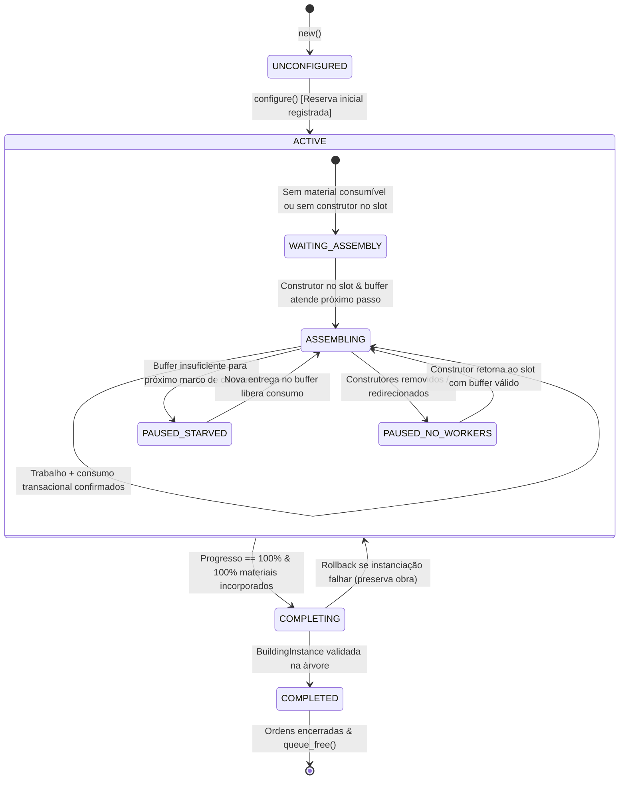
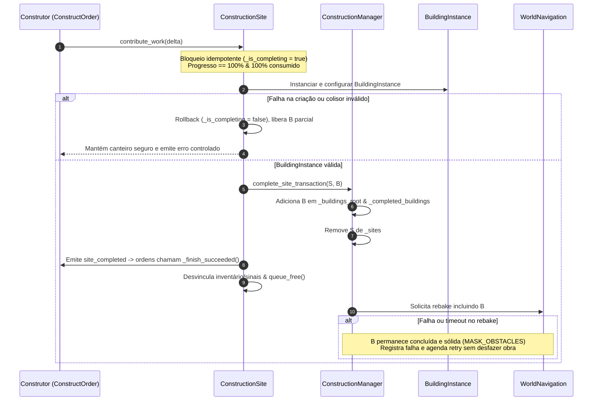

# DAWN OF KIN — T3.4 ARQUITETURA E PLANO DE IMPLEMENTAÇÃO (REVISÃO R1)

**Identificação da Revisão:** **T3.4-ARCHITECTURE-R1** (Correção pós-auditoria independente)
**Etapa:** T3.4 — Ordem de Construção, Progresso com Consumo e Conclusão
**Status:** PROPOSTA TÉCNICA REVISADA — Aguardando nova auditoria independente do ChatGPT e aprovação expressa do proprietário antes de qualquer código ser criado
**Base oficial da `main`:** `3c6fc0bd36fc3828af5a89662fb23cfb60d37865`
**Marco anterior:** Tag anotada `t3-3-complete`
**Branch de planejamento:** `planning/t3-4-architecture`
**Worktree de referência:** `C:\Projetos\Dawn_of_Kin_wt_t3_4_plan`
**Data da revisão R1:** 16 de novembro de 2026

> **Nota de Governança:** A aprovação deste documento de planejamento **não** autoriza o início da implementação nem a criação de branch de código. A T3.4 permanece bloqueada até autorização expressa do proprietário.

---

## 1. Estado Inicial Auditado (Baseline T3.3 / `3c6fc0b`)

A etapa **T3.3 (Canteiro de Obra e Suprimento Físico)** foi integralmente implementada, validada, auditada pelo ChatGPT e formalmente homologada pelo proprietário em 16/11/2026 ([T3_3_closeout_ACCEPTANCE.md](../testing/T3_3_closeout_ACCEPTANCE.md)), sendo integrada na `main` via fast-forward no commit `3c6fc0bd36fc3828af5a89662fb23cfb60d37865` com a tag anotada `t3-3-complete`.

**Registro Histórico da Validação T3.3 (Reportado pelo Antigravity sobre o commit `6c5c444`):**
- **234/234 testes aprovados** em **34/34 suítes** (`.\tools\run_tests.ps1 -Segmented`), totalizando **7.585 asserções** (`0` falhas, `0` erros de suíte).
- **109 scripts GDScript validados** (`.\tools\validate.ps1`), com **0 erros e 0 avisos**.
- **10/10 testes manuais aprovados** pelo proprietário (`A1`, `A2`, `B1`, `B2`, `C1`, `C2`, `C3`, `C4`, `D1`, `D2`), além de troca dinâmica de resolução (`1280×720 ↔ 1920×1080`).

*Nota:* Os números acima constituem resultados históricos da conclusão da T3.3; nenhum teste automatizado ou de cena foi reexecutado nesta revisão estritamente documental.

### 1.1 Capacidades Consolidadas na T3.3
1. **Reserva Atômica e Ciclo de Vida do Canteiro (`ConstructionManager` + `ConstructionSite`):**
   - Instanciação via `ConstructionManager.try_create_site_from_placement()` sob o nó `ConstructionSites` em `Main` (`src/main/main.gd`).
   - Reserva em lote (`reserve_batch`) no `SettlementInventory`, com aplicação da **Alternativa B — Perda Direta** em caso de deterioração física em pilha (sem realocação automática).
2. **Logística e Transporte Físico (`ConstructOrder` + `UnitCarryLoad`):**
   - Saque direcionado por pilha (`claim_pickup`, `record_withdrawn_for_site`), transporte com penalidade de peso e entrega no perímetro com validação de `_transit_claims` e alcance físico (`accept_delivery_from_carry_load`).
3. **Organização de Trabalhadores segundo D9:**
   - 1 trabalhador (`SOLO_SUPPLIER`), 2 trabalhadores (`1 TRANSPORTER + 1 BUILDER`), 3 trabalhadores (`1 TRANSPORTER + 2 BUILDER`), recusa do 4º trabalhador (`no_worker_slot`).
4. **Navegação e Terreno (`WorldNavigation`):**
   - `WorldNavigation` reside em `TestMap` (`levels/test_map/test_map.tscn`) com `source_root_path = ^".."`, incluindo geração de *curbs* laterais em rampas (`_append_sloped_terrain_side_curbs`).

### 1.2 Lacunas e Pontos de Transição para a T3.4
- Na T3.3, quando o canteiro atinge suprimento completo (`is_fully_supplied()`), `ConstructOrder._advance_by_role()` encerra imediatamente as ordens de `TRANSPORTER` e `SOLO_SUPPLIER` com `_finish_succeeded()`, enquanto trabalhadores já no papel `BUILDER` permanecem em `Phase.BUILDER_STANDBY` sem consumir materiais nem acumular progresso.
- O rebake de `WorldNavigation` lê apenas a subárvore de `TestMap` (`source_root_path = ^".."`), enquanto `ConstructionSites` está fora de `TestMap` (filho direto de `Main`).

---

## 2. Matriz de Rastreabilidade (GDD v1.0 × Decisões D1–D9 × Código Vigente)

| Requisito / Regra | Status Normativo | Realidade na Base (`3c6fc0b`) | Adaptação Exigida na T3.4 |
|---|---|---|---|
| **D2: Progresso conforme disponibilidade de materiais** | **DECIDIDO** | `ConstructionSite` acumula entregas em `_delivered_buffer`; sem consumo nem progresso. | Montagem avança consumindo o buffer proporcionalmente, com trava transacional e pausa por falta de material. |
| **D4: Custos, dimensões e tempos provisórios** | **APROVADO (provisório)** | `BuildingDefinition` define `costs`, `build_work_required_sec` e `max_builders = 2`. | Abrigo Básico (30 s-construtor, 12 madeira, 6 pedra); Depósito Rústico (45 s-construtor, 18 madeira, 10 pedra). |
| **D9: Organização dos trabalhadores (1 a 4)** | **DECIDIDO** | `ConstructOrder` encerra `TRANSPORTER`/`SOLO_SUPPLIER` em `is_fully_supplied()`; `BUILDER` fica em standby. | Promoção segura de `SOLO_SUPPLIER`/`TRANSPORTER` para `BUILDER` quando houver slot livre; montagem paralela de até 2 construtores enquanto 1 transporta. |
| **Alternativa B: Deterioração com perda direta** | **DECIDIDO** | `_on_inventory_reservation_lost_to_decay` reduz saldo reservado sem realocar automaticamente. | Invariante contábil deve explicitar o déficit não coberto ($Q_{\text{déficit\_não\_coberto}}$) sem criar materiais fictícios. |
| **Inclusão de edifícios no NavMesh** | **DECIDIDO (GDD §12)** | `MASK_NAV_STATIC` inclui `MASK_BUILDINGS`, mas `WorldNavigation` só lê `TestMap` (`^".."`), fora de `Main/ConstructionSites`. | Solução explícita de inclusão da geometria dos edifícios concluídos na subárvore/fonte do `WorldNavigation` da região, preservando curbs da rampa. |
| **Desempenho e Hardware Alvo** | **DECIDIDO (`AGENTS.md`)** | `WorldNavigation.request_rebake()` faz parse e bake síncronos na thread principal. | Evitar garantias antecipadas; adotar estratégia assíncrona/controlada e validar por medição real em Intel UHD 620 (1080p CA, $p95 \le 16,7\text{ ms}$). |

---

## 3. Modelo Formal de Estados do Canteiro de Obras

O modelo de estados suporta tanto a montagem progressiva paralela ao transporte (D2 + D9) quanto pausas determinísticas por falta de material ou ausência de construtores.

### 3.1 Diagrama de Estados do Canteiro (`ConstructionSite`)

### 3.2 Regras de Transição
1. **`ACTIVE / WAITING_ASSEMBLY`:** O canteiro existe e pode receber entregas a qualquer momento. Se já houver material suficiente para o primeiro passo de consumo e um construtor posicionado no slot, entra em `ASSEMBLING`.
2. **`ASSEMBLING`:** Um ou dois construtores acumulam trabalho no canteiro. O transporte por um colega (`TRANSPORTER`) continua ocorrendo simultaneamente segundo D9.
3. **`PAUSED_STARVED`:** Se o ritmo de montagem alcançar o limite de material atualmente disponível no buffer antes da próxima entrega (ou se ocorrer perda por deterioração nas pilhas sob a Alternativa B), a montagem pausa de forma limpa sem gerar saldos negativos, retornando a `ASSEMBLING` assim que novas entregas entrarem no buffer.
4. **`PAUSED_NO_WORKERS`:** Se todos os construtores forem interrompidos pelo jogador, o progresso e os materiais já incorporados permanecem intactos aguardando retorno.
5. **`COMPLETING` $\rightarrow$ `COMPLETED`:** Transição transacional e idempotente (detalhada na Seção 7).

---

## 4. Contabilidade Física, Deterioração e Consumo Transacional

### 4.1 Invariante Contábil Completa (Compatível com Alternativa B)

Considerando a **Alternativa B (DECIDIDO)** — na qual materiais reservados em pilhas podem se deteriorar sem realocação automática — o balanço patrimonial para cada recurso $R$ em qualquer instante $t$ é:

$$\text{Custo}(R) = Q_{\text{reservado}}(R) + Q_{\text{trânsito}}(R) + Q_{\text{buffer}}(R) + Q_{\text{incorporado}}(R) + Q_{\text{déficit\_não\_coberto}}(R)$$

Onde as 5 parcelas estritamente não negativas ($\in \mathbb{Z}_{\ge 0}$) significam:
1. $Q_{\text{reservado}}(R)$: Saldo físico ainda reservado para esta obra nas pilhas do acampamento (`_inventory.get_reservation_amount`).
2. $Q_{\text{trânsito}}(R)$: Quantidade carregada em `UnitCarryLoad` com reivindicação válida em `_transit_claims`.
3. $Q_{\text{buffer}}(R)$: Materiais entregues ao canteiro, disponíveis fisicamente na obra e **ainda não consumidos** (`_delivered_buffer[R]`).
4. $Q_{\text{incorporado}}(R)$: Materiais **já consumidos** e incorporados à estrutura da obra (`_consumed_materials[R]`).
5. $Q_{\text{déficit\_não\_coberto}}(R)$: Parcela do custo original não coberta por estoque físico ativo — resultante, por exemplo, de perda por deterioração em pilha (`reservation_lost`) ou perda de carga em trânsito, **sem realocação automática e sem criação de recursos fictícios**.

Definimos também o total já recebido pela obra:
$$Q_{\text{recebido}}(R) = Q_{\text{buffer}}(R) + Q_{\text{incorporado}}(R)$$

**Propriedade de Conservação:**
- Nenhuma operação pode fazer $Q_{\text{reservado}} + Q_{\text{trânsito}} + Q_{\text{recebido}} > \text{Custo}(R)$.
- Se não houver perdas por deterioração, $Q_{\text{déficit\_não\_coberto}}(R) = 0$.
- Caso haja deterioração em pilha, $Q_{\text{reservado}}(R)$ diminui e $Q_{\text{déficit\_não\_coberto}}(R)$ aumenta na mesma magnitude. A obra não fabrica recursos para compensar e só poderá ser concluída quando todos os recursos necessários forem fisicamente supridos (por exemplo, via futura reposição ou decisão de design de reabastecimento manual, se aplicável — ver Seção 11).

### 4.2 Matriz de Compatibilidade dos Getters e Regras Existentes (R1-C)

A T3.3 utilizava `_delivered_buffer` assumindo que nada era consumido durante a fase de canteiro. Se a T3.4 consumir `_delivered_buffer` sem adaptar os métodos abaixo, o sistema interpretará material já incorporado como faltante e reabastecerá a obra indefinidamente.

| Método em `ConstructionSite` | Comportamento Vigente (T3.3) | Regressão se Não Adaptado | Adaptação Obrigatória na T3.4 |
|---|---|---|---|
| `get_remaining_need_for_dropoff(res_id)` | `maxi(0, required - buffer)` | Pediria entrega de material já incorporado à estrutura. | `maxi(0, required - (buffer + consumed))` |
| `get_missing_amount(res_id)` | `maxi(0, required - buffer - reserved - in_transit)` | Contaria material incorporado como déficit de suprimento. | `maxi(0, required - (buffer + consumed) - reserved - in_transit)` |
| `is_fully_supplied()` | `buffer >= required` para todo `res_id` | Nunca retornaria `true` após iniciar consumo do buffer. | `(buffer + consumed) >= required` para todo `res_id` |
| `get_remaining_supply_to_claim(res_id, exclude)` | `remaining_dropoff - in_transit - pending_other` | Permitiria novos claims de retirada além do custo real. | Herda correção de `get_remaining_need_for_dropoff()`, descontando `consumed`. |
| `record_withdrawn_for_site(unit, res_id, amt)` | `headroom = required - buffer - reserved - in_transit` | Permitiria registrar trânsito duplicado sobre material incorporado. | `headroom = maxi(0, required - (buffer + consumed) - reserved - in_transit)` |
| `accept_delivery_from_carry_load(unit, load)` | `invariant_cap = required - buffer - reserved - other_transit` | Aceitaria entrega excedente acima do custo total da obra. | `invariant_cap = maxi(0, required - (buffer + consumed) - reserved - other_transit)` |

Adicionalmente, cria-se a distinção explícita de getters:
- `get_consumed_amount(res_id) -> int`: retorna `_consumed_materials[res_id]`.
- `get_total_received_amount(res_id) -> int`: retorna `_delivered_buffer[res_id] + _consumed_materials[res_id]`.

### 4.3 Protocolo Transacional de Progresso e Consumo (R1-D)

O arredondamento inteiro por função piso isoladamente **não** garante atomicidade se o buffer não contiver o saldo exigido. O avanço de trabalho em `contribute_work(unit, delta_sec)` deve executar uma **transação atômica** na thread principal:

1. **Guarda de Estado e Concorrência:**
   - Se `site` não está válido, ou `_is_completing` / `_is_completed` é verdadeiro, retorna imediatamente com avanço `0.0` (impede contribuições duplicadas de 2 construtores após atingir 100%).
2. **Cálculo do Progresso Candidato:**
   - $\Delta_{\text{eff}} = \min(\Delta_{\text{sec}}, \text{build\_work\_required\_sec} - \text{work\_progress\_sec})$
   - $p_{\text{cand}} = \min\left(1.0, \frac{\text{work\_progress\_sec} + \Delta_{\text{eff}}}{\text{build\_work\_required\_sec}}\right)$
3. **Cálculo dos Débitos Inteiros Exigidos:**
   - Para cada recurso $R$ com $\text{Custo}(R) > 0$:
     $$Q_{\text{meta}}(R) = \lfloor p_{\text{cand}} \times \text{Custo}(R) \rfloor$$
     $$\Delta Q_{\text{req}}(R) = \max(0, Q_{\text{meta}}(R) - Q_{\text{incorporado}}(R))$$
4. **Validação Prévia Integral (All-or-Nothing):**
   - Verificar se **para todos** os recursos $R$: $Q_{\text{buffer}}(R) \ge \Delta Q_{\text{req}}(R)$.
   - **Caso positivo:**
     - Debitar $\Delta Q_{\text{req}}(R)$ de `_delivered_buffer[R]` e creditar em `_consumed_materials[R]`.
     - Atualizar `_work_progress_sec += _delta_eff`.
   - **Caso negativo (Material Insuficiente / Starvation):**
     - **Não consumir** parcialmente um recurso enquanto falta outro.
     - Calcular o progresso máximo permitido pelo recurso gargalo $p_{\text{teto}}$ (limitado ao ponto imediatamente anterior ao próximo marco inteiro faltante, garantindo que o progresso não ultrapasse um limiar sem incorporar o material correspondente).
     - Se houver folga contínua antes do teto gargalo ($\text{work\_progress\_sec} < p_{\text{teto}} \times \text{build\_work\_required\_sec}$), avançar apenas até esse teto com $\Delta Q = 0$; caso contrário, não avançar (`work_progress_sec` permanece inalterado) e sinalizar `starved = true`, colocando o canteiro em `PAUSED_STARVED`.
5. **Trava Inviolável de 100%:**
   - O canteiro **só pode** atingir `work_progress_sec >= build_work_required_sec` ($p = 1.0$) e iniciar `COMPLETING` quando:
     $$\forall R: \quad Q_{\text{incorporado}}(R) == \text{Custo}(R)$$
   - Caso haja déficit no buffer, a obra fica bloqueada abaixo de 100% (em `PAUSED_STARVED`) até que o material faltante seja entregue.

---

## 5. Responsabilidades Modulares

| Módulo | Responsabilidades na T3.4 |
|---|---|
| **`ConstructionSite`** | Controlar `_work_progress_sec`, `_consumed_materials` e estado (`ACTIVE`, `PAUSED_STARVED`, `PAUSED_NO_WORKERS`, `COMPLETING`, `COMPLETED`); validar e executar transações de `contribute_work()`; adaptar getters contábeis (Seção 4.2); gerenciar promoção de papéis D9 ao concluir suprimento; orquestrar transmutação segura em `BuildingInstance`. |
| **`BuildingInstance`** *(Novo)* | `Node3D` representando a construção concluída. Possui `building_id`, `definition`, `region_id`, `footprint_rect`, malha visual definitiva e `StaticBody3D` com `collision_layer = CollisionLayers.MASK_BUILDINGS \| CollisionLayers.MASK_OBSTACLES`. Fornece método `is_valid()` para validação pós-instanciação. |
| **`ConstructionManager`** | Gerenciar raízes regionais (`_sites_root` e `_buildings_root`); manter `_completed_buildings`; coordenar substituição segura de `ConstructionSite` por `BuildingInstance`; registrar os edifícios concluídos no `WorldNavigation` da região e solicitar rebake. |
| **`ConstructOrder`** | Adicionar `Phase.BUILDER_ASSEMBLING` e `Phase.WAITING_FOR_MATERIALS`; verificar se papel foi promovido antes de encerrar ordem ao atingir `is_fully_supplied()`; executar `contribute_work()` no slot de montagem respeitando alcance; lidar com conclusão idempotente do canteiro. |
| **`BuildSlotPlanner`** | Manter slots perimetrais de montagem (`get_builder_slot_position`) a margem segura fora do footprint sólido, garantindo que construtores não fiquem dentro do colisor ao concluir a obra. |
| **`WorldNavigation`** | Incluir geometria estática de edifícios concluídos na malha da região correta (além de `TestMap`), preservar `_append_sloped_terrain_side_curbs()`, gerenciar invalidação de cache e executar rebake controlado sem corromper rotas. |

---

## 6. Transições e Promoção dos Trabalhadores segundo D9 (R1-E)

### 6.1 Correção do Encerramento Antecipado em `ConstructOrder._advance_by_role()`
No código da T3.3 (`src/units/orders/construct_order.gd`, linhas 209–216), quando `site.is_fully_supplied()` retorna `true` para um `TRANSPORTER` ou `SOLO_SUPPLIER`, a ordem encerra imediatamente com `_finish_succeeded()`, o que impediria o trabalhador de assumir o papel de construtor.

Na T3.4, o fluxo obrigatório em `_advance_by_role()` quando `site.is_fully_supplied()` for `true` será:
1. O trabalhador verifica se `site.is_completed_or_completing()` é verdadeiro; se sim, encerra com `_finish_succeeded()`.
2. Caso a montagem ainda esteja pendente, o trabalhador solicita ao canteiro a reavaliação de papéis (`site.try_promote_supplier_to_builder(_unit)` ou `_rebalance_worker_roles()` considerando `is_fully_supplied()`):
   - Se o papel da unidade passar a `WorkerRole.BUILDER`, **não** encerra a ordem; desvia para `_start_moving_to_builder_slot(movement)` e inicia montagem.
   - Se não houver vaga de construtor disponível (ex.: já existem 2 `BUILDER` ativos), seu papel é liberado (`UNASSIGNED` / encerramento limpo) e somente então a ordem executa `_finish_succeeded()`, liberando o trabalhador para `IDLE`.

### 6.2 Comportamento por Tamanho de Equipe
1. **1 Trabalhador:**
   - Inicia como `SOLO_SUPPLIER`.
   - *Sob Opção 2 (Suprimento Parcial):* Realiza viagens de transporte para o canteiro; se configurado para alternar ou após concluir o suprimento total, é promovido para `BUILDER` (slot 0) e conclui a montagem ($1,0\text{ s/s}$). *(Ver Seção 11 sobre o gatilho exato de alternância do trabalhador solitário).*
2. **2 Trabalhadores:**
   - 1 `TRANSPORTER` e 1 `BUILDER` (slot 0).
   - Enquanto o `TRANSPORTER` busca e entrega lotes no canteiro, o `BUILDER` já monta a estrutura com os materiais disponíveis no buffer (respeitando D2 e D9).
   - Quando a última entrega completa `is_fully_supplied()`, o `TRANSPORTER` é promovido automaticamente para o 2º slot de `BUILDER` (slot 1), elevando a velocidade para $2,0\text{ s/s}$.
3. **3 Trabalhadores:**
   - 1 `TRANSPORTER` e 2 `BUILDER` (slots 0 e 1, atingindo `max_builders = 2`).
   - Os 2 construtores trabalham a $2,0\text{ s/s}$ enquanto o transportador abastece.
   - Ao concluir o suprimento (`is_fully_supplied()`), como ambos os slots de construtor estão ocupados, o transportador encerra sua ordem com `_finish_succeeded()` e fica livre (`IDLE`).
4. **4º Trabalhador:**
   - Rejeitado na atribuição com `no_worker_slot`.

### 6.3 Preservação das Garantias T3.3 em Interrupções
- Se um construtor for interrompido por outra ordem, `unregister_worker()` libera seu slot e aciona `_rebalance_worker_roles()`.
- Cargas na mochila e `_transit_claims` preservam integralmente o contrato validado na T3.3-R1 (sem perda nem entrega indevida).

---

## 7. Ciclo de Conclusão Transacional e Recuperação de Falhas (R1-H)

Para garantir idempotência e evitar perda de estado ou nós órfãos em falhas intermediárias, a conclusão segue uma transação em estágios:

### 7.1 Garantias contra Falhas Específicas
1. **Falha na criação do `BuildingInstance` ou colisor inválido (`not instance.is_valid()`):**
   - A instância parcial é descartada (`free()`), `_is_completing` volta a `false`, o canteiro **não** é destruído e o estado contábil/progresso é preservado intacto.
2. **Contribuição duplicada no mesmo ciclo de física:**
   - Com 2 construtores ativos no mesmo frame, o primeiro que atingir `100%` ativa `_is_completing = true`. A chamada do segundo construtor no mesmo frame encontra `_is_completing == true` e retorna imediatamente sem reprocessar.
3. **Referência residual de ordem durante a remoção do canteiro:**
   - Antes de chamar `queue_free()`, todas as ordens registradas recebem a notificação síncrona de conclusão (`site_completed` / `_finish_succeeded()`). Caso qualquer ordem externa ou callback tente acessar o canteiro no mesmo tick antes da coleta pelo engine, a checagem `is_completing() or is_completed()` garante retorno seguro sem erro de referência nula.
4. **Falha de rebake após conclusão estrutural:**
   - O `BuildingInstance` já está validado com colisor físico sólido em `MASK_OBSTACLES | MASK_BUILDINGS` (impedindo travessia física pelas unidades). A falha ou timeout do rebake **não** reverte a conclusão da obra; o `ConstructionManager` mantém o edifício e registra estado de retry/alerta de navegação.

---

## 8. Estratégia de Navegação e Desempenho (R1-F e R1-G)

### 8.1 Solução Estrutural para Inclusão Real dos Edifícios na NavMesh (R1-F)
A inspeção das cenas reais revelou uma divergência crítica na base atual:
- `WorldNavigation` (`levels/test_map/test_map.tscn`) possui `source_root_path = ^".."`, apontando exclusivamente para a subárvore `TestMap`.
- `ConstructionSites` (`src/main/main.gd`, linha 108) é instanciado como filho direto de `Main`, **fora** da subárvore de `TestMap`.
- Portanto, apenas usar `MASK_BUILDINGS` em `WorldNavigation` **não** inclui edifícios criados fora de `TestMap`.

**Opções Arquiteturais Analisadas:**
- **Opção N1 — Raiz de Edifícios por Região (`buildings_root`) vinculada ao `WorldNavigation` (Recomendada):**
  - `ConstructionManager` cria/gerencia os `BuildingInstance` sob um nó de edifícios associado à região (seja configurado dentro do escopo espacial da cena/mapa ou passado explicitamente ao `WorldNavigation` via `register_additional_source_root(buildings_root)` / `add_building_blocker()`).
  - No `WorldNavigation`, a preparação da geometria estática faz o parse de `source_root` (com `_append_sloped_terrain_side_curbs` preservando as rampas) **e** incorpora a geometria dos `BuildingInstance` ativos da região (via parse do `buildings_root` ou inserção explícita de suas faces estáticas no `NavigationMeshSourceGeometryData3D`, invalidando o cache estático `_has_static_geometry_cache` na conclusão de cada obra).
  - **Vantagens:** Preserva o isolamento entre `TestMap` e `Main`, funciona para múltiplas regiões futuras e não exige acoplamento rígido de cena.
- **Opção N2 — Alterar `source_root_path` de `WorldNavigation` para `Main`:**
  - *Descartada como padrão* porque faria o `WorldNavigation` varrer toda a árvore de `Main` (incluindo unidades, câmera, efeitos e objetos fora do mapa), quebrando o isolamento regional de mapas.

### 8.2 Estratégia de Rebake e Desempenho (R1-G)
Remove-se qualquer afirmação prévia de tempo de bake ("3,5–7,2 ms") ou garantia antecipada de ausência de engasgos, pois o `WorldNavigation.request_rebake()` atual executa `parse_source_geometry_data()` e `bake_from_source_geometry_data()` **de forma síncrona na thread principal**, além de setar `_is_ready = false` durante a sincronização subsequente (com timeout de `SYNC_TIMEOUT_SEC = 5.0`).

**Diretrizes para a Implementação T3.4:**
1. **Evitar Bloqueio da Thread Principal (Bake Assíncrono):**
   - Utilizar o padrão já validado em `WorldNavigation.create_candidate_session_async()` (`NavigationServer3D.bake_from_source_geometry_data_async` + `AsyncBakeToken`) para assar a nova malha em thread de trabalho, aplicando-a ao `NavigationRegion3D` somente após conclusão, sem travar `find_path()` com `_is_ready = false` durante o processamento.
2. **Cache e Invalidação:**
   - Manter `_cached_static_vertices` / `_cached_static_indices` para a geometria pesada do terreno e rampas (evitando re-parsear o mapa inteiro), invalidando ou compondo apenas a camada adicional de edifícios concluídos quando uma obra é finalizada.
3. **Concorrência e Rebakes Consecutivos:**
   - Se duas obras concluírem em sequência rápida, o `AsyncBakeToken` anterior deve ser cancelado/substituído pelo pedido mais recente (coalescência), evitando que um bake antigo sobrescreva um mais novo.
4. **Falha ou Timeout de Sincronização:**
   - Caso ocorra erro ou `sync_timeout`, preservar a última malha navegável válida em vez de inutilizar a navegação global, emitindo diagnóstico claro.
5. **Validação Empírica Obrigatória:**
   - O impacto real de frame time e rebake deverá ser medido na etapa T3.4.5 exclusivamente em hardware de referência (**Intel UHD Graphics 620**, `1920×1080`, `gl_compatibility`, alimentação **CA**), verificando o critério $p95 \le 16,7\text{ ms}$ e `0` quadros $> 100\text{ ms}$.

---

## 9. Plano Incremental de Implementação (T3.4.1 a T3.4.5)

### Incremento T3.4.1 — Estados, Contabilidade Separada e Compatibilidade de Getters
- **Objetivo:** Adaptar `ConstructionSite` para distinguir `_delivered_buffer` vs `_consumed_materials` vs déficit não coberto (Alternativa B), atualizar os 6 getters de compatibilidade (Seção 4.2) e introduzir a máquina de estados de montagem.
- **Arquivos:** `src/buildings/construction_site.gd`.
- **Testes:** Testes unitários da invariante contábil com e sem deterioração de pilha, garantindo que material incorporado não seja reabastecido.

### Incremento T3.4.2 — Transação de Progresso e Consumo Proporcional Inteiro
- **Objetivo:** Implementar `contribute_work(unit, delta)` com validação prévia integral no buffer, consumo inteiro via piso acumulado, trava de 100% e pausa por starvation.
- **Arquivos:** `src/buildings/construction_site.gd`.
- **Testes:** Testes de consumo em marcos fracionados, falta de material seguida de retomada, e contribuições simultâneas de 2 construtores no mesmo frame sem duplicação.

### Incremento T3.4.3 — Execução da Montagem e Promoções D9 em `ConstructOrder`
- **Objetivo:** Implementar `Phase.BUILDER_ASSEMBLING`, impedir encerramento prematuro do transportador em `is_fully_supplied()` quando houver slot de `BUILDER` livre, e orquestrar os fluxos de 1, 2, 3 e 4 trabalhadores.
- **Arquivos:** `src/units/orders/construct_order.gd`, `src/buildings/construction_site.gd`.
- **Testes:** Testes de integração de equipe D9 (1, 2, 3 trabalhadores, recusa do 4º, interrupções e retomadas).

### Incremento T3.4.4 — `BuildingInstance` e Conclusão Transacional
- **Objetivo:** Criar `BuildingInstance` com colisor definitivo (`MASK_BUILDINGS | MASK_OBSTACLES`), implementar a conclusão idempotente com rollback em caso de falha na criação do edifício e liberação limpa das ordens.
- **Arquivos:** `src/buildings/building_instance.gd`, `src/buildings/construction_site.gd`, `src/buildings/construction_manager.gd`.
- **Testes:** Testes de transmutação completa, detecção de vazamento de nós e simulação de falha na instanciação de `BuildingInstance` preservando o canteiro.

### Incremento T3.4.5 — Inclusão no NavMesh, Rebake Controlado e Medição em Hardware
- **Objetivo:** Implementar inclusão explícita dos edifícios concluídos no `WorldNavigation` da região (Opção N1), rebake assíncrono/coalescente preservando curbs de rampa, e validar desempenho na Intel UHD 620.
- **Arquivos:** `src/navigation/world_navigation.gd`, `src/buildings/construction_manager.gd`, `src/main/main.gd`.
- **Testes:** Testes de pathfinding contornando `BuildingInstance`, preservação de acesso à rampa do platô, e benchmark real em 1080p CA.

---

## 10. Protocolo de Testes Manuais Proposto

Preservam-se os cenários originais e adicionam-se os cenários necessários para cobrir os riscos da auditoria R1:

| ID | Cenário | Procedimento | Resultado Esperado |
|---|---|---|---|
| **A1** | **1 Trabalhador (Ciclo Completo)** | Atribuir 1 líder a um canteiro de Abrigo Básico. | Transporta materiais, assume montagem, conclui o abrigo em 100%, surge `BuildingInstance` e líder volta a `IDLE`. |
| **A2** | **2 Trabalhadores (Paralelismo D2/D9 + Promoção)** | Atribuir 2 trabalhadores ao Abrigo. | 1 transporta e 1 constrói simultaneamente conforme entregas chegam; ao completar o suprimento, transportador junta-se como 2º construtor (2× velocidade). |
| **A3** | **3 Trabalhadores (Limite de 2 Construtores)** | Atribuir 3 trabalhadores. | 1 transporta e 2 constroem; ao terminar entregas, transportador é liberado para `IDLE` enquanto os 2 construtores terminam. |
| **B1** | **Rejeição do 4º Trabalhador** | Tentar atribuir 4º trabalhador a obra com 3 ativos. | Recusa imediata com motivo `no_worker_slot`. |
| **B2** | **Interrupção e Retomada** | Redirecionar construtor a 50% de progresso; depois reenviar à obra. | Montagem pausa exatamente em 50% sem perder material incorporado; retoma ao retornar. |
| **B3** *(Novo R1)* | **Falta de Material (Starvation) e Retomada** | Interromper o transportador após entrega parcial; deixar construtor consumir o buffer disponível; depois retomar transporte. | Construtor pausa sem saldos negativos ao esgotar o buffer; retoma montagem assim que novas entregas chegam. |
| **C1** | **Colisão e Contorno do Edifício Concluído** | Ordenar movimento atravessando a área de um edifício recém-concluído. | Unidade colide/contorna externamente o edifício; não atravessa paredes nem trava. |
| **C2** | **Navegação em Platô/Rampa com Edifício** | Concluir edifício no platô e ordenar viagem da base ao platô. | Curbs da rampa permanecem íntegros; unidades sobem a rampa e contornam o edifício no platô. |
| **D1** | **Resolução Dinâmica 720p ↔ 1080p** | Alternar resolução durante montagem e conclusão. | UI, barras e posicionamento mantêm fidelidade visual sem reiniciar partida. |

---

## 11. Decisões Aprovadas vs Decisões em Aberto para Deliberação

### 11.1 Já Aprovadas (Não Reabrir sem Autorização)
- **D2:** Transporte físico com reserva em pilha e consumo proporcional ao progresso de montagem.
- **D4:** Parâmetros provisórios do Abrigo Básico e Depósito Rústico (máx. 2 construtores simultâneos).
- **D9:** Organização de 1, 2 e 3 trabalhadores (1 transportador + até 2 construtores).
- **Alternativa B de Deterioração:** Perda física em pilha reduz reserva sem realocação automática.

### 11.2 Decisões em Aberto para Arbitragem do Proprietário
1. **Fluxo de Montagem com Suprimento Parcial vs Integral (R1-A):**
   - A **Opção 2 (Montagem com Suprimento Parcial / *Streaming Assembly*)** é a mais fiel às decisões vigentes **D2** e **D9**, permitindo que com 2 ou 3 trabalhadores um construa enquanto outro transporta, apoiada pelo protocolo transacional de pausa por starvation descrito na Seção 4.3.
   - *Ponto específico para confirmação do proprietário:*
     - Confirmar adoção da **Opção 2** (conforme D2/D9) ou optar explicitamente pela **Opção 1 (exigir 100% no buffer antes de iniciar montagem)** como simplificação temporária?
     - No caso de **1 único trabalhador (`SOLO_SUPPLIER`)** sob a Opção 2: ele deve buscar **todo** o material disponível antes de iniciar a montagem sequencial (evitando idas e vindas desnecessárias), ou montar a cada viagem de entrega? *(Sugestão técnica: para 1 trabalhador, transportar até suprir ou esgotar estoque antes de construir otimiza o deslocamento, mantendo D9: "busca materiais e constrói sequencialmente").*
2. **Efeito de Deterioração em Reserva sobre Obra Incompleta (Alternativa B):**
   - Se uma pilha reservada sofrer deterioração antes de ser transportada (gerando $Q_{\text{déficit\_não\_coberto}} > 0$), a obra ficará travada abaixo de 100% aguardando reposição? Na T3.4 (sem UI de cancelamento T3.6), confirmar se o jogador deve apenas repor estoque e reatribuir um transportador ou se há necessidade de comportamento adicional.
3. **Estratégia de Inclusão de Edifícios no `WorldNavigation` (R1-F):**
   - Confirmar a **Opção N1** (registro explícito de `buildings_root` por região no `WorldNavigation` correspondente, preservando isolamento de `TestMap`).

---

## 12. Fronteiras Estritas de Escopo

Permanecem **explicitamente fora da T3.4**:
- **T3.5:** Interface definitiva de construção (botão Construir, painel retrátil, painel contextual do canteiro).
- **T3.6:** Cancelamento de obras com reembolso proporcional.
- **T3.7:** Uso ativo do Depósito Rústico como armazenamento protegido contra deterioração.
- **T3.8:** Persistência versionada em disco (Save/Load).
- **T3.9:** Benchmark global integrado de encerramento da T3.
