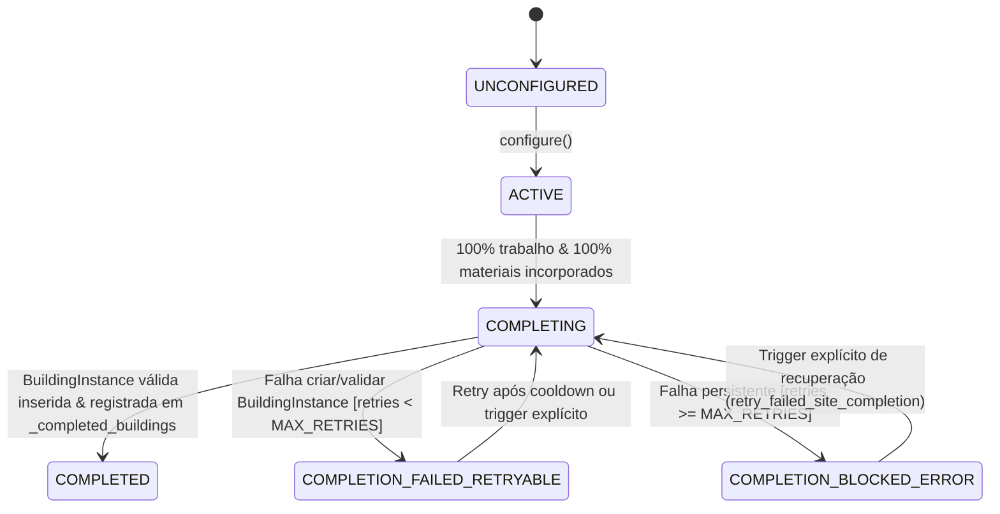

# DAWN OF KIN — T3.4-ARCHITECTURE-R2 — PROPOSTA NÃO APROVADA

**Identificação da Revisão:** **T3.4-ARCHITECTURE-R2 — PROPOSTA NÃO APROVADA**  
**Etapa:** T3.4 — Ordem de Construção, Progresso com Consumo e Conclusão  
**Status:** **PROPOSTA TÉCNICA R2 — NÃO APROVADA / NÃO IMPLEMENTADA** (aguardando auditoria independente do ChatGPT e aprovação expressa do proprietário; nenhuma autorização de código concedida)  
**Base oficial da `main`:** `518aec6da477c6105b60844a106cb7322246b53a`  
**GDD Normativo Vigente (`main`):** [`docs/Dawn_of_Kin_GDD.md`](../Dawn_of_Kin_GDD.md) (`v1.2 — Conteúdo Aprovado pelo Proprietário`)  
**Último Marco Funcional Homologado:** Tag anotada `t3-3-complete` ([T3_3_closeout_ACCEPTANCE.md](../testing/T3_3_closeout_ACCEPTANCE.md))  
**Referência Histórica R1 Preservada:** branch `planning/t3-4-architecture`, commit [`6ac2c5102e71623224dbd5f1e69bedd0d90bfc45`](https://github.com/Julian0s/Dawn-of-Kin/blob/6ac2c5102e71623224dbd5f1e69bedd0d90bfc45/docs/architecture/T3_4_implementation_plan_PROPOSAL.md) *(não integrada à `main`)*  
**Branch de Planejamento R2:** `planning/t3-4-architecture-r2`  
**Worktree Isolado:** `C:\Projetos\Dawn_of_Kin_wt_t3_4_plan_r2`  
**Engine Alvo:** Godot `4.7.2.stable` (`gl_compatibility`, `Jolt Physics`)  
**Data da Revisão R2:** 16 de novembro de 2026

> **Nota de Governança e Bloqueio Estrito:** Este documento é exclusivamente uma **especificação arquitetural candidata (`T3.4-ARCHITECTURE-R2`)**. Mesmo após eventual auditoria técnica, **a aprovação deste plano não libera automaticamente a escrita de código**: a implementação da `T3.4` e de qualquer etapa posterior (`T3.5`–`T8`) permanece estritamente bloqueada até autorização expressa do proprietário ([`AGENTS.md`](../../AGENTS.md)). Nenhum arquivo `.gd`, `.tscn`, `.tres`, teste ou configuração foi modificado nesta revisão.

---

## 1. Estado Auditado da Base (`main` `518aec6`) e Inventário Real do Código T3.3

A inspeção direta sobre `main` (`518aec6da477c6105b60844a106cb7322246b53a`) e sobre os scripts em `src/` confirma os seguintes fatos concretos da base homologada na `T3.3`:

1. **Economia e Reservas ([`settlement_inventory.gd`](../../src/economy/settlement_inventory.gd), [`ground_pile_manager.gd`](../../src/economy/ground_pile_manager.gd), [`pile_reservation_ledger.gd`](../../src/economy/pile_reservation_ledger.gd), [`in_memory_storage_source.gd`](../../src/economy/in_memory_storage_source.gd)):**
   - `SettlementInventory` delega integralmente os saldos a `SettlementStorageSource` (`GroundPileManager` em cena ou `InMemoryStorageSource` em testes unitários).
   - **Limitação crítica para `DEC-11B`:** `GroundPileManager._build_reserve_plan()` (L786–788) e `SettlementStorageSource.can_reserve_batch()` (L208–210) executam `if reservation_id.is_empty() or _ledger.has_reservation(reservation_id): return ... false`. Portanto, chamar `reserve_batch()` usando o `site.reservation_id` já existente falha silenciosamente sempre que restar qualquer unidade reservada da obra após deterioração parcial.
   - `PileReservationLedger.reconcile_pile_after_decay()` (L173–212) aplica a **Alternativa B**: reduz diretamente as alocações excedentes na pilha em ordem reversa de `_reservation_order` e emite `reservation_lost_to_decay(reservation_id, resource_id, lost_amount)` sem realocação automática.
2. **Canteiro e Transporte ([`construction_site.gd`](../../src/buildings/construction_site.gd), [`construct_order.gd`](../../src/units/orders/construct_order.gd), [`construction_manager.gd`](../../src/buildings/construction_manager.gd)):**
   - `ConstructionSite` controla `_required_amounts`, `_delivered_buffer`, `_pending_pickups`, `_transit_claims` (vinculados ao sinal `carry_load.load_changed` para sobreviver a interrupções de ordem) e `_assigned_workers` / `_worker_order_ids` sob regra **D9**.
   - Todos os getters atuais (`get_remaining_need_for_dropoff`, `get_missing_amount`, `is_fully_supplied`, `get_remaining_supply_to_claim`, `record_withdrawn_for_site`, `accept_delivery_from_carry_load`) ainda não descontam `_consumed_materials`.
   - `ConstructionSite._on_inventory_reservation_lost_to_decay()` (L736–745) apenas reemite `reservation_lost` e `state_changed`.
   - `ConstructOrder._advance_by_role()` (L209–216) encerra `TRANSPORTER` e `SOLO_SUPPLIER` imediatamente com `_finish_succeeded()` quando `site.is_fully_supplied()` retorna `true`, enquanto `BUILDER` permanece em `Phase.BUILDER_STANDBY`.
   - `ConstructionManager` mantém `_sites_root` (criado em `main.gd` sob `Main/ConstructionSites`, fora de `TestMap`) e `_sites: Array[ConstructionSite]`. Seu método `has_site_overlapping_rect()` verifica apenas `_sites`, e `PlacementValidator._validate_spatial_base()` (`placement_validator.gd` L750–755) verifica colisores em `MASK_OBSTACLES | MASK_BUILDINGS` e `context.construction_sites`.
3. **Navegação ([`world_navigation.gd`](../../src/navigation/world_navigation.gd), [`test_map.gd`](../../levels/test_map/test_map.gd)):**
   - `WorldNavigation` reside dentro de `TestMap` com `source_root_path = ^".."`, utiliza `CollisionLayers.MASK_NAV_STATIC` (`MASK_TERRAIN | MASK_OBSTACLES | MASK_BUILDINGS`), mantém cache estático de vértices/índices (`_cached_static_vertices` / `_cached_static_indices`) com `_append_sloped_terrain_side_curbs()`, e possui dois mecanismos distintos:
     - `request_rebake()` (L222–256): executa `parse_source_geometry_data()` e `bake_from_source_geometry_data()` **síncronos na thread principal**, depois define `_is_ready = false` e aguarda sincronização (`SYNC_TIMEOUT_SEC = 5.0`).
     - `create_candidate_session_async()` (L362–421): prepara dados reutilizando o cache estático + caixas extras e usa `NavigationServer3D.bake_from_source_geometry_data_async()` com `AsyncBakeToken` cancelável em thread de trabalho.

---

## 2. Matriz Comparativa e Divergências (`R1` × `R2` × `GDD v1.2` × Código `T3.3`)

Toda divergência entre a antiga R1 (`6ac2c51`), o `Dawn_of_Kin_GDD.md` (`v1.2`), os documentos normativos e o código `T3.3` fica registrada abaixo com sua correção em `R2`:

| Tema / Item | Formulação em R1 (`6ac2c51`) | Norma Vigente (`GDD v1.2` / `AGENTS.md` / Código `T3.3`) | Divergência Identificada | Correção Aplicada nesta `R2` |
|---|---|---|---|---|
| **Base Normativa e SHAs** | Base `3c6fc0b` + antigo `GDD v1.0`. | `main` em `518aec6`; `docs/Dawn_of_Kin_GDD.md` `v1.2` aprovado; `t3-3-complete` homologada ([T3_3_closeout_ACCEPTANCE.md](../testing/T3_3_closeout_ACCEPTANCE.md)). | R1 precedia a consolidação e promoção oficial do GDD v1.2. | Atualiza rastreabilidade integral para `518aec6` e `GDD v1.2`. |
| **Montagem Parcial e Solitário (`DEC-18`, §11.2 R1)** | R1 listava Opção 1 vs. Opção 2 e o fluxo do trabalhador solitário como "decisões em aberto". | `GDD v1.2` §4.3 e §12.2 (`DEC-18`) já definem montagem parcial com `2–3` trabalhadores e transporte prévio integral de reservados acessíveis pelo solitário (`SOLO_SUPPLIER`). | R1 reabria decisão já fechada pelo proprietário (`DEC-18`). | Remove pergunta em aberto; incorpora `DEC-18` e o fluxo determinístico do `SOLO_SUPPLIER` diretamente no contrato (§5 e §6). |
| **Complementação de Reserva Deteriorada (`DEC-11B`, `R2-01`)** | R1 mencionava $Q_{\text{déficit\_não\_coberto}}$ e punha reposição como dúvida em aberto (§11.2). | `GDD v1.2` §4.2 e §12.2 (`DEC-11B` ratificada): proibido repor automaticamente; exige autorização manual + saldo livre + transporte físico; `GroundPileManager.reserve_batch()` rejeita `reservation_id` existente. | R1 não especificava API de complementação e ignorava bloqueio de `has_reservation(reservation_id)` na base `T3.3`. | Especifica `complement_reservation()` / `authorize_manual_complement()` transacionais, fronteira `T3.4`/`T3.5` e modo de teste sem UI provisória (§4.1). |
| **Falha na Conclusão e Retentativa (`R2-02`)** | R1 só fazia `_is_completing = false` no rollback sem gatilho nem limite de retentativa. | `T3.4-ARCHITECTURE-R2` exige gatilho explícito, limite anti-loop por frame, diagnóstico e separação de falha de navegação. | Sem gatilho e trava de estado, falha persistente causaria loop em `_physics_process()` a cada frame. | Define máquina de estados com `COMPLETION_FAILED_RETRYABLE`, cooldown/teto (`MAX_COMPLETION_RETRIES = 3`), `COMPLETION_BLOCKED_ERROR` e retry pós-rebake isolado (§4.2). |
| **Proteção Contínua contra Sobreposição (`R2-03`)** | R1 citava apenas criação de `BuildingInstance` com `MASK_BUILDINGS \| MASK_OBSTACLES`. | `ConstructionManager.has_site_overlapping_rect()` e `PlacementValidator` (`L750`) verificam apenas `_sites`; `buildings_root` ainda não existe. | Poderia haver janela de corrida entre remoção do `ConstructionSite`, entrada física do `BuildingInstance` e cache da NavMesh candidata. | Especifica registro atômico pré-remoção no `ConstructionManager` (`_completed_buildings`), coleta regional em `ValidationContext` e invalidação imediata do cache (`_navigation_revision`) (§4.3). |
| **Guardas de `contribute_work` (`R2-04`)** | R1 confiava nos testes do `ConstructOrder` e validava apenas `_is_completing`/`_is_completed`. | Chamadores futuros/testes podem invocar `contribute_work(unit, delta)` fora de fase, fora de alcance, com papel errado ou `NaN`/`INF`/duplicado no frame. | Falta de validação autônoma no backend quebraria invariantes D9 e progressão determinística. | Define as 9 guardas obrigatórias pré-mutação diretamente em `ConstructionSite.contribute_work()` (§4.4). |
| **Consumo Inteiro e Progresso (`R2-05`)** | R1 §4.3 L154 dizia "avançar apenas até o teto gargalo **com $\Delta Q = 0$**". | Em Abrigo (`12` madeira, `6` pedra) com buffer `{wood: 2, stone: 0}` e `20%`, avançar até `< 1/6` com $\Delta Q = 0$ cruza `1/12` sem debitar `1` madeira. | R1 permitia progresso `16,66%` com `consumed_wood == 0`, violando conservação e precisão numérica `float`. | Substitui por aritmética inteira exata em microssegundos (`_work_progress_usec`), teto global + débito integral obrigatório de todo marco cruzado e rollback atômico (§4.5). |
| **Navegação Regional N1 (`DEC-19`, §6)** | R1 listava Opção N1 como sugestão aguardando confirmação (§11.2). | `GDD v1.2` §4.3 e §12.2 (`DEC-19`): diretriz N1 selecionada, sujeita à especificação R2 preservando `TestMap` e `_append_sloped_terrain_side_curbs()`. | Faltava detalhar composição cache terreno + `_buildings_root` e coalescência assíncrona com `request_rebake()`. | Especifica `register_additional_source_root()`, camada dinâmica de edifícios sobre o cache estático de terreno e rebake assíncrono coalescente com fallback (§6). |

---

## 3. Decisões Aprovadas (Não Reabrir) e Contrato Contábil Base

### 3.1 Decisões Vinculantes Preservadas Integralmente (`GDD v1.2` / `T3_architecture_PROPOSAL.md`)
Permanecem fechadas e fora de reabertura na `T3.4-R2`:
- **D2:** Transporte físico com reserva em pilha e consumo proporcional ao progresso de montagem, sem crédito instantâneo.
- **D4:** Custos, dimensões e tempos provisórios em `data/buildings/*.tres`:
  - **Abrigo Básico (`shelter_basic`):** $4,0 \times 4,0\text{ m}$, `12 wood` (peso `24`) + `6 stone` (peso `18`) = `42` peso, `30,0 s-construtor`, máx. `2` construtores.
  - **Depósito Rústico (`storage_depot`):** $5,0 \times 4,0\text{ m}$, `18 wood` (peso `36`) + `10 stone` (peso `30`) = `66` peso, `45,0 s-construtor`, máx. `2` construtores.
- **D9:** `1` trabalhador (`SOLO_SUPPLIER`), `2` trabalhadores (`1 TRANSPORTER + 1 BUILDER`), `3` trabalhadores (`1 TRANSPORTER + 2 BUILDER`), `4º` trabalhador recusado (`no_worker_slot`).
- **DEC-18 (já decidida):** Montagem parcial com `2–3` trabalhadores é obrigatória; **trabalhador solitário (`1` trabalhador)** transporta primeiro todos os materiais reservados e acessíveis da obra e, **somente quando não houver mais entregas possíveis** (reservas esgotadas/entregues e mochila vazia de carga útil para a obra), assume o papel/fase de montagem com o que estiver disponível no buffer.
- **Alternativa B + DEC-11A:** Deterioração física reduz reservas diretamente nas pilhas sem realocação automática; **pedra bruta (`decay_stone_provisional.tres`) não deteriora temporalmente (`can_decay = false`)**.
- **DEC-11B (ratificada):** Complementação de reservas perdidas por deterioração exige **autorização manual explícita no canteiro**, usando apenas **saldo físico livre real** e **transporte físico normal**, preservando progresso e materiais já incorporados.
- **DEC-19 (diretriz N1):** Inclusão de `buildings_root` regional no `WorldNavigation`, detalhada tecnicamente na Seção 6.

### 3.2 Invariante Contábil e Matriz de Compatibilidade dos Getters da T3.3
Para todo recurso $R$ exigido em um canteiro $c$ ($\text{Custo}(R) > 0$), em qualquer frame:
$$\text{Custo}(R) = Q_{\text{reservado}}(R) + Q_{\text{trânsito}}(R) + Q_{\text{buffer}}(R) + Q_{\text{incorporado}}(R) + Q_{\text{déficit\_não\_coberto}}(R)$$
onde todas as 5 parcelas pertencem a $\mathbb{Z}_{\ge 0}$, satisfazendo:
- $Q_{\text{incorporado}}(R) = \text{\_consumed\_materials}[R] \in [0, \text{Custo}(R)]$, monotônico não decrescente durante a vida do canteiro.
- $Q_{\text{trânsito}}(R)$ contabiliza unidades físicas vinculadas em `_transit_claims` (inclusive se o trabalhador tiver sido interrompido por outra ordem, preservando integralmente o contrato `T3.3-R1`).
- $Q_{\text{recebido}}(R) = Q_{\text{buffer}}(R) + Q_{\text{incorporado}}(R) \le \text{Custo}(R)$.
- $Q_{\text{reservado}}(R) + Q_{\text{trânsito}}(R) + Q_{\text{recebido}}(R) \le \text{Custo}(R)$.

**Adaptação obrigatória dos getters existentes em `ConstructionSite` (T3.3 → T3.4):**

| Método em `ConstructionSite` | Fórmulas Atualizadas para T3.4 | Garantia |
|---|---|---|
| `get_consumed_amount(res_id)` | `int(_consumed_materials.get(res_id, 0))` | Novo getter explícito de material incorporado. |
| `get_total_received_amount(res_id)` | `get_delivered_buffer_amount(res_id) + get_consumed_amount(res_id)` | Soma entregue (consumida + restante no buffer). |
| `get_remaining_need_for_dropoff(res_id)` | `maxi(0, required - (buffer + consumed))` | Impede reentrega de material já incorporado. |
| `get_missing_amount(res_id)` | `maxi(0, required - (buffer + consumed) - reserved - in_transit)` | Calcula apenas o déficit legítimo não coberto (ex.: pós-decaimento). |
| `is_fully_supplied()` | Para todo `res_id`: `(buffer + consumed) >= required` | Permanece `true` após iniciar montagem com suprimento total. |
| `get_remaining_supply_to_claim(res_id, exclude)` | `maxi(0, get_remaining_need_for_dropoff(res_id) - in_transit - pending_other)` | Impede saque acima do que ainda falta entregar fisicamente. |
| `record_withdrawn_for_site(unit, res_id, amt)` | `headroom = maxi(0, required - (buffer + consumed) - reserved - in_transit)` | Não duplica trânsito sobre material incorporado. |
| `accept_delivery_from_carry_load(unit, load)` | `invariant_cap = maxi(0, required - (buffer + consumed) - reserved - other_in_transit)` | Impede overflow econômico ao entregar carga após consumo parcial. |

---

## 4. Resolução Técnica dos Seis Riscos Arquiteturais (`R2-01` a `R2-06`)

### R2-01 — Complementação Manual Transacional de Reservas (`DEC-11B`)

#### 1. Diagnóstico na Base T3.3
Em `GroundPileManager._build_reserve_plan()` (`L787`) e `SettlementStorageSource.can_reserve_batch()` (`L209`), reservas adicionais usando um `reservation_id` já existente são bloqueadas (`has_reservation(reservation_id)` retorna `true`). Além disso, `ConstructionSite` não expõe nenhuma operação manual para complementar déficits causados pela Alternativa B (`reservation_lost_to_decay`).

#### 2. Contrato de Backend (`SettlementStorageSource` → `GroundPileManager` / `InMemoryStorageSource` → `SettlementInventory`)
Adicionam-se os seguintes métodos dedicados (preservando intacta a semântica de `reserve_batch()` para novas obras com ID inédito):

```gdscript
# Em SettlementStorageSource, InMemoryStorageSource, GroundPileManager e SettlementInventory:
func can_complement_reservation(reservation_id: StringName, extra_amounts: Dictionary) -> bool
func complement_reservation(reservation_id: StringName, extra_amounts: Dictionary) -> bool
```

**Regras invariantes de `complement_reservation(reservation_id, extra_amounts)`:**
1. **Validação estrita:** rejeita se `is_locked()`, `reservation_id.is_empty()` ou `parse_positive_batch(extra_amounts)` falhar (`extra_amounts` vazio, chave inválida ou quantidade $\le 0$).
2. **Permissão explícita para `reservation_id` existente:** **não** rejeita quando `has_reservation(reservation_id)` é `true`; aceita tanto `reservation_id` com saldo parcial remanescente quanto `reservation_id` cuja reserva caiu a `0` por decaimento ou saque total anterior.
3. **Uso exclusivo de saldo físico livre real:** verifica que para todo `res_id`, $\text{get\_available\_amount}(res\_id) \ge \text{extra\_amounts}[res\_id]$ (somando apenas `pile.amount - _ledger.get_pile_reserved_amount(pile.pile_id)` nas pilhas de `camp_zone`). **Jamais** reduz, libera ou realoca reservas de outro `reservation_id`.
4. **Atomicidade e preservação de ordem FIFO:**
   - Em `GroundPileManager`: monta plano completo antes de mutar (`_build_reserve_plan_internal(reservation_id, extra_amounts, allow_existing = true)`); caso falte saldo livre em qualquer recurso do lote, retorna `false` sem alocar nada. Ao confirmar, executa `_ledger.allocate_on_pile(pile.pile_id, res_id, reservation_id, amt)` preservando `_reservation_order[reservation_id]` original se ainda ativo (ou atribuindo nova sequência caso tenha zerado).
   - Em `InMemoryStorageSource`: utiliza `_create_rollback_snapshot()` / `_restore_rollback_snapshot()` dentro de `begin_batch()`/`end_batch()`, somando `items[res_id]` ao `bucket` existente de `reservation_id`.
5. **Emissão de sinais:** emite `reservations_changed` e `storage_changed` uma única vez ao concluir o lote.

#### 3. Contrato de Complementação em `ConstructionSite`
```gdscript
# API em ConstructionSite:
func get_complementable_missing_amounts() -> Dictionary
func can_authorize_manual_complement(requested_amounts: Dictionary = {}, allow_partial: bool = false) -> Dictionary
func authorize_manual_complement(
    requested_amounts: Dictionary = {},
    allow_partial: bool = false,
    authority_source: StringName = &"player_action"
) -> Dictionary
```

**Comportamento transacional de `authorize_manual_complement()`:**
1. **Gatilho estritamente manual:** nunca é invocado por `_on_inventory_reservation_lost_to_decay()`, `_on_inventory_reservations_changed()`, `_physics_process()`, `ConstructOrder` ou criação de canteiro. Rejeita chamadas com `authority_source.is_empty()` ou originadas de contexto automático proibido.
2. **Cálculo não duplicado do déficit elegível (`get_complementable_missing_amounts`):**
   - Usa `get_missing_amount(res_id) = maxi(0, required - (delivered_buffer + consumed_materials) - reserved_in_piles - in_transit)`.
   - Como `delivered_buffer + consumed_materials`, `reserved_in_piles` e `_transit_claims` (incluindo trabalhadores interrompidos carregando carga vinculada à obra) já estão descontados, nenhum recurso é contado duas vezes.
   - Se todos os faltantes forem `0` (`missing.is_empty()`), a chamada repetida é **idempotente e segura**: retorna `{"ok": true, "complemented": {}, "remaining_missing": {}, "reason": "nothing_missing"}` sem alterar reservas.
3. **Normalização do lote solicitado:**
   - Se `requested_amounts.is_empty()`, solicita o mapa completo de `get_complementable_missing_amounts()`.
   - Se `requested_amounts` for fornecido, restringe cada chave estritamente ao mínimo `mini(requested, missing[res_id])` (impedindo qualquer pedido acima do déficit legítimo da obra ou de recursos que a obra não exige).
   - Quando `allow_partial == false` (padrão transacional estrito): exige que todo recurso do lote tenha saldo livre suficiente (`_inventory.can_complement_reservation(reservation_id, target_batch)`); caso falte qualquer quantidade, retorna `{"ok": false, "complemented": {}, "reason": "insufficient_free_stock", ...}` sem reservar nada.
   - Quando `allow_partial == true` (opcional explícito para autorização parcial de estoque livre disponível): calcula `target_batch[res_id] = mini(target_batch[res_id], _inventory.get_available_amount(res_id))` para valores $> 0$; se todo `target_batch` ficar vazio, retorna `"insufficient_free_stock"` sem mutar.
4. **Efetivação e pós-condição física (`DEC-11B`):**
   - Executa `_inventory.complement_reservation(reservation_id, target_batch)`. Se retornar `false`, nenhuma alteração contábil permanece no canteiro.
   - O material recém-reservado permanece nas pilhas físicas (`CampStorageZone`), **não** altera `_delivered_buffer`, **não** altera `_consumed_materials` nem `_work_progress_usec` (que permanecem 100% preservados), e passa a aparecer em `get_reserved_in_piles_amount(res_id)`.
   - Emite `state_changed.emit(self)` — acordando automaticamente eventual trabalhador em `WAITING_FOR_PEER_SUPPLY` ou permitindo nova ordem `ConstructOrder` realizar o transporte físico normal até o canteiro.
5. **Reentrância e chamadas repetidas:** guarda `_is_complementing: bool` impede reentrância durante sinais; chamadas subsequentes após sucesso encontram `missing == 0` (ou apenas eventual saldo não complementado restante) e são idempotentes.

#### 4. Fronteira `T3.4` × `T3.5` × `T3.6` e Mecanismo de Teste sem UI Definitiva
- **`T3.4` (backend):** implementa apenas `can_complement_reservation` / `complement_reservation` e `ConstructionSite.authorize_manual_complement()` + invariantes contábeis.
- **`T3.5` (UI definitiva):** conectará o botão contextual manual do jogador em `BuildingInspectorPanel` à API `site.authorize_manual_complement({}, true/false, &"player_action")`.
- **`T3.6` (reembolso `D3`):** cancelamento e devolução permanecem isolados e fora da `T3.4`.
- **Como testar na `T3.4` sem UI provisória nem conflito com `T3.5`:**
  - *Testes automatizados (`tests/unit/` e `tests/integration/`):* invocam diretamente `site.authorize_manual_complement(..., &"test_harness")` em cenários determinísticos de decaimento (ex.: `EconomyClockController` + `step_decay`) antes e depois de desgaste.
  - *Separação explícita de autoridade:* um teste automatizado valida explicitamente que `_on_inventory_reservation_lost_to_decay()` e `ConstructOrder` **nunca** chamam `authorize_manual_complement()`, preservando o déficit (`Q_déficit > 0`) até a chamada explícita de API com `authority_source = &"player_action"` ou `&"test_harness"`.
  - *Sem UI provisória nova na `T3.4`:* **não** será adicionado nenhum botão novo ao `PlacementTestOverlay` nesta etapa sem autorização expressa separada do proprietário (o protocolo manual da `T3.4` mantém foco na montagem progressiva, starvation por falta/interrupção de entrega, D9 e conclusão, deixando o botão interativo de complementação ao inspetor definitivo da `T3.5` ou à validação automatizada de integração na `T3.4`).

---

### R2-02 — Fluxo de Conclusão e Retentativa Após Falha de `BuildingInstance`

#### 1. Estados Formais de Conclusão em `ConstructionSite`
Expande-se a máquina de estados do canteiro de um booleano simples para estados explícitos:

```gdscript
enum SiteState {
    UNCONFIGURED,
    ACTIVE,
    COMPLETING,
    COMPLETION_FAILED_RETRYABLE,
    COMPLETION_BLOCKED_ERROR,
    COMPLETED,
}
```

#### 2. Fluxo Passo a Passo e Separação de Falhas



1. **Disparo Único (`ACTIVE` $\rightarrow$ `COMPLETING`):**
   - Somente quando `_work_progress_usec >= _total_work_usec` **e** para todo $R$, `_consumed_materials[R] == _required_amounts[R]`, `ConstructionSite` muda `_site_state = SiteState.COMPLETING` antes de criar o edifício.
   - Qualquer contribuição paralela do 2º construtor no mesmo frame encontra `_site_state != SiteState.ACTIVE` e retorna imediatamente sem mutação nem segundo disparo.

2. **Falha A — Criação ou Validação de `BuildingInstance` (`not is_instance_valid(instance) or not instance.is_valid()`):**
   - **Rollback imediato sem perda nem segundo consumo:**
     - Se uma instância parcial foi criada, remove-a da árvore (`remove_child`) e chama `free()`.
     - `_consumed_materials` (100%), `_work_progress_usec` (`_total_work_usec`), `_delivered_buffer` (`0`) e o nó `ConstructionSite` (incluindo `_site_body` sólido em `_sites` e seu footprint registrado) são **integralmente preservados**.
     - **Nenhum** material é consumido novamente e **nenhum** `BuildingInstance` é inserido em `_buildings_root` ou `_completed_buildings`.
   - **Controle Anti-Loop por Frame (`MAX_COMPLETION_RETRIES = 3`, `RETRY_COOLDOWN_SEC = 1.0`):**
     - Incrementa `_completion_retry_count += 1` e registra `_last_completion_error` (motivo diagnóstico).
     - Se `_completion_retry_count < MAX_COMPLETION_RETRIES`: transiciona para `SiteState.COMPLETION_FAILED_RETRYABLE` com `_retry_cooldown_remaining_sec = RETRY_COOLDOWN_SEC` (timer controlado em `ConstructionManager` ou no ciclo controlado de `_process` com guarda estrita de cooldown — **nunca** retentando a cada frame de física!). Durante o cooldown, chamadas `contribute_work()` são rejeitadas com `"completion_pending_retry"` sem alterar trabalho/materiais; os construtores aguardam em prontidão/standby ou retentam somente quando o cooldown expira.
     - Se `_completion_retry_count >= MAX_COMPLETION_RETRIES`: transiciona para `SiteState.COMPLETION_BLOCKED_ERROR`, emite sinal `site_completion_failed(site, error_reason)` e interrompe retentativas automáticas. Só sai desse estado via chamada explícita `ConstructionManager.retry_failed_site_completion(site)` (após correção de causa externa/override), zerando o contador para nova tentativa controlada.
   - **Remoção segura do canteiro:** `ConstructionSite` **somente** transiciona para `SiteState.COMPLETED`, emite `site_completed(self, building_instance)`, notifica/encerra ordens ativas (`_finish_succeeded()`), desvincula inventário/trânsito, sai de `_sites` e executa `queue_free()` **depois** que `building_instance.is_valid()` foi confirmado e já está adicionado a `_buildings_root` e `_completed_buildings`.

3. **Falha B — Falha ou Timeout Posterior da Atualização de Navegação (`WorldNavigation`):**
   - Ocorre **após** `SiteState.COMPLETED` e remoção do canteiro (`building_instance` já é válido, definitivo e possui `StaticBody3D` sólido em `MASK_BUILDINGS | MASK_OBSTACLES`).
   - **Nunca** desfaz o `BuildingInstance` nem recria o `ConstructionSite`.
   - O `ConstructionManager` / `WorldNavigation` registra `nav_rebake_pending = true` e preserva a última `NavigationMesh` válida, agendando retentativa controlada (`MAX_NAV_REBAKE_RETRIES = 3` com cooldown, ou `retry_pending_nav_rebake()`), mantendo diagnóstico explícito em sinal `navigation_rebake_deferred(region_id, reason)`.

---

### R2-03 — Proteção Contínua contra Sobreposição (`ConstructionSite` $\rightarrow$ `BuildingInstance`)

#### 1. Diagnóstico na Base T3.3
Atualmente:
- `ConstructionManager.has_site_overlapping_rect()` verifica somente `_sites`.
- `PlacementValidator._validate_spatial_base()` verifica colisores `MASK_OBSTACLES | MASK_BUILDINGS` e `context.construction_sites`.
- Ao trocar `ConstructionSite` por `BuildingInstance`, se o canteiro fosse removido antes de `BuildingInstance` entrar no mesmo frame ou em janela de sincronização física/cache da `CandidateSession`, poderia surgir uma brecha para novo posicionamento sobreposto.

#### 2. Contrato de Continuidade Sem Janela Livre
1. **`BuildingInstance` (`src/buildings/building_instance.gd`):**
   - `const GROUP_COMPLETED_BUILDINGS: StringName = &"completed_buildings"`
   - Propriedades obrigatórias: `building_id: StringName`, `definition: BuildingDefinition`, `region_id: StringName`, `footprint_size: Vector2`.
   - Métodos: `get_footprint_rect() -> Rect2`, `get_footprint_aabb() -> AABB`, `is_valid() -> bool`, `static func resolve_from_collider(collider: Object) -> BuildingInstance`.
   - Colisor físico: `StaticBody3D` criado sincronicamente em `configure()` com `collision_layer = CollisionLayers.MASK_BUILDINGS | CollisionLayers.MASK_OBSTACLES` e `BoxShape3D` cobrindo integralmente `(footprint_size.x, collider_height, footprint_size.y)`.
2. **Registro Regional em `ConstructionManager`:**
   - Mantém `_buildings_root: Node3D` (associado à região do `ConstructionManager`) e `_completed_buildings: Array[BuildingInstance]`.
   - Novo método `has_building_overlapping_rect(rect: Rect2, tolerance: float = 0.01) -> bool` e unificação em `has_footprint_overlapping_rect(rect: Rect2, tolerance: float = 0.01) -> bool`, consultando **ambos** `_sites` (incluindo `ACTIVE`, `COMPLETING`, `COMPLETION_FAILED_RETRYABLE`, `COMPLETION_BLOCKED_ERROR`) **e** `_completed_buildings`.
   - `try_create_site_from_placement()` valida obrigatoriamente `has_footprint_overlapping_rect(target_rect)` (além de `CampStorageZone`), rejeitando sobreposição sobre edifício concluído com `"building_overlap"`.
3. **Ordem Atômica da Transição em `complete_site_transaction(site, building_instance)` (Thread Principal):**
   - Passo 1: `building_instance` já foi criado, configurado (`configure()`) e validado (`is_valid() == true`), com seu `StaticBody3D` ativo.
   - Passo 2: `building_instance` é inserido na árvore sob `_buildings_root` (`add_child`) e anexado a `_completed_buildings` **antes** de remover `site` de `_sites` ou chamar `site.queue_free()`. *(Há sobreposição lógica instantânea dentro do mesmo frame na thread principal antes da liberação do site — nunca janela com 0 ocupantes!)*
   - Passo 3: `site._site_state = COMPLETED`, `site_completed` é emitido, ordens vinculadas concluem, `site` é removido de `_sites` e removido da árvore (`remove_child` + `queue_free()`).
   - Passo 4: `_world_navigation.notify_building_geometry_changed()` (ou `invalidate_static_geometry_cache()` + solicitação de rebake N1) incrementa imediatamente `_navigation_revision` **na mesma função**.
4. **Atualização Obrigatória em `PlacementValidator` (`ValidationContext`):**
   - `ValidationContext` recebe campo `completed_buildings: Array[BuildingInstance] = []` (com `buildings_root` / descoberta por `GROUP_COMPLETED_BUILDINGS` filtrada por `_matches_world(node, ctx.world_3d)` e `region_id`, preservando isolamento estrito por região!).
   - `ValidationContext.refresh_dynamic_state()` atualiza dinamicamente tanto `construction_sites` quanto `completed_buildings`.
   - `_validate_spatial_base()` passa a verificar retângulos de `context.completed_buildings` **além** de `context.construction_sites` e da query física `MASK_OBSTACLES | MASK_BUILDINGS`, eliminando qualquer janela entre o `add_child` do edifício e o próximo tick do servidor de física `Jolt Physics`.
   - Se o jogador já estiver no meio de `validate_confirm_async()` no instante em que uma obra próxima concluir, a elevação imediata de `_navigation_revision` (Passo 4) combinada com `refresh_dynamic_state()` garante abortamento imediato por `REASON_NAVIGATION_STALE` ou `REASON_OBSTACLE_OVERLAP` antes do `placement_confirmed`.

---

### R2-04 — Validação Rigorosa de `ConstructionSite.contribute_work(unit, delta_sec)`

`ConstructionSite.contribute_work(unit: Unit, delta_sec: float) -> Dictionary` é autoridade independente de servidor local e **não** confia que o chamador tenha vindo de um estado válido de `ConstructOrder`.

**Contrato de retorno padrão em rejeição (com ZERO mutações de estado, buffer, progresso ou sinais de progresso):**
```gdscript
{
    "ok": false,
    "advanced_sec": 0.0,
    "consumed": {},
    "starved": false,
    "completed": false,
    "reason": "<codigo_estavel>"
}
```

**Ordem determinística das 9 guardas obrigatórias antes de qualquer mutação:**

| Ordem | Guarda Obrigatória em `contribute_work(unit, delta_sec)` | Condição Exata Verificada | Código `reason` em Falha |
|---|---|---|---|
| **1** | Estado e validade do canteiro | `is_valid()` e `is_inside_tree()` e `_site_state == SiteState.ACTIVE` (rejeita `UNCONFIGURED`, `COMPLETING`, `COMPLETED`, `COMPLETION_FAILED_RETRYABLE`, `COMPLETION_BLOCKED_ERROR`). | `"invalid_site_state"` / `"site_completing_or_completed"` |
| **2** | Parâmetro `delta_sec` válido | `is_finite(delta_sec)` e `delta_sec > 0.0` e `delta_sec <= MAX_WORK_DELTA_SEC` (`MAX_WORK_DELTA_SEC = 0.25` s provisório para proteção contra dt absurdo/NaN/Inf). | `"invalid_delta"` |
| **3** | Unidade válida na cena | `unit != null` e `is_instance_valid(unit)` e `unit.is_inside_tree()`. | `"invalid_unit"` |
| **4** | Registro ativo no canteiro | `_prune_stale_state()` executado; `uid = unit.get_instance_id()` existe em `_assigned_workers`. | `"worker_not_registered"` |
| **5** | Papel efetivo `BUILDER` | `get_worker_role(unit) == WorkerRole.BUILDER` (rejeita `TRANSPORTER`, `SOLO_SUPPLIER`, `UNASSIGNED`). | `"worker_not_builder"` |
| **6** | Slot válido e limite D9 | `slot_idx = get_builder_slot_index(unit)` satisfaz `0 <= slot_idx and slot_idx < maxi(0, definition.max_builders)` (teto máximo de `2` construtores em `D4`/`D9`) e corresponde exatamente a `uid` na lista ordenada. | `"invalid_builder_slot"` |
| **7** | Ordem ativa compatível | `order = unit.get_current_order()` é `ConstructOrder`, `order.is_active()`, `order.site == self`, e coincide com `_assigned_workers[uid]["order"]`. | `"invalid_active_order"` |
| **8** | Proximidade / alcance físico | `BuildSlotPlanner.is_unit_in_site_dropoff_range(unit.global_position, self, DEFAULT_DROPOFF_REACH_TOLERANCE, get_world_3d()) == true` (checa distância ao footprint, `HEIGHT_TOLERANCE` e `has_clear_physical_access`). | `"worker_out_of_reach"` |
| **9** | Anti-duplicação no mesmo ciclo | Em execução normal (`Engine.is_in_physics_frame()` ou `PhysicsServer`), impede o mesmo `uid` de contribuir duas vezes no mesmo `Engine.get_physics_frames()` (`_last_work_physics_frame_by_unit.get(uid, -1) == current_frame` -> rejeita; além de guarda contra chamadas dentro do mesmo tick lógico via `_work_cycle_serial`). *(Em testes unitários headless fora de múltiplos frames de física, chamadas sequenciais explícitas devem usar novo frame de física ou avanço de tick/ciclo explícito documentado para exercitar tanto avanço quanto detecção de duplicata no mesmo frame).* | `"duplicate_cycle_contribution"` |

*Nota sobre dupla contribuição no mesmo frame:* Dois construtores **distintos** (`slot 0` e `slot 1`) podem e devem contribuir ambos dentro do mesmo `Engine.get_physics_frames()` (somando `2,0 s/s` até atingir `100%`), enquanto o **mesmo trabalhador** chamando duas vezes no mesmo frame recebe `"duplicate_cycle_contribution"`.

---

### R2-05 — Algoritmo Determinístico de Consumo Inteiro Multi-Recurso e Precisão Numérica

#### 1. Diagnóstico do Defeito na R1 e Demonstração do Caso Obrigatório
A proposta R1 (§4.3) calculava `Q_meta(R) = floor(p_cand * Custo(R))` e determinava: *"Se houver folga contínua antes do teto gargalo, avançar apenas até esse teto **com $\Delta Q = 0$**"*. Esse comportamento contém dois defeitos graves:

1. **Violação multi-recurso no caso obrigatório (`Abrigo Básico`: `12 wood`, `6 stone`, `30,0 s`; buffer `{wood: 2, stone: 0}`; `p_cand = 20% = 0,20`):**
   - Marcos inteiros da **Madeira** ($12$ unidades): $\frac{1}{12} \approx 8,333\%$, $\frac{2}{12} = \frac{1}{6} \approx 16,667\%$, $\frac{3}{12} = 25\% \dots$
   - Marcos inteiros da **Pedra** ($6$ unidades): $\frac{1}{6} \approx 16,667\%$, $\frac{2}{6} \approx 33,333\% \dots$
   - No candidato $p_{\text{cand}} = 20\%$:
     - Madeira exigiria $\lfloor 0,20 \times 12 \rfloor = \lfloor 2,4 \rfloor = 2$ unidades (`buffer = 2` $\implies$ suficiente).
     - Pedra exigiria $\lfloor 0,20 \times 6 \rfloor = \lfloor 1,2 \rfloor = 1$ unidade (`buffer = 0` $\implies$ **insuficiente!**).
   - O bloqueio da **Pedra** está imediatamente abaixo de $\frac{1}{6} \approx 16,667\%$.
   - Se o algoritmo R1 apenas limitasse o progresso até o teto gargalo da pedra ($p \approx 16,66\% < \frac{1}{6}$) aplicando *"com $\Delta Q = 0$"*, o canteiro passaria do estado $(p = 0\%, \text{consumed\_wood} = 0)$ para $(p \approx 16,66\%, \text{consumed\_wood} = 0)$, **ultrapassando o marco de consumo da 1ª madeira em $\frac{1}{12} \approx 8,333\%$ sem debitar a unidade correspondente**! Isso dessincroniza progresso e material incorporado (inclusive inflando futuros cálculos de reembolso/inspeção e burlando o custo de madeira já superado pelo progresso).
2. **Erro de ponto flutuante IEEE-754 (`float`):**
   - Em aritmética `float`, somar `delta_sec` repetidamente (ex.: passos de `1/60 s`) até `2,5 s` pode produzir `2.5 / 30.0 * 12.0 = 0.9999999999999999` (`floor` retorna `0` depois do marco!) ou `1.0000000000000002` (`floor` dispara antes do marco!).

#### 2. Algoritmo Determinístico R2 em Inteiros Exatos (`_work_progress_usec: int`)
Eliminamos qualquer erro de arredondamento `float` armazenando o progresso internamente em **microssegundos inteiros de trabalho** (`int` de 64 bits com sinal):

- $\text{total\_work\_usec} = \max\big(1,\; \text{roundi}(\text{definition.build\_work\_required\_sec} \times 1\_000\_000.0)\big)$ *(ex.: `30.0 s` $\implies$ `30_000_000 usec`)*.
- $\Delta_{\text{usec}} = \max(1,\; \text{roundi}(\Delta_{\text{sec}} \times 1\_000\_000.0))$ *(ou acumulador de sub-microssegundos não descartável caso $\Delta_{\text{sec}} < 1\text{ }\mu\text{s}$)*.
- Getter público compatível: `get_work_progress_sec() -> float`: `float(_work_progress_usec) / 1_000_000.0`, e `get_progress_ratio() -> float`: `float(_work_progress_usec) / float(_total_work_usec)`.
- **Meta exata de consumo de todo recurso $R$ no progresso inteiro $w \in [0, \text{total\_work\_usec}]$ (divisão inteira exata sem `float`):**
  $$Q_{\text{meta}}(R, w) = \left\lfloor \frac{w \times \text{Custo}(R)}{\text{total\_work\_usec}} \right\rfloor \quad \text{(em GDScript: } \texttt{(w * cost) / total\_work\_usec}\text{)}$$
- **Teto exato inteiro suportado pelo buffer + incorporado atual de cada recurso $R$:**
  Seja $Q_{\text{cap}}(R) = Q_{\text{incorporado}}(R) + Q_{\text{buffer}}(R)$.
  - Se $Q_{\text{cap}}(R) \ge \text{Custo}(R)$: $w_{\text{máx}}(R) = \text{total\_work\_usec}$ (`100%` permitido por $R$).
  - Se $Q_{\text{cap}}(R) < \text{Custo}(R)$: a próxima unidade faltante $m_R = Q_{\text{cap}}(R) + 1$ seria exigida exatamente quando $w \times \text{Custo}(R) \ge (Q_{\text{cap}}(R) + 1) \times \text{total\_work\_usec}$. Logo, o maior inteiro $w$ que garante $Q_{\text{meta}}(R, w) \le Q_{\text{cap}}(R)$ é exatamente:
    $$w_{\text{máx}}(R) = \left\lfloor \frac{(Q_{\text{cap}}(R) + 1) \times \text{total\_work\_usec} - 1}{\text{Custo}(R)} \right\rfloor$$

**Execução Transacional (`_apply_work_transaction(delta_sec)`):**
1. Calcular candidato bruto limitado ao teto da obra:
   $$w_{\text{cand\_bruto}} = \min(\text{total\_work\_usec},\; \_work\_progress\_usec + \Delta_{\text{usec}})$$
2. Calcular o teto global suportado considerando **todos** os recursos exigidos:
   $$w_{\text{teto\_global}} = \min_{R \in \text{Custo}} w_{\text{máx}}(R)$$
   *(Nota: se existir ao menos 1 recurso com $Q_{\text{cap}}(R) < \text{Custo}(R)$, então $(Q_{\text{cap}}(R)+1) \le \text{Custo}(R)$, donde $w_{\text{máx}}(R) \le \text{total\_work\_usec} - 1$. Portanto **$w_{\text{teto\_global}}$ é estritamente menor que $100\%$ sempre que faltar qualquer unidade de qualquer recurso!**)*
3. Determinar o avanço efetivo admissível:
   $$w_{\text{efetivo}} = \min(w_{\text{cand\_bruto}},\; w_{\text{teto\_global}})$$
   Se $w_{\text{efetivo}} \le \_work\_progress\_usec$ (não há nenhuma folga antes de atingir marco não financiado): **rejeitar avanço** com `starved = true`, **0 mutação** no buffer, **0 mutação** em `_consumed_materials` e transição do estado operacional para `PAUSED_STARVED`!
4. **Cálculo e Validação Integral All-or-Nothing para $w_{\text{efetivo}}$ (nunca avança com $\Delta Q = 0$ quando um marco foi cruzado!):**
   - Para **todos** os recursos $R$:
     $$Q_{\text{meta}}(R) = \left\lfloor \frac{w_{\text{efetivo}} \times \text{Custo}(R)}{\text{total\_work\_usec}} \right\rfloor, \qquad \Delta Q_{\text{req}}(R) = Q_{\text{meta}}(R) - Q_{\text{incorporado}}(R)$$
   - Verifica invariante de segurança: para todo $R$, $\Delta Q_{\text{req}}(R) \ge 0$ e $\Delta Q_{\text{req}}(R) \le Q_{\text{buffer}}(R)$.
   - **Se qualquer recurso falhar nessa verificação** (por segurança defensiva ou chamada de modo estrito sem clamp): **abortar integralmente (rollback total)** — nenhum recurso é debitado parcialmente e `_work_progress_usec` permanece intacto (`ok = false`, `reason = "insufficient_buffer_transaction_aborted"`).
5. **Commit Atômico:**
   - Somente após validação de **todos** os recursos: para cada $R$, subtrair $\Delta Q_{\text{req}}(R)$ de `_delivered_buffer[R]` e somar a `_consumed_materials[R]`; atualizar `_work_progress_usec = w_efetivo`; marcar `starved = (w_cand_bruto > w_teto_global)`.
   - Se `w_efetivo == _total_work_usec`: validar $\forall R: Q_{\text{incorporado}}(R) == \text{Custo}(R)$ e disparar transição para `COMPLETING`.

#### 3. Verificação Numérica do Caso Obrigatório e Casos de Fronteira
**Parâmetros:** `Abrigo Básico` (`wood: 12`, `stone: 6`, `total_work_usec = 30_000_000`).  
**Marcos exatos:**
- Madeira (`12`): $m_1 = 2\_500\_000\text{ }\mu\text{s}$ ($\frac{1}{12}$), $m_2 = 5\_000\_000\text{ }\mu\text{s}$ ($\frac{2}{12} = \frac{1}{6}$), $m_3 = 7\_500\_000\text{ }\mu\text{s}$ ($\frac{3}{12}$)...
- Pedra (`6`): $s_1 = 5\_000\_000\text{ }\mu\text{s}$ ($\frac{1}{6}$), $s_2 = 10\_000\_000\text{ }\mu\text{s}$ ($\frac{2}{6}$)...

| Caso / Fronteira | Estado Inicial (`w`, `consumed`, `buffer`) | Entrada ($\Delta$ / `w_cand_bruto`) | Cálculo Exato R2 | Estado Final (`w`, `consumed`, `buffer`) | Regra Garantida |
|---|---|---|---|---|---|
| **Caso Obrigatório (`20%`)** | `0 µs`, `{w:0, s:0}`, `{w:2, s:0}` | `6,0 s` $\implies$ `6_000_000 µs` (`20%`) | `w_máx(wood) = (3*30M - 1)/12 = 7_499_999 µs`; `w_máx(stone) = (1*30M - 1)/6 = 4_999_999 µs` $\implies$ `w_efetivo = 4_999_999 µs` (`16,666663%`). Em `4_999_999 µs`: `Q_meta(wood) = (4_999_999*12)/30M = 1`; `Q_meta(stone) = 0`. | `4_999_999 µs`, `{w:1, s:0}`, `{w:1, s:0}`, `starved = true` | **Não ultrapassou `1/12` sem debitar madeira (`1 wood` debitada)! Não atingiu `1/6` sem pedra!** |
| **Abaixo de `1/12`** | `0 µs`, `{w:0, s:0}`, `{w:2, s:0}` | `2_499_999 µs` | `Q_meta(wood) = (2_499_999*12)/30M = 0`; `Q_meta(stone) = 0`. | `2_499_999 µs`, `{w:0, s:0}`, `{w:2, s:0}` | `1 µs` abaixo de `1/12`: nenhum débito prematuro. |
| **Exato em `1/12`** | `2_499_999 µs`, `{w:0, s:0}`, `{w:2, s:0}` | `+1 µs` $\implies$ `2_500_000 µs` | `Q_meta(wood) = (2_500_000*12)/30M = 1`; `Q_meta(stone) = 0`. | `2_500_000 µs`, `{w:1, s:0}`, `{w:1, s:0}` | No ponto exato `1/12`: debita `1 wood` determinístico. |
| **Acima de `1/12`** | `2_500_000 µs`, `{w:1, s:0}`, `{w:1, s:0}` | `+1 µs` $\implies$ `2_500_001 µs` | `Q_meta(wood) = 1` (`Δ=0`); `Q_meta(stone) = 0` (`Δ=0`). | `2_500_001 µs`, `{w:1, s:0}`, `{w:1, s:0}` | Nenhuma dupla cobrança acima do marco. |
| **Abaixo de `1/6` sem Pedra** | `4_999_998 µs`, `{w:1, s:0}`, `{w:1, s:0}` | `+100_000 µs` | Teto em `4_999_999 µs`; avança `1 µs` com `Q_meta = {1, 0}` (`Δ=0`) e pausa (`starved = true`). | `4_999_999 µs`, `{w:1, s:0}`, `{w:1, s:0}` | Trava exatamente em `4_999_999 µs` sem cruzar `1/6`. |
| **Em `1/6` ainda sem Pedra** | `4_999_999 µs`, `{w:1, s:0}`, `{w:1, s:0}` | `+1 µs` (tenta `5_000_000 µs`) | `w_teto_global = 4_999_999 <= _work_progress_usec` $\implies$ `0` avanço, `starved = true`. | `4_999_999 µs`, `{w:1, s:0}`, `{w:1, s:0}` | Bloqueado em `4_999_999 µs`; `0` consumo parcial de madeira restante! |
| **Entrega `1` Pedra $\rightarrow$ Exato em `1/6`** | `4_999_999 µs`, `{w:1, s:0}`, `{w:1, s:1}` | `+1 µs` $\implies$ `5_000_000 µs` | `w_máx(stone) = 9_999_999`; em `5_000_000 µs`: `Q_meta(wood) = 2`, `Q_meta(stone) = 1`. | `5_000_000 µs`, `{w:2, s:1}`, `{w:0, s:0}` | Debita `1 wood + 1 stone` juntos atomicamente! |
| **Faltando 1 pedra para 100%** | `29_999_999 µs`, `{w:12, s:5}`, `{w:0, s:0}` | `+100_000 µs` | `w_máx(stone) = (6*30M - 1)/6 = 29_999_999`; trava antes de `30_000_000`. | `29_999_999 µs`, `{w:12, s:5}`, `{w:0, s:0}` | Impossível atingir `100%` faltando qualquer material! |
| **Conclusão 100%** | `29_999_999 µs`, `{w:12, s:5}`, `{w:0, s:1}` | `+1 µs` $\implies$ `30_000_000 µs` | `Q_meta = {12, 6}`; debita `1` pedra e inicia `COMPLETING`. | `30_000_000 µs`, `{w:12, s:6}`, `{w:0, s:0}` | `100%` ocorre **sse** 100% dos materiais incorporados. |

*(Nota sobre modo estrito opcional de API: se uma chamada declarar `allow_clamping = false` e `w_cand_bruto > w_teto_global`, a transação é integralmente rejeitada com `0` avanço de `_work_progress_usec` e `0` débito de buffer — garantindo que uma transação rejeitada nunca faça consumo parcial).*

---

## 5. Transições D9 e Fluxo de Trabalhadores (`DEC-18` + `ConstructOrder`)

Sem reabrir `DEC-18` ou `D9`:

1. **Ajuste de `ConstructOrder._advance_by_role()` quando `site.is_fully_supplied()`:**
   - Se `site.is_completed_or_completing()` é `true`: libera Claims e finaliza com `_finish_succeeded()`.
   - Caso contrário (suprimento 100% entregue no canteiro, montagem ainda não concluída):
     - Chama `site.rebalance_for_assembly_on_supply_complete(_unit)`:
       - Se o trabalhador for promovido a `WorkerRole.BUILDER` (vaga entre os `max_builders = 2` disponível): **não** encerra a ordem; transiciona para `_start_moving_to_builder_slot(movement)` e, ao chegar no slot dentro do alcance físico, entra em `Phase.BUILDER_ASSEMBLING` chamando `site.contribute_work(_unit, delta)` a cada passo de física.
       - Se os `2` slots de construtor já estiverem ocupados (`3º` trabalhador em equipe de `3`): libera o trabalhador (`UNASSIGNED`) e encerra sua ordem com `_finish_succeeded()`, retornando a `IDLE`.
2. **Fluxo exato por tamanho de equipe (`D9` + `DEC-18`):**
   - **1 Trabalhador (`SOLO_SUPPLIER`):**
     - Busca e entrega **primeiro** todos os materiais reservados e acessíveis da obra (inclusive enquanto houver `missing == 0` com reservas em pilhas ou carga útil vinculada na mochila).
     - Quando `site.is_fully_supplied()` é atingido **OU** quando não há mais entregas possíveis pela ausência temporária de reservas restantes/acessíveis (`no_reserved_piles` com `delivered_buffer` consumível disponível e sem carga útil pendente na mochila), solicita `site.try_promote_solo_to_builder(_unit)` e inicia a montagem com o material já disponível no buffer (`Phase.BUILDER_ASSEMBLING` a `1,0 s/s`), entrando em `PAUSED_STARVED` quando esgotar o buffer consumível.
   - **2 Trabalhadores:** `1` `TRANSPORTER` + `1` `BUILDER`. O `BUILDER` monta em paralelo enquanto o `TRANSPORTER` realiza viagens (`D2 + DEC-18`). Ao concluir suprimento, o `TRANSPORTER` assume o 2º slot de `BUILDER` (`2,0 s/s`).
   - **3 Trabalhadores:** `1` `TRANSPORTER` + `2` `BUILDER` (`max_builders = 2`). Ao concluir suprimento, o `TRANSPORTER` passa a `IDLE`.
   - **4º Trabalhador:** recusado na atribuição com `"no_worker_slot"`.
3. **Preservação em Interrupções:** cancelar ou substituir a ordem por movimento libera o slot de construtor (`unregister_worker()`), mantendo integralmente `_consumed_materials`, `_work_progress_usec`, `_delivered_buffer`, `carry_load` e `_transit_claims` conforme validado na `T3.3-R1`.

---

## 6. Navegação Regional (`DEC-19`), Robustez e Desempenho

### 6.1 Diagnóstico da Base Real (`WorldNavigation` vs `ConstructionSites`)
- `TestMap/WorldNavigation` usa `source_root_path = ^".."`, cobrindo apenas `TestMap`.
- `Main/ConstructionSites` (e futuro `Main/Buildings`) reside sob `Main`, fora de `TestMap`.

### 6.2 Especificação da Opção N1 (`register_additional_source_root`)
1. **`ConstructionManager`** gerencia, por região, `_sites_root` e `_buildings_root` (onde todos os `BuildingInstance` concluídos são adicionados mantendo isolamento regional por `region_id` e `world_3d`).
2. **`WorldNavigation` (adições em `src/navigation/world_navigation.gd`):**
   - Adiciona `_additional_source_roots: Array[Node]` com API `register_additional_source_root(root: Node)` / `unregister_additional_source_root(root: Node)`, configurada em `main.gd` (`world_nav.register_additional_source_root(_buildings_root)`).
   - **Preservação de Cache Estático e Rampas (`_append_sloped_terrain_side_curbs`):**
     - `_cached_static_vertices` / `_cached_static_indices` continuam guardando exclusivamente o parse do terreno estático da região (`source_root`) + `_append_sloped_terrain_side_curbs(source_root, source_data)`, evitando re-parsear o `TestMap` e preservando 100% os curbs laterais das rampas do platô (`T3.3-R2`).
     - A geometria dos `BuildingInstance` concluídos contidos nas raízes adicionais registradas (`_additional_source_roots`) é anexada dinamicamente sobre `source_data` (via `NavigationServer3D.parse_source_geometry_data(nav_mesh, extra_data, extra_root)` + `source_data.append_arrays(...)`, ou inserção explícita dos polígonos/caixas de colisão dos `BuildingInstance`) tanto no `create_candidate_session_async()` quanto no rebake ativo.
     - Assim, a assinatura `create_candidate_session_async()` (T3.2) também enxerga edifícios recém-concluídos sem re-parsear terreno, e `invalidate_static_geometry_cache()` ou `notify_additional_geometry_changed()` incrementa `_navigation_revision` imediatamente.
3. **Diferenciação Estrita: `request_rebake()` Síncrono Existente × Rebake Assíncrono Ativo na T3.4:**
   - O método `WorldNavigation.request_rebake()` existente na T1–T3.3 permanece síncrono (útil na inicialização de cena e testes determinísticos existentes que aguardam `_bake_on_ready` / `request_rebake()`).
   - Para conclusão de edifícios em tempo real na T3.4, introduz-se `WorldNavigation.request_async_active_rebake()`:
     1. Prepara `cand_nav` e `source_data` (reaproveitando cache estático do terreno + curbs + `_buildings_root`).
     2. Mantém a malha navegável anterior ativa e `_is_ready == true` durante o processamento em worker thread via `NavigationServer3D.bake_from_source_geometry_data_async()`.
     3. Usa `_active_rebake_token: AsyncBakeToken` dedicado com **coalescência**: se duas obras concluírem em sequência rápida (ex.: 2 frames depois), o novo pedido chama `prev_token.cancel()`, gerando um novo token — impedindo que um bake obsoleto sobrescreva o mapa mais recente.
     4. Ao retornar à thread principal (`_on_active_rebake_async_complete`), aplica a nova `NavigationMesh` gerada ao `NavigationRegion3D` (`navigation_mesh = baked_nav`), inicia a janela curta de sincronização RID (`_sync_min_map_iteration`, `_sync_min_region_iteration`, `SYNC_TIMEOUT_SEC = 5.0`), e emite `navigation_ready` ao sincronizar.
     5. **Tratamento de falha ou `sync_timeout`:** preserva a última `NavigationMesh` válida conhecida (os `BuildingInstance` continuam bloqueando fisicamente unidades via `MASK_OBSTACLES | MASK_BUILDINGS`), incrementa `_navigation_revision`, emite `navigation_rebake_failed(reason)` para o `ConstructionManager` agendar retentativa controlada sem corromper rotas ou reverter a obra.
4. **Segurança Perimetral na Transição:** os offsets de `BuildSlotPlanner.compute_site_perimeter_slot` (`DEFAULT_DROPOFF_OUTWARD_MARGIN = 0.85 m`, maior que `agent_radius = 0.50 m`) asseguram que construtores não fiquem dentro da footprint do `BuildingInstance` no momento do spawn do colisor.
5. **Desempenho Empírico Obrigatório:** **nenhum FPS ou tempo em `ms` é assumido ou garantido antecipadamente**; a validação em hardware real permanece obrigatória no incremento `T3.4.5` na **Intel UHD Graphics 620** (`1920×1080`, `gl_compatibility`, tomada **CA**, critério $p95 \le 16,7\text{ ms}$ e `0` quadros $> 100\text{ ms}$).

---

### R2-06 — Matriz Verificável de Regressão e Protocolo Manual Futuro

#### A. Suíte Automatizada (`tests/unit/` e `tests/integration/` — Separação Estrita dos Testes Manuais)

| ID | Tipo | Cenário / Risco | Preparação | Ação | Resultado Esperado | Invariante Protegida |
|---|---|---|---|---|---|---|
| **T34-AUT-01** | Unitário (`R2-01`) | Complementação autorizada (`DEC-11B`) | Abrigo (`12 w, 6 s`), `6 w` livres na pilha; `step_decay` remove `4 w` da reserva (`4` faltantes). | Validar que `reserved` caiu sem realocação; depois chamar `site.authorize_manual_complement({}, false, &"test_harness")`. | `missing` passa a `0`; `reserved_in_piles` sobe `+4`; `_consumed` e progresso intactos; `buffer` inalterado até entrega física. | `DEC-11B`, Alternativa B, zero realocação silenciosa e zero crédito instantâneo. |
| **T34-AUT-02** | Unitário (`R2-01`) | Complementação recusada, repetida e parcial | Cenário A: `0` livre no estoque; Cenário B: repetir chamada após sucesso; Cenário C: só `2 w` livres (`4` faltantes). | Chamar `authorize_manual_complement` estrito (A), repetido (B) e com `allow_partial=true` (C). | (A) retorna `ok=false` (`insufficient_free_stock`), zero reserva; (B) retorna idempotente sem reserva extra; (C) reserva só `2 w` sem tocar reservas alheias. | Idempotência, saldo livre real e isolamento entre reservas. |
| **T34-AUT-03** | Unitário (`R2-01`) | Deterioração de reserva compartilhada por múltiplas obras | Pilha única com `10 w` reservada para Obra A (`5`) e Obra B (`5`); decay reduz pilha para `6`. | Executar `step_decay()`, verificar reservas de A e B, complementar apenas Obra A manualmente com saldo livre em outra pilha. | Obra B mantém sua parcela e **não** é tocada nem complementada ao complementar Obra A (`reconcile_pile_after_decay` determinístico). | Isolamento de `reservation_id` entre múltiplas obras. |
| **T34-AUT-04** | Integração (`R2-01`) | Trabalhador interrompido com material em trânsito | Trabalhador saca `4 w` para Obra A (`_transit_claims`), recebe `MoveOrder` para outro ponto; outra pilha decai `2 w`. | Verificar `get_missing_amount()`, depois autorizar complemento manual e reatribuir construtor. | Carga em trânsito (`4 w`) continua subtraída de `missing`; complemento reserva apenas `2 w` faltantes; ao retornar à obra entrega `4 w` sem perda/duplicação. | Conservação exata de `_transit_claims` em interrupções + `DEC-11B`. |
| **T34-AUT-05** | Integração (`R2-02`) | Falha de instanciação de `BuildingInstance` seguida de retentativa | Configurar `building_creator_override` em `ConstructionManager` para falhar 1× (ou 3×) ao completar `100%`. | Completar montagem até `100%`, observar cooldown (`RETRY_COOLDOWN_SEC`), liberar override e acionar retry. | Na falha: site, progresso (`100%`) e `_consumed` preservados, `0` segundo consumo, `0` duplicação, sem retry por frame; após retry bem-sucedido: `1` `BuildingInstance` válida e `site` liberado. | Idempotência de conclusão, preservação em rollback e controle anti-loop. |
| **T34-AUT-06** | Integração (`R2-02` / `§6`) | Duas conclusões próximas no tempo | Dois canteiros adjacentes a `99%` concluintes com `1–2` frames de intervalo. | Finalizar Obra 1 e logo em seguida Obra 2 disparando 2 rebakes assíncronos consecutivos. | Coalescência via `AsyncBakeToken`: último rebake inclui **ambos** os `BuildingInstance` na NavMesh final sem corromper rotas nem perder o 1º edifício. | Concorrência e coalescência de rebake assíncrono. |
| **T34-AUT-07** | Integração (`R2-03`) | Tentativa de posicionamento sobre edifício recém-concluído | Concluir `shelter_basic`; testar `PlacementValidator.validate_hover/confirm` e `ConstructionManager.try_create_site_from_placement` sobre o mesmo local (no mesmo frame da transição e após sync). | Tentar validar/instanciar novo canteiro no footprint ocupado (e durante `validate_confirm_async` concorrente). | Rejeição imediata em todos os frames (`building_overlap` / `REASON_OBSTACLE_OVERLAP` / `REASON_NAVIGATION_STALE`), sem janela livre. | Continuidade de proteção de footprint entre `ConstructionSite` e `BuildingInstance`. |
| **T34-AUT-08** | Unitário (`R2-04`) | Contribuições inválidas e chamadas duplicadas em `contribute_work` | Canteiro ativo com `2` construtores (`u1`, `u2`), `1` transportador (`u3`), `1` externa (`u4`). | Chamar `contribute_work` com: `u3`, `u4`, `u1` fora de alcance, `u1` com ordem errada/nula, `delta` (`0`, `-1`, `NaN`, `INF`, `5.0`), site em `COMPLETING`, e `u1` 2× no mesmo frame de física. | Todas retornam `ok=false` com `reason` esperado e `0` mutação de progresso ou buffer; `u1` + `u2` no mesmo frame somam normalmente. | Integridade autônoma de backend em `ConstructionSite.contribute_work()`. |
| **T34-AUT-09** | Unitário (`R2-05`) | Consumo inteiro multi-recurso e fronteiras exatas | `Abrigo` (`12 w, 6 s, 30,0 s`). Cenários: `{w:2, s:0}` com avanço `20%`; fronteiras exatas `1/12 ± 1 µs`, `1/6 ± 1 µs`, `30,0 s - 1 µs` faltando `1 s`. | Invocar `contribute_work` nos pontos exatos e limites. | Em `20%` com `{2, 0}`: trava em `4_999_999 µs` **debitando `1 w`** (`{w:1, s:0}` consumidos, `0` s); jamais cruza `1/12` com `Δw = 0`; `100%` impossível sem `{12, 6}`. | Aritmética inteira exata, acoplamento multi-recurso e trava de `100%`. |
| **T34-AUT-10** | Integração (`R2-05`) | Pausa por starvation e retomada | Iniciar com `2` trab. e só `2 w, 0 s` entregues; deixar construtor consumir e pausar; depois liberar entregas restantes. | Observar entrada em `PAUSED_STARVED` e retomada automática após entrega física. | Nenhuma conta fica negativa; pausa preserva `work_progress_usec` e `_consumed_materials`; retoma ao receber pedra. | Estabilidade `PAUSED_STARVED` $\leftrightarrow$ `ASSEMBLING` e D2. |
| **T34-AUT-11** | Integração (`§5` / D9) | Equipes D9 (`1`, `2`, `3` e recusa do `4º` trabalhador) | Canteiro válido e estoque suficiente no acampamento. | Testar fluxos separados com `1` (`SOLO_SUPPLIER`), `2`, `3` e tentativa do `4º` trabalhador. | `1`: transporta todos reservados acessíveis e depois monta com buffer; `2`: paralelo + promoção para 2º construtor; `3`: 1 transp. + 2 constr., transp. volta a `IDLE`; `4º`: `no_worker_slot`. | Regras D9 e `DEC-18` do `GDD v1.2`. |
| **T34-AUT-12** | Integração (`§6`) | Navegação em rampas, platôs e NavMesh após conclusão | Canteiro concluído no topo do platô próximo à rampa do `TestMap` (`levels/test_map/test_map.tscn`). | Solicitar caminhos base $\leftrightarrow$ platô e atravessando centro do novo `BuildingInstance`. | Curbs da rampa preservados (`T3.3-R2`); caminhos contornam o `BuildingInstance` sem cair pela lateral da rampa ou entrar no colisor. | Isolamento regional, curbs de rampa e atualização real da NavMesh (N1). |
| **T34-PERF-01** | Perf (`§6`) | Regressão de FPS e frametime na Intel UHD 620 | Cena com `TestMap`, `4` trabalhadores, múltiplos canteiros em montagem paralela e conclusão com rebake assíncrono (`1920×1080`, `gl_compatibility`, CA). | Executar script dedicado `tests/perf/t3_4_assembly_benchmark.gd` (`--rendering-driver opengl3`). | Coleta empírica verificando critério $p95 \le 16,7\text{ ms}$, `0` quadros $> 100\text{ ms}$ e zero erros/avisos na console. | Desempenho alvo em hardware de referência (`AGENTS.md`). |

#### B. Protocolo de Testes Manuais Futuro (`docs/testing/T3_4_manual_test_protocol.md` — Para Execução Após Implementação Autorizada)

> **Campos Obrigatórios de Homologação Manual em Cada Item:** Todos os itens abaixo devem conter na ficha de execução do proprietário os campos explícitos **`Resultado: [ ] Aprovado  [ ] Reprovado`** e **`Observações opcionais do proprietário:`**.

| ID | Cenário Manual | Procedimento | Resultado Esperado | Aprovação / Reprovação | Observações Opcionais do Proprietário |
|---|---|---|---|---|---|
| **M-A1** | **1 Trabalhador (`DEC-18` / D9)** | Posicionar Abrigo Básico, selecionar `1` líder e clicar com RMB no canteiro. | Transporta primeiro todos os materiais reservados acessíveis; ao concluir entregas (ou esgotar acessíveis), monta até 100%, cria `BuildingInstance` e fica `IDLE`. | `[ ] Aprovado  [ ] Reprovado` | `________________` |
| **M-A2** | **2 Trabalhadores (`D2` / `D9`)** | Atribuir `2` trabalhadores ao Abrigo Básico desde `0%`. | `1` transporta enquanto `1` monta com material parcial entregue; ao terminar suprimento, o transportador assume o 2º slot e dobra a velocidade de montagem. | `[ ] Aprovado  [ ] Reprovado` | `________________` |
| **M-A3** | **3 Trabalhadores e Recusa do `4º`** | Atribuir `3` trabalhadores (`LeaderA`, `LeaderB`, `Worker3` temporário) e tentar designar `Worker4`. | `1` transporta e `2` montam; `4º` é recusado (`no_worker_slot`); ao fim do transporte, transportador fica livre enquanto os `2` concluem. | `[ ] Aprovado  [ ] Reprovado` | `________________` |
| **M-B1** | **Pausa por Falta de Material (`Starvation`) e Retomada** | Atribuir `2` trabalhadores, interromper o transportador antes de trazer pedra suficiente, deixar o construtor consumir o buffer disponível e depois reatribuir transporte. | Construtor pausa sem travar ou gerar saldo negativo ao faltar pedra; retoma exatamente de onde parou quando novas entregas chegam. | `[ ] Aprovado  [ ] Reprovado` | `________________` |
| **M-B2** | **Interrupção por Nova Ordem e Retomada** | Redirecionar construtor com `MoveOrder` próximo de 50%; verificar progresso e reenviar à obra. | Progresso e materiais já incorporados permanecem intactos; montagem retoma sem duplicar consumo. | `[ ] Aprovado  [ ] Reprovado` | `________________` |
| **M-C1** | **Contorno Físico e Proteção contra Sobreposição** | Concluir um Abrigo Básico, tentar mover unidades através dele e abrir prévia (`F6`/`F7`) por cima do edifício concluído. | Unidades contornam suavemente o edifício sem atravessar paredes; prévia marca vermelho/bloqueio sobre a área do prédio concluído. | `[ ] Aprovado  [ ] Reprovado` | `________________` |
| **M-C2** | **Construção e Navegação no Platô / Rampa** | Posicionar e concluir obra no platô próximo à rampa; ordenar unidades da base para além do prédio no platô. | Unidades sobem normalmente pela rampa (sem cair nas laterais) e contornam o prédio concluído até o destino. | `[ ] Aprovado  [ ] Reprovado` | `________________` |
| **M-D1** | **Resolução Dinâmica `1280×720 ↔ 1920×1080`** | Alternar resolução durante montagem ativa e transição de conclusão da obra. | HUD, prévia de rejeição e enquadramento mantêm integridade sem reiniciar a partida nem gerar erros de console. | `[ ] Aprovado  [ ] Reprovado` | `________________` |

---

## 7. Plano Incremental Revisado (`T3.4.1` a `T3.4.5`) — Bloqueado até Autorização

| Incremento | Objetivo | Arquivos Previstos | Contratos Afetados | Dependências | Riscos | Testes de Aceitação | Critério de Parada e Rollback |
|---|---|---|---|---|---|---|---|
| **T3.4.1** | Contabilidade separada (`_consumed_materials`), adaptação dos 8 getters (§3.2), máquina de estados completa e API de complementação manual `DEC-11B` (`R2-01`). | `src/economy/settlement_storage_source.gd`, `in_memory_storage_source.gd`, `ground_pile_manager.gd`, `settlement_inventory.gd`, `src/buildings/construction_site.gd`. | `can_complement_reservation`, `complement_reservation`, `authorize_manual_complement`, getters T3.3 adaptados. | Base `main` `518aec6` + aprovação desta R2. | Quebra de invariantes de reserva da T3.1 ou dupla contagem em trânsito. | `T34-AUT-01..04` + suíte integral T3.1–T3.3 verde (`0` regressões). | Parar e reverter incremento via `git checkout`/`revert` controlado em falha de saldo ou reserva alheia. |
| **T3.4.2** | Guardas rigorosas em `contribute_work` (`R2-04`) e transação determinística em microssegundos inteiros (`R2-05`). | `src/buildings/construction_site.gd`. | `contribute_work(unit, delta_sec)`, `_work_progress_usec`, transação All-or-Nothing multi-recurso. | `T3.4.1` concluído e validado. | Desvio em fronteiras racionais (`1/12`, `1/6`, `100%`) ou consumo parcial em falha. | `T34-AUT-08`, `T34-AUT-09`, `T34-AUT-10`. | Parar se qualquer caso de fronteira cruzar marco sem debitar ou consumir em chamada rejeitada. |
| **T3.4.3** | Promoções e montagem D9 / `DEC-18` em `ConstructOrder` (`BUILDER_ASSEMBLING`, `SOLO_SUPPLIER` pós-entregas, retomada de `PAUSED_STARVED`). | `src/units/orders/construct_order.gd`, `src/buildings/construction_site.gd`, `src/buildings/build_slot_planner.gd`. | `_advance_by_role()`, `Phase.BUILDER_ASSEMBLING`, `try_promote_solo_to_builder`. | `T3.4.2` concluído e validado. | Loop de replan entre espera por par e montagem ou troca prematura do `SOLO_SUPPLIER`. | `T34-AUT-11` + reteste completo `tests/integration/test_t3_3_*`. | Parar e corrigir estados de ordem antes de adicionar `BuildingInstance` se houver deadlock de papéis. |
| **T3.4.4** | `BuildingInstance`, conclusão transacional com retry/cooldown (`R2-02`) e proteção contínua contra sobreposição (`R2-03`). | `src/buildings/building_instance.gd` *(novo)*, `src/buildings/construction_site.gd`, `src/buildings/construction_manager.gd`, `src/buildings/placement_validator.gd`. | `complete_site_transaction`, `retry_failed_site_completion`, `ValidationContext` (`completed_buildings`), `_completed_buildings`. | `T3.4.3` concluído e validado. | Nó órfão em falha de instanciação, loop de retry em frame ou brecha de sobreposição. | `T34-AUT-05`, `T34-AUT-07` + detecção de vazamento de nós (`validate.ps1`). | Parar e manter branch isolada sem alterar `BuildingInstance` se `PlacementValidator` aceitar footprint recém-concluído. |
| **T3.4.5** | Inclusão regional N1 (`_buildings_root`) no `WorldNavigation` (`DEC-19`), rebake assíncrono coalescente com fallback, `T34-PERF-01` na Intel UHD 620 e protocolo manual. | `src/navigation/world_navigation.gd`, `src/buildings/construction_manager.gd`, `src/main/main.gd`, `tests/perf/t3_4_assembly_benchmark.gd` *(novo)*, `docs/testing/T3_4_manual_test_protocol.md` *(novo na ocasião)*. | `register_additional_source_root()`, `request_async_active_rebake()`. | `T3.4.4` concluído e validado. | Regressão nos curbs da rampa do `TestMap`, bake concorrente corrompido ou $p95 > 16,7\text{ ms}$ em CA. | `T34-AUT-06`, `T34-AUT-12`, `T34-PERF-01`, suíte completa `.\tools\run_tests.ps1 -Segmented` + validação manual do proprietário. | Se fallback falhar ou curbs regressarem, reverter para preservação da última `NavigationMesh` válida e diagnosticar antes do closeout. |

---

## 8. Escopo Explicitamente Excluído desta Revisão e da Etapa T3.4

Permanecem **estritamente fora da T3.4** (compatibilidade preservada via contratos sem implementação):
- **T3.5:** Interface definitiva de construção (`ConstructionHud`, catálogo e painel inspetor definitivo com botão de complementação manual `DEC-11B`).
- **T3.6:** Cancelamento de canteiro e reembolso proporcional `D3` ($\eta_{\text{demolição}} = 0,50$).
- **T3.7:** Depósito Rústico funcional como armazenamento protegido com decaimento `0,0` (`D5`).
- **T3.8:** Persistência mínima versionada em disco (`SaveManager` extensível, `schema_version = 1`, `D1` / `DEC-17`).
- **T3.9:** Validação global integrada da fase T3.
- **Sistemas futuros (`T4–T8`):** calendário, ecologia (`DEC-09`), família/modulares, combate, *Alento* e narrativa.

---

## 9. Pendências Reais para Liberação Futura da T3.4

Não há pendência de design criativo aberta sobre regras já decididas (`D2`, `D4`, `D9`, `DEC-11A`, `DEC-11B`, `DEC-18`, `DEC-19`). As únicas pendências reais para liberar o início do incremento `T3.4.1` são estritamente de governança:
1. Auditoria independente do ChatGPT sobre esta revisão **`T3.4-ARCHITECTURE-R2`** na branch `planning/t3-4-architecture-r2`.
2. Aprovação técnica deste documento pelo proprietário e **autorização expressa de implementação da etapa T3.4**.
