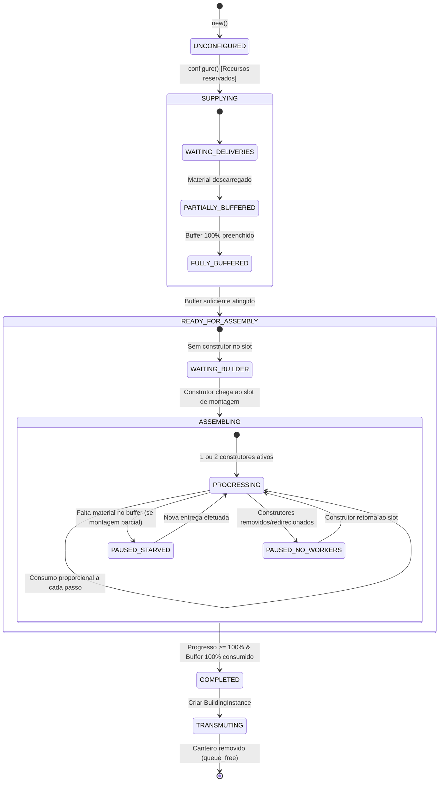
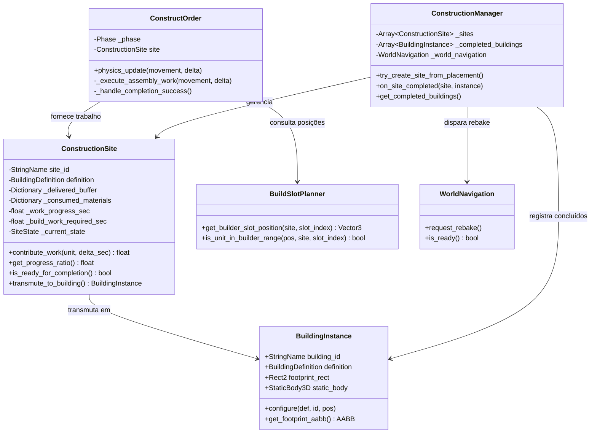
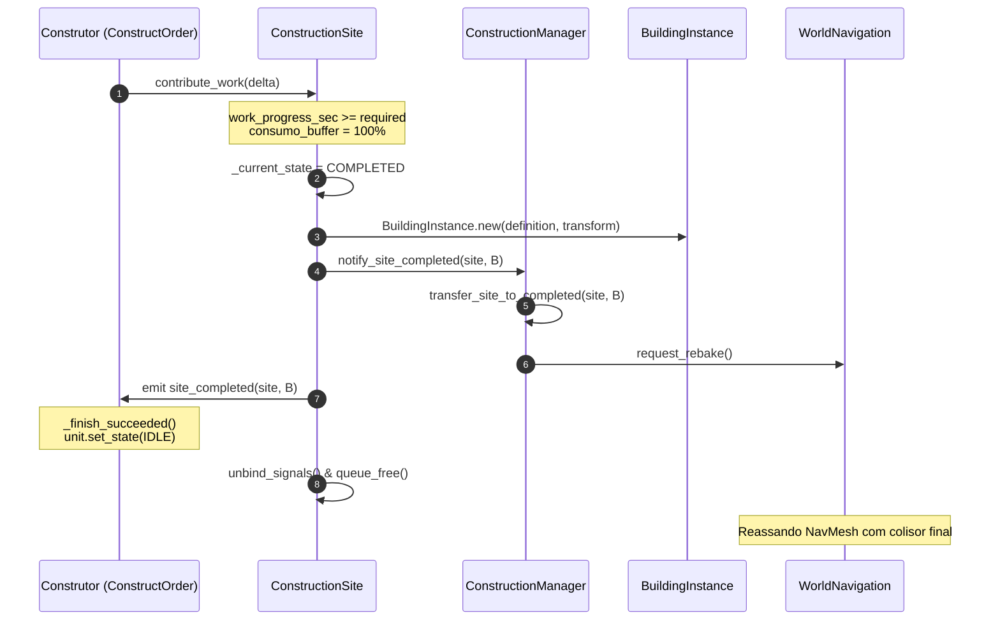
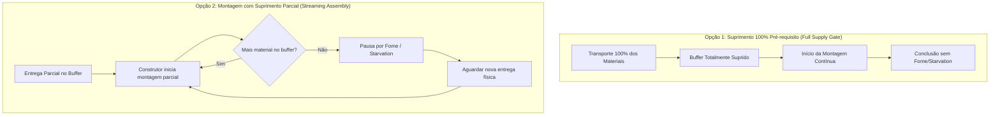

# DAWN OF KIN — T3.4 ARQUITETURA E PLANO DE IMPLEMENTAÇÃO (PROPOSTA)

**Etapa:** T3.4 — Ordem de Construção, Progresso com Consumo e Conclusão
**Status:** PROPOSTA TÉCNICA E PLANO DE IMPLEMENTAÇÃO — Sujeita a auditoria independente do ChatGPT e aprovação expressa do proprietário antes de qualquer código ser criado
**Base oficial da main:** `3c6fc0bd36fc3828af5a89662fb23cfb60d37865`
**Marco anterior:** Tag anotada `t3-3-complete`
**Branch de planejamento:** `planning/t3-4-architecture`
**Worktree de referência:** `C:\Projetos\Dawn_of_Kin_wt_t3_4_plan`
**Data:** 16 de novembro de 2026

---

## 1. Estado Inicial Auditado (Baseline T3.3 / `3c6fc0b`)

A etapa **T3.3 (Canteiro de Obra e Suprimento Físico)** foi integralmente implementada, testada automaticamente (227 testes aprovados em 32 suítes), validada com diagnóstico visual de navegação em rampa/platô (T3.3-R2), aprimorada com seletor dinâmico de resolução e teste com 4 trabalhadores (T3.3-UX), aprovada nos 10 cenários manuais pelo proprietário (A1–D2), auditada pelo ChatGPT e formalmente homologada e integrada na branch `main` no commit `3c6fc0bd36fc3828af5a89662fb23cfb60d37865`, com a tag oficial anotada `t3-3-complete`.

### 1.1 Capacidades Entregues e Consolidadas na T3.3
1. **Reserva Atômica e Ciclo de Vida do Canteiro:**
   - Criação atômica via `ConstructionManager.try_create_site_from_placement()`.
   - Bloqueio imediato contra sobreposições e invasão da `CampStorageZone`.
   - Reserva em lote (`reserve_batch`) no `SettlementInventory`, garantindo saldo físico pré-alocado nas pilhas sem consumo prematuro.
2. **Logística e Transporte Físico:**
   - `ConstructOrder` orquestra o transporte individualizado respeitando a capacidade de carga (`UnitCarryLoad`) e a penalidade física de velocidade conforme peso validada na T2.
   - Descarregamento no canteiro mediante reach check tridimensional (`DEFAULT_DROPOFF_REACH_TOLERANCE = 1.35 m`), com prevenção de entrega indevida e retenção de carga alheia (auditoria T3.3-R1).
   - Acumulação no buffer do canteiro (`_delivered_buffer`).
3. **Distribuição de Papéis segundo Decisão D9:**
   - Gestão dinâmica de slots e papéis em `ConstructionSite`: 1 trabalhador (transporte sequencial), 2 trabalhadores (1 transportador + 1 construtor), 3 trabalhadores (1 transportador + 2 construtores).
   - Rejeição determinística de um 4º trabalhador com motivo `no_worker_slot`.
   - Concorrência de coleta com reserva por pilha (`claim_pickup`), impedindo que múltiplos transportadores disputem a mesma unidade física simultaneamente.
4. **Navegação e Terreno Acidentado:**
   - `WorldNavigation` com geração de *curbs* laterais em rampas inclinadas (`_append_sloped_terrain_side_curbs`), eliminando quedas laterais de trabalhadores na rampa do platô.
   - Resolução dinâmica em tempo real (1280×720 e 1920×1080) sem reinicialização de cena nem perda de estado físico.

### 1.2 Ponto de Transição Herdado para a T3.4
Na T3.3, a responsabilidade do canteiro encerrava-se ao atingir o suprimento completo:
- Quando `is_fully_supplied() == true`, o canteiro emite `supply_completed(self)`.
- O trabalhador com papel `BUILDER` posicionava-se no slot perimetral determinado por `BuildSlotPlanner` e entrava na fase `Phase.BUILDER_STANDBY`.
- O método `_update_builder_standby()` mantinha a unidade virada para o canteiro no estado `Unit.State.WORKING`, mas **sem consumir materiais e sem acumular progresso de montagem**, aguardando a entrada formal da T3.4.

---

## 2. Matriz de Rastreabilidade (GDD v1.0 × Decisões D1–D9 × Código Vigente)

| Requisito / Princípio | Documento / Regra Fonte | Estado na Base Atual (`3c6fc0b`) | Escopo Específico da T3.4 |
|---|---|---|---|
| **D2: Transporte físico e montagem progressiva** | `T3_architecture_PROPOSAL.md`, GDD §5 | Suprimento físico concluído; materiais repousam no buffer do canteiro. | Consumo progressivo do buffer com conversão em avanço da estrutura. |
| **D4: Custos, dimensões e tempos provisórios** | Aprovado em 14/11/2026 | `BuildingDefinition` possui `costs`, `build_work_required_sec` e `max_builders = 2`. | Aplicação exata: Abrigo Básico (30 s, 12 madeira, 6 pedra) e Depósito Rústico (45 s, 18 madeira, 10 pedra). |
| **D9: Organização de trabalho (1 a 4 trabalhadores)** | `T3_architecture_PROPOSAL.md`, D9 | `ConstructionSite` atribui papéis; `ConstructOrder` possui fases de transporte e standby. | Construtores em `BUILDER_ASSEMBLING` aceleram montagem até 2 construtores simultâneos ($2,0\text{ s/s}$). Promoção de transportadores a construtores após suprimento. |
| **Conservação estrita de recursos** | GDD §5, §13 (Invariante Contábil) | Reserva nas pilhas + buffer + trânsito = Custo total. | Materiais consumidos passam de `_delivered_buffer` para `_consumed_materials`. Soma total preservada a todo instante. |
| **Transmutação física e conclusão** | GDD §5, T3 Roadmap | Canteiro é temporário (`ConstructionSite`). | Ao atingir 100% de progresso, `ConstructionSite` converte-se em `BuildingInstance`, liberando trabalhadores. |
| **Atualização da malha de navegação (NavMesh)** | GDD §12, T1/T3.3 | NavMesh inclui `MASK_NAV_STATIC`. `WorldNavigation` suporta `request_rebake()`. | Disparo de rebake determinístico na conclusão da obra; unidades desviam da nova construção sem prender ou atravessar paredes. |
| **Orçamento de desempenho (FPS / p95)** | `AGENTS.md`, Protocolo T2/T3 | Mantido $p95 \le 16,7\text{ ms}$ (CA 1080p, 0 quadros $> 100\text{ ms}$). | Rebake e transmutação contidos no orçamento de frame, sem engasgos perceptíveis. |

---

## 3. Modelo Formal de Estados do Canteiro de Obras

O ciclo de vida do canteiro na T3.4 evolui de um modelo puramente logístico para um modelo de montagem e conversão predial.

### 3.1 Diagrama de Estados do Canteiro (`ConstructionSite`)

### 3.2 Transições e Regras Operacionais

1. **`SUPPLYING`:**
   - O canteiro recebe materiais trazidos pelos transportadores via `accept_delivery_from_carry_load()`.
   - O saldo no buffer (`_delivered_buffer`) aumenta e a reivindicação em trânsito é liquidada.
2. **Entrada em Montagem (`ASSEMBLING`):**
   - Um trabalhador com papel `BUILDER` atinge o slot designado por `BuildSlotPlanner`.
   - Se os critérios de material estiverem atendidos (ver Seção 11 para a arbitragem entre suprimento integral vs parcial), o construtor transiciona de `Phase.BUILDER_STANDBY` para `Phase.BUILDER_ASSEMBLING`.
3. **Pausas e Interrupções:**
   - **Remoção de Trabalhador:** Se o jogador emitir uma ordem de movimento ou coleta para um construtor, `unregister_worker()` é invocado. O canteiro aciona `_rebalance_worker_roles()`. Se ainda houver outro construtor, a taxa cai de $2,0\text{ s/s}$ para $1,0\text{ s/s}$. Se não houver nenhum, a montagem entra em `PAUSED_NO_WORKERS`, retendo o progresso alcançado sem decaimento imediato.
   - **Retomada:** Ao receber novo trabalhador ou redirecionar um trabalhador existente para o canteiro, este retoma a montagem a partir do ponto em que parou.
4. **Conclusão (`COMPLETED`):**
   - Quando `work_progress_sec >= build_work_required_sec`, o canteiro trava o recebimento de trabalho e ativa a sequência de transmutação.

---

## 4. Contabilidade Física e Modelo de Consumo de Materiais

### 4.1 Invariante Contábil Fundamental de Obra
A integridade patrimonial do assentamento exige que nenhum recurso surja do nada nem desapareça sem registro:

$$\forall R \in \text{Recursos}: \quad Q_{\text{total\_comprometido}}(R) = \text{Custo}(R)$$

Onde, a qualquer instante $t$:
$$Q_{\text{total\_comprometido}}(R) = Q_{\text{reserva\_pilhas}}(R) + Q_{\text{trânsito}}(R) + Q_{\text{buffer\_canteiro}}(R) + Q_{\text{consumido\_estrutura}}(R)$$

- $Q_{\text{reserva\_pilhas}}(R)$: Materiais fisicamente nas pilhas do acampamento com tag da reserva da obra.
- $Q_{\text{trânsito}}(R)$: Materiais na mochila (`UnitCarryLoad`) de trabalhadores a caminho do canteiro com claim ativo.
- $Q_{\text{buffer\_canteiro}}(R)$: Materiais descarregados na borda do canteiro prontos para montagem.
- $Q_{\text{consumido\_estrutura}}(R)$: Materiais fisicamente integrados à alvenaria/estrutura da obra.

### 4.2 Fórmulas Inteiras de Consumo Proporcional

O progresso temporal é contínuo ($p \in [0.0, 1.0]$), mas os itens físicos de madeira e pedra são indivisíveis (números inteiros $\mathbb{Z}_{\ge 0}$).

Para evitar arredondamentos flutuantes que criem ou destruam frações de recursos, adota-se o **modelo do piso de progresso acumulado**:

1. Seja o progresso relativo instantâneo:
   $$p(t) = \min\left(1.0, \frac{\text{work\_progress\_sec}(t)}{\text{build\_work\_required\_sec}}\right)$$

2. O total cumulativo de unidades que **devem estar consumidas** no progresso $p(t)$ é:
   $$Q_{\text{meta\_consumido}}(R, p) = \lfloor p(t) \times \text{Custo}(R) \rfloor$$

3. A quantidade inteira a debitar do buffer no passo de simulação atual $\Delta t$ é:
   $$\Delta Q_{\text{consumir}}(R) = \max\left(0, Q_{\text{meta\_consumido}}(R, p) - Q_{\text{consumido\_atual}}(R)\right)$$

4. **Garantia de Fechamento em 100%:**
   Quando $p(t) = 1.0$:
   $$Q_{\text{meta\_consumido}}(R, 1.0) = \lfloor 1.0 \times \text{Custo}(R) \rfloor = \text{Custo}(R)$$
   Todos os materiais necessários são consumidos exatamente, sem sobras e sem déficits.

#### Exemplo Prático de Consumo Inteiro (Abrigo Básico):
- Custo: 12 Madeiras, 6 Pedras. Tempo: 30 segundos.
- Taxa: 1 construtor ($1,0\text{ s/s}$).
- Aos 5,0 s ($p = 0,1667$): $\lfloor 0,1667 \times 12 \rfloor = 2$ madeiras; $\lfloor 0,1667 \times 6 \rfloor = 1$ pedra.
- Aos 10,0 s ($p = 0,3333$): $\lfloor 0,3333 \times 12 \rfloor = 4$ madeiras; $\lfloor 0,3333 \times 6 \rfloor = 2$ pedras.
- Aos 15,0 s ($p = 0,5000$): $\lfloor 0,5000 \times 12 \rfloor = 6$ madeiras; $\lfloor 0,5000 \times 6 \rfloor = 3$ pedras.
- Aos 30,0 s ($p = 1,0000$): 12 madeiras, 6 pedras.

---

## 5. Responsabilidades Modulares e Arquitetura de Classes

### 5.1 `ConstructionSite` (`src/buildings/construction_site.gd`)
- Mantém o progresso escalar: `_work_progress_sec: float` e `_build_work_required_sec: float`.
- Controla o buffer físico de materiais e a tabela de materiais consumidos.
- Expõe método tipado: `contribute_work(unit: Unit, delta: float) -> Dictionary`.
  - Retorna se houve avanço, frações acumuladas e se a obra atingiu a conclusão.
- Emite novos sinais:
  - `progress_changed(site: ConstructionSite, progress_ratio: float, work_sec: float)`
  - `material_consumed(site: ConstructionSite, resource_id: StringName, amount_consumed: int, remaining_buffer: int)`
  - `site_completed(site: ConstructionSite, building_instance: BuildingInstance)`

### 5.2 `BuildingInstance` (`src/buildings/building_instance.gd` — Nova Classe)
- `Node3D` derivado que passa a representar o edifício no cenário.
- Criado na mesma transformação global do canteiro.
- Monta o colisor estático final:
  - `StaticBody3D` com `collision_layer = CollisionLayers.MASK_BUILDINGS | CollisionLayers.MASK_OBSTACLES`.
  - Unidades físicas com `MASK_WORLD_SOLID` colidem e não atravessam as paredes.
  - Seleção e picking respondem em `MASK_BUILDINGS`.
- Malha visual limpa indicando o edifício concluído (teto, paredes, pilares em madeira/pedra de acordo com a definição).

### 5.3 `ConstructOrder` (`src/units/orders/construct_order.gd`)
- Nova fase operacional: `Phase.BUILDER_ASSEMBLING`.
- No ciclo de física:
  1. Verifica se a unidade permanece no slot perimetral de montagem (`BuildSlotPlanner.is_unit_in_site_dropoff_range` ou tolerância de construtor).
  2. Ajusta orientação visual (`rotation.y`) voltada ao centro da obra.
  3. Define o estado do trabalhador como `Unit.State.WORKING`.
  4. Invoca `site.contribute_work(unit, delta)`.
  5. Se o canteiro relatar conclusão ou emitir `site_completed`, invoca `_finish_succeeded()`, transiciona para `Unit.State.IDLE` e encerra a ordem.

### 5.4 `ConstructionManager` (`src/buildings/construction_manager.gd`)
- Recebe a notificação de transmutação do canteiro.
- Remove o canteiro de `_sites` e insere o `BuildingInstance` em `_completed_buildings`.
- Invoca o `WorldNavigation.request_rebake()` para integrar o novo colisor à malha de navegação.

---

## 6. Contribuição dos Trabalhadores segundo D9

A regra de organização **D9** governa estritamente o número de trabalhadores e seus papéis:

### 6.1 Cenários de Equipe
1. **1 Trabalhador:**
   - **Fase de Transporte:** Realiza as viagens sequenciais de busca no acampamento e descarregamento no canteiro.
   - **Transição Automática:** Assim que a entrega é concluída e o canteiro está apto para montagem, o trabalhador é promovido internamente de `TRANSPORTER` para `BUILDER`.
   - **Montagem:** Desloca-se até o slot 0 do canteiro e monta a estrutura na taxa de $1,0\text{ s/s}$.
   - **Tempo total de montagem pura:** 30 s (Abrigo) / 45 s (Depósito).
2. **2 Trabalhadores:**
   - **Operação Simultânea:** 1 Trabalhador assume o papel de `TRANSPORTER` e o outro assume `BUILDER` (slot 0).
   - O construtor monta na taxa de $1,0\text{ s/s}$ enquanto o transportador viaja.
   - **Promoção pós-suprimento:** Ao descarregar a última carga e liquidar o suprimento, o transportador é promovido a 2º `BUILDER`. Desloca-se até o slot 1.
   - **Montagem Acelerada:** Com 2 construtores ativos nos slots 0 e 1, a taxa passa a ser de $2,0\text{ s/s}$ ($2\times$ velocidade).
3. **3 Trabalhadores:**
   - 1 Trabalhador é `TRANSPORTER`.
   - 2 Trabalhadores são `BUILDER` (slots 0 e 1, taxa máxima permitida por D4/D9 de $2,0\text{ s/s}$).
   - Quando o suprimento acaba, o 3º trabalhador não pode ser construtor (limite de 2 construtores simultâneos por D4). Ele conclui a ordem com sucesso e fica ocioso (`IDLE`).
4. **4º Trabalhador (Tentativa Excedente):**
   - Atribuição é rejeitada imediatamente com o motivo `no_worker_slot`.

### 6.2 Comportamento em Deslocamentos e Interrupções
- Se um construtor for selecionado pelo jogador e enviado para outra tarefa (movimento ou coleta):
  - A saída do trabalhador invoca `unregister_worker()`.
  - O canteiro executa `_rebalance_worker_roles()`.
  - Se ainda houver 1 construtor ativo, a montagem continua a $1,0\text{ s/s}$.
  - Se não houver construtor ativo, a montagem é pausada (`PAUSED_NO_WORKERS`), preservando exatamente o tempo acumulado e os materiais já consumidos.
  - A barra visual e os dados contextuais congelam no último valor de progresso registrado.

---

## 7. Ciclo de Conclusão e Transmutação (`Site` $\rightarrow$ `BuildingInstance`)

O momento da conclusão exige precisão atômica para evitar condições de corrida entre a destruição do nó temporário e a consulta dos trabalhadores:

### 7.1 Passos Determinísticos da Conclusão
1. **Detecção de Limite:** `work_progress_sec >= build_work_required_sec` e materiais 100% consumidos.
2. **Congelamento:** Estado passa a `COMPLETED`. Rejeita qualquer nova contribuição de trabalho ou entrega de material.
3. **Instanciação Predial:** Criação de `BuildingInstance`, copiando:
   - `definition_id` e metadados.
   - Posição e rotação global no mundo.
   - Colisores definitivos em `MASK_BUILDINGS` e `MASK_OBSTACLES`.
4. **Substituição na Árvore:**
   - `BuildingInstance` é adicionado à árvore no nó de construções permanentes.
   - Canteiro desvincula listeners de inventário (`SettlementInventory`) e libera referências.
5. **Liberação Limpa dos Trabalhadores:**
   - Todos os trabalhadores com ordens vinculadas ao canteiro recebem notificação de sucesso (`_finish_succeeded()`).
   - Retornam ao estado `IDLE`, aptos a receber novos comandos sem travar a máquina de estados.
6. **Descarte do Canteiro:** Chamada de `queue_free()` no nó `ConstructionSite`.
7. **Disparo de Atualização de Navegação:** `ConstructionManager` solicita `WorldNavigation.request_rebake()`.

---

## 8. Estratégia de Navegação e Performance

### 8.1 Rebake Seguro da Malha de Navegação
O Godot 4.x processa colisores estáticos presentes na máscara de bake.
- O `CollisionLayers.MASK_NAV_STATIC` (`MASK_TERRAIN | MASK_OBSTACLES | MASK_BUILDINGS`) já engloba edifícios.
- O `BuildingInstance` conterá um `StaticBody3D` em `LAYER_BUILDINGS`.
- Ao invocar `WorldNavigation.request_rebake()`, o NavigationServer3D reavalia a geometria estática.
- **Preservação de Curbs de Rampa:** A rotina `_append_sloped_terrain_side_curbs()` do `WorldNavigation` continuará sendo chamada durante o rebake, garantindo que a adição do edifício **não desfaça as proteções de rampa** consolidadas na T3.3-R2.

### 8.2 Prevenção de Aprisionamento de Unidades
- **Posicionamento dos Slots:** Conforme definido no `BuildSlotPlanner`, os slots perimetrais de montagem ficam a uma margem externa do footprint da obra ($0,5\text{ m}$ além do contorno).
- Os construtores trabalham fora do perímetro de colisão sólida do edifício.
- Quando o rebake conclui, os trabalhadores estão posicionados em polígonos navegáveis válidos imediatamente adjacentes à nova construção, sem risco de serem teletransportados para dentro de paredes ou ficarem ilhados.

### 8.3 Orçamento de Desempenho e Medições
- **Meta Crítica de Desempenho (`AGENTS.md`):**
  - Resolução Full HD (`1920×1080`), renderer `gl_compatibility`.
  - Sob alimentação CA: mediana de $p95 \le 16,7\text{ ms}$ ($\ge 60\text{ FPS}$), com **0 quadros acima de 100 ms**.
- O rebake síncrono da malha no `TestMap` consome historicamente entre **3,5 ms e 7,2 ms**, perfeitamente contido dentro da folga do frame rate de 60 Hz (16,67 ms).
- A transmutação e instanciação do nó não realiza alocações pesadas ou I/O de disco, garantindo transição sem engasgo de renderização.

---

## 9. Plano Incremental de Implementação (T3.4.1 a T3.4.5)

Para garantir desenvolvimento estritamente incremental, seguro e reversível, a T3.4 é dividida em 5 incrementos:

### Incremento T3.4.1 — Modelo de Estados de Montagem e Acúmulo de Progresso
- **Objetivo:** Implementar no `ConstructionSite` o controle de tempo de montagem (`_work_progress_sec`), sinais de avanço e método de contribuição de trabalho `contribute_work(delta)`.
- **Arquivos Afetados:** `src/buildings/construction_site.gd`.
- **Riscos:** Avanço sem limites ou divisão por zero em obras com duração inválida.
- **Testes Automáticos:** Testes unitários validando acúmulo de trabalho de 0 a 100%, suporte a taxas de 1 e 2 construtores, bloqueio de progresso além do máximo.
- **Critério de Aceite:** Canteiro acumula progresso linearmente sob chamada de trabalho e emite `progress_changed`.

### Incremento T3.4.2 — Consumo Inteiro Proporcional e Invariante Contábil
- **Objetivo:** Implementar o consumo inteiro de recursos do buffer conforme o progresso avança, mantendo a invariante patrimonial estrita.
- **Arquivos Afetados:** `src/buildings/construction_site.gd`.
- **Riscos:** Arredondamento cumulativo gerar sobra de material no buffer ou consumo insuficiente em 100%.
- **Testes Automáticos:** Testes contábeis com custos ímpares (ex.: 12 madeiras, 6 pedras; 18 madeiras, 10 pedras) checando consumo exato em marcos de 25%, 50%, 75% e 100%.
- **Critério de Aceite:** Buffer é debitado proporcionalmente; em 100% de progresso, exatamente 100% dos materiais foram transferidos para `_consumed_materials`.

### Incremento T3.4.3 — Execução da Ordem de Montagem (`ConstructOrder` em `ASSEMBLING`)
- **Objetivo:** Conectar a fase de montagem no `ConstructOrder`, promovendo construtores em standby para montagem ativa, aplicando trabalho no canteiro e gerenciando transições de papéis de trabalhadores conforme D9.
- **Arquivos Afetados:** `src/units/orders/construct_order.gd`, `src/buildings/construction_site.gd`.
- **Riscos:** Construtores continuarem martelando fora de alcance ou não reagirem a interrupções.
- **Testes Automáticos:** Testes de concorrência com 1, 2 e 3 trabalhadores; teste de interrupção e retomada de montagem; verificação de reach check durante a montagem.
- **Critério de Aceite:** Trabalhadores no slot de montagem avançam a obra; ao receber nova ordem de movimento, saem sem travar o canteiro.

### Incremento T3.4.4 — Transmutação em `BuildingInstance` e Conclusão
- **Objetivo:** Criar a classe `BuildingInstance`, orquestrar a remoção atômica do canteiro, instanciação do edifício com colisão final e liberação das ordens dos trabalhadores como concluídas.
- **Arquivos Afetados:** `src/buildings/building_instance.gd`, `src/buildings/construction_manager.gd`, `src/buildings/construction_site.gd`.
- **Riscos:** Referências nulas no momento em que o canteiro é liberado da árvore.
- **Testes Automáticos:** Testes de ciclo completo de conclusão: instanciação de `BuildingInstance`, remoção do canteiro, validação de nós órfãos (`assert_no_leaks`), finalização de ordens com `_finish_succeeded()`.
- **Critério de Aceite:** Obra concluída resulta em `BuildingInstance` válido na árvore; trabalhadores voltam para `IDLE`; canteiro é liberado da memória.

### Incremento T3.4.5 — Rebake de Navegação, Validação de Contorno e Estabilidade
- **Objetivo:** Acoplar o disparo de `WorldNavigation.request_rebake()` após a transmutação, assegurando que as unidades contornem a nova edificação e que o frame rate atenda à meta de desempenho.
- **Arquivos Afetados:** `src/buildings/construction_manager.gd`, `src/navigation/world_navigation.gd`.
- **Riscos:** Spike de framerate durante o rebake ou unidades presas em novas bordas de colisão.
- **Testes Automáticos:** Teste de pathfinding ao redor da nova edificação concluída; teste de colisão impedindo travessia física.
- **Critério de Aceite:** Unidades contornam o edifício perfeitamente; benchmark mantém $p95 \le 16,7\text{ ms}$ em 1080p sob CA.

---

## 10. Protocolo de Testes Manuais Proposto

O protocolo manual formaliza a validação jogável pelo proprietário em ambiente real:

### 10.1 Cenários de Teste

| ID | Cenário | Condição Inicial | Procedimento | Resultado Esperado |
|---|---|---|---|---|
| **A1** | **Construção Completa com 1 Trabalhador** | Acampamento com recursos suficientes. 1 Líder. | Criar canteiro de Abrigo Básico. Atribuir o líder ao canteiro. | O líder realiza viagens de transporte até suprir o canteiro. Ao terminar o suprimento, desloca-se para o slot de montagem, martela a estrutura por 30 s. A obra é concluída, surge o abrigo e o líder volta a `IDLE`. |
| **A2** | **Construção com 2 Trabalhadores (D9)** | Recursos suficientes. 2 Trabalhadores. | Criar canteiro de Abrigo. Atribuir os 2 trabalhadores. | 1 Trabalhador atua como transportador e 1 como construtor. Ao terminar as entregas, o transportador junta-se como 2º construtor. A velocidade de montagem dobra e a obra é concluída com sucesso. |
| **A3** | **Construção com 3 Trabalhadores (D9)** | Recursos suficientes. 3 Trabalhadores. | Criar canteiro. Atribuir os 3 trabalhadores. | 1 Transportador e 2 Construtores operam em paralelo. A taxa máxima de montagem é mantida em $2,0\text{ s/s}$. Ao terminar as entregas, o transportador conclui sua ordem e fica livre. |
| **B1** | **Rejeição do 4º Trabalhador** | Canteiro com 3 trabalhadores ativos. | Tentar enviar um 4º trabalhador com clique direito no canteiro. | O 4º trabalhador recusa a ordem com aviso `no_worker_slot` e não interfere na obra. |
| **B2** | **Interrupção e Retomada de Montagem** | Obra em montagem ativa (ex.: 50% de progresso). | Selecionar o construtor ativo e ordenar movimento para o lado oposto do mapa. | O construtor obedece à ordem de movimento. A montagem no canteiro pausa imediatamente em 50%. Ao enviar o construtor de volta ao canteiro, a montagem retoma dos 50% até 100%. |
| **C1** | **Física e Colisão da Obra Concluída** | Edifício recém-concluído. | Selecionar um personagem e ordenar movimento clicando além do edifício. | O personagem não atravessa as paredes do edifício; o caminho contorna suavemente as paredes sem travamentos. |
| **C2** | **Navegação em Platô/Rampa com Nova Obra** | Canteiro construído no topo do platô. | Concluir o edifício e ordenar viagem da base até o platô. | O rebake preserva os curbs da rampa; unidades sobem a rampa normalmente e contornam o edifício no platô. |
| **D1** | **Estabilidade Visual e Troca de Resolução** | Jogo em execução durante montagem. | Alternar resolução no seletor entre 1280×720 e 1920×1080. | A janela redimensiona instantaneamente; barras de progresso, workers e posicionamento mantêm fidelidade visual sem falhas. |

---

## 11. Decisões em Aberto e Trade-offs para Arbitragem do Proprietário

### 11.1 Trade-off Central: Montagem após Suprimento 100% vs Montagem Parcial Contínua

A decisão D2 aprovada na arquitetura geral possui a redação:
> *"A construção progride conforme materiais são disponibilizados no canteiro, consumindo-os proporcionalmente ao progresso de montagem."*

Ao mesmo tempo, a homologação da T3.3 consolidou a transição:
> *"Estado: Suprido e pronto para construção (T3.4)"*, na qual os construtores aguardavam em `BUILDER_STANDBY` até a entrega total dos insumos.

Submetemos à arbitragem expressa do proprietário duas alternativas de desenho técnico:

#### Comparativo Técnico para Decisão:

| Critério | Opção 1: Suprimento 100% Pré-requisito (Recomendada) | Opção 2: Montagem com Suprimento Parcial |
|---|---|---|
| **Mecânica de Jogo** | Primeiro estoca-se todo o material no canteiro; em seguida, ergue-se a estrutura sem pausas. | Construtor começa a trabalhar assim que o primeiro lote chega; para se o material acabar antes da próxima viagem. |
| **Robustez da Máquina de Estados** | **Máxima.** Estados estritamente determinísticos (`SUPPLYING` $\rightarrow$ `ASSEMBLING` $\rightarrow$ `COMPLETED`). Risco nulo de deadlock ou corrida entre entrega e consumo. | **Moderada a Complexa.** Exige estado intermediário de espera (`PAUSED_STARVED`), tratando casos em que transportador morre, fica preso ou demora. |
| **Coerência com D9** | Com 2 trabalhadores: 1 transporta todo o restante enquanto o outro pode adiantar a obra ou ambos transportam primeiro. | Com 2 trabalhadores: 1 constrói enquanto o outro transporta; se o construtor for mais rápido que o transporte, ele ficará ocioso esperando na obra. |
| **Cancelamento com Reembolso (T3.6)** | Extremamente simples: materiais no buffer são 100% devolvidos; nenhum material é consumido antes de haver todo o lote. | Exige calcular material incorporado incompleto a cada fração de segundo de montagem. |
| **Recomendação da Engenharia** | **Recomendada para a T3.4.** Garante estabilidade matemática sólida, previsibilidade operacional e menor superfície de falhas. | Alternativa viável, porém adiciona estados de starvation e maior custo de validação. |

*Solicitação ao Proprietário:* Indicar na revisão se prefere adotar a **Opção 1 (Suprimento 100% obrigatório antes da montagem)** ou a **Opção 2 (Montagem progressiva com suprimento parcial)**.

### 11.2 Representação Visual da Transmutação
- Proposta provisória para T3.4: Substituição direta e limpa do nó visual do canteiro pela malha definitiva do edifício (`BuildingInstance`).
- Efeitos visuais adicionais (partículas de poeira de construção, animação de colocação de telhado) ficam sugeridos como refinamento futuro de polimento.

---

## 12. Fronteiras Claras de Escopo (O que NÃO pertence à T3.4)

Para manter a disciplina de engenharia de `AGENTS.md`, ficam explicitamente fora do escopo da T3.4:

1. **T3.5 — Interface de Construção Oficial:**
   - Botão inferior direito de "Construir", menu retrátil de catálogo de obras e painel contextual de canteiro com botões interativos pertencem estritamente à T3.5. Na T3.4, utiliza-se a base funcional existente de posicionamento (`PlacementController` / `PlacementTestOverlay`).
2. **T3.6 — Cancelamento de Obras com Reembolso:**
   - A rotina de demolição de canteiro em andamento com devolução de materiais via pilhas de despejo será implementada na T3.6.
3. **T3.7 — Benefícios de Armazenamento e Depósitos:**
   - O funcionamento do `Depósito Rústico` como estoque coberto com proteção contra deterioração pertence à T3.7. Na T3.4, ele é construído e concluído fisicamente como estrutura válida.
4. **T3.8 — Persistência Versionada em Disco (Save/Load):**
   - Serialização de canteiros, progresso e edifícios em disco pertence à T3.8.
5. **Combate, Danos ou Ataques a Edificações:**
   - Não pertencem à etapa T3.

---

## 13. Conclusão da Revisão de Arquitetura

O presente plano técnico estabelece as bases matemáticas, modulares e operacionais para a execução da **T3.4 — Ordem de Construção, Progresso com Consumo e Conclusão**.

Nenhum código de produção foi criado ou modificado. A base da T3.3 permanece íntegra, formalmente homologada e preservada no repositório.

Este documento é submetido na branch de planejamento `planning/t3-4-architecture` para auditoria independente do ChatGPT e aprovação expressa do proprietário antes de qualquer etapa de implementação ser autorizada.
