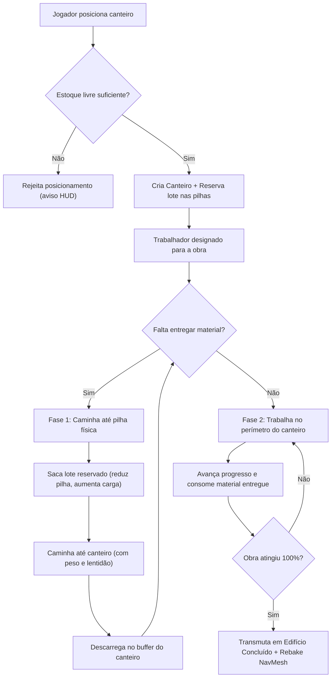
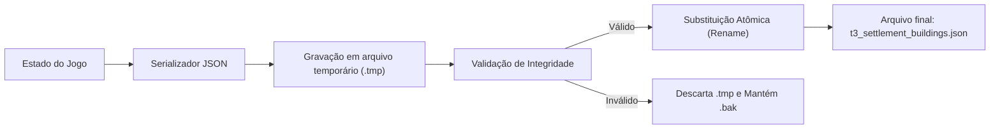

# Dawn of Kin — T3.0-R1: Revisão da Arquitetura e Planejamento Incremental da T3 (Construção)

**Status:** PROPOSTA ARQUITETURAL REVISADA (T3.0-R1) — somente planejamento autorizado; nenhuma linha de código T3 implementada.<br>
**Base Auditada:** Branch `main` (`f7c24592e3a6d936dbcb63f648c474280695ab9b`), tag `t2-complete`.<br>
**Fonte Normativa:** [Dawn_of_Kin_GDD_v1.0.md](../Dawn_of_Kin_GDD_v1.0.md) (com referências informativas à minuta [Dawn_of_Kin_GDD_v1.1.md](../Dawn_of_Kin_GDD_v1.1.md)).<br>
**Engine e Alvo de Referência:** Godot `4.7.2.stable` (`gl_compatibility`), Intel UHD Graphics 620 (`1920×1080`, meta `p95 <= 16,7 ms` em tomada CA).

---

## 1. As Sete Decisões Aprovadas pelo Proprietário (D1 a D7)

Em 14/11/2026, o proprietário do projeto deliberou sobre os pontos abertos da proposta inicial T3.0, estabelecendo os seguintes direcionamentos executivos vinculantes:

1. **D1 — Persistência em disco na T3 (DECIDIDO: P2):**
   - As construções e o estado do assentamento deverão ser salvos em disco já na T3.
   - A persistência deve ser mínima, versionada (esquema inicial `schema_version = 1`) e compatível com o futuro `SaveManager` da T4.
   - Deve assegurar consistência estrita entre construções concluídas, canteiros em andamento, progresso, reservas, estoque físico e materiais em trânsito, impedindo duplicação ou desaparecimento de recursos após recarga.
   - Não antecipar calendário, ciclo dia/noite ou os demais subsistemas previstos para a T4.

2. **D2 — Transporte físico dos materiais até o canteiro (DECIDIDO: Reserva e Transporte Físico):**
   - O consumo atômico instantâneo na colocação foi rejeitado.
   - Ao posicionar uma obra, os materiais necessários são **reservados logicamente** nas pilhas físicas do acampamento.
   - Os trabalhadores devem retirar fisicamente os materiais reservados das pilhas, carregá-los respeitando o peso unitário e a capacidade de carga individual (`UnitCarryLoad`, `0%` a `100%`, com desaceleração conforme carga da T2), transportá-los até o canteiro e descarregá-los lá.
   - O trabalho de construção só avança à medida que os materiais são entregues ao canteiro, consumindo-os proporcionalmente ao progresso de montagem.
   - Devem ser tratadas reservas concorrentes, retiradas, interrupções, entregas parciais, deterioração de pilhas com reserva e ausência absoluta de duplicação.

3. **D3 — Cancelamento com reembolso proporcional (DECIDIDO: Proporcional ao trabalho restante):**
   - O cancelamento de obra em andamento deve adotar regra contabilmente consistente.
   - Materiais ainda reservados nas pilhas são liberados imediatamente (100%).
   - Materiais em transporte continuam com o trabalhador e são redirecionados para devolução ao acampamento (100%).
   - Materiais entregues ao canteiro e não incorporados permanecem no local para recolhimento/devolução (100%).
   - Materiais já consumidos pela construção são reembolsados proporcionalmente ao trabalho restante ou via taxa de sucata de demolição ($\eta_{\text{demolição}}$).
   - O cancelamento jamais poderá criar recursos do nada nem duplicar estoque.

4. **D4 — Custos, dimensões e tempos provisórios (DECIDIDO: Apresentar tabela para aprovação):**
   - Apresentar proposta paramétrica concreta para o **Abrigo Básico** e o **Depósito Rústico**.
   - Dimensões em metros, custos de madeira e pedra, esforço total de construção em segundos-construtor, número de trabalhadores simultâneos e função/capacidade.
   - Valores justificados com base na capacidade de transporte de 20 unidades de peso e no ritmo de coleta validado na T2.
   - Marcados explicitamente como **PROPOSTA** técnica sujeita a aprovação final.

5. **D5 — Depósitos protetores incluídos na própria T3 (DECIDIDO: Escopo da T3):**
   - Após a validação do primeiro abrigo funcional, implementar depósitos construíveis na T3 que reduzam ou eliminem a deterioração dos materiais armazenados.
   - Preservar uma autoridade única de estoque (`SettlementInventory`), permitindo distinguir materiais expostos de protegidos sem duplicação de saldo.

6. **D6 — Construção na CampStorageZone (DECIDIDO: Opção A — Área das pilhas reservada):**
   - Durante a T3, edifícios e canteiros não podem ocupar o interior da `CampStorageZone` (área lógica inicial de pilhas e descarga).
   - Construções permitidas exclusivamente fora da zona do acampamento.
   - A prévia de posicionamento deve acusar rejeição clara quando o cursor estiver sobre a zona reservada.
   - Preservar acessos às pilhas, pontos de descarga e corredores de navegação, sem impor quadrículas visíveis ao mapa.
   - Não transformar a restrição inicial em proibição permanente futura de reorganizar a comunidade.

7. **D7 — Interface de construção (DECIDIDO: Opção A — Botão Construir com painel retrátil):**
   - Botão discreto **Construir** no canto inferior direito da tela.
   - Painel retrátil com catálogo de edifícios disponíveis e indicação de custos.
   - Seleção pelo mouse, prévia no terreno (verde/vermelha com motivo de bloqueio), confirmação por clique esquerdo e cancelamento de posicionamento por `Esc` ou clique direito.
   - Painel contextual de canteiro com progresso de materiais e obra, permitindo cancelamento.
   - Não sobrepor painel do personagem selecionado (canto inferior esquerdo) nem estoque (superior direito).

---

## 2. Matriz GDD × Código Atual (`main`) × Arquitetura Revisada

| Requisito / Referência (GDD v1.0 + v1.1) | Status na `main` (`f7c2459`) | Solução Arquitetural T3.0-R1 | Impacto / Módulos Envolvidos |
|---|---|---|---|
| Início sem infraestrutura prévia; edifícios vistos apenas pelo exterior (§6, **DECIDIDO**) | Totalmente atendido (`test_map.tscn` limpo, sem construções prévias) | Manter canteiros e edifícios puramente externos, com malhas leves sem interiores navegáveis. | `BuildingDefinition`, `ConstructionSite`, `BuildingInstance`. |
| Posicionamento contínuo sem grid visível (§6, **DECIDIDO**; D6) | Inexistente (apenas raycast pontual de terreno em `WorldPicker`) | `PlacementController` com raycast contínuo no terreno, alinhamento de normal suave e rotação livre/discreta. | `PlacementController`, `PlacementPreview`, `PlacementValidator`. |
| Proibição de construção na `CampStorageZone` (D6) | `CampStorageZone` atua apenas validando slots de pilhas e descarga | `PlacementValidator` rejeita posicionamento cuja *footprint* intercepte o AABB/bounds da `CampStorageZone`. | `PlacementValidator`, `CampStorageZone`. |
| Transporte físico de materiais para obras (D2, GDD §5/§6) | Apenas coleta e entrega no acampamento (`DeliverToCampOrder`, `GatherResourceOrder`) | `SupplyConstructionOrder` (ou ciclo de suprimento em `ConstructOrder`): retirar material reservado da pilha, caminhar com peso e entregar no canteiro. | `ConstructOrder`, `SupplyConstructionOrder`, `UnitCarryLoad`, `GroundPileManager`. |
| Reserva de materiais sem consumo imediato (D2) | `GroundPileManager` e `SettlementInventory` possuem apenas saldo físico absoluto; sem reservas | Adicionar contabilidade de reservas em lote (`reserve_batch`, `release_batch`, `withdraw_reserved_batch`). | `GroundPileManager`, `SettlementInventory`. |
| Consumo de materiais conforme progresso da obra (D2) | Inexistente | `ConstructionSite` mantém buffer de materiais entregues e consome frações inteiras à medida que o trabalho é executado. | `ConstructionSite`, `ConstructOrder`. |
| Reembolso proporcional ao cancelar (D3) | Inexistente | Desfazer reservas pendentes (100%), gerar devolução para materiais em transporte/entregues (100%) e aplicar fórmula de demolição ao consumido. | `ConstructionSite`, `ConstructionManager`, `DeliverToCampOrder`. |
| Conclusão de abrigo funcional visível externamente (§6, §13 T3) | Inexistente | Ao atingir 100% de progresso, `ConstructionSite` transmuta em `BuildingInstance` (abrigo), libera trabalhadores e atualiza NavMesh. | `ConstructionSite`, `BuildingInstance`, `WorldNavigation`. |
| Depósitos protetores contra deterioração (D5, GDD §5/§6) | `GroundPileManager` aplica decaimento único global via `CampStorageZone.decay_multiplier` | `CompositeStorageSource` integrando pilhas no chão e slots de depósitos construídos com fator de decaimento zero ou reduzido. | `CompositeStorageSource`, `DepotStorageManager`, `StorageDepotInstance`. |
| Persistência em disco na T3 (D1, P2) | Inexistente (estado apenas em memória volátil) | `BuildingPersistenceManager` com gravação atômica (`.tmp` -> replace), schema versionado e validação contábil pós-carga. | `BuildingPersistenceManager`, `MainScene`. |
| Interface com botão e painel retrátil (D7) | HUD passivo (`ResourceHud`, `SettlementStockpilePanel`, `SelectedUnitPanel`) | `ConstructionHud` no canto inferior direito com `MOUSE_FILTER_STOP`, painel retrátil e painel de inspeção contextual de obra. | `ConstructionHud`, `BuildingInspectorPanel`, `MainScene`. |

---

## 3. Modelo Contábil e Logística Física de Construção

### 3.1. Invariante Contábil Fundamental do Assentamento
Para impedir duplicação, perda ou surgimento espontâneo de recursos durante transporte, reservas, cancelamentos e salvamento, a economia do assentamento obedece à equação de conservação estrita por categoria de recurso $R$:

$$Q_{\text{total}}(R) = Q_{\text{livre\_pilhas}}(R) + Q_{\text{reservado\_pilhas}}(R) + \sum_{u \in \text{Unidades}} Q_{\text{transporte}}(u, R) + \sum_{c \in \text{Canteiros}} Q_{\text{entregue}}(c, R) + \sum_{c \in \text{Canteiros}} Q_{\text{incorporado}}(c, R) + \sum_{d \in \text{Depósitos}} Q_{\text{depósito}}(d, R)$$

Onde:
- $Q_{\text{livre\_pilhas}}(R)$: Recursos fisicamente presentes no chão da `CampStorageZone` e disponíveis para novas reservas ou consumo.
- $Q_{\text{reservado\_pilhas}}(R)$: Recursos fisicamente presentes nas pilhas, porém vinculados contratualmente a obras ativas. Não podem ser reservados por outras obras.
- $Q_{\text{transporte}}(u, R)$: Materiais sendo fisicamente transportados por trabalhadores nas mochilas (`UnitCarryLoad`).
- $Q_{\text{entregue}}(c, R)$: Materiais já entregues no perímetro do canteiro $c$, aguardando trabalho de montagem.
- $Q_{\text{incorporado}}(c, R)$: Materiais que já foram consumidos fisicamente e integrados à estrutura da obra conforme o progresso.
- $Q_{\text{depósito}}(d, R)$: Materiais guardados dentro de depósitos construídos (etapa D5).

O estoque total informado no HUD (`SettlementStockpilePanel`) reflete os recursos de propriedade da comunidade:
- **Estoque Disponível:** $Q_{\text{livre\_pilhas}}(R) + Q_{\text{depósito\_livre}}(R)$ (o que o jogador pode gastar para novas obras).
- **Estoque Comprometido:** $Q_{\text{reservado\_pilhas}}(R) + \sum Q_{\text{transporte}} + \sum Q_{\text{entregue}}$.

### 3.2. Ciclo de Vida da Reserva e Suprimento Físico
O fluxo de construção é dividido em duas etapas operacionais coordenadas: **Suprimento de Materiais** e **Trabalho Construtivo**.



#### Passo 1: Reserva Contratual na Colocação
- Ao confirmar o canteiro, `SettlementInventory.reserve_batch(costs)` verifica se $Q_{\text{livre\_pilhas}}(R) \ge \text{cost}(R)$.
- Em caso afirmativo, transfere atomicamente a quantidade de $Q_{\text{livre\_pilhas}}$ para $Q_{\text{reservado\_pilhas}}$.
- O canteiro registra `materials_required = costs.duplicate()` e `materials_reserved_pending = costs.duplicate()`.

#### Passo 2: Saque Físico pelo Trabalhador
- O trabalhador recebe ordem vinculada ao canteiro (`ConstructOrder`).
- Se houver `materials_reserved_pending > 0`, a ordem entra na fase `FETCHING_SUPPLIES`.
- O trabalhador calcula quanto pode carregar com base na sua capacidade livre ($20 - \text{peso\_atual}$):
  $$\text{take\_amount} = \min \left( \left\lfloor \frac{\text{capacidade\_livre}}{\text{unit\_weight}(R)} \right\rfloor, \text{materials\_reserved\_pending}(R) \right)$$
- O trabalhador se desloca até a pilha física correspondente na `CampStorageZone`. Ao chegar, executa `GroundPileManager.withdraw_reserved(resource_id, take_amount)`.
- A quantidade sai fisicamente da pilha e entra na mochila (`UnitCarryLoad`):
  $$Q_{\text{reservado\_pilhas}} \mathrel{-}= \text{take\_amount}, \quad Q_{\text{transporte}}(u) \mathrel{+}= \text{take\_amount}$$
  $$\text{materials\_reserved\_pending}(R) \mathrel{-}= \text{take\_amount}, \quad \text{materials\_in\_transit}(R) \mathrel{+}= \text{take\_amount}$$

#### Passo 3: Caminhada com Carga e Entrega no Canteiro
- O trabalhador caminha até o ponto de entrega do canteiro (`BuildSlotPlanner.get_dropoff_slot()`).
- Sua velocidade é reduzida proporcionalmente ao peso transportado, obedecendo à curva de esforço unificada na T2 (`4,8 m/s` com 0% carga até `~2,88 m/s` com 100% carga).
- Ao chegar, descarrega a mochila no canteiro:
  $$Q_{\text{transporte}}(u) \mathrel{-}= \text{take\_amount}, \quad Q_{\text{entregue}}(c) \mathrel{+}= \text{take\_amount}$$
  $$\text{materials\_in\_transit}(R) \mathrel{-}= \text{take\_amount}, \quad \text{materials\_delivered}(c)(R) \mathrel{+}= \text{take\_amount}$$

#### Passo 4: Trabalho e Consumo Progressivo
- Quando todos os materiais necessários tiverem sido entregues (ou quando houver materiais suficientes para a etapa de trabalho atual), o trabalhador assume a fase `ASSEMBLING` no perímetro do canteiro.
- A cada fração de trabalho realizada $\Delta W$, o canteiro consome materiais entregues:
  $$\Delta M(R) = \text{materials\_required}(R) \times \frac{\Delta W}{W_{\text{total}}}$$
- Para evitar frações de itens, o canteiro acumula progresso e consome unidades inteiras conforme os limiares fracionários são superados:
  $$Q_{\text{entregue}}(c, R) \mathrel{-}= \text{itens\_consumidos}, \quad Q_{\text{incorporado}}(c, R) \mathrel{+}= \text{itens\_consumidos}$$

### 3.3. Deterioração de Pilhas com Reserva
As pilhas na `CampStorageZone` permanecem no chão e continuam expostas ao desgaste pelo tempo (`EconomyClockController.step_decay()`):
- **Prioridade de perda por deterioração:** A deterioração física atinge primeiro o saldo livre da pilha ($Q_{\text{livre\_pilhas}}$). O saldo reservado é protegido enquanto houver saldo livre na pilha.
- **Caso extremo (perda de material reservado):** Se uma pilha sofrer deterioração de tal magnitude que a quantidade física total caia abaixo do valor reservado, a autoridade de estoque atua:
  1. Tenta reancorar a reserva pendente em outra pilha física da mesma categoria no acampamento que possua saldo livre.
  2. Se a comunidade não possuir mais o recurso livre em nenhuma pilha, o canteiro é notificado da escassez (`deficit = reserva_perdida`).
  3. O canteiro transita para o estado visual `AWAITING_RESOURCES`, pausando novas viagens de busca para aquele material e alertando o jogador na interface: *"Construção pausada: faltam materiais no acampamento"*.
  4. Assim que o jogador coletar e entregar novo material na `CampStorageZone`, a reserva pendente do canteiro é automaticamente restabelecida e os trabalhadores retomam o transporte.

---

## 4. Cancelamento com Reembolso Proporcional (D3)

### 4.1. Regra Contábil de Reembolso
Ao cancelar um canteiro ativo via interface, o sistema calcula o reembolso de cada categoria $R$ sem gerar recursos espontâneos:

1. **Materiais Reservados nas Pilhas ($M_{\text{reservado\_pendente}}$):**
   - Não saíram das pilhas físicas. A reserva é desfeita no `GroundPileManager`:
   - $Q_{\text{livre\_pilhas}}(R) \mathrel{+}= M_{\text{reservado\_pendente}}(R)$, $Q_{\text{reservado\_pilhas}}(R) \mathrel{-}= M_{\text{reservado\_pendente}}(R)$.
   - **Reembolso: 100% integral e imediato nas pilhas do acampamento.**

2. **Materiais em Transporte com Trabalhadores ($M_{\text{em\_transporte}}$):**
   - O trabalhador interrompe a `ConstructOrder` imediatamente.
   - O material permanece na mochila do trabalhador.
   - Uma ordem prioritária `DeliverToCampOrder` é emitida para o trabalhador, que caminha até a `CampStorageZone` e descarrega a mercadoria no chão.
   - **Reembolso: 100% integral após caminhada de retorno.**

3. **Materiais Entregues no Canteiro e Não Consumidos ($M_{\text{entregue\_livre}} = Q_{\text{entregue}} - Q_{\text{incorporado}}$):**
   - Os materiais já estão no local da obra, intactos.
   - Ao cancelar o canteiro, esses materiais são descarregados no chão como uma pilha física temporária de salvados (`GroundSalvagePile`) ou recolhidos automaticamente pelos trabalhadores com ordens de transporte de volta ao acampamento.
   - **Reembolso: 100% integral.**

4. **Materiais Já Incorporados à Estrutura ($Q_{\text{incorporado}}$):**
   - Materiais já fixados e trabalhados sofrem perda por desmontagem/quebra.
   - **Fórmula de Reembolso Proposto:**
     $$M_{\text{recuperado\_incorporado}}(R) = \left\lfloor Q_{\text{incorporado}}(R) \times (1.0 - \text{progresso}) \times \eta_{\text{demolição}} \right\rfloor$$
     *(PROPOSTA: Fator de eficiência de demolição $\eta_{\text{demolição}} = 0,50$, isto é, recupera 50% do material proporcionalmente ao que ainda não foi totalmente consolidado).*
   - Os itens recuperados são somados à pilha de salvados do canteiro para transporte de retorno à `CampStorageZone`.

**Invariante de Cancelamento:**
$$\text{Total Devolvido}(R) \le \text{materials\_required}(R)$$
Garante matematicamente que o jogador nunca receba mais recursos do que os alocados originalmente na obra.

---

## 5. Tabela de Custos, Dimensões e Tempos (PROPOSTA — D4)

Os valores abaixo foram dimensionados considerando:
- Capacidade máxima de transporte da unidade: **20 unidades de peso**.
- Pesos da T2: Madeira = **3**, Pedra = **4**, Alimento = **1**.
- Tempos de coleta da T2: Madeira = **2,5 s/unidade**, Pedra = **3,5 s/unidade**.
- Composição da comunidade inicial: **2 personagens adultos** (o casal protagonista).

| Parâmetro | Abrigo Básico (`shelter_basic`) | Depósito Rústico (`storage_depot`) | Justificativa de Balanceamento |
|---|---|---|---|
| **Classificação** | Residência unifamiliar (GDD §6) | Armazém protetor coberto (GDD §5, §6; D5) | O abrigo foca em abrigar o casal; o depósito protege o excedente de coleta. |
| **Dimensões (XZ)** | $4,0\text{ m} \times 4,0\text{ m}$ ($16\text{ m}^2$) | $5,0\text{ m} \times 4,0\text{ m}$ ($20\text{ m}^2$) | Abrigo comporta o casal; depósito acomoda compartimentos internos lógicos de carga. |
| **Altura Visual** | $3,0\text{ m}$ (teto inclinado rústico) | $2,8\text{ m}$ (cobertura rústica protetora) | Silhuetas distintas para leitura em câmera isométrica inclinada (45°). |
| **Custo: Madeira** | **12 unidades** ($36\text{ peso}$) | **18 unidades** ($54\text{ peso}$) | Abrigo: 2 viagens de 6 madeiras por trabalhador. Depósito: 3 viagens de 6 madeiras. |
| **Custo: Pedra** | **6 unidades** ($24\text{ peso}$) | **10 unidades** ($40\text{ peso}$) | Abrigo: fundações leves (1–2 viagens). Depósito: piso seco e muretas (2 viagens). |
| **Peso Total Materiais** | **60 unidades de peso** | **94 unidades de peso** | Total de 3 a 4 viagens completas por trabalhador (com o casal atuando junto). |
| **Tempo de Suprimento Estimado** | ~ 30 a 45 segundos de transporte | ~ 50 a 70 segundos de transporte | Ritmo ágil sem microgestão exaustiva no início do jogo. |
| **Esforço de Construção** | **30,0 segundos-construtor** | **45,0 segundos-construtor** | Com os 2 trabalhadores atuando juntos: **15,0 s** para abrigo e **22,5 s** para depósito. |
| **Máximo Construtores** | **2 trabalhadores** | **2 trabalhadores** | Compatível com o casal protagonista inicial sem congestionar o perímetro. |
| **Função / Benefício** | Atende ao critério de vitória/aceite da T3 (abrigo permanente do casal). | Capacidade protegida: **50 madeiras, 50 pedras, 30 alimentos**. Decaimento = **0,0** (sem perda). | Justifica a construção eliminando o desgaste do estoque ao longo do tempo. |

> **Nota:** Todos os parâmetros acima serão configurados em arquivos `.tres` desacoplados (`data/buildings/shelter_basic.tres` e `data/buildings/storage_depot.tres`), permitindo calibração direta sem alteração de código.

---

## 6. Navegação, Validação Espacial e Área Reservada (D6)

### 6.1. Regra da Área Reservada do Acampamento (D6)
- A `CampStorageZone` define a zona lógica de descarregamento e pilhas no chão (`map_bounds_half_extents = Vector2(4.0, 4.0)`).
- Durante a T3, o `PlacementValidator` aplica a restrição rígida:
  $$\text{AABB}(\text{Edifício}) \cap \text{AABB}(\text{CampStorageZone}) = \emptyset$$
- Se houver qualquer interseção, a colocação é rejeitada com a mensagem: `"Posição inválida: Área reservada para pilhas do acampamento"`.
- Assegura que as rotas de descarga dos coletores nunca sejam bloqueadas e que as pilhas existentes tenham espaço para expansão.

### 6.2. Verificação de Corredores e Acessibilidade
Para evitar que o jogador cerque o acampamento ou isole recursos naturais:
1. **Raycasts de Superfície:** Amostragem em grade $3 \times 3$ no terreno sob a *footprint* para garantir contato sólido com o solo (`MASK_TERRAIN`) e desnível máximo $\le 0,35\text{ m}$ (impede obras em penhascos ou degraus de rampa).
2. **Checagem de Sobreposição Física:** `PhysicsShapeQueryParameters3D` em `MASK_OBSTACLES | MASK_RESOURCES | MASK_BUILDINGS | MASK_UNITS`.
3. **Preservação de Conectividade:** Executa consulta de teste no `WorldNavigation.find_path()` entre:
   - Centro da `CampStorageZone` e cada uma das fontes de recursos ativas.
   - Se o caminho ficar bloqueado pela *footprint* simulada, a colocação é invalidada com o aviso: `"Posição inválida: Bloqueia rota essencial de coleta"`.

### 6.3. Atualização do NavMesh (`NavigationMesh`)
- `CollisionLayers.LAYER_BUILDINGS` (camada 5) passa a integrar `CollisionLayers.MASK_WORLD_SOLID`.
- Ao instanciar um `ConstructionSite`, concluir um edifício ou cancelar uma obra:
  1. A colisão sólida do edifício é ativada.
  2. `WorldNavigation.request_rebake()` é disparado.
  3. O *rebake* ocorre em background sem travar o loop de renderização da Godot.
  4. Durante a sincronização do NavMesh (`_is_syncing`), as unidades continuam se movendo usando o NavMesh anterior até que a nova malha esteja validada no `NavigationServer3D`.
  5. Métricas de tempo de *bake* (`get_last_bake_metrics()`) serão monitoradas no benchmark de 1080p na Intel UHD 620.

---

## 7. Persistência Mínima em Disco na T3 (P2 — D1)

### 7.1. Arquitetura de Gravação e Restauração
A persistência mínima em disco na T3 salva o estado estruturado em `user://saves/t3_settlement_buildings.json`.



#### Gravação Segura e Atômica:
1. Os dados são convertidos em Dictionary estruturado e serializados como texto JSON.
2. A escrita ocorre no arquivo temporário `user://saves/t3_settlement_buildings.json.tmp`.
3. O arquivo temporário é reaberto e validado via `JSON.parse_string()`.
4. Se íntegro, o arquivo original existente é renomeado para `.bak` e o `.tmp` é renomeado atomicamente para o arquivo principal via `DirAccess.rename_absolute()`.
5. Se ocorrer crash no meio da escrita, o arquivo original permanece intacto.

### 7.2. Estrutura do Esquema Versionado (`schema_version = 1`)
```json
{
  "schema_version": 1,
  "generator": "DawnOfKin_T3",
  "save_time_sec": 420.5,
  "buildings_completed": [
    {
      "instance_id": "bld_shelter_1",
      "definition_id": "shelter_basic",
      "transform": {
        "origin": [8.5, 0.0, -12.0],
        "basis": [[1.0, 0.0, 0.0], [0.0, 1.0, 0.0], [0.0, 0.0, 1.0]]
      }
    }
  ],
  "construction_sites": [
    {
      "site_id": "site_shelter_2",
      "definition_id": "shelter_basic",
      "transform": {
        "origin": [14.0, 0.0, -5.0],
        "basis": [[1.0, 0.0, 0.0], [0.0, 1.0, 0.0], [0.0, 0.0, 1.0]]
      },
      "work_progress": 12.5,
      "materials_delivered": { "wood": 6, "stone": 4 },
      "materials_consumed": { "wood": 2, "stone": 1 },
      "materials_reserved_pending": { "wood": 6, "stone": 2 },
      "materials_in_transit": { "wood": 0, "stone": 0 }
    }
  ],
  "storage_depots": []
}
```

### 7.3. Restauração e Reconciliação Contábil
Ao carregar a cena:
1. Instancia todas as `buildings_completed` e adiciona ao nó raiz de edifícios.
2. Instancia os `construction_sites` restaurando o progresso acumulado e os materiais entregues.
3. **Reconciliação de Reservas:** Verifica com o `GroundPileManager` se as quantidades em `materials_reserved_pending` ainda encontram lastro nas pilhas físicas. Caso afirmativo, restabelece as reservas.
4. **Reconciliação de Carga das Unidades:** Se a unidade foi salva transportando material para a obra, sua carga na mochila é preservada e vinculada à ordem de entrega do canteiro.
5. Executa `WorldNavigation.request_rebake()` uma única vez ao término da carga do mapa para garantir que o NavMesh reflita todos os edifícios restaurados.

---

## 8. Interface do Usuário (D7 — OPÇÃO A)

### 8.1. Layout e Distribuição Espacial na Tela
O HUD preserva os contratos ergonômicos da T1/T2, evitando sobreposições com os módulos existentes:
- **Canto Superior Direito:** `SettlementStockpilePanel` (madeira, pedra, alimento e status de exposição/depósito).
- **Canto Inferior Esquerdo:** `SelectedUnitPanel` (identidade do morador, barra de carga `0%–100%`, estado).
- **Canto Inferior Direito (NOVO - D7):** `ConstructionHud`.

```
+------------------------------------------------------------------------------------+
|                                                  [Estoque: 18 Madeira | 12 Pedra]  |
|                                                  [Armazenamento: Exposto / Seguro] |
|                                                                                    |
|                                                                                    |
|                                 (Câmera RTS 3D)                                    |
|                                                                                    |
|                                                                                    |
|                                                         +------------------------+ |
|                                                         | [Painel Retrátil Obras]| |
|                                                         | - Abrigo Básico        | |
|                                                         | - Depósito Rústico     | |
| [+--------------------------+]                          +------------------------+ |
| [Painel Personagem: Carga % ]                          | [ BOTÃO CONSTRUIR ]    | |
+------------------------------------------------------------------------------------+
```

### 8.2. Componentes e Fluxo Interativo
1. **Botão "Construir":**
   - Botão estilizado com `HudStyle.create_panel_style()` no canto inferior direito.
   - Utiliza `mouse_filter = MOUSE_FILTER_STOP` apenas na sua área de clique.
   - Clique alterna a visibilidade do painel retrátil de obras.
2. **Painel Retrátil de Catálogo:**
   - Lista cards dos edifícios disponíveis.
   - Cada card exibe: Ícone rústico, nome do edifício, custos em madeira/pedra e tempo estimado.
   - Se os recursos no estoque forem suficientes: botão habilitado. Se insuficientes: botão desabilitado com valores faltantes destacados em vermelho.
   - Clique no card fecha o painel e ativa o modo de posicionamento.
3. **Modo de Posicionamento e Prévia 3D:**
   - O cursor projeta a malha translúcida do edifício no terreno (`PlacementPreview`).
   - Material Verde Translúcido: Posição válida.
   - Material Vermelho Translúcido: Posição inválida, acompanhado de *tooltip* discreto junto ao cursor informando a causa (ex.: *"Muito íngreme"*, *"Obstruído por rocha"*, *"Área reservada do acampamento"*).
   - `Clique Esquerdo`: Confirma e instancia o canteiro.
   - `Clique Direito` ou tecla `Esc`: Cancela o posicionamento sem qualquer penalidade.
4. **Painel Contextual de Canteiro (`BuildingInspectorPanel`):**
   - Ao selecionar um canteiro com clique esquerdo:
     - Exibe nome da obra, percentual de progresso (`0%` a `100%`), indicador de suprimentos (ex.: *"Madeira: 8/12 entregues"*) e construtores atuando.
     - Botão vermelho destacado: `[ Cancelar Obra ]`.
     - Ao clicar em cancelar, exibe confirmação rápida com resumo do reembolso e encerra o canteiro conforme a regra da seção 4.

---

## 9. Depósitos Protetores contra Deterioração (D5)

### 9.1. Integração com a Economia
Para cumprir a decisão D5 sem duplicar o saldo nem quebrar a autoridade única do `SettlementInventory`:
- A classe base `SettlementStorageSource` gerencia tanto as pilhas livres quanto os depósitos construídos através de um coordenador `CompositeStorageSource`.
- Quando um `StorageDepot` é concluído:
  1. Ele se registra no `CompositeStorageSource` oferecendo sua capacidade protegida.
  2. O trabalhador que transporta recursos da coleta pode entregar diretamente no depósito se houver capacidade livre.
  3. Recursos dentro do depósito possuem `decay_multiplier = 0.0` (proteção total contra decaimento por exposição).
  4. O HUD de estoque (`SettlementStockpilePanel`) atualiza a legenda de exposição:
     - Antes: *"Armazenamento: exposto (perda ativa)"*.
     - Depois: *"Armazenamento: 40/50 protegidos no depósito"*.

---

## 10. Plano Incremental Revisado (T3.1 a T3.9)

O plano de implementação é estruturado em incrementos pequenos, desacoplados e testáveis, seguindo a ordem lógica de dependências aprovada:

| Etapa | Objetivo Principal | Dependências | Arquivos Previstos | Riscos Técnicos | Testes Automatizados Previstos | Critério de Aceite |
|---|---|---|---|---|---|---|
| **T3.0 — Revisão Arquitetural** *(atual)* | Formalizar decisões D1–D7 e arquitetura detalhada | `main` (`t2-complete`) | `docs/architecture/T3_architecture_PROPOSAL.md` | Falha de documentação ou escopo não alinhado | `git diff --check` | Documento revisado aceito e pronto para auditoria |
| **T3.1 — Contabilidade, Reservas e Saque em Lote** | Implementar `reserve_batch()`, `release_batch()`, `withdraw_batch()` e `withdraw_reserved()` com snapshot/rollback | T3.0 aprovada | `src/economy/settlement_storage_source.gd`, `ground_pile_manager.gd`, `settlement_inventory.gd` | Regressão em invariantes contábeis da T2 | Testes unitários com reservas múltiplas, concorrência, cancelamento de reserva e rollback | Conservação estrita: soma de livre + reservado = estoque físico; 0 falhas na suíte T2 |
| **T3.2 — Canteiro de Obra e Ciclo de Suprimento Físico** | Criar `BuildingDefinition`, nó `ConstructionSite` com buffer de materiais e ordem de busca/entrega física (`SupplyOrder` / `ConstructOrder`) | T3.1 | `src/buildings/building_definition.gd`, `construction_site.gd`, `src/units/orders/construct_order.gd`, `src/units/orders/build_slot_planner.gd` | Trabalhador travar no percurso ou tentar sacar mais do que aguenta carregar | Testes de integração: trabalhador pega madeira na pilha, respeita peso, leva ao canteiro e descarrega | Material sai da pilha física com peso real e passa a constar no canteiro sem perdas |
| **T3.3 — Trabalho de Construção e Progresso com Consumo** | Consumir materiais entregues proporcionalmente ao esforço dos construtores, avançar progresso e transmutar em `BuildingInstance` | T3.2 | `src/buildings/construction_site.gd`, `building_instance.gd`, `src/units/orders/construct_order.gd` | Progresso avançar sem materiais entregues ou deadlocks com múltiplos construtores | Testes unitários de consumo progressivo e teste de integração com 2 construtores simultâneos | Abrigo conclui em 100%, consome materiais do buffer e unidades ficam IDLE |
| **T3.4 — Validação Espacial, Prévia sem Grid e Área Reservada** | Implementar `PlacementValidator` (rejeição da `CampStorageZone`, inclinação, acessibilidade) e `PlacementPreview` visual | T3.3 | `src/buildings/placement_validator.gd`, `placement_preview.gd`, `placement_controller.gd`, `src/core/collision_layers.gd` | Falsos positivos de rejeição ou obra flutuando em desníveis | Testes unitários de validação geométrica (fora vs dentro da `CampStorageZone`, declives) | Prévia verde/vermelha responde ao vivo; proíbe colocação na `CampStorageZone` com motivo claro |
| **T3.5 — Interface de Construção (Botão, Painel e Contexto)** | Adicionar botão "Construir" no canto inferior direito, catálogo retrátil e painel de canteiro | T3.4 | `src/ui/construction_hud.gd`, `building_inspector_panel.gd`, `src/rts/rts_input_controller.gd`, `src/main/main.gd` | Bloqueio acidental de cliques RTS do mapa pela UI | Testes de integração de UI: abrir painel, selecionar, posicionar e fechar com Esc | Interface não interfere no painel do personagem nem no clique de movimento RTS |
| **T3.6 — Cancelamento com Reembolso Proporcional** | Implementar cancelamento de canteiro ativo com devolução de reservas, descarga de transportadores e salvados | T3.5 | `src/buildings/construction_site.gd`, `building_manager.gd`, `src/units/orders/deliver_to_camp_order.gd` | Geração indevida de recursos ou perda de material transportado | Testes unitários e de integração de cancelamento em 0%, 50% e 90% de obra | Reembolso nunca excede custo original; materiais voltam fisicamente ao acampamento |
| **T3.7 — Depósitos Protetores contra Deterioração** | Implementar `StorageDepotInstance`, `CompositeStorageSource` e proteção de recursos contra decaimento | T3.6 | `src/buildings/storage_depot.gd`, `src/economy/composite_storage_source.gd`, `src/ui/settlement_stockpile_panel.gd` | Conflito de autoridade de saque entre pilhas e depósitos | Testes com `EconomyClockController`: recursos no depósito não deterioram | Depósito construído zera decaimento da cota armazenada e atualiza HUD |
| **T3.8 — Persistência Mínima Versionada em Disco (P2)** | Serializar e desserializar edifícios, canteiros e reservas em `user://saves/` com gravação atômica | T3.7 | `src/persistence/building_persistence_manager.gd`, `src/main/main.gd` | Corrupção de arquivo ou dessincronização de estoque ao recarregar | Testes de save/load: consistência de progresso, integridade de arquivo e teste de recuperação de `.bak` | Jogo recarregado preserva obras concluídas e em andamento sem duplicar recursos |
| **T3.9 — Validação Global, Protocolo Manual e Benchmarks** | Execução de suíte segmentada completa, bateria de testes manuais e medição de performance na Intel UHD 620 | T3.8 | `tests/perf/t3_perf_benchmark.gd`, `docs/testing/T3_manual_test_protocol.md` | Queda de FPS abaixo da meta (`p95 > 16,7 ms` em CA) ou picos de rebake | Suíte completa via `run_tests.ps1 -Segmented` + benchmark 1080p | 100% testes aprovados, 0 avisos/erros e `p95 <= 16,7 ms` na tomada CA |

---

## 11. Riscos Técnicos e Estratégia de Mitigação

1. **Custo de CPU no `WorldNavigation.request_rebake()` (Intel UHD 620):**
   - *Risco:* Quedas bruscas de taxa de quadros (*stuttering*) ao instanciar ou concluir edifícios.
   - *Mitigação:* O *rebake* ocorre apenas em eventos discretos (colocação, cancelamento e conclusão), nunca em processamento por quadro. O mapa demonstrativo de 64×64 m gerou tempo médio de bake de ~6 ms na T1/T2. O benchmark da T3.9 monitorará `get_last_bake_metrics()` para garantir `0` quadros `> 100 ms`.
2. **Concorrência e Deadlocks no Perímetro da Obra:**
   - *Risco:* Trabalhadores colidirem ou ficarem se empurrando ao tentar entregar materiais ou construir no mesmo ponto.
   - *Mitigação:* `BuildSlotPlanner` distribui slots angulares ao redor da *footprint* com espaçamento mínimo $\ge 1,1\text{ m}$ e reserva de slots ativos (`get_reserved_target()`), espelhando o mecanismo testado com sucesso no `GatherSlotPlanner`.
3. **Corrupção de Salvamento em Disco:**
   - *Risco:* Crash do sistema durante a gravação deixar o arquivo de save corrompido ou inacessível.
   - *Mitigação:* Gravação estritamente atômica em `.tmp`, validação estrutural do JSON e rotação segura para `.bak`.

---

## 12. Pontos Restantes para Aprovação Final do Proprietário

Para que a implementação do primeiro incremento (**T3.1**) seja iniciada após a auditoria independente, resta apenas a homologação formal dos seguintes detalhes técnicos:

1. **Aprovação da Tabela de Valores Provisórios (D4):**
   - Confirmar os valores sugeridos para o Abrigo Básico (12 Madeiras, 6 Pedras, 30 s de esforço) e Depósito Rústico (18 Madeiras, 10 Pedras, 45 s de esforço, capacidade 50/50/30).
2. **Aprovação da Taxa de Eficiência de Demolição ($\eta_{\text{demolição}} = 0,50$):**
   - Confirmar o percentual de recuperação de materiais já incorporados à estrutura no cancelamento.
3. **Autorização do Sequenciamento Incremental:**
   - Confirmar a execução da etapa `T3.1 — Contabilidade, Reservas e Saque em Lote` como próximo passo de código.
