# DAWN OF KIN — UI-0 R1: Reformulação Artística Profissional (Três Conceitos Distintos)

**PROPOSTA DE DIREÇÃO DE ARTE — AGUARDANDO ESCOLHA DO PROPRIETÁRIO**

- **Status:** **PROPOSTA VISUAL + PROVA EXECUTÁVEL ISOLADA NA GODOT 4.7.2** — nenhuma direção escolhida pelo agente; **UI-1 não iniciada**.
- **Branch documental isolada:** `design/ui-0-r1-art-direction`
- **Worktree isolado:** `C:\Projetos\Dawn_of_Kin_wt_ui_0_r1`
- **Base preservada:** `design/ui-0-professional-interface` (`2417069`, mantida intacta como registro histórico da UI-0 reprovada) e `feat/rux-2b-multi-source-selection` (`cddd582`).
- **Engine / Hardware-alvo auditado:** Godot `4.7.2.stable.official.ed1daf0bf`, `gl_compatibility` (`OpenGL API 3.3.0 - Build 30.0.101.1339`), `Jolt Physics`, `Intel(R) UHD Graphics 620`, resoluções `1280×720` e `1920×1080`.
- **Segurança e Preservação:** zero alteração em código de gameplay, `MainScene`, economia, transporte, RTS/seleção, RUX, construção, testes, `AGENTS.md`, `docs/Dawn_of_Kin_GDD.md`, `main` ou branches técnicas. Nenhum asset de terceiros licenciado foi copiado ou redistribuído no repositório.

> [!IMPORTANT]
> **Pendências preservadas intactas:** 3 ensaios manuais UX-1; homologação jogável RUX-1, RUX-2A e RUX-2B; retestes `D3-04` e `D3-07` de `T3.6.4-R1`; decisões abertas `P-RUX-1`, `P-RUX-2`, `P-RUX-3`, `P-RUX-4` e `P-RUX-6`. Todos os recursos futuros exibidos nas pranchas (estações/calendário T4, salvar/carregar T3.8, oficinas T4+, defesa T6+) estão sinalizados como **PROPOSTA**.

---

## 1. Diagnóstico Crítico da UI-0 Anterior (Por Que Foi Reprovada)

A análise da proposta anterior (`design/ui-0-professional-interface`, `2417069`) confirmou a crítica do proprietário:
1. **Estética de dashboard administrativo:** todos os painéis compartilhavam a mesma geometria retangular genérica (`border-radius: 4 px`, fundo escuro uniforme, borda `1 px`), evocando software utilitário em vez de um objeto pertencente ao mundo de *Dawn of Kin*.
2. **Variações A e B eram mera recoloração:** mesma estrutura nos quatro cantos, mesma silhueta de botões, mesma ausência de textura material ou silhuetas próprias.
3. **Viabilidade na Godot presumida sem prova:** a UI-0 anterior apresentou apenas composições HTML/CSS sobre capturas, sem renderizar materiais 9-slice dentro da Godot `4.7.2` nem medir impacto real na `Intel(R) UHD Graphics 620`.

**O que foi descartado vs. o que sobrevive da arquitetura anterior:**
- **Descartado:** estética de caixas pretas genéricas com bordas finas, Variações A/B anteriores, retratos representados por quadrados com letras `"A"`/`"B"` e layout único repetido em todas as propostas.
- **Preservado após revisão crítica (para a futura fase UI-1, independente do conceito escolhido):** separação de camadas `L0–L6`, pilha determinística única para `Esc` (`UiPanelManager`), bloqueio centralizado contra click-through/scroll-through (`UiInputGuard`), `UiScaleService` (`85%–125%`), atualização orientada a sinais sem `_process` contínuo e proibição de blur pesado em tempo real na Intel UHD 620.

---

## 2. Auditoria da Biblioteca do Proprietário (Google Drive) e Pesquisa de Ferramentas Godot

### 2.1 Inspeção da Biblioteca no Google Drive (`Biblioteca de Interfaces, HUD e UX`)
- **Escopo efetivamente verificado:** acesso somente leitura à pasta pública `https://drive.google.com/drive/folders/19yISOiB7Zw5xeIE6fSYcmCWeKlO37FTh`. Foram lidos diretamente a estrutura das **9 subpastas** (`01_Icones` a `09_Documentacao`), **`CATALOGO.md`** (`8 KB`) e **`09_Documentacao/LICENCAS.csv`** (`14 KB`, 41 linhas de pacotes), confirmando a presença física das 9 pastas prioritárias extraídas (`*_ZIP`).
- **Verificação local:** nenhuma cópia local sincronizada dessa biblioteca foi encontrada em `C:\Projetos`, `Downloads`, `Documents` ou `OneDrive`.
- **Limite declarado com transparência:** os arquivos binários internos (PNGs/scripts dentro de cada subpasta `*_ZIP` do Drive) **não** foram baixados nem executados no projeto protegido; a avaliação combina o inventário/licenciamento real lido de `CATALOGO.md` + `LICENCAS.csv` com verificação upstream pública das licenças e características técnicas.

| Pacote prioritário no Drive | Pasta / Arquivos (`LICENCAS.csv`) | Compatibilidade Godot | Situação em `LICENCAS.csv` | Licença upstream verificada | Avaliação para *Dawn of Kin* |
|---|---|---|---|---|---|
| **`theme_assist-2.5.0_ZIP`** | `06_Ferramentas_e_Plugins` (`251` arqs.) | Godot `4.4+` | `Pendente` (licença não identificada na planilha) | **MIT** (código `keranik`) + fontes *Barlow* **SIL OFL** | Bom acelerador de playground de `Theme`, mas presets prontos (*Flat/Modern/Framed/Pixel*) ainda exigem arte própria para identidade única. |
| **`UI_Builder-main_ZIP`** | `06_Ferramentas_e_Plugins` (`43` arqs.) | Godot `4.6 / 4.7` | `Pendente` | **MIT** (`TheTechUmbrella/UI_Builder`) | Plugin só de editor para alinhamento/canvas rápido; zero custo em runtime, mas dispensável se usarmos cenas limpas e containers nativos. |
| **`dot-ui-main_ZIP`** | `06_Ferramentas_e_Plugins` (`151` arqs.) | Godot `4 / 4.7` | `Pendente` (`CC0 indicado`) | **MIT** (`modcommunity/dot-ui`) | Kit utilitário modular; exige conferência de terceiros antes de incorporar. |
| **`G.U.I.D.E-main_ZIP`** | `06_Ferramentas_e_Plugins` (`855` arqs.) | `Verificar` (upstream: Godot 4) | `Pendente` (`MIT — Jan Thomä`) | **MIT** + prompts de controle **CC0** | Excelente para remapeamento avançado de gamepad/combos, mas **overkill** para RTS mouse+teclado na UI-1; avaliar apenas se suporte a controle entrar no roadmap. |
| **`kenney_fantasy-ui-borders_ZIP`** | `07_Kits_de_Interface` (`286` arqs.) | Agnóstico (PNG/SVG 9-slice) | `Pendente` (`CC0 indicado`) | **CC0 1.0 (Domínio Público)** | **Único kit de bordas livre de restrições comerciais/redistribuição.** Bom como referência técnica de fatiamento 9-slice, mas genérico demais para ser a identidade principal do jogo. |
| **`emberhold-free-v1.0_ZIP`** | `07_Kits_de_Interface` (`440` arqs.) | Agnóstico (PNG) | **`Restrito`** (`Licença própria com restrições`) | Royalty-free comercial (VictorGabrielF); **proíbe redistribuição bruta e uso em treino de IA** | Estética *Dark Fantasy* pesada (mais sombria que a natureza vibrante do Dawn of Kin). **Não incluir no repositório público.** |
| **`gravewatch-free-v1.1_ZIP`** | `02_HUD` (`80` arqs.) | Agnóstico (PNG + SFX) | **`Restrito`** (`Licença própria com restrições`) | Royalty-free comercial (VictorGabrielF); **proíbe redistribuição bruta e uso em treino de IA** | Focado em HUD de combate sombrio. **Não incluir no repositório público.** |
| **`GildedFantasyUIKit_Lite_free_ZIP`** | `07_Kits_de_Interface` (`25` arqs.) | Agnóstico (`NinePatchRect`) | `Pendente` (`Licença própria ou mista`) | Comercial (gildedforge); **proíbe redistribuição dos arquivos** | Versão Lite pequena com ornamento fantasia genérico. **Não redistribuir em repo público.** |
| **`ui-kit-sampler-12-free-pixel-ui-themes-twelve-themes_ZIP`** | `07_Kits_de_Interface` (`713` arqs.) | Godot `4 / 4.7.2` | **`Restrito`** (`Licença própria com restrições`) | Comercial (CSAF); **proíbe redistribuição**; *pixel art* gerado por IA | **Descartado por direção de arte:** pixel art entra em choque com o estilo 3D estilizado naturalista do Dawn of Kin. |

### 2.2 Comparação Externa de Ferramentas de UI para Godot 4.7.2

| Ferramenta | Compatibilidade Godot 4.7.2 | Licença / Custo | Dependências e Risco | Personalização Artística | Desempenho Runtime | Veredito Técnico |
|---|---|---|---|---|---|---|
| **Editor Nativo de `Theme` + `StyleBoxTexture` / `NinePatchRect`** | **100% nativa** | MIT (da engine), zero custo | **Zero dependências externas** | **Máxima** — suporta qualquer arte 9-slice, silhueta, `TextureButton`, fonte OFL e shader leve | **Ótimo** (pipeline 2D direto) | **BASE RECOMENDADA para produção:** zero lock-in, fácil manutenção e sobrevive a qualquer atualização da Godot. |
| **Theme Assist (`keranik`)** | Godot `4.4+` (testar em `4.7.2`) | MIT + Barlow OFL (grátis) | Addon em `addons/` | Alta via Playground, mas parte de presets utilitários | Bom (gera `Theme` nativo) | **Opcional apenas como auxiliar de editor** caso o proprietário queira editar temas visualmente; não é obrigatório. |
| **UI Builder / Quick Layout** | Godot `4.6 / 4.7` | MIT (grátis) | Addon só de editor | Alta (alinha `Control` nativos) | Zero overhead em runtime | **Opcional de produtividade** no editor; containers nativos (`HBox`/`VBox`/`Margin`) já resolvem layout responsivo com mais previsibilidade. |
| **gohud (`thruthesky/gohud`)** | Godot 4.x | MIT (grátis) | Framework próprio de widgets | Média (preso às convenções do kit) | Moderado/Bom | **Não recomendado como dependência central:** adiciona camada opinativa desnecessária quando *Dawn of Kin* precisa de identidade sob medida. |
| **Envy UI (`envyui.com`)** | Exporta `Control` Godot 4 | Runtime MIT / **Editor pago** | Ferramenta externa fechada + pipeline de exportação | Alta | Bom (nós nativos) | **Não recomendado nesta fase:** introduz ferramenta paga externa e etapa extra de exportação sem necessidade para o escopo atual. |

---

## 3. Comparação Geral dos Três Conceitos Artísticos

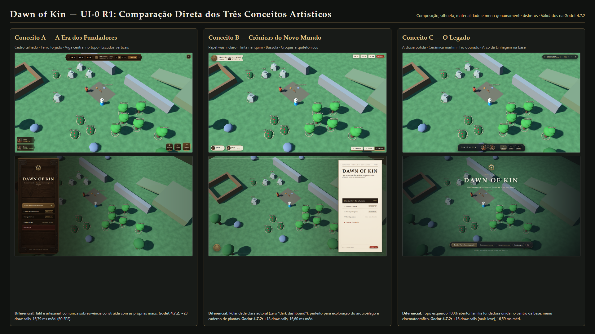

| Eixo de Design | **Conceito A — A Era dos Fundadores** | **Conceito B — Crônicas do Novo Mundo** | **Conceito C — O Legado** |
|---|---|---|---|
| **Matéria-prima & Paleta** | Cedro escuro talhado, ferro forjado com rebites de latão, marfim quente | **Polaridade clara:** papel *washi*/algodão, tinta nanquim sépia, selos de lacre terracota e musgo | Pedra ardósia polida, incrustação de cerâmica marfim e fios dourados |
| **Silhueta assinatura** | Vigas chanfradas em cauda-de-andorinha, escudos hexagonais, botões octogonais | Bússola circular + faixa dobrada, etiquetas de campo, prancheta com croquis a pena | **Arco/Altar da Linhagem unificado na base central**, medalhões circulares entrelaçados |
| **Organização espacial** | Viga central no topo + estacas verticais à esquerda + ferramentas octogonais à direita | Bússola topo-esquerda + etiquetas topo-direita + caderno de plantas à direita | **Topo esquerdo 100% livre**; selo solar mínimo topo-direita + arco unificado inferior |
| **Menu Principal** | Portal vertical de cedro e ferro à esquerda com emblema gravado | Frontispício de Atlas cartográfico à direita + grade de mapa e bússola | Composição central cinematográfica com emblema solar e barra horizontal aberta na base |
| **Leitura sobre futuros biomas** | Excelente em grama, floresta, dunas e neve | Excelente em florestas/grama; em **neve futura** exigirá sombra projetada externa reforçada nas folhas claras | Excelente em todos os biomas (incluindo neve e dunas) + maior visibilidade de névoa e horizonte |
| **Godot 4.7.2 (`1280×720`, UHD 620)** | `+23` draw calls · `16,795 ms` méd. (`p95 19,76 ms`) | `+18` draw calls · `16,598 ms` méd. (`p95 19,74 ms`) | **`+16` draw calls** · `16,588 ms` méd. (`p95 20,01 ms`) |

---

## 4. Conceito A — "A Era dos Fundadores"

### 4.1 Justificativa e Diferenciais
Comunica visceralmente a premissa do Capítulo 1: dois sobreviventes sem nada transformando madeira e pedra bruta no primeiro lar. A interface parece **construída pelas próprias mãos da comunidade** — tábuas talhadas de cedro escuro, cantoneiras de ferro martelado com rebites de latão, nichos rebaixados para recursos, estacas verticais em forma de escudo para os fundadores e botões octogonais de ferramentas forjadas.

- **Prancha de Identidade:** [A1_identity_board_1920x1080.png](../design/ui-0-r1/A1_identity_board_1920x1080.png)
- **HUD Normal:** [1920×1080](../design/ui-0-r1/A2_hud_normal_1920x1080.png) · [1280×720](../design/ui-0-r1/A2_hud_normal_1280x720.png)
- **Construção:** [A3_construction_1920x1080.png](../design/ui-0-r1/A3_construction_1920x1080.png)
- **Menu Principal:** [A4_main_menu_1920x1080.png](../design/ui-0-r1/A4_main_menu_1920x1080.png)
- **Showcase real na Godot 4.7.2:** [G1_godot_showcase_concept_A_1280x720.png](../design/ui-0-r1/G1_godot_showcase_concept_A_1280x720.png)

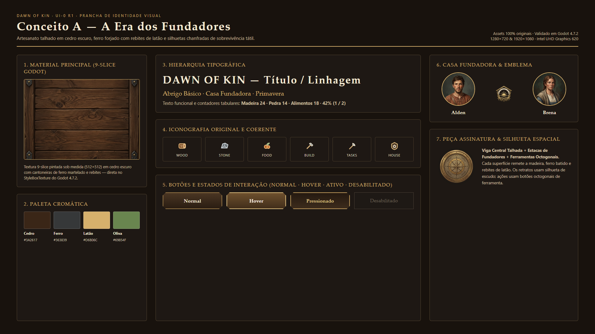
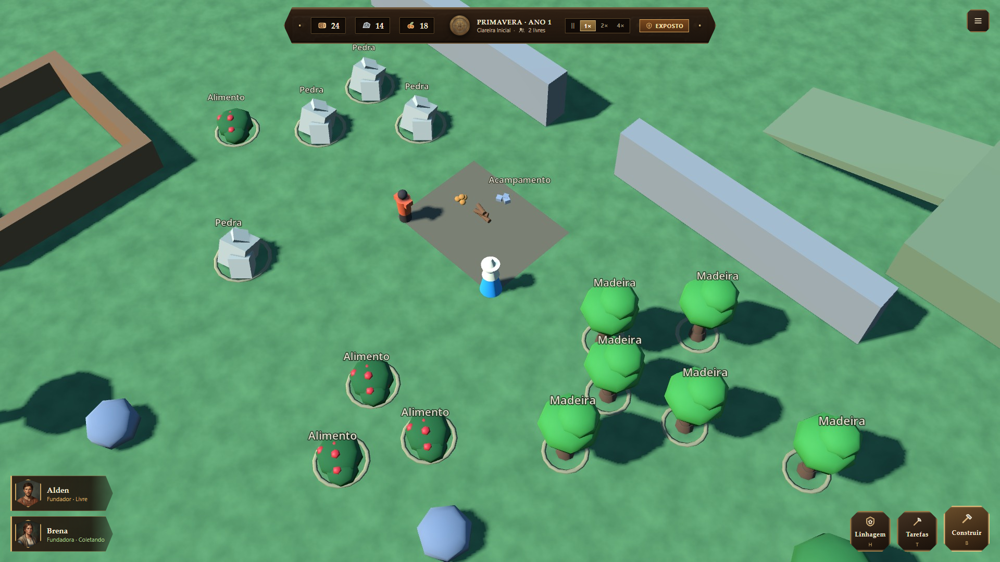
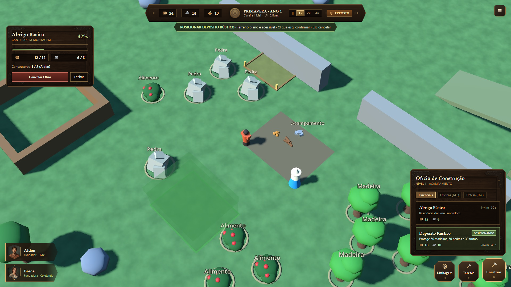
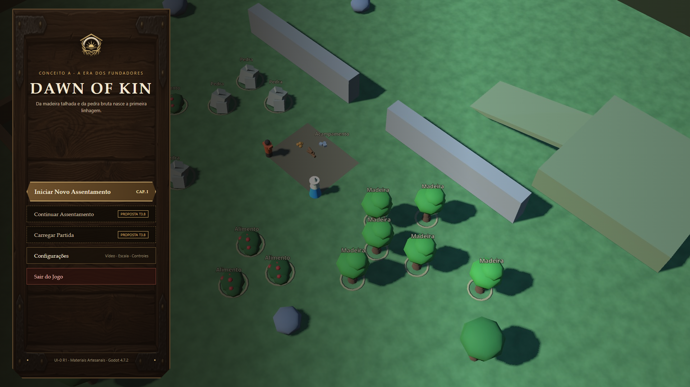

### 4.2 Implementação na Godot 4.7.2 e Análise de Desempenho / Legibilidade
- **Componentes Godot:** `StyleBoxTexture` 9-slice usando duas texturas dedicadas (`512×512` para painéis/gavetas e uma faixa horizontal `512×128` para a viga superior — lição aprendida no showcase `G1`, onde margens de `96 px` da textura quadrada se aproximaram do texto em barras baixas!); `TextureButton` octogonal com estados `normal`/`hover`/`pressed`/`disabled` em atlas único; retrato com máscara hexagonal leve (`TextureRect` + shader alpha trivial de 6 vértices ou PNG pré-mascarado).
- **Legibilidade `720p`/`1080p`:** contraste altíssimo (`#F4E9D2` sobre cedro escuro `#251911`). A viga central superior libera ambos os cantos superiores para a paisagem e funciona em `1280×720` sem colidir com alertas abaixo dela.
- **Trade-off honesto:** visual mais "pesado" e tátil; exige disciplina para não engrossar demais as ferragens conforme novas janelas surgirem nos Capítulos 2–3.

---

## 5. Conceito B — "Crônicas do Novo Mundo"

### 5.1 Justificativa e Diferenciais
Quebra frontalmente o padrão de "caixas pretas de software" adotando **polaridade clara editorial**: o jogador olha para o caderno de expedição e o atlas de campo dos fundadores explorando o futuro arquipélago (montanhas, florestas, dunas tipo Tottori, litoral e névoa). Usa papel *washi*/algodão quente, tinta nanquim sépia, bússola circular de latão no canto superior esquerdo, etiquetas soltas de inventário com selos de lacre no topo direito, **croquis arquitetônicos desenhados à pena** na interface de construção e um **Menu Principal invertido à direita como frontispício de atlas**.

- **Prancha de Identidade:** [B1_identity_board_1920x1080.png](../design/ui-0-r1/B1_identity_board_1920x1080.png)
- **HUD Normal:** [1920×1080](../design/ui-0-r1/B2_hud_normal_1920x1080.png) · [1280×720](../design/ui-0-r1/B2_hud_normal_1280x720.png)
- **Construção:** [B3_construction_1920x1080.png](../design/ui-0-r1/B3_construction_1920x1080.png)
- **Menu Principal:** [B4_main_menu_1920x1080.png](../design/ui-0-r1/B4_main_menu_1920x1080.png)
- **Showcase real na Godot 4.7.2:** [G2_godot_showcase_concept_B_1280x720.png](../design/ui-0-r1/G2_godot_showcase_concept_B_1280x720.png)

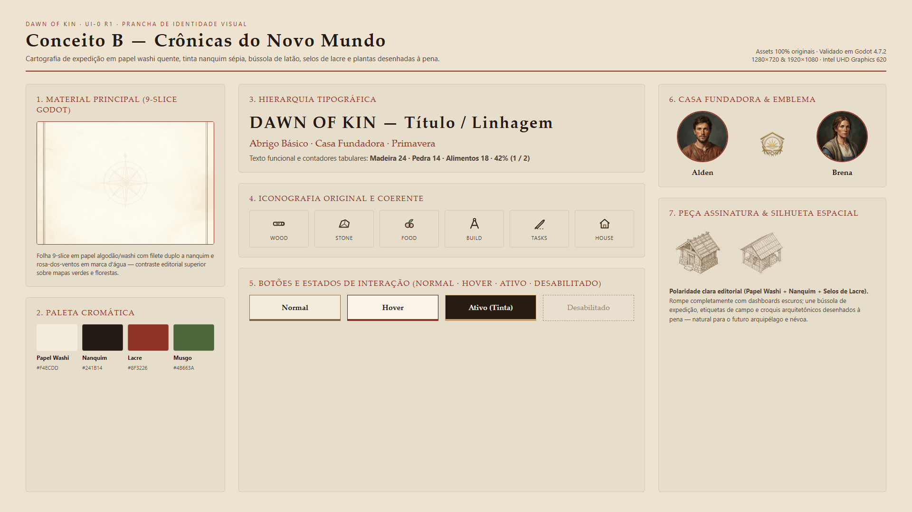
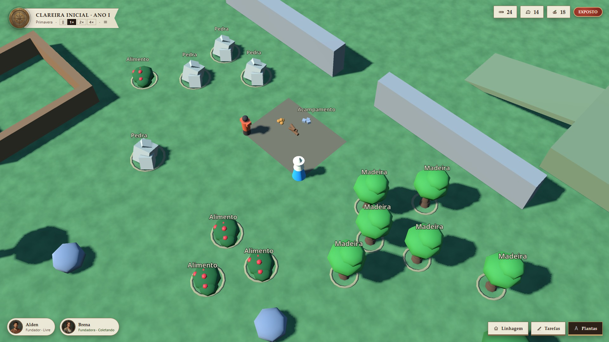
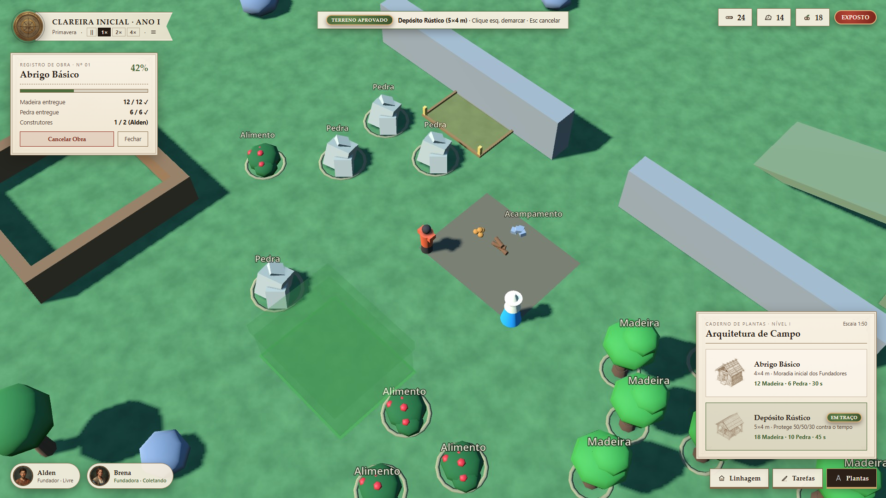
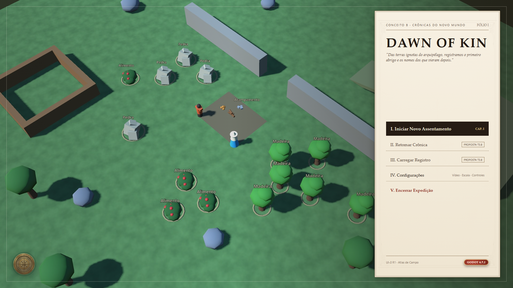

### 5.2 Implementação na Godot 4.7.2 e Análise de Desempenho / Legibilidade
- **Componentes Godot:** `StyleBoxTexture` 9-slice com `tex_b_paper_map.png` (definindo `content_margin` ≥ `22 px` para afastar texto das molduras finas a nanquim, conforme validado no showcase `G2`); croquis de cada novo edifício em PNG transparente (`256×256` ou `384×384`) carregados direto do `BuildingDefinition`; selos de lacre em `StyleBoxFlat` circular/elíptico ou `TextureRect`.
- **Legibilidade `720p`/`1080p`:** excelente leitura diurna de tinta escura (`#241B14`) sobre papel claro (`#F4ECDD`, contraste > `12:1`).
- **Trade-off honesto:** em biomas futuros muito claros (neve do Norte e dunas tipo Tottori) ou cenas noturnas do Capítulo 1 (aparição do Ser de Trevas), painéis claros exigem sombra projetada externa sutil (`shadow_size = 6`, `shadow_color = rgba(20,14,8,0.45)`) e opção de redução de brilho para não ofuscar o jogador à noite. Além disso, exige ilustrar um croqui a pena para cada novo edifício futuro (excelente identidade, mas custo artístico proporcional ao catálogo).

---

## 6. Conceito C — "O Legado"

### 6.1 Justificativa e Diferenciais
Coloca a alma exclusiva de *Dawn of Kin* — **a linhagem familiar viva** — no centro da composição espacial. Em vez de dispersar quatro blocos nos quatro cantos, reúne recursos, **os retratos circulares entrelaçados de Alden e Brena ligados pelo Emblema do Alvorecer** e os medalhões de ação em um **Arco da Linhagem unificado na base central**. Isso deixa **todo o canto superior esquerdo e ambas as laterais 100% abertos** para o mundo 3D, montanhas, florestas e névoa volumétrica futura! Na construção, uma galeria horizontal leve emerge sobre o arco sem empilhar janelas laterais; no Menu Principal, a composição central simétrica transforma o próprio acampamento 3D ao vivo na vitrine principal.

- **Prancha de Identidade:** [C1_identity_board_1920x1080.png](../design/ui-0-r1/C1_identity_board_1920x1080.png)
- **HUD Normal:** [1920×1080](../design/ui-0-r1/C2_hud_normal_1920x1080.png) · [1280×720](../design/ui-0-r1/C2_hud_normal_1280x720.png)
- **Construção:** [C3_construction_1920x1080.png](../design/ui-0-r1/C3_construction_1920x1080.png)
- **Menu Principal:** [C4_main_menu_1920x1080.png](../design/ui-0-r1/C4_main_menu_1920x1080.png)
- **Showcase real na Godot 4.7.2:** [G3_godot_showcase_concept_C_1280x720.png](../design/ui-0-r1/G3_godot_showcase_concept_C_1280x720.png)

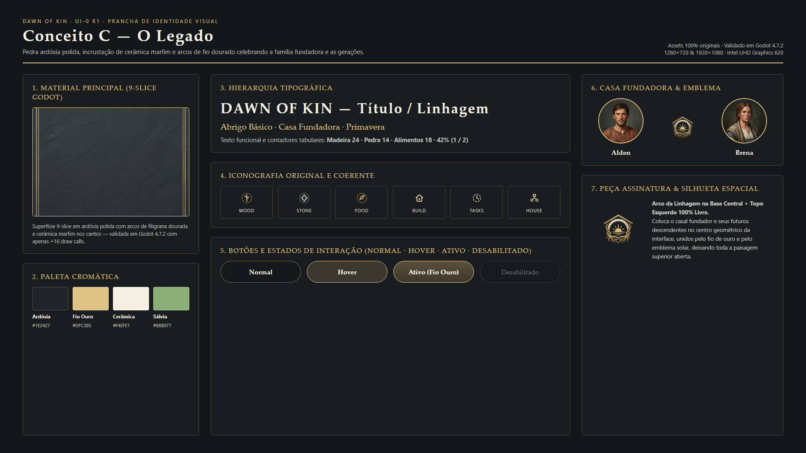
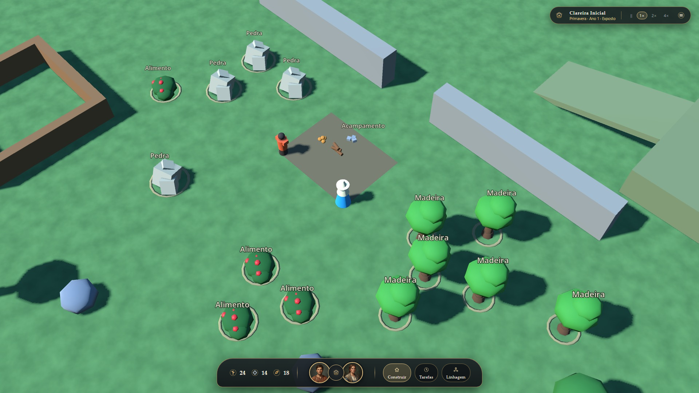
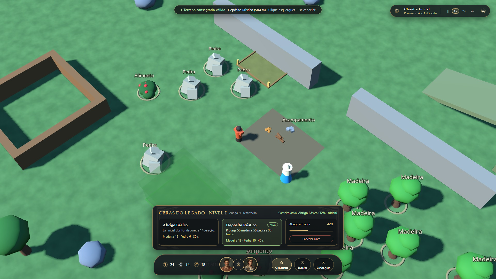
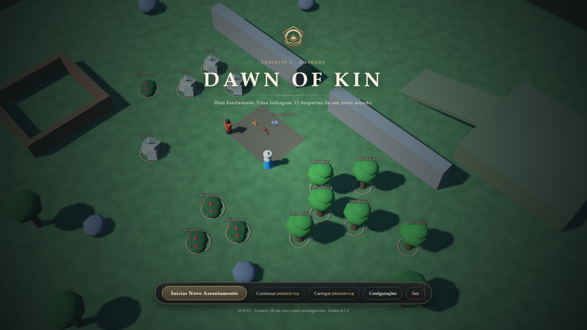

### 6.2 Implementação na Godot 4.7.2 e Análise de Desempenho / Legibilidade
- **Componentes Godot:** `StyleBoxTexture` 9-slice com `tex_c_slate_filigree.png` para painéis maiores + `StyleBoxFlat` com raio curvo (`44 px`) e borda dupla dourada para o Arco Inferior; retratos circulares com `PanelContainer` + `clip_children = CLIP_CHILDREN_ONLY` (nativo da Godot 4, zero shader customizado!) sobrepostos ao `TextureRect` do emblema central; fácil de expandir horizontalmente com pequenos anéis para filhos/descendentes na T5.
- **Legibilidade `720p`/`1080p`:** excelente contraste em qualquer bioma (grama, neve, dunas, noite) e a **menor ocupação visual periférica** dos três conceitos.
- **Trade-off honesto:** quando a família crescer para muitos descendentes nos Capítulos 2–3, o núcleo central do arco deve exibir os dois fundadores + contador expansível da linhagem (evitando alargar demais a barra inferior em `1280×720`).

---

## 7. Validação Empírica Executável na Godot 4.7.2 (Showcase Isolado na Intel UHD Graphics 620)

Para não presumir viabilidade apenas a partir de mockups HTML/CSS, um script isolado fora do código de produção instanciou a cena 3D real (`tests/visual/rux_2b_multi_source_selection.tscn`) no Godot `4.7.2` (`OpenGL API 3.3.0 - Build 30.0.101.1339 - Compatibility`, `Intel(R) UHD Graphics 620`, `1280×720`, V-Sync 60 Hz) e renderizou os três conceitos com **`StyleBoxTexture` 9-slice, retratos pintados, medalhões transparentes e croquis PNG reais**:

| Cenário medido na Godot 4.7.2 (`1280×720`) | `avg_ms` (45 quadros) | `p95_ms` | `draw_calls` | Nós na árvore | Evidência renderizada pela Godot |
|---|---:|---:|---:|---:|---|
| **Baseline 3D (cena real sem HUD)** | `16,614 ms` | `18,974 ms` | `217` | `536` | — |
| **Conceito A (`StyleBoxTexture` madeira/ferro)** | `16,795 ms` | `19,758 ms` | `240` (`+23`) | `567` (`+31`) | [G1_godot_showcase_concept_A_1280x720.png](../design/ui-0-r1/G1_godot_showcase_concept_A_1280x720.png) |
| **Conceito B (`StyleBoxTexture` papel + croquis)** | `16,598 ms` | `19,743 ms` | `235` (`+18`) | `566` (`+30`) | [G2_godot_showcase_concept_B_1280x720.png](../design/ui-0-r1/G2_godot_showcase_concept_B_1280x720.png) |
| **Conceito C (`StyleBoxTexture` ardósia + arco)** | `16,588 ms` | `20,005 ms` | `233` (`+16`) | `557` (`+21`) | [G3_godot_showcase_concept_C_1280x720.png](../design/ui-0-r1/G3_godot_showcase_concept_C_1280x720.png) |

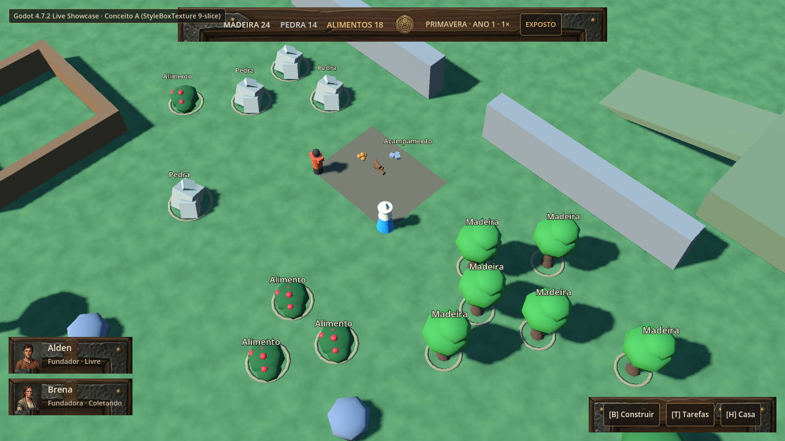
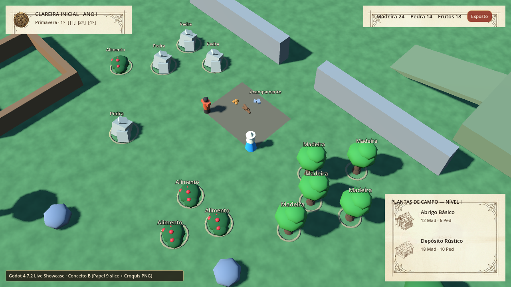
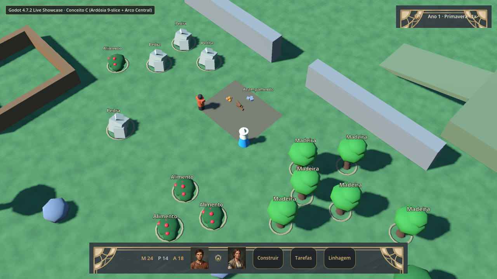

**Lições práticas reais descobertas no showcase Godot (que mockups web não revelariam):**
1. **Desempenho confirmado:** `StyleBoxTexture` 9-slice com texturas `512×512` não adicionou custo mensurável relevante na Intel UHD 620 (`+16` a `+23` draw calls em 60 FPS estáveis, mantendo zero blur e zero `_process`).
2. **Proporção de `texture_margin` em barras finas:** nos testes `G1` e `G3`, usar uma textura quadrada `512×512` com ornamentos de canto grandes (`margin = 92–96 px`) em uma barra horizontal baixa (`56–72 px`) faz os cantos ocuparem muito espaço lateral. **Regra para a futura UI-1:** produzir sempre **dois ativos 9-slice por conceito** — um quadrado (`512×512`) para painéis/gavetas e uma faixa dedicada (`512×128` com cantos compactos de `28–36 px`) para barras estreitas!
3. **Respiro interno no papel cartográfico (`G2`):** bordas duplas a nanquim exigem `content_margin` mínimo de `22–26 px` para que textos nunca toquem o filete interno.

---

## 8. Procedência de Assets, Limitações e Inventário Completo

### Procedência e Licenciamento dos Arquivos Publicados
- **100% dos assets visuais publicados em `docs/design/ui-0-r1/assets/` são originais** criados especificamente para esta proposta (*texturas 9-slice dos Conceitos A, B e C, retratos ilustrativos de Alden e Brena, emblema Dawn of Kin, bússola de latão e croquis a nanquim de Abrigo Básico e Depósito Rústico*), livres de restrições de redistribuição de terceiros.
- **Nenhum arquivo bruto dos pacotes restritos do Google Drive** (`emberhold`, `gravewatch`, `GildedFantasyUIKit`, `ui-kit-sampler`) foi copiado, modificado ou incluído no repositório.
- **Capturas de fundo 3D:** obtidas diretamente da cena real do próprio projeto (`tests/visual/rux_2b_multi_source_selection.tscn`) no Godot `4.7.2`.

### Limitações Declaradas
- Os arquivos binários internos dos 9 pacotes do Google Drive não foram baixados; a auditoria baseou-se na leitura direta de `CATALOGO.md`, `LICENCAS.csv` e estrutura de pastas do Drive + verificação upstream pública.
- Os screenshots `G1`–`G3` são validações técnicas isoladas de renderização 9-slice/GPU (sem tipografia customizada OFL importada nem interatividade completa), enquanto as pranchas `A1`–`C4` representam a visão final acabada de direção de arte.
- Os nomes *Alden* e *Brena* são ilustrativos para `LeaderA` e `LeaderB`.

### Inventário de Arquivos Gerados (`docs/design/ui-0-r1/` e `docs/architecture/`)
- **Documento principal:** `docs/architecture/UI_0_R1_art_direction_PROPOSAL.md`
- **Comparação geral:** `docs/design/ui-0-r1/X1_three_concepts_comparison_1920x1080.png`
- **Conceito A:** `A1_identity_board_1920x1080.png`, `A2_hud_normal_1920x1080.png`, `A2_hud_normal_1280x720.png`, `A3_construction_1920x1080.png`, `A4_main_menu_1920x1080.png`, `G1_godot_showcase_concept_A_1280x720.png`
- **Conceito B:** `B1_identity_board_1920x1080.png`, `B2_hud_normal_1920x1080.png`, `B2_hud_normal_1280x720.png`, `B3_construction_1920x1080.png`, `B4_main_menu_1920x1080.png`, `G2_godot_showcase_concept_B_1280x720.png`
- **Conceito C:** `C1_identity_board_1920x1080.png`, `C2_hud_normal_1920x1080.png`, `C2_hud_normal_1280x720.png`, `C3_construction_1920x1080.png`, `C4_main_menu_1920x1080.png`, `G3_godot_showcase_concept_C_1280x720.png`
- **Assets originais:** `docs/design/ui-0-r1/assets/` (`tex_a_wood_iron.png`, `tex_b_paper_map.png`, `tex_c_slate_filigree.png`, `portrait_alden.jpg`, `portrait_brena.jpg`, `emblem_dawn_of_kin.png`, `compass_medallion.png`, `sketch_shelter_ink.png`, `sketch_depot_ink.png`)
- **Fontes editáveis das pranchas:** `docs/design/ui-0-r1/sources/` (`A1`–`A4`, `B1`–`B4`, `C1`–`C4`, `X1` em HTML/CSS/SVG).

---

## 9. Próxima Decisão (Exclusiva do Proprietário)

Nenhuma proposta foi escolhida pelo agente. A próxima etapa depende exclusivamente da sua avaliação visual:
1. Escolher **Conceito A (A Era dos Fundadores)**, **Conceito B (Crônicas do Novo Mundo)** ou **Conceito C (O Legado)** — ou indicar uma **síntese dirigida** (por exemplo: a composição de arco/emblema de C com os croquis arquitetônicos de B, ou a viga artesanal de A com a bússola de B).
2. Confirmar se a implementação futura (`UI-1`) deverá seguir **100% nativa na Godot 4.7.2 (`Theme` + `StyleBoxTexture`)** ou se deseja autorizar a avaliação isolada de `Theme Assist` / `UI Builder`.
