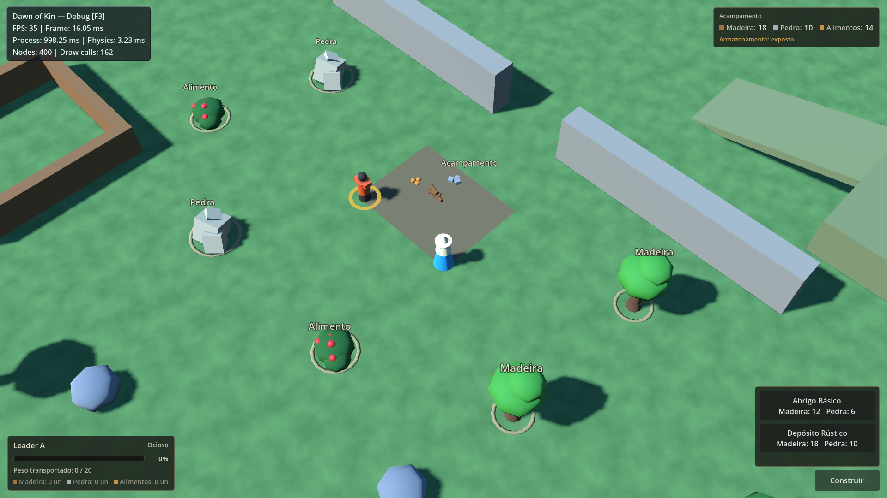
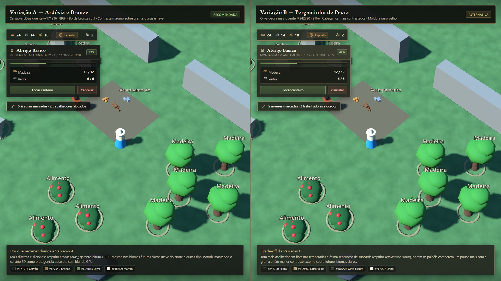
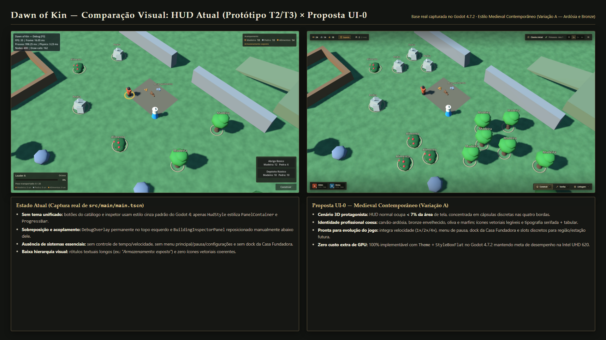
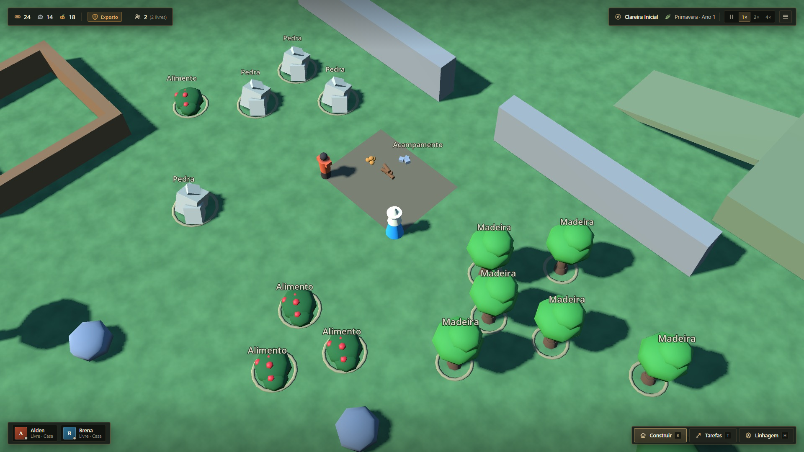
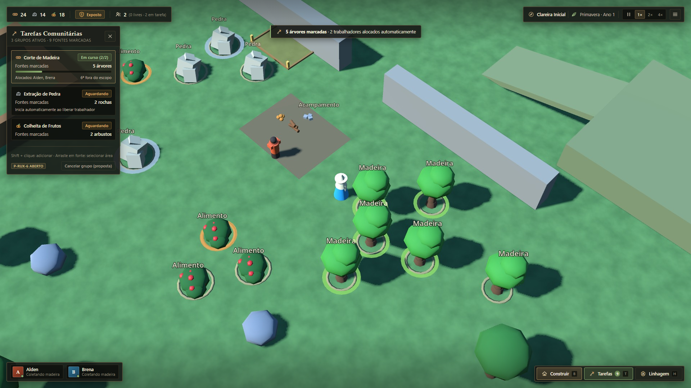
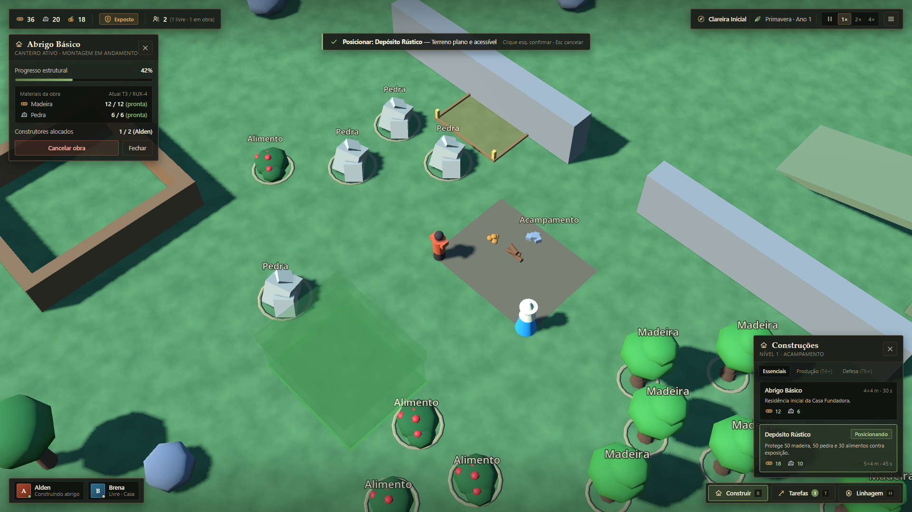
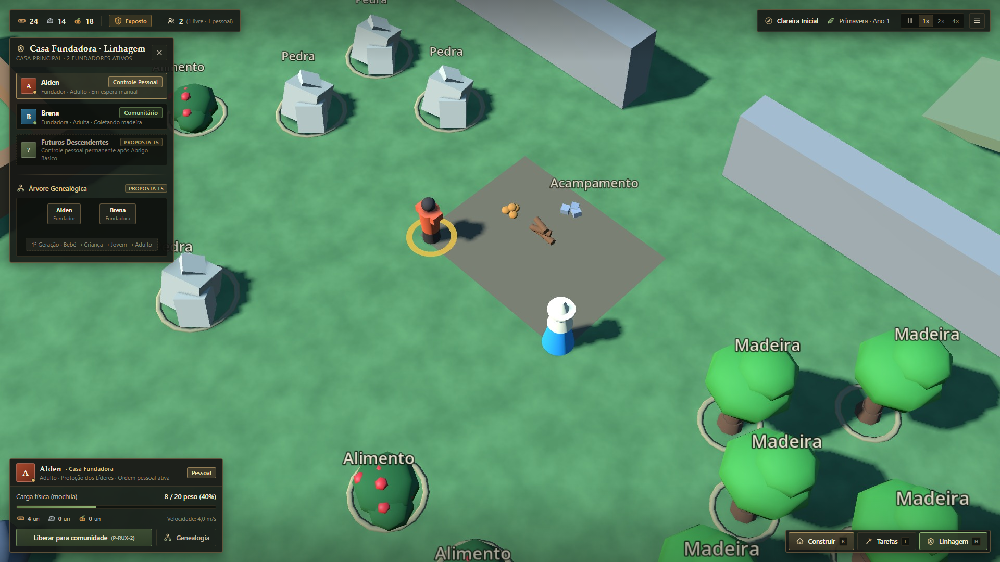
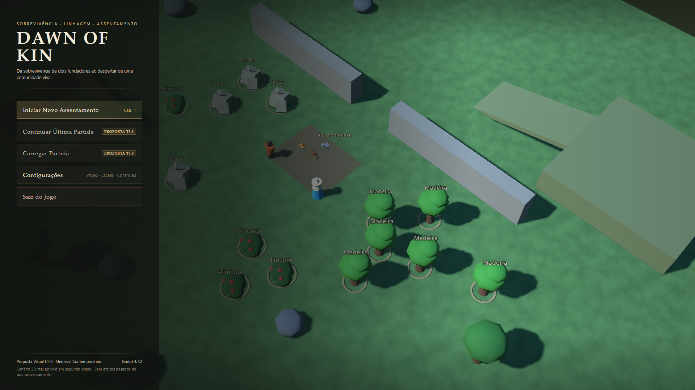
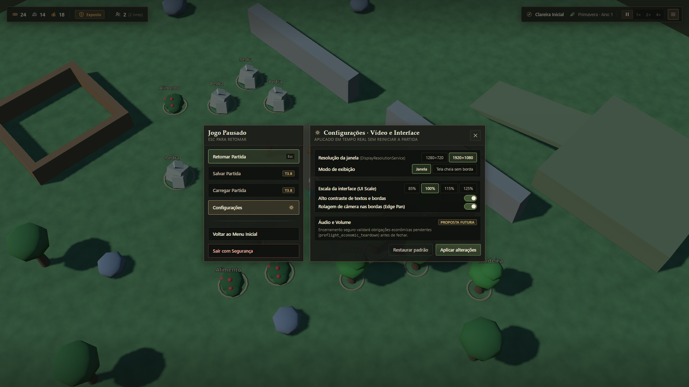
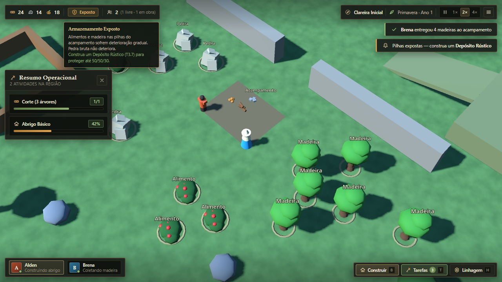

# UI-0 — Projeto Visual da HUD Profissional e Sistema Unificado de Menus

**PROPOSTA VISUAL E ARQUITETURAL — PENDENTE DE APROVAÇÃO VISUAL DO PROPRIETÁRIO**

- **Direção artística aprovada:** **Medieval Contemporâneo** (discrição de *Manor Lords* + organização de *Against the Storm*, com identidade original *Dawn of Kin*).
- **Branch documental:** `design/ui-0-professional-interface`
- **Worktree isolado:** `C:\Projetos\Dawn_of_Kin_wt_ui_0`
- **Base técnica auditada:** `feat/rux-2b-multi-source-selection` em `cddd582bc9159f46006ff06346ef5c85bdc16382`
- **Engine / hardware-alvo:** Godot `4.7.2.stable.official.ed1daf0bf`, `GDScript` tipado estrito, `gl_compatibility` (`OpenGL API 3.3.0`), `Jolt Physics`, `Intel(R) UHD Graphics 620` (`1280×720` e `1920×1080`, meta $p95 \le 16,7\text{ ms}$ em tomada CA).
- **Escopo desta entrega:** **exclusivamente design, especificação arquitetural e mockups visuais baseados em capturas reais do jogo**. Nenhum código de produção, cena `.tscn`, teste, `AGENTS.md`, `docs/Dawn_of_Kin_GDD.md`, `main` ou branch `feat/rux-2b-multi-source-selection` foi alterado.

> [!IMPORTANT]
> **Preservação de pendências e decisões abertas:** esta especificação não homologa nem substitui nenhuma decisão aberta. Permanecem integralmente pendentes: 3 ensaios manuais da **UX-1**, homologação jogável de **RUX-1**, **RUX-2A** e **RUX-2B**, retestes **D3-04** e **D3-07** de **T3.6.4-R1**, e as decisões abertas da RUX-0 (**P-RUX-1**, **P-RUX-2**, **P-RUX-3**, **P-RUX-4** e **P-RUX-6**). Recursos futuros presentes nos mockups (calendário/estações, genealogia T5, salvar/carregar T3.8, áudio) estão explicitamente sinalizados como **PROPOSTA**.

---

## 1. Auditoria da HUD Atual (Código Real + Captura Real em `cddd582`)

A inspeção direta de `src/main/main.tscn`, `src/main/main.gd`, `src/ui/*`, `src/buildings/placement_test_overlay.gd`, `src/economy/economy_clock_controller.gd`, `src/rts/rts_input_controller.gd` e `project.godot` revela o estado exato da interface atual:


*Captura real de `src/main/main.tscn` no Godot `4.7.2` (`1920×1080`, `Intel(R) UHD Graphics 620`), com `LeaderA` selecionado, estoque populado e catálogo de construção aberto.*

### 1.1 Inventário do que existe, o que é provisório e o que falta

| Componente atual | Arquivo real | Estado | Diagnóstico técnico | Destino na migração |
|---|---|---|---|---|
| **Estilo base (`HudStyle`)** | `src/ui/hud_style.gd` (`75` linhas) | Existente (parcial) | Define constantes de cor e 3 `StyleBoxFlat` (`PanelContainer` e `ProgressBar`). **Não define `Theme` nem estilos para `Button`, `CheckBox`, `OptionButton`, `TooltipPanel` ou tipografia**, deixando botões com a aparência padrão cinza do Godot 4. | **Evoluir** para `UiTheme` + `UiTokens` centralizado (UI-1). |
| **Formatadores (`HudFormatter`)** | `src/ui/hud_formatter.gd` (`143` linhas) | Existente (bom) | Helpers puros sem cache paralelo de saldos; consulta `SettlementInventory` e `UnitCarryLoad` diretamente. | **Reutilizar** como camada de formatação/snapshot. |
| **HUD de Recursos (`ResourceHud`)** | `src/ui/resource_hud.gd`, `settlement_stockpile_panel.gd`, `selected_unit_panel.gd` | Existente (bom núcleo, visual básico) | 100% orientado a sinais (`set_process(false)`), `MOUSE_FILTER_IGNORE` recursivo. Porém usa texto longo (`"Armazenamento: exposto"`), não possui ícones vetoriais e trata os líderes como unidades genéricas sem contexto da Casa Fundadora. | **Substituir gradualmente** pelo `TopResourceBar` e `FoundingHouseDock` mantendo o mesmo padrão orientado a sinais. |
| **Catálogo de Construção (`ConstructionHud`)** | `src/ui/construction_hud.gd` (`83` linhas) | Existente (inicial) | Instanciado em `MainScene._setup_placement()`. Botões padrão do Godot sem custo colorido por disponibilidade; captura `KEY_ESCAPE` diretamente em `_input()`, competindo fora de um gerenciador de pilhas. | **Migrar** para gaveta retrátil unificada gerida pelo `UiPanelManager`. |
| **Inspetor de Canteiro (`BuildingInspectorPanel`)** | `src/ui/building_inspector_panel.gd` (`491` linhas) | Existente (funcional, denso) | Posicionado manualmente olhando para `DebugOverlay/Panel` (`_layout_left_hud()`), acoplando HUD de jogo a ferramenta de debug. Exibe tabela textual densa de 6 colunas (`necessário \| incorporado \| buffer \| reserva \| transporte \| déficit`) e usa dois `Timer`s (`0.2s` e `0.5s`). | **Refatorar visualmente** em cartões legíveis, desacoplado de `DebugOverlay`, compatível com T3 atual e futura simplificação RUX-4. |
| **Overlay de Teste (`PlacementTestOverlay`)** | `src/buildings/placement_test_overlay.gd` (`836` linhas) | **Provisório (dev T3.2/T3.3)** | Mistura barra de dev (`F8`), `Worker3/Worker4`, troca de resolução e toast de posicionamento (usando `_process(delta)`). | **Isolar como ferramenta de dev**; toast e resolução migram para `UiNotificationCenter` e Configurações. |
| **Serviço de Resolução (`DisplayResolutionService`)** | `src/ui/display_resolution_service.gd` (`123` linhas) | Existente (pronto p/ reuso) | Já projetado explicitamente para futuro menu de Configurações (`1280×720`, `1920×1080`, clamp seguro ao monitor). | **Reutilizar diretamente** no menu de Configurações (UI-4). |
| **Feedback RUX (`AutonomousGatherFeedback`)** | `src/ui/autonomous_gather_feedback.gd` (`56` linhas) | **Provisório (cenas RUX)** | Presente apenas nas cenas `rux_1`/`rux_2a`/`rux_2b`. Banner único no centro superior (`offset_top = 14`), sem fila, sem severidades, sem histórico. | **Absorver** no `UiNotificationCenter`. |
| **Menu UX-1 (`TreeWorkMenu`)** | `src/ui/tree_work_menu.gd` (`201` linhas) | **Provisório (cena UX-1)** | Preso à cena `tests/visual/ux_1_tree.tscn`; usa `_process` contínuo para seguir âncora 3D. | **Preservar intacto** na cena UX-1 até decisão final do proprietário. |
| **Overlay de Debug (`DebugOverlay`)** | `src/ui/debug_overlay.gd` (`60` linhas) | Existente (dev `F3`) | Visível por padrão no canto superior esquerdo e roda `_process` contínuo. | **Ocultar por padrão** em modo jogo (mantendo `F3`) e desacoplar completamente do layout da HUD. |
| **Relógio Econômico (`EconomyClockController`)** | `src/economy/economy_clock_controller.gd` (`115` linhas) | Existente (sem UI) | Já suporta `set_paused(bool)` e `set_time_scale(float)`, mas **não há nenhum controle visual na HUD**. | **Conectar** ao widget de Tempo e Velocidade (`||`, `1×`, `2×`, `4×`). |
| **Menus Principais, Pausa, Configurações, Escala UI, Painel de Tarefas, Casa Fundadora / Genealogia** | *Inexistentes* | **Não implementados** | Não existe Menu Inicial, Menu de Pausa, tela de Configurações, seletor de `UI Scale`, confirmação modal reutilizável, resumo de tarefas comunitárias nem painel pessoal da Casa Fundadora. | **Construir por etapas** (`UI-1` a `UI-5`). |

### 1.2 Confronto Explícito: GDD Normativo (`v1.2`) × Proposta RUX-0 × Nova Visão do Mundo × Código Atual

| Tema | GDD Normativo (`v1.2`) | Proposta RUX-0 / Código `cddd582` | Nova Visão Criativa do Mundo | Tratamento na Proposta UI-0 |
|---|---|---|---|---|
| **Coleta e tarefas** | §9.1: clique direito em fonte (`IMPLEMENTADO`); busca autônoma futura via `JobSystem` (`DEC-08`). | RUX-1/2A/2B: clique esquerdo, `Shift + clique` e caixa sobre fonte com despacho automático; `P-RUX-6` aberto para cancelamento. | Sem conflito. | UI-0 prevê painel retrátil de **Tarefas Comunitárias** (`M2`) com ação de cancelamento marcada explicitamente como **`P-RUX-6 ABERTO`**, sem antecipar regra definitiva. |
| **Construção e canteiros** | §4.2–4.3: reserva em pilhas, transporte físico `D2`, complementação manual `DEC-11B`, cancelamento `D3` (implementados em `BuildingInspectorPanel`). | RUX-0 §8–9 propõe débito imediato (`RUX-4`) e 4 opções de reembolso (`P-RUX-1` aberto). | Sem conflito. | O Inspetor de Canteiro (`M3`) separa resumo claro de materiais (prontos/pendentes) e ações contextuais, permitindo suportar **tanto** o fluxo atual T3 (`DEC-11B`/`D3`) **quanto** o futuro fluxo RUX-4 sem refazer o layout. |
| **Casa Fundadora e Residência** | §3.4: cada casal exige residência própria; controle RTS geral sem distinção de linhagem. | RUX-0 §5–7: controle pessoal permanente de protagonistas + descendentes, `ControlMode` (`P-RUX-2` aberto), cônjuges externos (`P-RUX-3` aberto), Casa Principal sem interiores. | Sem conflito. | O dock inferior esquerdo e o painel `M4` expõem os fundadores reais atuais (`Alden`/`Brena` — hoje `LeaderA`/`LeaderB`), sinalizando `P-RUX-2` no botão de liberação e **`PROPOSTA T5`** nos futuros descendentes e na Árvore Genealógica. |
| **Mundo, Biomas, Estações e Névoa** | §7.1–7.2 (`DEC-14`): regiões conectadas `256–384 m` + simulação leve fora da câmera; biomas terrestres naturais; duração de estações em `ABERTO`. | `TestMap` (`64×64 m`) único, sem clima/estações/névoa. | **Grande arquipélago inspirado no Japão** (escala compactada): Norte frio/neve, Centro temperado/montanhas/florestas, Dunas tipo Tottori, Sul subtropical/tropical, litoral/ilhas; **4 estações**; **névoa natural volumétrica** (sem preto sólido). | **Conciliável com `DEC-14`** (arquipélago particionado em regiões). UI-0 reserva **um slot discreto** na barra superior direita (`Região · Estação · Ano`) sem antecipar mecânicas de bioma/clima nem adicionar minimapa prematuro. A paleta escura (`Variação A`) já considera contraste sobre neve e dunas futuras. |
| **Persistência e Saída Segura** | §11 (`DEC-17`): `SaveManager` planejado para `T3.8`. | `MainScene.preflight_economic_teardown()` já existe em código, sem botão de UI. | Sem conflito. | Menu Inicial e Pausa (`M5a`/`M5b`) exibem **Salvar / Carregar / Continuar** marcados como **`PROPOSTA T3.8`**, e vinculam **"Sair com Segurança"** à verificação real de `preflight_economic_teardown()`. |
| **Ritmo e Velocidade** | §3.3 (`DEC-01`): velocidades `1×`, `2×`, `4×` e calendário `1 ano ≈ 12–15 min`. | `EconomyClockController` já implementa `set_paused()` e `set_time_scale()`. | Quatro estações ao longo do ano. | Cápsula compacta `||  1×  2×  4×` no topo direito (`M1`), pronta para ligar ao `EconomyClockController` e ao futuro calendário T4. |

---

## 2. Guia Visual Completo — Direção "Medieval Contemporâneo"

### 2.1 Princípios de Design
1. **Cenário 3D como protagonista absoluto:** em estado normal (`M1`), a HUD ocupa **menos de 7% da área de tela**, ancorada exclusivamente nas quatro extremidades; o centro da viewport permanece 100% desobstruído.
2. **Elegância silenciosa sem ornamento pesado:** evocação medieval pela **paleta orgânica** (carvão, pedra, oliva, bronze, marfim), **tipografia serifada lapidar** nos títulos e **filetes finos de bronze** — jamais molduras grossas de pergaminho rasgado, escudos gigantes, neon ou glow.
3. **Organização funcional clara:** inspirada na clareza operacional de *Against the Storm*, cada bloco responde a uma única pergunta do jogador (*"O que tenho?"* no topo esquerdo, *"Quando/onde estou?"* no topo direito, *"Quem estou comandando?"* embaixo à esquerda, *"O que posso ordenar?"* embaixo à direita).
4. **Custo mínimo de GPU na Intel UHD Graphics 620:** nenhum efeito de blur em tempo real (`BackBufferCopy`), sem bloom nem texturas gigantes; toda a estética é obtida com `StyleBoxFlat`, bordas de `1 px`, filete interno sutil e ícones vetoriais limpos.

### 2.2 Duas Variações Visuais (Comparação e Recomendação)



| Critério | **Variação A — Ardósia e Bronze (RECOMENDADA)** | **Variação B — Pergaminho de Pedra (Alternativa)** |
|---|---|---|
| **Superfície base** | Carvão-ardósia quente `#171916` (`rgba(22, 24, 21, 0.89)`) | Oliva-pedra aquecido `#242720` (`rgba(36, 39, 32, 0.91)`) |
| **Cabeçalhos / elevação** | `#1D201B` com separador bronze `1 px` | `#383A2E` mais contrastado frente ao corpo |
| **Borda principal** | Bronze envelhecido `#8F754C` (`54%` opacidade) | Ouro velho suave `#BC9F69` (`68%` opacidade) |
| **Contraste sobre futuros biomas** | **Superior:** lê com facilidade sobre grama vibrante, floresta escura, **dunas claras tipo Tottori** e **neve do Norte**. | **Moderado:** muito acolhedora em florestas temperadas, mas compete mais com a grama e destaca-se demais sobre neve/dunas claras. |
| **Presença visual sobre o 3D** | Mais discreta e silenciosa (mais fiel à referência *Manor Lords*). | Mais presente e "tátil" (mais próxima de *Against the Storm*). |
| **Recomendação** | **Adotar como padrão oficial da UI-1.** | Manter apenas como referência alternativa de ajuste fino caso o proprietário prefira painéis mais claros/quentes. |

### 2.3 Paleta Oficial de Tokens (Variação A — Ardósia e Bronze)

| Token | Hex / RGBA | Uso semântico | Contraste aprox. vs `#171916` |
|---|---|---|---|
| `bg_panel` | `rgba(22, 24, 21, 0.89)` (`#161815E3`) | Fundo padrão de barras, cartões e gavetas | — |
| `bg_header` | `rgba(29, 32, 27, 0.96)` (`#1D201BF5`) | Cabeçalho de painéis contextuais e modais | — |
| `bg_inset` | `rgba(13, 15, 12, 0.78)` (`#0D0F0CC7`) | Subcards, trilhas de progresso, caixa de velocidade | — |
| `border_bronze` | `rgba(154, 128, 86, 0.54)` (`#9A80568A`) | Borda externa de `1 px` de painéis e botões | — |
| `border_bronze_strong` | `rgba(196, 165, 107, 0.78)` (`#C4A56BC7`) | Estado selecionado / hover / botão principal | — |
| `text_primary` | `#F1EBD9` (Marfim Claro) | Números principais, títulos, rótulos ativos | **~14.2:1** (WCAG AAA) |
| `text_secondary` | `#C2BBA8` (Pedra Clara) | Descrições, metadados, rótulos secundários | **~8.9:1** (WCAG AAA) |
| `text_muted` | `#8E8878` (Pedra Fosca) | Subtítulos, atalhos, hints discretos | **~4.9:1** (WCAG AA) |
| `text_gold` | `#DFC48E` (Bronze Claro) | Destaques da Casa Fundadora, títulos de tooltip | **~10.4:1** (WCAG AAA) |
| `accent_olive` | `#6D8B55` / `#8FB273` | Progresso, proteção, tarefas ativas, terreno válido | **~6.9:1** |
| `accent_amber` | `#D59B49` | Armazenamento exposto, fila aguardando, alertas médios | **~7.5:1** |
| `accent_danger` | `#C55D4B` / `#F0B4A8` | Cancelamento de obra, saída, erro / bloqueio | **~8.8:1** (texto `#F0B4A8`) |
| `res_wood` | `#C59058` | Ícone e anel de madeira | — |
| `res_stone` | `#A5AEB3` | Ícone e anel de pedra | — |
| `res_food` | `#D9984A` | Ícone e anel de alimentos | — |

### 2.4 Tipografia, Tamanhos, Espaçamentos e Micro-animações

- **Famílias recomendadas para Godot 4.7.2 (licença aberta SIL OFL, leves em `.ttf`/`.otf`):**
  - **Display / Títulos / Linhagem / Menus:** `Cormorant Garamond SemiBold` (ou `EB Garamond SemiBold`) — serifada clássica com excelente legibilidade sem aspecto caricato. *(Nos mockups HTML editáveis foi usada a pilha local `Palatino Linotype / Book Antiqua / Georgia` para renderização imediata offline.)*
  - **UI / Números / Tooltips / Botões:** `Inter` ou `Source Sans 3` (Regular `400` e SemiBold `600`) com **números tabulares (`tnum`)** para evitar trepidação horizontal quando contadores de recursos ou progresso mudam.
- **Escala tipográfica mínima:**
  - `1920×1080` (`UI Scale 100%`): títulos de painel `16–17 px`, valores/botões `14 px`, corpo/subcards `12.5–13 px`, rótulos/tags `11 px`, título de menu principal `44–46 px`.
  - `1280×720` (modo compacto): títulos `14.5 px`, valores/botões `12.5 px`, corpo `11.5–12 px`, rótulos `10.5 px` (nunca abaixo de `10.5 px` efetivo).
- **Grade de espaçamento:** múltiplos de `4 px` — margem de borda da tela `18 px` em `1080p` (`12 px` em `720p`), padding interno de painel `10–12 px`, distância entre elementos `8–10 px`, raio de canto `4 px` (painéis) e `3 px` (botões/subcards).
- **Micro-animações (discretas e baratas via `Tween` sob demanda):**
  - Entrada/saída de gaveta ou toast: fade de opacidade (`0 → 1`) + deslocamento curto (`6 px`) em `120–160 ms` (`EASE_OUT`).
  - Hover de botão: transição suave da cor de borda/fundo em `90 ms`.
  - Zero animações contínuas ociosas em loop.

---

## 3. Comparação Visual: HUD Atual × Proposta UI-0



---

## 4. Mockups Obrigatórios (M1–M6 em `1280×720` e `1920×1080`)

> Todos os mockups abaixo foram compostos sobre **capturas reais renderizadas no Godot `4.7.2`** (`OpenGL 3.3.0 Compatibility`, `Intel(R) UHD Graphics 620`) a partir de `tests/visual/rux_2b_multi_source_selection.tscn`, usando estoque físico real, anéis reais de seleção múltipla e prévia verde real do `PlacementController`. Os nomes ilustrativos *Alden* e *Brena* representam os protagonistas atuais (`LeaderA` e `LeaderB`).

### M1 — HUD Normal
Recursos coletivos, status discreto de armazenamento (`Exposto`), contagem comunitária, espaço discreto para região/estação futura (`PROPOSTA`), controles de pausa/velocidade (`1×/2×/4×`), acesso ao menu, mini-dock da Casa Fundadora e barra compacta de ações (`Construir`, `Tarefas`, `Linhagem`).

- **Versão `1920×1080`:** [M1_hud_normal_1920x1080.png](../design/ui-0/M1_hud_normal_1920x1080.png)
- **Versão `1280×720`:** [M1_hud_normal_1280x720.png](../design/ui-0/M1_hud_normal_1280x720.png)
- **Fonte editável:** [M1_hud_normal.html](../design/ui-0/sources/M1_hud_normal.html)



---

### M2 — Coleta Comunitária
Captura real com **5 árvores marcadas** (6ª árvore intocada fora da seleção), **2 rochas** e **2 arbustos** marcados. Mostra o painel lateral esquerdo **Tarefas Comunitárias** (grupos ativos, alocação automática de trabalhadores, progresso, fila em espera), notificação discreta abaixo da barra superior e badge numérico (`9`) no botão `Tarefas`. A ação de cancelamento de grupo está sinalizada como **`P-RUX-6 ABERTO`**.

- **Versão `1920×1080`:** [M2_community_gathering_1920x1080.png](../design/ui-0/M2_community_gathering_1920x1080.png)
- **Versão `1280×720`:** [M2_community_gathering_1280x720.png](../design/ui-0/M2_community_gathering_1280x720.png)
- **Fonte editável:** [M2_community_gathering.html](../design/ui-0/sources/M2_community_gathering.html)



---

### M3 — Construção
Captura real com um canteiro ativo de **Abrigo Básico** e a **prévia verde real** de posicionamento do **Depósito Rústico** sobre terreno plano livre. Mostra o **Catálogo de Construções** retrátil à direita (com abas futuras *Produção T4+* e *Defesa T6+* sinalizadas), o **banner de posicionamento ativo** no topo central (posicionado abaixo da linha superior para nunca colidir em `1280×720`) e o **Inspetor de Canteiro** limpo à esquerda (substituindo a tabela de 6 colunas e sem acoplamento ao `DebugOverlay`).

- **Versão `1920×1080`:** [M3_construction_1920x1080.png](../design/ui-0/M3_construction_1920x1080.png)
- **Versão `1280×720`:** [M3_construction_1280x720.png](../design/ui-0/M3_construction_1280x720.png)
- **Fonte editável:** [M3_construction.html](../design/ui-0/sources/M3_construction.html)



---

### M4 — Casa Fundadora
Captura real focada nos dois fundadores junto ao acampamento (`LeaderA` selecionado com anel 3D). Apresenta o **Cartão Pessoal expandido** (canto inferior esquerdo: retrato, vínculo de linhagem, modo `Pessoal` vs `Comunitário`, carga física `8/20 peso (40%)`, velocidade reduzida por peso, botão condicional `P-RUX-2` e acesso rápido à Genealogia) e a gaveta **Casa Fundadora · Linhagem** à esquerda listando os dois fundadores reais + espaços claramente sinalizados como **`PROPOSTA T5`** para futuros descendentes e Árvore Genealógica.

- **Versão `1920×1080`:** [M4_founding_house_1920x1080.png](../design/ui-0/M4_founding_house_1920x1080.png)
- **Versão `1280×720`:** [M4_founding_house_1280x720.png](../design/ui-0/M4_founding_house_1280x720.png)
- **Fonte editável:** [M4_founding_house.html](../design/ui-0/sources/M4_founding_house.html)



---

### M5 — Menus Principais (Menu Inicial + Pausa e Configurações)
Dividido em duas telas integradas ao mesmo sistema visual sobre a cena 3D real ao vivo:

- **M5a — Menu Inicial:** trilho vertical elegante à esquerda deixando o cenário vivo respirar à direita; itens *Continuar* e *Carregar Partida* claramente marcados como **`PROPOSTA T3.8`**.
  - `1920×1080`: [M5a_main_menu_1920x1080.png](../design/ui-0/M5a_main_menu_1920x1080.png) | `1280×720`: [M5a_main_menu_1280x720.png](../design/ui-0/M5a_main_menu_1280x720.png) | Fonte: [M5a_main_menu.html](../design/ui-0/sources/M5a_main_menu.html)
- **M5b — Menu de Pausa e Configurações:** escurecimento moderado (sem blur caro), menu de pausa à esquerda e painel de Configurações à direita expondo `DisplayResolutionService` (`1280×720` / `1920×1080`), **UI Scale (`85%`–`125%`)**, **Alto Contraste**, **Edge Pan**, slot futuro de Áudio (`PROPOSTA FUTURA`) e **Sair com Segurança** integrado ao `preflight_economic_teardown()`.
  - `1920×1080`: [M5b_pause_settings_1920x1080.png](../design/ui-0/M5b_pause_settings_1920x1080.png) | `1280×720`: [M5b_pause_settings_1280x720.png](../design/ui-0/M5b_pause_settings_1280x720.png) | Fonte: [M5b_pause_settings.html](../design/ui-0/sources/M5b_pause_settings.html)





---

### M6 — Tela com Várias Informações Simultâneas
Demonstra a convivência simultânea de **HUD completa**, **Tooltip ativo** (ancorado abaixo do badge `Exposto`), **Gaveta de Resumo Operacional** (à esquerda, abaixo da zona do tooltip) e **2 Notificações empilhadas** (ancoradas no canto superior direito abaixo da cápsula de tempo). Mesmo sob carga máxima de informação em `1280×720` e `1920×1080`, **mais de 75% do centro do cenário 3D permanece totalmente desimpedido** e sem nenhuma sobreposição entre elementos.

- **Versão `1920×1080`:** [M6_multi_info_layout_1920x1080.png](../design/ui-0/M6_multi_info_layout_1920x1080.png)
- **Versão `1280×720`:** [M6_multi_info_layout_1280x720.png](../design/ui-0/M6_multi_info_layout_1280x720.png)
- **Fonte editável:** [M6_multi_info_layout.html](../design/ui-0/sources/M6_multi_info_layout.html)



---

## 5. Arquitetura Profissional Reutilizável para Godot 4.7.2

Para impedir que cada nova mecânica (coleta, construção, família, biomas, comércio, combate) crie um menu ad hoc com estilo próprio e regras conflitantes de `Esc`/mouse, a interface será estruturada em camadas desacopladas sob `src/ui/` e `assets/ui/` (sem autoloads globais, preservando a arquitetura explícita do projeto):

### 5.1 Organização de Diretórios e Componentes Futuros

```text
assets/ui/
  fonts/
    cormorant_garamond_semibold.ttf   # Títulos / menus / linhagem (SIL OFL)
    inter_regular.ttf                 # Corpo / tooltips (SIL OFL)
    inter_semibold.ttf                # Números tabulares / botões (SIL OFL)
  icons/                              # SVGs vetoriais importados com mipmaps/oversampling
    ic_wood.svg, ic_stone.svg, ic_food.svg, ic_people.svg,
    ic_shield_exposed.svg, ic_shield_protected.svg, ic_build.svg,
    ic_tasks.svg, ic_house.svg, ic_genealogy.svg, ic_compass.svg,
    ic_spring.svg, ic_pause.svg, ic_settings.svg, ic_menu.svg

src/ui/
  theme/
    ui_tokens.gd                      # Paleta única, espaçamentos, tamanhos e modo alto contraste
    ui_theme_factory.gd               # Constrói/cacheia o Theme único (Panel, Button, ProgressBar, Tooltip, CheckBox)
    dawn_of_kin_theme.tres            # Recurso Theme compartilhado pela raiz UiRoot
  components/                         # Biblioteca reutilizável (zero lógica de domínio)
    ui_panel.gd / ui_panel.tscn       # Cabeçalho serifado + subtítulo + botão fechar + divisor bronze
    ui_button.gd                      # Variantes: PRIMARY, SECONDARY, DANGER, GHOST, ICON (+ hotkey opcional)
    ui_resource_chip.gd               # Ícone + valor tabular + cor semântica de disponibilidade
    ui_progress_bar.gd                # Barra padronizada (normal / alerta / sobrecarga)
    ui_portrait_card.gd               # Retrato + ponto de estado + nome + badge de controle
    ui_confirm_dialog.gd              # Modal reutilizável de confirmação (cancelar obra, sair com segurança, etc.)
    ui_tooltip_layer.gd               # Tooltip rico desacoplado, ancorado com clamp seguro à viewport
    ui_notification_center.gd         # Fila de toasts (máx. 3 visíveis, severidades, Timer one-shot, zero polling)
  system/                             # Orquestração, camadas, input guard e escala
    ui_root.gd / ui_root.tscn         # Raiz única sob CanvasLayer aplicando Theme e camadas L0–L6
    ui_panel_manager.gd               # Controla abertura/fechamento, exclusividade de gavetas e pilha de Esc
    ui_input_guard.gd                 # Bloqueia click-through / scroll-through / edge-pan sob UI interativa
    ui_scale_service.gd               # Escala 85%–125% + breakpoint Compact (720p) vs Standard (1080p)
    ui_settings_store.gd              # Persistência leve user://ui_settings.cfg (resolução, escala, contraste, edge-pan)
  hud/                                # Composições de jogo (ligadas por sinais aos sistemas de domínio)
    top_resource_bar.gd               # Substitui SettlementStockpilePanel (usa HudFormatter + SettlementInventory)
    top_world_clock_bar.gd            # Conecta EconomyClockController (pausa, 1×/2×/4×) + slot futuro Região/Estação
    founding_house_dock.gd            # Mini-retratos + expansão para cartão pessoal (substitui SelectedUnitPanel)
    bottom_action_dock.gd             # Botões Construir (B), Tarefas (T), Linhagem (H)
    tasks_drawer.gd                   # Visão dos grupos do CommunityWorkBoard (RUX-2B+)
    construction_catalog_drawer.gd    # Substitui ConstructionHud
    site_inspector_drawer.gd          # Substitui BuildingInspectorPanel (desacoplado de DebugOverlay)
    founding_house_drawer.gd          # Lista da Casa Principal + gancho para Genealogia (T5)
  menus/
    main_menu_screen.gd               # Menu Inicial sobre cena 3D viva
    pause_menu_overlay.gd             # Pausa (Esc) + Configurações + Saída Segura (preflight_economic_teardown)
    settings_panel.gd                 # Resolução (DisplayResolutionService) + UI Scale + Acessibilidade
```

### 5.2 Camadas de Renderização, Prioridade entre Painéis e Pilha de `Esc`

| Camada | Conteúdo | Política de exclusividade | Política de mouse |
|---|---|---|---|
| **L0 — World Overlays** | `SelectionBoxOverlay` | Sempre abaixo da HUD | `MOUSE_FILTER_IGNORE` |
| **L1 — Persistent HUD** | `TopResourceBar`, `TopWorldClockBar`, `FoundingHouseDock`, `BottomActionDock` | Sempre visíveis em jogo; compactas | `MOUSE_FILTER_STOP` nos controles clicáveis; fundo vazio `IGNORE` |
| **L2 — Contextual Drawers** | Gaveta Esquerda (`Tasks` / `SiteInspector` / `FoundingHouse`) e Gaveta Direita (`ConstructionCatalog`) | **Máx. 1 gaveta esquerda + 1 direita simultâneas.** Abrir uma nova gaveta no mesmo lado fecha a anterior automaticamente, impedindo empilhamento caótico. | `MOUSE_FILTER_STOP` + `mouse_force_pass_scroll_events = false` |
| **L3 — Notifications** | `UiNotificationCenter` (toasts topo-direita + banner de modo topo-centro) | Máx. 3 toasts; os mais antigos expiram em `3,5 s` (alerta `5,0 s`). | `MOUSE_FILTER_IGNORE` (ou botão dispensar opcional) |
| **L4 — Tooltips** | `UiTooltipLayer` | Máx. 1 tooltip ativo, sempre clamped dentro da viewport com margem de `8 px`. | `MOUSE_FILTER_IGNORE` |
| **L5 — Modals & Pause** | `PauseMenuOverlay`, `SettingsPanel`, `UiConfirmDialog` | Bloqueia interação com L0–L4 e pausa `EconomyClockController` + `Edge Pan`. | Scrim `MOUSE_FILTER_STOP` em tela cheia |
| **L6 — Dev Debug** | `DebugOverlay` (`F3`), ferramentas dev (`F8`) | **Totalmente independente do layout da HUD**; oculto por padrão em jogo. | `MOUSE_FILTER_IGNORE` |

**Regra determinística única para `Esc` (`UiPanelManager._unhandled_input`):**
1. Se houver **diálogo de confirmação modal (`L5`)** aberto → fecha apenas o diálogo.
2. Se o **Menu de Pausa / Configurações (`L5`)** estiver aberto → fecha e retoma o jogo.
3. Se houver **prévia de construção (`PlacementController`)** ou **arraste de seleção (`RtsInputController`)** ativo → cancela a prévia/arraste (sem cancelar tarefas comunitárias já confirmadas).
4. Se houver **gavetas contextuais (`L2`)** abertas → fecha a gaveta mais recente.
5. Se houver **unidades selecionadas (`SelectionManager`)** → limpa a seleção.
6. Se nada acima estiver ativo → **abre o Menu de Pausa (`L5`)**.

### 5.3 Regras Contra Click-Through e Scroll-Through no Cenário 3D
1. **Separação estrita `_gui_input` vs `_unhandled_input`:** toda interação de UI permanece no pipeline GUI nativo do Godot (`Control`); `RtsInputController` e `RtsCameraRig` escutam exclusivamente `_unhandled_input()`. Nenhum painel de HUD deve usar `_input()` para roubar teclas antes dos modais.
2. **Bloqueio de roda do mouse sobre painéis:** todo `PanelContainer` / `ScrollContainer` interativo aplica `mouse_filter = Control.MOUSE_FILTER_STOP` e `mouse_force_pass_scroll_events = false`, impedindo que rolar uma lista de tarefas ou construções dê zoom acidental na câmera.
3. **Bloqueio de `Edge Pan` e Hover 3D:** `UiInputGuard` expõe `is_pointer_over_interactive_ui() -> bool` (usando `get_viewport().gui_get_hovered_control()`) e `is_modal_open() -> bool`. Enquanto verdadeiro, `RtsInputController` suprime hover 3D em unidades/fontes e `RtsCameraRig` suprime `edge_pan`, evitando movimentos involuntários ao clicar perto das bordas da janela.
4. **Cliques no botão direito sobre a HUD:** painéis com `MOUSE_FILTER_STOP` consomem também o botão direito (`COMMAND`), garantindo que um clique direito acidental sobre o painel de construção ou cartão de personagem nunca envie unidades para caminhar no terreno atrás da janela.

### 5.4 Responsividade, Escala Ajustável (`UI Scale`) e Acessibilidade
- **Base Godot 4.7.2 preservada:** `project.godot` já usa `window/stretch/mode = "canvas_items"` e `window/stretch/aspect = "expand"` em `1920×1080`.
- **`UiScaleService` (`85%`, `100%`, `115%`, `125%`):** multiplica `Window.content_scale_factor` (mantendo o 3D nítido na resolução nativa enquanto escala a camada 2D proporcionalmente) e alterna a densidade de layout (`Compact` quando largura lógica `< 1440 px`, como `1280×720`, reduzindo larguras de gavetas de `316 px` para `274 px` e margens de `18 px` para `12 px`).
- **Acessibilidade embutida desde UI-1:**
  - Contraste padrão acima de **WCAG AA/AAA** (`14.2:1` em textos principais).
  - Opção **Alto Contraste** nas Configurações (eleva opacidade de fundos para `96%`, bordas de `54%` → `85%` e reforça separadores).
  - **Dupla codificação semântica:** nunca usar apenas cor para indicar estado (ex.: `Exposto` = ícone escudo alerta + cor âmbar + texto; `Válido/Inválido` = ícone + texto + cor).
  - Atalhos de teclado visíveis com discrição (`B`, `T`, `H`, `Esc`, `Espaço` para pausa).

---

## 6. Qualidade e Orçamento de Desempenho (Intel UHD Graphics 620)

| Aspecto técnico | Escolha da UI-0 | Justificativa para Intel UHD Graphics 620 (`gl_compatibility`) |
|---|---|---|
| **Superfícies de painéis** | `StyleBoxFlat` reutilizado em cache no `Theme` único | Evita `BackBufferCopy` e shaders de blur em tela cheia, que facilmente custam `2–4 ms` extras em `1920×1080` na UHD 620. |
| **Atualização de dados** | 100% orientado a sinais (`inventory_changed`, `selection_changed`, `task_registered`, `state_changed`) | Zero `_process()` contínuo em barras e painéis; a HUD em repouso executa **0 código GDScript por quadro**. |
| **Notificações / Toasts** | `Timer` one-shot com `ignore_time_scale = true` | Mantém funcionamento sob pausa ou `4×` sem polling. |
| **Animações** | `Tween` pontual apenas na abertura/fechamento (`≤ 160 ms`) | Zero impacto no steady-state dos benchmarks de `p95`. |
| **Draw calls 2D** | Atlas/cache de ícones SVG rasterizados uma vez e fontes compartilhadas | Reduz trocas de estado GLES3; impacto estimado `< 0,3 ms/quadro` (sujeito a medição empírica obrigatória nas etapas UI-1+). |

---

## 7. Plano de Migração Gradual por Etapas (Sem Substituir a HUD Antiga Agora)

A implementação seguirá rigorosamente incrementos pequenos e reversíveis, **sem quebrar os 562 testes existentes nem remover a HUD atual antes da validação visual de cada incremento**:

| Etapa | Escopo incremental | O que preserva intacto | Critérios de aceite (automáticos + manuais) |
|---|---|---|---|
| **UI-1 — Fundação Visual e Sistema de Camadas** | Criar `UiTokens`, `dawn_of_kin_theme.tres`, biblioteca base (`UiPanel`, `UiButton`, `UiProgressBar`, `UiTooltipLayer`, `UiNotificationCenter`, `UiConfirmDialog`), `UiPanelManager`, `UiInputGuard`, `UiScaleService` e cena isolada de showcase `tests/visual/ui_1_theme_showcase.tscn`. | 100% da `MainScene`, `ResourceHud`, `ConstructionHud`, `BuildingInspectorPanel` e todas as cenas RUX/UX-1 intocadas. | Testes unitários de `UiPanelManager` (pilha `Esc`, exclusividade de gavetas), `UiInputGuard` (zero click-through/scroll-through), `UiScaleService` (`85%–125%`), `validate.ps1` com `0` erros/avisos e smoke gráfico `720p`/`1080p`. |
| **UI-2 — HUD Superior, Velocidade e Notificações Unificadas** | Implementar `TopResourceBar`, `TopWorldClockBar` (ligado ao `EconomyClockController`: pausa, `1×/2×/4×`, slot estático de região) e `UiNotificationCenter` numa cena candidata isolada (`tests/visual/ui_2_hud_candidate.tscn`), absorvendo o feedback da coleta automática RUX-2B. | `ResourceHud` antigo mantido em `src/main/main.tscn` até aprovação visual da UI-2. | Testes de integração confirmando sincronia exata com `SettlementInventory` (zero saldo paralelo), pausa/velocidade real no `EconomyClockController`, zero polling (`_apply_count`) e aprovação visual em `720p` e `1080p`. |
| **UI-3 — Dock Inferior, Gaveta de Tarefas e Construção Unificada** | Implementar `BottomActionDock`, `TasksDrawer` (lendo `CommunityWorkBoard`), `ConstructionCatalogDrawer` e `SiteInspectorDrawer` (compatível com T3 atual e pronto para RUX-4, desacoplado de `DebugOverlay`). | `ConstructionHud`, `BuildingInspectorPanel` e testes T3.6.4 antigos preservados durante a transição. | Testes confirmando posicionamento sem click-through, abertura exclusiva de gavetas, convivência simultânea (`M6`) sem sobreposição em `720p`/`1080p` e aprovação manual. |
| **UI-4 — Menus Principais, Pausa e Configurações** | Implementar `MainMenuScreen`, `PauseMenuOverlay`, `SettingsPanel` (integrado a `DisplayResolutionService`, `UiScaleService`, Alto Contraste e Edge Pan) e diálogo de saída segura validando `preflight_economic_teardown()`. Slots de Salvar/Carregar permanecem desabilitados com rótulo claro até `T3.8`. | Fluxo de inicialização direta em testes headless preservado. | Testes de ciclo `Esc` → pausa real da simulação → troca `720p ↔ 1080p` e `UI Scale` sem reiniciar partida → saída segura sob carga/transação pendente. |
| **UI-5 — Casa Fundadora e Promoção à `MainScene`** | Implementar `FoundingHouseDock` e `FoundingHouseDrawer` (integrado à `RUX-3` quando aprovada; gancho de Genealogia para `T5`), promover a nova HUD para `src/main/main.tscn` após aprovação expressa do proprietário, aposentar `PlacementTestOverlay` do fluxo jogável e rodar benchmark completo na Intel UHD 620 (`1920×1080`, CA, $p95 \le 16,7\text{ ms}$). | Cenas de histórico solicitadas pelo proprietário permanecem preservadas conforme governança. | Regressão segmentada 100% verde, protocolo manual completo em `720p` e `1080p` e benchmark de desempenho aprovado. |

---

## 8. Pendências, Riscos e Limitações desta Etapa

### Riscos técnicos e mitigações previstas
1. **Risco de quebra nos testes T2/T3.6.4 acoplados aos nós antigos de UI** (`test_t2_resource_hud.gd`, `test_t3_6_4_cancellation_ui.gd`): mitigado pela migração em cenas candidatas isoladas (`UI-1` a `UI-4`) antes de promover para `MainScene` na `UI-5`, adaptando os testes apenas no corte aprovado.
2. **Risco de sobreposição em `1280×720` com `UI Scale 125%`:** mitigado durante a própria produção destes mockups — o banner de posicionamento/notificações foi movido para baixo da barra superior (`top = edge + bar_h + 8px`) e toasts empilháveis ancorados no topo direito, garantindo zero colisão mesmo em `720p`.
3. **Risco de conflito entre `Esc` da câmera/RTS e `Esc` do Menu de Pausa:** mitigado pela centralização da pilha de `Esc` no `UiPanelManager`.
4. **Risco de queda de FPS na Intel UHD 620:** mitigado pela proibição de blur em tempo real, zero `_process` em HUD e medição obrigatória em `1920×1080` antes da promoção final.

### Limitações desta entrega documental
- As imagens finais foram renderizadas a partir de fontes HTML/CSS/SVG sobre **capturas 3D genuínas do Godot 4.7.2** — não representam ainda uma HUD executável dentro do Godot.
- O desempenho real da nova HUD no Godot 4.7.2 ainda **não foi medido** (será medido a partir da `UI-1`/`UI-2`).
- Os nomes *Alden* e *Brena* nos mockups são apenas ilustrativos para os protagonistas atuais `LeaderA` e `LeaderB`.
- **Decisões aguardando escolha do proprietário antes de iniciar `UI-1`:**
  1. Aprovação geral da direção visual apresentada nos mockups `M1`–`M6`.
  2. Escolha entre **Variação A — Ardósia e Bronze (Recomendada)** ou **Variação B — Pergaminho de Pedra**.
  3. Eventuais ajustes de posição de barras/docks ou nomenclatura de botões antes de travar o guia para `UI-1`.

---

## 9. Inventário Completo de Arquivos e Imagens Gerados

### Especificação Arquitetural
- [docs/architecture/UI_0_professional_interface_PROPOSAL.md](UI_0_professional_interface_PROPOSAL.md)

### Mockups PNG (acessíveis diretamente no GitHub)
- **M1 — HUD Normal:** [1280×720](../design/ui-0/M1_hud_normal_1280x720.png) · [1920×1080](../design/ui-0/M1_hud_normal_1920x1080.png)
- **M2 — Coleta Comunitária:** [1280×720](../design/ui-0/M2_community_gathering_1280x720.png) · [1920×1080](../design/ui-0/M2_community_gathering_1920x1080.png)
- **M3 — Construção:** [1280×720](../design/ui-0/M3_construction_1280x720.png) · [1920×1080](../design/ui-0/M3_construction_1920x1080.png)
- **M4 — Casa Fundadora:** [1280×720](../design/ui-0/M4_founding_house_1280x720.png) · [1920×1080](../design/ui-0/M4_founding_house_1920x1080.png)
- **M5a — Menu Inicial:** [1280×720](../design/ui-0/M5a_main_menu_1280x720.png) · [1920×1080](../design/ui-0/M5a_main_menu_1920x1080.png)
- **M5b — Pausa e Configurações:** [1280×720](../design/ui-0/M5b_pause_settings_1280x720.png) · [1920×1080](../design/ui-0/M5b_pause_settings_1920x1080.png)
- **M6 — Múltiplas Informações:** [1280×720](../design/ui-0/M6_multi_info_layout_1280x720.png) · [1920×1080](../design/ui-0/M6_multi_info_layout_1920x1080.png)
- **Comparação Atual × Proposta:** [C_comparison_current_vs_proposed_1920x1080.png](../design/ui-0/C_comparison_current_vs_proposed_1920x1080.png)
- **Variações Visuais (A vs B):** [V_style_variations_A_vs_B_1920x1080.png](../design/ui-0/V_style_variations_A_vs_B_1920x1080.png)

### Capturas Reais do Jogo Base (`docs/design/ui-0/captures/`)
- Evidência da HUD atual real (`src/main/main.tscn`): [current_hud_1280x720.png](../design/ui-0/captures/current_hud_1280x720.png) · [current_hud_1920x1080.png](../design/ui-0/captures/current_hud_1920x1080.png)
- Bases 3D reais (`rux_2b_multi_source_selection.tscn`) usadas pelos fontes editáveis: `base_m1_clean_{res}.jpg`, `base_m2_gather_{res}.jpg`, `base_m3_build_{res}.jpg`, `base_m4_family_{res}.jpg`, `base_m5_menu_{res}.jpg` (`1280×720` e `1920×1080`).

### Fontes Editáveis HTML/CSS/SVG (`docs/design/ui-0/sources/`)
- [ui0_tokens.css](../design/ui-0/sources/ui0_tokens.css) — tokens de cor, tipografia, responsividade e tema da Variação A e Variação B.
- [M1_hud_normal.html](../design/ui-0/sources/M1_hud_normal.html), [M2_community_gathering.html](../design/ui-0/sources/M2_community_gathering.html), [M3_construction.html](../design/ui-0/sources/M3_construction.html), [M4_founding_house.html](../design/ui-0/sources/M4_founding_house.html), [M5a_main_menu.html](../design/ui-0/sources/M5a_main_menu.html), [M5b_pause_settings.html](../design/ui-0/sources/M5b_pause_settings.html), [M6_multi_info_layout.html](../design/ui-0/sources/M6_multi_info_layout.html), [V_style_variations_A_vs_B.html](../design/ui-0/sources/V_style_variations_A_vs_B.html), [C_comparison_current_vs_proposed.html](../design/ui-0/sources/C_comparison_current_vs_proposed.html).
