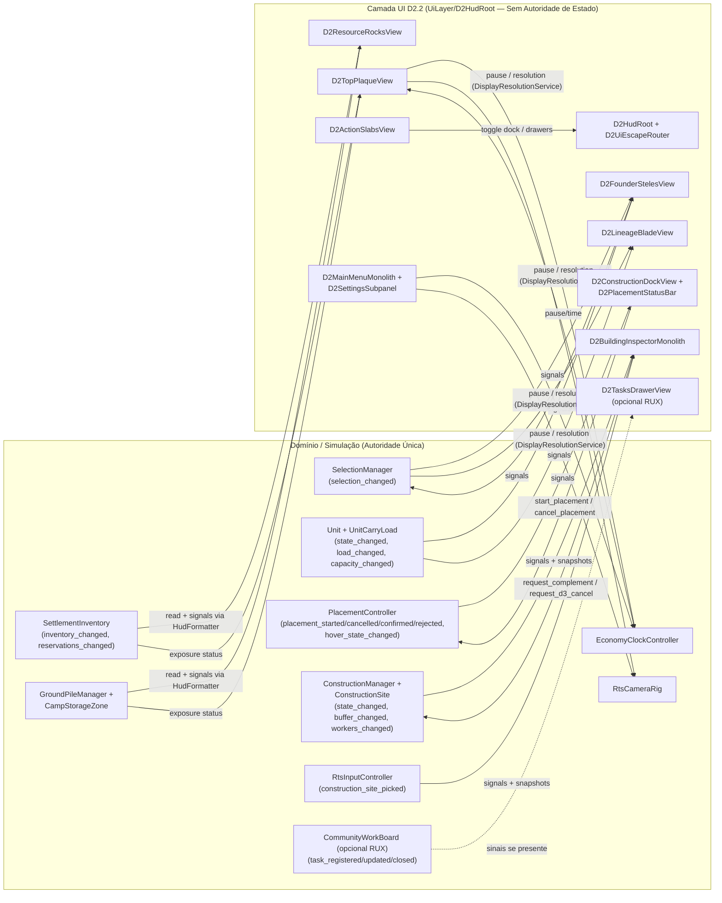

> **Nota de Revisão:** Este plano inicial (`UI-1.0`) foi revisado após auditoria técnica independente; consulte a versão vigente em **[UI_1_0_R1_INTEGRATION_PLAN.md](UI_1_0_R1_INTEGRATION_PLAN.md)** (que incorpora Correções A–E e subdivisão `UI-1.1A`/`UI-1.1B`).

# DAWN OF KIN — UI-1.0
## Plano Técnico de Integração da Interface D2.2 ("Marcos de Pedra e Eclipse")

> **Status:** `PLANO TÉCNICO REVISÁVEL (UI-1.0)` — Auditoria de engenharia e arquitetura de integração da interface **D2.2 — Marcos de Pedra e Eclipse** na Godot 4.7.2.  
> **Autorização:** O proprietário autorizou expressamente o início da etapa **UI-1**. Conforme `AGENTS.md` e o escopo da `UI-1.0`, **nenhum código de produção foi modificado nesta execução**; o plano técnico e o primeiro incremento (`UI-1.1`) aguardam revisão e aceite antes de iniciar o código.  
> **Fontes Normativas e Referências Verificadas:**
> - **Identidade Visual Aprovada:** `design/ui-0-r2-2-d2-visual-fidelity` @ `1ab8ffb78c269f3a659712491de91ab1f317e919` (`G_godot_D2_2_*`, `C1`–`C4`, `d2_2_faithful_atlas.png`, `atlas_manifest.json`).
> - **Design System Homologado Documentalmente:** `design/ui-0-r2-3-2-closeout` @ `cdd9f2f4308a05d822c8f7c72f57c0a07756f0a6` ([DAWN_OF_KIN_VISUAL_DESIGN_SYSTEM.md](../design/DAWN_OF_KIN_VISUAL_DESIGN_SYSTEM.md) e [UI_0_R2_3_2_CLOSEOUT.md](../design/ui-0-r2-3/UI_0_R2_3_2_CLOSEOUT.md)).
> - **Regras de Engenharia & GDD:** [AGENTS.md](../../AGENTS.md) e [Dawn_of_Kin_GDD.md](../Dawn_of_Kin_GDD.md).
> - **Branch Documental desta Entrega:** `planning/ui-1-0-integration-plan` (worktree isolado `C:\Projetos\Dawn_of_Kin_wt_ui_1_0_plan`, derivada de `cdd9f2f4308a05d822c8f7c72f57c0a07756f0a6`).

---

## 1. Auditoria da Arquitetura Existente e Estado das Branches Git

### 1.1 Auditoria Git e Escolha Justificada da Base Técnica da UI-1
A auditoria de todas as branches locais e remotas (`git branch -a --no-merged cdd9f2f` e diffs em `src/`, `scenes/`, `data/`, `tests/`) comprovou a seguinte topologia linear real:

| Branch | SHA | Conteúdo Funcional Verificado | Adequação como Base da UI-1 |
|---|---|---|---|
| `main` | `25e0a20` | Congelada em `T3.6.1`. **Faltam** `T3.6.2` (proveniência), `T3.6.3` (custódia de cancelamento e inspetor D3), `UX-1`, `RUX-1/2A/2B` e toda a documentação/assets `UI-0` (`135` commits atrás de `cdd9f2f`). | **Inadequada** — obrigaria a reintegrar `14.981` linhas de `T3.6.2–T3.6.3` + `1.931` linhas de `UX/RUX` + assets `D2.2`. |
| `feat/t3-6-3-cancellation-custody` | `8deeef1` | Contém `T3.1–T3.6.3` completos (construção, inspetor, complementação manual `DEC-11B`, cancelamento e recuperação `D3`), mas sem `UX-1`, `RUX-1/2A/2B` nem assets `D2.2`. | **Incompleta** — deixaria de fora compatibilidade com `UX-1`/`RUX-2B` e o Design System. |
| `feat/rux-2b-multi-source-selection` | `cddd582` | Contém `T3.1–T3.6.3` + `UX-1` + `RUX-1/2A/2B` (isolados em cenas de teste visual sem quebrar `main.tscn`), mas sem os assets e o Design System `D2.2`. | **Quase completa**, faltando os 9 commits documentais da `UI-0`. |
| **`design/ui-0-r2-3-2-closeout`** | **`cdd9f2f`** | Ancestral direto de **todas** as branches funcionais (`git diff cddd582..cdd9f2f -- src/ scenes/ data/ tests/ project.godot` = **vazio**), somado aos assets aprovados `D2.2` (`1ab8ffb`) e ao Design System homologado (`cdd9f2f`). | **Base Técnica Recomendada (`DT-01`)** — 100% do código funcional mais recente + 100% dos artefatos `D2.2` sem conflito de merge. |

> **Observação:** As únicas 5 branches remotas fora da ancestralidade de `cdd9f2f` são exclusivamente documentais/históricas (`audit/global-vision-and-design`, `planning/t3-4-architecture`, `planning/t3-4-architecture-r2`, `planning/t3-6-architecture-r1`, `docs/chatgpt-creative-collaboration-20261119`).

### 1.2 Configuração do Projeto (`project.godot`) e Ambiente
- **Engine / Renderer:** Godot `4.7.2`, `gl_compatibility` (desktop e mobile), `Jolt Physics`, alvo de hardware de referência `Intel(R) UHD Graphics 620`.
- **Display / Stretch:** `viewport_width = 1920`, `viewport_height = 1080`, `stretch/mode = "canvas_items"`, `stretch/aspect = "expand"`.
- **Tipagem Estrita Obrigatória:** `untyped_declaration=1`, `unsafe_property_access=1`, `unsafe_method_access=1`, `unsafe_cast=1`, `unsafe_call_argument=1`. Todo código da `UI-1` deve compilar com **zero avisos e zero erros**.
- **Ações de Entrada (`src/core/input_actions.gd`):** `select` (LMB), `command` (RMB), `selection_modifier` (Shift), `clear_selection` (**`KEY_ESCAPE` / 4194305**), `camera_pan_*` (WASD/Setas), `camera_drag` (MMB), `camera_zoom_in/out` (Wheel), `debug_overlay` (F3), `debug_navigation` (F4). Não existem ainda ações para `build_menu` (`B`), `tasks` (`T`), `lineage` (`H`) ou `pause_menu`.

### 1.3 Inventário dos Controladores e Componentes de UI Existentes

| Arquivo / Classe | Papel Atual na Cena (`src/main/main.tscn` e `tests/visual/`) | Estado / Sinais / Particularidades Críticas |
|---|---|---|
| `src/main/main.gd` (`MainScene`) | Compositor raiz sem autoloads. Instancia `GroundPileManager`, `SettlementInventory`, `EconomyClockController`, `ConstructionManager`, `ConstructionHud` e `BuildingInspectorPanel` em `$UiLayer`. | `main.tscn` define `use_provenance_economy = true`. Possui `preflight_economic_teardown()` e `request_controlled_teardown()` (linha 185) sem vínculo de UI/quit ainda. |
| `src/ui/resource_hud.gd` (`ResourceHud`) | Coordena `SettlementStockpilePanel` (canto superior direito) e `SelectedUnitPanel` (canto inferior esquerdo). | **Zero polling** (`set_process(false)`). Chama `HudStyle.apply_mouse_filter_ignore_recursive(self)` — **todo o HUD T2.5 é pass-through** (afirmado explicitamente por `test_t2_resource_hud.gd`). |
| `src/ui/hud_formatter.gd` (`HudFormatter`) | Funções puras de formatação: `format_unit_state`, `format_unit_name`, `build_carry_snapshot`, `build_stockpile_snapshot` (`ExposureTone`). | **Reutilizável integralmente** na `UI-1` sem duplicar lógica de formatação ou de exposição das pilhas. |
| `src/ui/hud_style.gd` (`HudStyle`) | Paleta provisória T2.5 e `StyleBoxFlat` legados. | Permanecerá intocado para o modo legado; `UI-1` criará seu próprio `D2ThemeFactory` / `D2Tokens` separado. |
| `src/ui/construction_hud.gd` (`ConstructionHud`) | Botão `Construir` (`BuildButton`) e catálogo `Catalog` no canto inferior direito (`shelter_basic`, `storage_depot`). | Intercepta `KEY_ESCAPE` em **`_input()`** quando `_catalog.visible`. Testes `test_t3_5_1_construction_hud.gd` acessam `UiLayer/ConstructionHud/BuildButton`, `Catalog`, `shelter_basic` e `storage_depot`. |
| `src/ui/building_inspector_panel.gd` (`BuildingInspectorPanel`) | Painel contextual de `ConstructionSite` (materiais, progresso, trabalhadores, complementação `DEC-11B`, cancelamento/recuperação `D3` e botão `Recuperações`). | Posicionado abaixo do `DebugOverlay` (`_layout_left_hud`). Define `mouse_force_pass_scroll_events = false`. Usa `Timer` debounce (`0.2 s` / `0.5 s` recuperação). Testes `test_t3_5_2` e `test_t3_6_4` acessam campos internos `_panel`, `_progress`, `_materials`, `_d3_begin`, `_d3_confirm`, `_recoveries`, `_recovery_open`. |
| `src/buildings/placement_test_overlay.gd` (`PlacementTestOverlay`) | Overlay temporário de teste (`F8` barra dev, `F6`/`F7` atalhos, toast/status de posicionamento, botões de resolução `720p`/`1080p` e workers de teste). | Já instancia `DisplayResolutionService`. Mantém `_status_panel` visível durante posicionamento (`hover_state_changed`, `placement_rejected`, `placement_confirmed`). |
| `src/ui/display_resolution_service.gd` (`DisplayResolutionService`) | Serviço modular puro para troca segura de janela (`1280×720` e `1920×1080`) com clamp ao `usable_rect` e cálculo de decorações. | **Pronto para reuso direto** na tela de Configurações da `UI-1` (sem recarregar cena nem alterar OS). |
| `src/ui/debug_overlay.gd` (`DebugOverlay`) | Overlay de telemetria (`F3`: FPS, frame ms, Process/Physics, Nodes, Draw calls). | Deve continuar coexistindo sem conflito de posição com as Pedras de Recursos (`top-left`) na `UI-1`. |
| `src/rts/rts_input_controller.gd` (`RtsInputController`) | LMB seleção/box, RMB comando, `Esc` (`CLEAR_SELECTION`), emite `construction_site_picked(site)`. Delega ao `PlacementController` quando ativo. | Consome `CLEAR_SELECTION` (`Esc`) incondicionalmente em `_unhandled_input`, mesmo com seleção vazia. |
| `src/camera/rts_camera_rig.gd` (`RtsCameraRig`) | Câmera isométrica (`Yaw/Pitch/Zoom`, WASD, MMB drag, Wheel zoom, Edge Pan `6 px`). | **`PROCESS_MODE_ALWAYS`** — continua processando WASD e Edge Pan mesmo com `get_tree().paused = true` ou ponteiro sobre UI! |
| `src/economy/economy_clock_controller.gd` (`EconomyClockController`) | Relógio econômico pausável (`PROCESS_MODE_PAUSABLE`), `SimulatedWorldTimeProvider` (segundos simulados), `set_paused()`, `set_time_scale()`. | **Atenção:** Não possui calendário/estações (`T4`). `set_time_scale()` afeta o tempo econômico, enquanto simulação geral de unidades/construção usa `Engine.time_scale`. |
| `src/rts/autonomous_gather_input.gd` + `CommunityWorkBoard` + `CommunityTaskDispatcher` + `AutonomousGatherFeedback` | Protótipos `RUX-1/2A/2B` de coleta comunitária automática multi-fonte. | Ativos apenas em `tests/visual/rux_*.tscn` (não na `main.tscn` padrão). `CommunityWorkBoard` é totalmente dirigido por sinais (`task_registered`, `task_updated`, `task_closed`). |
| `src/ui/tree_work_menu.gd` (`TreeWorkMenu`) | Protótipo `UX-1` de menu contextual de árvore. | Ativo apenas em `tests/visual/ux_1_contextual_tree.tscn`; fecha automaticamente ao receber `PlacementController.placement_started`. |
| `data/characters/leader_a.tres` & `leader_b.tres` | Definições dos 2 protagonistas fundadores. | `character_id` = `&"leader_a"` / `&"leader_b"`, **`display_name` = `"Leader A"` / `"Leader B"`** (ainda não `"Alden"` / `"Brena"`). |

### 1.4 Verificação Factual de Funcionalidades Existentes vs Futuras
Para cumprir a regra estrita de **nunca apresentar comportamentos fictícios como implementados**:

| Elemento Visual na Referência D2.2 | Situação Real no Código (`cdd9f2f`) | Comportamento Obrigatório na `UI-1` |
|---|---|---|
| Estoques `Madeira`, `Pedra`, `Alimentos` | **`IMPLEMENTADO`** (`SettlementInventory` + `GroundPileManager`) | Ligação 100% real via sinal `inventory_changed` e `HudFormatter`. |
| Status `● EXPOSTO` / `PROTEGIDO` | **`IMPLEMENTADO`** (`HudFormatter.build_stockpile_snapshot`) | Ligação 100% real a `CampStorageZone` e `GroundPileManager`. |
| Região `Clareira Inicial` | **`IMPLEMENTADO`** (cenário `TestMap`) | Rótulo de região real (`Clareira Inicial`). |
| Estação/Calendário (`Primavera · Ano I`) | **`PLANEJADO` (`T4`) — NÃO IMPLEMENTADO** | **Não simular estações.** Exibir apenas rótulo factual (ex.: `Acampamento · Dia 1` estático marcado ou omitir linha de estação até `T4` — decisão `DT-05`). |
| Controles de Tempo (`||`, `1×`, `2×`, `4×`) | **Pausa `get_tree().paused` + `EconomyClockController` existem; `2×/4×` sem orquestrador unificado de `Engine.time_scale`** | Implementar **Pausa real (`||`)** e **`1×`** na `UI-1.1`; `2×`/`4×` só entram se aprovados com sincronização explícita `Engine.time_scale` + `EconomyClockController` + testes de física/navegação (`DT-05`), caso contrário desabilitados com tooltip honesto. |
| Estelas dos 2 Fundadores (`Alden` / `Brena`) | **`IMPLEMENTADO`** (`LeaderA`/`LeaderB`, `SelectionManager`, `Unit.state_changed`, `UnitCarryLoad`) | Ligação 100% real aos 2 `Unit` da cena. Nome lido de `HudFormatter.format_unit_name()` (`DT-04`). |
| Maquetes `Abrigo Básico` (`12/6`) e `Depósito Rústico` (`18/10`) | **`IMPLEMENTADO`** (`data/buildings/*.tres`, `PlacementController`, `ConstructionManager`) | Ligação 100% real a `BuildingDefinition` e `PlacementController`. |
| Faixa de Validação (`LOCAL VÁLIDO` / motivo inválido) | **`IMPLEMENTADO`** (`PlacementController.hover_state_changed`, `placement_rejected`) | Ligação 100% real ao resultado do `PlacementValidator`. |
| Monólito de Canteiro Ativo (materiais, progresso, `DEC-11B`, cancelamento `D3`, recuperações) | **`IMPLEMENTADO`** (`ConstructionSite`, `ConstructionManager`) | Paridade funcional 100% com `BuildingInspectorPanel`. |
| Comando `Tarefas [T]` e Botão `Liberar para Comunidade (P-RUX-2)` | **Parcial (`RUX-2B` existe em `tests/visual/rux_2b_*`; `P-RUX-2` ainda aberto)** | Em cenas com `CommunityWorkBoard`, exibe tarefas reais da fila; em `main.tscn` sem board RUX, exibe estado honesto (`Sem quadro comunitário ativo`) sem inventar tarefas; botão `P-RUX-2` permanece omitido ou claramente desabilitado até decisão do proprietário. |
| Menu Principal: `Continuar`, `Configurações` (Resolução `720p/1080p`), `Sair` | **`Continuar` (unpause) e `DisplayResolutionService` IMPLEMENTADOS** | Funcionais de verdade na `UI-1.5`. |
| Menu Principal: `Salvar`, `Carregar`, `Créditos` | **`PLANEJADO` (`T3.8`) — NÃO IMPLEMENTADO** | Botões exibidos em estado **`Desabilitado`** com indicação explícita (`Em breve — T3.8`), nunca fingindo salvamento ou carregamento. |

---

## 2. Mapa de Dependências de UI e Gameplay

A UI **nunca** detém autoridade sobre estoques, seleções, reservas, obras ou ordens. Todo fluxo obedece estritamente ao padrão **Observer / Intent-Delegation**:



**Regra de Ciclo de Vida:** Todo componente D2.2 implementa `configure(...)` idempotente e `unbind()` chamado em `_exit_tree()`, desconectando 100% dos sinais sem deixar callbacks pendentes ou *memory leaks* (seguindo o padrão comprovado de `ResourceHud` e `SelectedUnitPanel`).

---

## 3. Identificação dos Conflitos de Integração

A auditoria real do código identificou **8 conflitos técnicos concretos** que precisam ser resolvidos estruturalmente antes ou durante a migração:

### Conflito C1 — Corrida de 4 Vias na Tecla `Esc` (`KEY_ESCAPE` / `InputActions.CLEAR_SELECTION`)
- **Diagnóstico real:**
  1. `ConstructionHud._input()` intercepta `KEY_ESCAPE` antes mesmo da árvore de GUI.
  2. `RtsInputController._unhandled_input()` repassa `CLEAR_SELECTION` ao `PlacementController` quando ativo.
  3. Quando fora de construção, `RtsInputController._unhandled_input()` **sempre** consome `CLEAR_SELECTION` (linhas 75–88), mesmo quando `_selection_manager.is_empty()` e não há drag!
  4. `BuildingInspectorPanel` não responde a `Esc`.
- **Solução arquitetural:** Criar um roteador único e determinístico **`D2UiEscapeRouter`** acionado antes de `RtsInputController` (ou via callback registrado em `RtsInputController` quando `use_d2_2_hud == true`) que executa estritamente a precedência da §4.2 do Design System (respeitando também o contrato de `test_t3_5_1_construction_hud.gd` — fechar catálogo antes de cancelar posicionamento):
  1. Se **Subpainel de Configurações** aberto → fecha Configurações e mantém Menu aberto.
  2. Se **Menu Principal/Pausa** aberto → fecha Menu e retoma o jogo (`unpause`).
  3. Se **Catálogo/Mesa de Maquetes** aberto → fecha Mesa (sem cancelar posicionamento se já estiver posicionando, ou mantendo consistência).
  4. Se **`PlacementController.is_placement_active()`** → `cancel_placement()` (preservando seleção de unidades!).
  5. Se **Monólito de Canteiro / Drawer de Tarefas / Lâmina expandida** aberto → fecha painel contextual.
  6. Se **drag de seleção ativo** em `RtsInputController` → cancela drag.
  7. Se **`SelectionManager` não vazio** → `clear_selection()`.
  8. Caso tudo esteja fechado e seleção vazia → **abre o Monólito do Menu Principal / Pausa** (`DT-06`).

### Conflito C2 — `RtsCameraRig` Ignora Pausa e Dispara Edge Pan Sobre a UI
- **Diagnóstico real (`src/camera/rts_camera_rig.gd`):**
  - Linha 48: `process_mode = Node.PROCESS_MODE_ALWAYS` — quando o Menu de Pausa definir `get_tree().paused = true`, WASD/Setas e Edge Pan **continuam movendo a câmera** por trás do menu!
  - Linhas 254–268: `_collect_pan_direction()` checa `_last_mouse_pos` (que só atualiza em `_unhandled_input`, congelando quando o mouse entra num `Control` com `MOUSE_FILTER_STOP` perto da borda!) ou `viewport.get_mouse_position()`, disparando **movimento involuntário de câmera** ao clicar nos cantos da HUD (`Pedras de Recursos`, `Placa Superior`, `Estelas`, `Maquetes`).
- **Solução cirúrgica em `RtsCameraRig` (retrocompatível 100% com testes T1/T2):**
  - Adicionar método `set_input_locked(locked: bool)` (padrão `false`) chamado exclusivamente pelo Menu Modal/Pausa quando aberto (zera `_pan_velocity_xz`, cancela `_is_dragging` e bloqueia WASD/Edge/Zoom/Drag enquanto modal aberto).
  - Em `_collect_pan_direction()`, antes de aplicar `edge_pan`, verificar `viewport.gui_get_hovered_control() == null` (ou se o controle sob o ponteiro possui `mouse_filter == MOUSE_FILTER_STOP`), impedindo Edge Pan sobre qualquer peça sólida da HUD enquanto mantém o Edge Pan 100% funcional na borda real livre da janela!
  - Garantir `mouse_force_pass_scroll_events = false` em todas as peças sólidas da D2.2 para impedir zoom involuntário ao rolar listas/painéis.

### Conflito C3 — Contrato `MOUSE_FILTER_IGNORE` do `ResourceHud` Legado vs Peças Interativas D2.2
- **Diagnóstico real:** `tests/integration/test_t2_resource_hud.gd` (linhas 314–335) testa explicitamente que clicar sobre o `ResourceHud` legado **vaza para o mundo 3D**. Na D2.2 (Design System §4.1), peças minerais sólidas **devem bloquear cliques** (`MOUSE_FILTER_STOP`) enquanto os vãos transparentes entre as pedras/estelas/cantos usam `MOUSE_FILTER_IGNORE`.
- **Solução:** Estratégia **Dual-Mode controlada por flag (`use_d2_2_hud`)** (Seção 5) — o `ResourceHud` legado preserva 100% seu contrato de testes, enquanto o `D2HudRoot` implementa e testa rigorosamente o contrato D2.2 (`MOUSE_FILTER_STOP` nas pedras/placas/estelas/lajes e `MOUSE_FILTER_IGNORE` nos espaços vazios).

### Conflito C4 — Acoplamento de Testes T3.5 / T3.6.4 a Nós e Campos Privados do Inspetor e Catálogo Legados
- **Diagnóstico real:** `test_t3_5_1_construction_hud.gd` consulta `UiLayer/ConstructionHud/BuildButton`, `Catalog`, `shelter_basic` e `storage_depot`; `test_t3_5_2_building_inspector.gd` e `test_t3_6_4_cancellation_ui.gd` acessam `UiLayer/BuildingInspectorPanel` e campos internos (`_panel`, `_d3_begin`, `_d3_confirm`, etc.).
- **Solução:** Durante `UI-1.1`–`UI-1.6`, não destruir nem renomear `ConstructionHud` ou `BuildingInspectorPanel`; mantê-los ativos sob `use_d2_2_hud == false` e desativados/não instanciados quando `use_d2_2_hud == true`. Em `UI-1.7` (cutover), ajustar as fixtures dos testes legados para declarar explicitamente `main.use_d2_2_hud = false` enquanto toda a nova suíte `test_ui_1_*` valida `use_d2_2_hud = true`.

### Conflito C5 — Sobreposição Visual com `DebugOverlay` (`F3`) e `PlacementTestOverlay` (`F8` / Status Bar)
- **Diagnóstico real:**
  - `DebugOverlay` fica ancorado no canto superior esquerdo (`x=12, y=12`), colidindo diretamente com as **3 Pedras de Recursos** (`x=20, y=20..69`) da D2.2!
  - `PlacementTestOverlay` exibe seu próprio `_status_panel` na parte inferior central durante o posicionamento, que duplicaria a **Faixa de Validação D2.2 (`build_valid_bar`)**!
- **Solução:**
  - Quando `use_d2_2_hud == true`, o `DebugOverlay` (quando alternado por `F3`) desloca-se automaticamente para baixo das Pedras de Recursos (`y = 92 * s`) ou para o topo central, evitando qualquer sobreposição com os recursos.
  - Em `MainScene._setup_placement()`, quando `use_d2_2_hud == true`, o `PlacementTestOverlay` suprime seu `_status_panel` duplicado (mantendo `F8` dev-bar disponível sob demanda para QA sem interferir na HUD D2.2).

### Conflito C6 — Carregamento de Fontes e Assets do Showcase Incompatível com Builds Exportados
- **Diagnóstico real:** `ui0_r2_2_d2_faithful_showcase.gd` carregava `C:/Windows/Fonts/palab.ttf` / `segoeui.ttf` via `FileAccess` absoluto e texturas via `ProjectSettings.globalize_path("res://docs/...")`. Ambos falham em Linux/macOS e em pacotes `.pck` exportados, além de usar fontes proprietárias do Windows.
- **Solução:** Ver Seção 6 (`D2AtlasLibrary` com recursos `res://` importados + `D2ThemeFactory` com `SystemFont` imediato e plano de substituição por fontes livres SIL OFL).

### Conflito C7 — Nomes das Unidades nos `.tres` (`Leader A`/`Leader B`) vs Mockups (`Alden`/`Brena`)
- **Diagnóstico real:** `leader_a.tres` e `leader_b.tres` definem `display_name = "Leader A"` e `"Leader B"`. Alterá-los silenciosamente pode quebrar asserções de testes T1–T3.
- **Solução:** As estelas D2.2 consomem sempre `HudFormatter.format_unit_name(unit)` e mapeiam retratos por `character_id` (`&"leader_a"` → retrato Alden, `&"leader_b"` → retrato Brena, com silhueta fallback genérica para futuras unidades). Renomear `display_name` nos `.tres` fica registrado como decisão explícita `DT-04`.

### Conflito C8 — Encerramento Seguro (`Sair`) e Domínio Econômico (`MainScene.request_controlled_teardown`)
- **Diagnóstico real:** `MainScene` valida custódia econômica (`preflight_economic_teardown`) e libera domínios regionais em `_exit_tree()`. Um botão `"Sair do Jogo"` no Menu Principal que chame `get_tree().quit()` enquanto `get_tree().paused == true` precisa despausar/desconectar UI ordenadamente e permitir que `MainScene._exit_tree()` execute sem erros de transação presa.
- **Solução:** No incremento `UI-1.5`, o botão `"Sair"` exige confirmação simples (evitando saída acidental), chama `D2HudRoot.unbind()`, despausa a árvore se necessário e dispara `get_tree().quit()`, com teste automatizado de teardown limpo.

---

## 4. Proposta de Arquitetura Modular (`src/ui/d2/`)

Toda a nova interface será construída exclusivamente com **nós `Control` nativos da Godot 4.7.2**, GDScript estritamente tipado, sem *god scripts* e com separação limpa entre **dados/formatação**, **recursos/tema** e **visões modulares**.

### 4.1 Estrutura de Diretórios e Responsabilidades

```text
res://assets/ui/d2/                          # Cópia runtime bit-a-bit dos assets aprovados D2.2 (DT-02)
├── d2_2_faithful_atlas.png                  # 1024×1024 — 12 peças poligonais 2× + 5 ícones
├── d2_2_menu_monolith.png                   # 1024×1024 — monólito diagonal do menu
├── atlas_manifest.json                      # Coordenadas canônicas das 17 regiões
├── portrait_alden.jpg                       # Retrato leader_a
├── portrait_brena.jpg                       # Retrato leader_b
├── emblem_dawn_of_kin.png                   # Emblema solar
├── d1_shelter_mini.png                      # Miniatura Abrigo Básico
└── d1_depot_mini.png                        # Miniatura Depósito Rústico

res://src/ui/d2/
├── d2_tokens.gd                             # Constantes exatas da Seção 2 do Design System (cores, tamanhos, escalas)
├── d2_atlas_library.gd                      # Carrega AtlasTexture cacheados (singleton de cena, 0 alocação por frame)
├── d2_theme_factory.gd                      # Constrói Theme nativo Godot (Font, StyleBoxTexture, Button/Label states)
├── d2_scale_controller.gd                   # Calcula fator s (1.00 em 1080p, 1.22 em 720p) e reage a window size_changed
├── d2_ui_escape_router.gd                   # Pilha determinística de Esc + atalhos B, T, H, 1, 2
├── d2_hud_root.gd                           # Compositor leve (sem lógica de negócio) montado em MainScene/UiLayer
├── components/
│   ├── d2_slab_button.gd                    # Botão nativo sobre AtlasTexture com estados Hover/Pressed/Selected/Disabled
│   ├── d2_resource_rocks_view.gd            # 3 pedras escalonadas (Madeira +0, Pedra +7, Alimento +2)
│   ├── d2_top_plaque_view.gd                # Placa com cumeeira: Clareira Inicial, tempo/pausa, exposição real, ☰ MENU
│   ├── d2_founder_steles_view.gd            # 2 estelas separadas (Brena +6 px), elevação -22 px na seleção, clique/Shift
│   ├── d2_action_slabs_view.gd              # Laje Alabastro Maquetes [B] + Laje Basalto Tarefas [T] / Linhagem [H]
│   ├── d2_construction_dock_view.gd         # Mesa de maquetes verticais em alabastro (Abrigo Básico 12/6, Depósito 18/10)
│   ├── d2_placement_status_bar.gd           # Faixa 760×38 px de validação em tempo real (verde/terracota + Esc)
│   ├── d2_building_inspector_monolith.gd    # Monólito 308×224+ px de canteiro ativo + DEC-11B + D3 cancelamento/recuperação
│   ├── d2_lineage_blade_view.gd             # Lâmina 454×214 px de fundador selecionado (estado, carga real, ocupação)
│   ├── d2_tasks_drawer_view.gd              # Painel de Tarefas Comunitárias (ligado a CommunityWorkBoard quando presente)
│   └── d2_main_menu_monolith.gd             # Monólito diagonal 632×1080 px: Continuar, Configurações (720p/1080p), T3.8 disabled, Sair
```

### 4.2 Garantias de Fidelidade Visual e Acessibilidade na Implementação
1. **Fidelidade D2.2 Absoluta:** Todas as 17 regiões do `atlas_manifest.json` são instanciadas via `D2AtlasLibrary.get_region(key)` respeitando exatamente o `pad: 10 px` de sombra pré-assada e as coordenadas/proporções do showcase aprovado (`ui0_r2_2_d2_faithful_showcase.gd`).
2. **Proibições Estruturais:** Zero barras retangulares unificadas para recursos; zero fusão das estelas de Alden e Brena; zero botões cinzentos no lugar da laje de alabastro `Maquetes [B]`.
3. **Conformidade WCAG 2.1 sem Descaracterizar a D2.2:** Conforme §2.1.1 do Design System homologado, `#385B2A` (`2,33:1` sobre basalto) **nunca** é usado como texto ou indicador isolado sobre `#141618`; é aplicado exclusivamente como preenchimento de fundo acompanhado de texto `#F4EFE4` (`6,79:1`) e/ou filete/rótulo `#A5C98B` (`9,78:1`). `#6A5832` (`2,64:1`) restringe-se a divisores puramente decorativos.
4. **Zero Polling:** Nenhum componente D2.2 ativa `_process()` continuamente (exceto interpolação breve de `120–160 ms` via `Tween` nativo da Godot ao elevar estela/maquete, desligada em repouso).

---

## 5. Estratégia de Migração Segura e Coexistência com a HUD Legada

Para garantir **zero regressão** nos testes existentes (`test_t2_resource_hud`, `test_t3_5_1`, `test_t3_5_2`, `test_t3_6_4`, `test_rux_*`) e permitir comparação lado a lado com a HUD antiga durante toda a migração:

1. **Chave Explícita em `MainScene`:** Adicionar `@export var use_d2_2_hud: bool = false` (padrão `false` durante `UI-1.1`–`UI-1.6`).
2. **Cena Visual Dedicada de Validação (`tests/visual/ui_1_d2_2_sandbox.tscn`):** Instancia `main.tscn` com `use_d2_2_hud = true` (e outra variante sobre `rux_2b_multi_source_selection.tscn` na `UI-1.6`), permitindo abrir e testar a D2.2 ao vivo na Godot 4.7.2 a cada incremento sem perturbar o padrão legado enquanto a migração está em curso.
3. **Alternância Limpa em Runtime (apenas para comparação QA/proprietário):** `MainScene.set_d2_2_hud_enabled(enabled: bool)` desconecta/oculta a HUD inativa (`unbind()` + `visible = false`) e conecta/exibe a ativa (`configure(...)` + `visible = true`), garantindo que nunca existam duas HUDs reagindo aos mesmos cliques ou à tecla `Esc` simultaneamente.
4. **Cutover Controlado (`UI-1.7`):** Somente após os 6 incrementos anteriores passarem em todos os testes automatizados, testes manuais e no **Visual Consistency Gate (VCG)** com aceite do proprietário, `main.tscn` altera `use_d2_2_hud = true` como padrão, preservando o modo legado desativado como recuperação imediata e mantendo os testes legados rodando explicitamente com `use_d2_2_hud = false`.

---

## 6. Assets, Tipografia, Escala Responsiva e Riscos de Desempenho

### 6.1 Inventário do Atlas e Estratégia de Importação (`DT-02`)
- **Coordenadas Verificadas (`atlas_manifest.json`):** `1024×1024`, `shadow_pad = 10`, `12` peças poligonais (`maquette_depot_sel`, `build_site_monolith`, `maquette_shelter`, `lineage_blade`, `founder_stele_raised`, `founder_stele`, `top_plaque`, `slab_maquetes_alab`, `slab_cmd_basalt`, `menu_primary_alab`, `resource_rock`, `build_valid_bar`) + `5` ícones `48×48` (`ico_wood`, `ico_stone`, `ico_food`, `ico_tasks`, `ico_lineage`) + arquivo separado `d2_2_menu_monolith.png` (`1024×1024`).
- **Recomendação (`DT-02`):** Copiar bit-a-bit os 9 arquivos de `docs/design/ui-0-r2-2/assets/` para `res://assets/ui/d2/` para que a Godot gere `.import` apenas em `assets/` (configurados com `Mipmaps = ON` ou `Filter = Linear` sem compressão lossy agressiva para evitar artefatos nas linhas finas de ouro kintsugi!), mantendo `docs/design/ui-0-r2-2/assets/` 100% imutável e livre de `.import`.

### 6.2 Estratégia Tipográfica Legalmente Segura (`DT-03`)
- **Proibição respeitada:** Nenhuma fonte comercial de sistema (`palab.ttf`, `segoeui.ttf`, `georgia.ttf`) será copiada para o repositório ou empacotada no build.
- **Fase 1 (Imediata na `UI-1.1`, zero arquivos externos):** Uso de `SystemFont` nativo da Godot com lista ordenada de fallback:
  - *Display/Títulos Serif:* `["Palatino Linotype", "Book Antiqua", "Georgia", "TeX Gyre Pagella", "Liberation Serif", "DejaVu Serif"]`
  - *Dados/UI Sans Tabular:* `["Segoe UI", "Inter", "Noto Sans", "Liberation Sans", "DejaVu Sans"]`
- **Fase 2 (Para build distribuível / multiplataforma, mediante aprovação do proprietário):** Adotar fontes abertas sob licença verificada (com arquivo `LICENSE.txt` incluído em `assets/fonts/`):
  - *Serif equivalente à Palatino:* **TeX Gyre Pagella** (clone métrico fiel de Palatino, GUST Font License) ou **Crimson Pro / EB Garamond** (SIL OFL 1.1).
  - *Sans tabular equivalente à Segoe UI:* **Inter** ou **Source Sans 3** (SIL OFL 1.1, suporte completo a acentuação PT-BR e `tnum`).

### 6.3 Riscos Técnicos Mapeados (Texturas, Escala, Draw Calls e Licenças)

| Risco | Causa Raiz | Mitigação Concreta na `UI-1` |
|---|---|---|
| **Distorção de texturas poligonais** | Esticar peças com `STRETCH_SCALE` em proporções muito diferentes do `content_w × content_h` assado no atlas. | Usar a proporção nativa do atlas em peças fixas (pedras, placa, estelas, lajes, maquetes); apenas `build_valid_bar` e `build_site_monolith` permitem expansão controlada (ou 3-slice/conteúdo interno rolável se textos crescerem). |
| **Perda de nitidez em `1280×720`** | Downscale de `1920×1080` (`0,6667×`) sem mipmaps ou com fontes pequenas abaixo de `10 px`. | Aplicar `scale = 1.22` via `D2ScaleController` quando `window.size.x <= 1366` (reproduzindo exatamente `G_godot_D2_2_*_1280x720.png`) + `Mipmaps = ON` / `TextureFilter = LINEAR_WITH_MIPMAPS` no atlas 2× supersampled. |
| **Estouro de draw calls na Intel UHD 620** | Misturar texturas avulsas entre botões, quebrando o batching 2D da Godot. | Centralizar todas as 17 regiões no único `d2_2_faithful_atlas.png` via `AtlasTexture` compartilhado e agrupar irmãos da mesma textura na árvore de cena (meta: manter overhead em torno de `+40` draw calls na HUD em repouso). |
| **Sobreposição de controles em `720p`** | Painéis contextuais (`Lâmina de Linhagem`, `Monólito de Canteiro`, `Mesa de Construção`) abertos simultaneamente. | Regra de exclusividade contextual coordenada por `D2HudRoot`: abrir `Mesa de Construção` colapsa `Lâmina de Linhagem` estendida; `Monólito de Canteiro` ancora no quadrante direito acima das lajes de comando; testes automatizados de não-interseção de `Rect2` em `1280×720` e `1920×1080`. |
| **Ressalva de licenciamento dos assets IA** | 6 texturas/retratos/ícones base foram gerados por IA no fluxo `UI-0` (sem certidão jurídica externa anexada). | Preservar ressalva explícita documentada em `UI_0_R2_3_2_CLOSEOUT.md` §2; arquitetura desacoplada via `D2AtlasLibrary` permite substituir qualquer retrato/miniatura/textura no futuro trocando apenas o arquivo sem alterar código. |

---

## 7. Plano Incremental Completo da UI-1

Cada incremento é pequeno, isolado, verificável por testes automatizados + inspeção visual manual + **Visual Consistency Gate (VCG)** de 10 passos, parando para revisão antes do próximo:

| Incr. | Objetivo Principal | Componentes D2.2 | Dependências | Critério de Aceite Resumido |
|---|---|---|---|---|
| **UI-1.1** | **Fundação D2.2, Tema/Atlas, Proteção Câmera/Esc, Pedras de Recursos & Placa Superior** | `D2Tokens`, `D2AtlasLibrary`, `D2ThemeFactory`, `D2ScaleController`, `D2UiEscapeRouter`, `D2HudRoot`, `D2ResourceRocksView`, `D2TopPlaqueView`, ajuste cirúrgico em `RtsCameraRig` | `SettlementInventory`, `GroundPileManager`, `CampStorageZone`, `HudFormatter`, `EconomyClockController`, `RtsCameraRig` | Dual-mode `use_d2_2_hud` operacional; 3 pedras escalonadas + placa com cumeeira fiéis à D2.2 em `720p` e `1080p`; sincronismo real de estoque/exposição; pausa real `||`; zero click-through e zero edge-pan sobre UI; 100% dos testes legados verdes. |
| **UI-1.2** | **Estelas dos Fundadores & Lâmina Contextual de Linhagem/Unidade** | `D2FounderStelesView` (2 estelas separadas, degrau `6 px`, elevação `-22 px`), `D2LineageBladeView` (carga real, estado, seleção única/múltipla) | `UI-1.1`, `SelectionManager`, `Unit`, `UnitCarryLoad`, `HudFormatter` | Clique na estela seleciona/Shift-alterna unidade; elevação sincronizada bidirecionalmente com cliques 3D e box-selection; Lâmina exibe peso/carga/recursos reais (`0%–100%`, sobrecarga) e resumo multi-seleção sem polling. |
| **UI-1.3** | **Laje de Maquetes (Alabastro), Comandos Basalto, Mesa de Construção & Faixa de Validação** | `D2ActionSlabsView`, `D2ConstructionDockView` (Abrigo Básico `12/6`, Depósito Rústico `18/10`), `D2PlacementStatusBar` (`760×38`) | `UI-1.1`, `PlacementController`, `BuildingDefinition`, `D2UiEscapeRouter` | Tecla `[B]` e clique em `Maquetes` abrem/fecham maquetes em alabastro; `[1]`/`[2]` iniciam posicionamento; faixa exibe validação real (verde/terracota); `Esc` fecha catálogo → cancela posicionamento sem limpar seleção; zero regressão em `PlacementController`. |
| **UI-1.4** | **Monólito de Canteiro Ativo (Inspetor, Complementação `DEC-11B`, Cancelamento e Recuperação `D3`)** | `D2BuildingInspectorMonolith` (materiais, progresso, trabalhadores, confirmação dupla `DEC-11B`, prévia/commit `D3`, dropdown/botão de recuperações) | `UI-1.3`, `ConstructionManager`, `ConstructionSite`, `RtsInputController` | Paridade funcional integral com `BuildingInspectorPanel`; zero mutação direta da economia pela UI; testes de conservação, decaimento e cancelamento `D3` 100% aprovados via UI D2.2; `Esc` fecha inspetor sem vazar. |
| **UI-1.5** | **Monólito Diagonal do Menu Principal, Pausa Modal & Configurações de Resolução** | `D2MainMenuMonolith` (`632×1080`, costura dourada dupla), subpainel `Configurações` (`DisplayResolutionService` `720p`/`1080p`), itens `T3.8` desabilitados honestamente, `Sair` seguro | `UI-1.1`, `DisplayResolutionService`, `RtsCameraRig.set_input_locked`, `MainScene` | `Esc` (com tudo fechado) e `☰ MENU` abrem Monólito e pausam simulação + câmera; `Continuar` retoma; troca `720p↔1080p` sem recarregar cena; `Salvar`/`Carregar` claramente desabilitados (`T3.8`); `Sair` com teardown limpo. |
| **UI-1.6** | **Integração RUX (`Tarefas [T]`), Feedback Comunitário D2.2 & Coexistência `UX-1`/`DebugOverlay`** | `D2TasksDrawerView` (conectado a `CommunityWorkBoard` quando existir), estilo D2.2 para `AutonomousGatherFeedback`, ajuste de layout com `F3 DebugOverlay` | `UI-1.2`, `UI-1.3`, `CommunityWorkBoard` (opcional), `DebugOverlay` | Em `rux_2b_multi_source_selection.tscn`, `Tarefas [T]` lista tarefas/grupos ativos em tempo real via sinais; em `main.tscn`, exibe estado honesto sem simular RUX; `F3` nunca sobrepõe pedras de recursos. |
| **UI-1.7** | **Cutover Controlado, Homologação VCG Completa & Benchmark Integrado (Intel UHD 620)** | Ativação de `use_d2_2_hud = true` por padrão em `main.tscn`, adequação explícita de fixtures legadas (`use_d2_2_hud = false`), benchmark integrado AC/DC | `UI-1.1`–`UI-1.6` aprovados | Todas as suítes automatizadas (legadas + novas `test_ui_1_*`) 100% verdes; VCG 10 passos aprovado pelo proprietário em `720p` e `1080p`; medições reais de `p95`/`p99`/draw calls registradas sem regressão grave. |

### Condições de Parada ou Replanejamento (Aplicáveis a Todos os Incrementos)
- **Interromper imediatamente** se: (a) qualquer teste automatizado existente (T1, T2, T3.1–T3.6.4, UX-1, RUX-1/2A/2B) falhar; (b) surgirem avisos de tipagem estrita da Godot; (c) o layout em `1280×720` apresentar qualquer corte/overflow de texto ou sobreposição de painéis; (d) o custo adicional em `1920×1080` (Intel UHD 620, `gl_compatibility`) exceder `+15` draw calls acima da referência R2.2 (`+40` HUD / `+66` Construção) sem justificativa; ou (e) surgir necessidade de alterar qualquer silhueta, cor ou composição da D2.2 (submeter proposta antes de editar).

---

## 8. Estratégia de Testes, Regressão e Visual Consistency Gate (VCG)

### 8.1 Pirâmide de Validação Obrigatória por Incremento
1. **Testes Unitários Headless (`tests/unit/test_ui_1_*.gd`):**
   - Validação do `atlas_manifest.json` (todas as 17 regiões dentro de `1024×1024`).
   - Cálculo de escala responsiva (`1.00` em `1920×1080`, `1.22` em `1280×720`).
   - Máquina de estados do `D2UiEscapeRouter` (todas as 8 prioridades determinísticas).
   - Verificação de desconexão total de sinais (`unbind()`) e `apply_count` sem polling.
2. **Testes de Integração em `SubViewport` (`tests/integration/test_ui_1_*.gd`):**
   - `MOUSE_FILTER_STOP` em toda pedra/placa/estela/laje (cliques LMB/RMB sobre UI **nunca** alteram seleção no mundo nem emitem `MoveOrder`/`GatherOrder`/`confirm_placement`).
   - `MOUSE_FILTER_IGNORE` em áreas transparentes (seleção, box-select e comandos RTS no mundo 3D funcionam livremente).
   - Edge Pan bloqueado quando ponteiro está sobre peça sólida da UI, e funcionando normalmente na borda livre da janela.
   - `RtsCameraRig` travado (zero deslocamento por WASD/Edge/Zoom/Drag) com Menu/Pausa aberto.
   - Redimensionamento dinâmico `1280×720 ↔ 1920×1080` com asserção de `encloses()` e ausência de interseções indevidas entre painéis.
   - Regressão completa da suíte existente via `.\tools\run_tests.ps1 -Segmented`.
3. **Validação Visual Real e Manual na Godot 4.7.2 (Obrigatória — Headless NÃO Substitui):**
   - Execução interativa ao vivo na Godot 4.7.2 em `1280×720` e `1920×1080`.
   - Capturas controladas comparadas **por região da UI** (canto superior esquerdo, superior direito, inferior esquerdo, inferior direito, construção, linhagem, menu) contra as capturas oficiais `docs/design/ui-0-r2-2/G_godot_D2_2_*.png` (nunca diff pixel-a-pixel cego com fundos 3D diferentes).
   - Preenchimento formal da **Checklist Visual Consistency Gate (VCG — 10 passos)** definida na Seção 8 de `DAWN_OF_KIN_VISUAL_DESIGN_SYSTEM.md`.
4. **Medição de Desempenho Real (`Intel UHD Graphics 620`, `gl_compatibility`):**
   - Medição reproduzível em `1280×720` e `1920×1080` (média, `p95`, `p99`, quadros `> 100 ms`, draw calls, nós), registrando explicitamente condição de alimentação (tomada CA × bateria DC) e comparando contra o baseline sem UI-1.

---

## 9. Riscos, Decisões Técnicas Pendentes e Limitações

Antes de iniciar a codificação do primeiro incremento (`UI-1.1`), submetem-se ao proprietário **6 decisões técnicas pontuais** (com recomendação clara para cada uma):

| ID | Decisão Técnica Pendente | Recomendação Técnica (Padrão Proposto) | Impacto |
|---|---|---|---|
| **DT-01** | **Base Git da `UI-1`** | Criar a branch `feat/ui-1-1-d2-foundation` a partir de **`design/ui-0-r2-3-2-closeout` (`cdd9f2f`)**. | Inclui `T3.6.3` + `UX-1` + `RUX-2B` + Design System D2.2 sem merge. |
| **DT-02** | **Localização dos Assets Runtime** | Copiar bit-a-bit os 9 arquivos de `docs/design/ui-0-r2-2/assets/` para **`res://assets/ui/d2/`** para importação Godot limpa (`.import` fora de `docs/`). | Garante funcionamento em `.pck` exportado e mantém `docs/` limpo. |
| **DT-03** | **Tipografia na `UI-1.1` e Builds** | Iniciar `UI-1.1` com **`SystemFont`** (sem redistribuir fontes do Windows); escolher posteriormente par aberto OFL (ex.: `TeX Gyre Pagella` ou `EB Garamond` + `Inter`) antes de build exportado. | Zero risco de licença e visual fiel imediato no Windows/Linux. |
| **DT-04** | **Nomes dos Fundadores (`Leader A/B` × `Alden/Brena`)** | Ler **`CharacterDefinition.display_name`** dinamicamente (`"Leader A"` / `"Leader B"` hoje) na `UI-1.2`, mantendo 100% dos testes atuais verdes; renomear os `.tres` para `"Alden"` / `"Brena"` apenas se/quando o proprietário autorizar. | Evita quebra silenciosa de testes T1–T3 e separa UI de dados narrativos. |
| **DT-05** | **Placa Superior: Velocidade (`2×/4×`) e Linha de Estação** | Implementar **Pausa (`||`) + `1×`** reais na `UI-1.1`; manter `2×`/`4×` desabilitados até validação física/nav dedicada (ou ativar sob pedido) e exibir `"Clareira Inicial"` + status real de exposição sem simular estações `T4`. | 100% honestidade funcional (zero botões ou calendários fictícios). |
| **DT-06** | **Comportamento do `Esc` com Tudo Fechado** | Confirmar a precedência do Design System §4.2: quando não houver catálogo, posicionamento, inspetor, drag nem unidade selecionada, `Esc` abre o **Monólito de Menu/Pausa** (`UI-1.5`). | Alinha `RtsInputController` com o contrato D2.2 e ergonomia RTS padrão. |

### Limitações Declaradas
- As pendências históricas do projeto continuam abertas e intocadas: 3 testes manuais de `UX-1`, aceite manual definitivo de `RUX-1/2A/2B`, decisões `P-RUX-1`..`P-RUX-6`, `D3-04`/`D3-07`, e classificação DC da T2.
- Recursos de `T3.7` (Depósito Rústico funcional com proteção contra decaimento), `T3.8` (Save/Load), `T4` (Calendário/Estações) e `T5` (Genealogia completa) **não serão implementados nem simulados** na `UI-1`.

---

## 10. Proposta Detalhada do Primeiro Incremento Implementável (`UI-1.1`)

### 10.1 Objetivo do Incremento `UI-1.1`
Construir a **fundação modular D2.2** em modo paralelo seguro (`use_d2_2_hud`), integrando ao vivo os dois primeiros blocos da HUD superior — **3 Pedras de Recursos escalonadas** e **Placa Superior com cumeeira** — mais a infraestrutura de **Atlas/Tema, Escala Responsiva (`720p`/`1080p`), Roteamento de `Esc` e Proteção de Edge Pan da Câmera**.

### 10.2 Arquivos a Criar / Modificar na `UI-1.1`
- **Assets runtime (cópia fiel sem edição visual, conforme `DT-02`):**
  - `assets/ui/d2/*` (cópia bit-a-bit de `docs/design/ui-0-r2-2/assets/*`).
- **Novos arquivos em `src/ui/d2/`:**
  - `src/ui/d2/d2_tokens.gd` — tokens cromáticos WCAG 2.1, tipográficos e dimensões canônicas.
  - `src/ui/d2/d2_atlas_library.gd` — carregamento via `res://` e cache de `AtlasTexture` das 17 regiões.
  - `src/ui/d2/d2_theme_factory.gd` — `SystemFont` + `Theme` nativo Godot reutilizável.
  - `src/ui/d2/d2_scale_controller.gd` — fator `1.00` (`1080p`) / `1.22` (`720p`) sincronizado com `viewport.size_changed`.
  - `src/ui/d2/d2_ui_escape_router.gd` — base extensível da pilha determinística de `Esc`.
  - `src/ui/d2/d2_hud_root.gd` — container raiz `MOUSE_FILTER_IGNORE` montado em `UiLayer`.
  - `src/ui/d2/components/d2_resource_rocks_view.gd` — 3 pedras (`84×42`, offsets `+0/+7/+2 px`), ícones `ico_wood/stone/food`, sincronizadas a `SettlementInventory.inventory_changed` via `HudFormatter`.
  - `src/ui/d2/components/d2_top_plaque_view.gd` — placa `196×110` com cumeeira, `"Clareira Inicial"`, pausa real `||` / `1×` (ligada a `get_tree().paused` e `EconomyClockController`), indicador real de exposição (`HudFormatter.ExposureTone`) e acionador `☰ MENU` (conectado a sinal `menu_requested` para a `UI-1.5`).
- **Alterações mínimas e cirúrgicas em arquivos existentes:**
  - `src/camera/rts_camera_rig.gd` — adicionar `set_input_locked(locked: bool)` e checagem de `gui_get_hovered_control()` no Edge Pan (100% retrocompatível).
  - `src/main/main.gd` — adicionar `@export var use_d2_2_hud: bool = false`, instanciar `D2HudRoot` quando ativo, manter HUD legado intacto quando `false`, e ajustar posicionamento de `DebugOverlay` sob as pedras quando `use_d2_2_hud == true`.
- **Cena visual isolada e testes novos:**
  - `tests/visual/ui_1_d2_2_sandbox.tscn` (`main.tscn` com `use_d2_2_hud = true`).
  - `tests/unit/test_ui_1_1_d2_foundation.gd` e `tests/integration/test_ui_1_1_rocks_and_plaque.gd`.

### 10.3 Critérios de Aceite da `UI-1.1`
1. `.\tools\run_tests.ps1 -Segmented`: **100% dos testes existentes + novas suítes `test_ui_1_1_*` aprovados** com 0 erros e 0 avisos de tipagem estrita.
2. Em `tests/visual/ui_1_d2_2_sandbox.tscn`, os contadores das 3 pedras sobem **apenas na descarga física** nas pilhas do acampamento e refletem fielmente `SettlementInventory`.
3. Cliques esquerdo e direito sobre as pedras e a placa **não** alteram seleção nem movem unidades; cliques nos vãos transparentes entre as pedras e no mapa 3D funcionam normalmente.
4. Passar o mouse sobre as pedras ou placa próximo à borda da janela **não** dispara Edge Pan; na borda livre o Edge Pan continua funcionando.
5. Botão `||` pausa efetivamente unidades, construção e `EconomyClockController` (e trava câmera quando modal), e `1×` retoma normalmente.
6. Inspeção visual real na Godot 4.7.2 em `1280×720` e `1920×1080` + checklist **VCG (10 passos)** confirmando fidelidade exata às regiões correspondentes de `G_godot_D2_2_hud_1280x720.png` e `G_godot_D2_2_hud_1920x1080.png`.

---

## 11. Parada para Revisão do Plano Técnico

Este plano (`UI-1.0`) encerra a etapa de auditoria e especificação arquitetural sem alterar nenhum arquivo de produção.  
Aguarda-se exclusivamente a revisão deste plano e a confirmação (ou ajuste) das decisões técnicas **`DT-01` a `DT-06`** para iniciar imediatamente a implementação do primeiro incremento **`UI-1.1`**.
