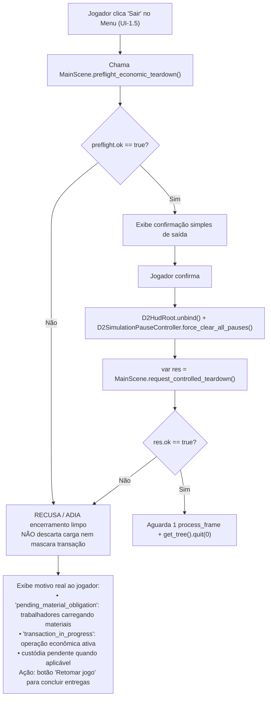

# DAWN OF KIN — UI-1.0 R1
## Revisão Final do Plano Técnico de Integração da Interface D2.2 ("Marcos de Pedra e Eclipse")

> **Status Atual (Reconciliação R-02A — 23/11/2026):** `DECIDIDO / PARCIALMENTE IMPLEMENTADO E HOMOLOGADO` (`UI-1.1A`, `UI-1.1B`, `UI-1.2` e **`UI-1.3 R1`** homologadas até `fix/ui-1-3-r1-validation-uid` @ `c4a6361919564fca59ddbad3362468a0c1b1708e`; `UI-1.4`–`UI-1.7` permanecem **`PLANEJADO` / `BLOQUEADO`** conforme [ROADMAP_MESTRE.md](../ROADMAP_MESTRE.md) e o [Adendo R-02A](#9-adendo-de-reconciliação-canônica-r-02a) abaixo).  
> **Status Histórico Original (`7dbfeb1`):** `PLANO TÉCNICO REVISADO (UI-1.0 R1 — AGUARDANDO ACEITE DO PROPRIETÁRIO)` — preservado integralmente nas Seções 1 a 8 como registro fiel da revisão técnica original.  
> **Escopo Original:** Revisão exclusivamente documental do plano histórico `UI_1_0_INTEGRATION_PLAN.md` ([commit `82934dc`](https://github.com/Julian0s/Dawn-of-Kin/blob/82934dc3410b058c5dfef8c1b1b25bc9aa33cc4c/docs/architecture/UI_1_0_INTEGRATION_PLAN.md) na branch `planning/ui-1-0-integration-plan`), incorporando as **5 correções técnicas obrigatórias (A–E)** e a **revisão das decisões `DT-01` a `DT-06`** levantadas na auditoria independente do ChatGPT.  
> **Referências Imutáveis:**
> - **Identidade Visual Aprovada D2.2:** `design/ui-0-r2-2-d2-visual-fidelity` @ `1ab8ffb78c269f3a659712491de91ab1f317e919`
> - **Design System Homologado Documentalmente:** `design/ui-0-r2-3-2-closeout` @ `cdd9f2f4308a05d822c8f7c72f57c0a07756f0a6` (reconciliado em [DAWN_OF_KIN_VISUAL_DESIGN_SYSTEM.md](../design/DAWN_OF_KIN_VISUAL_DESIGN_SYSTEM.md))
> - **Branch Documental Original desta Revisão:** `planning/ui-1-0-r1-integration-plan` @ `7dbfeb1` (worktree histórico `C:\Projetos\Dawn_of_Kin_wt_ui_1_0_r1_plan`), integrada documentalmente na candidata `R-02A`.

---

## 1. Diagnóstico das 5 Correções Obrigatórias (Auditoria Independente)

A auditoria real do código em `cdd9f2f` (`Select-String process_mode src/**/*.gd`, `main.gd`, `rts_camera_rig.gd`, `economy_clock_controller.gd`, `rts_input_controller.gd`, `construction_hud.gd`) confirmou os 5 riscos apontados:

| Código | Risco Detectado na UI-1.0 (`82934dc`) | Causa Raiz Verificada no Código Real | Solução Definida nesta R1 |
|---|---|---|---|
| **Correção A** | Pausa via `SceneTree.paused` travaria os próprios controles da UI e poderia divergir de `EconomyClockController`. | Em todo `src/`, apenas `RtsCameraRig` (`PROCESS_MODE_ALWAYS`) e `EconomyClockController` + `_timer` (`PROCESS_MODE_PAUSABLE`) definem `process_mode`. `UiLayer` e seus `Control` herdam `PAUSABLE` — ao pausar a árvore, o botão `1×` deixaria de responder! Além disso, `EconomyClockController.is_paused()` combina `get_tree().paused or _time_provider.is_paused()`, criando risco de dupla pausa divergente se ambos forem acionados separadamente. | Introduzir **`D2SimulationPauseController`** (`PROCESS_MODE_ALWAYS`) como **autoridade única** baseada em pilha de motivos (`_pause_reasons`), sincronizada exclusivamente com `SceneTree.paused` + `RtsCameraRig.set_input_locked()`, mantendo apenas controles de pausa/menu em `PROCESS_MODE_ALWAYS` e restaurando tudo em `_exit_tree()`. |
| **Correção B** | `MOUSE_FILTER_STOP` em `TextureRect` retangular bloquearia cliques/scroll/edge-pan nos cantos transparentes e nos `10 px` de sombra (`shadow_pad`). | Todas as peças de `d2_2_faithful_atlas.png` possuem silhuetas poligonais chanfradas + margem transparente de `10 px` (`atlas_manifest.json`). Um retângulo simples intercepta cliques fora da pedra. | Criar **`D2PolygonalSlab`** / **`D2SlabButton`** sobrescrevendo **`Control._has_point(point: Vector2) -> bool`** com **`Geometry2D.is_point_in_polygon(point, _scaled_polygon)`**, alinhado às coordenadas exatas dos polígonos D2.2 + `shadow_pad`, com `mouse_force_pass_scroll_events = false`. |
| **Correção C** | `D2UiEscapeRouter` na UI-1.1 assumiria abertura de Menu Principal que só existirá na UI-1.5. | Sem menu implementado na UI-1.1, consumir `Esc` para um destino inexistente quebraria o comportamento esperado e criaria conflito com `RtsInputController._unhandled_input()`, `PlacementController` e `ConstructionHud._input()`. | Adoção **progressiva por registro de capacidades**: ausente na `UI-1.1A`; introduzido em modo **pass-through** na `UI-1.1B` (só consome `Esc` se houver handler ativo registrado); cada incremento (`UI-1.3`, `UI-1.4`, `UI-1.5`) registra apenas seus próprios painéis reais. |
| **Correção D** | `D2MainMenuMonolith` (UI-1.5) previa `get_tree().quit()` direto, violando os contratos econômicos de `MainScene`. | `main.gd:167–238` define `preflight_economic_teardown()` (que bloqueia se houver `transaction_in_progress`, custódia pendente ou `pending_material_obligation` em trabalhadores carregando carga) e `request_controlled_teardown()`. `get_tree().quit()` ignora o preflight e pode interromper obrigações econômicas. | Redesenhar o fluxo de saída da `UI-1.5` para consultar **`MainScene.preflight_economic_teardown()`** e executar **`MainScene.request_controlled_teardown()`** somente quando `ok == true`, recusando/adiando o encerramento limpo com mensagem honesta ao jogador quando houver transporte ou transação pendente. |
| **Correção E** | `UI-1.1` acumulava fundação visual, assets, tema, escala, pedras, placa, pausa real, câmera e `Esc` num único incremento grande. | Misturar layout/dados com pausa global e alteração em `RtsCameraRig` dificulta diagnóstico e rollback. | Subdividir em **`UI-1.1A` (Fundação Visual e Dados, zero mudança em `RtsCameraRig`/pausa/`Esc`)** e **`UI-1.1B` (Hitboxes Poligonais, Pausa Segura, Proteção de Câmera e `Esc` Router Progressivo)**. |

---

## 2. Arquitetura Ajustada (Correções A, B, C e D)

### 2.1 Arquitetura de Pausa Segura (`Correção A`)

| Componente / Nó | `process_mode` | Comportamento Durante `SceneTree.paused == true` |
|---|---|---|
| `MainScene`, `Units`, `Unit`, `ConstructionSites`, `ConstructionSite`, `RtsInputController`, `PlacementController`, `CommunityTaskDispatcher` | `INHERIT` (`PAUSABLE`) | **Pausados integralmente** — zero movimento, zero extração/transporte, zero montagem de canteiro, zero comandos RTS. |
| `EconomyClockController` + `DecayTickTimer` | `PAUSABLE` (já existente) | **Pausado automaticamente** por `SceneTree.paused`. **Regra estrita:** `D2SimulationPauseController` **NÃO** chama `EconomyClockController.set_paused()` para evitar segundo estado divergente; `EconomyClockController.is_paused()` já retorna `true` via `get_tree().paused`. |
| `RtsCameraRig` | `ALWAYS` (já existente) | Recebe `_camera_rig.set_input_locked(true)` do `D2SimulationPauseController`: zera `_pan_velocity_xz`, cancela `_is_dragging` e bloqueia WASD/Setas, Edge Pan, Wheel Zoom e MMB Drag durante a pausa. |
| `D2SimulationPauseController` | **`ALWAYS`** | **Única autoridade de pausa da UI.** Mantém conjunto de motivos ativos (`_reasons: Dictionary`, ex.: `&"hud_pause"`, `&"modal_menu"`). Define `get_tree().paused = not _reasons.is_empty()` e `_camera_rig.set_input_locked(not _reasons.is_empty())`. Emite `pause_state_changed(is_paused: bool)`. |
| `D2TopPlaqueView` (controles `||` e `1×`) | **`ALWAYS`** | Continua recebendo cliques durante a pausa para permitir clicar em `1×` (ou `||`) e retomar a simulação imediatamente. |
| `D2MainMenuMonolith` & `D2UiEscapeRouter` (`UI-1.5`) | **`ALWAYS`** | Continuam responsivos para fechar menu via `Continuar` ou `Esc`. |
| Demais componentes D2.2 (`D2ResourceRocksView`, `D2FounderStelesView`, `D2ActionSlabsView`, `D2ConstructionDockView`, `D2BuildingInspectorMonolith`, `D2LineageBladeView`, `D2TasksDrawerView`) | `PAUSABLE` | Impede seleção de estelas, início de construção ou ações econômicas enquanto pausado. |

**Garantias contra estados divergentes e erros:**
1. **Idempotência:** `request_pause(&"hud_pause")` repetido não duplica entradas; `release_pause(&"hud_pause")` só despausa a árvore se nenhum outro motivo (ex.: `&"modal_menu"`) estiver ativo.
2. **Restauração garantida:** Em `_exit_tree()`, `unbind()` e erros de inicialização, `D2SimulationPauseController.force_clear_all_pauses()` restaura obrigatoriamente `get_tree().paused = false` e `_camera_rig.set_input_locked(false)` (garantindo zero vazamento de pausa entre cenas ou testes).
3. **Sem confusão com `EconomyClockController.set_paused()`:** Testes automatizados de `EconomyClockController` continuam usando `set_paused()` isoladamente sem interferência; em runtime normal, `EconomyClockController.is_paused()` reflete fielmente `SceneTree.paused`.

### 2.2 Hitboxes Poligonais Compatíveis com a Silhueta D2.2 (`Correção B`)

Para preservar 100% da aparência D2.2 sem criar bloqueios retangulares fantasmas:

```gdscript
# Contrato conceitual de D2PolygonalSlab (estende TextureRect ou Control)
# - _base_polygon: PackedVector2Array em coordenadas do conteúdo (ex.: 84x42 para resource_rock)
# - _pad: float = 10.0 (shadow_pad do atlas_manifest.json)
# - _scaled_polygon: recalculado apenas em _notification(NOTIFICATION_RESIZED) ou set_scale_factor()
func _has_point(point: Vector2) -> bool:
    if _scaled_polygon.size() < 3:
        return Rect2(Vector2.ZERO, size).has_point(point)
    return Geometry2D.is_point_in_polygon(point, _scaled_polygon)
```

- **Polígonos canônicos exatos (do Design System D2.2):**
  - `resource_rock` (`84×42`): `[(6,0), (84,3), (79,42), (0,38)]` + offset `pad = 10`.
  - `top_plaque` (`196×110`): `[(0,4), (98,0), (196,4), (190,110), (6,106)]` + offset `pad = 10`.
  - `founder_stele` (`108×136`) / `raised` (`108×154`): `[(6,6), (108,0), (104,H), (0,0.98*H)]` + offset `pad = 10`.
  - `slab_maquetes_alab` (`176×72`) / `slab_cmd_basalt` (`146×72`): `[(8,0), (W,4), (W-6,72), (0,69)]` + offset `pad = 10`.
  - `d2_2_menu_monolith` (`632×1080`): `[(0,0), (632,0), (468,1080), (0,1080)]` escalado proporcionalmente.
- **Propriedades de entrada obrigatórias:**
  - Peça mineral (`D2PolygonalSlab` / `D2SlabButton`): `mouse_filter = MOUSE_FILTER_STOP`, `mouse_force_pass_scroll_events = false`, `focus_mode = FOCUS_NONE`.
  - Textos, ícones e retratos internos: `mouse_filter = MOUSE_FILTER_IGNORE`.
  - Containers de layout e vãos entre pedras: `mouse_filter = MOUSE_FILTER_IGNORE`.
- **Benefício duplo automático no Edge Pan:** Como `Viewport.gui_get_hovered_control()` respeita `Control._has_point()`, o Edge Pan de `RtsCameraRig` será bloqueado **exclusivamente** quando o ponteiro estiver sobre a rocha sólida, e continuará funcionando normalmente sobre os `10 px` transparentes e na borda livre da janela!

### 2.3 Introdução Gradual do `D2UiEscapeRouter` (`Correção C`)

O roteador de `Esc` usa um registro ordenado por prioridade (`priority: int`, `can_handle: Callable`, `handle: Callable`) e **nunca** chama `get_viewport().set_input_as_handled()` quando nenhum handler registrado responde `true`:

| Etapa | Estado do `D2UiEscapeRouter` (`use_d2_2_hud == true`) | Modo Legado (`use_d2_2_hud == false`) |
|---|---|---|
| **UI-1.1A** | **Não instanciado / inativo.** `Esc` segue 100% o fluxo atual (`ConstructionHud` → `PlacementController` → `RtsInputController`). | Intocado. |
| **UI-1.1B** | **Instanciado em modo pass-through** (0 handlers bloqueantes ativos; estrutura unitariamente testada). Não intercepta `Esc` enquanto nenhum painel D2.2 estiver registrado; se `||` estiver pausado e nenhum modal existir, decisão conservadora: `Esc` não abre menu inexistente. | Desativado / não conectado. |
| **UI-1.3** | Registra handlers reais: (1) fechar Mesa de Maquetes (`priority 30`), (2) `PlacementController.cancel_placement()` (`priority 40`). `ConstructionHud` legado desligado quando `use_d2_2_hud == true`. | Intocado. |
| **UI-1.4** | Registra handler real: fechar `D2BuildingInspectorMonolith` (`priority 50`). | Intocado. |
| **UI-1.5** | Registra handlers reais: (1) fechar Configurações (`priority 10`), (2) fechar Menu/Pausa (`priority 20`), e **somente aqui** o fallback de menor prioridade (`priority 90`): abrir Menu/Pausa quando `not RtsInputController.is_drag_gesture_active()` e `SelectionManager.is_empty()` e nenhum painel contextual estiver aberto. | Intocado. |

### 2.4 Encerramento Econômico Seguro na UI-1.5 (`Correção D` — Planejado, Não Implementado Agora)

O botão `"Sair"` do futuro `D2MainMenuMonolith` (`UI-1.5`) **nunca** chamará `get_tree().quit()` diretamente. O protocolo obrigatório será:



- **Proteção garantida:** Nenhum material em transporte, reserva ou operação econômica ativa é descartado ou mascarado. *(Nota: a eventual inclusão de um botão secundário explícito de "Forçar saída perdendo estado da sessão" fica como decisão opcional futura do proprietário, fora do escopo padrão da `UI-1.5`.)*

---

## 3. Matriz de Decisões Técnicas (`DT-01` a `DT-06`)

> **Registro Histórico + Estado Atualizado na R-02A:** Na revisão original `7dbfeb1`, todas as seis decisões encontravam-se `PENDENTE DE ACEITE`. Elas foram aprovadas pelo proprietário antes da abertura da `UI-1.1A` e executadas nas entregas homologadas `UI-1.1A`–`UI-1.3 R1` (com ressalvas remanescentes explicitadas na última coluna e na Seção 9).

| ID | Decisão | Proposta Revisada com Ressalvas da Auditoria | Estado Atual (R-02A) |
|---|---|---|---|
| **DT-01** | **Base Git da `UI-1`** | Derivar `feat/ui-1-1a-d2-visual-foundation` de **`design/ui-0-r2-3-2-closeout` (`cdd9f2f`)**. Topologia Git validada: `0` diffs de código entre `feat/rux-2b-multi-source-selection` (`cddd582`) e `cdd9f2f`. | **`DECIDIDO` / `HOMOLOGADO`** (executado em `UI-1.1A`..`UI-1.3 R1`) |
| **DT-02** | **Assets Runtime** | Copiar bit-a-bit os 9 assets de `docs/design/ui-0-r2-2/assets/` para `res://assets/ui/d2/` para importação Godot limpa (`.import` fora de `docs/`), **sem modificar os originais** e **mantendo integralmente as ressalvas de procedência/licença** da Seção 6.1 do Design System. | **`DECIDIDO` / `HOMOLOGADO`** (`UI-1.1A`; ressalvas jurídicas mantidas) |
| **DT-03** | **Tipografia** | Usar `SystemFont` nativo como solução **provisória** na `UI-1.1A`–`UI-1.3` (sem redistribuir fontes proprietárias), **sujeito à validação visual de aparência** em `720p`/`1080p` e à posterior definição de fontes abertas com licença verificada (SIL OFL) antes de qualquer build distribuível. | **`DECIDIDO` (provisório)** / **`ABERTO`** para empacotamento comercial |
| **DT-04** | **Nomes nas Estelas (`UI-1.2`)** | Preservar leitura dinâmica de `CharacterDefinition.display_name` (`"Leader A"` / `"Leader B"` hoje), mantendo 100% dos testes existentes intactos; nenhuma alteração em `.tres` sem autorização explícita. | **`DECIDIDO` / `HOMOLOGADO`** (`UI-1.2`) |
| **DT-05** | **Placa Superior (`UI-1.1A` / `UI-1.1B`)** | Exibir `"Clareira Inicial"` + exposição real (`HudFormatter`) na `UI-1.1A`; ativar **Pausa real (`||`) + `1×`** via `D2SimulationPauseController` na `UI-1.1B`. **Sem estações simuladas (`T4`) e sem multiplicadores `2×`/`4×` não validados.** | **`DECIDIDO` / `HOMOLOGADO`** (`UI-1.1A`/`UI-1.1B`) |
| **DT-06** | **Comportamento Final de `Esc`** | `D2UiEscapeRouter` assume cada ação **somente quando o respectivo painel existir**; a abertura do Menu/Pausa com tudo fechado e seleção vazia entra **exclusivamente na `UI-1.5`**. | **`DECIDIDO`** (`UI-1.1B`/`UI-1.3 R1` homologadas; `UI-1.4`/`UI-1.5` `PLANEJADO`) |

---

## 4. Primeiro Incremento Subdividido (`UI-1.1A` e `UI-1.1B`) — Correção E

> *(Registro histórico preservado da estrutura de `UI-1.1A` e `UI-1.1B`, ambas já concluídas e ancestrais diretas de `UI-1.3 R1` @ `c4a6361`. Ver Seção 9 para o roteiro reconciliado de `UI-1.4` a `UI-1.7` após `D-ERR-1 B` e `D-ERR-2 C`.)*

### 4.1 Subincremento `UI-1.1A` — Fundação Visual e Dados (`HOMOLOGADO`)
- **Objetivo:** Provar a fidelidade visual D2.2, o carregamento de assets/tema/escala responsiva (`720p`/`1080p`), o modo dual (`use_d2_2_hud`) e o sincronismo reativo por sinais (`SettlementInventory` + `HudFormatter`) sem tocar em `RtsCameraRig`, `RtsInputController`, `SceneTree.paused` nem `Esc`.
- **Componentes:** Cópia runtime bit-a-bit em `res://assets/ui/d2/`; `D2Tokens`, `D2AtlasLibrary`, `D2ThemeFactory` (`SystemFont`), `D2ScaleController`, `D2HudRoot`, `D2ResourceRocksView` e `D2TopPlaqueView` (modo informativo).
- **Mudança em produção existente:** `src/main/main.gd` (`@export var use_d2_2_hud: bool = false`, instanciação condicional de `D2HudRoot` e deslocamento do `DebugOverlay`). `main.tscn` manteve `use_d2_2_hud = false`.

### 4.2 Subincremento `UI-1.1B` — Hitboxes Poligonais, Pausa Segura, Proteção de Câmera e `Esc` Router Progressivo (`HOMOLOGADO`)
- **Objetivo:** Adicionar interação poligonal exata, pausa/retomada real segura com trava de câmera, proteção de Edge Pan sobre peças sólidas e base pass-through do `D2UiEscapeRouter`.
- **Componentes:** `D2PolygonalSlab`, `D2SlabButton`, `D2SimulationPauseController`, ativação interativa de `||`/`1×` em `D2TopPlaqueView` (`PROCESS_MODE_ALWAYS`), `D2UiEscapeRouter` pass-through e `set_input_locked(bool)` + checagem `gui_get_hovered_control()` em `src/camera/rts_camera_rig.gd`.

---

## 5. Testes Exigidos (`UI-1.1B` — Histórico Verificado e Preservado na Regressão)

### 5.1 Suíte de Hitboxes Poligonais e Proteção de Entrada (`tests/integration/test_ui_1_1b_hitboxes_and_pause.gd`)
1. **Clique esquerdo na pedra** (ponto interno ao polígono) → consumido pela UI; não altera `SelectionManager` nem inicia box-select.
2. **Clique direito na pedra** (ponto interno ao polígono) → consumido pela UI; unidade selecionada **não** recebe `MoveOrder` nem `GatherResourceOrder`.
3. **Clique sobre canto transparente / margem de sombra `10 px`** → `_has_point()` retorna `false`; evento passa normalmente ao mundo 3D.
4. **Clique no vão entre as pedras escalonadas** → passa normalmente ao mundo 3D.
5. **Scroll (roda do mouse) sobre pedra ou placa** → consumido (`mouse_force_pass_scroll_events = false`); `RtsCameraRig.get_target_zoom_distance()` permanece inalterado.
6. **Scroll e Edge Pan na borda real livre da janela** → funcionam normalmente (zoom altera distância; ponteiro na borda livre move foco da câmera), enquanto ponteiro sobre peça sólida junto à borda **não** dispara Edge Pan.
7. **Zero vazamento de comando RTS** por áreas sólidas em `1280×720` e `1920×1080`.

### 5.2 Suíte de Pausa Segura e Integridade Econômica (`test_ui_1_1b_hitboxes_and_pause.gd`)
1. **Pausa e retomada repetidas (`||` → `1×` → `||` → `1×`)**: `SceneTree.paused`, `EconomyClockController.is_paused()`, `D2SimulationPauseController.is_paused()` e `RtsCameraRig` permanecem 100% sincronizados.
2. **Responsividade durante a pausa:** Com `get_tree().paused == true`, clicar em `1×` na `D2TopPlaqueView` retoma a simulação normalmente (`PROCESS_MODE_ALWAYS`).
3. **Câmera travada na pausa:** WASD/Setas, Edge Pan, Wheel Zoom e MMB Drag produzem deslocamento `0,0` enquanto pausado, voltando a responder após `1×`.
4. **Pausa com transporte e construção ativos:** Pausar no meio de coleta/construção, aguardar múltiplos frames reais, retomar com `1×` e comprovar conclusão íntegra com **conservação exata de materiais**.
5. **Restauração em saída de cena:** Remover/destruir `MainScene` enquanto pausada restaura `get_tree().paused == false` sem contaminar testes seguintes.
6. **Roteador `Esc` pass-through na `UI-1.1B`:** `Esc` continua cancelando seleção/drag/posicionamento normalmente sem ser engolido para menu inexistente; modo legado (`use_d2_2_hud = false`) 100% idêntico.

---

## 6. Riscos Residuais

| Risco Residual | Gravidade | Mitigação / Controle |
|---|---|---|
| **Aparência de `SystemFont` em máquinas sem `Palatino Linotype`/`Segoe UI`** | Média | Validado visualmente em `UI-1.1A`–`UI-1.3 R1` no ambiente atual; manter definição de pacote de fontes abertas SIL OFL (`DT-03`) antes de builds externos. |
| **Precisão de `_has_point()` após resize dinâmico `720p ↔ 1080p`** | Média | Recalcular `_scaled_polygon` em `NOTIFICATION_RESIZED` + teste automatizado de hitbox antes e depois de resize. |
| **Conflito de foco de teclado em botões Godot** | Baixa | Impor `focus_mode = Control.FOCUS_NONE` em todos os botões D2.2 para impedir que `Space`/`Enter` reativem botões acidentalmente durante comandos RTS. |
| **Encerramento forçado pelo botão `[X]` da janela do SO (`NOTIFICATION_WM_CLOSE_REQUEST`)** | Média | Documentado para a `UI-1.5` (`R-06A`): avaliar interceptação de `WM_CLOSE_REQUEST` apenas na `UI-1.5` para aplicar o mesmo preflight de `Correção D` sem bloquear fechamento em testes headless. |
| **Ressalva jurídica dos 6 assets base gerados por IA** | Documental | Preservada integralmente; `D2AtlasLibrary` isola caminhos para substituição futura sem impacto de código. |

---

## 7. Lista de Arquivos de `UI-1.1A` e `UI-1.1B` (Referência Histórica Implementada)

- **Assets runtime em `res://assets/ui/d2/` (`UI-1.1A`):** `d2_2_faithful_atlas.png`, `d2_2_menu_monolith.png`, `atlas_manifest.json`, `portrait_alden.jpg`, `portrait_brena.jpg`, `emblem_dawn_of_kin.png`, `d1_shelter_mini.png`, `d1_depot_mini.png`, `d2_kintsugi_basalt.png`.
- **Código `UI-1.1A`:** `src/ui/d2/d2_tokens.gd`, `d2_atlas_library.gd`, `d2_theme_factory.gd`, `d2_scale_controller.gd`, `d2_hud_root.gd`, `components/d2_resource_rocks_view.gd`, `components/d2_top_plaque_view.gd`, integração condicional em `src/main/main.gd`, cena `tests/visual/ui_1_d2_2_sandbox.tscn`, suítes `test_ui_1_1a_*`.
- **Código `UI-1.1B`:** `components/d2_polygonal_slab.gd`, `components/d2_slab_button.gd`, `d2_simulation_pause_controller.gd`, `d2_ui_escape_router.gd`, `set_input_locked()` em `src/camera/rts_camera_rig.gd`, suítes `test_ui_1_1b_*`.
- **Extensões já entregues até `UI-1.3 R1` (`c4a6361`):** `D2FounderStelesView` (`UI-1.2`), `D2ActionSlabsView`, `D2ConstructionDockView`, `D2PlacementStatusBar` (`UI-1.3`) e `.gdignore` nos 3 showcases históricos (`UI-1.3 R1`).

---

## 8. Critérios de Aceite e Parada (Preservados para Todo Incremento UI-1)

1. `.\tools\validate.ps1` com `0` erros e `0` avisos.
2. `.\tools\run_tests.ps1 -Segmented -MaxIntegrationPerGroup 1` com 100% das suítes verdes e sem regressões.
3. Conformidade visual D2.2 (VCG) em `1280×720` e `1920×1080` sem cortes, colisões ou click-through.
4. Validação manual guiada na Godot 4.7.2 + auditoria independente + aceite expresso do proprietário com parada obrigatória após cada incremento.

---

## 9. Adendo de Reconciliação Canônica (R-02A)

Este adendo sincroniza integralmente a série `UI-1` com o estado real verificado em **23/11/2026**, com as decisões **D-01 a D-13**, **P-REC-1 a P-REC-4**, **D-ERR-1 B** e **D-ERR-2 C**, e com o [ROADMAP_MESTRE.md](../ROADMAP_MESTRE.md).

### 9.1 Estado Real da Série `UI-1` em 23/11/2026

| Incremento | Estado Atual | Referência / Evidência |
|---|---|---|
| **UI-1.1A** | **`HOMOLOGADO` *(não integrado à `main`)*** | Fundação visual, assets runtime `res://assets/ui/d2/`, pedras de recursos e placa superior (`a02aa97`, ancestral de `c4a6361`). |
| **UI-1.1B** | **`HOMOLOGADO` *(não integrado à `main`)*** | Hitboxes poligonais (`_has_point`), `D2SimulationPauseController`, trava de câmera e `D2UiEscapeRouter` pass-through (`a6542ca`, ancestral de `c4a6361`). |
| **UI-1.2** | **`HOMOLOGADO` *(não integrado à `main`)*** | `D2FounderStelesView` e estrutura inicial de `D2LineageBladeView` no canto inferior esquerdo (`9f84d33`, ancestral de `c4a6361`). |
| **UI-1.3 + R1 (`R-01`)** | **`HOMOLOGADO` *(não integrado à `main`)*** (23/11/2026) | `D2ActionSlabsView`, `D2ConstructionDockView`, `D2PlacementStatusBar`, integração `PlacementController`/`D2UiEscapeRouter` + 3 `.gdignore` em `docs/design/ui-0-r2*/godot_showcase/` (`fix/ui-1-3-r1-validation-uid` @ `c4a6361919564fca59ddbad3362468a0c1b1708e`: `0` erros / `0` avisos em `validate.ps1`, `85/85` suítes / `592/592` testes / `28.989` asserções na regressão histórica da R1, `8/8` itens manuais aprovados em `720p` e `1080p`). `main.tscn` preserva `use_d2_2_hud = false`. |
| **UI-1.4 (`R-05A`)** | **`PLANEJADO` / `BLOQUEADO`** | Aguarda `R-02A`, `R-02B`, `R-03A`–`R-03D` e `R-04A`–`R-04C`. |
| **Transição `R-05B` (`D-ERR-1 B`)** | **`DECIDIDO` / `PLANEJADO`** | Ativação controlada de `use_d2_2_hud = true` na `MainScene` imediatamente após homologação da `UI-1.4`. |
| **UI-1.5 (`R-06A`)** | **`PLANEJADO` / `BLOQUEADO`** | Reposicionada **após `T3.7` e `T3.8`** (`D-ERR-2 C`) para integrar salvamento/carregamento real. |
| **UI-1.6 (`R-06B`)** | **`PLANEJADO` / `BLOQUEADO`** | Lajes `[T]` e `[H]`, integração final da lista flutuante de tarefas (`D-11`) e convivência com `DebugOverlay`. |
| **UI-1.7 (`R-07`)** | **`PLANEJADO` / `BLOQUEADO`** | Redefinida por `D-ERR-1 B` como encerramento definitivo da HUD D2.2, retirada controlada de legados e benchmark. |

### 9.2 Reconciliação Textual da `D2PlacementStatusBar` (`UI-1.3 R1`)
- No Design System histórico `R2.3.2` (Componente 07, `build_valid_bar`), a faixa de validação foi documentada no centro inferior (`y = 994 px` em `1080p`).
- Durante a implementação e homologação da `UI-1.3` / `UI-1.3 R1` (`c4a6361`), a `D2PlacementStatusBar` foi ancorada no **centro superior (`y = 24 * s`)** para evitar sobreposição com a `D2ConstructionDockView` no canto inferior direito em `1280×720` e `1920×1080`, preservando integralmente a textura do atlas `build_valid_bar`, a silhueta chanfrada em basalto, o filete dourado kintsugi, a barra lateral de status e os tokens cromáticos D2.2.
- Esse posicionamento foi **testado manualmente e aprovado (`8/8`) pelo proprietário** em ambas as resoluções e passa a vigorar como referência canônica da `UI-1.3 R1` (registrado também em [DAWN_OF_KIN_VISUAL_DESIGN_SYSTEM.md](../design/DAWN_OF_KIN_VISUAL_DESIGN_SYSTEM.md)).

### 9.3 Roteiro Reconciliado de `UI-1.4` a `UI-1.7` (`D-ERR-1 B` e `D-ERR-2 C`)

1. **`R-05A / UI-1.4` — Inspetor de Canteiro e Edifício D2.2 (`D2BuildingInspectorMonolith`):**
   - Implementado **após `R-04A`–`R-04C`**, já alinhado integralmente ao **novo contrato de construção canônico** (`D-01`, `D-02`, `D-13`, `P-REC-1`, `P-REC-2`): exibe progresso de montagem, construtores atribuídos, prioridade e cancelamento com prévia de **reembolso `R2 simples` direto ao estoque (`100%` dos recursos pagos quando `p = 0`; `floor(Q_pago × (1 − p))` quando `0 < p ≤ 1`, sem multiplicador adicional `η = 0,50`, com destino prioritário depósito protegido com capacidade disponível → pilhas válidas e preservação de exposição sem rejuvenescer recursos)**.
   - **Não** expõe controles do contrato antigo aposentado em `R-04C` (complementação manual `DEC-11B`, fila de suprimento físico de obra ou recuperação física de sobras `D3-04`/`D3-07`).
   - Registra handler `priority 50` no `D2UiEscapeRouter`.
2. **`R-05B` — Transição Autorizada da HUD D2.2 na `MainScene` (`D-ERR-1 B`):**
   - Incremento curto e dedicado que ativa **`use_d2_2_hud = true` por padrão em `main.tscn`** após homologação da `UI-1.4`.
   - Mantém comandos ainda não implementados de `UI-1.5` (Menu/Salvar/Carregar/Configurações) e `UI-1.6` (lajes `[T]`/`[H]` finais) **honestamente indisponíveis**, sem placeholders falsos.
   - Preserva compatibilidade com testes legados (`use_d2_2_hud = false` onde aplicável até `R-07`).
3. **`T3.7` (Depósito Rústico) → `T3.8` (Persistência, Salvamento e Carregamento):**
   - Executadas **antes da `UI-1.5`** (`D-ERR-2 C`) para que a UI de menu já nasça conectada ao sistema real de salvamento/carregamento e ao estoque protegido real (eliminando botões simulados).
4. **`R-06A / UI-1.5` — Menu Principal, Pausa, Configurações e Save/Load Real:**
   - Implementa `D2MainMenuMonolith` (`d2_2_menu_monolith.png`), tela de Configurações D2.2, fallback final do `D2UiEscapeRouter` (`priority 90`), protocolo de encerramento econômico seguro (`Correção D`) e integração direta com o `SaveManager` real da `T3.8`.
5. **`R-06B / UI-1.6` — Tarefas `[T]`, Linhagem `[H]`, Lista de Tarefas (`D-11`) e Coexistência com Debug:**
   - Ativa as lajes `[T]` e `[H]` conectadas à Casa Fundadora (`D-04`/`D-05`/`D-10`, sem simular genealogia `T5`), realiza a integração final D2.2 da lista flutuante de tarefas comunitárias (`D-11`, nascida funcionalmente em `R-03D`) e garante convivência definitiva sem sobreposição com o `DebugOverlay`.
6. **`R-07 / UI-1.7` — Encerramento Definitivo da HUD D2.2, Retirada de Legados e Benchmark:**
   - Redefinida por `D-ERR-1 B`: deixa de ser a primeira ativação da HUD D2.2 e passa a cobrir a **retirada controlada dos componentes legados**, revisão integral de acessibilidade/VCG (`1280×720` e `1920×1080`), verificação de tipografia aberta (`DT-03` quando aplicável) e benchmark gráfico formal (`1920×1080`, Intel UHD 620, CA).
