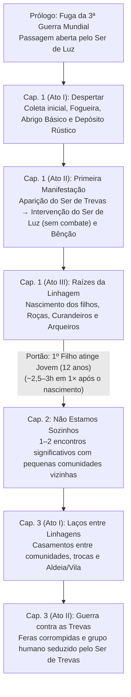

# DAWN OF KIN — GLOBAL VISION, DESIGN & ARCHITECTURE AUDIT (R1)

**Identificação da Revisão:** **GLOBAL-VISION-AUDIT-R1** (Revisão pós-auditoria independente do ChatGPT)
**Documento:** Relatório Estratégico de Auditoria Global, Visão Criativa, Game Design, Narrativa e Arquitetura (`PROPOSAL`)
**Repositório:** `https://github.com/Julian0s/Dawn-of-Kin`
**Base Oficial Auditada (`origin/main`):** `3c6fc0bd36fc3828af5a89662fb23cfb60d37865` (Tag oficial `t3-3-complete`)
**Branch de Planejamento Auditada (`planning/t3-4-architecture`):** `6ac2c5102e71623224dbd5f1e69bedd0d90bfc45` (`T3.4-ARCHITECTURE-R1`)
**Branch de Publicação desta Auditoria:** `audit/global-vision-and-design`
**Worktree Isolado:** `C:\Projetos\Dawn_of_Kin_wt_global_audit`
**Engine e Ambiente:** Godot `4.7.2.stable` (`gl_compatibility`, `Jolt Physics`)
**Data da Revisão R1:** 16 de novembro de 2026

> **Regra de Governança:** Este documento consolida a **Auditoria Global do Repositório** e o registro rastreável da **Entrevista Estratégica (`/grill-me`)** realizada em 16/11/2026. Nenhuma alteração foi feita em código GDScript, cenas `.tscn`, recursos `.tres`, testes ou documentos normativos existentes (`AGENTS.md`, `docs/Dawn_of_Kin_GDD_v1.0.md`, `docs/Dawn_of_Kin_GDD_v1.1.md`, `docs/architecture/T3_4_implementation_plan_PROPOSAL.md`). Este relatório destina-se à auditoria independente do ChatGPT; somente após essa revisão e autorização expressa em prompt futuro os GDDs e documentos de arquitetura deverão ser atualizados. A etapa **T3.4** e todas as etapas subsequentes permanecem **estritamente bloqueadas** para implementação.

---

## Legenda da Hierarquia das Fontes

Cada afirmação, decisão e diagnóstico neste relatório obedece à seguinte classificação rigorosa:

- **DECIDIDO:** Escolha expressamente aprovada e verificável pelo proprietário (nos documentos normativos/aceites anteriores ou com confirmação direta registrada na entrevista `/grill-me`).
- **IMPLEMENTADO:** Comportamento confirmado diretamente na inspeção do código GDScript, cenas `.tscn` e recursos `.tres` na base `3c6fc0b`.
- **VALIDADO:** Comportamento testado com evidências documentadas no repositório (protocolos manuais aprovados pelo proprietário, telemetria JSON/JSONL, capturas `.png` e relatórios históricos de suítes automatizadas).
- **PROPOSTA:** Ideia técnica, estimativa ou sugestão de design sem aprovação formal fechada.
- **ABERTO:** Questão que permanece intencionalmente sem definição final, aguardando deliberação futura ou calibração empírica.
- **PENDENTE DE RATIFICAÇÃO:** Escolha preliminar ou ponto misto cuja compreensão e aprovação explícita do proprietário ainda precisam ser confirmadas antes de virar norma.
- **CONFLITANTE:** Divergência comprovada entre documentos distintos ou entre documentação e código/recursos reais.
- **INFERÊNCIA:** Conclusão analítica derivada pela auditoria a partir do cruzamento das fontes, sujeita a confirmação.

---

## 1. Inventário da Auditoria

### 1.1 Estado Git, Branches, Tags e Worktrees Verificados

A inspeção direta do Git confirmou a seguinte topologia preservada:

| Referência / Worktree | Commit SHA | Branch / Tag | Estado Verificado |
|---|---|---|---|
| `origin/main` | `3c6fc0bd36fc3828af5a89662fb23cfb60d37865` | `main` | Homologação formal da T3.3 integrada via fast-forward. |
| Tag `t1-complete` | `2808799c43b815cf876144807f41f92902bc2983` | `t1-complete` | Marco T1 — Fundação RTS concluído. |
| Tag `t2-complete` | `f7c24592e3a6d936dbcb63f648c474280695ab9b` | `t2-complete` | Marco T2 — Trabalho e Recursos concluído. |
| Tag `t3-3-complete` | `3c6fc0bd36fc3828af5a89662fb23cfb60d37865` | `t3-3-complete` | Etapa T3.3 — Canteiro e Suprimento Físico concluída. |
| `C:/Projetos/Dawn of Kin` | `729390832883587180e3df89193522a72f27299d` | `review/t2-closeout-candidate` | Worktree histórico preservado intacto. |
| `C:/Projetos/Dawn_of_Kin_wt_t2_closeout` | `f7c24592e3a6d936dbcb63f648c474280695ab9b` | `main` (local) | Worktree histórico da T2 preservado intacto. |
| `C:/Projetos/Dawn_of_Kin_wt_t3_1_reservations` | `ceb3f7194a750e66dbf73ebb0b0a7460d51eb87f` | `feature/t3-1-reservations` | Worktree da T3.1 preservado intacto. |
| `C:/Projetos/Dawn_of_Kin_wt_t3_2_placement` | `931ad196346251e3f24a3ea5db6facb3641233bc` | `feature/t3-2-placement` | Worktree da T3.2 preservado intacto. |
| `C:/Projetos/Dawn_of_Kin_wt_t3_3_construction` | `3c6fc0bd36fc3828af5a89662fb23cfb60d37865` | `feature/t3-3-construction-logistics` | Worktree da T3.3 homologada preservado intacto. |
| `C:/Projetos/Dawn_of_Kin_wt_t3_4_plan` | `6ac2c5102e71623224dbd5f1e69bedd0d90bfc45` | `planning/t3-4-architecture` | Contém `T3.4-ARCHITECTURE-R1`. Confirmado que `T3.4-R2` não foi publicada. |
| `C:/Projetos/Dawn_of_Kin_wt_t3_arch` | `640a2cdb088608353eeb3b9bd950ddb9d1577717` | `docs/t3-architecture-review` | Worktree histórico de arquitetura T3 preservado. |
| `C:/Projetos/Dawn_of_Kin_wt_global_audit` | Base `3c6fc0b` / R0 `c14771c` | `audit/global-vision-and-design` | Worktree isolado dedicado exclusivamente a este relatório. |

### 1.2 Documentação, Código, Dados e Evidências Auditados

1. **Governança e Design:**
   - [AGENTS.md](../../AGENTS.md), [README.md](../../README.md), [project.godot](../../project.godot).
   - [docs/Dawn_of_Kin_GDD_v1.0.md](../Dawn_of_Kin_GDD_v1.0.md) (única fonte normativa vigente do design).
   - [docs/Dawn_of_Kin_GDD_v1.1.md](../Dawn_of_Kin_GDD_v1.1.md) (minuta consolidada não promovida de 14/11/2026).
   - [docs/KNOWN_ISSUES.md](../KNOWN_ISSUES.md).
2. **Arquitetura e Planos:**
   - [docs/architecture/T1_architecture.md](../architecture/T1_architecture.md), [docs/T1_Implementation_Plan.md](../T1_Implementation_Plan.md).
   - [docs/architecture/T2_architecture_DRAFT.md](../architecture/T2_architecture_DRAFT.md), [docs/T2_Implementation_Plan_DRAFT.md](../T2_Implementation_Plan_DRAFT.md).
   - [docs/architecture/T3_architecture_PROPOSAL.md](../architecture/T3_architecture_PROPOSAL.md).
   - `docs/architecture/T3_4_implementation_plan_PROPOSAL.md` (examinado na branch `planning/t3-4-architecture`, commit `6ac2c51`).
3. **Homologações, Revisões e Protocolos de Teste:**
   - [docs/reviews/T2_Closeout_CANDIDATE.md](../reviews/T2_Closeout_CANDIDATE.md), [docs/reviews/T2_Closeout_ACCEPTANCE.md](../reviews/T2_Closeout_ACCEPTANCE.md), [docs/reviews/T2_6_D2_performance_DRAFT.md](../reviews/T2_6_D2_performance_DRAFT.md), [docs/reviews/T2_6_B1_speed_alignment_DRAFT.md](../reviews/T2_6_B1_speed_alignment_DRAFT.md), [docs/reviews/T2_6_B1_1_performance_DRAFT.md](../reviews/T2_6_B1_1_performance_DRAFT.md).
   - [docs/testing/T1_manual_test_protocol.md](../testing/T1_manual_test_protocol.md), [docs/testing/T2_manual_test_protocol.md](../testing/T2_manual_test_protocol.md).
   - [docs/testing/T3_1_closeout.md](../testing/T3_1_closeout.md), [docs/testing/T3_2_closeout.md](../testing/T3_2_closeout.md), [docs/testing/T3_2_manual_test_protocol.md](../testing/T3_2_manual_test_protocol.md), [docs/testing/T3_2_technical_notes.md](../testing/T3_2_technical_notes.md).
   - [docs/testing/T3_3_closeout_CANDIDATE.md](../testing/T3_3_closeout_CANDIDATE.md), [docs/testing/T3_3_closeout_ACCEPTANCE.md](../testing/T3_3_closeout_ACCEPTANCE.md), [docs/testing/T3_3_manual_test_protocol.md](../testing/T3_3_manual_test_protocol.md), [docs/testing/T3_3_technical_notes.md](../testing/T3_3_technical_notes.md), [docs/testing/T3_3_R2_plateau_navigation_diagnostic.md](../testing/T3_3_R2_plateau_navigation_diagnostic.md), [docs/testing/T3_3_UX_technical_notes.md](../testing/T3_3_UX_technical_notes.md).
4. **Código-Fonte GDScript (`src/`), Cenas (`levels/`, `src/`) e Dados (`data/`, `assets/`):**
   - **50 scripts GDScript** em `src/` (`camera`, `core`, `rts`, `navigation`, `units`, `units/orders`, `economy`, `buildings`, `ui`, `main`).
   - **10 cenas `.tscn`** (`main.tscn`, `test_map.tscn`, `rts_camera_rig.tscn`, `unit.tscn`, `selection_indicator.tscn`, `destination_marker.tscn`, `tree_source.tscn`, `rock_source.tscn`, `bush_source.tscn` e cenas de UI).
   - **10 arquivos `.tres` de dados** em `data/` e **14 assets provisórios** em `assets/placeholder/`.
   - **36 scripts de teste** em `tests/` e **5 scripts PowerShell** em `tools/`.
5. **Inventário de Binários e Evidências:**
   - `docs/testing/evidence/t3_3_r2_plateau/`: 46 capturas `.png` (`1280×720` e `1920×1080`) e 8 arquivos `.json`/`.jsonl`.
   - `docs/testing/evidence/t3_3_ux/`: 14 capturas `.png` (`1280×720` e `1920×1080`) e 4 arquivos `.json`/`.jsonl`.
   - `docs/reviews/evidence/`: 15 relatórios JSON de benchmarks históricos da T1 e T2 (`1920×1080`).

### 1.3 Cronologia Reconstruída do Desenvolvimento

1. **T1 — Fundação RTS (`2808799`, tag `t1-complete`):** Câmera isométrica (`RtsCameraRig`), seleção individual e por caixa (`SelectionManager`, `WorldPicker`), movimentação em grupo (`GroupMovePlanner`), navegação (`WorldNavigation`) e RVO (`UnitMovement`).
2. **T2 — Trabalho e Recursos (`f7c2459`, tag `t2-complete`, homologada em 14/11/2026):** Recursos com peso (`wood=2`, `stone=3`, `food=1`), capacidade (`20`), extração em `ResourceSource`, transporte com desaceleração proporcional (ajuste `B1`: `4,8 m/s` sem carga), pilhas na `CampStorageZone` (`GroundPileManager`), deterioração (`EconomyClockController`) e HUD não bloqueante.
3. **T3.0 — Arquitetura da Construção (`640a2cd`):** Decisões D1 a D9, fórmulas contábeis, parâmetros provisórios e política de deterioração direta sobre reservas (Alternativa B).
4. **T3.1 — Contabilidade, Reservas e Saque em Lote (`ceb3f71`, integrada em 15/11/2026):** `PileReservationLedger`, `reserve_batch`, `release_batch`, `withdraw_reserved` e perda direta no decaimento.
5. **T3.2 — Validação Espacial, Área Reservada e Prévia sem Grid (`931ad19`, integrada em 15/11/2026):** `PlacementValidator`, `PlacementPreview` sem grid, exclusão da `CampStorageZone` (D6), cache estático e bake candidato assíncrono em worker thread.
6. **T3.3 — Canteiro de Obra e Suprimento Físico (`3c6fc0b`, tag `t3-3-complete`, homologada em 16/11/2026):** `ConstructionSite`, `ConstructionManager`, `BuildSlotPlanner`, `ConstructOrder` (transporte e standby), correções de `_transit_claims` (T3.3-R1), *curbs* laterais na rampa do platô (T3.3-R2), seletor dinâmico de resolução e trabalhadores temporários de teste (T3.3-UX).
7. **Planejamento T3.4 (`6ac2c51` em `planning/t3-4-architecture`):** Plano técnico revisado em `T3.4-ARCHITECTURE-R1`. Nenhuma implementação T3.4 foi iniciada e `T3.4-R2` não foi publicada.

### 1.4 Limitações da Investigação nesta Sessão

- Conforme as diretrizes desta auditoria, **nenhum teste automatizado ou binário da Godot foi executado nesta sessão**; todas as métricas de testes (`234/234` na T3.3, `182/182` na T2) e benchmarks de FPS/frametime citados referem-se exclusivamente aos registros históricos documentados no repositório.

---

## 2. Visão Consolidada do Jogo

### 2.1 Identidade Central e Fantasia do Jogador

*Dawn of Kin* («Aurora da Linhagem») é um jogo single-player 3D isométrico que combina **sobrevivência familiar**, **construção orgânica de assentamento**, **RTS acessível** e uma **jornada mítica de reconstrução da humanidade sob o conflito entre Luz e Sombra Primordial**.

- **Diferencial Central (`DECIDIDO`):** O jogador parte de **um único casal identificável e personalizável**, salvo do colapso da Terceira Guerra Mundial. Os novos moradores do Capítulo 1 nascem desse casal, recebem nome e sobrenome familiar, herdam traços visuais dos pais, atravessam **Bebê → Criança → Jovem → Adulto**, assumem profissões/vocações e, nos capítulos seguintes, encontram outras comunidades sobreviventes para formar novas famílias e combater um mal primordial.

### 2.2 Os Cinco Pilares Consolidados

1. **Linhagem Viva e Identidade Persistente (`DECIDIDO`):** Habitantes com ID estável, nome próprio, sobrenome da linhagem, genealogia rastreável (impedindo consanguinidade até primos de 1º grau), herança visual e residência própria ao casar.
2. **Economia Física sem Microgestão Burocrática (`DECIDIDO`):** Transporte físico real com peso e armazenamento válido, sem crédito instantâneo, sem barras individuais de fome/sede e sem salários/dinheiro interno entre familiares.
3. **Comando RTS Soberano + Autonomia por Profissão (`DECIDIDO`):** Clique direito manual tem prioridade máxima, aliado à busca automática da próxima fonte próxima quando uma se esgota e à execução autônoma de profissões quando ociosos (`JobSystem`).
4. **Natureza Vibrante em Contraste com o Mistério Sombrio (`DECIDIDO`):** Estética 3D estilizada vibrante naturalista (com brotação orgânica de árvores em solo livre) contrastada pela presença opressiva do Ser de Trevas e de feras corrompidas.
5. **Escala Regional Sustentável para Hardware Modesto (`DECIDIDO`):** Regiões conectadas por passagens (estilo *Ragnarok/Albion*), com obrigação contínua de medição empírica de desempenho na GPU de referência (**Intel UHD Graphics 620**, `1920×1080`, `gl_compatibility`, CA).

---

## 3. História e Universo Consolidados

### 3.1 Cosmologia e Espinha Dorsal Mítica (`DECIDIDO` — `[DEC-05]`, `[DEC-06]`, `[DEC-07]`)

Preservando integralmente a premissa do GDD normativo (`docs/Dawn_of_Kin_GDD_v1.0.md` §2 L24: o destino é **"uma versão da Terra"**, sem fixar viagem no tempo, universos paralelos ou afirmar tratar-se do planeta original), a entrevista registrou as seguintes definições autorais:

1. **O Mal Primordial (O Ser de Trevas):**
   - Há milhares de anos, antes de existir vida nessa versão da Terra, uma entidade maligna primordial (inspirada na presença psicológica e sombria de *It: A Coisa* / uma figura análoga a Satanás, **cujo nome ninguém conhece**) instalou-se nesse mundo.
   - Esse ser corrompe parte da fauna local, tornando esses animais mais fortes e **irradiando trevas**, coexistindo com animais naturais normais, e também é capaz de seduzir corações humanos vulneráveis.
2. **O Resgate e a Missão (O Ser de Luz):**
   - Em meio às explosões nucleares da Terceira Guerra Mundial, **O Ser de Luz** (sem explicação expositiva de *"Quem é Ele"*, preservando o mistério sagrado) abre a passagem espacial para salvar escolhidos com a missão de **repovoar a terra e erradicar o mal primordial** ali instalado.
   - A passagem transporta apenas seres vivos (sem carro, armas ou inventário).
3. **A Bênção da Sabedoria e os Dons da Luz:**
   - Após os primeiros dias, a bênção do Ser de Luz capacita os escolhidos com **Sabedoria** (para erguer desde construções simples até estruturas avançadas, ferramentas, armas e proteções) e com **poderes/Dons da Luz** para enfrentar as forças das trevas (**Guerreiros**, **Arqueiros**, **Magos/Canalizadores da Luz** e **Curandeiros**), além de sustentar a vitalidade perene dos adultos aos 18 anos e a proteção de resgate aos dois líderes originais.

### 3.2 Mistérios Mantidos Intencionalmente em Aberto (`ABERTO`)

Para manter a coerência narrativa e evitar explicações prematuras não deliberadas pelo proprietário, permanecem intencionalmente **ABERTO**:
- A natureza cosmológica exata dessa versão da Terra e a física do buraco de minhoca (não fixar se é viagem no tempo, outro universo ou outro planeta).
- A identidade última de *"Quem é Ele"* (o Ser de Luz) e os critérios pelos quais selecionou os sobreviventes.
- O nome verdadeiro e a origem última do Ser de Trevas.
- A forma visual exata das aparições do Ser de Luz e do Ser de Trevas no Capítulo 1 (a ser detalhada na T7).

### 3.3 Progressão Narrativa por Capítulos (`DECIDIDO`)

- **Capítulo 1 — O Isolamento:** Após erguerem o **Abrigo Básico**, ocorre a aparição do **Ser de Trevas** ainda no Capítulo 1 para que o jogador perceba que não estão sozinhos; o **Ser de Luz** intervém sem combate direto (fazendo o ser de trevas se ocultar) e abençoa o casal com Sabedoria e Dons da Luz. O casal cria os filhos até que pelo menos um chegue à fase **Jovem (12 anos)**.
- **Capítulo 2 — Não Estamos Sozinhos:** Destravado após um filho atingir Jovem. Ocorrem 1–2 encontros significativos com pequenas comunidades vizinhas sobreviventes.
- **Capítulo 3 — Laços entre Comunidades e Conflito:** Casamentos entre jovens de comunidades pacíficas distintas, comércio por trocas e guerras futuras contra um **grupo humano seduzido pelo Ser de Trevas** e forças sombrias (`[DEC-07]`).

---

## 4. Mecânicas e Sistemas Consolidados

### 4.1 Calendário, Ritmo e Ciclo de Vida Familiar (`[DEC-01]` a `[DEC-04]`, `[DEC-16]`)

- **Escala do Calendário (`[DEC-01]` — `DECIDIDO`):** `1 ano de jogo ≈ 12 a 15 minutos` na velocidade `1×` (com velocidades `1×`, `2×`, `4×`). **Esclarecimento cronológico (R1-G):** o intervalo estimado de `~2,5 a 3 horas` em `1×` para um filho atingir a fase **Jovem (12 anos)** é contado **a partir do nascimento do primeiro filho**; portanto, a duração total do Capítulo 1 até o portão do Capítulo 2 inclui também o tempo inicial de sobrevivência e construção até ocorrer o primeiro nascimento.
- **Atuação por Idade (`[DEC-04]` — `DECIDIDO`):**
  - *Bebê (`0–2 anos`):* Protegido na residência, não selecionável nem comandável via RTS.
  - *Criança (`3–11 anos`):* Unidade selecionável, colabora apenas em tarefas leves e seguras (frutos/cargas leves), proibida de lenha, pedra, obra pesada e combate.
  - *Jovem (`12–17 anos`):* Trabalha quase como adulto, destrava o Cap. 2, proibido de casar.
  - *Adulto (`18+ anos`):* Capacidade plena, idade congelada, apto a casar e combater.
- **Nascimentos (`[DEC-03]` — `DECIDIDO`):** O Abrigo Básico já permite iniciar a família do casal líder; nascimentos são autônomos exigindo vaga de dependente na residência, estabilidade alimentar coletiva e intervalo progressivo conforme o número de filhos já tidos pelo casal.
- **Genealogia e Viuvez (`[DEC-02]`, `[DEC-04]`, `[DEC-16]` — `DECIDIDO`):** Bloqueio de afinidade até primos de 1º grau; jovens de comunidades vizinhas (Cap. 2/3) casam com descendentes e mudam-se para a vila quando houver casa; viúvos mantêm residência e filhos e podem recasar após luto (avós/parentes acolhem órfãos); famílias usam **Nome + Sobrenome da Linhagem** (sugestão inédita automática no nascimento com edição livre pelo jogador).

### 4.2 Ecologia, Fontes Naturais, Caminhos e Deterioração (`[DEC-08]` a `[DEC-12]`)

1. **Remoção Integral de Árvores e Pedras Esgotadas (`[DEC-09]` — `DECIDIDO`):**
   - Ao atingir `0` unidades, **Árvores** e **Pedras** somem 100% da cena (`queue_free()`, eliminando o `DepletedVisual` `StumpMesh`/`RubbleMesh` e os colisores residuais observados no código atual da T2), liberando o solo para caminhar e construir.
   - Novas árvores brotam organicamente em qualquer ponto de solo livre onde não haja construções, acampamento ou caminhos; caminhos estruturados bloqueiam brotação e facilitam o deslocamento.
2. **Arbustos e Roças (`[DEC-10]` — `DECIDIDO`):**
   - Arbustos regeneram frutas, mas podem ser arrancados quando o jogador construir no local; **Roças** operam como campos agrícolas contínuos cuidados pelo Agricultor.
3. **Deterioração e Reposição de Reservas (`[DEC-11]` — `PENDENTE DE RATIFICAÇÃO PARCIAL`):**
   - **Regra vigente preservada:** Sob a **Alternativa B** (`DECIDIDO` na arquitetura T3), materiais expostos em pilhas que se deterioram reduzem diretamente a reserva afetada **sem realocação automática silenciosa** para outras pilhas.
   - **Conflito e pendência de ratificação:** Na preparação da T3.4, o proprietário havia selecionado preliminarmente **complemento manual de reserva**, pedindo esclarecimentos. Durante a Pergunta 10 da entrevista `/grill-me`, a Opção A combinou a questão da deterioração da pedra (`decay_stone_provisional.tres` com `can_decay = false`) com reposição automática pelo trabalhador da obra, e o comentário do proprietário concentrou-se no problema visual das fontes no chão. Portanto, **tanto a regra de não deterioração da pedra contra o texto do GDD v1.0 (§5 L71) quanto a escolha entre complemento manual vs. reposição automática pelo trabalhador da obra permanecem marcadas como `PENDENTE DE RATIFICAÇÃO`**.
   - **Invariante obrigatória:** Qualquer mecanismo de reposição adotado (manual ou automático) exigirá estritamente: (a) **integridade contábil** (nova reserva ou alocação explícita sem violar reservas alheias), (b) **disponibilidade física real** no estoque livre, e (c) **transporte físico real** até o canteiro (jamais crédito instantâneo).
4. **Economia Comunitária sem Salário (`[DEC-12]` — `DECIDIDO`):**
   - Sem dinheiro ou salário interno; roupas e ferramentas vão para o estoque/arsenal compartilhado e equipam automaticamente conforme a profissão. Comércio ocorre por trocas entre comunidades no Capítulo 3.

### 4.3 Construção Progressiva T3.4 (`[DEC-18]`, `[DEC-19]` e Pendências Técnicas para `T3.4-R2`)

Preservam-se as decisões D1–D9 e as diretrizes preliminares da T3.4 (`[DEC-18]` montagem com suprimento parcial + regra do trabalhador solitário; `[DEC-19]` Opção N1 de inclusão regional de `buildings_root` no `WorldNavigation`).
Contudo, **a consolidação técnica da T3.4 ainda NÃO está pronta para implementação**, pois depende da publicação e auditoria da revisão **`T3.4-ARCHITECTURE-R2`** cobrindo explicitamente:
1. Complementação transacional de reservas deterioradas (alinhada à decisão ratificada de reposição manual vs. automática).
2. Retentativa de conclusão após falha intermediária na instanciação/validação de `BuildingInstance`.
3. Proteção espacial contra posicionamento de novas obras sobre edifícios já concluídos.
4. Validação contínua das contribuições de trabalho dos construtores no slot.
5. Teto de progresso atrelado à incorporação de materiais inteiros.
6. Bateria ampliada de testes de regressão, navegação e contabilidade.

### 4.4 Evolução da Comunidade (Níveis 1–5) e Combate RTS (`[DEC-13]`, `[DEC-15]`)

- **Níveis 1 a 5 por Marcos Reais (`[DEC-13]` — `DECIDIDO`):**
  - *Nível 1 (Acampamento):* Pilhas, Fogueira, Abrigo Básico, Depósito Rústico → evento da Bênção do Ser de Luz libera Nível 2.
  - *Nível 2 (Propriedade):* Casas Familiares, Roça (Agricultor), Costura (Roupas), Tenda de Cura (**Curandeiros**), defesa rústica.
  - *Nível 3 (Povoado):* Carpintaria (**Arqueiros** / Lanças), Criação de Animais e Montarias, Caminhos, Paliçadas.
  - *Nível 4 (Aldeia):* Mina, Ferraria e Arsenal (**Guerreiros** Espada+Escudo), Santuário da Luz (**Magos/Canalizadores da Luz**), Torres.
  - *Nível 5 (Vila):* Oficinas avançadas, Posto de Trocas entre Comunidades, Fortificações, Exército/Expedições contra as Trevas.
- **Combate RTS e Líderes (`[DEC-15]`, `[DEC-07]` — `DECIDIDO`):** Formação automática (Guerreiros na frente; Arqueiros, Magos da Luz e Curandeiros atrás), cura e dissipação de aura sombria autônomas, **comandos especiais dos 2 Líderes acionando/potencializando os skills dos soldados**, e resgate dos Líderes derrotados pela Luz com exaustão temporária na residência.

### 4.5 Mundo, Regiões e Padrão 3D (`[DEC-14]`, `[DEC-16]`)

- **Regiões (`[DEC-14]` — `DECIDIDO`):** Mapas oficiais da T4+ dimensionados entre `256×256 m` e `384×384 m` conectados por passagens nas bordas; apenas 1 região ativa em 3D por vez enquanto a Vila roda em simulação matemática leve durante expedições.
- **Orçamento Técnico 3D e Desempenho (`[DEC-16]` — `DECIDIDO` como diretriz de alvo, `PROPOSTA` para números):** Modelos estilizados naturalistas padronizados em Esqueleto Único por faixa etária. Estimativas numéricas de contagem de triângulos (`~1.500–3.500` por personagem) e ganhos futuros de FPS/CPU/GPU são **hipóteses de engenharia** a validar empiricamente — **não há garantia prévia de 60 FPS em regiões maiores**, permanecendo obrigatória a medição real na **Intel UHD Graphics 620** (`1920×1080`, `gl_compatibility`, tomada CA).

---

## 5. Registro Rastreável de Decisões

Classificação rigorosa da origem de cada item (sem atribuir aprovação direta do proprietário onde não houver evidência verificável):

| ID | Tema | Origem / Rastreabilidade Verificada | Alternativas Analisadas | Conteúdo / Escolha Registrada | Impacto no Jogo | Status Final |
|---|---|---|---|---|---|---|
| **DEC-01** | Escala do Calendário e Cap. 1 | **Confirmada diretamente na entrevista `/grill-me`** (Pergunta 1: seleção expressa da Opção A). | A: `1 ano ≈ 12–15 min` em `1×` (`~2,5–3h` após nascimento até Jovem) B: `50 min/ano` C: Saltos por marcos | Opção A aprovada (esclarecido em R1-G que `2,5–3h` conta a partir do nascimento). | Calibra relógio (`T4`), consumo e abertura do Cap. 2. | **DECIDIDO** |
| **DEC-02** | Genealogia e Parceiros | **Confirmada diretamente na entrevista `/grill-me`** (Pergunta 2: seleção expressa da Opção A). | A: Bloqueio até primos de 1º grau + jovens de vilas vizinhas (Cap. 2/3) B: Grupos sem teto C: Só pais/irmãos | Opção A aprovada. | Exige grafo de parentesco até avós em `CharacterIdentity`. | **DECIDIDO** |
| **DEC-03** | Gatilho de Nascimento | **Confirmada diretamente na entrevista `/grill-me`** (Pergunta 3: seleção expressa da Opção A+C). | A+C: Abrigo Básico inicia família + vaga de dependente + comida + intervalo crescente B: Manual C: Só probabilidade | Opção A+C aprovada. | Adiciona `household_dependent_slots` e regula natalidade. | **DECIDIDO** |
| **DEC-04** | Fases de Vida e Viuvez | **Confirmada diretamente na entrevista `/grill-me`** (Pergunta 4: seleção expressa da Opção A). | A: Bebê na casa (não RTS); Criança coleta leve; Jovem trabalho quase pleno; Casamento 18+; Viúvos recasam após luto B: Criança ambiental | Opção A aprovada. | Filtra seleção/ordens por `LifeStage`; define herança de casa. | **DECIDIDO** |
| **DEC-05** | Ser de Luz vs. Ser de Trevas e Fauna Corrompida | **Confirmada diretamente em texto autoral na entrevista `/grill-me`** (Pergunta 5: resposta extensa do proprietário). | Cosmologia e origem da ameaça sombria. | Ser de Luz salvou escolhidos da 3ª Guerra para repovoar a Terra e vencer o mal primordial (Ser de Trevas sem nome, estilo *It*/Satanás, anterior à vida ali) que fortalece e irradia trevas em parte dos animais. | Define espinha dorsal narrativa, inimigos e vocações. | **DECIDIDO** |
| **DEC-06** | Evento Fundador do Cap. 1 e Vocações | **Confirmada diretamente na entrevista `/grill-me`** (Pergunta 6: seleção expressa da Opção A). | A: Após Abrigo Básico, aparição da Sombra + intervenção da Luz (sem luta) + Bênção de Sabedoria/Dons B: No prólogo C: Magia elemental | Opção A aprovada (Guerreiros, Arqueiros, Curandeiros e Magos da Luz). | Define transição Nível 1 → Nível 2 e as 4 classes. | **DECIDIDO** |
| **DEC-07** | Humanos Seduzidos e Recuperação de Líderes | **Confirmada diretamente na entrevista `/grill-me`** (Pergunta 7: seleção da Opção A + texto *"Sim poderia ter um grupo que foi seduzido, que causarão guerras futuras."*). | A: Aliados + grupo humano seduzido pela Sombra + resgate dos Líderes pela Luz com exaustão temporária B: Humanos nunca inimigos | Opção A aprovada. | Facções hostis no Cap. 3 e resgate luminoso em 0 HP. | **DECIDIDO** |
| **DEC-08** | RTS vs. Autonomia por Profissão | **Confirmada diretamente na entrevista `/grill-me`** (Pergunta 8: seleção da Opção A + comentário sobre desmatamento). | A: Híbrido (clique direito soberano + busca de próxima fonte + rotina automática em `IDLE`) B: Manual estrito C: Só por prédio | Opção A aprovada. | Evolui `GatherResourceOrder` e define `JobSystem` (T4/T5). | **DECIDIDO** |
| **DEC-09** | Remoção 100% de Árvores/Pedras e Brotação | **Confirmada diretamente na entrevista `/grill-me`** (Pergunta 9: seleção da Opção A + diretriz autoral *"ela deve sumir completemante, e onde não houver contruição, em qualquer luagr do mapa pode brotar novas arvores"*). | A: Árvore/Pedra em `0` somem 100% (`queue_free()`); novas árvores brotam em solo livre; caminhos evitam brotação e dão bônus | Opção A + diretriz autoral aprovada. | Corrige `INC-01` em `ResourceSource` e cria spawner ecológico. | **DECIDIDO** |
| **DEC-10** | Arbustos e Roças Agrícolas | **Confirmada diretamente na entrevista `/grill-me`** (Pergunta 11: seleção expressa da Opção A). | A: Arbusto regenera frutas mas pode ser arrancado para construir; Roça contínua pelo Agricultor B: Remoção manual prévia | Opção A aprovada. | Desbloqueia terrenos com arbusto; define `FarmPlot`. | **DECIDIDO** |
| **DEC-11** | Deterioração de Pedra e Reposição de Reserva | **Seleção mista na Pergunta 10 sem ratificação esclarecida** (proprietário focou no sinal visual das fontes no chão; conflita com escolha preliminar anterior de complemento manual na T3.4). | Pedra sem deterioração (`decay_stone_provisional.tres`) + reposição manual *vs.* reposição automática pelo trabalhador da obra | **Pendente de ratificação expressa** quanto à reposição (manual vs. automática) e alteração do texto normativo da pedra no GDD. Alternativa B sem realocação automática permanece preservada. | Exige decisão clara antes da `T3.4-R2` e atualização do GDD §5. | **PENDENTE DE RATIFICAÇÃO** |
| **DEC-12** | Economia Cooperativa sem Salário | **Confirmada diretamente na entrevista `/grill-me`** (Pergunta 12: seleção expressa da Opção A). | A: Sem salário/dinheiro interno; roupas/ferramentas coletivas por profissão; trocas entre vilas no Cap. 3 B: Moeda Nível 5 C: Salário cedo | Opção A aprovada. | Remove a proposta salarial da minuta GDD v1.1. | **DECIDIDO** |
| **DEC-13** | Escada Níveis 1 a 5 por Marcos | **Confirmada diretamente na entrevista `/grill-me`** (Pergunta 13: seleção expressa da Opção A). | A: Níveis 1–5 por marcos reais integrando Depósito Rústico (Nível 1), Bênção da Luz e 4 vocações B: Trava populacional | Opção A aprovada. | Substitui tabela `PROPOSTA` da §6 do GDD. | **DECIDIDO** |
| **DEC-14** | Escala Regional e Expedições | **Confirmada diretamente na entrevista `/grill-me`** (Pergunta 14: seleção expressa da Opção A). | A: Regiões `256×256 m` a `384×384 m` com passagens + Vila em simulação leve durante expedições B: Tudo 3D C: Vila congela | Opção A aprovada. | Define `RegionManager` e orçamento da T4 (medição UHD 620 obrigatória). | **DECIDIDO** |
| **DEC-15** | Combate RTS e Skills dos Líderes | **Confirmada diretamente na entrevista `/grill-me`** (Pergunta 15: Opção A + texto *"+ Lideres tem comandos especiais dos skills dos soldados."*). | A: Formação automática + suporte autônomo + comandos especiais nos Líderes B: Microgestão MOBA | Opção A + comandos especiais dos Líderes aprovada. | Evolui `GroupMovePlanner` e interface de combate (T6). | **DECIDIDO** |
| **DEC-16** | Nomes/Sobrenomes e Padrão 3D | **Confirmada diretamente na entrevista `/grill-me`** (Pergunta 16: seleção expressa da Opção A). | A: Nome + Sobrenome da Linhagem + padrão estilizado em esqueleto único e malhas leves | Opção A aprovada (`~1.5k–3.5k` triângulos tratado como meta/hipótese técnica a validar). | Define `NameService` e pipeline de arte (T5). | **DECIDIDO** *(orçamento numérico = PROPOSTA)* |
| **DEC-17** | SaveManager Unificado e Unificação GDD | **Confirmada diretamente na entrevista `/grill-me`** (Pergunta 17: seleção expressa da Opção A). | A: `SaveManager` extensível desde T3.8 + limpeza de fontes no roadmap + unificar GDD após auditoria | Opção A aprovada. | Evita retrabalho T3.8→T4 e guia consolidação documental futura. | **DECIDIDO** |
| **DEC-18** | T3.4: Suprimento Parcial e Solo Supplier | **Decisão anterior à entrevista** (Seção 6, itens 1 e 2 do prompt de Auditoria Global, originados na preparação da T3.4). | Montagem com suprimento parcial (2–3 trab.) e trabalhador solitário transporta acessíveis antes de montar | Preservada da preparação T3.4 (não alterada na entrevista). | Regra de execução da `T3.4-R2` e `ConstructOrder`. | **DECIDIDO (pré-entrevista)** |
| **DEC-19** | T3.4: Solução N1 de Navegação Regional | **Decisão preliminar anterior à entrevista** (Seção 6, item 4 do prompt de Auditoria Global: selecionada para planejamento com pedido de explicação acessível). | Registrar `buildings_root` regional no `WorldNavigation` | Preservada para planejamento (explicação acessível fornecida durante a entrevista). | Guia integração `ConstructionManager` ↔ `WorldNavigation` na T3.4.5. | **DECIDIDO (planejamento)** |

---

## 6. Inconsistências, Lacunas Arquiteturais e Riscos de Planejamento Identificados

Para rigor classificatório (**R1-D**), os achados foram separados conforme sua natureza real: **4 Inconsistências Estritas** (conflitos reais no código ou entre documentos vigentes) e **3 Lacunas / Riscos de Planejamento** (itens dependentes de etapas futuras ou calibração).

### 6.1 Inconsistências Estritas Verificadas (4 itens)

| ID | Gravidade | Fontes / Arquivos e Linhas | Natureza Exata do Problema | Encaminhamento |
|---|---|---|---|---|
| **INC-01** | **ALTA** *(Defeito Concreto Implementado)* | `src/economy/resource_source.gd` (L66–77, L569–588) `src/economy/sources/tree_source.tscn` (L63–79, L118–124) `src/economy/sources/rock_source.tscn` (L52–68, L100–106) `src/economy/sources/bush_source.tscn` (L54–62, L124–135) | Ao esgotar (`_remaining_amount == 0`), árvores e pedras ativam `DepletedVisual` (`StumpMesh` / `RubbleMesh`) e mantêm `SolidBody` (`LAYER_OBSTACLES`) e `InteractionArea` (`LAYER_RESOURCES`) ativos, deixando restos visuais eternos no chão e bloqueando movimento e construção no local. | Remover árvore/pedra esgotada (`queue_free()`) e atualizar navegação conforme **[DEC-09]**; permitir remoção de arbusto ao construir (**[DEC-10]**). |
| **INC-03** | **MÉDIA** *(Divergência Texto Normativo vs. Recurso Provisório)* | `docs/Dawn_of_Kin_GDD_v1.0.md` (§5 L71) `docs/Dawn_of_Kin_GDD_v1.1.md` (§5 L91) `docs/architecture/T3_architecture_PROPOSAL.md` (§1 D8 L51) *vs.* `data/resources/decay_stone_provisional.tres` (L7–9) | O texto normativo do GDD afirma que pedra exposta no chão sofre desgaste temporal, mas `decay_stone_provisional.tres` está configurado com `can_decay = false` e `exposure_duration_sec = 0.0`. | **Pendente de ratificação formal** pelo proprietário: atualizar texto do GDD para isentar pedra bruta de apodrecimento ou ativar desgaste no `.tres`. |
| **INC-06** | **MÉDIA** *(Defasagem de Status da T3.3 nos Documentos)* | `AGENTS.md` (L6) `docs/Dawn_of_Kin_GDD_v1.0.md` (L8, L247, L262) `README.md` (L8) `docs/architecture/T3_architecture_PROPOSAL.md` (L3) `docs/testing/T3_3_closeout_ACCEPTANCE.md` (L91–95) | **Correção R1-C:** `AGENTS.md` **já** registra corretamente a conclusão e aprovação da T2 em 14/11/2026 (`t2-complete`). Porém, todos os arquivos listados ainda descrevem a **T3.3** como isolada na branch `feature/t3-3-construction-logistics` sem merge na `main` e sem tag, quando `origin/main` já está em `3c6fc0b` com a tag `t3-3-complete`. | Sincronizar os blocos de status histórico na próxima rodada autorizada de atualização documental (`M-01`, `M-02`). |
| **INC-07** | **MÉDIA** *(Contradição Interna na Minuta GDD v1.1)* | `docs/Dawn_of_Kin_GDD_v1.1.md` (L9, L15 *vs.* §13 L337) | Na minuta `v1.1`, as linhas 9 e 15 declaram a T2 formalmente concluída e aprovada (`t2-complete`), mas a tabela do Roadmap (§13, L337) ainda a descreve como *"Candidata a encerramento... aceite formal do marco ainda pendente"*, além de omitir a T3.3. | Corrigir ao consolidar a versão normativa única futura (`[DEC-17]`). |

### 6.2 Lacunas Arquiteturais e Riscos de Planejamento/Balanceamento (3 itens)

| ID | Classificação | Fontes / Arquivos | Descrição Verificada | Encaminhamento |
|---|---|---|---|---|
| **GAP-01** *(ex-INC-02)* | **Lacuna Arquitetural Futura (T3.4)** | `levels/test_map/test_map.tscn` (L69–70) `src/navigation/world_navigation.gd` (L111, L227) `src/main/main.gd` (L105–109) | Não é um defeito de edifício concluído já existente (pois `BuildingInstance` ainda não existe), mas uma lacuna estrutural para a T3.4: `WorldNavigation` lê apenas `TestMap` (`^".."`), enquanto `ConstructionSites` está sob `Main`. | Endereçada pela Opção N1 (`[DEC-19]`) e detalhamento pendente na `T3.4-R2`. |
| **BAL-01** *(ex-INC-04)* | **Risco de Ritmo e Balanceamento** | `docs/Dawn_of_Kin_GDD_v1.0.md` (§3 L38, §11 L176–177) | Não é erro matemático no código existente, mas incompatibilidade de ritmo entre o ciclo rápido de coleta/obra e a hipótese de `1 ano = 50 min` (~10h até 12 anos). | Resolvida por `[DEC-01]` (`1 ano ≈ 12–15 min`; `~2,5–3h` após nascimento). |
| **PLAN-01** *(ex-INC-05)* | **Divergência de Planejamento de Desbloqueios** | `docs/Dawn_of_Kin_GDD_v1.0.md` (§6 L100–101) *vs.* D4/D5 e `PlacementTestOverlay` | Tabela da §6 prevê depósito apenas no Nível 2, enquanto D5 antecipa o Depósito Rústico após o Abrigo Básico (Nível 1); distinguir também a UI provisória de testes (`PlacementTestOverlay` da T3.2/T3.3) da UI definitiva (T3.5). | Reconciliada na nova tabela Níveis 1–5 (`[DEC-13]`). |

---

## 7. Riscos de Engenharia e Game Design

| ID | Categoria | Descrição do Risco | Evidência / Base | Mitigação Recomendada (`PROPOSTA`) | Altera T3.4? |
|---|---|---|---|---|---|
| **RISK-01** | **Desempenho (CPU / RVO)** | Custo passivo e ativo do solver RVO medido em `docs/KNOWN_ISSUES.md` (§2): `+662,5 µs` (nav) + `+723,2 µs` (física) apenas por manter agentes registrados em `IDLE`, chegando a `14,56 ms` com 50 unidades convergindo. | Medição real documentada em `KNOWN_ISSUES.md` §2. | Hipótese de otimização para T4/T5: desativar `avoidance_enabled` quando unidades estiverem paradas em trabalho fixo ou distantes da câmera. *(Ganho percentual exato não afirmado antes de medição).* | **Não.** |
| **RISK-02** | **Desempenho (GPU / Mapas 256×256m+)** | Mapas regionais de `256×256 m` a `384×384 m` (`[DEC-14]`) aumentam em 16× a 36× a área em relação ao `TestMap` (`64×64 m`). **Não há garantia prévia de 60 FPS** nessas dimensões. | `KNOWN_ISSUES.md` §1 mostra margem estreita sob bateria e dependência de sombras em `1920×1080` na Intel UHD 620. | Manter `Ground.cast_shadow = OFF`, `directional_shadow_max_distance = 75.0`, aplicar `visibility_range` e `MultiMeshInstance3D` na T4, com **medição obrigatória na Intel UHD 620** (`1920×1080`, CA). | **Não.** |
| **RISK-03** | **Arte 3D / Modelos Modulares** | Peças geradas via IA (Tripo AI) sem padronização podem exceder o orçamento de polígonos e quebrar *skinning* compartilhado na T5. | `Dawn_of_Kin_GDD_v1.1.md` §7.2 e §15. | Adotar Esqueleto Único por faixa etária e meta/hipótese de `~1.500–3.500` triângulos por personagem, validando em benchmark na Intel UHD 620. | **Não.** |
| **RISK-04** | **Pendências Técnicas Bloqueantes da T3.4** | O plano `T3.4-ARCHITECTURE-R1` ainda requer a revisão **`T3.4-ARCHITECTURE-R2`** antes de qualquer código ser escrito. | Auditoria R1-E do ChatGPT. | Fechar formalmente na `T3.4-R2`: complementação transacional de reservas, retentativa após falha de `BuildingInstance`, proteção contra sobreposição sobre edifícios concluídos, validação de contribuições no slot, teto inteiro de progresso e suíte ampliada de testes. | **Sim — bloqueia início da T3.4 até aprovação da R2.** |
| **RISK-05** | **Economia / Déficit por Deterioração** | Sob a Alternativa B, perda em pilha pode deixar o canteiro sem saldo suficiente para atingir 100%. | `T3_architecture_PROPOSAL.md` §3.4. | Sem realocação automática silenciosa; qualquer reposição futura (manual ou automática após ratificação) exige integridade contábil, saldo livre e transporte físico. | **Sim — detalhar na `T3.4-R2`.** |
| **RISK-06** | **Persistência / Retrabalho T3.8 → T4** | Um save isolado descartável na T3.8 geraria reescrita imediata na T4. | `T3_architecture_PROPOSAL.md` §7 vs. GDD §13 T4. | Estruturar a T3.8 já como núcleo modular extensível do `SaveManager` (`[DEC-17]`). | **Não altera T3.4.** |

---

## 8. Recomendações Estratégicas (`PROPOSTA` — Sem Vínculo Obrigatório)

1. **Shader Leve para Animais Corrompidos (`PROPOSTA — T6/T7`):** Aplicar material parametrizado compatível com `gl_compatibility` (fresnel escuro + olhos emissivos + escala aumentada) sobre a fauna natural para materializar o efeito visual do Ser de Trevas sem multiplicar modelos 3D, permitindo que ataques dos Magos da Luz reduzam visualmente a aura negra.
2. **Hibernação de RVO (`PROPOSTA — T4/T5`):** Desligar `avoidance_enabled` em unidades estacionárias (`IDLE`/`WORKING`), sujeita a medição comparativa de frametime na Intel UHD 620.
3. **Encenação In-Game da Bênção no Capítulo 1 (`PROPOSTA — T7`):** Utilizar iluminação dinâmica da própria câmera isométrica (escurecimento da mata, silhueta da Sombra além das árvores e facho do Ser de Luz sobre o abrigo/fogueira) evitando *cutscenes* pré-renderizadas pesadas.

---

## 9. Matriz de Atualização Documental

Esta matriz separa claramente **sincronizações de status histórico**, **incorporação de normas já aprovadas (`DECIDIDO`)**, **pontos dependentes de ratificação** e **pendências técnicas da T3.4**, propondo a consolidação futura em **uma única versão normativa oficial do GDD** (sem criá-la nem promovê-la nesta tarefa, e sem promover automaticamente toda a minuta `v1.1`).

| # | Documento Alvo | Seção Atual | Tipo de Mudança | Problema / Lacuna | Base / Decisão Justificadora | Conteúdo Conceitual Proposto | Risco de Contradição | Ratificação / Aprovação Adicional? |
|---|---|---|---|---|---|---|---|---|
| **M-01** | `docs/Dawn_of_Kin_GDD_v1.0.md`, `README.md`, `T3_architecture_PROPOSAL.md`, `T3_3_closeout_ACCEPTANCE.md` | Cabeçalhos / §16 / Rodapés de estado | **Status Histórico** *(Substituir)* | Descrevem a T3.3 como não integrada à `main` e sem tag (`INC-06`), e `v1.1` §13 L337 contradiz status da T2 (`INC-07`). | Fato Git verificado (`origin/main` em `3c6fc0b`, tags `t2-complete` e `t3-3-complete`). | Registrar T1, T2 e T3.1–T3.3 como concluídas, homologadas e integradas na `main` (`3c6fc0b`); T3.4+ bloqueadas em planejamento. | Baixo | Não (fato histórico já homologado) |
| **M-02** | `AGENTS.md` | §Fonte de verdade e escopo (L6) | **Status Histórico** *(Substituir)* | Já registra T2 concluída, mas ainda diz que T3.3 aguarda merge/tag (`INC-06`). | `origin/main` em `3c6fc0b`, tag `t3-3-complete`. | Atualizar trecho da T3.3 para integrada na `main` (`t3-3-complete`), mantendo T3.4+ bloqueadas e apontando para o GDD normativo unificado quando promovido. | Baixo | Sim (autorização expressa para editar `AGENTS.md`) |
| **M-03** | Futuro GDD Normativo Único *(consolidando `v1.0` + trechos aprovados da `v1.1`)* | §2 (Premissa e Mundo) e §3 (Capítulos 1–3) | **Regra de Jogo (`DECIDIDO`)** *(Complementar / Substituir)* | Cosmologia e ameaça sombria estavam em `ABERTO`. | `[DEC-05]`, `[DEC-06]`, `[DEC-07]`, GDD v1.0 §2 L24. | Preservar "uma versão da Terra" sem fixar viagem no tempo/universo paralelo; incluir Ser de Luz (sem explicar *"Quem é Ele"*), Ser de Trevas ancestral sem nome (corrompendo parte da fauna), evento fundador no Cap. 1 após o Abrigo Básico (sem combate direto), Bênção da Sabedoria/Dons, e grupo humano seduzido pela Sombra causando guerras no Cap. 3. | Médio (alinhar §8 e §15 removendo antigo `ABERTO`) | Aprovado na entrevista; revisão textual pelo ChatGPT antes de promover |
| **M-04** | Futuro GDD Normativo Único | §4 (Controles RTS) e §12 (`AI/JobSystem`) | **Regra de Jogo (`DECIDIDO`)** *(Complementar)* | Faltava regra de transição entre comando manual e trabalho autônomo. | `[DEC-08]`. | Incorporar Modelo Híbrido RTS + Autonomia por Profissão (`JobSystem`): ordem manual soberana + busca automática de fonte próxima + execução autônoma em `IDLE`. | Baixo | Aprovado na entrevista |
| **M-05A** | Futuro GDD Normativo Único | §5 (Fontes Naturais, Roças e Economia sem Salário) | **Regra de Jogo (`DECIDIDO`)** *(Substituir / Complementar)* | `v1.0` não previa remoção total de árvores/pedras esgotadas (`INC-01`); `v1.1` continha `PROPOSTA FUTURA` de economia salarial. | `[DEC-09]`, `[DEC-10]`, `[DEC-12]`. | Árvores e pedras em `0` somem 100% (`queue_free()`); novas árvores brotam em solo livre; caminhos evitam brotação e dão bônus; arbustos podem ser arrancados ao construir; roças contínuas; **descartar proposta salarial da `v1.1`** (roupas/ferramentas comunitárias; trocas entre vilas no Cap. 3). **Não promover** seções não aprovadas da `v1.1`. | Médio (remove subseção salarial da `v1.1`) | Aprovado na entrevista |
| **M-05B** | Futuro GDD Normativo Único e `T3_architecture_PROPOSAL.md` | §5 L71 (`v1.0`) / §1 D8 L51 (`T3_arch`) | **Regra de Jogo (`PENDENTE DE RATIFICAÇÃO`)** | Conflito sobre deterioração da pedra (`INC-03`) e divergência sobre reposição manual vs. automática de reserva deteriorada (`DEC-11`). | `decay_stone_provisional.tres` (`can_decay = false`) vs. texto GDD; seleção preliminar manual vs. Opção A da Pergunta 10. | Submeter explicitamente ao proprietário: (1) confirmar se pedra bruta não deteriora no GDD; (2) ratificar se reposição de reserva deteriorada será **manual** ou **automática pelo trabalhador da obra** (mantendo Alternativa B sem realocação automática e com transporte físico real). | Alto se alterado sem ratificação | **SIM — exige ratificação expressa do proprietário** |
| **M-06** | Futuro GDD Normativo Único | §6 (Evolução da Comunidade) | **Regra de Jogo (`DECIDIDO`)** *(Substituir tabela)* | Tabela `PROPOSTA` punha depósito no Nível 2 (`PLAN-01`) e omitia Curandeiros/Magos da Luz. | `[DEC-09]`, `[DEC-13]`. | Atualizar Níveis 1 a 5 por marcos reais (Nível 1: Abrigo+Depósito+Fogueira → Bênção; Nível 2: Casas, Roça, Roupas, Curandeiros; Nível 3: Carpintaria, Arqueiros, Montarias, Caminhos; Nível 4: Ferraria, Guerreiros, Santuário/Magos da Luz; Nível 5: Fortificações, Trocas, Exército). | Baixo | Aprovado na entrevista |
| **M-07** | Futuro GDD Normativo Único | §7 (Família, Nomes e Aparência Modular) | **Regra de Jogo (`DECIDIDO`) + `PROPOSTA` da `v1.1`** | Itens `ABERTO` sobre atuação RTS por idade, nascimentos, consanguinidade, viuvez e sobrenomes. | `[DEC-02]`, `[DEC-03]`, `[DEC-04]`, `[DEC-16]`, trechos aprovados da `v1.1` §7.1–7.5. | Incorporar regras fechadas de Bebê/Criança/Jovem/Adulto, gatilho de nascimento no Abrigo/Casas, bloqueio até primos de 1º grau, viuvez, Nome + Sobrenome da Linhagem, e herança/nomes da `v1.1` (mantendo parâmetros numéricos finos como `ABERTO`/`PROPOSTA`). | Baixo | Aprovado na entrevista (manter marcadores `ABERTO` nos limites numéricos) |
| **M-08** | Futuro GDD Normativo Único | §8 (Mortalidade, Combate e Arsenal) | **Regra de Jogo (`DECIDIDO`)** *(Complementar)* | Faltavam Curandeiros, Magos da Luz, formação tática, skills dos Líderes e regra de recuperação dos Líderes. | `[DEC-06]`, `[DEC-07]`, `[DEC-15]`. | Documentar as 4 vocações, formação automática, suporte autônomo, comandos especiais dos 2 Líderes para skills dos soldados e resgate luminoso com exaustão temporária em 0 HP. | Baixo | Aprovado na entrevista |
| **M-09** | Futuro GDD Normativo Único | §9 (Regiões), §10/§12 (Arte/Engenharia), §11 (Calendário) | **Regra de Jogo (`DECIDIDO`) + `PROPOSTA` técnica** | Tamanho de região `ABERTO`; calendário `50 min/ano` (`BAL-01`); falta padrão de esqueleto único. | `[DEC-01]`, `[DEC-14]`, `[DEC-16]`, `[DEC-17]`. | Regiões `256–384 m` com simulação leve em 2º plano; calendário `1 ano ≈ 12–15 min` em `1×` (`2,5–3h` após nascimento até Jovem); Esqueleto Único (`~1.5k–3.5k` triângulos marcado como `PROPOSTA`/hipótese a medir na UHD 620); `SaveManager` extensível desde T3.8. | Baixo (não prometer 60 FPS antecipados) | Aprovado na entrevista (orçamentos numéricos ficam como `PROPOSTA`) |
| **M-10** | `docs/architecture/T3_4_implementation_plan_PROPOSAL.md` | §4.1, §6.2, §8.1, §11.2 e nova revisão **`T3.4-ARCHITECTURE-R2`** | **Planejamento Técnico T3.4 (`PENDENTE DE R2`)** | Precisa consolidar `[DEC-18]`, `[DEC-19]` e fechar as **6 pendências técnicas** apontadas em R1-E antes de liberar código. | Auditoria R1-E, `[DEC-18]`, `[DEC-19]`, `M-05B`. | Publicar revisão **`T3.4-ARCHITECTURE-R2`** cobrindo: (1) complementação transacional de reservas (conforme `M-05B`), (2) retentativa após falha de `BuildingInstance`, (3) proteção contra novas obras sobre edifícios concluídos, (4) validação de contribuições no slot, (5) teto de progresso inteiro, e (6) testes de regressão/navegação/contabilidade. **Implementação T3.4 segue bloqueada.** | Médio | **SIM — requer publicação da `T3.4-R2`, auditoria do ChatGPT e autorização expressa** |

---

## 10. Sequência Sugerida de Atualização Documental

1. **Passo 1 — Ratificação de `M-05B` (`DEC-11` / `INC-03`) pelo Proprietário:** Confirmar explicitamente a regra da pedra no GDD e escolher entre reposição manual vs. automática pelo trabalhador da obra.
2. **Passo 2 — Consolidação em Único GDD Normativo Futuro (`M-01`, `M-03` a `M-09`):** Criar/atualizar uma única fonte normativa consolidada do GDD (unindo `v1.0` + trechos aprovados da `v1.1` + decisões `DEC-01` a `DEC-17`, preservando marcadores `DECIDIDO`, `PROPOSTA` e `ABERTO` sem promover automaticamente o restante da `v1.1`).
3. **Passo 3 — Sincronização de Governança (`M-02`):** Atualizar `AGENTS.md`, `README.md` e `T3_architecture_PROPOSAL.md` com o estado real da `main` (`t3-3-complete`) e apontamento para o GDD normativo consolidado.
4. **Passo 4 — Revisão `T3.4-ARCHITECTURE-R2` (`M-10`):** Fechar as 6 pendências técnicas da T3.4 na branch `planning/t3-4-architecture` e submeter à auditoria antes de qualquer autorização de código.

---

## 11. Pendências Não Resolvidas (`ABERTO` e `PENDENTE DE RATIFICAÇÃO`)

1. **`PENDENTE DE RATIFICAÇÃO` (`DEC-11` / `INC-03`):** Confirmação expressa do proprietário sobre (a) isenção de deterioração da pedra no GDD e (b) reposição manual *vs.* automática pelo trabalhador da obra quando uma reserva em pilha se deteriora.
2. **`PENDENTE DE REVISÃO TÉCNICA` (`T3.4-R2`):** As 6 pendências de engenharia da T3.4 listadas em `M-10` e `RISK-04`.
3. **`ABERTO` (Marca):** Disponibilidade comercial e jurídica do nome *Dawn of Kin*.
4. **`ABERTO` (Cosmologia e Mistério):** Natureza exata da versão da Terra e do buraco de minhoca, identidade última do Ser de Luz, nome/origem do Ser de Trevas e estética final das aparições no Cap. 1.
5. **`ABERTO` (Balanceamento Numérico):** Tempos exatos de brotação de árvores e regeneração de arbustos, vagas exatas de dependentes por casa, curva numérica do intervalo de nascimentos, e parâmetros de HP/dano/alcance/cooldowns de combate e duração da exaustão dos Líderes.
6. **`ABERTO` (Desempenho Empírico):** Orçamento final de polígonos, shaders, RVO e medição real em regiões `256×256 m`–`384×384 m` na **Intel UHD Graphics 620**.
