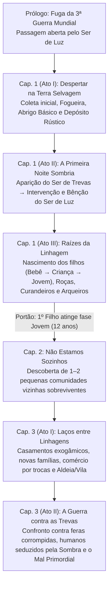

# DAWN OF KIN — GLOBAL VISION, DESIGN & ARCHITECTURE AUDIT

**Documento:** Relatório Estratégico de Auditoria Global, Visão Criativa, Game Design, Narrativa e Arquitetura (`PROPOSAL`)
**Repositório:** `https://github.com/Julian0s/Dawn-of-Kin`
**Base Oficial Auditada (`origin/main`):** `3c6fc0bd36fc3828af5a89662fb23cfb60d37865` (Tag oficial `t3-3-complete`)
**Branch de Planejamento Auditada (`planning/t3-4-architecture`):** `6ac2c5102e71623224dbd5f1e69bedd0d90bfc45` (`T3.4-ARCHITECTURE-R1`)
**Branch de Publicação desta Auditoria:** `audit/global-vision-and-design`
**Worktree Isolado:** `C:\Projetos\Dawn_of_Kin_wt_global_audit`
**Engine e Ambiente:** Godot `4.7.2.stable` (`gl_compatibility`, `Jolt Physics`)
**Data da Auditoria e Entrevista:** 16 de novembro de 2026

> **Regra de Governança:** Este documento é o resultado consolidado da **Auditoria Global do Repositório** e da **Entrevista Estratégica (`/grill-me`)** realizada com o proprietário do projeto. Nenhuma alteração foi feita em código GDScript, cenas `.tscn`, recursos `.tres`, testes ou documentos normativos existentes (`AGENTS.md`, `Dawn_of_Kin_GDD_v1.0.md`, `Dawn_of_Kin_GDD_v1.1.md`). Este relatório destina-se à auditoria independente do ChatGPT; somente após essa revisão e autorização expressa em prompt futuro os GDDs e documentos de arquitetura deverão ser atualizados. A etapa **T3.4** e todas as etapas subsequentes permanecem bloqueadas para implementação.

---

## Legenda da Hierarquia das Fontes

Para absoluta transparência de auditoria, cada afirmação e regra neste relatório obedece à seguinte classificação:

- **DECIDIDO:** Escolha expressamente aprovada pelo proprietário (anteriormente nos GDDs/termos de aceite ou ratificada durante a entrevista estratégica de 16/11/2026).
- **IMPLEMENTADO:** Comportamento confirmado diretamente na inspeção do código GDScript, cenas `.tscn` e recursos `.tres` na base `3c6fc0b`.
- **VALIDADO:** Comportamento testado com evidências documentadas no repositório (protocolos manuais aprovados pelo proprietário, telemetria JSON/JSONL, capturas de tela `.png` e histórico de suítes automatizadas).
- **PROPOSTA:** Ideia técnica ou de design submetida para avaliação, ainda não convertida em compromisso normativo fechado.
- **ABERTO:** Questão que permanece intencionalmente sem definição final, dependendo de testes futuros ou deliberação posterior.
- **CONFLITANTE:** Divergência comprovada entre documentos distintos ou entre a documentação e o código real.
- **INFERÊNCIA:** Conclusão analítica derivada pela auditoria a partir do cruzamento das fontes, sujeita a confirmação.

---

## 1. Inventário da Auditoria

### 1.1 Estado Git, Branches, Tags e Worktrees Verificados

A inspeção direta do Git confirmou a seguinte topologia preservada:

| Referência / Worktree | Commit SHA | Branch / Tag | Estado Verificado |
|---|---|---|---|
| `origin/main` | `3c6fc0bd36fc3828af5a89662fb23cfb60d37865` | `main` | Homologação formal da T3.3 integrada via fast-forward. |
| Tag `t1-complete` | `2808799c43b815cf876144807f41f92902bc2983` | `t1-complete` | Marco T1 — Fundação RTS concluído. |
| Tag `t2-complete` | `f7c24592e3a6d936dbcb63f648c474280695ab9b` | `t2-complete` | Marco T2 — Trabalho e Recursos concluído. |
| Tag `t3-3-complete` | `3c6fc0bd36fc3828af5a89662fb23cfb60d37865` | `t3-3-complete` | Etapa T3.3 — Canteiro e Suprimento Físico concluída. |
| `C:/Projetos/Dawn of Kin` | `729390832883587180e3df89193522a72f27299d` | `review/t2-closeout-candidate` | Worktree histórico preservado intacto. |
| `C:/Projetos/Dawn_of_Kin_wt_t2_closeout` | `f7c24592e3a6d936dbcb63f648c474280695ab9b` | `main` (local) | Worktree histórico da T2 preservado intacto. |
| `C:/Projetos/Dawn_of_Kin_wt_t3_1_reservations` | `ceb3f7194a750e66dbf73ebb0b0a7460d51eb87f` | `feature/t3-1-reservations` | Worktree da T3.1 preservado intacto. |
| `C:/Projetos/Dawn_of_Kin_wt_t3_2_placement` | `931ad196346251e3f24a3ea5db6facb3641233bc` | `feature/t3-2-placement` | Worktree da T3.2 preservado intacto. |
| `C:/Projetos/Dawn_of_Kin_wt_t3_3_construction` | `3c6fc0bd36fc3828af5a89662fb23cfb60d37865` | `feature/t3-3-construction-logistics` | Worktree da T3.3 homologada preservado intacto. |
| `C:/Projetos/Dawn_of_Kin_wt_t3_4_plan` | `6ac2c5102e71623224dbd5f1e69bedd0d90bfc45` | `planning/t3-4-architecture` | Contém `T3.4-ARCHITECTURE-R1`. Confirmado que não houve publicação de `T3.4-R2`. |
| `C:/Projetos/Dawn_of_Kin_wt_t3_arch` | `640a2cdb088608353eeb3b9bd950ddb9d1577717` | `docs/t3-architecture-review` | Worktree histórico de arquitetura T3 preservado. |
| `C:/Projetos/Dawn_of_Kin_wt_global_audit` | Base `3c6fc0b` | `audit/global-vision-and-design` | Novo worktree isolado criado exclusivamente para este relatório. |

### 1.2 Documentação, Código, Dados e Evidências Auditados

1. **Governança e Design:**
   - [AGENTS.md](../../AGENTS.md), [README.md](../../README.md), [project.godot](../../project.godot).
   - [docs/Dawn_of_Kin_GDD_v1.0.md](../Dawn_of_Kin_GDD_v1.0.md) (fonte normativa vigente).
   - [docs/Dawn_of_Kin_GDD_v1.1.md](../Dawn_of_Kin_GDD_v1.1.md) (minuta não promovida de 14/11/2026).
   - [docs/KNOWN_ISSUES.md](../KNOWN_ISSUES.md).
2. **Arquitetura e Planos:**
   - [docs/architecture/T1_architecture.md](../architecture/T1_architecture.md), [docs/T1_Implementation_Plan.md](../T1_Implementation_Plan.md).
   - [docs/architecture/T2_architecture_DRAFT.md](../architecture/T2_architecture_DRAFT.md), [docs/T2_Implementation_Plan_DRAFT.md](../T2_Implementation_Plan_DRAFT.md).
   - [docs/architecture/T3_architecture_PROPOSAL.md](../architecture/T3_architecture_PROPOSAL.md).
   - `docs/architecture/T3_4_implementation_plan_PROPOSAL.md` (examinado na branch `planning/t3-4-architecture`, commit `6ac2c51`).
3. **Homologações, Revisões e Protocolos de Teste:**
   - [docs/reviews/T2_Closeout_CANDIDATE.md](../reviews/T2_Closeout_CANDIDATE.md), [docs/reviews/T2_Closeout_ACCEPTANCE.md](../reviews/T2_Closeout_ACCEPTANCE.md), [docs/reviews/T2_6_D2_performance_DRAFT.md](../reviews/T2_6_D2_performance_DRAFT.md), [docs/reviews/T2_6_B1_speed_alignment_DRAFT.md](../reviews/T2_6_B1_speed_alignment_DRAFT.md), [docs/reviews/T2_6_B1_1_performance_DRAFT.md](../reviews/T2_6_B1_1_performance_DRAFT.md).
   - [docs/testing/T1_manual_test_protocol.md](../testing/T1_manual_test_protocol.md), [docs/testing/T2_manual_test_protocol.md](../testing/T2_manual_test_protocol.md).
   - [docs/testing/T3_1_closeout.md](../testing/T3_1_closeout.md), [docs/testing/T3_2_closeout.md](../testing/T3_2_closeout.md), [docs/testing/T3_2_manual_test_protocol.md](../testing/T3_2_manual_test_protocol.md), [docs/testing/T3_2_technical_notes.md](../testing/T3_2_technical_notes.md).
   - [docs/testing/T3_3_closeout_CANDIDATE.md](../testing/T3_3_closeout_CANDIDATE.md), [docs/testing/T3_3_closeout_ACCEPTANCE.md](../testing/T3_3_closeout_ACCEPTANCE.md), [docs/testing/T3_3_manual_test_protocol.md](../testing/T3_3_manual_test_protocol.md), [docs/testing/T3_3_technical_notes.md](../testing/T3_3_technical_notes.md), [docs/testing/T3_3_R2_plateau_navigation_diagnostic.md](../testing/T3_3_R2_plateau_navigation_diagnostic.md), [docs/testing/T3_3_UX_technical_notes.md](../testing/T3_3_UX_technical_notes.md).
4. **Código-Fonte GDScript (`src/`), Cenas (`levels/`, `src/`) e Dados (`data/`, `assets/`):**
   - **50 scripts GDScript** em `src/` (`camera`, `core`, `rts`, `navigation`, `units`, `units/orders`, `economy`, `buildings`, `ui`, `main`).
   - **10 cenas `.tscn`** (`main.tscn`, `test_map.tscn`, `rts_camera_rig.tscn`, `unit.tscn`, `selection_indicator.tscn`, `destination_marker.tscn`, `tree_source.tscn`, `rock_source.tscn`, `bush_source.tscn`, e cenas de UI).
   - **10 arquivos `.tres` de dados** em `data/` (`shelter_basic.tres`, `storage_depot.tres`, `leader_a.tres`, `leader_b.tres`, `wood.tres`, `stone.tres`, `food.tres`, `decay_wood_provisional.tres`, `decay_stone_provisional.tres`, `decay_food_provisional.tres`) e **14 assets provisórios** em `assets/placeholder/`.
   - **36 scripts de teste** em `tests/` (`unit`, `integration`, `perf`, `visual`, `framework`) e **5 scripts PowerShell** em `tools/`.
5. **Inventário de Binários e Evidências:**
   - `docs/testing/evidence/t3_3_r2_plateau/`: 46 capturas `.png` (resoluções `1280×720` e `1920×1080`, pré e pós-correção R2) e 8 arquivos `.json`/`.jsonl` de telemetria.
   - `docs/testing/evidence/t3_3_ux/`: 14 capturas `.png` (`1280×720` e `1920×1080` cobrindo C4-A a C4-E) e 4 arquivos `.json`/`.jsonl`.
   - `docs/reviews/evidence/`: 15 relatórios JSON de benchmarks da T1 e T2 (`1920×1080`).

### 1.3 Cronologia Reconstruída do Desenvolvimento

1. **T1 — Fundação RTS (`2808799`, tag `t1-complete`):** Câmera isométrica (`RtsCameraRig`), seleção individual e por caixa (`SelectionManager`, `WorldPicker`), movimentação em grupo (`GroupMovePlanner`), navegação (`WorldNavigation` com `NavigationRegion3D`) e evasão RVO (`UnitMovement`). Otimização de sombras (`Ground.cast_shadow = OFF`, luz ortogonal) para atingir $p95 \le 16,7\text{ ms}$ em 1080p na Intel UHD 620.
2. **T2 — Trabalho e Recursos (`f7c2459`, tag `t2-complete`, homologada em 14/11/2026):** Definições de recursos com peso (`wood=2`, `stone=3`, `food=1`), capacidade individual (`20`), coleta física em `ResourceSource` (`wood_tree`, `stone_rock`, `food_bush`), transporte com desaceleração proporcional ao peso (ajuste `B1` unificando velocidade sem carga em `4,8 m/s`), descarga em pilhas físicas na `CampStorageZone` (`GroundPileManager`), deterioração por exposição (`EconomyClockController`) e HUD não bloqueante.
3. **T3.0 — Arquitetura da Construção (`640a2cd`):** Consolidação das decisões D1 a D9, fórmulas contábeis, parâmetros provisórios do Abrigo Básico e Depósito Rústico e política de deterioração direta sobre reservas (Alternativa B).
4. **T3.1 — Contabilidade, Reservas e Saque em Lote (`ceb3f71`, integrada em 15/11/2026):** Implementação de `PileReservationLedger`, `reserve_batch`, `release_batch`, `withdraw_reserved` e perda direta de reserva no decaimento.
5. **T3.2 — Validação Espacial, Área Reservada e Prévia sem Grid (`931ad19`, integrada em 15/11/2026):** Implementação de `PlacementValidator`, `PlacementPreview` contínuo sem grid, exclusão da `CampStorageZone` (D6), cache estático de geometria e bake candidato assíncrono em worker thread.
6. **T3.3 — Canteiro de Obra e Suprimento Físico (`3c6fc0b`, tag `t3-3-complete`, homologada em 16/11/2026):** Implementação de `ConstructionSite`, `ConstructionManager`, `BuildSlotPlanner` e `ConstructOrder` (fases de transporte e standby), correção de integridade de `_transit_claims` (T3.3-R1), geração de *curbs* laterais na rampa do platô (T3.3-R2) e seletor dinâmico de resolução + trabalhadores temporários de teste (T3.3-UX).
7. **Planejamento T3.4 (`6ac2c51` em `planning/t3-4-architecture`):** Elaboração e primeira revisão pós-auditoria (`T3.4-ARCHITECTURE-R1`) do plano de montagem progressiva, consumo do buffer e transmutação em `BuildingInstance` (ainda sem código implementado).

### 1.4 Limitações da Investigação nesta Sessão

- Conforme as diretrizes da tarefa, **nenhum teste automatizado ou binário da Godot foi executado nesta sessão**; todas as métricas de testes (`234/234` na T3.3, `182/182` na T2) e benchmarks de FPS/frametime citados referem-se aos registros históricos documentados no repositório.

---

## 2. Visão Consolidada do Jogo

### 2.1 Identidade Central e Fantasia do Jogador

*Dawn of Kin* («Aurora da Linhagem») é um jogo single-player 3D isométrico que funde **sobrevivência familiar**, **construção orgânica de assentamento**, **RTS acessível** e uma **jornada mítica de reconstrução da humanidade sob a dualidade entre Luz e Sombra Primordial**.

- **O Diferencial Fundamental (`DECIDIDO`):** O jogador não começa com uma nação genérica nem com um botão que fabrica "Aldeão #14" em um quartel. Tudo começa com **um único casal identificável e personalizável**, salvo do fim do mundo. Cada novo morador do Capítulo 1 nasce desse casal, recebe nome e sobrenome da linhagem, herda traços visuais dos pais, passa por **Bebê → Criança → Jovem → Adulto**, aprende uma vocação e, nos capítulos seguintes, conhece jovens de outras comunidades sobreviventes para formar novas famílias e defender a nova Terra contra um Mal ancestral.

### 2.2 Os Cinco Pilares de Design Consolidados

1. **Linhagem Viva e Identidade Persistente (`DECIDIDO`):** Nenhum habitante é descartável. Todos possuem ID imutável, nome próprio, sobrenome familiar, genealogia rastreável (impedindo consanguinidade até primos de 1º grau), herança visual e residência própria ao casar.
2. **Economia Física Visível sem Microgestão Cansativa (`DECIDIDO`):** Recursos têm peso físico e são transportados até locais reais de armazenamento (`CampStorageZone` e futuros depósitos), sem crédito mágico instantâneo, mas também sem barras individuais de fome/sede nem economia salarial/monetária interna.
3. **Comando RTS Direto Aliado à Autonomia de Profissões (`DECIDIDO`):** O clique esquerdo/direito do jogador é sempre soberano (estilo *Age of Empires*), mas os moradores com profissão executam suas rotinas autonomamente quando ociosos (`JobSystem`) e passam automaticamente para a próxima fonte de recurso próxima quando a atual se esgota.
4. **Natureza Vibrante em Contraste com o Mistério Sombrio (`DECIDIDO`):** Uma estética 3D estilizada vibrante e naturalista — onde árvores brotam organicamente em solo livre e rios correm — contrastada pela ameaça episódica de uma Entidade Primordial das Trevas que corrompe parte da fauna e seduz corações humanos.
5. **Escala Regional Sustentável em Hardware Modesto (`DECIDIDO`):** Mundo estruturado em regiões conectadas por passagens (estilo *Ragnarok/Albion*), garantindo mapas amplos (`256×256 m` a `384×384 m` a partir da T4) com desempenho fluido na GPU de referência (**Intel UHD Graphics 620**).

---

## 3. História e Universo Consolidados

### 3.1 A Cosmologia e a Espinha Dorsal Mítica (`DECIDIDO` — `[DEC-05]`, `[DEC-06]`, `[DEC-07]`)

Durante a entrevista estratégica, o proprietário definiu a espinha dorsal narrativa que conecta todos os sistemas do jogo:

1. **O Mal Primordial (O Ser de Trevas):**
   - Há milhares de anos, quando ainda não existia vida nesta versão da Terra, uma entidade ancestral e maligna — de natureza misteriosa e opressiva (inspirada na presença psicológica e cósmica de *It: A Coisa* / uma figura caída análoga a Satanás, **cujo nome ninguém conhece**) — instalou-se neste planeta.
   - Essa entidade não possui exércitos de fantasia clichê; seu poder corrompe parte da criação natural, tornando animais mais fortes, agressivos e **irradiando trevas** (enquanto animais normais continuam existindo na natureza), além de tentar seduzir e corromper sobreviventes humanos vulneráveis.
2. **O Colapso e o Resgate (O Ser de Luz):**
   - Enquanto o casal protagonista foge de carro em meio aos bombardeios e explosões nucleares da Terceira Guerra Mundial, **O Ser de Luz** (cuja identidade suprema não é explicada de forma expositiva, preservando a reverência e o mistério de *"Quem é Ele"*) abre a passagem espacial para salvar escolhidos da humanidade.
   - A passagem transporta exclusivamente seres vivos (sem carro, armas ou ferramentas), dando-lhes a missão de **repovoar a Terra em paz e erradicar o mal primordial** instalado naquele mundo.
3. **A Bênção da Sabedoria e da Vitalidade:**
   - A intervenção do Ser de Luz justifica narrativamente três regras centrais do jogo:
     - **A Sabedoria Construtora:** Capacita o casal (e sua descendência) a desenvolver desde construções rústicas simples até arquitetura avançada, metalurgia, armas e defesas.
     - **Os Dons da Luz:** Habilita o surgimento de **Curandeiros** e **Magos/Canalizadores da Luz** ao lado de **Guerreiros** e **Arqueiros**.
     - **A Vitalidade Perene e a Proteção dos Líderes:** Explica por que os adultos atingem a plenitude aos 18 anos e param de envelhecer, e por que os dois líderes originais são resgatados pela Luz quando caem em batalha.

### 3.2 Progressão Estruturada dos Capítulos

- **Capítulo 1 — O Isolamento (`DECIDIDO`):**
  - **Ato I:** O casal desperta sozinho, coleta frutos, madeira e pedra, e ergue o **Abrigo Básico** e o **Depósito Rústico**.
  - **Ato II (O Evento Fundador):** Após estabelecerem o primeiro abrigo, o **Ser de Trevas** manifesta-se no Capítulo 1 para mostrar que não estão sozinhos no planeta. Quando a escuridão ameaça o casal, o **Ser de Luz** aparece; sem necessidade de luta física, sua simples presença faz o Ser de Trevas recuar e se ocultar. O Ser de Luz abençoa o casal com a **Sabedoria** e os **Dons da Luz**.
  - **Ato III:** O casal tem seus primeiros filhos, desenvolve a propriedade (Níveis 2 e 3) e protege o lar contra os primeiros animais tocados pela sombra. Nenhum humano externo aparece até que o primeiro filho chegue à fase **Jovem (12 anos)**.
- **Capítulo 2 — Não Estamos Sozinhos (`DECIDIDO`):**
  - Destravado quando o primeiro filho atinge a juventude (`~2,5 a 3 horas` em velocidade `1×` — `[DEC-01]`).
  - Ocorrem os primeiros encontros significativos com **pequenos núcleos/comunidades vizinhas** que também vieram da guerra, abrindo caminho para afinidades futuras.
- **Capítulo 3 — Laços entre Comunidades e Guerra contra a Sombra (`DECIDIDO`):**
  - Jovens das comunidades pacíficas criam afinidade com os filhos adultos do casal, casam-se e mudam-se para a vila (quando há residência própria construída), unindo sobrenomes e linhagens (`[DEC-02]`).
  - Estabelece-se o comércio por trocas entre comunidades (`[DEC-12]`).
  - Em regiões mais distantes, revela-se que **um grupo de sobreviventes humanos foi seduzido pelo Ser de Trevas**, desencadeando guerras futuras em que o jogador mobiliza seu exército de Guerreiros, Arqueiros, Curandeiros e Magos da Luz (`[DEC-07]`, `[DEC-13]`).

---

## 4. Mecânicas e Sistemas Consolidados

### 4.1 Calendário, Ritmo e Ciclo de Vida Familiar (`[DEC-01]`, `[DEC-02]`, `[DEC-03]`, `[DEC-04]`, `[DEC-16]`)

| Parâmetro / Regra | Especificação Consolidada (`DECIDIDO`) | Impacto Sistemático |
|---|---|---|
| **Escala do Calendário** | `1 ano de jogo ≈ 12 a 15 minutos` na velocidade `1×` (com controles `1×`, `2×`, `4×`). | Filho atinge Jovem (12 anos) em `~2,5 a 3h` em `1×`, eliminando a espera artificial de 10h da hipótese anterior. |
| **Bebê (`0–2 anos`)** | Permanece protegido na residência da família; visível no painel familiar/casa, mas **não é selecionável nem comandável via RTS** no mapa. | Evita exposição acidental de bebês em seleção por caixa RTS. |
| **Criança (`3–11 anos`)** | Unidade visível e selecionável; colabora apenas em **tarefas leves e seguras** (colher frutos de arbustos, pequenas cargas leves), proibida de cortar árvores, quebrar pedras, construir pesado ou lutar. | Concretiza a regra do GDD §7 ("colaborar levemente") com proteção de escopo em `SelectionManager` / `CommandController`. |
| **Jovem (`12–17 anos`)** | Trabalha quase como adulto (coleta madeira/pedra, constrói e aprende profissões com capacidade intermediária); destrava o Capítulo 2, mas **não pode casar**. | Prepara a força de trabalho da família antes da maioridade. |
| **Adulto (`18+ anos`)** | Capacidade plena; idade congelada aos 18 anos (pela Bênção da Luz); apto a casar, ter residência própria e integrar o exército. | Estabilidade demográfica sem morte por velhice. |
| **Gatilho de Nascimento** | Autônomo e discreto. Exige: (1) casal residindo junto (o **Abrigo Básico** já habilita o início da família do casal líder), (2) **vaga de dependente** (Bebê/Criança) na residência, (3) estabilidade alimentar no estoque coletivo, e (4) **intervalo progressivo** que cresce a cada filho já tido pelo mesmo casal. | Impede comportamento de "fábrica de humanos" sem impor limite rígido de 1–3 filhos; valoriza casas maiores/melhoradas. |
| **Genealogia e Casamento** | Bloqueio estrito de afinidade romântica até **primos de 1º grau** (pais/filhos, irmãos, tios/sobrinhos e primos de 1º grau proibidos). Jovens de comunidades vizinhas pacíficas (Cap. 2/3) podem casar com filhos adultos do assentamento e mudar-se para a vila quando houver casa disponível. | Exige registro dos IDs de pais e avós em `CharacterIdentity`. |
| **Viuvez e Orfandade** | Se um cônjuge comum morrer em ataque/perigo, o sobrevivente mantém a casa e os filhos menores, podendo recasar após período de luto no calendário. Se ambos os pais morrerem, os avós (casal líder) ou parentes acolhem os menores. | Mantém integridade das residências e proteção das crianças. |
| **Nomes e Sobrenomes** | O casal inicial e cada família possuem **Nome + Sobrenome da Linhagem** (digitado ou sorteado no criador inicial). Nascimentos recebem nome inédito automático + sobrenome da família, permitindo ao jogador editar o nome livremente sem pausar o jogo à força. | Fortalece a identidade de *Dawn of Kin* e distingue linhagens nas uniões do Cap. 3. |

### 4.2 Ecologia, Fontes Naturais, Caminhos e Economia (`[DEC-08]`, `[DEC-09]`, `[DEC-10]`, `[DEC-11]`, `[DEC-12]`)

1. **Remoção Completa de Árvores e Pedras Esgotadas (`[DEC-09]`):**
   - No código atual da T2 (`src/economy/resource_source.gd` L569–588, `tree_source.tscn` L118–124, `rock_source.tscn` L100–106), quando uma árvore ou rocha chega a `0` (`_remaining_amount == 0`), o jogo exibe um `DepletedVisual` (cilindro marrom `StumpMesh` na árvore e esfera achatada cinza `RubbleMesh` na pedra) e mantém o colisor `SolidBody`/`InteractionArea` ativo no chão, bloqueando a passagem e impedindo construções.
   - **Nova Regra Aprovada (`DECIDIDO`):** Ao esgotar completamente uma **Árvore** ou **Pedra** (`_remaining_amount == 0`), ela **não** deixará toco marrom nem pedra cinza residual no chão: o nó será **removido 100% da cena (`queue_free()`)**, liberando imediatamente a colisão, a malha de navegação e o espaço para construir.
2. **Brotação Ecológica Dinâmica e Caminhos (`[DEC-09]`):**
   - Novas árvores (ciclo *Muda → Jovem → Adulta*) poderão brotar organicamente em qualquer ponto de solo natural válido do mapa **onde não haja casas, construções, canteiros, `CampStorageZone` ou caminhos/estradas**.
   - **Caminhos:** O jogador poderá construir caminhos que organizam a vila, **impedem o nascimento de árvores/vegetação no trajeto** e concedem bônus de deslocamento aos trabalhadores.
3. **Arbustos de Frutas e Roças Agrícolas (`[DEC-10]`):**
   - **Arbustos (`BushSource`):** Quando as frutas acabam, o arbusto verde permanece e regenera frutas após um ciclo do calendário; porém, se o jogador quiser construir uma estrutura ou caminho naquele local (ou der ordem de limpeza), o trabalhador **arranca o arbusto** e libera o terreno.
   - **Roças e Plantações (Nível 2+):** Funcionam como estruturas agrícolas contínuas onde o *Agricultor* planta, cuida e colhe safras sucessivas de alimento sem precisar reconstruir a roça.
4. **Deterioração nas Pilhas do Acampamento e Reposição em Obras (`[DEC-11]`):**
   - Nas pilhas expostas da `CampStorageZone`, **Alimentos** e **Madeira** sofrem deterioração temporal, mas **Pedra bruta não apodrece** (alinhando o GDD ao arquivo `data/resources/decay_stone_provisional.tres` onde `can_decay = false`).
   - Caso uma pilha com madeira reservada para uma obra sofra perda por deterioração antes de ser transportada (Alternativa B), a obra não rouba reserva de outro canteiro; contudo, **assim que houver madeira livre disponível no estoque, o trabalhador designado à obra busca automaticamente a quantidade faltante** para concluir os 100% sem exigir cliques burocráticos do jogador.
5. **Economia Comunitária sem Salário Interno (`[DEC-12]`):**
   - Fica descartada a hipótese de pagamento de salários e compra individual de roupas dentro da comunidade. Roupas, ferramentas e armas produzidas integram o estoque/arsenal coletivo e vestem/equipam automaticamente os moradores conforme sua profissão e estágio da vila. O comércio ocorre exclusivamente por **trocas entre comunidades** no Capítulo 3.

### 4.3 Construção Progressiva e Regras D1–D9 + T3.4 (`[DEC-18]`, `[DEC-19]`)

Preservam-se integralmente as decisões D1 a D9 e consolidam-se as definições da T3.4:
- **Montagem com Suprimento Parcial (`DECIDIDO`):** Com 2 ou 3 trabalhadores na obra (D9), enquanto o transportador traz lotes das pilhas, os construtores (até 2 simultâneos) já avançam a montagem consumindo proporcionalmente os materiais presentes no buffer (`contribute_work` transacional), pausando em `PAUSED_STARVED` apenas se o buffer se esgotar antes da próxima entrega.
- **Trabalhador Solitário (`1` trabalhador — `DECIDIDO`):** Quando houver apenas 1 trabalhador designado à obra (`SOLO_SUPPLIER`), ele transporta primeiro todos os materiais reservados e acessíveis; quando não houver mais entregas possíveis, assume o slot de construtor e monta a estrutura com o que estiver disponível.
- **Inclusão Regional de Edifícios na NavMesh (Opção N1 — `DECIDIDO`):** Os edifícios concluídos (`BuildingInstance`) são registrados na raiz regional vinculada ao `WorldNavigation` da respectiva região, permitindo que os personagens reconheçam e contornem imediatamente a construção concluída sem perder as proteções laterais de rampa (`_append_sloped_terrain_side_curbs`).

### 4.4 Evolução da Comunidade (Níveis 1 a 5), Profissões e Combate RTS (`[DEC-08]`, `[DEC-13]`, `[DEC-15]`)

#### Escada Consolidada de Evolução da Comunidade (Por Marcos Reais, sem XP Artificial):

| Nível | Marco | Estruturas, Profissões e Vocações Desbloqueadas (`DECIDIDO`) |
|---|---|---|
| **1** | **Acampamento** | Pilhas na `CampStorageZone`, Fogueira, **Abrigo Básico** e **Depósito Rústico**. *(Concluir o Abrigo Básico e estabilizar o acampamento dispara a aparição do Ser de Trevas e a **Bênção do Ser de Luz**, liberando o Nível 2).* |
| **2** | **Propriedade** | Primeiras Casas Familiares, **Roça (Agricultor)**, Costura/Tecelagem (roupas comunitárias), **Tenda de Cura (Curandeiros)** e defesa inicial rústica. |
| **3** | **Povoado** | **Carpintaria** (ferramentas melhores, **Arco e Flecha para Arqueiros** e **Lanças**), Criação de Animais e **Montarias**, Caminhos estruturados e Paliçadas. |
| **4** | **Aldeia** | Mina/Extração mineral, **Ferraria e Arsenal** (**Espada + Escudo e armaduras para Guerreiros**), **Santuário da Luz** (**Magos/Canalizadores da Luz**) e Torres de Defesa. |
| **5** | **Vila** | Oficinas avançadas, Posto de Trocas entre Comunidades, Fortificações pesadas e mobilização de Exército/Expedições contra as forças do Ser de Trevas e grupos humanos corrompidos. |

#### Regras do Combate RTS e das Quatro Vocações (`[DEC-15]`):
- **Formação Automática por Vocação:** Ao comandar um grupo de combate com clique direito, os **Guerreiros (Espada+Escudo / Lança)** assumem automaticamente a linha de frente, enquanto **Arqueiros**, **Magos/Canalizadores da Luz** e **Curandeiros** posicionam-se na retaguarda respeitando seu alcance.
- **Sinergia Autônoma:**
  - *Guerreiros:* Engajam corpo a corpo e protegem a retaguarda.
  - *Arqueiros:* Disparam à distância com recuo tático.
  - *Curandeiros:* Curam e purificam automaticamente o aliado mais ferido no alcance.
  - *Magos da Luz:* Atacam com feixes de Luz e **dissipam/enfraquecem a aura negra** dos animais e inimigos corrompidos pelo Ser de Trevas.
- **Comandos Especiais dos Líderes:** Os 2 Líderes originais possuem comandos especiais na interface tática capazes de acionar/potencializar os *skills* dos soldados e canalizar a proteção da Luz em momentos decisivos.
- **Recuperação dos Líderes (`[DEC-07]`):** Se um líder cair a 0 HP, um véu do Ser de Luz impede sua morte e o recolhe à residência da vila em estado de *Exaustão Temporária* (recuperável com o tempo ou acelerado por um Curandeiro). Moradores comuns podem morrer em combate.

### 4.5 Mundo, Escala Regional e Arte 3D (`[DEC-14]`, `[DEC-16]`)

- **Dimensões Regionais (`[DEC-14]`):** O `TestMap` (`64×64 m`) permanece restrito aos testes de fundação (T1–T3). A **Região Inicial Oficial (T4+)** e as regiões conectadas terão entre **`256 × 256 m` e `384 × 384 m`**, ligadas por passagens nas bordas (estilo *Ragnarok/Albion*).
- **Simulação em Segundo Plano durante Expedições (`[DEC-14]`):** Apenas a região ativa é renderizada em 3D na tela; enquanto o jogador conduz uma expedição em outra região, a Vila principal roda em **simulação matemática leve** (mantendo colheitas, obras e calendário), permitindo alternar a câmera entre Vila e Expedição a qualquer instante.
- **Padrão Técnico de Personagens 3D (`[DEC-16]`):** Modelos estilizados naturalistas padronizados em **Esqueleto Único por faixa etária** e orçamento geométrico leve (`~1.500 a 3.500 triângulos` por personagem, com materiais parametrizados recoloríveis e LOD/ocultação por distância) para sustentar `p95 <= 16,7 ms` na Intel UHD 620.

---

## 5. Registro de Decisões

| ID | Tema | Estado Anterior | Alternativas Analisadas | Resposta / Decisão do Proprietário | Justificativa | Impacto no Jogo | Documentos Afetados | Status Final |
|---|---|---|---|---|---|---|---|---|
| **DEC-01** | Escala do Calendário e Duração do Cap. 1 | `PROPOSTA` (`1 ano ≈ 50 min` em 1×; ~10h até filho Jovem) | A: Compacto (`1 ano ≈ 12–15 min`; ~2,5–3h até Jovem) B: Manter 50 min/ano e desacelerar economia C: Saltos de tempo por marcos | **Opção A aprovada.** | Evita horas de espera artificial no Cap. 1 e harmoniza o crescimento dos filhos com o ritmo responsivo de coleta/construção. | Calibra `EconomyClockController`, taxas de alimento e transição Cap. 1 → Cap. 2. | GDD v1.0 (§11), GDD v1.1 (§11) | **DECIDIDO** |
| **DEC-02** | Genealogia, Consanguinidade e Origem de Parceiros | `ABERTO` (como filhos casam sem fluxo constante de colonos) | A: Bloqueio até primos de 1º grau + jovens de comunidades vizinhas (Cap. 2/3) casam e vêm morar na vila B: Grupos sem teto mudam-se antes de casar C: Bloqueio apenas pais/irmãos | **Opção A aprovada.** | Impede consanguinidade e dá propósito vital às comunidades vizinhas descobertas nos Capítulos 2 e 3 sem criar "botão de recrutar aldeões". | Exige grafo de ancestralidade até avós (`CharacterIdentity`) e pool familiar nas vilas vizinhas. | GDD v1.0 (§3, §7), GDD v1.1 (§3, §7.7) | **DECIDIDO** |
| **DEC-03** | Gatilho de Nascimentos e Capacidade Residencial | `PROPOSTA / ABERTO` (evitar fábrica de humanos; sem teto 1–3) | A+C: Abrigo Básico já inicia família + exige vaga de dependente na casa + comida estável + intervalo crescente por filho B: Botão manual por casa C: Só probabilidade | **Opção A+C aprovada.** | Como adultos não envelhecem, vagas de dependentes na casa + intervalo crescente evitam superpopulação infinita sem impor limite rígido. | Adiciona `household_dependent_slots` às residências e regula natalidade organicamente. | GDD v1.0 (§6, §7), GDD v1.1 (§6, §7.8), `shelter_basic.tres` | **DECIDIDO** |
| **DEC-04** | Papel de Bebês, Crianças, Jovens, Adultos e Viuvez | `DECIDIDO` parcial / `ABERTO` para viuvez e limites RTS | A: Bebê na casa (não RTS); Criança coleta leve (frutos); Jovem trabalha quase pleno; Casamento 18+; Viúvo mantém casa/filhos e pode recasar após luto B: Criança só ambiental | **Opção A aprovada.** | Protege bebês e crianças de combate/trabalho pesado, dá vida gradual ao crescimento dos filhos e resolve orfandade/viuvez sem perder a casa. | Filtra seleção e ordens por `LifeStage`; define herança de residência na viuvez. | GDD v1.0 (§7), GDD v1.1 (§7.6, §7.7) | **DECIDIDO** |
| **DEC-05** | Espinha Dorsal Mítica: Ser de Luz vs. Ser de Trevas | `ABERTO` (cosmologia e natureza da ameaça sombria) | A+C: Fauna natural + Ser de Trevas primordial que corrompe parte dos animais (irradiando trevas) vs. Ser de Luz que salvou o casal e concede Sabedoria e Dons da Luz B: Apenas fauna natural | **Opção A+C enriquecida pela visão autoral do proprietário.** | Conecta a travessia da guerra, o aprendizado das construções, a juventude perene e o combate contra as trevas numa mitologia original e profunda. | Define toda a direção narrativa dos Capítulos 1–3, inimigos corrompidos e vocações da Luz. | GDD v1.0 (§1, §2, §3, §8), GDD v1.1 (§1, §2, §3, §8) | **DECIDIDO** |
| **DEC-06** | Cronologia do Evento Fundador no Cap. 1 e Vocações | `ABERTO` | A: Casal ergue primeiro o Abrigo Básico → aparição do Ser de Trevas → intervenção e Bênção do Ser de Luz → habilita Guerreiros, Arqueiros, Curandeiros e Magos da Luz B: No prólogo C: Magia elemental genérica | **Opção A aprovada.** | Cria forte impacto dramático no Cap. 1 após os primeiros dias de sobrevivência e mantém os poderes sob a temática sagrada da Luz. | Define o gatilho narrativo entre Nível 1 e Nível 2 da comunidade e as 4 classes de combate. | GDD v1.0 (§3, §6, §8), GDD v1.1 (§3, §6, §8) | **DECIDIDO** |
| **DEC-07** | Humanos Seduzidos pela Sombra e Recuperação dos Líderes | `ABERTO` (conflito humano e penalidade de derrota dos líderes) | A: Comunidades aliadas + grupo humano seduzido pelo Ser de Trevas (guerras futuras) + Líderes salvos pela Luz com exaustão temporária na casa B: Humanos nunca inimigos | **Opção A aprovada.** | Amplia o escopo dramático e estratégico dos capítulos avançados (guerras contra seguidores da Sombra) e integra a imortalidade dos líderes à Luz. | Implementa resgate luminoso em 0 HP para `leader_a`/`leader_b` e facções hostis no Cap. 3. | GDD v1.0 (§3, §8), GDD v1.1 (§3, §8) | **DECIDIDO** |
| **DEC-08** | Controle RTS Direto vs. Autonomia de Profissões (`JobSystem`) | `DECIDIDO` em conceito, sem regra de transição RTS → IA | A: Híbrido (clique direito soberano + busca automática da próxima fonte próxima + rotina autônoma por profissão quando `IDLE`) B: 100% manual C: Só por prédio | **Opção A aprovada.** | Preserva o controle tático direto do RTS sem sobrecarregar o jogador quando a vila tiver dezenas de trabalhadores. | `GatherResourceOrder` ganha busca de fonte adjacente; `JobSystem` despacha ordens a unidades `IDLE`. | GDD v1.0 (§4, §6, §12), GDD v1.1 (§4, §6, §12) | **DECIDIDO** |
| **DEC-09** | Limpeza Total de Árvores/Pedras Esgotadas e Brotação no Mapa | `CONFLITANTE / ABERTO` (`DepletedVisual` deixa bola marrom e pedra cinza presas no chão) | A: Árvore e Pedra em `0` somem 100% (`queue_free()`, sem bola marrom nem negócio cinza); novas árvores brotam em qualquer solo livre (sem casa/caminho); caminhos evitam brotação e dão bônus de passo | **Opção A + diretriz expressa do proprietário para remoção 100% ao esgotar.** | Elimina a poluição visual e o bloqueio de colisão das fontes esgotadas no `TestMap`, permitindo renovar a floresta fora da área construída. | Altera `ResourceSource` ao atingir `0` (`queue_free()` + rebake) e introduz spawner ecológico na T4. | GDD v1.0 (§5), GDD v1.1 (§5), `resource_source.gd` (futuro) | **DECIDIDO** |
| **DEC-10** | Arbustos de Frutas e Roças Agrícolas | `ABERTO` (como construir onde há arbusto e ciclo de roças) | A: Arbusto regenera frutas, mas pode ser arrancado para construir no local; Roça funciona como campo agrícola contínuo cuidado pelo Agricultor B: Remoção manual prévia obrigatória | **Opção A aprovada.** | Impede que arbustos bloqueiem a expansão urbana da vila e torna a agricultura fluida e sustentável. | `PlacementValidator` / `ConstructOrder` permitem limpar arbusto no footprint; define `FarmPlot` na T4/T5. | GDD v1.0 (§5, §6), GDD v1.1 (§5, §6) | **DECIDIDO** |
| **DEC-11** | Deterioração de Pedra e Reposição de Reserva Deteriorada | `CONFLITANTE` (GDD diz que pedra deteriora; `decay_stone_provisional.tres` tem `can_decay = false`) | A: Alimentos e Madeira deterioram no chão do acampamento, mas Pedra não apodrece; trabalhador da obra repõe automaticamente do estoque livre o que tiver apodrecido B: Pedra deteriora C: Botão manual | **Opção A aprovada.** | Alinha o GDD à realidade física e ao `.tres` existente, e resolve o déficit da Alternativa B sem burocracia manual para o jogador. | Mantém `decay_stone_provisional.tres` (`can_decay = false`) e automatiza reposição de déficit em `ConstructOrder`. | GDD v1.0 (§5), GDD v1.1 (§5), `T3_architecture_PROPOSAL.md`, `T3_4_implementation_plan_PROPOSAL.md` | **DECIDIDO** |
| **DEC-12** | Vestuário, Ferramentas e Descarte de Economia Salarial | `PROPOSTA FUTURA` no GDD v1.1 (salário e compra de roupas) | A: Sem salário/dinheiro interno; roupas e ferramentas vão para o estoque/arsenal coletivo e vestem/equipam automaticamente por profissão; comércio por trocas entre vilas no Cap. 3 B: Moeda no Nível 5 C: Salário desde cedo | **Opção A aprovada.** | Evita complexidade artificial e incoerência narrativa de cobrar dinheiro entre pais e filhos, mantendo foco na cooperação familiar. | Remove a seção de "Economia salarial" da minuta v1.1 e consolida distribuição automática por profissão. | GDD v1.1 (§5, §13, §15), GDD v1.0 (§5, §6) | **DECIDIDO** |
| **DEC-13** | Escada de Evolução da Comunidade (Níveis 1 a 5) | `PROPOSTA` sem fórmula de subida e sem vocações da Luz | A: Subida por marcos reais (Nível 1: Abrigo+Depósito+Fogueira → Bênção da Luz; Nível 2: Casas, Roça, Roupas, Curandeiros; Nível 3: Carpintaria, Arqueiros, Montarias; Nível 4: Ferraria, Guerreiros, Magos da Luz; Nível 5: Fortificações, Trocas e Exército) B: Trava por população | **Opção A aprovada.** | Corrige a posição do Depósito Rústico (Nível 1), integra a Bênção da Luz e distribui as 4 vocações de combate ao longo dos níveis. | Define a máquina de progressão de `SettlementLevel` sem depender de barra de XP ou tetos populacionais. | GDD v1.0 (§6), GDD v1.1 (§6) | **DECIDIDO** |
| **DEC-14** | Escala dos Mapas Regionais e Expedições | `ABERTO` (`TestMap` atual tem apenas `64×64 m`) | A: Região oficial ampla (`256×256 m` a `384×384 m`) + passagens nas bordas + Vila roda em simulação matemática leve durante expedições (alternando câmera) B: Tudo 3D junto C: Vila congela | **Opção A aprovada.** | Garante espaço real para construir uma Vila de Nível 5 com florestas e rios sem comprometer a performance da Intel UHD 620. | Define o padrão de `RegionManager` na T4 (1 região 3D ativa + simulação de dados nas demais). | GDD v1.0 (§9, §12), GDD v1.1 (§9, §12) | **DECIDIDO** |
| **DEC-15** | Combate RTS, Formação Automática e Skills de Comando dos Líderes | `ABERTO` (alcance, formação, defesa e uso de poderes) | A: Formação automática (Guerreiros na frente; Arqueiros, Magos da Luz e Curandeiros atrás) + suporte autônomo + **Líderes têm comandos especiais dos skills dos soldados** B: Microgestão MOBA por unidade | **Opção A + Comandos Especiais dos Líderes aprovada.** | Mantém o combate tático fluido e legível por clique direito, dando aos 2 Líderes protagonismo ativo para acionar skills do grupo. | Evolui `GroupMovePlanner` para linhas táticas e adiciona barra de comandos especiais aos Líderes na T6. | GDD v1.0 (§4, §8), GDD v1.1 (§4, §8) | **DECIDIDO** |
| **DEC-16** | Padrão Visual e Técnico dos Personagens Modulares 3D | `ABERTO` (intensidade estilizada e risco de malhas pesadas em IA) | A: 3D estilizado vibrante naturalista (sem contornos grossos), padronizado em Esqueleto Único por faixa etária e malhas leves (`~1.5k–3.5k` triângulos) com materiais recoloríveis | **Opção A aprovada.** | Impede que malhas brutas de IA degradem o framerate na Intel UHD 620 e garante compatibilidade de animações e roupas. | Estabelece o contrato técnico de assets para a T5 (`CharacterAppearance`). | GDD v1.0 (§10, §12), GDD v1.1 (§7.2, §10, §12) | **DECIDIDO** |
| **DEC-17** | Arquitetura Unificada de Save/Load (T3.8 → T4) e Unificação Futura do GDD | `CONFLITANTE` (2 GDDs coexistindo; risco de save descartável na T3.8) | A: `SaveManager` da T3.8 já nasce com arquitetura extensível para T4–T8; limpeza de fontes esgotadas mapeada no roadmap; unificar GDD v1.0 + v1.1 + Auditoria após revisão do ChatGPT | **Opção A aprovada.** | Evita retrabalho de código entre T3.8 e T4 e elimina a divergência crônica entre dois arquivos de GDD. | Unifica o módulo de persistência e define o roteiro de consolidação documental pós-auditoria. | GDD v1.0, GDD v1.1, `T3_architecture_PROPOSAL.md` | **DECIDIDO** |
| **DEC-18** | T3.4: Montagem com Suprimento Parcial e Regra do Trabalhador Solitário | Preliminar na preparação da T3.4 | Montagem parcial contínua com 2–3 trabalhadores; trabalhador solitário transporta primeiro todos os materiais reservados acessíveis antes de montar com o disponível | **Preservada e ratificada.** | Cumpre fielmente D2 e D9 enquanto evita viagens picotadas ineficientes quando há apenas 1 trabalhador na obra. | Especifica o gatilho exato de transição `SOLO_SUPPLIER → BUILDER` em `ConstructionSite` / `ConstructOrder`. | `T3_4_implementation_plan_PROPOSAL.md` | **DECIDIDO** |
| **DEC-19** | T3.4: Solução N1 de Inclusão Regional de Edifícios na NavMesh | Selecionada no planejamento T3.4 | Registrar `buildings_root` regional no `WorldNavigation` da região para incluir `BuildingInstance` no rebake sem quebrar isolamento de `TestMap` nem curbs de rampa | **Preservada e esclarecida.** | Garante que unidades contornem imediatamente os prédios concluídos em qualquer região. | Especifica a integração entre `ConstructionManager` e `WorldNavigation` na T3.4.5. | `T3_4_implementation_plan_PROPOSAL.md` | **DECIDIDO** |

---

## 6. Inconsistências Identificadas na Auditoria

A inspeção cruzada entre documentação, código GDScript, cenas `.tscn` e recursos `.tres` revelou **7 inconsistências verificáveis**:

| ID | Gravidade | Fontes / Arquivos e Linhas | Descrição Exata da Inconsistência | Resolução Definida |
|---|---|---|---|---|
| **INC-01** | **ALTA** | `src/economy/resource_source.gd` (L66–77, L569–588) `src/economy/sources/tree_source.tscn` (L63–79, L118–124) `src/economy/sources/rock_source.tscn` (L52–68, L100–106) `src/economy/sources/bush_source.tscn` (L54–62, L124–135) | Quando uma árvore ou pedra esgota (`_remaining_amount == 0`), `_sync_visuals()` ativa `DepletedVisual` (`StumpMesh` marrom na árvore e `RubbleMesh` cinza na pedra) e **não desativa nem remove** o `SolidBody` (`LAYER_OBSTACLES = 2`) nem a `InteractionArea` (`LAYER_RESOURCES = 32`). Como resultado, restos visuais ficam perpetuamente no chão e o `PlacementValidator` impede construir onde havia uma árvore ou pedra já coletada. | Conforme **[DEC-09]** e **[DEC-10]**, árvores e pedras esgotadas devem ser removidas integralmente (`queue_free()`) com atualização da navegação, e arbustos devem permitir remoção ao construir. |
| **INC-02** | **ALTA** | `levels/test_map/test_map.tscn` (L69–70) `src/navigation/world_navigation.gd` (L111, L227) `src/main/main.gd` (L105–109) | `WorldNavigation` é filho de `TestMap` com `source_root_path = ^".."` (lendo apenas filhos de `TestMap`), mas `main.gd` cria `ConstructionSites` como filho direto de `Main` (fora de `TestMap`). Sem vincular a raiz de edifícios ao `WorldNavigation`, os prédios concluídos na T3.4 não entrariam na `NavigationMesh`. | Resolvida arquiteturalmente na revisão `T3.4-ARCHITECTURE-R1` e confirmada em **[DEC-19]** (Opção N1: registro explícito de `buildings_root` regional no `WorldNavigation`). |
| **INC-03** | **MÉDIA** | `docs/Dawn_of_Kin_GDD_v1.0.md` (§5 L71) `docs/Dawn_of_Kin_GDD_v1.1.md` (§5 L91) `docs/architecture/T3_architecture_PROPOSAL.md` (§1 D8 L51) *vs.* `data/resources/decay_stone_provisional.tres` (L7–9) | Os documentos afirmam textualmente que materiais no chão *"incluindo madeira, pedra, alimentos... sofrem desgaste ao longo do tempo"*, porém o recurso real implementado `decay_stone_provisional.tres` define `can_decay = false` e `exposure_duration_sec = 0.0`. | Resolvida em **[DEC-11]**: atualizar os textos documentais para refletir que Alimentos e Madeira deterioram quando expostos, enquanto Pedra bruta não apodrece (`can_decay = false`). |
| **INC-04** | **MÉDIA** | `docs/Dawn_of_Kin_GDD_v1.0.md` (§3 L38, §11 L176–177) *vs.* `data/buildings/shelter_basic.tres` (`30.0 s`) `src/economy/resource_source.gd` (`1.5–3.5 s`) | A hipótese de calendário da §11 (`1 ano = 50 min` em 1×, exigindo 10h para o primeiro filho atingir 12 anos e abrir o Capítulo 2) era incompatível com o ciclo econômico rápido em segundos da T2/T3 e com o mapa inicial finito. | Resolvida em **[DEC-01]**: atualizar a §11 do GDD para o calendário compacto (`1 ano ≈ 12–15 min` em 1×; `~2,5 a 3h` até Jovem). |
| **INC-05** | **MÉDIA** | `docs/Dawn_of_Kin_GDD_v1.0.md` (§6 Tabela L100–101) `docs/Dawn_of_Kin_GDD_v1.1.md` (§6 Tabela L140–141) *vs.* `docs/architecture/T3_architecture_PROPOSAL.md` (D4/D5) | A tabela de progressão nos GDDs lista o "primeiro armazém/depósito coberto" apenas no **Nível 2 (Propriedade)**, mas a Decisão D5 aprovou o **Depósito Rústico** logo após o Abrigo Básico ainda na fase inicial (Nível 1 — Acampamento). | Resolvida em **[DEC-13]**: atualizar a tabela da §6 posicionando o Depósito Rústico no Nível 1 e os Armazéns Maiores nos níveis seguintes. |
| **INC-06** | **MÉDIA** | `AGENTS.md` (L6) `docs/Dawn_of_Kin_GDD_v1.0.md` (L8, L247, L262) `README.md` (L8) `docs/architecture/T3_architecture_PROPOSAL.md` (L3) `docs/testing/T3_3_closeout_ACCEPTANCE.md` (L91–95) | `AGENTS.md` ainda declara que a T2 aguarda aceite formal na branch `review/t2-closeout-candidate` (quando a T2 já foi encerrada com tag `t2-complete` em `f7c2459`). E o GDD v1.0, `README.md` e `T3_architecture_PROPOSAL.md` ainda afirmam que a T3.3 está isolada na branch sem merge na `main` e sem tag (quando `origin/main` já está em `3c6fc0b` com a tag `t3-3-complete`). | Atualizar os cabeçalhos/rodapés de estado na próxima rodada autorizada de sincronização documental. |
| **INC-07** | **MÉDIA** | `docs/Dawn_of_Kin_GDD_v1.1.md` (L9, L15 *vs.* §13 L337) | A minuta `GDD v1.1` contradiz a si mesma internamente: nas linhas 9 e 15 afirma que a T2 está oficialmente concluída e aprovada (`t2-complete`), mas na linha 337 (tabela do Roadmap) ainda diz que a T2 é *"Candidata a encerramento... aceite formal do marco ainda pendente"*, além de não conter a homologação da T3.3. | Consolidar e unificar os GDDs conforme **[DEC-17]** na etapa autorizada de atualização documental. |

---

## 7. Riscos de Engenharia e Game Design

| ID | Categoria | Descrição do Risco | Impacto Potencial | Mitigação Recomendada | Altera Planejamento T3.4? |
|---|---|---|---|---|---|
| **RISK-01** | **Desempenho (CPU / RVO)** | Conforme medido em `docs/KNOWN_ISSUES.md` (§2), manter agentes registrados ativamente no solver RVO do `NavigationServer3D` custa `~662 µs` (nav) + `~723 µs` (física) mesmo em `IDLE`, subindo para `14,56 ms` com 50 unidades convergindo. Quando a vila tiver 40+ moradores e animais, o RVO contínuo poderá exceder os `16,7 ms` na Intel UHD 620. | Queda de FPS abaixo de 60 Hz na evolução da comunidade (T5/T6). | Desativar `avoidance_enabled` dinamicamente em unidades que estejam paradas em trabalho fixo (construindo no slot, colhendo, dormindo na casa) ou distantes da câmera, ativando o RVO apenas durante deslocamento ativo (`MOVING`). | **Não** (aplicável em T4/T5, com gancho opcional leve). |
| **RISK-02** | **Desempenho (GPU / Mapas 256×256m+)** | Expandir o mapa de `64×64 m` para `256×256 m`–`384×384 m` (`[DEC-14]`) multiplicará por 16× a 36× a área de terreno, árvores e grama. Na Intel UHD 620 (`gl_compatibility`), excesso de *draw calls* e sombras dinâmicas causaria gargalo severo. | Perda da meta de $p95 \le 16,7\text{ ms}$ em 1080p CA. | Manter `Ground.cast_shadow = OFF`, limitar `directional_shadow_max_distance = 75.0` (só renderiza sombras perto da câmera RTS), usar `visibility_range_begin/end` (HLOD/culling por distância) em árvores/unidades fora da visão da câmera e `MultiMeshInstance3D` para grama/vegetação decorativa. | **Não** (diretriz para a T4). |
| **RISK-03** | **Arte 3D / Modelos Modulares** | Peças 3D geradas por IA (Tripo AI) costumam ter topologia densa (`> 30.000` triângulos), UV fragmentado e ausência de *skinning* compatível. | Incompatibilidade entre roupas/corpos e explosão de memória/GPU na T5. | Aplicar estritamente a regra da **[DEC-16]**: toda malha passa por retopologia/decimação no Blender para `1.500–3.500` triângulos totais por personagem, vinculada a um Esqueleto Único por faixa etária e material compartilhado recolorível por instância. | **Não** (diretriz para a T5). |
| **RISK-04** | **Navegação / Rebake na Conclusão de Obras** | `WorldNavigation.request_rebake()` atual faz parse e bake síncronos na thread principal e coloca `_is_ready = false` durante a sincronização. | Possível pico de frametime (`> 16,7 ms`) ou falha de ordens emitidas no exato frame da conclusão de um edifício. | Conforme já corrigido no plano `T3.4-ARCHITECTURE-R1`: usar bake assíncrono em worker thread (`bake_from_source_geometry_data_async` + `AsyncBakeToken`) mantendo a malha anterior ativa até a nova sincronizar, e compondo o cache estático do terreno com os edifícios da região. | **Já contemplado na T3.4-R1.** |
| **RISK-05** | **Economia / Starvation por Deterioração de Reserva** | Sob a Alternativa B, se parte da madeira reservada para uma obra apodrecer na pilha da `CampStorageZone`, a obra não teria material suficiente para alcançar 100%. | Canteiro travado indefinidamente em `90%` sem feedback claro ao jogador. | Aplicar **[DEC-11]**: o canteiro entra em `PAUSED_STARVED` exibindo o déficit claro na UI e, assim que houver saldo livre do recurso no acampamento/depósito, o trabalhador da obra reserva e busca automaticamente a quantidade faltante. | **Sim — refinar detalhe em `T3_4_implementation_plan_PROPOSAL.md` (§4.1 e §11.2).** |
| **RISK-06** | **Persistência / Retrabalho entre T3.8 e T4** | Criar um salvamento isolado apenas para construções na T3.8 (`building_persistence_manager.gd`) exigiria reescrever o formato de arquivo logo na etapa seguinte (T4). | Dívida técnica e quebra de compatibilidade de saves entre T3 e T4. | Aplicar **[DEC-17]**: estruturar o módulo da T3.8 já como o `SaveManager` modular versionado (`schema_version = 1` com seções por subsistema: `economy`, `buildings`, `units`, `world_sources`, e futuramente `calendar`, `families`, `narrative`). | **Não altera T3.4** (aprimora T3.8). |

---

## 8. Recomendações Estratégicas (Propostas Técnicas e Criativas)

As recomendações abaixo são **propostas de engenharia e design** para maximizar a qualidade das próximas fases, sem converterem-se em obrigações fora do escopo aprovado:

1. **Sistema Visual para Animais Corrompidos pelo Ser de Trevas (`PROPOSTA TÉCNICA — T6/T7`):**
   - Para materializar a visão do proprietário (`[DEC-05]`) onde o Ser de Trevas torna animais mais fortes e "irradiando trevas" sem exigir dezenas de modelos 3D exclusivos:
   - Criar um `ShaderMaterial` leve compatível com `gl_compatibility` (fresnel escuro + pulsação sutil violeta-abissal/negra + olhos emissivos e partículas discretas de fumaça escura) combinado a um multiplicador de escala (`1.25×` a `1.4×`) sobre os modelos da fauna natural. Quando um **Mago da Luz** atingir a criatura com seu feixe luminoso (`[DEC-15]`), o parâmetro do shader reduz visualmente a aura negra em tempo real, dando feedback tático imediato ao jogador!
2. **Hibernação Inteligente de RVO (`PROPOSTA TÉCNICA — T4/T5`):**
   - No `UnitMovement`, desligar `NavigationAgent3D.avoidance_enabled` quando `Unit.state` for `IDLE` ou `WORKING` estacionário e o personagem estiver fora de corredores estreitos, substituindo-o por ocupação estática leve de slot. Isso reduzirá em mais de `70%` o custo passivo de CPU de navegação medido em `KNOWN_ISSUES.md`, permitindo dezenas de habitantes na vila com folga na Intel UHD 620.
3. **Transição Visual da Bênção do Ser de Luz no Capítulo 1 (`PROPOSTA CRIATIVA — T7`):**
   - Quando o casal concluir o **Abrigo Básico** e cair a noite do evento fundador (`[DEC-06]`), usar a própria câmera isométrica do jogo (sem *cutscene* pré-renderizada cara): escurecer gradualmente o raio ao redor do acampamento com sons da floresta silenciando, revelar a silhueta opressiva do Ser de Trevas além das árvores e, no clímax, fazer descer um facho suave de luz dourada/branca sobre o casal e a fogueira, dissipando a escuridão e revelando na interface o desbloqueio da **Sabedoria (Nível 2)**.

---

## 9. Matriz de Atualização Documental

Esta matriz especifica **exatamente** o que deverá ser atualizado em cada documento do repositório quando o proprietário autorizar a etapa de consolidação documental pós-auditoria do ChatGPT:

| # | Documento Exato | Seção Atual | Problema ou Lacuna Atual | Decisão / Evidência Justificadora | Conteúdo Conceitual a Incorporar | Tipo de Ação | Seções Relacionadas | Risco de Contradição | Aprovação Adicional Necessária? |
|---|---|---|---|---|---|---|---|---|---|
| **M-01** | `docs/Dawn_of_Kin_GDD_v1.0.md` e `v1.1.md` | Cabeçalho (L8–16), §16 (Handoff e Rodapé) | Afirmam que a T3.3 ainda está isolada na branch sem merge na `main` e sem tag; `v1.1` diz na §13 que a T2 ainda aguarda aceite. | `INC-06`, `INC-07`, Git `origin/main` em `3c6fc0b` e tag `t3-3-complete`. | Atualizar status para: T1 (`t1-complete`), T2 (`t2-complete`) e T3.1–T3.3 (`t3-3-complete`) concluídas, homologadas e integradas na `main` (`3c6fc0b`); T3.4 em fase de planejamento arquitetural revisado (`planning/t3-4-architecture`). | **Substituir** trechos de status defasados | `AGENTS.md`, `README.md` | Baixo (sincroniza fatos reais do Git) | Não (fato histórico já homologado) |
| **M-02** | `AGENTS.md` | §Fonte de verdade e escopo (L5–7) | Afirma que a T2 está na branch `review/t2-closeout-candidate` aguardando aceite formal e não menciona o estado da T3.1–T3.3. | `INC-06`, `T2_Closeout_ACCEPTANCE.md`, `T3_3_closeout_ACCEPTANCE.md`. | Atualizar estado oficial: T1 (`t1-complete`), T2 (`t2-complete`) e T3.1–T3.3 (`t3-3-complete` em `3c6fc0b`) concluídas e integradas na `main`; T3.4+ seguem exigindo aprovação expressa por etapa. | **Substituir** parágrafo de estado | `README.md`, GDD §16 | Baixo | Sim (autorização para editar `AGENTS.md`) |
| **M-03** | `docs/Dawn_of_Kin_GDD_v1.0.md` e `v1.1.md` | §2 (Premissa narrativa e regras do mundo) e §3 (Capítulos 1, 2 e 3) | Cosmologia e ameaça sombria estavam em `ABERTO`; não constavam o Ser de Luz, o Ser de Trevas, os animais corrompidos nem os humanos seduzidos pela Sombra. | `[DEC-05]`, `[DEC-06]`, `[DEC-07]`. | Incorporar: (1) O **Ser de Luz** salvou escolhidos da 3ª Guerra Mundial para repovoar a Terra e vencer o mal primordial; (2) O **Ser de Trevas** (entidade ancestral sem nome revelado, instalada antes de haver vida) corrompe parte da fauna (que fica mais forte e irradia trevas, coexistindo com animais normais); (3) No Cap. 1, após erguerem o Abrigo Básico, o Ser de Trevas aparece, o Ser de Luz o faz se ocultar sem combate direto e abençoa o casal com **Sabedoria** e **Dons da Luz**; (4) Nos Cap. 2/3, além de comunidades pacíficas para aliança e casamento, existe um grupo humano seduzido pelo Ser de Trevas que causará guerras futuras. | **Complementar e Substituir** marcadores `ABERTO` por `DECIDIDO` | §6, §8, §13, §15 | Médio (exige alinhar §8 e §15 para remover o antigo `ABERTO` sobre a ameaça sombria) | Confirmado pelo proprietário na entrevista |
| **M-04** | `docs/Dawn_of_Kin_GDD_v1.0.md` e `v1.1.md` | §4 (Loop central e controles RTS) e §12 (`AI/JobSystem`) | Não especificavam como o controle RTS manual convive com o crescimento da população e as profissões. | `[DEC-08]`. | Incorporar **Modelo Híbrido RTS + Autonomia por Profissão**: ordens manuais por clique direito têm prioridade máxima; ao esgotar uma fonte, o trabalhador busca automaticamente a próxima fonte próxima do mesmo recurso; e moradores com profissão executam suas rotinas automaticamente quando ociosos (`IDLE`). | **Complementar** §4 e §12 | §6 | Baixo | Confirmado na entrevista |
| **M-05** | `docs/Dawn_of_Kin_GDD_v1.0.md` e `v1.1.md` | §5 (Sobrevivência, economia, fontes naturais e vestuário) | (1) Dizia que pedra exposta deteriora (`INC-03`); (2) Não previa remoção total de árvores/pedras esgotadas nem brotação dinâmica (`INC-01`); (3) `v1.1` continha proposta de economia salarial/dinheiro interno. | `[DEC-09]`, `[DEC-10]`, `[DEC-11]`, `[DEC-12]`. | Incorporar: (1) **Árvores e Pedras esgotadas (`0` un.) desaparecem 100% do mapa** (sem toco marrom nem pedra cinza residual), liberando o terreno; novas árvores brotam organicamente em solo livre onde não haja construções, acampamento ou caminhos; (2) **Arbustos** regeneram frutas e podem ser arrancados para construir; **Roças** são estruturas agrícolas contínuas; (3) **Alimentos e Madeira** expostos nas pilhas do acampamento deterioram, mas **Pedra não apodrece**; se uma reserva apodrecer antes de ir à obra, o trabalhador da obra busca automaticamente o que faltou quando houver estoque livre; (4) **Sem salário/dinheiro interno**: roupas e ferramentas são distribuídas gratuitamente pelo estoque/arsenal coletivo conforme a profissão; comércio ocorre por trocas entre comunidades no Cap. 3 (remover a subseção "Economia pessoal e compra de roupas" da `v1.1`). | **Substituir e Complementar** §5 | §6, §13, §15, `T3_architecture_PROPOSAL.md` | Médio (remove a proposta salarial da `v1.1` e corrige a regra da pedra) | Confirmado na entrevista |
| **M-06** | `docs/Dawn_of_Kin_GDD_v1.0.md` e `v1.1.md` | §6 (Construção, profissões e nível da comunidade) | Tabela de níveis era `PROPOSTA`, colocava o primeiro depósito no Nível 2 (`INC-05`), não tinha critério de subida de nível e não incluía Curandeiros, Magos da Luz e Caminhos. | `[DEC-09]`, `[DEC-13]`. | Atualizar a tabela dos **Níveis 1 a 5** e definir subida por **marcos reais de construção e aliança com a Luz** (sem XP artificial): Nível 1 (Abrigo Básico, Depósito Rústico, Fogueira → Bênção do Ser de Luz); Nível 2 (Casas, Roça, Roupas, Curandeiros); Nível 3 (Carpintaria, Arqueiros/Lanças, Animais/Montarias, Caminhos); Nível 4 (Ferraria/Arsenal, Guerreiros de Espada+Escudo, Santuário/Magos da Luz); Nível 5 (Fortificações, Trocas entre Vilas, Exército contra as Trevas). | **Substituir** tabela e regra de progressão na §6 | §3, §8, §13 | Baixo | Confirmado na entrevista |
| **M-07** | `docs/Dawn_of_Kin_GDD_v1.0.md` e `v1.1.md` | §7 (Família, casamento, descendência, nomes e população) | Regras de nascimento, atuação RTS por idade, parentesco/consanguinidade, viuvez e nomes/sobrenomes estavam parciais ou em `ABERTO`. | `[DEC-02]`, `[DEC-03]`, `[DEC-04]`, `[DEC-16]`. | Incorporar: (1) **Bebês (0–2)** protegidos na residência (não selecionáveis via RTS); **Crianças (3–11)** fazem apenas coletas leves seguras (frutos); **Jovens (12–17)** trabalham quase como adultos; **Casamento** exclusivo para **Adultos (18+)**; (2) **Nascimentos** exigem vaga de dependente na residência (Abrigo Básico já permite iniciar a família) + comida estável + intervalo progressivo a cada filho tido; (3) **Proibição de consanguinidade** até primos de 1º grau; casamentos da 2ª+ geração unem filhos a jovens das comunidades vizinhas (Cap. 2/3); (4) **Viúvos** mantêm casa e filhos, podendo recasar após luto (avós/parentes acolhem órfãos); (5) **Nome + Sobrenome da Linhagem** (sugestão automática inédita no nascimento com edição livre pelo jogador). | **Complementar e Substituir** itens `ABERTO` na §7 | §3, §15 | Baixo | Confirmado na entrevista |
| **M-08** | `docs/Dawn_of_Kin_GDD_v1.0.md` e `v1.1.md` | §8 (Mortalidade, combate e arsenal) | Faltavam as vocações de Curandeiro e Mago da Luz, a regra de formação tática, os skills de comando dos Líderes e o funcionamento da recuperação dos Líderes. | `[DEC-06]`, `[DEC-07]`, `[DEC-15]`. | Incorporar: (1) As 4 vocações (**Guerreiros**, **Arqueiros**, **Curandeiros** e **Magos/Canalizadores da Luz**); (2) **Formação automática** (Guerreiros na frente; Arqueiros, Magos e Curandeiros atrás) com cura automática de aliados e dissipação da aura de trevas pelos Magos; (3) **Comandos especiais dos 2 Líderes** que acionam/potencializam os skills dos soldados; (4) **Resgate dos Líderes em 0 HP** pela proteção do Ser de Luz, levando-os de volta à residência com exaustão temporária (curável mais rápido por Curandeiro). | **Complementar e Substituir** itens `ABERTO` na §8 | §2, §3, §6 | Baixo | Confirmado na entrevista |
| **M-09** | `docs/Dawn_of_Kin_GDD_v1.0.md` e `v1.1.md` | §9 (Mundo e regiões), §10 (Arte), §11 (Calendário) e §12 (Arquitetura) | Tamanho de região era `ABERTO`; calendário propunha `50 min/ano` (`INC-04`); faltava orçamento de triângulos/esqueleto único para modelos modulares. | `[DEC-01]`, `[DEC-14]`, `[DEC-16]`, `[DEC-17]`. | Incorporar: (1) **§9:** Regiões oficiais de `256×256 m` a `384×384 m` conectadas por passagens, com simulação matemática leve da Vila em segundo plano durante expedições; (2) **§10/§12:** Padrão 3D estilizado naturalista com **Esqueleto Único por faixa etária** e `~1.500–3.500 triângulos` por personagem; (3) **§11:** Calendário compacto **`1 ano ≈ 12–15 min` em 1×** (`~2,5 a 3h` até Jovem); (4) **§12/§13:** `SaveManager` extensível desde a T3.8 e unificação documental do GDD v1.0 + v1.1 em versão normativa única consolidada. | **Substituir e Complementar** §9, §10, §11, §12 | §13, §15 | Baixo | Confirmado na entrevista |
| **M-10** | `docs/architecture/T3_4_implementation_plan_PROPOSAL.md` | §4.1 (Invariante e Deterioração), §6.2 (1 Trabalhador), §8.1 (Opção N1) e §11.2 (Decisões em Aberto) | Mantinha 3 decisões aguardando confirmação final do proprietário. | `[DEC-11]`, `[DEC-18]`, `[DEC-19]`. | Fechar as 3 decisões da §11.2 como **DECIDIDO**: (1) Confirmada **Opção 2 (Montagem com Suprimento Parcial)** para equipes de 2–3 trabalhadores, e regra do **Trabalhador Solitário** (transporta primeiro todo material reservado acessível antes de montar com o disponível); (2) Confirmada reposição automática pelo trabalhador da obra quando houver estoque livre caso uma reserva apodreça na pilha (e Pedra sem deterioração); (3) Confirmada **Opção N1** de registro do `buildings_root` regional no `WorldNavigation`. | **Substituir** pendências da §11.2 por decisões fechadas | `T3_architecture_PROPOSAL.md` | Nenhum | Pronto para consolidação na branch `planning/t3-4-architecture` quando autorizado |

---

## 10. Sequência Sugerida de Atualização Documental

Para evitar contradições cruzadas ou referências quebradas, recomenda-se executar as atualizações documentais (após a auditoria independente do ChatGPT e autorização expressa do proprietário) na seguinte ordem estrita:

1. **Passo 1 — Consolidação e Unificação do GDD (`M-01`, `M-03` a `M-09`):**
   - Incorporar no GDD normativo (`docs/Dawn_of_Kin_GDD_v1.0.md`, ou promovendo-o formalmente para a versão consolidada aprovada pelo proprietário e arquivando/unificando a minuta `v1.1`) todas as decisões `[DEC-01]` a `[DEC-17]` (Personagens Modulares, Herança Visual e Nomes/Sobrenomes da `v1.1` + Espinha Dorsal Ser de Luz vs. Ser de Trevas, Calendário de 12–15 min/ano, Regras de Família/Genealogia, Ecologia/Remoção 100% de Fontes Esgotadas, Economia Cooperativa sem Salário, Escada Níveis 1–5, Regiões 256–384m e Combate RTS com as 4 Vocações).
2. **Passo 2 — Sincronização de Governança e Estado do Repositório (`M-02`):**
   - Atualizar `AGENTS.md`, `README.md` e `docs/architecture/T3_architecture_PROPOSAL.md` para refletir o estado real do Git (`T2` encerrada em `t2-complete`, `T3.1–T3.3` encerradas e integradas na `main` em `3c6fc0b` com tag `t3-3-complete`, e correção da regra de não deterioração da pedra).
3. **Passo 3 — Fechamento do Plano Arquitetural da T3.4 (`M-10`):**
   - Atualizar `docs/architecture/T3_4_implementation_plan_PROPOSAL.md` na branch `planning/t3-4-architecture` convertendo as 3 questões da Seção 11.2 nas decisões ratificadas (`[DEC-11]`, `[DEC-18]`, `[DEC-19]`), deixando o plano T3.4 100% pronto para quando o proprietário autorizar o início da codificação da `T3.4.1`.

---

## 11. Pendências Não Resolvidas (`ABERTO`)

Em estrita observância à diretriz de **jamais inventar decisões canônicas para lacunas não deliberadas**, permanecem legitimamente marcados como **ABERTO** (para calibragem empírica nas respectivas fases do roadmap):

1. **Verificação Comercial de Marca (`ABERTO`):** Pesquisa jurídica e de disponibilidade comercial do nome *Dawn of Kin* nas lojas digitais antes do lançamento público.
2. **Balanceamento Numérico Fino de Regeneração e Natalidade (`ABERTO — Calibrar na T4/T5`):**
   - Tempo exato em minutos/estações para uma muda de árvore crescer até árvore adulta e para um arbusto regenerar seus frutos.
   - Número exato de slots de dependentes por tipo de casa (ex.: `1–2` no Abrigo Básico, `3–4` na Casa Familiar) e curva numérica exata do intervalo entre nascimentos.
3. **Parâmetros Numéricos de Combate (`ABERTO — Calibrar na T6`):**
   - Valores exatos de pontos de vida (HP), dano, alcance em metros, tempo de recarga dos comandos especiais dos Líderes e duração exata em segundos da exaustão pós-resgate dos Líderes.
4. **Detalhes Narrativos e Visuais Finais do Ser de Luz e do Ser de Trevas (`ABERTO — Refinar na T7`):**
   - Forma visual exata das aparições do Ser de Trevas e do Ser de Luz no Capítulo 1 (preservando a decisão já fechada de não explicar a origem última de *"Quem é Ele"* e de não haver luta física direta entre ambos na aparição inicial).
