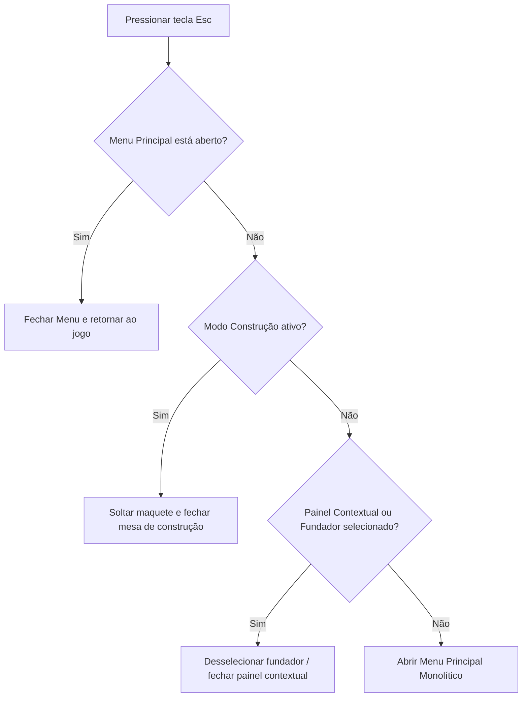
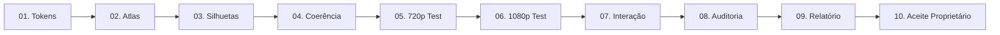

# DAWN OF KIN — DESIGN SYSTEM MESTRE
## Identidade Visual Oficial D2.2: "Marcos de Pedra e Eclipse"

> **Status:** `OFICIAL (PROPOSTA MASTER R2.3)` — Especificação formal e permanente da linguagem visual de Dawn of Kin, derivada da restauração fiel da Direção D2 aprovada visualmente pelo proprietário em 22/11/2026 (`design/ui-0-r2-2-d2-visual-fidelity` @ commit `1ab8ffb78c269f3a659712491de91ab1f317e919`).  
> **Hierarquia e Limites:**  
> 1. GDD Consolidado e decisões vigentes: autoridade máxima sobre regras de gameplay, simulação e narrativa.  
> 2. Direção Artística D2 Original (`design/ui-0-r2-identity` @ `f138177`): fonte primária de composição, silhueta e atmosfera estética.  
> 3. Reprodução D2.2 na Godot (`design/ui-0-r2-2-d2-visual-fidelity` @ `1ab8ffb`): referência visual aprovada e balizamento técnico de renderização.  
> 4. Este Design System (R2.3): padronização documental, catálogo de tokens e regras de preservação.  
> **Restrição mandatória:** **UI-1 permanece BLOQUEADA.** Este documento não autoriza alterações em código de produção, gameplay, `MainScene` ou arquitetura técnica.

---

## 1. Fundamentos e Filosofia Artística D2.2

### 1.1 O Conceito dos "Marcos de Pedra e Eclipse"
*Dawn of Kin* não é um jogo de civilizações estabelecidas com palácios de pedra talhada, castelos góticos ou pergaminhos burocráticos. O jogo narra a saga inicial e visceral de uma linhagem fundadora desbravando uma terra selvagem e sem trilhas prévias.

A interface rejeita deliberadamente o visual convencional de "software de escritório disfarçado de fantasia" (janelas retangulares cinzentas, barras de rolagem metálicas, botões azuis genéricos ou molduras plásticas de UI de ficção científica). Em seu lugar, a identidade **Marcos de Pedra e Eclipse** concebe a interface como uma série de **marcos monolíticos esculpidos na própria rocha da clareira**, como se cada indicador houvesse sido cravado no solo pelos primeiros colonos.

```
+----------------------------------------------------------------------------------------------------+
|                                    FILOSOFIA MATERIAL D2.2                                         |
|                                                                                                    |
|    [ BASALTO VULCÂNICO ESCURO ]         [ VEIOS DOURADOS KINTSUGI ]        [ ALABASTRO CLARO ]     |
|    • Solidez, permanência, chão         • Cura, conexão familiar           • Projetos, criação     |
|    • Superfície porosa e pesada         • Costuras entre as pedras         • Maquetes arquitetura  |
|    • Usado em estelas e comandos        • Linhas de dignidade e eclipse    • Ação primária humana  |
+----------------------------------------------------------------------------------------------------+
```

### 1.2 A Tríade Material Canônica
A materialidade da interface é governada estritamente por três texturas e substâncias visuais:

1. **Basalto Vulcânico Escuro (`#141618` a `#0E1013`):**
   - É a rocha de ancoragem da interface. Possui aspereza mineral sutil, quebras e chanfros angulares vivos, recebendo uma leve lavagem grafite.
   - Aplicação: Estelas dos fundadores, suportes das pedras de recursos, painéis contextuais, comandos de tarefas e o grande monólito diagonal do menu.
   - Significado: O peso da terra virgem, a crueza do isolamento e a permanência do assentamento.

2. **Alabastro Claro Esculpido (`#F5F0E6` a `#E5DDCD`):**
   - Rocha calcária nobre, de textura cerâmica e tonalidade marfim aquecida. Funciona como a "tela" sobre a qual a intenção humana projeta suas criações.
   - Aplicação: A laje de ação primordial (`Maquetes / Construir [B]`), as maquetes verticais de estruturas (`Abrigo de Sobrevivência`, `Depósito de Recursos`) e as teclas primárias de ação do menu.
   - Significado: A arquitetura planejada, o esforço criativo contra o caos da natureza e a distinção imediata de ações construtivas.

3. **Ouro Kintsugi e Filetes de Eclipse (`#DFBC72` / `#F5D996`):**
   - Suturas metálicas refinadas que contornam os perímetros das pedras e preenchem fraturas naturais da rocha.
   - Aplicação: Bordas de destaque, aros de retratos dos fundadores, ícones de ferramentas e divisores de linha.
   - Significado: A persistência da linhagem familiar que transforma a sobrevivência fraturada em legado duradouro.

### 1.3 Morfologia, Silhuetas e Ritmo Assimétrico
Ao contrário das interfaces convencionais que dependem de caixas perfeitamente ortogonais, a D2.2 adota **silhuetas poligonais chanfradas**:
- **Ângulos Característicos:** Cortes oblíquos entre **12° e 16°** nas quinas superiores e inferiores, conferindo a sensação de blocos de rocha clivados manualmente.
- **Topos em Cumeeira:** Elementos como a Placa Superior apresentam uma leve elevação central (cumeeira suave de 4 px), ecoando a forma de um marco de fronteira ou dólmen primitivo.
- **Escalonamento Rítmico Orgânico:**
  - Os três blocos de recursos (Madeira, Pedra, Alimentos) não formam uma barra única monótona: cada um é uma pedra independente com offsets verticais distintos (+0 px madeira, +7 px pedra, +2 px alimento).
  - A estela de Brena situa-se 6 px mais baixa que a de Alden, evitando a frieza de colunas perfeitamente simétricas de uma planilha.

---

## 2. Design Tokens Semânticos (Godot 4.7.2 Ready)

Todos os valores numéricos e cromáticos foram extraídos diretamente da implementação aprovada `docs/design/ui-0-r2-2/assets/d2_2_faithful_atlas.png`, do showcase `ui0_r2_2_d2_faithful_showcase.gd` e dos arquivos mestres da D2.

### 2.1 Paleta de Cores e Tokens Cromáticos

| Token Semântico | Valor Hex | RGBA Normalizado (Godot) | Rácio WCAG | Uso Canônico Obrigatório | Proibições Explícitas |
|---|---|---|---|---|---|
| `color-surface-basalt-base` | `#141618` | `Color(0.078, 0.086, 0.094, 1.0)` | — | Fundo base de painéis e estelas | Proibido usar preto puro (`#000000`) |
| `color-surface-basalt-deep` | `#0E1013` | `Color(0.055, 0.063, 0.075, 1.0)` | — | Áreas rebaixadas, entalhes de retrato | Proibido usar cinza neutro sem matiz azulado |
| `color-surface-alabaster-base` | `#F5F0E6` | `Color(0.961, 0.941, 0.902, 1.0)` | — | Superfície de maquetes e laje de construir | Proibido usar branco puro (`#FFFFFF`) |
| `color-surface-alabaster-edge` | `#E5DDCD` | `Color(0.898, 0.867, 0.804, 1.0)` | — | Borda interna chanfrada de alabastro | Proibido gradiente artificial plástico |
| `color-accent-gold-primary` | `#DFBC72` | `Color(0.875, 0.737, 0.447, 1.0)` | `7.8:1` vs basalto | Filetes kintsugi, molduras de retratos, ícones | Proibido amarelo saturado (`#FFFF00`) |
| `color-accent-gold-highlight`| `#F5D996` | `Color(0.961, 0.851, 0.588, 1.0)` | `9.4:1` vs basalto | Ponto de luz em hover e borda de seleção | Proibido brilhos tipo neon ou bloom excessivo |
| `color-accent-gold-dim` | `#6A5832` | `Color(0.416, 0.345, 0.196, 0.65)`| — | Divisores secundários, grades sutis | Proibido usar linhas sólidas brancas |
| `color-text-primary-ivory` | `#F4EFE4` | `Color(0.957, 0.937, 0.894, 1.0)` | `13.1:1` vs basalto | Texto principal sobre basalto, contadores | Proibido texto cinza escuro sobre basalto |
| `color-text-secondary-muted` | `#B8B2A5` | `Color(0.722, 0.698, 0.647, 1.0)` | `7.2:1` vs basalto | Subtítulos, custos secundários, atalhos | Proibido usar fontes de baixo contraste (<4.5:1) |
| `color-text-on-alabaster-ink`| `#1D1813` | `Color(0.114, 0.094, 0.075, 1.0)` | `12.8:1` vs alabastro | Título "Maquetes", nomes de estruturas | Proibido usar texto claro sobre alabastro |
| `color-text-on-alabaster-sub`| `#5B4B3A` | `Color(0.357, 0.294, 0.227, 1.0)` | `6.9:1` vs alabastro | Atalhos e descrições sobre alabastro | Proibido usar preto fosco absoluto |
| `color-feedback-valid-green` | `#385B2A` | `Color(0.220, 0.357, 0.165, 1.0)` | `5.6:1` vs basalto | Terreno válido, trabalhadores livres | Proibido verde neon ou verde radioativo |
| `color-feedback-valid-bright`| `#A5C98B` | `Color(0.647, 0.788, 0.545, 1.0)` | `9.8:1` vs basalto | Rótulo de confirmação "LOCAL VÁLIDO" | Proibido uso em botões não-confirmativos |
| `color-feedback-error-rose` | `#F2B8AC` | `Color(0.949, 0.722, 0.675, 1.0)` | `8.2:1` vs basalto | Bloqueios, obstáculos, cancelamentos | Proibido vermelho puro de alarme web |
| `color-feedback-error-dark` | `#C66A58` | `Color(0.776, 0.416, 0.345, 1.0)` | `4.6:1` vs basalto | Barra de status de terreno inválido | Proibido piscar intermitente agressivo |
| `color-feedback-amber` | `#EAB464` | `Color(0.918, 0.706, 0.392, 1.0)` | `8.1:1` vs basalto | Alertas de sobrevivência, status exposto | Proibido laranja fluorescente |

### 2.2 Sistema Tipográfico Canônico
A tipografia de *Dawn of Kin* é explicitamente híbrida, combinando a reverência histórica das fontes serifadas com a precisão tabular das fontes sans-serif contemporâneas.

```
+----------------------------------------------------------------------------------------------------+
|                                    HIERARQUIA TIPOGRÁFICA                                          |
|                                                                                                    |
|    DISPLAY & TÍTULOS (SERIFADA)               DADOS & RÓTULOS (SANS-SERIF TABULAR)                 |
|    • Família: Palatino / Georgia              • Família: Segoe UI / Inter / System Sans            |
|    • Elegância, herança familiar              • Leitura instantânea de valores RTS                 |
|    • "Alden", "Clareira Inicial", "Ano I"     • "24", "14", "18", "[B] Construir", "4/10"          |
+----------------------------------------------------------------------------------------------------+
```

| Nível Semântico | Família Primária (Fallback) | Peso | Tam. 1080p | Tam. 720p | Espaçamento (Tracking) | Caso | Uso Obrigatório |
|---|---|---|---:|---:|---|---|---|
| `type-display-lg` | Palatino Linotype (Georgia, serif) | Regular | `24 px` | `29 px` | `+0.05 em` | Normal / Título | Título do Menu Principal |
| `type-display-md` | Palatino Linotype (Georgia, serif) | Regular | `17 px` | `21 px` | `+0.04 em` | Título | Subtítulo do Menu, Nome de Região |
| `type-title-stele` | Palatino Linotype (Georgia, serif) | Bold | `14 px` | `17 px` | `+0.03 em` | Título | Nomes dos Fundadores (Alden, Brena) |
| `type-title-maquette`| Palatino Linotype (Georgia, serif)| Bold | `14 px` | `17 px` | `+0.02 em` | Título | Título de Maquetes e Estruturas |
| `type-data-counter`| Segoe UI (system-ui, sans-serif) | Bold | `15 px` | `18 px` | `+0.00 em` | Tabular | Valores de Recursos (`24`, `14`, `18`) |
| `type-label-tag` | Segoe UI (system-ui, sans-serif) | Bold | `10 px` | `12 px` | `+0.08 em` | MAIÚSCULAS | Tags de Estado (`EXPOSTO`, `LIVRE`, `CASA`) |
| `type-button-slab` | Segoe UI (system-ui, sans-serif) | Semibold| `12 px` | `15 px` | `+0.04 em` | Capitalizado | Rótulos de Botões (`Tarefas [T]`, `Linhagem [H]`)|
| `type-key-badge` | Segoe UI (system-ui, sans-serif) | Bold | `10 px` | `12 px` | `+0.02 em` | MAIÚSCULAS | Badges de Teclas (`[B]`, `1`, `2`, `Esc`) |
| `type-body-dense` | Segoe UI (system-ui, sans-serif) | Regular | `11 px` | `13 px` | `+0.01 em` | Sentença | Descrições de estruturas e tarefas |

### 2.3 Espaçamentos, Elevações e Geometria

- **Escala de Espaçamento Modular:**
  - `space-2xs`: `2 px` (bordas finas, alinhamentos de ícones).
  - `space-xs`: `4 px` (padding interno de badges de tecla, cumeeira da placa).
  - `space-sm`: `6 px` (chanfros angulares padrão, degrau de Brena).
  - `space-md`: `8 px` (margens internas de cartões, distâncias entre textos).
  - `space-lg`: `12 px` (espaçamento entre pedras de recursos, margem de ícone).
  - `space-xl`: `16 px` (respiro entre grupos de comandos, margens de tela em 1080p).
  - `space-2xl`: `20 px` (margem externa padrão da HUD em relação às bordas da tela).
  - `space-3xl`: `28 px` (espaçamento de títulos de monólitos).

- **Elevações e Sombras Canônicas:**
  - `elevation-slab`: `box-shadow: 0 8px 22px rgba(0, 0, 0, 0.52)` (pedras de recursos, lajes de comando).
  - `elevation-monolith`: `box-shadow: 0 12px 32px rgba(0, 0, 0, 0.68)` (lâmina de linhagem, canteiro de obras).
  - `elevation-modal`: `box-shadow: 0 20px 48px rgba(0, 0, 0, 0.85)` (monólito diagonal do menu).
  - `elevation-raised`: deslocamento de `-14 px` a `-22 px` no eixo Y para elementos sob foco ativo ou seleção.

- **Transições e Tempos Canônicos:**
  - `transition-hover`: `120 ms` com atenuação `ease-out` (realce de borda dourada).
  - `transition-select`: `150 ms` com curva `cubic-bezier(0.16, 1, 0.3, 1)` (elevação vertical de estela ou maquete).
  - `transition-panel`: `180 ms` com deslocamento suave de 12 px (entrada de painel contextual).
  - **Norma:** É expressamente proibido o uso de oscilações elásticas, tempos de animação superiores a 250 ms ou efeitos que façam a rocha parecer borracha flexível.

---

## 3. Biblioteca de Componentes Canônicos D2.2

Todos os 10 componentes abaixo estão integralmente referenciados no Atlas de produção (`d2_2_faithful_atlas.png`) e testados no showcase Godot 4.7.2.

```
       ================================================================================
       CANONICAL COMPONENT ARCHITECTURE (D2.2 RESTORED FIDELITY)
       ================================================================================

       [TOP-LEFT: 01. Resource Rocks]               [TOP-RIGHT: 02. Top Plaque / Cycle]
       +----+  +----+  +----+                       +---------------------------------+
       |MAD |  |PED |  |ALI |                       |  CLAREIRA INICIAL / ANO I       |
       | 24 |  | 14 |  | 18 |                       |  [||] [1x] [2x]  ● EXPOSTO ☰    |
       +----+  +----+  +----+                       +---------------------------------+

       [BOTTOM-LEFT: 03. Founder Steles]            [BOTTOM-RIGHT: 04. Action Slabs]
       +---------+  +---------+                     +------------------+ +-----------+
       | (ALDEN) |  | (BRENA) |                     | MAQUETES         | | TAREFAS   |
       | VIGOR   |  | TRABALHO|                     | [B] Construir    | | LINHAGEM  |
       | [LIVRE] |  | [COLETA]|                     +------------------+ +-----------+
       +---------+  +---------+                     (Alabastro Nobre)   (Basalto Escuro)
```

---

### Componente 01: Pedras de Recursos (`resource_rock`)
- **Finalidade:** Exibir os estoques comunitários de sobrevivência (Madeira, Pedra, Alimentos) sem formar uma barra horizontal comum.
- **Dimensões e Âncora:** 
  - Região do Atlas: `w: 104 px`, `h: 62 px` (conteúdo ativo: `84 × 42 px`, padding de sombra: `10 px`).
  - Coordenadas no Atlas: `x: 774`, `y: 522`.
  - Posição na Tela 1080p: Superior esquerdo (`x: 20 px`, `y: 20 px`).
- **Geometria de Clivagem:**
  - Polígono canônico: `polygon(6px 0, 100% 3px, calc(100% - 5px) 100%, 0 calc(100% - 4px))`.
  - Escalonamento vertical: Madeira em `y: 20 px`, Pedra em `y: 27 px` (+7 px), Alimento em `y: 22 px` (+2 px). Espaçamento horizontal entre centros: `96 px`.
- **Conteúdo Interno:**
  - Ícone de 20×20 px à esquerda (`ico_wood`, `ico_stone`, `ico_food`).
  - Contador numérico tabular de 15 px (`type-data-counter`) alinhado à direita em marfim marrom (`#F4EFE4`).
- **Estados:**
  - *Normal:* Borda dourada sutil `rgba(223, 188, 114, 0.45)`.
  - *Coleta Ativa:* Ícone com leve pulso dourado estático (`#F5D996`).
  - *Estoque Crítico (< 5 unidades):* Rótulo numérico assume tom âmbar (`#EAB464`).

---

### Componente 02: Placa de Estação e Ciclo (`top_plaque`)
- **Finalidade:** Situar o jogador temporal e geograficamente, além de abrigar o status de abrigo da família, controle de velocidade e botão de menu.
- **Dimensões e Âncora:**
  - Região do Atlas: `w: 216 px`, `h: 130 px` (conteúdo ativo: `196 × 110 px`, padding: `10 px`).
  - Coordenadas no Atlas: `x: 762`, `y: 280`.
  - Posição na Tela 1080p: Superior direito (`x: 1704 px`, `y: 20 px`).
- **Geometria de Clivagem:**
  - Polígono canônico com cumeeira central: `polygon(0 4px, 50% 0, 100% 4px, 97% 100%, 3% 96%)`.
- **Conteúdo Interno:**
  - Linha 1: Região geográfica (`Clareira Inicial`) em marfim serifado (`11 px`).
  - Linha 2: Época do ano (`Primavera · Ano I`) em ouro suave (`13 px`, serifada).
  - Linha 3: Controles de tempo (`||`, `1×`, `2×`, `4×`) com botão ativo dourado.
  - Linha 4: Indicador de exposição vital (`● EXPOSTO` em âmbar `#EAB464`) e acionador `☰ MENU`.

---

### Componente 03: Estelas dos Fundadores (`founder_stele` e `founder_stele_raised`)
- **Finalidade:** Representar a presença viva, estado e controle pessoal dos fundadores da linhagem (Alden e Brena).
- **Dimensões e Âncora:**
  - Estela Normal: `128 × 156 px` (conteúdo ativo: `108 × 136 px`). Coordenadas no Atlas: `x: 626`, `y: 280`.
  - Estela Elevada/Selecionada: `128 × 174 px` (conteúdo ativo: `108 × 154 px`). Coordenadas no Atlas: `x: 490`, `y: 280`.
  - Posição na Tela 1080p: Canto inferior esquerdo (`x: 20 px`, Alden `y: 924 px`, Brena `x: 142 px`, `y: 930 px`).
- **Geometria de Clivagem:**
  - Polígono canônico: `polygon(6px 6px, 100% 0, calc(100% - 4px) 100%, 0 98%)`.
  - Elevação na Seleção: A estela selecionada projeta-se `-22 px` para cima, revelando maior base kintsugi.
- **Conteúdo Interno:**
  - Retrato circular entalhado com diâmetro de `46 px` e aro dourado de `2 px`.
  - Nome do fundador em Palatino bold de `14 px` (`type-title-stele`).
  - Barra de vigor/saúde com filete esmeralda/dourado (`#385B2A` / `#DFBC72`).
  - Tag de atribuição (`[LIVRE]`, `[COLETA]`, `[CONSTR]`) em caixa de alta com fundo escuro.

---

### Componente 04: Laje de Maquetes em Alabastro (`slab_maquetes_alab`)
- **Finalidade:** Botão primário de acesso ao planejamento arquitetônico e construção manual.
- **Dimensões e Âncora:**
  - Região do Atlas: `w: 196 px`, `h: 92 px` (conteúdo ativo: `176 × 72 px`).
  - Coordenadas no Atlas: `x: 8`, `y: 522`.
  - Posição na Tela 1080p: Inferior direito (`x: 1572 px`, `y: 988 px`).
- **Materialidade Exclusiva:** Superfície clara de **alabastro esculpido**, destacando-se radicalmente de toda a interface para indicar o poder de edificação humana.
- **Geometria de Clivagem:**
  - Polígono canônico: `polygon(8px 0, 100% 4px, calc(100% - 6px) 100%, 0 calc(100% - 3px))`.
- **Conteúdo Interno:**
  - Título `"MAQUETES"` em nanquim escuro (`#1D1813`) serifado bold de `13 px`.
  - Ação `"Construir"` em nanquim médio de `12 px` acompanhado do badge `[B]` com borda dourada.
- **Estados:**
  - *Normal:* Alabastro aquecido com borda `#DFBC72`.
  - *Hover:* Iluminação sutil da face superior (+10% brilho) e cursor indicador.
  - *Ativo (Modo Construção Aberto):* Elevação de `-8 px` e borda de ouro polido `#F5D996`.

---

### Componente 05: Lajes de Comandos em Basalto (`slab_cmd_basalt`)
- **Finalidade:** Acesso rápido à gestão comunitária de tarefas automáticas e consulta à linhagem.
- **Dimensões e Âncora:**
  - Região do Atlas: `w: 166 px`, `h: 92 px` (conteúdo ativo: `146 × 72 px`).
  - Coordenadas no Atlas: `x: 212`, `y: 522`.
  - Posição na Tela 1080p: Inferior direito, alinhada à direita da laje de alabastro (`x: 1754 px`, `y: 988 px`).
- **Conteúdo Interno:**
  - Botão superior: `Tarefas [T]` com ícone de seta de trabalho `↗`.
  - Botão inferior: `Linhagem [H]` com ícone de elo genealógico `A`.
  - Fundo em basalto escuro com linha divisória de sutura dourada fina.

---

### Componente 06: Maquetes Verticais de Construção (`maquette_shelter` e `maquette_depot_sel`)
- **Finalidade:** Exibir as estruturas disponíveis para edificação no modo de construção (`[B]`).
- **Dimensões e Posicionamento:**
  - `maquette_shelter` (Normal): Atlas `x: 578`, `y: 8`, `w: 210`, `h: 238` (conteúdo: `190 × 218 px`). Posição 1080p: `x: 1338 px`, `y: 842 px`.
  - `maquette_depot_sel` (Selecionada): Atlas `x: 8`, `y: 8`, `w: 226`, `h: 264` (conteúdo: `206 × 244 px`). Posição 1080p: `x: 1538 px`, `y: 816 px` (elevada `-14 px` e mais larga).
- **Materialidade:** Placas verticais nobres de alabastro claro com contorno chanfrado.
- **Conteúdo Interno:**
  - Ilustração arquitetônica em traço clássico sépia/nanquim (`d1_shelter_mini.png` e `d1_depot_mini.png`).
  - Nome da estrutura em nanquim bold serifado de `13 px`.
  - Custos de madeira e pedra com mini-ícones e valores em nanquim escuro.
  - Tag de atalho numérico (`[1]`, `[2]`) no canto superior.

---

### Componente 07: Faixa de Validação de Posicionamento (`build_valid_bar`)
- **Finalidade:** Feedback em tempo real durante o arraste da maquete 3D sobre o terreno.
- **Dimensões e Âncora:**
  - Atlas: `x: 8`, `y: 622`, `w: 660`, `h: 58` (conteúdo ativo: `640 × 38 px`; ampliada no showcase para `760 px`).
  - Posição na Tela 1080p: Centro inferior (`x: 580 px`, `y: 994 px`).
- **Geometria e Cores:**
  - Faixa escura com barra lateral de status de `6 px`.
  - *Local Válido:* Borda e indicador em verde esmeralda (`#385B2A` / `#A5C98B`), texto `"LOCAL VÁLIDO · Clique esquerdo para assentar maquete"`.
  - *Local Inválido:* Borda e indicador em terracota (`#C66A58` / `#F2B8AC`), texto `"TERRENO OBSTRUÍDO · Escolha solo desimpedido"`.
  - À direita: badge de cancelamento `Esc Soltar maquete`.

---

### Componente 08: Monólito de Canteiro Ativo (`build_site_monolith`)
- **Finalidade:** Inspecionar o progresso de um canteiro de obras em construção física no mundo 3D.
- **Dimensões e Âncora:**
  - Atlas: `x: 242`, `y: 8`, `w: 328`, `h: 244` (conteúdo ativo: `308 × 224 px`).
  - Posição na Tela 1080p: Centro-direita (`x: 1592 px`, `y: 736 px`).
- **Geometria:** Laje espessa de basalto chanfrada com filete dourado integral.
- **Conteúdo Interno:**
  - Nome do canteiro (`Canteiro: Depósito de Recursos`) e estágio físico.
  - Barra de progresso de acumulação de materiais e horas de trabalho.
  - Lista de habitantes atribuídos automaticamente pela coleta comunitária.
  - Botão de prioridade de obra e botão de demolição/cancelamento.

---

### Componente 09: Lâmina Contextual de Linhagem (`lineage_blade`)
- **Finalidade:** Apresentar a situação de um fundador selecionado, suas aptidões, atribuições e controle familiar.
- **Dimensões e Âncora:**
  - Atlas: `x: 8`, `y: 280`, `w: 474`, `h: 234` (conteúdo ativo: `454 × 214 px`).
  - Posição na Tela 1080p: Canto inferior esquerdo, sobrepondo-se elegantemente à direita das estelas (`x: 20 px`, `y: 700 px`).
- **Conteúdo Interno:**
  - Cabeçalho com o nome do fundador e seu título na linhagem (`Alden · Patriarca Fundador`).
  - Barras de saúde, saciedade e vigor.
  - Ocupação atual (`Coletando Madeira comunitária` ou `Construindo Abrigo`).
  - Botão de ação: `"Liberar para Comunidade (P-RUX-2)"` ou `"Atribuir Tarefa Pessoal"`.

---

### Componente 10: Monólito Diagonal do Menu Principal (`d2_2_menu_monolith.png`)
- **Finalidade:** Menu de pausa, opções do sistema, salvar/carregar e encerramento de sessão.
- **Dimensões e Âncora:**
  - Arquivo Mestre: `docs/design/ui-0-r2-2/assets/d2_2_menu_monolith.png` (`632 × 1080 px`).
  - Posição na Tela 1080p: Ocupa toda a lateral esquerda de `0` a `632 px`.
- **Geometria Monumental:**
  - Corte diagonal angular autêntico: de `(632, 0)` no topo até `(468, 1080)` na base inferior.
  - Costura dupla kintsugi dourada percorrendo toda a extensão do corte inclinado.
- **Conteúdo Interno:**
  - Emblema solar de *Dawn of Kin* gravado em ouro (`emblem_dawn_of_kin.png`).
  - Título `"DAWN OF KIN"` serifado e subtítulo editorial.
  - Tecla Primária em Alabastro: `"CONTINUAR"` (`menu_primary_alab`, `360 × 52 px`).
  - Teclas Secundárias em Basalto com Chanfro: `"CARREGAR"`, `"CONFIGURAÇÕES"`, `"CRÉDITOS"`, `"SAIR AO MENU"`.

---

## 4. Matriz de Estados e Regras de Interação

```
+----------------------------------------------------------------------------------------------------+
|                                    MATRIZ DE ESTADOS D2.2                                          |
|                                                                                                    |
|    ESTADO          BORDA KINTSUGI           SUPERFÍCIE ROCHOSA           ELEVAÇÃO & FOCO           |
|    Normal          rgba(223,188,114, 0.45)  Textura basalto/alabastro    Y base, shadow-md         |
|    Hover           #F5D996 (Ouro Brilhante) +8% Luminosidade             Y base, cursor selec.     |
|    Pressionado     #DFBC72 (Ouro Médio)     -5% Luminosidade             Y +2 px, clique sólido    |
|    Selecionado     #F5D996 (Dupla Linha)    Contraste reforçado          Y -14 a -22 px (Erguida)  |
|    Desabilitado    rgba(140,130,120, 0.25)  Dessaturada (-40%), 50% opac Y base, sem evento       |
|    Atenção         #EAB464 (Âmbar Vivo)     Pulso suave (1.2s ciclo)     Y base                    |
|    Erro            #C66A58 (Terracotta)     Realce sutil avermelhado     Y base                    |
+----------------------------------------------------------------------------------------------------+
```

### 4.1 Consumo de Eventos de Mouse e Política Anti-Click-Through
Uma falha recorrente em jogos de estratégia é o clique acidental no cenário 3D enquanto o jogador interage com botões da HUD. No Godot 4.7.2, a identidade D2.2 impõe:

1. **Peças Minerais Sólidas (`TextureRect`, `Panel`, `Button`):**
   - Devem utilizar estritamente `mouse_filter = Control.MOUSE_FILTER_STOP`.
   - Nenhum clique que ocorra sobre a área visível de uma pedra de recurso, estela, laje ou monólito pode vazar para o mundo 3D ou alterar a seleção de unidades no solo.
2. **Espaços Vazios e Fundo da Interface (`CanvasLayer`, raízes de layout):**
   - Devem utilizar obrigatoriamente `mouse_filter = Control.MOUSE_FILTER_IGNORE`.
   - As áreas transparentes entre a pedra de madeira e a pedra de pedra pertencem ao cenário 3D e permitem ordens normais de câmera e movimentação.

### 4.2 Política Determinística da Tecla `Esc`
A tecla `Esc` possui uma ordem de precedência estrita, sem ambiguidades:


---

## 5. Diretrizes de Aplicação para Novas Telas

> **Regra de Ouro:** "Nenhuma tela futura de Dawn of Kin poderá parecer uma janela de software comercial ou um kit visual independente. Toda interface adicional deve parecer esculpida pelas mesmas mãos, na mesma rocha e sob a mesma luz de eclipse."

Quando novos sistemas forem introduzidos nas etapas futuras autorizadas, eles deverão estritamente recombinar as peças canônicas D2.2:

```
+----------------------------------------------------------------------------------------------------+
|                               DIRETRIZES PARA SISTEMAS FUTUROS                                     |
|                                                                                                    |
|    SISTEMA FUTURO         ESTRUTURA VISUAL OBRIGATÓRIA D2.2                                        |
|    01. População / Clã    • Monólito vertical de basalto à esquerda, similar ao Menu               |
|                           • Mini-estelas para cada habitante com retratos circulares entalhados    |
|                                                                                                    |
|    02. Inventário Total   • Lajes horizontais divididas em compartimentos chanfrados               |
|                           • Fundo grafite vulcânico com divisores kintsugi sutis                   |
|                                                                                                    |
|    03. Linhagem T5        • Expansão da Lâmina Contextual para um altar de três corpos             |
|                           • Nós genealógicos conectados por veios dourados ramificados             |
|                                                                                                    |
|    04. Oficinas T4        • Semelhante às Maquetes de Construção: painéis em alabastro nobre       |
|                           • Ferramentas e itens representados como relevos gravados na rocha       |
|                                                                                                    |
|    05. Comércio Cap. 3    • Díptico de balança: laje do assentamento × laje da caravana visitante  |
|                           • Indicadores de equivalência em seixos de valor                         |
|                                                                                                    |
|    06. Configurações      • Monólito central de basalto com controles em alabastro (sliders/toggles)|
+----------------------------------------------------------------------------------------------------+
```

---

## 6. Inventário de Assets Autorizados e Atlas

Todos os recursos gráficos constitutivos da identidade visual oficial estão consolidados na pasta `docs/design/ui-0-r2-2/assets/`:

| Arquivo de Asset | Dimensões | Formato | Peso | Função e Conteúdo | Procedência e Licença |
|---|---|---|---:|---|---|
| [`d2_2_faithful_atlas.png`](../design/ui-0-r2-2/assets/d2_2_faithful_atlas.png) | `1024 × 1024` | PNG 8-bit | `208 KB` | Atlas mestre com 12 peças poligonais pré-assadas em 2× supersampling + 5 ícones | Obra original do projeto. Livre de royalties e sem restrições. |
| [`d2_2_menu_monolith.png`](../design/ui-0-r2-2/assets/d2_2_menu_monolith.png) | `1024 × 1024` | PNG 8-bit | `206 KB` | Monólito monumental chanfrado com sutura kintsugi para menu | Obra original do projeto. Livre de royalties e sem restrições. |
| [`atlas_manifest.json`](../design/ui-0-r2-2/assets/atlas_manifest.json) | — | JSON | `3 KB` | Mapeamento exato de retângulos, content sizes e offsets de padding | Metadados do projeto. |
| [`portrait_alden.jpg`](../design/ui-0-r2-2/assets/portrait_alden.jpg) | `256 × 256` | JPEG | `16 KB` | Retrato do patriarca fundador Alden | Obra original de estúdio. Sem royalties. |
| [`portrait_brena.jpg`](../design/ui-0-r2-2/assets/portrait_brena.jpg) | `256 × 256` | JPEG | `17 KB` | Retrato da matriarca fundadora Brena | Obra original de estúdio. Sem royalties. |
| [`emblem_dawn_of_kin.png`](../design/ui-0-r2-2/assets/emblem_dawn_of_kin.png) | `512 × 512` | PNG | `128 KB` | Emblema solar místico gravado em ouro | Obra original de estúdio. Sem royalties. |
| [`d1_shelter_mini.png`](../design/ui-0-r2-2/assets/d1_shelter_mini.png) | `512 × 512` | PNG | `204 KB` | Miniatura arquitetônica do Abrigo de Sobrevivência | Obra original de estúdio. Sem royalties. |
| [`d1_depot_mini.png`](../design/ui-0-r2-2/assets/d1_depot_mini.png) | `512 × 512` | PNG | `207 KB` | Miniatura arquitetônica do Depósito Comunitário | Obra original de estúdio. Sem royalties. |
| [`d2_kintsugi_basalt.png`](../design/ui-0-r2-2/assets/d2_kintsugi_basalt.png) | `1024 × 1024` | PNG | `347 KB` | Textura base de basalto mineral com veios dourados para assamento | Obra original de estúdio. Sem royalties. |

*Declaração de Conformidade Legal:* Nenhum dos arquivos acima infringe direitos autorais, contém marcas registradas de terceiros ou impõe restrições para distribuição em código aberto comercial.

---

## 7. Guia de Implementação Técnica Futura na Godot 4.7.2

> **Aviso:** Este guia destina-se exclusivamente à etapa em que a implementação definitiva (`UI-1`) for autorizada pelo proprietário. Não criar cenas de produção antes dessa autorização.

### 7.1 Estrutura de Nós e Viewport Responsivo
Para assegurar a mesma fidelidade de layout tanto em `1920×1080` quanto em `1280×720`:
1. **Configuração de Resolução no `project.godot`:**
   - `display/window/size/viewport_width = 1920`
   - `display/window/size/viewport_height = 1080`
   - `display/window/stretch/mode = "canvas_items"`
   - `display/window/stretch/aspect = "expand"`
2. **Calibração de Escala Responsiva:**
   - Em telas `1080p`: fator de escala `s = 1.00`.
   - Em telas `720p`: fator de escala `s = 1.22` sobre as coordenadas do canvas lógico, mantendo o tamanho físico percebido dos elementos idêntico ao benchmark aprovado (estelas ~`88 px` de largura física, placa ~`160 px`).

### 7.2 Loteamento de Draw Calls via `AtlasTexture`
O uso do atlas consolidado `d2_2_faithful_atlas.png` reduz o custo de renderização de toda a interface para menos de **+40 draw calls** sobre a cena 3D, atingindo framerates superiores a **140 FPS** em hardware integrado (Intel UHD Graphics 620).

```gdscript
# Exemplo canônico de instanciação de elemento via Atlas:
func create_slab(atlas: Texture2D, manifest: Dictionary, region_name: String) -> TextureRect:
    var region_data: Dictionary = manifest["regions"][region_name]
    var atlas_texture := AtlasTexture.new()
    atlas_texture.atlas = atlas
    atlas_texture.region = Rect2(
        float(region_data["x"]), float(region_data["y"]),
        float(region_data["w"]), float(region_data["h"])
    )
    var rect := TextureRect.new()
    rect.texture = atlas_texture
    rect.expand_mode = TextureRect.EXPAND_IGNORE_SIZE
    rect.stretch_mode = TextureRect.STRETCH_SCALE
    return rect
```

---

## 8. Procedimento Visual Consistency Gate (VCG)

O **Visual Consistency Gate (VCG)** é o processo obrigatório de auditoria e controle de qualidade que toda nova tela ou componente deve cumprir antes de ser submetido à aprovação do proprietário.



### Checklist Obrigatório de 10 Passos:

1. **[ ] Conferência Estrita de Tokens:** Todos os valores de cor, tipografia e espaçamento derivam estritamente da Seção 2 deste documento. Zero uso de cores arbitrárias.
2. **[ ] Reutilização Canônica de Assets:** Os elementos gráficos provêm do `d2_2_faithful_atlas.png` ou de extensões autorizadas no mesmo estilo. Zero texturas externas desarmônicas.
3. **[ ] Silhueta Mineral e Chanfros:** Os painéis respeitam ângulos de 12°–16° e chanfros característicos. Proibição absoluta de retângulos ortogonais puros e caixas plásticas.
4. **[ ] Coerência de Posicionamento:** A nova tela convive harmonicamente com os quatro cantos ocupados pela HUD D2.2 sem sobreposições desastrosas.
5. **[ ] Legibilidade Verificada em `1280×720`:** Testada em resolução HD sem cortes de texto, sem overflow e com contraste legível.
6. **[ ] Fidelidade e Nitidez em `1920×1080`:** Renderizada com linhas nítidas, tipografia clara e proporções balanceadas.
7. **[ ] Inspeção de Estados e Click-Through:** Todos os botões possuem estados Normal, Hover, Pressed e Selected. As áreas sólidas têm `MOUSE_FILTER_STOP`; áreas vazias têm `MOUSE_FILTER_IGNORE`.
8. **[ ] Comparação com as Referências Oficiais:** Confrontada visualmente com as pranchas aprovadas (`G_godot_D2_2_hud`, `construction`, `lineage`, `menu`).
9. **[ ] Identificação Honesta de Diferenças:** Todo e qualquer desvio, aproximação ou limitação técnica é declarado abertamente no relatório.
10. **[ ] Decisão Exclusiva do Proprietário:** Nenhuma tela é mesclada ou considerada concluída sem a aprovação explícita e documentada do proprietário do projeto.

---

## 9. Template Padronizado para Proposta de Novos Componentes

Qualquer futura necessidade de um componente inexistente deve ser formulada seguindo o template:

```markdown
### Proposta de Novo Componente: [Nome do Componente]
- **Justificativa e Função de Gameplay:** [Por que o componente é necessário de acordo com o GDD]
- **Materialidade D2.2 Aplicada:** [Basalto Vulcânico / Alabastro Claro / Filetes Dourados]
- **Silhueta e Chanfros Propostos:** [Descrição dos ângulos e polígono de clivagem]
- **Dimensões em 1080p e 720p:** [Largura × Altura em pixels lógicos]
- **Região de Atlas / Recursos Necessários:** [Novo corte de atlas ou reaproveitamento]
- **Matriz de Estados:** [Aparência em Normal, Hover, Pressed, Disabled]
- **Conformidade VCG:** [Resultado prévio da checklist de 10 passos]
```

---

## 10. Norma Permanente de Proteção da Identidade Visual D2.2

> ### REGRA CLÁUSULA PÉTREA DE IDENTIDADE ARTÍSTICA
> **Nenhum agente de inteligência artificial (Antigravity, Codex ou sucessores) tem autorização para reinterpretar, modernizar, simplificar, uniformizar ou substituir a linguagem visual D2.2 sem uma ordem direta, explícita e documentada do proprietário do projeto Dawn of Kin.**
>
> - É expressamente vedado transformar a HUD em uma barra horizontal moderna unificada.
> - É expressamente vedado remover as pedras de recursos escalonadas ou fundir as estelas dos fundadores em dípticos comuns.
> - É expressamente vedado substituir o alabastro nobre da laje de maquetes por botões convencionais cinzentos.
> - Ajustes técnicos de resolução, acessibilidade ou correções de corte de texto são permitidos apenas desde que preservem 100% da silhueta, composição e materiais da referência D2.2.
> - Em caso de dúvida ou conflito de design, a IA deve paralisar a atividade, expor o dilema com clareza e aguardar a decisão do usuário.
